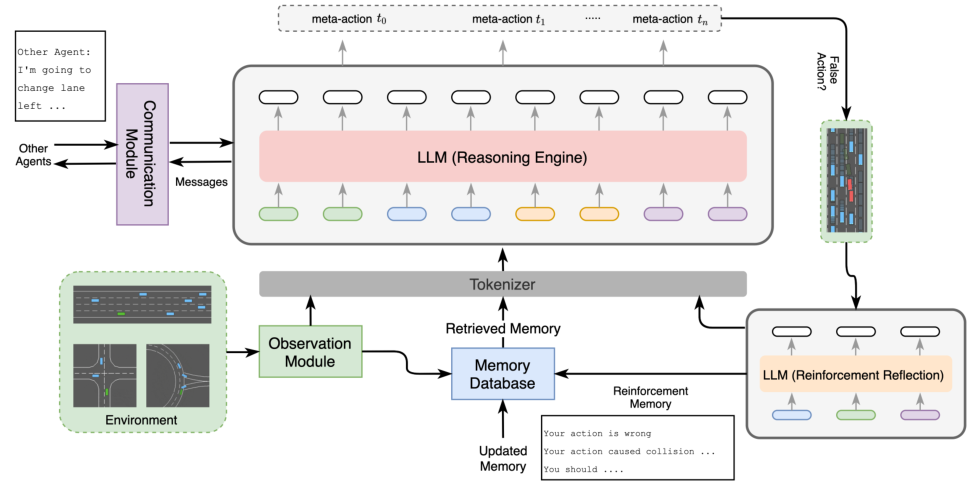
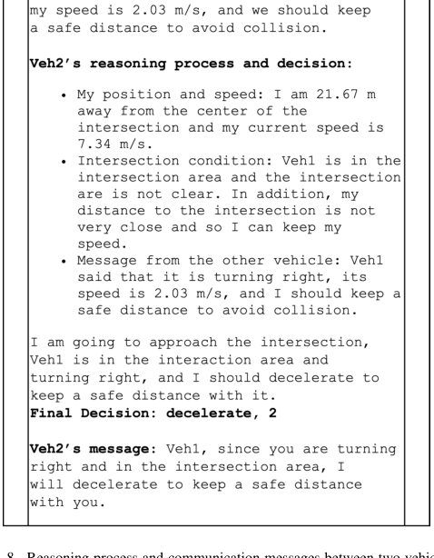

# 车与车商量着开：一个五模块 agent 循环是怎么被拼进多车协同驾驶的

> **全局编号**：85
> **论文**：AgentsCoDriver: Large Language Model Empowered Collaborative Driving with Lifelong Learning
> **作者**：Senkang Hu, Zhengru Fang, Zihan Fang, Yiqin Deng, Xianhao Chen, Yuguang Fang（注：任务简报中列出 5 位作者，漏了 Yiqin Deng；此处 6 位以 PDF 题名页与 arXiv 页面为准）
> **会议/年份**：仍无 venue（arXiv 2404.06345，v1 2024-04-09，v2 2024-04-21；2026-10-09 检索未发现任何录用记录——**确认保持为预印本引用**）
> **arXiv**：https://arxiv.org/abs/2404.06345（PDF 全文 12 页，已通读，含图注表注）
> **代码**：未找到官方代码（正文无仓库链接；第三方论文合集页对该条目标注代码为 None）
> **一句话核心洞见**：把 DiLu 那套"单车 LLM agent（记忆—反思）"的循环原样复制到每辆车上，再给每辆车装一张"嘴"——多车协作就从一个规划问题，变成了一群 agent 用自然语言商量出来的共识；所谓的终身学习，只是这个循环转起来后自然掉下来的副产品。

---

## 先看一个谁也绕不开的场景：路口那两辆车，到底谁先走

论文第 1 页的图 1 画了这样一个场景：veh1 从南向北开到路口想右转，veh2 从西向东开过来想直行。两辆车同时接近路口，谁先走？

这个问题有一个让单车自动驾驶很尴尬的性质：**答案不在任何一辆车自己的传感器里**。veh1 的激光雷达看得再清楚，也只能看到 veh2 的位置和速度，看不到 veh2 打算直行还是转弯、打算让还是抢。veh2 也一样。两辆车各自把感知做到极致，各自规划出"最优"轨迹，结果可能是同时进入路口——因为"对方会让我"这个假设，两边可能同时在做。

人类司机怎么解这道题？看一眼、打个手势、鸣个笛，用某种方式把意图交换一下，然后形成一个共识：你先走，我等着。这不是感知问题，是协商问题。

这就是整篇论文的起点。作者在引言里点名的单车数据驱动方法的三个短板——可解释性差、泛化弱、不会持续学习——都是老生常谈；但他真正想说的是第四个：**单车系统没有和别的车协作协商的能力**，而遮挡、传感器距离限制这些单车系统的先天缺陷，在多车场景下是结构性的，不是把感知模型做大能解决的。路口让行这道题，你感知再强也答不上来，因为它考的不是"你看到了什么"，而是"你们商量出什么"。

所以这篇论文要回答的不是"怎么开好一辆车"，而是"怎么让一群车商量着开"。

## 数据驱动单车方法的三个短板，到了多车场景为什么变得更疼

论文摘要和引言把单车数据驱动方法的短板列了三条。值得细看的是，每一条在多车场景下都会放大，而且放大的方式不一样。

**可解释性**。黑盒网络做决策，出事后说不清为什么。多车场景下这个问题变成"说不清是谁的错"：两辆车相撞，是 A 的规划错了，还是 B 对 A 的意图预测错了，还是通信延迟？如果每辆车的决策过程本身就是不可读的向量运算，事故归因就无从谈起。作者的解法是让决策全程走文字：场景描述是文字，推理过程是文字，车与车之间的消息也是文字。出事了，把三段文字摆出来，错在哪一步一目了然。这是 LLM agent 路线相对端到端黑盒最实在的一个优势，不是口号。

**泛化**。单车场景的长尾已经够长，多车交互把长尾变成了长尾的组合：两辆车的意图组合、三辆车的让行顺序、施工+加塞+行人同时出现。数据驱动方法靠"训练时见过类似场景"来泛化，组合爆炸后"没见过"才是常态。作者赌的是 LLM 的常识推理：没见过"三车同时到四路口"，但见过足够多关于"排队""让行""先来后到"的人类文字，推理能力可以迁移过来。这个赌注是否成立，实验部分会检验——Table II 里 0 shot 的惨烈数字说明，裸 LLM 的常识离直接开车还差得远，真正干活的是记忆模块（后文详述）。

**持续学习**。权重一旦训练完就固化了，新场景要重新训练。多车场景下这个问题更急：别的车的行为模式本身在变（今天这条路上的车普遍开得猛），环境是非平稳的。作者的答案是不碰权重——把学到的东西写成文字存进记忆库，下次遇到类似场景当 few-shot 示例读出来。学习变成了"写笔记"，而不是"调参数"。

## 作者的赌注：不发明新算法，把五个现成的部件拼成一个转得起来的循环

还原一下 2024 年 4 月这个时间点。DiLu（Wen et al., 2023 年 10 月）刚刚把"记忆+自我反思"做进了单车 LLM 驾驶，证明了 LLM agent 在 HighwayEnv 里能开车；MetaGPT、CAMEL（2023）正把"LLM 多智能体协作"炒热，证明了 LLM 之间可以用自然语言分工协作；作者团队自己（Hu, Fang 等）一直在做协同感知（F-Cooper、PACP 等），手里有 V2X 的积累。

作者的赌注就是：**这三件事拼在一起，第一个吃螃蟹**。DiLu 的单车 agent 循环拿过来，每辆车复制一份；多智能体协作的"用语言商量"拿过来，当成车与车之间的通信；协同感知的场景拿过来，当实验场。论文里没有任何一个新的数学工具、没有新的训练算法——D-POMDP 是借的（引了 Bhalla et al. 2020），CoT 是借的（引了 Wei et al.），向量数据库做记忆检索是借的。作者的全部工作是系统设计：五个模块（观察、推理引擎、认知记忆、强化反思、通信）怎么拼、信息怎么流、谁先谁后。

论文第 3 页的表 I 把这个赌注暴露得最彻底。它对比了 Agent-Driver、DiLu、GPT-Driver、LanguageMPC 和 AgentsCoDriver 在六个能力维度上的有无：cognitive memory、self-reflection、reinforcement reflection、collaborative driving、inter-vehicle communication、lifelong learning。前四家在"collaborative driving"和"inter-vehicle communication"两列全是叉。这张表真正想说的是：**这个格子是空的，我来填**。至于填得好不好，那是实验的事；但"第一个填"这个论断，作者在摘要和结论里都写了（大意为：据我们所知，这是首篇把 LLM 用于多车协同驾驶的工作）。

这张底牌有多硬？实话实说：这是工程集成型工作的底牌，硬在"拼得完整、实验转起来了"，不在"数学上无可辩驳"。它的风险也明显：五个模块里每个单拎出来都不是新的，审稿人很容易问"新意在哪里"。作者的回答只能是"组合本身的完整性+多车场景的验证"。这种工作的命运取决于实验是否真的撑得住场面——下面逐模块看时，我会指出哪个模块在实验里真正承重。



图 2 是作者押注的那个画面，值得盯着看一会儿。信息流是这样转的：环境 → 观察模块 → 分词器 → LLM（推理引擎）→ meta-action 序列（t₀…tₙ）。记忆库在侧面，给推理引擎喂"检索到的记忆"；通信模块在左侧，和其它 agent 双向交换消息，消息也喂给推理引擎；右下角是强化反思：meta-action 序列先过一个"False Action?"的判断框，有问题的动作送进 LLM（强化反思），吐出一段文字（"Your action is wrong / Your action caused collision … / You should …"），写回记忆库，变成"强化记忆"。注意这个图的诚实之处：反思的输入是"被判为错的动作"，输出是文字教训——**学习=写检讨，检讨=下次的 few-shot 示例**。整个系统没有一处梯度更新。

---

## 先把协作写进数学：D-POMDP 里那个多出来的通信项到底是什么

论文第 III 节用 Decentralized POMDP with inter-agent communications 给多车协同驾驶建模。公式只有两个，但每个符号都值得停一下：

$$\langle \mathcal{A}, \mathcal{S}, \{A_i\}, \{O_i\}, Z, G \rangle \tag{1}$$

- $\mathcal{A}$：agent 的集合，就是路上那几辆被框架控制的车。
- $\mathcal{S}$：环境的有限状态空间，所有车辆的真实位置、速度等构成的全局状态。注意是"真实"，单个 agent 看不到它。
- $\{A_i\}$：每个 agent 自己的动作空间。关键细节在正文里："CAV $i$ takes action $a_i \in A_i$ to change lane, accelerate, overtake another CAV, **and communicate with each other**"——**通信本身被写进了动作空间**。说话是一个动作，和变道、加速并列。
- $\{O_i\}$：每个 agent 的观测空间， decentralized 的根源：每辆车只能看到自己的那一份。
- $Z$：观测函数，$$Z : \mathcal{S} \times A_1 \times \dots \times A_n \to \Pi(O_1 \times \dots \times O_n) \tag{2}$$ 给定全局状态和所有 agent 的联合动作，每个 agent 会收到什么观测，是一个概率分布（$\Pi$ 表示分布）。观测依赖于联合动作——因为别的车的动作会改变下一时刻的全局状态，从而改变你看到的东西。
- $G$：目标集合，每辆车的目标 $g_i$（比如安全通过路口）。

通信在这个数学架子里落在哪里？论文 IV-F 给了一个极简的刻画：两个 agent 的观测分别是 $o_1$、$o_2$，交换信息后各自的观测变成 $o_1 \cup o_2$。**通信=观测的并集**。超车的例子：后车想超前车，把意图告诉前车，前车的观测里就多了一条"后车想超我"的信息，于是能提前让速避让。

为什么这个形式值得讲？因为它回答了一个"为什么我想不到"的问题：多车协作看起来是个全新的问题，但作者没有发明新数学，而是把"说话"塞进动作空间、把"听到的话"塞进观测，然后整个问题就坍缩回了单智能体 POMDP 的形状——只不过观测变大了。这是一种典型的借力：Dec-POMDP-Comm 在多智能体 RL 文献里是现成工具（论文引了 Bhalla et al. 2020），作者拿它当架子，把工程问题装进去。架子本身不产生新知识，但它让后面五个模块的职责划分有了数学依据：观察模块管 $o_i$，通信模块管 $o_1 \cup o_2$ 里多出来的那部分，推理引擎管策略 $\pi_i$。

## 观察模块：把整个交通场景压成一段结构化文字

观察模块的输入是仿真器给的原始状态，输出是一段**预定义格式的结构化文字描述**。论文 Algorithm 1 的 Prompt Generation 把输入列得很具体：车道数 $L_n$、ego 所在车道 $L_c$、ego 速度 $v$、ego 位置 $(x, y)$，周围车辆 $\{veh_1, \dots\}$ 各自的速度 $v_i$ 和位置 $(x_i, y_i)$，以及收到的消息 $M$。Descriptor 把这些拼成一段文字，大致长这样（示意，格式按论文输入列表还原）：

> Lane number: 3. Ego vehicle: lane 2 (middle), speed 12.5 m/s, position (120.0, 0.0). Surrounding vehicles: veh1 at (145.0, 3.5), speed 10.2 m/s; veh2 at (98.0, -3.5), speed 14.0 m/s. …

这段文字有两个去向：一是送进分词器，成为推理引擎 prompt 的"scenario description"部分；二是被编码成 embedding，去记忆库里召回 top-K 相似记忆。

这里有一个必须指出的取舍：**观察模块在 HighwayEnv 里几乎就是"格式化打印"**。HighwayEnv 直接给的就是结构化车辆状态，不存在目标检测、跟踪、状态估计。所以这篇论文的"感知"和真实自动驾驶的感知之间，还隔着一整个 BEV 感知栈。作者在第 VI 节 limitations 里自己承认了：框架是 text-based，缺乏直接理解视觉信息的能力。这是个诚实分，但读者要清楚——这套方法今天能跑，是因为仿真器把最难的感知问题已经替它做完了。搬到 Bench2Drive 这种带传感器的闭环基准上，"场景描述生成器"本身就是一个待设计模块。

## 推理引擎：一个 prompt 六块积木，加一段自己和自己商量的循环

推理引擎是五个模块里 LLM 味最浓的一个，分三步：prompt 生成、推理过程、运动规划。

**Prompt 的六块积木**（论文图 3）：(1) prefix instruction，前缀指令，告诉 LLM 它的角色和任务；(2) scenario description，观察模块吐的那段文字；(3) few-shot experience，从记忆库召回的 top-K 经验；(4) goal description，目标（比如高速场景是"开得快且不撞"，路口场景是"安全通过"）；(5) action list，可选的 meta-action 列表；(6) 收到的其它 agent 的消息（如果有）。六块拼成一个结构化模板，一次喂给 LLM。

**推理过程**（Algorithm 1 的 ReasoningProcess）是全文最值得细读的一段伪代码：

```
把任务 T 拆成子任务 {T1, …, Tn}
for Ti in {T1, …, Tn}:
    Oi ← LLM(Ti + P)      # 带着当前 prompt 解第 i 个子任务
    P ← P + Oi            # 把中间结论追加回 prompt
生成最终决策 D
```

这就是 chain-of-thought 在这里的落点：不是简单加一句"let's think step by step"，而是**显式的任务分解 + 上下文累积**。prompt $P$ 越滚越长，带着前面子任务的结论继续想下一个。为什么需要这样？论文的理由是驾驶场景的复杂多变，直接让 LLM 输出决策容易产生不准确或幻觉的结果。拆开想，每一步只回答一个小问题（"我和前车距离多少""前车意图是什么""我该加速还是减速"），每一步的答案都写下来，后面可以引用。

**运动规划**其实只有一句话：把决策 $D$ 解码成具体的 meta-action。列表在 Algorithm 1 第 28 行：idle、lane left、lane right、acceleration、deceleration 等，正文还提到 turning left、turning right。注意这里的"规划"和轨迹规划不是一回事——输出的是离散的高层动作，具体怎么执行（方向盘转多少）是仿真器的事。这也是 LLM 驾驶论文在 2024 年的普遍形态：LLM 只做高层决策。

论文第 9 页图 8 给了一个真实的推理片段，值得转述：veh2 距路口中心 21.67 米、车速 7.34 m/s；它判断路口区域不净空、自己离路口还有距离可以保持车速；然后它引用了收到的消息——veh1 说自己正在右转、车速 2.03 m/s，要求保持安全距离；最终决策是 **decelerate, 2**，并回了一条消息确认让行。注意决策格式：meta-action 后面跟了一个数字"2"。这个数字是什么含义（强度档位？优先级？），**论文全文没有定义**，记为未确认。这是复现时的一个暗坑。



---

## 认知记忆：三种记忆各存什么，recall 时到底在比什么

记忆模块分三层，每层存的东西不一样，这个划分是整篇论文里最值得抄走的设计之一：

- **常识记忆（commonsense memory）**：开车的基本知识——交规、驾驶规则、注意事项。常驻，不随经验增长。
- **经验记忆（experience memory）**：过去的驾驶场景，每个条目包含**场景观测 + 对应动作 + 推理过程**。注意第三项：存的不只是"当时做了什么"，还有"当时是怎么想的"。这让 few-shot 示例自带推理链，LLM 读到的是"这种场景下应该这么想"，而不只是"这种场景下应该这么做"。
- **反思记忆（reflection memory）**：reflector 的产出，每个条目包含场景描述、有效的推理过程、正确的决策、**学到的教训**。这是"错题本"，而且是带订正过程的错题本。

**Recall 机制**：把当前场景描述编码成 embedding；记忆库里的每条记忆按"场景描述部分"编码成 embedding；在 embedding 空间里算相似度，返回 top-K。这里论文没写两个关键细节：**用的哪个 embedding 模型、相似度度量是什么**（余弦？点积？）。复现缺口，记为未确认。

**初始化**：论文原话是"we first initialize the memory manually"——先手工挑一些场景，手写决策和推理过程写进经验记忆；再挑一些错误场景，手写教训写进反思记忆。起点不是自举的，是人工冷启动的。这一点对理解"终身学习"实验至关重要，后文怀疑式审读会展开。

**承重证据**：表 II 是记忆模块的承重证明。记忆库初始化 10 个条目，shots 从 0 加到 5（即 recall 0/1/3/5 条记忆当 few-shot），SSmean（平均成功步数，满分 30）的变化：高速双车 4.2→13.5，高速单车 5.6→17.3，路口双车 8.2→17.6，路口单车 7.1→19.6。**0 shot 时全线低于 10 步**——裸 GPT-3.5-turbo 直接开车，开不到 10 秒就撞。作者的原话是 LLM 不经 adaptation 无法直接执行驾驶任务，而记忆模块就是那个 adaptation。消融掉记忆（0 shot），系统塌得最狠，所以记忆是承重墙。五个模块里，如果只能留一个，留它。

---

## 强化反思："强化"两个字到底是什么意思

这是论文标题里"lifelong learning"的机制来源，也是最容易被名字误导的模块。先看结构：两个 LLM 实例。

- **Evaluator $E$**：扮裁判。输入是环境观测 + agent 的输出（决策+推理过程），输出一个 **reward score**，表示这次决策好不好。
- **Reflector $R$**：扮复盘教练。输入是 $E$ 给的 reward、agent 的决策和推理过程、场景描述，输出**文字版的强化反馈**：错在哪、教训是什么、以后怎么做、正确的决策应该是什么。然后这段文字存进记忆库的反思记忆。

"强化"二字的真相：**这不是强化学习**。传统 RL 的 reward 是数字，进梯度、更新权重；这里的 reward 是文字（外加一个没公布量表的分数），进记忆库、下次当 few-shot 读出来。用 Hinton 的白话说：传统 RL 是"错了就调突触"，这里是"错了就写检讨，检讨贴墙上下次照着念"。论文自己也明确区分了它和传统强化学习的不同，这个区分是诚实的。

消融实验（表 IV，单车、5 shots）：去掉反思模块，SSmean 9.5；加上，SSmean 17.5，中位数从 5.0 涨到 14.0。效果是真实的——错题本确实比只记对题管用。

但有三个问题论文没回答。第一，**$E$ 的打分标准是什么**？reward score 的量表多大、阈值在哪，全文没写。裁判本身也是 GPT-3.5-turbo，它有没有判错？没有人类校验，没有裁判一致性实验。第二，**反思的触发频率**：图 2 里 meta-action 序列先过一个"False Action?"判断框，看起来是每步都检查；正文的描述也是决策生成后就走 evaluator 和 reflector，像是每步都跑。这意味着**每做一次决策，至少调三次 LLM**（推理一次、裁判一次、反思一次），延迟和 token 成本 triple。第三，"False Action?"这个框谁说了算？按图是反思模块自己看动作序列判，但判据没写。复现时这三处都是暗坑。

---

## 通信模块：什么时候开口、开口说什么

论文把通信拆成两个问题，拆法本身比答案更有价值：**when to communicate** 和 **what to communicate**。

**When**：agent 自己每步决定。没有手工规则（比如"距离小于 50 米就说话"），没有阈值——论文把"要不要说话"也交给了 agent 自己的 LLM 来判断。这很符合 agent 范式的审美，但代价是每步多一次 LLM 调用，而且 LLM 可能该说的时候不说。

**What**：消息生成器是另一个 LLM 实例，被当成"工具"来调用。输入三样东西：当前场景编码、收到的其它 agent 消息、**上一步动作**。输出是自然语言消息。生成用的结构化模板分四部分：prefix instruction、action history、dialogue history、scenario description——注意有 dialogue history，说明支持多轮对话上下文，不是每轮都从零开始。

关键判断：**消息是自然语言，不是结构化协议**。协商没有任何回合制状态机、没有投票、没有拍卖、没有共识算法——就是两段文字来回。图 8 的实例转述：veh1 发消息说"我正在右转，车速 2.03 米每秒，请保持安全距离避免碰撞"；veh2 收到后决定减速，并回消息"veh1，你在路口区域右转，我减速和你保持安全距离"。这就是全部的"协商协议"。它能成立的原因不是协议设计得好，而是 LLM 读得懂意图、讲得出承诺。

效果（表 V，路口场景，背景车减到 1 辆以隔离干扰）：3 辆被控车，SR 从 45.0% 涨到 75.0%（+66.7%）；5 辆被控车，SR 从 40.0% 涨到 70.0%（+75.0%）。通信确实把成功率抬起来了。但注意实验条件：这是"去干扰版"的设置，主实验（表 II）里背景车是 15 辆。两个数字回答的是不同问题，拼在一起看才完整，后文会讲。

---

## 走完全程：双车窄路会车，五个模块各做什么

下面用论文的机制走一个具体场景。场景：一条单车道双向窄路，长 40 米，两端各有一个拓宽的错车点；车 A 从东向西、车 B 从西向东同时接近。窄路一次只能过一辆车，谁先进谁就先过，后进的要在错车点等。只看车 A 在第 $t$ 步的一个决策周期（数字为示意，按论文的输入格式构造）：

**第 1 步：观察模块**。输入是仿真器状态，输出结构化文字描述：

> Lane number: 1 (single lane, two-way). Ego vehicle A: speed 8.0 m/s, position (60.0, 0.0), heading west. Narrow section: from x=20 to x=60. Vehicle B: position (5.0, 0.0), speed 7.5 m/s, heading east. Distance from A to narrow entry: 0 m (at entry). Distance from B to narrow entry: 15 m.

这段文字同时做两件事：送分词器，准备进 prompt；编码成 embedding，准备去记忆库召回。

**第 2 步：认知记忆 recall**。embedding 相似度取 top-3（设 shots=3），召回的条目大致是：

1. 经验记忆："场景：双车道变单车道施工路段，对向来车距入口 20 米；动作：deceleration，在入口前停下等待；推理：对向车先到入口，按先到先行让其先过。"
2. 反思记忆："教训：上次与对向车同时进入窄路段，双方在中段相遇无处错车，episode 失败；正确做法：进入前先确认对向车意图，必要时停车等待。"
3. 常识记忆："窄路会车时，接近障碍物（此处为窄路入口）一方应让行。"

注意第 2 条是"错题本"在起作用——它直接把"同时进入=死路"这个教训摆到了 prompt 里。

**第 3 步：推理引擎**。六块积木拼成 prompt：前缀指令（"你是驾驶 agent，目标是安全高效通过"）+ 上面的场景描述 + 召回的三条记忆（few-shot）+ 目标描述 + 动作列表（idle, acceleration, deceleration, …）+ 收到的消息（本轮暂无）。CoT 拆成子任务逐个想：

- T1（算时间）：B 距入口 15 米、车速 7.5，约 2 秒后到达；A 已在入口。
- T2（判冲突）：双方都要进同一段窄路，轨迹冲突成立；且记忆第 2 条警告过同时进入的后果。
- T3（做决策）：A 虽然先到入口，但 B 速度快、2 秒即到，此时进入会在中段相遇；正确动作是 deceleration，在入口停车等待。

输出决策：**deceleration**（在入口等待）。

**第 4 步：通信模块**。when：agent 判断存在轨迹冲突，决定说话。what：消息生成器输入=当前场景编码 + 对话历史（空）+ 上一步动作（deceleration），输出自然语言消息。A 发给 B：

> "我是车 A，从东侧到达窄路入口，当前已停车等待。你距入口约 15 米，请先通过窄路，我等你出来后再进入。"

B 收到后，它的下一轮 prompt 里就多了一块"收到的消息"。B 的推理引擎读到：A 已停车、明确让行 → B 的决策从"犹豫"变成"acceleration，通过窄路"，并回消息确认：

> "收到，我先通过，预计 6 秒后驶出。"

A 在下一轮把 B 的回复并入 prompt，维持等待决策，直到 B 驶出。协商完成：两段文字，一个共识（B 先过），零碰撞。

**第 5 步：强化反思**。本轮 A 的决策（停车等待）+ 推理过程送进 evaluator $E$，打分（示意：8/10，量表论文未公布）；reflector $R$ 生成文字反馈，写入反思记忆：

> 场景：窄路会车，对向车 2 秒后到入口。决策：在入口停车等待并先发消息让行。结果：B 顺利通过，无冲突。教训：进入窄路前先用消息确认对向车意图，比单纯靠距离判断更可靠；已验证：等待+先声让行策略有效。

下次再遇到窄路，recall 出来的就是这条"带验证"的经验。

**同一场景，基线走一遍**（无通信、无记忆的单车 LLM，第 2 步即分叉）。第 $t$ 步，A 的观察模块输出同样的场景描述，但没有记忆召回、没有 B 的消息。A 的推理：B 距入口 15 米，"还远，无即时冲突"，决策 acceleration，进入窄路。B 那边对称地想了同样的事：A 在入口处速度 8，"它可能会让我"，决策也是进入。第 $t+2$ 步，两车在窄路中段相遇，无处错车——episode 失败。基线死在哪一步？死在第 $t$ 步的**意图不可观**：A 的观测里没有 B 的意图，B 的观测里也没有 A 的意图。双方都基于"对方会配合"的假设做了最优决策，两个局部最优拼出一个全局死局。这个失败是结构性的：不给 A 一个看到 B 意图的通道（通信），调什么参数都救不回来。这正是论文开头那个路口场景的论点，也是通信模块存在的全部理由。

---

## 怀疑式审读：论文没说全的几件事

**"终身学习"到底验证了多少**。这是全文最需要较真的一处。图 6 的横轴是**记忆条目数**（10→40），不是时间轮次。高速场景下，SSmean 从不足 18 涨到 23 出头，SR 从 40% 出头涨到不足 75%；路口场景两条线也都往上走。数字本身没问题，但它证明的是"记忆越多，few-shot 示例越多，效果越好"。而第 IV-D 节明确写了记忆是**手工初始化**的（"we first initialize the memory manually"），第 V-D 节只说"we set the number of memory items to 10, 20, 30, and 40"，**没有说这 40 条是 agent 自己在线跑出来的**。两种读法：(a) 研究者手工多写了 30 条记忆——那这就是一条 few-shot 规模曲线，和"终身"无关；(b) agent 在线交互积累——那论文欠我们一条"第 N 轮比第 N-1 轮好"的纵向证据，而这条证据没有出现。按文本证据，更接近 (a)，至少无法区分。所以诚实的表述是：论文验证了"记忆库越大效果越好"，没有验证"agent 越开越聪明"。标题里的 Lifelong Learning，目前只是"能把学到的东西存下来"，"持续变好"的那一半还没被证明。

**对照基线的强度**。全文唯一的量化对照是 DiLu（表 III，20 条记忆、1/3/5 shots 三档）。结果是全赢：Setting1 中位数 7.0→10.0，Setting2 中位数 9.0→12.0，Setting3 中位数 12.0→15.0。但 DiLu 是**单车**方法。论文最核心的 claim——多车协作协商——**没有任何外部基线**：表 I 里另外四家本来就没有 collaborative driving 这一列，等于和空气比。摘要里的"show the superiority … to existing approaches"，证据只覆盖了单车维度。多车部分，通信消融（表 V）证明的是"有通信比没通信好"，这是一个自对照，不是和现有方法的对照。

**表 II 里那个尴尬的数字**。5 shots 下，高速场景双车 SSmean 13.5、单车 17.3；路口双车 17.6、单车 19.6——**双车全线低于单车**。作者给了个解释：背景车设了 15 辆且行为不导致碰撞，而被框架控制的车有不可忽略的碰撞概率，被控车越多，撞上的概率越高，所以双车反而低。这个解释是合理的，而且作者没有藏这个数字，值得肯定。但它反过来暴露了框架的绝对碰撞率不低：5 shots 下单车也只能开 17~19 秒（满分 30 秒）。然后在 V-E 节，作者把背景车减到 1 辆，重新测"被控车之间"的协作增益，才得到表 V 的 SR 45%→75%。两个实验回答的是不同问题：表 II 回答"系统整体开得怎么样"，表 V 回答"通信对被控车之间的协作有没有用"。拼在一起看才是完整的，单独看任何一个都会误判。

**统计与复现**。每组重复 10 次、报告四分位数（SSmin/Q1/median/Q3/max/mean），比只报均值好；但随机种子没给、没有误差棒、SR 的分母（总 episode 数）没写。复现缺口清单：embedding 模型未指明、相似度度量未指明、reward score 的量表和阈值未写、"decelerate, 2"里数字 2 的含义未定义、prompt 全文未公开、代码未公开。按 skill 的标准，这些缺口意味着第三方很难一比一复现数字。

**延迟，作者自己认了**。第 VI 节原话：框架不是实时的，生成一次输出需要 several seconds。决策频率 1Hz，GPT-3.5-turbo 每步至少三次调用（推理、裁判、反思），再加通信时的消息生成。离车载实时差两个数量级，作者把它列为首要 limitation，没有糊弄。做得好的地方也记一笔：表 II 里 0 shot 的惨烈数字敢原样放出来（很多论文会藏起这种"裸模型不行"的证据），双车不如单车的反直觉结果给了合理解释而不是藏起来。

---

## 可迁移想法：从这篇论文能带走的几颗种子

**反思不必在线，改成事件驱动能省掉三分之二的调用**。他们的 evaluator+reflector 每步都跑，是为了撑"终身学习"的故事。实际系统中，决策正确的步骤不需要反思——只在失败、接管、风险校验拦截时触发一次反思，把"场景+错误决策+正确决策+一句话教训"写进反思记忆。平时只记经验。这样既保留了错题本，又避开了每步三倍 LLM 调用的延迟坑。

**"说话"是一种动作，这个建模技巧可以直接借**。D-POMDP 把 communicate 写进动作空间、把收到的消息写进观测——多规划器调度可以照抄：调度器向每个规划器发"提案请求"就是一次通信动作，规划器返回的提案与理由就是观测的一部分。一旦这么写，多规划器协商就有了现成的数学架子，不用从零发明。

**经验记忆要存"怎么想的"，不只存"怎么做"**。这篇论文记忆设计里最值得抄的细节：experience 条目包含推理过程。few-shot 示例带推理链，比只带"场景→动作"标签管用得多，因为 LLM 学到的是思考模板，不只是动作映射。做情景记忆时，每条记忆存"场景+推理摘要+动作+结果"，召回时一起读出来。

**Evaluator 是" learned reward"的极简版**。用 LLM 当裁判打分、再把文字反馈入库——这是 RLAIF 在驾驶上的雏形。闭环风险校验可以借这个思路：校验器不只输出 pass/fail，还输出一句话"为什么拦"（比如"右侧车辆意图不明，减速决策依据不足"），这句话直接进反思记忆。校验器就从"守门员"变成了"教练"。

**协商不需要复杂的协议**。两段自然语言来回就解决了路口让行——没有投票、没有拍卖、没有共识算法。对多规划器协商的启示：先别急着设计复杂的仲裁机制，让每个规划器用结构化文本陈述提案和理由，调度器（LLM）做仲裁，可能就够了。复杂机制是优化，不是起点。

---

## 与本课题的关联：五模块循环如何装进"世界模型+情景记忆的多规划器 Agent"

**观察模块 → 感知**。他们的观察模块拿的是仿真器直接给的结构化状态，约等于"格式化打印"。用户课题要从 BEV/传感器来，中间差一个"场景描述生成器"。但他们的 Descriptor 格式（车道数、ego 状态、周围车辆位置速度列表）可以直接作为这个生成器的**目标输出格式**——感知模块的交付物就是这样一段结构化文字，后面所有模块都只认这个格式。这给了用户课题一个清晰的模块接口定义。

**认知记忆 → 情景记忆**。三层划分（常识/经验/反思）可直接借用，每层的写入来源也对应得上：常识=交规与驾驶知识，常驻；经验=世界模型 rollouts 与实车交互的场景+决策；反思=闭环风险校验拦截下来的失败案例。但有一个关键差异：**他们的 recall 是纯相似度 top-K，没有时间维度**。用户课题的"自适应衰减"正好补上这一块：经验会过时（别的车换了驾驶风格、上次有效的让行策略这次失效），反思条目的置信度应随"被验证次数"增减。互补关系很干净：**他们只做加法（记忆越多越好，图 6 的 40 条还在涨），用户课题做"加权遗忘"**——给每条记忆加时间戳和置信度，衰减按时间和验证结果走，定期清理低置信度条目。这篇论文的实验恰好暴露了"只加不减"的隐患：涨到 400 条时 recall 还准不准、过时经验会不会污染决策，论文没有回答，而这正是用户课题衰减机制要回答的。

**强化反思 → 闭环风险校验后的失败案例回灌**。映射几乎是一一对应的：他们的 evaluator≈风险校验器（判决策好不好），reflector≈失败分析器（生成文字教训），反思记忆≈失败案例库。差异在触发方式：他们是每步在线跑三遍 LLM，用户课题可以只在风险校验拦截或失败时触发一次反思——这正是用户课题"场景驱动动态模块旁路"思想的一个具体落点：**反思模块平时旁路，事件驱动时接入**。既保留了终身学习，又避开了延迟坑。

**通信模块 → 多规划器协商**。车与车协商 vs 规划器与规划器协商，when/what 两问可以直接平移：调度器决定"要不要让规划器们讨论"（when，比如两个规划器提案冲突时），规划器用结构化文本提交提案+理由（what），调度器做最终仲裁。一个有利差异：车与车是真分布式，通信有成本不敢多轮；规划器在同一进程里，通信零成本，**可以做多轮 debate**（提案→质疑→修正→再提案），这是用户课题可以比这篇论文做得更深的地方。另一个差异：他们的消息是纯自然语言；多规划器协商建议用"结构化提案（轨迹+风险评分+理由）+自然语言讨论"的混合形式，仲裁时可审计。

**终身学习 vs 自适应衰减：一对互补，不是替代**。他们的终身学习=只存不忘，用户课题的衰减=带遗忘的学习。真实驾驶需要两边：新场景的教训要存下来（他们的强项），过时的经验要降权（他们的盲区）。一个具体的结合点：反思入库时带时间戳和初始置信度；每次该条记忆被 recall 并导向成功决策，置信度上调；导向失败或长期未被 recall，置信度按时间衰减。**衰减的权重更新规则，可以从他们 evaluator 的 reward score 思想里来**——只是把"裁判打分"从在线 LLM 改成"闭环验证结果"（这次决策最终撞没撞、被没被接管），更便宜、更诚实。

**落差提醒**。他们的"多车"是 HighwayEnv 文本状态 + 1Hz 决策 + GPT-3.5-turbo 三遍调用；用户课题是 Bench2Drive 闭环基准 + 边侧实时约束。这篇论文给不了时延优化的答案——它自己都承认要 several seconds。用户课题已经规划的四项时延优化（世界模型中间分布复用、分层粗细检索、场景驱动动态模块旁路、异步流水线+时间戳运动学补偿）是必须自己啃的硬骨头。这篇论文的价值在**系统结构**（五个模块怎么拼、信息怎么流、记忆怎么分层、协商怎么做），不在性能数字。读的时候取其骨架，别信其肌肉。
