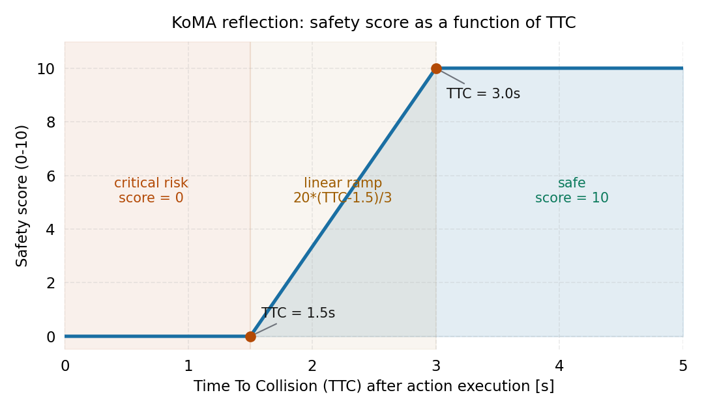

# 「不开口，只读心」：KoMA 让每辆车用 LLM 互相揣测意图的多智能体驾驶

> **全局编号**：82
> **论文**：KoMA: Knowledge-driven Multi-agent Framework for Autonomous Driving with Large Language Models
> **作者**：Kemou Jiang, Xuan Cai, Zhiyong Cui*, Aoyong Li, Yilong Ren, Haiyang Yu, Hao Yang, Daocheng Fu, Licheng Wen, Pinlong Cai*（*为通讯作者；单位按 PDF：北航智能交通系统国家重点实验室/交通科学与工程学院、约翰霍普金斯大学土木与系统工程系、上海人工智能实验室）
> **会议/年份**：**已确认** IEEE Transactions on Intelligent Vehicles（通讯作者蔡品隆个人主页 publications 栏列为 TIV 2024；第一作者崔志勇主页亦列 IEEE TIV 2024；Science China Information Sciences 综述引用为 IEEE Trans. Intell. Veh., 2025, vol 10, pp. 4655–4668——期刊在线发表在 2024、纸质卷号归属 2025，正式引用建议写 IEEE Trans. Intell. Veh., vol. 10, pp. 4655–4668, 2025）
> **arXiv**：[2407.14239](https://arxiv.org/abs/2407.14239)（v1，2024-07-19，cs.AI；PDF 共 13 页）
> **代码**：未找到官方代码。项目页（https://jkmhhh.github.io/KoMA/）只放了演示视频，没有仓库链接；论文正文也没有给出代码地址
> **一句话核心洞见**：多智能体驾驶最难的不是"怎么开"，而是"他车想干什么"——KoMA 的赌注是，让每辆车上的 LLM 从文本场景描述里**揣测**他车意图（而不是真的通信），再用"目标-计划-动作"三层链条锁住长短决策的一致性，最后靠"安全/效率打分+事后反思"把犯过的错变成共享记忆；40 轮带反思的试错，顶过了 MARL 的 4 万轮训练。

---

## 一个具体的撞墙现场：单智能体 LLM 在"他车意图"上是怎么翻车的

先把时间拨回 2024 年初。当时 LLM 驾驶 agent 的代表作是 DiLu（Wen et al.，ICLR 2024）：一个单智能体框架，三个部件——记忆（存历史经验）、推理（每帧做决策）、反思（撞了之后复盘）。DiLu 在高速公路直行、环形跟车这类场景里跑得不错，论文里报告的泛化能力压过了一批强化学习方法。

但 DiLu 有一个结构性的盲区：**它只给自己开车，从不认真琢磨别的车想干什么。** 在直行场景里这无所谓——周围的车各开各的，互不干扰。可一旦进入有冲突的场景，这个盲区就致命了。

论文选的试金石是**高速公路匝道汇入**：一辆车在匝道上，限时内必须并进主路；主路上有车在开，两边的目标直接冲突。主路车想保持速度直行，匝道车想挤进主路。这一刻，决策的关键不再是"我这帧往哪打方向"，而是"我左边那辆车是打算让我，还是打算抢在我前面"。

DiLu 式的单智能体推理在这里会怎么翻车？它的推理模块有两种工作方式，论文在引言里把两种的毛病都点名了：

- **单帧决策**（每帧只看当前场景描述，直接输出下一帧动作）：没有远见。匝道车这一帧看到左边有空隙就并线，下一帧发现那辆车其实在加速，空隙没了——决策只顾眼前，掉进局部最优。
- **一次性多步规划**（一次输出未来若干帧的动作序列）：没有应变。计划做好了，场景一变（旁边那辆车突然变道），整套计划作废，目标完不成。

注意这两个毛病的对称性：一个是"想得太短"，一个是"想得太死"。作者没有二选一，而是提出第三条路：**分层**。先定目标（我要限时汇入），再定计划（等后车过去再并，还是加速抢到前车前面），最后才落到这一帧的动作。计划可以随着场景变化重做，但目标不动——长短决策就被同一根线穿起来了。这是多步规划（multi-step planning）模块的来历：不是拍脑袋加的，是被上面这对矛盾逼出来的。

第二个撞墙点更隐蔽：**反思只在撞车后触发**。DiLu 的反思模块是"撞了才复盘"。但在长序列决策里，出事的那一帧往往不是犯错的那一帧——真正的错误可能发生在十几帧之前（比如三帧前就不该加速）。等撞了再回头找，根因定位很难。KoMA 把反思的触发条件从"撞没撞"改成了"分数掉没掉"：每一帧的动作执行后都打两个分（安全分、效率分），场景结束后把低分帧挑出来反思。这就是"排序式反思"（ranking-based reflection）名字的由来：先给所有决策排个序，再决定反思谁。

## 从 DiLu 到 KoMA：作者到底加了哪几样东西

论文的 Fig.1 把单智能体和多智能体两套图并排画出来，值得细看。单智能体那一半就是 DiLu：环境、驾驶员 agent（回忆/推理/反思）、独立记忆。多智能体那一半，在 driver agent 之间加了一个 **Interaction** 框，记忆从"每个 agent 独立"变成了"共享"。

KoMA 自称五个模块：环境（Environment）、多智能体交互（Multi-agent Interaction）、多步规划（Multi-step Planning）、共享记忆（Shared Memory）、排序式反思（Ranking-based Reflection）。环境模块负责把仿真状态转成**文本场景描述**——这是整个框架的地基：LLM 看不到图像、看不到张量，它看到的是一段英文，描述"我在哪、多快、周围有谁"。后面所有模块都在文本上工作。

这里要先纠正一个容易被标题误导的期待。看到 "Multi-agent Framework"，读者自然会想：几辆车上的 LLM 互相发消息、讨价还价、达成共识。但 KoMA 的"交互"**不是通信**。论文 III-B 节写得很直白：agents do not interact directly with each other。所谓的交互，是每个 agent **独立地**分析他车的历史和当前状态，**猜**他车的意图——就像人类司机开车时做的那样：看到左边的车突然加速，心里想"他要超车"，然后决定自己是让还是抢。

这个设计选择值得停下来想一想。为什么不让 LLM 们直接对话？论文没有明说，但可以从约束条件里推出两条理由。第一，真实驾驶中车与车之间本来就没有语言通道，人类司机靠的也是观察和揣测——作者要的是"像人一样开车"，直接通信反而偏离了仿真目标。第二，LLM 之间传自然语言消息，通信开销和"幻觉传染"都是麻烦：A 车的一个错误判断写成文字发给 B 车，B 车把它当事实吃进去，错误会在 agent 之间放大。隐式交互把每辆车的推理关在自己的提示词里，至少错是各错各的。

但反过来说，这个"多智能体交互"的水分也要看清楚：它本质上还是**单智能体推理**，输入里多了一段"他车意图分析"。两辆 LLM 车之间没有任何信息交换，各自对着同一份场景文本做阅读理解。Fig.1 里画在两个 driver agent 之间的那个双向 Interaction 箭头，画得比实际做的事要热闹。记住这一点，后面看实验数字时才不会被"多智能体协同"这个词带偏。

## 「左边那辆车突然加速了」：意图揣测在提示词里长什么样

交互模块的输入是环境给的文本场景描述。论文没有公开完整的提示词模板（这是复现层面的一个缺口，后面会细说），但从 III-B 节的例子可以还原出它的工作方式：

> 当 LLM 驾驶的 agent 感知到左边的车辆突然加速，它会进一步分析推理，猜测这辆车的意图是超车，然后把这个猜测和自己的计划放在一起，看要不要调整短期计划。

把这个过程翻译成人类司机的版本：你在最右车道开，左后视镜里一辆车油门声起来了、速度表上它的相对速度在涨。你不会等它并到你前面才反应，你在它加速的第 1 秒心里就已经写好了剧本——"他要超我"。KoMA 要求 LLM 做的就是这件事：**从运动状态的时间序列里读出意图**。

这里有一个关键的表示问题：LLM 看到的不是视频，而是一段文字，里面是离散的数字（位置、速度、加速度）。"突然加速"在文本里长什么样？是这一帧加速度 0.00、下一帧 1.38（论文 Fig.3 的例子里自车加速度就是 1.38 m/s²）。LLM 要从这些数字里算出"它在加速"，再从"它在加速"推出"它想超车"。这一步完全依赖 GPT-4 的常识推理——没有任何专门训练的意图预测模型。作者的赌注是：**预训练语言模型里关于"开车"的常识，足够支撑这种揣测**。

这个赌注的风险点也很直白。第一，文本描述是离散的、低频的（决策频率 2Hz，即每 0.5 秒一帧），很多意图的微表情（方向盘的小抖动、车头的轻微偏转）在文本里根本不存在——揣测的输入本身就是有损压缩。第二，LLM 的"常识"来自互联网文本，不是驾驶学校；它对"加速=超车意图"的判断是统计直觉，不是物理模型。在简单场景里这够用，在对抗性强的场景里（比如对方故意晃你），这种揣测会系统性失效。论文的实验没有测对抗场景，这是留白。

## 目标-计划-动作：三层链条是怎么锁住"前后决策说同一件事"的

多步规划模块是论文里写得最细的部分，也是 Fig.3 那个长案例的全部内容。它的结构是 **GPA：Goal（目标）→ Plan（计划）→ Action（动作）**，外加计划制定时的四个子步骤。用论文自己的匝道例子从头走一遍，整个机制就清楚了。

**场景**（Fig.3 左侧的文本描述）：你在高速入口匝道上，已经到了可以并入主路的路段，匝道尽头在 115.50 米外，你必须在到达尽头前左转并入。你在 3 车道的最右车道，位置 `(231.00, 8.00)`，速度 21.51 m/s，加速度 0。周围：96 号车在你左侧车道与你并行，位置 `(235.71, 4.00)`，速度 21.79；488 号车在你左前方，位置 `(253.83, 4.00)`，速度 21.38。

**第 1 层：定目标。** 论文把目标分成两类。特殊场景目标（special scenario goals）：这个场景限时要办成的事——"在到达匝道尽头前安全并入高速"。一般场景目标（general scenario goals）：长期悬在那里的要求——"安全、高效地开"。LLM 先读场景描述，判断出"这是匝道汇入场景"，于是目标就定为"限时安全汇入"。这一步看起来 trivial，但它是整条链的锚：后面所有的计划和动作都要回过头来问"这一步离目标近了还是远了"。

**第 2 层：定计划。** 这是四步走：

1. **头脑风暴**：列出所有可行且互不相同的计划。例子里 LLM 列了两个：(a) 加速，抢到 96 号车前面并入；(b) 保持当前速度（IDLE），等一个安全空隙，可能跟在 96 或 488 后面并入。
2. **逐个打分**：每个计划从安全和效率两个维度打 0–10 分。加速抢行：安全 6、效率 8（"能利用小的速度差抢到前面，但有超速风险"）；等空隙：安全 9、效率 7（"不冒超速风险，找空隙并入"）。
3. **排序**：按打分和场景排个先后。等空隙的计划安全分更高，排前面。
4. **选一个**：选中"保持速度等空隙"作为指导后续决策的计划。

注意这里已经出现了一次"排序"思想——反思模块的"排序"是它的镜像：一个在决策前给计划排序，一个在决策后给已执行的动作排序。论文没有明说这两处排序的内在联系，但结构上它们是同一枚硬币的两面：**用同一套安全/效率标尺，在决策前后各卡一次**。

**第 3 层：选动作。** 动作空间只有 5 个离散动作：左转、IDLE（保持车道和速度）、右转、加速、减速。LLM 结合当前场景和已选定的计划，输出这一帧的动作。例子里选了 IDLE，理由写得很具体：离匝道尽头还有 115.50 米，当前速度下保持速度是最稳的，不提前变线，给自己留观察交通流的时间。

还有一条容易漏掉的逻辑：**如果上一帧已经有计划了怎么办？** 论文的处理是：LLM 先结合交互模块的他车意图分析，检查旧计划是否还可行；可行就沿用，不可行就重做。这就是 GPA 链条的"重规划"（replanning）入口——它回答了引言里"一次性多步规划怕场景突变"的问题：计划不是一次定死的，每帧都可以根据他车意图的变化推翻重来。代价是每帧都要跑一遍 LLM 推理，2Hz 的决策频率下，GPT-4 的调用量相当可观（论文对成本只字未提，后面会算这笔账）。

## 从"撞了才反思"到"分数一掉就反思"：那块记分牌到底怎么打分

反思模块是 KoMA 相对 DiLu 改动最大的一处，也是"排序式"（ranking-based）这个名字的直接来源。DiLu 的反思是二值的：撞了→反思，没撞→不反思。KoMA 把它改成了连续的：**每一帧的动作执行完都打两个分，场景结束后再看分数单**。

**安全分**用量化的 TTC（Time To Collision，碰撞时间）算。公式是分段函数：

$$\text{Safety}_{score}(t) = \begin{cases} \frac{20(\text{TTC}(t)-1.5)}{3}, & 1.5\text{s} < \text{TTC}(t) < 3\text{s} \\ 10, & \text{TTC}(t) > 3\text{s} \\ 0, & \text{其他} \end{cases}$$

翻译成人话：动作执行后，如果算出来的 TTC 大于 3 秒，满分 10；小于 1.5 秒，0 分，直接判高危；在这之间，线性插值。验算一下连续性：TTC=3 时，20×(3−1.5)/3=10，正好接上满分档；TTC=1.5 时得 0，接上 0 分档——函数在两个 kink 点都连续，设计是自洽的。画出来就是下面这张图：1.5 秒和 3 秒是两个阈值，阈值之间是一条直线。


*图：安全分随 TTC 的变化。两个 kink 点（1.5s、3s）引自论文对"临界风险"和"最优安全"的界定（参考文献 [37]–[39] 的 surrogate safety 文献）。*

**效率分**用的是速度：把自车速度跟周围车辆的平均速度比。如果自车速度超过平均速度，得满分 10；如果低于平均速度，论文文字说"效率分是自车速度与平均速度的比值再缩放到 10"。

这里必须指出一个**论文的排版问题**：正文里印出来的效率公式只有两档——

> Efficiency_score(t) = 10, if V_LLM(t) > V_Avg(t)；0, otherwise

——"低于平均就得 0 分"，这和紧接着的文字描述（"低于平均时按比值缩放"）直接矛盾。合理的公式应该是三档：高于平均得 10，低于平均得 10×V_LLM/V_Avg。排版里大概率丢了一行 LaTeX 的 case。这不是小事：反思模块的"排序"完全依赖这两个分数，如果效率分的定义本身在正文里是坏的，读者就无法确切知道实验里用的到底是哪一版。审稿视角下，这是一个应该被揪出来的不一致，本文档按文字描述（比值缩放版）理解，并在引用时注明此处存疑。

**反思的触发和执行**（Fig.5）：场景结束后（到达终点或发生碰撞），反思 agent（也是 GPT-4 扮演的另一个角色）拿到整场动作的分数单。论文给的例子里分数单是：#0（安全 10，效率 10）、#1（2.8，10）、#2（4.4，8.9）、#3（6.7，8.2）、#4（8.1，6.3）。反思 agent 把低分项（#1、#2 这种）挑出来，用"当时的场景描述+当时的推理过程"做输入，让 LLM 解释错在哪、给出修正后的决策，然后把"修正后的经验"和"原本就高分的经验"一起写进共享记忆。

关键的一句在 III-E 末尾：**只有高分经验和被修正过的经验会被保留**。低分且没被修正的（或者说反思 agent 认为改也没意义的）直接丢弃。记忆库的质量就靠这一道过滤器守着。但论文没有给出"低分"的阈值——安全分低于几算低？效率和安全的权重怎么 trade off（#1 是安全 2.8/效率 10，#4 是安全 8.1/效率 6.3，哪个更该反思）？这些"排序标准"在正文里没有定义，全部装在反思 agent 的提示词里，而提示词没有公开。这是整个框架里**最不透明**的一块：排序式反思的"排序"，排序权在 GPT-4 手里。

## 所有车的经验倒进同一个库：共享记忆的四元组

记忆模块的每一条经验是一个四元组：**场景描述 + 规划过程 + 最终决策 + 评估分数**。场景描述的文本被 `text-embeddings-ada-002` 转成向量，存进 Chroma 向量数据库；检索时把当前场景描述向量化，做相似度搜索，捞出最像的几条历史经验，作为 few-shot 上下文喂给 LLM。

"共享"的含义是：**所有 agent 共用同一个向量库**。匝道上的车攒的汇入经验，主路上的车也能检索到；A 车犯过的错、B 车可以直接读修正版。论文把这个类比成强化学习里的参数共享（parameter sharing，参考文献 [21]）：多智能体 RL 里让多个 agent 共用一套网络参数，KoMA 里让多个 agent 共用一套经验库。

为什么共享这么重要？论文在消融实验里给了最直接的论据（数字见后文），但光看机制也能想通一层：匝道车整个场景都在匝道上，它的经验库里全是"怎么汇入"；可汇入成功之后，它还要在主路上继续开一段——这段"主路直行"的经验它自己几乎没有攒过。没有共享记忆，它在主路段就是个新手；有了共享，它可以直接读主路车攒下的直行经验。**共享记忆解决的不是"学得更快"，而是"每个 agent 的经验天然有场景盲区"**。这是论文里写得最漂亮的一句机制解释（IV-C-1），值得单独拎出来。

Fig.4 画的就是这个：LLM Agent 1（高速场景）从库里捞出高速驾驶经验，LLM Agent 2（匝道场景）捞出匝道汇入经验——同一个库，各取所需。

没写清楚的细节：检索时取几条（top-k 是多少）、相似度阈值、有没有去重、经验条目会不会无限膨胀。Chroma 是开源向量库，这些工程细节直接决定"记忆"会不会随训练轮数变成一锅粥，但论文一个字没提。复现者只能自己猜。

## 跟着 Algorithm 1 跑一轮：两辆车其实是轮流开，不是同时开

论文的 Algorithm 1 是整个框架唯一的形式化描述，值得逐行走一遍，因为里面藏着一个论文没有强调的实现细节。

```
输入：场景 sce，总时长 T，当前时间 t，决策间隔 ∆t，
      反思 agent RA，驾驶 agent DA，agent 列表 DA_list，共享记忆 M
初始化：t = 0，分数单 SL = []，决策单 DL = []，文档 doc = []，plan = None
while t < T:
    for DA in DA_list:                      # 逐个 agent 来
        sce_des = sce.describe(DA)          # 给这个 agent 生成文本场景描述
        few_shot = M.retriveMemory(sce_des) # 从共享记忆捞相似经验
        action, plan = DA.reason(sce_des, few_shot, plan)  # GPA 推理
        DL.append(action)
        score, done = env.step(action)       # 执行动作，打分
        SL.append(score)
        doc.append([DA, sce_des, plan, action, score])
        t = t + ∆t                           # 注意：时间在这里推进
    if done: break
corrected = RA.reflect(SL, DL)               # 场景结束，反思
M.update(corrected)                          # 记忆更新 = "一轮训练"完成
```

逐行看门道：

1. `sce.describe(DA)` —— 场景描述是**按 agent 分开生成**的。每辆车看到的是以自己为中心的文本（"你在最右车道，速度 21.51……"），而不是上帝视角。这就是为什么意图揣测成为必需：每辆车只能看到别人"长什么样"，看不到别人的计划。
2. `DA.reason(sce_des, few_shot, plan)` —— 注意 `plan` 是跨帧传入的。上一帧定好的计划会带进下一帧的推理，GPA 的"重规划"逻辑就发生在这里：LLM 先看旧计划还成不成立，不成立才重做。`plan=None` 初始时，第一帧必然走完整四步计划流程。
3. **关键细节在循环结构里**：`for DA in DA_list` 里面，每处理完一个 agent 就 `env.step(action)` 且 `t += ∆t`。两辆 LLM 车不是同时决策的——是**轮流**的：A 车描述→推理→执行→时间推进 ∆t，然后 B 车描述→推理→执行→时间再推进 ∆t。也就是说，在仿真时间的流逝口径下，每辆车的决策间隔实际上是 2∆t（中间隔着另一辆车的半步），而不是 ∆t。论文 Table II 写 policy frequency 2Hz（∆t=0.5s），按这个实现，每辆车每 1 秒才做一次决策，另一辆车的动作会先被环境执行、反映在下一帧的场景描述里。这种"序贯决策"实现起来简单（不用处理同时博弈），但它悄悄改变了"多智能体同时交互"的语义：严格来说这是**回合制**，不是**同时制**。论文正文没有讨论这一点。
4. `RA.reflect(SL, DL)` —— 反思只在场景结束后跑一次，输入是整场的分数单和决策单。反思 agent 修正完低分决策，`M.update` 把修正版写进记忆库。论文明确说：记忆更新完成，才算"一轮训练"（one round of training）结束。所以后文所有的"训练 20 轮"，单位是"跑完 20 个完整场景+反思"。

## 30%→50%→70%：这些数字到底在什么条件下成立

实验设置先一次摆全，因为后面所有的数字都挂在这些条件上：

- **仿真器**：highway-env（2D 俯视运动学仿真，不是 CARLA 级别的传感器仿真）。
- **场景**：高速入口匝道汇入。主路 2 车道，匝道 1 车道、长 120 米；车辆初始速度 20–25 m/s；出生点间距 40 米，位置噪声 ±10 米；**2 辆 LLM 车 + 5 辆 IDM（智能驾驶员模型）车**；决策频率 2Hz。
- **基座**：GPT-4 负责多步规划和反思；记忆检索用 Chroma + OpenAI `text-embeddings-ada-002`。
- **基线**：Chen et al. 的深度 MARL 高速汇入方法（IEEE T-ITS 2023, [41]）。论文把它的 policy frequency 从 5Hz 改到 2Hz 以"保持一致"，训练场景也改成了同样的双车道汇入。
- **评测协议**：场景以"到达终点或发生碰撞"结束；每训练 20 轮，用 20 个固定的随机生成场景测一次成功率。

主结果（Fig.7）：KoMA 成功率 0 轮 30%、20 轮 50%、40 轮 70%；MARL 成功率 0 轮 45%、2 万轮 51%、4 万轮 65%。论文的叙事是：KoMA 用 40 轮训练超过了 MARL 4 万轮的效果，"知识驱动的 agent 学习效率更高、效果更好"。

这个对比要打几个折。第一，**"轮"的单位根本不可比**：KoMA 的一轮是一个带 GPT-4 全程推理的完整场景（几十帧、每帧多次 LLM 调用）；MARL 的一轮是一次环境交互步。40 轮 vs 4 万轮，听起来是 1000 倍的样本效率，但分子分母的"样本"不是同一种东西——KoMA 的每一轮里都装着 GPT-4 预训练带来的全部人类知识，MARL 的每一轮是从零开始试错。公平的说法是：**KoMA 把预训练知识折算成了"免费样本"**，这是 LLM agent 方法的通用红利，不是 KoMA 独有的设计红利。第二，MARL 的 5Hz 改 2Hz：决策频率砍半对 MARL 是削弱还是无影响？论文没有做 5Hz 原版的对照，这个"保持一致"的改动到底动了基线多少实力，无从得知。第三，MARL 0 轮 45% 成功率这件事本身就很可疑——一个随机初始化的策略在匝道汇入场景里能成 45%？要么场景本身不难（随机策略都能蒙对近一半），要么"0 轮"另有所指。论文没有解释，读者只能记下这个问号：如果随机策略都有 45%，那 70% 的含金量就要重新掂量。

## 消融实验真正说了什么：四个模块里只有两个被动过刀

论文的四个新模块（交互、多步规划、共享记忆、排序反思），**只有两个做了消融**：共享记忆和多步规划。交互模块和反思模块没有任何"去掉它会怎样"的数据。这是一个结构性的证据缺口——后文"承重设计"的判断只能基于现有的两个消融来做。

**消融一：记忆**（Fig.8，三种配置跑 40 轮）：共享记忆 70%，各车独立记忆（non-shared）45%，无记忆的数值正文没有给出（图里有曲线但文字未报数，记为未确认）。70%→45%，掉了 25 个点，这是全文最大的单项落差。论文的解释前面已经转述过：匝道车的经验有场景盲区（缺主路直行经验），共享补上了这个盲区。反过来说，独立记忆的 agent 里，肯定有一辆长期拖后腿——这也印证了"共享"的价值不只是加速，更是**拉齐**。

**消融二：多步规划**（Table III，用 DiLu 做"无多步规划"的对照，0/20/40 轮）：

| 训练轮数 | DiLu（无 GPA） | KoMA |
|---|---|---|
| 0 | 40% | 30% |
| 20 | 50% | 50% |
| 40 | 50% | 70% |

这张表信息量很大。0 轮时 KoMA 反而比 DiLu 低 10 个点（30% vs 40%）——GPA 链条在没有经验积累时是个负担：又要定目标又要打分排序，推理链越长，GPT-4 越容易在细节上跑偏。20 轮时打平（都是 50%），40 轮时 KoMA 反超到 70%，而 DiLu 停在 50% 不动了。解读：**GPA 的价值是"让经验越用越好"**——它把零散的经验组织成"目标一致"的决策流，训练轮数越多，复利越明显；DiLu 的单步决策吃不到这种复利，20 轮后就 plateau 了。Fig.9 还报告了 40 轮后成功场景的平均安全/效率分，GPA 组两项都更高（具体数值只在图里，正文未报，记为未确认），论文的解释是目标明确后，agent 不再来回加减速瞎折腾。

承重排序就很清楚了：**共享记忆最承重**（-25 个点），**多步规划次之**（40 轮时 -20 个点，且决定了训练到后期的性能上限）。交互模块和反思模块没有消融数据——尤其是反思模块，它是记忆库质量的守门员，理论上应该很承重，但论文没有给出"关掉反思、只存原始经验"会怎样。这个缺失的消融，是全文最可惜的一个对照。

## 换道与环岛：记忆的泛化是真泛化吗

泛化实验分两档。第一档是**小改场景**：主路车道数加一或减一（Fig.10），用在双车道主路上训了 40 轮的记忆库直接去测。论文说效果依然好（具体数字只在图里，正文未报，记为未确认）。车道数变化对文本描述的影响其实很小——"3 车道的最右车道"变成"2 车道的最右车道"，向量检索大概率还能捞到相似经验。这一档测的更多是"文本描述的鲁棒性"，而不是"知识的迁移"。

第二档是**换场景**：从匝道汇入换到环岛。环岛设置：四个出入口各 1 车道，环内 2 车道环形路；西入口 4 辆 IDM 车（目的地东出口），南入口 1 辆 LLM 车（后跟 1 辆 IDM 车），共 6 辆车；LLM 车要从南入口进环岛、从东出口出。结果：**无记忆 60%，用匝道记忆库 80%**。

80% vs 60% 看起来是泛化的证据，但论文自己给出的解释反而削弱了这个结论：无记忆都有 60%，原因是 (1) 场景里只有 1 辆 LLM 车，碰撞风险天然低；(2) 环岛场景对 LLM 车更简单——进环岛前只需要纵向加减速，不用变道。也就是说，**60% 的基线本身就偏高**，20 个点的增益里有多少是"记忆迁移"的功劳、多少是场景变简单的红利，分不开。更严格的做法应该是：同样在环岛场景里从零训练 40 轮，看性能上限是多少——这个对照论文没有做。

## 换基座：GPT-4 之外的模型都怎么样（Table IV）

| 训练轮数 | GPT-3.5 | GPT-4 | Llama3-8B | Llama2-7B | Qwen2-7B |
|---|---|---|---|---|---|
| 0 | 20% | 30% | 25% | 20% | 25% |
| 20 | 30% | 50% | 35% | 25% | 30% |
| 40 | 35% | 70% | 40% | 35% | 40% |

GPT-4 一骑绝尘：40 轮 70%，第二名（Llama3-8B、Qwen2-7B）只有 40%。论文对 GPT-3.5 的诊断值得原文转述：它"处理长场景文本吃力，抓不住车距、车速变化这类关键细节，经常在决策时漏掉重要信息，导致碰撞"。这句话其实点出了 KoMA 的**基座依赖**：意图揣测、GPA 打分、反思复盘，全是长文本精细推理，基座差一档，整个框架的效果就塌一档。Llama2-7B 训练 40 轮只从 20% 爬到 35%，说明"知识驱动"的红利不是免费的——它向基座能力收费，而且收得很贵。

这直接回答了任务背景里的那个怀疑："多少增益来自 GPT-4 基座本身？"——从 Table IV 看，**至少 30 个点的成功率差**（70% vs 40%）是换基座换掉的。KoMA 的框架设计（共享记忆+GPA+反思）在弱基座上依然有效（都有提升），但绝对值被基座锁死。任何想复用这个框架的人，第一个要回答的问题不是"模块怎么搭"，而是"基座够不够强"。

## 怀疑式审读：七个论文没有回答的问题

**1. 仿真离"复杂驾驶场景"有多远。** highway-env 是 2D 运动学仿真：车辆是带长宽的矩形，动作是离散的（左转/右转/加速/减速/保持），没有传感器噪声、没有遮挡、没有行人、没有红绿灯。场景描述是结构化文本，直接由仿真状态翻译而来——**感知问题被整个跳过了**。论文摘要说"complex, unpredictable driving environments"，但实验里的"复杂"指的是"两辆车的目标冲突"，不是感知或环境的复杂。这个差距决定了 KoMA 的结论能外推到哪里：它验证的是"LLM 能不能做多智能体决策推理"，不是"LLM 能不能开车"。

**2. 成本账完全缺席。** 2Hz 决策频率下，每一帧每个 agent 至少跑：一次意图分析、一次 GPA（头脑风暴+打分+排序+选择+动作）、记忆检索的 embedding。场景结束再加一次全量反思。40 轮训练、每轮一个完整场景（几十到上百帧），GPT-4 的 API 调用量是数万次规模。论文没有报告任何墙钟时间、token 消耗或费用。对比 MARL 的"4 万轮"时，只谈样本效率、不谈**推理成本**，是不完整的比较——MARL 训练完推理几乎免费，KoMA 的每一次决策都要付 GPT-4 的钱。

**3. 随机种子的沉默。** 全文没有提随机种子数量、没有误差棒。20 个测试场景、成功率精确到 5% 一档（70%、65%……），但 20 个样本下 ±1 个场景就是 ±5 个点。KoMA 40 轮 70% vs MARL 4 万轮 65%，5 个点的差距很可能落在噪声带里。论文把"70% 超过 65%"写成了超越的结论，这个表述的底气不足。

**4. 反思的排序标准装在黑盒里。** 什么算"低分"？安全和效率冲突时听谁的（Fig.5 的 #1 是安全 2.8/效率 10，#4 是安全 8.1/效率 6.3，哪个更该反思）？阈值、权重、排序规则全部在反思 agent 的提示词里，而提示词没有公开。更深一层：反思 agent 本人就是 GPT-4，它是在"纠正错误"，还是在"为错误编一个合理的解释"？LLM 的自我反思有美化倾向，这是已知的问题（related work 里无人讨论）。记忆库的质量守门员是一个没有审计标准的黑盒——这是框架里最该被追问的地方。

**5. 效率公式的排版事故。** 前文已述：印出来的公式（低于平均得 0）与文字描述（低于平均按比值缩放）矛盾。实验到底用的哪一版，无法从正文确定。一个审稿人应该要求作者澄清并修正。

**6. MARL 基线的两次动手脚。** 一是 policy frequency 从 5Hz 改到 2Hz，二是训练场景改成适配 KoMA 的双车道汇入。论文说这是"保持一致"，但 5Hz→2Hz 对 MARL 的性能影响没有对照实验；而且基线的 2 万/4 万轮数字是作者自己重训的还是原论文的？正文只说"initiated the training process accordingly"，没有给训练曲线、没有给超参数。基线部分的透明度明显低于 KoMA 自身的部分。

**7. 提示词零公开。** 意图分析的 prompt、GPA 每一步的 prompt、反思的 prompt——全部没有。这对 LLM agent 论文是致命的复现缺口：同样的框架，prompt 差之毫厘，效果谬以千里。Table IV 里 GPT-3.5 "抓不住车距车速细节"的诊断，很可能就是 prompt 对长文本不友好的结果，而不是模型能力的真实上限。

公允地说，论文也有做得扎实的地方：Table III 那个"0 轮时 KoMA 反而更差"的负面结果如实报告了（很多论文会藏起这种曲线交叉）；共享记忆的消融解释（场景盲区）是机制层面的真解释，不是事后贴金；多基座对比（Table IV）敢于把 GPT-4 的依赖摆上台面。这些地方作者没有躲。

## 作者的底牌：为什么他敢拿 40 轮去碰 4 万轮

把论文的论证链条压缩一下，作者的底牌其实只有一张：**GPT-4 脑子里已经有"怎么开车"的常识，KoMA 要做的不是从零学开车，而是把常识"校准"到具体场景**。40 轮训练的每一轮，都是一次"用场景反馈修正常识"的机会；共享记忆是修正的账本，反思是记账的会计，GPA 是花钱的预算表。

证据在论文的组织方式里：Fig.1（单智能体→多智能体的范式扩展图）放在第 2 页最显眼的位置——作者押的赌注是"知识驱动"这个范式本身，不是某个具体技巧。引言里反复出现的词是 "knowledge-driven"，出现了十几次；与之对立的 "data-driven" 每次出现都带着"需要海量数据、泛化差"的定语。整篇论文的修辞结构是：数据驱动已撞墙（dataset bias、overfitting），知识驱动是出路，KoMA 是知识驱动在多智能体场景的第一个完整实现。

这张底牌有多硬？Table IV 给出了它的边界：底牌的硬度 = 基座的硬度。GPT-4 在，40 轮顶 4 万轮；换成 7B 小模型，40 轮只爬到 35–40%，底牌基本失效。所以 KoMA 的真正主张不是"40 轮 > 4 万轮"，而是"**当基座足够强时**，知识驱动的样本效率大幅超过数据驱动"。论文没有把"当基座足够强时"这个定语说出口，但数据替它说了。

心虚的地方看措辞分布也能找到：实验节动词多是 "demonstrate""show"，结论节是 "has proven instrumental""confirmed"——在自己有数字的地方措辞很硬；但在成本、延迟、实时性这些没有数字的地方，论文选择**沉默**而不是 hedging。一篇驾驶论文不谈实时性，这本身就是一种心虚：2Hz 的 GPT-4 决策在真实车辆上不可部署，作者知道，审稿人也知道，双方默契地不谈。

## 可迁移想法

读完 KoMA，能带走的不是"五个模块"，而是下面这几个可以装到别的系统里的具体招式：

1. **意图揣测代替显式通信。** 多智能体不一定要真的传消息。当通信开销大、或通信内容不可信（幻觉传染）时，让每个 agent 从观测里独立推断他者意图，是一种更便宜、更鲁棒的"隐式协同"。这个招式的适用条件是：意图能从运动状态里读出来（驾驶可以，纯语言协作任务不一定可以）。

2. **决策前后用同一把尺子卡两道。** KoMA 在计划阶段给候选计划打安全/效率分（选计划），在执行后给已做动作打同样的分（挑反思对象）。同一套标尺、前后各卡一次，前面是"选优"，后面是"纠错"。任何多步决策系统都可以偷这个结构：**事前排序和事后复盘共用评分函数**，复盘的结果直接变成下一次事前排序的 few-shot。

3. **反思的触发条件从"出事"改成"分数掉"。** 二值触发（撞/没撞）会漏掉"没撞但开得很险"的帧；连续打分+排序挑低分，能把根因定位提前到事故之前。这个思想不依赖 LLM：任何有 surrogate safety 指标（如 TTC）的系统都能用。

4. **共享经验库补的是"场景盲区"，不只是"学得快"。** KoMA 消融里最漂亮的发现：匝道车缺主路经验，共享记忆补上了它自己永远攒不到的那部分经验。设计多智能体记忆时，第一个问题应该是"每个 agent 的经验天然缺哪块"，而不是"怎么加速"。

5. **GPA 链的复利只在"有经验可复用"时为正。** 0 轮时 GPA 是负担（30% < 40%），40 轮时是引擎（70% > 50%）。分层推理的代价是固定的（更长的链、更多的错位机会），收益是随经验积累递增的。这给了一个经验法则：**冷启动阶段用短链，经验攒够了再加深推理**。

## 与本课题的关联：把"车与车协商"平移到"规划器与规划器仲裁"

用户的课题是：**LLM 调度多个专家规划器**，执行开放式自然语言指令，模块包括世界模型未来预测、情景记忆检索、LLM 调度器、风险校验/冲突仲裁。KoMA 是"多个 LLM 车互相揣测"，课题是"一个 LLM 调度多个规划器"。两者看似方向不同，但把 KoMA 的"车"换成"规划器候选"，结构几乎是同构的：

**同构映射**：KoMA 里每个 agent 是一个独立的决策者，各自输出动作，靠"意图揣测"避免撞车；课题里每个专家规划器输出一条候选轨迹，LLM 调度器要从中选一条或融合成一条，靠"冲突仲裁"避免选出危险轨迹。KoMA 的"他车意图推断"对应课题的"候选轨迹意图理解"——把每条候选轨迹翻译成自然语言（"这条轨迹打算加速抢到前车前面"），LLM 读这些"意图陈述"而不是原始轨迹点，再做仲裁。这正是 KoMA 验证过有效的招式：**LLM 不直接处理数值轨迹，处理的是数值的语义摘要**。

**排序反思→风险加权仲裁**：KoMA 的反思模块给每个已执行的动作打安全/效率分、按分排序、反思低分项。平移到课题里，仲裁环节可以照搬这套记分牌：每个候选轨迹先过世界模型做未来预测（rollout），从预测结果里算 TTC 类安全分和速度类效率分，按分排序；对低分候选，让 LLM 做"反事实反思"——"这条轨迹如果在第 t 帧减速，TTC 能回到 3 秒以上吗"，反思结论写进情景记忆（带衰减权重），下次同类场景直接调用。KoMA 的 Fig.5 分数单（#0 到 #4 五个动作各有安全/效率分）就是仲裁环节的雏形：**仲裁不是二选一，而是一个带分数、可解释、可回放的排序过程**。

**三个可直接偷的设计细节**：

1. **GPA 的 plan 复用机制**（`plan` 跨帧传入、每帧先验旧计划）：课题里的 LLM 调度器不需要每帧从零调度。上一帧选中的规划器/轨迹可以作为"当前计划"带入下一帧，先用世界模型的预测验算它是否还成立，成立就沿用——这就是用户课题里"场景驱动动态模块旁路"的现成实现思路：旁路的不是模块，是**重复的调度决策**。
2. **共享记忆的四元组格式**（场景描述/规划过程/最终决策/评估分数）：课题的情景记忆可以直接用这个 schema，只是"场景描述"换成"世界模型预测的未来+当前观测"，"评估分数"换成"世界模型 rollout 的 TTC/效率分"。KoMA 证明了带"规划过程"的经验比只带"决策"的经验更有用——记忆里存 LLM 的推理链，而不只存结果。
3. **反思只存"高分+修正版"**：课题的情景记忆有"自适应衰减"，KoMA 给了衰减之外的另一维质量控制——**写入过滤**。不是所有经验都值得进记忆库，低分且修不好的直接丢弃。这比"先进先出"或"统一衰减"更省库容，也更保质量。

**两个要小心的坑**：第一，KoMA 的"多智能体"是回合制、隐式交互，没有真正的同时博弈；课题里的多规划器仲裁是**同时**面对多个候选，仲裁逻辑要处理候选之间的互斥关系（选了 A 就不能选 B），这比 KoMA 的"各开各的"更接近真正的协商，需要额外设计。第二，KoMA 的全部增益高度依赖 GPT-4 基座（换 7B 模型掉 30 个点）；课题如果要在端侧跑，调度器和反思都不能指望 GPT-4 级别的长文本推理——KoMA 的 Table IV 是一个警告：**框架设计时就要按弱基座做压力测试**，不要等端侧部署才发现链条太长。

最后给一个最直接的建议：如果课题要做"冲突仲裁"的创新点，KoMA 的排序式反思是最值得深挖的单点——它是全文四个模块里**唯一一个没有消融、却可能是最承重的**（它是记忆库的守门员）。把"排序反思"从 KoMA 的事后复盘，改造成课题里的**事前仲裁**（候选轨迹先打分排序、再对低分候选做反事实反思、反思结论决定采纳/否决），这个"事前化"的改造本身就是一个清晰的创新陈述。
