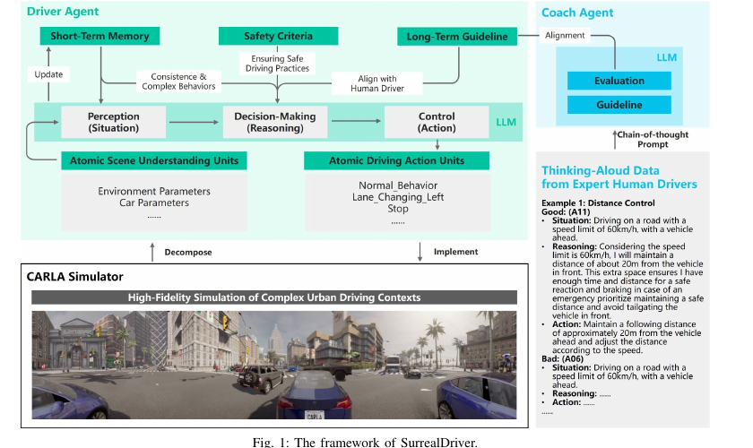
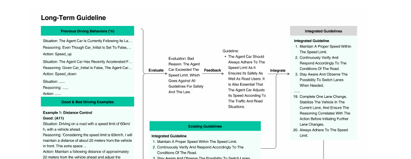

# 没摸过方向盘的 LLM，靠读老司机的"内心独白"学会开车

> SurrealDriver 精读 · 全局编号 83

**论文标题**：SurrealDriver: Designing LLM-powered Generative Driver Agent Framework based on Human Drivers' Driving-thinking Data
**作者**：Ye Jin, Ruoxuan Yang, Zhijie Yi, Xiaoxi Shen, Huiling Peng, Xiaoan Liu, Jingli Qin, Jiayang Li, Jintao Xie, Peizhong Gao, Guyue Zhou, Jiangtao Gong（清华大学智能产业研究院，通讯作者 Jiangtao Gong）
**会议/年份**：**已确认 IROS 2024**（pp. 966–971，DOI 10.1109/IROS58592.2024.10802229；多方独立引用一致——"Foundation Models for Autonomous Driving" 综述、Springer 章节、通讯作者龚江涛清华 AIR 主页 publications 栏）。先前"疑为 ICRA 2024"的猜测作废：ICRA 2024 于 2024 年 5 月召开，该文实际发表于同年 10 月 Abu Dhabi 的 IROS，正好解释了 v2 修订（2024-07-22）晚于 ICRA 会期的疑问。arXiv 2309.13193（v1 2023-09-22，v2 2024-07-22），分类 cs.HC。
**arXiv 链接**：https://arxiv.org/abs/2309.13193
**代码**：未找到官方代码。正文与 arXiv 页面均无代码链接，不用第三方复现顶替。
**数据集**：已公开，https://github.com/AIR-DISCOVER/Driving-Thinking-Dataset（已核实可访问）。内含 `driving-thinking.xlsx`，三个工作表：访谈原始记录（中文）、回放修订版（中文）、中英双语版；行按司机编号与类型组织，列按驾驶工况（转弯、直行、变道超车等）组织。
**一句话核心洞见**：LLM 缺的不是开车知识，而是"开过车"的那种身体直觉；作者把 24 名真人司机事后复盘时的"内心独白"当作 chain-of-thought 示范喂给 GPT-4 驾驶员，在 CARLA 里把碰撞率压下去八成——人类经验可以用自然语言直接"移植"进 LLM agent，不必翻译成代码。

---

## 「会讲道理但不会开车」：LLM 的 embodiment 缺口长什么样

一个 LLM 能把交通法规背得滚瓜烂熟，能头头是道地分析"跟车距离应该和速度成正比"。但让它真正握住方向盘，它会干出人类司机看一眼就觉得离谱的事。论文第 IV-A 节记录了一个这样的瞬间：当前车只有 5 米远时，基线 DriverAgent 决定变道超车，一头撞上前车。人类司机不会犯这种错，不是因为更懂交规，而是因为身体里有一种"5 米这个距离变道会死"的直觉——那是几千个小时握方向盘攒出来的。

这就是作者要解决的缺口，论文摘要里叫它 lack of embodiment。引言把前人的两条路都摆了出来。第一条是给 LLM 加约束、缩小任务范围（引 [12]）；第二条是让 agent 自己在环境里攒经验，比如 Voyager 那种（引 [13][14]）。作者认为这两条都不对症：前者是把问题藏起来，后者是让没开过车的 LLM 从零开始交学费，贵且慢。真正缺的，是一批"人类开车时脑子里在想什么"的自然语言示范——传统具身任务的示范都是轨迹、动作序列，没法直接当 few-shot 例子喂给 LLM；用人来做 RLHF 又贵得离谱。论文的判断是：示范数据的形态错了，不是示范这个想法错了。

这个判断值得停一下。2023 年下半年，DriveGPT4、DiLu、"Drive Like a Human"这些工作都在往 LLM 里塞驾驶能力，它们的"人类知识"来源其实都是 LLM 自己在互联网文本里学到的常识。作者在引言里点名了这一点：LLM 的常识是从带噪声的互联网语料里"非具身地"学来的，里面没有职业司机那种任务专用的身体经验。所以 SurrealDriver 的赌注可以一句话概括：**与其让 LLM 自己悟，不如直接去问老司机当时在想什么，把答案原样当 prompt 用。**

## 作者的赌注：老司机的"内心独白"可以直接当 CoT 用

这个赌注分两层。第一层是认识论上的：专家司机的好不是"直觉"也不是"运气"，而是一套可以说出来的规则链。论文在数据分析部分写得很直白——专家司机会不断总结驾驶行为的规律，思维链从战略层（strategy）下到战术层（tactics）再到操作层（operation）。第二层是工程上的：这套规则链既然能说出来，就能当 chain-of-thought 示范塞进 LLM 的上下文，LLM 的泛化能力会把"一个司机的经验"扩成"一类场景的应对"。

赌注硬不硬？作者手里其实有三张牌。第一张是数据形态的牌：自然语言自述天然就是 CoT 的形状，不需要翻译成代码或奖励函数，"transcript in, prompt out"，链路极短。第二张是成本的牌：采 24 个人的访谈，比做 RLHF 便宜两个数量级，比让 agent 在仿真里撞几万次便宜得多。第三张是 HCI 出身的牌——这篇的分类是 cs.HC，作者单位是智能产业研究院，他们真正擅长的是"怎么从人身上把高质量的语言数据掏出来"，访谈设计、编码员一致性检查这些都是 HCI 的看家本事。三张里最硬的是第一张：示范数据的形态第一次和 LLM 的输入形态严丝合缝。

但赌注也有它的阿喀琉斯之踵，放在后面的怀疑清单里细说。这里先记一笔：这个赌注成立的前提，是"人说出来的"等于"人开车时实际用的"。论文为了安全起见，采集的是**事后**自述——司机先开完车，再对着录像复盘"我当时在想什么"。复盘时的叙事，和握着方向盘那一秒的在线推理，是同一回事吗？作者没有正面回答这个问题。

## 24 名司机、3 台相机、1.5 小时访谈：这批数据是怎么攒出来的

数据采集是这篇论文最花功夫的部分，也是它自称"首个高质量自然语言驾驶思维数据集"的底气来源。流程分四步。

第一步，**先真开**。24 名司机（10 名专家 + 14 名新手）先参加一次真实的城市道路驾驶实验。专家通过职业招聘平台招募，驾龄 12–28 年，年龄 35–48 岁（均值 39.9，标准差 4.18）；新手通过社交媒体招募，年龄 20–25 岁（均值 21.93，标准差 1.49），驾龄 1–4 年。研究通过了机构伦理审查，知情同意、匿名化都写进了正文。

第二步，**全程录像**。车上装了三台设备：Tobii Glass 3 眼动仪（记录司机看哪里）、车顶 Insta360 X3 全景相机（360 度路况）、车内 DJI OSMO Action 3 运动相机。眼动数据在正文里没有再被用过——这是个值得记的细节，采集了但没用，大概率是留给后续工作的。

第三步，**事后访谈**。司机对着录像回放，把"刚才这个操作我当时是怎么想的"说出来。访谈员还会追问复杂场景下的判断依据。每人访谈 1.5–2 小时，24 份录像全部转写成文字。每份数据由 2–3 名受过训练的编码员处理，并做了编码一致性检查——但论文没有报告 kappa 系数之类的量化指标，"检查"做到什么程度，未确认。

第四步，**入库**。访谈文本按驾驶场景整理，连同人口学信息和问卷数据一起入库。公开仓库里的 xlsx 有三版：访谈员现场记录的原始中文版、回放修订过的中文版、中英双语版。README 还提到这批数据支撑了另一篇后续论文《Driving Style Alignment for LLM-powered Driver Agent》。

## 转弯时为什么要看两次：专家思维链里的三层结构

论文最有味道的两段话，是两位专家司机的原话转述，我把它还原成中文大意（为控制引用量，这里是转述而非逐字翻译）。

D11 谈转弯："不管左转右转，我一定先看我要去的那个方向，因为那是我要走的路。但我也会看反方向。基本原则是看两次：第一遍看两边，第二遍确认，然后再转。" D06 谈进主路："先看左后视镜，关键看后车的速度。慢，我就踩油门直接进；快，我就停一下等，等它过去我再进。"

注意这两段话的形状。它们都不是"遇到 X 就做 Y"的单条规则，而是一个**带分支的决策链**：先看 A，再看 B；看完 A 的结果决定下一步是走还是等。论文把这种结构描述为"多个互联的决策点，每个都基于当前路况和对未来的预期"。更关键的是作者的观察：专家能把这套东西说出来，说明它已经从肌肉记忆被提炼成了显式规则——而显式规则正是 LLM 能吃进去的东西。

论文还点出了思维链的三层：战略层（比如"我要保持防御性驾驶风格"）、战术层（"这个路口我应该让行还是抢行"）、操作层（"现在松油门"）。D11 的"看两次"是战术层，D06 的"看后视镜判断后车速度"是战术层带操作层。这个分层在后面的框架里没有被严格对应到模块上——框架的四个模块是按功能切的，不是按这三层切的。这是一个小小的脱节：数据分析讲了一套漂亮的三层理论，框架设计用了另一套四分法，两套话语之间没有明确的映射关系。读者可以自己留意，作者没有解释为什么。

## 框架的四根柱子：原子场景、短期记忆、长期指南、安全准则

图 1 是论文押注的那个设计总览，值得盯着看（论文第 3 页）。

*看这张图时注意三件事：第一，LLM 只出现在两个位置——DriverAgent 的决策核和 CoachAgent，感知和控制都是参数化、非学习的；第二，"记忆"这个词在图里出现了两次，但指的是两种完全不同的东西（下面细说）；第三，右下角那个 Good/Bad 对照示例，是整套人类对齐机制的缩影。*

框架建立在四个设计考虑上，对应四个模块。

**第一根柱子：感知层的"原子化"。** 作者把驾驶场景拆成离散参数（环境参数 + 车辆参数），把驾驶动作拆成原子操作（停车、保持速度、变道、调速等），中间用 JSON 传命令。图 2 展示了一个真实的决策步：感知到的参数包括 `Car_Speed`、`Car_Speed_limit`、红绿灯状态、行人状态、前车距离等等；输出的动作就是一个 `Speed_up`。为什么要原子化？因为 LLM 不直接看图像，它看的是文字化的参数表。把连续世界离散成"参数+原子动作"，等于给 LLM 造了一个它能读写的驾驶 API。这一步没有学习，纯粹是接口设计——但它是整个框架能跑起来的前提。代价也明显：参数表是人工预设的，能看到什么、看不到什么，在写参数列表那一刻就定死了。论文没有讨论这个参数表的完备性。

**第二根柱子：短期记忆，一个先进先出的行为缓冲。** 存的是 agent 最近几步自己干了什么，满了就把最老的顶掉，每一步都重新喂给 DriverAgent，当作感知的一部分。它的作用有两个：保持决策连续（别上一秒加速下一秒急刹），以及把几个原子动作拼成复杂行为（比如超车=加速+变道+加速）。注意它的形态：**没有检索，没有相似度，没有衰减，就是一个定长的 FIFO 队列**。论文里叫它 short-term driving memory，但和"情景记忆"（episodic memory）不是一回事——它记的是"我刚做了什么"，不是"我以前在哪见过这个场景"。这个区分对后面的迁移很关键。

**第三根柱子：长期指南，CoachAgent 产出的规则列表。** 这是人类思维数据真正进入系统的地方，下一节单独讲。

**第四根柱子：安全准则，两层硬规则。** 强制层：10 米内有车或行人、红灯，必须停车。建议层：20 米内有车或行人要减速，路口减速，和移动车辆保持至少 1 米，减少不必要的速度变化以省电。它横跨"整个驾驶过程"，是一个独立于 LLM 推理的冗余层。设计意图很诚实：作者不相信 LLM 的推理在安全上可靠，所以用规则兜底。这个"不信任 LLM"的姿态，反而是框架里最工程化的部分。

## CoachAgent：一个给驾驶员"打分并写评语"的 LLM

长期指南模块是这篇论文机制上最有意思的地方。它不是简单地把专家语录贴进 prompt，而是设计了一个双 agent 结构（图 3，论文第 5 页）。

*看这张图时抓住它的循环：历史行为进来 → CoachAgent 打 Good/Bad 并写理由 → 生成一条指南 → 并入已有的编号指南列表 → 列表回头去约束 DriverAgent。这是一个用自然语言做"梯度下降"的结构：评价是 loss，指南是参数更新。*

流程是这样的。CoachAgent 拿到 DriverAgent 过去一段的行为记录（situation + reasoning + action 三元组），逐条评价为 Good 或 Bad，并写出理由。评价的标准来自哪里？来自专家驾驶思维数据——作者把专家访谈整理成"情境-推理-动作"三元组示例，并且**每个示例都配了 Good 和 Bad 两个版本**。图 1 右下角印了一个完整例子：距离控制，情境是"限速 60 的路，前方有车"；Good 版本的推理是"考虑到限速 60，我和前车保持约 20 米，多出来的空间留给紧急制动反应"；Bad 版本的推理则无视限速（图里只印了半句，大意是"不管限速多少……"）。这种对照示范让 CoachAgent 学到的不是"怎么做对"，而是"对和错的边界在哪里"。

评价完，CoachAgent 生成一条自然语言指南，并入一个**编号累积的指南列表**。图 3 右侧印出了这个列表的样子：第 1 条"在限速内保持合适的速度"，第 2 条"持续确认路况并相应响应"，第 3 条"注意观察，必要时考虑变道"，一直到第 19 条"一次只变一条车道，变完先稳住，确认推理和动作一致再变下一条"，第 20 条"永远遵守限速"。论文正文里还记录了一个真实发生的例子：CoachAgent 把一段"停车过于频繁"的行为评为 Bad，理由是停得太多，然后生成指南"保持稳定、安全的速度"，之后 DriverAgent 的行为就更像人了。

这个设计的聪明之处在于，**指南是可累积、可人工审阅、可修改的自然语言**。和 RL 的权重更新不同，这里的"学习"产物是一个人类能读的列表。它的代价是 prompt 会越变越长——第 IV-A 节有个耐人寻味的数字：完整框架的实验耗时 63725 秒，是基线条件（7079 秒）的 9 倍。论文没有解释为什么，但一个合理的推测是：指南列表越长，每次决策的 prompt 越长，GPT-4 的 token 数越多，决策越慢。这是用自然语言做记忆的隐性成本。

## 走一遍跟车场景：基线在哪一步撞上，完整框架在哪一步躲开

下面用论文自己报告的三个案例，把基线和完整框架各走一遍。案例和数字都出自原文，我只是把每一步的输入输出展开。

**案例一：前车 5 米，变道还是不変道。** 这是论文第 IV-A 节安全模块的原话案例。

基线的走法（无安全准则、无短期记忆、无长期指南）：感知层输出参数——前车距离 5 米。决策层，GPT-4 自由推理：前方慢车挡路，变道超车是合理选项。控制层输出原子动作：变道。结果：撞上前车。注意，LLM 的推理在字面上挑不出毛病——"前方有慢车→变道超车"是一条成立的驾驶逻辑。错的是它缺了那根"5 米这个距离变道会死"的身体直觉。它的知识里有"变道要确认安全"，但"5 米"这个数字没有触发任何警报。

完整框架的走法（论文报告的是 7 米距离的对应案例，机制相同）：感知层输出前车距离 7 米。安全准则的强制层先介入：10 米内有车，必须停车。这条规则不经过 LLM 的推理，直接把决策改写为 stop。控制层输出停车，车在前车后面停稳。差别发生在哪一步？**不在感知（两边看到的数字一样），在决策之后、控制之前多了一道硬规则。** 安全准则不是让 LLM 变聪明，而是不让 LLM 犯傻——这是两种完全不同的安全观。

**案例二：连加速三步之后，加速还是保持。** 这是短期记忆的原话案例。

无短期记忆的走法：每一步决策只看当前帧。上一秒加速了，这一秒"当前速度仍低于限速"→继续加速。下一步还是"低于限速"→继续加速。LLM 的每一步推理各自成立，连起来就是一段不像人开的、顿挫的加速曲线。

有短期记忆的走法：FIFO 缓冲里躺着 `[Speed_up, Speed_up, Speed_up]`，这段历史被重新喂进感知。决策层的推理变成："考虑到之前已经连续加速，现在保持当前速度"。输出 `maintain_speed`。差别在于**有没有"上一拍"**：没有记忆的 agent 活在永恒的现在，每一步都是孤立的最优；有记忆的 agent 能看到自己的动作序列，从而选一个序列层面更平滑的动作。这个机制简单到简陋，但消融显示它贡献了标准口径约 45% 的碰撞下降（见下一节）。

**案例三：停车太频繁，被教练点名。** 这是长期指南的原话案例。

CoachAgent 回看一段历史行为：situation-reasoning-action 三元组里，stop 出现的密度过高。评价：Bad。理由：停车过于频繁。反馈：生成指南"保持稳定、安全的速度"，并入编号列表。从此这条指南常驻 DriverAgent 的 prompt。差别在于**评价的视角**：DriverAgent 自己做决策时，每一步的 stop 都有局部理由（"前面有情况，先停一下"）；但 CoachAgent 站在一段历史之外，能看到"总在停"这个模式本身有问题。局部最优和全局模式的张力，是双 agent 结构存在的理由。

## 表 1 的数字我重算了一遍：标题数字没错，但三个模块的降幅被写大了

这是全文最需要较真的一节。表 1（论文第 5 页）给了四个框架配置的碰撞率，两个口径：按距离（每次/米）、按时间（每次/秒）。

| 框架配置 | 碰撞率/米 | 碰撞率/秒 |
|---|---|---|
| 无安全准则、无短期记忆、无长期指南（基线） | 0.01453958 | 0.041315485 |
| 有安全准则 | 0.00923361 | 0.02366976 |
| 有安全准则、有短期记忆 | 0.005046864 | 0.009530682 |
| 完整框架 | 0.002757353 | 0.005100011 |

摘要的标题数字"碰撞率降低 81.04%"，用标准口径验算：(0.01453958 − 0.002757353) / 0.01453958 = 81.04%，**分毫不差**。但注意它用的是"按距离"口径；如果用"按时间"口径，降幅是 87.66%，论文没有 headline 这个数字。选哪个口径 headline，作者选了小的那个——这倒是诚实的。

问题出在第 IV-A 节正文里三个模块各自的降幅：安全准则"57.46%"、短期记忆"82.96%"、长期指南"83.03%"。按表 1 的数字用标准口径重算：

| 模块增量 | 论文写法 | 标准口径（按距离） | 标准口径（按时间） |
|---|---|---|---|
| 加安全准则 | 57.46% | 36.49% | 42.71% |
| 加短期记忆 | 82.96% | 45.34% | 59.73% |
| 加长期指南 | 83.03% | 45.37% | 46.49% |

论文的三个数字是怎么来的？我验算发现，它们用的是 **(改进前 − 改进后) / 改进后**——分母取了改进后的值。比如安全准则：(0.01453958 − 0.00923361) / 0.00923361 = 57.46%，和论文一字不差。这不是"降低百分之多少"的标准算式。按标准算式，"降低 57.46%"意味着碰撞率应该从 0.0145 降到 0.0062，但实际只降到了 0.0092。三个模块的真实降幅都在 36%–60% 之间，论文的写法把每个都放大了将近一倍。

我不认为这是编造——表 1 的原始数字是实的，而且有一个很漂亮的内证：三个增量用标准口径相乘，(1 − 36.49%) × (1 − 45.34%) × (1 − 45.37%) = 0.1896，1 − 0.1896 = 81.04%，**恰好等于标题数字**。增量式消融的连乘等于总降幅，说明表 1 的四个数是同一套实验里老老实实测出来的。更可能的情况是：作者在写正文时随手用了错的分母，而摘要的 81.04% 是认真算的。但不管是不是随手，读者应该知道每个模块的真实贡献是三到五成，不是八成。

还有一个数字细节：四个条件的实验耗时分别是 7079.67 秒、13730.6 秒、23870.28 秒、63725.35 秒，加起来 108405.90 秒（30.11 小时），和正文对得上。但分布极不均匀——完整框架跑了 17.7 小时，是基线的 9 倍。论文没有解释。结合"指南列表越长 prompt 越长"的推测，这 9 倍很可能就是自然语言记忆的 token 成本。这对任何想复现的人都是个实际提醒：完整框架的 30 小时实验里，一大半时间可能花在等 GPT-4 上。

## 人类评测的"像人开"到底在量什么：50% 这个数字没有出处

摘要里还有半句标题数字："人类相似度提升 50%"。我把正文第 IV-B 节翻了三遍，**找不到这个 50% 的来源**。正文报告的人类评测结果只有一个：单因素被试内设计的重复测量方差分析，F(2.5, 57.4) = 4.353，p = 0.01（Mauchly 球形检验显著，用了 Huynh-Feldt 校正）；Bonferroni 事后检验显示完整框架的得分显著高于"三无"基线，p = 0.009。没有均值，没有标准差，没有四个条件的得分表。50% 是从哪两个数的比值里来的？论文没写。**这个数字标为"正文无出处，未确认"。**

抛开数字出处，评测方法本身也值得拆开看。24 名评测者（年龄 29.3±4.9 岁，17 名男性，都有驾照，和数据采集的 24 名司机无重叠）在线看四个框架各一段约 30 秒的 CARLA 录像，顺序随机，然后在 5 点量表上回答"司机的操作在多大程度上像人类司机的操作"（1=完全不像，5=几乎全像）。这个测量量的是**旁观者对一段 30 秒仿真录像的印象**，不是驾驶行为本身的人类相似度。几个问题是论文没有回答的：24 个人打分的一致性如何（没有报告评分者间信度）；量表只有"像不像人"一个题项，构念效度全靠这一句话撑着；录像里能看到的是车辆轨迹，评测者看不到 agent 的推理过程——他们打的"像人"，其实是"轨迹看起来顺眼"。

另外注意一个问卷条目里的笔误：人口学问题包括 "driving silence status"，按上下文疑为 "driving license status"（驾照状态）之误。小事，但结合下面要说的几个文本破绽，说明 v2 修订得比较匆忙。

## 怀疑清单：样本、基线、实时性，以及几个文本里的破绽

**样本的代表性。** 24 名司机全部来自中国（北京），专家走职业招聘平台（大概率是职业司机），新手是 20–25 岁的社交媒体用户。性别构成没有报告。驾驶文化是单一的：中国的城市路况、交规、驾驶习惯。专家示范里沉淀的"看两次""让快车先过"在多大程度上是跨文化的？论文没有讨论。更微妙的是，新手数据采了但没用——所有示范和指南都只用了专家数据，新手只出现在被试描述里。14 名新手的 1.5 小时访谈，在框架里零贡献。这不一定是错（专家数据质量更高），但"24 名司机"这个数字在方法部分的实际分量是 10 名。

**事后自述和实时思维的距离。** 为安全起见，访谈是事后对着录像做的。事后复述是一种重构：人会把当时模糊的感觉整理成漂亮的规则，会遗漏那些说不出来的部分（比如 D11 真的每次转弯都"看两次"吗，还是他觉得自己应该看两次？）。论文用"编码员一致性检查"来保证转述的质量，但编码员检查的是"转述是否被忠实记录"，不是"转述是否等于当时的真实思维"。这个缺口是方法固有的，作者没有承认它。

**基线的水平。** 表 1 的基线是作者自己的最简 agent：GPT-4 直连感知-决策-控制，无任何模块。论文没有和任何外部工作对比——没有 DiLu，没有 "Drive Like a Human"，没有任何传统规划器。所以 81.04% 是"相对于自己最简版本"的降幅，不是相对于领域现状。基线有多弱呢？它会在前车 5 米时变道撞上去——一个连"5 米内不变道"这种常识都没有的 agent。这与其说是基线，不如说是"裸 LLM 有多不靠谱"的演示。

**实时性是被扭曲的。** GPT-4 一次决策要数秒，作者把 CARLA 的仿真时间放慢到固定步长 0.0006–0.0015 秒。也就是说，agent 思考 3 秒，仿真世界只推进了几毫秒。同时，为了"让驾驶表现更容易被观察到"，背景车辆和行人被调得更鲁莽（急变道、闯红灯）。在一个时间流速被扭曲、对手被故意调难的世界里测出的碰撞率，和真实驾驶的决策压力不是一回事。论文如实报告了这些设置，这是优点；但结论的外推要打折。

**统计报告的缺失。** 没有随机种子，没有误差棒，没有碰撞的绝对次数（只给了"率"）。四个条件的实验轮次是否相同？正文只说"直到完成所需的驾驶轮数"，没有给出轮数。结合四个条件耗时 9 倍的差异，读者无法判断碰撞率的差异里有没有"跑的路程/时长不同"带来的混杂——虽然按距离和按时间两个口径都报告了，部分对冲了这个问题。

**文本里的破绽。** v2 正文第 III-B-3 节有一处 "collected in Section ??"——LaTeX 交叉引用没有解析。渲染后的 PDF 里，Fig.2、Fig.3、Table I、Section IV-A 几处引用显示为红色未解析状态。这些破绽不影响结论，但说明 2024 年 7 月的 v2 修订没有经过仔细校对。结合"疑为 ICRA 2024"的传言一起看：一个 2024 年 7 月还在修格式的稿子，不太可能是 2024 年 5 月开会的 ICRA 的 camera-ready。Venue 未确认是准确的判断。

**"记忆"这个词的误导性。** 论文摘要和框架图都在说 safety and memory mechanism，容易让读者以为这里有情景记忆。实际上短期记忆是 FIFO 行为缓冲，长期指南是编号规则列表——**没有检索、没有相似度计算、没有记忆衰减**。这不是批评，只是一个术语澄清：它的"记忆"解决的是"决策连续性"和"经验沉淀"，不是"在相似场景下想起上次是怎么处理的"。

## 公平地说，这篇工作漂亮的地方

怀疑归怀疑，有几处是真漂亮，说清楚为什么。

第一，**消融链条的乘法一致性**。四个配置是增量式消融（每次只加一个模块），三个增量的标准口径降幅连乘恰好等于总降幅。这不是作者宣称的，是我按表 1 重算发现的。这种内在一致性很难靠编数字编出来——四个独立测量的碰撞率能满足乘法关系，说明实验是真实跑的，数据是实的。这是全文最硬的证据质量信号。

第二，**Good/Bad 对照示范**。给 CoachAgent 的示例不是"专家怎么做"，而是"同一个情境下，好和坏的版本各长什么样"。对照比单向示范信息量大：它标出了对错的边界。D06 式的分支规则（"慢就进，快就等"）天然适合这种写法。这是一个可以偷走的设计。

第三，**FIFO 短期记忆的性价比**。一个定长队列，零学习成本，解决的是 LLM agent 的通病：每一步独立采样导致的决策抖动。标准口径 45% 的碰撞下降，代价是几行代码。在"记忆"这个词被用得很重的今天，这种"小技巧解决大问题"的诚实很难得。

第四，**两级安全准则的工程诚实**。作者没有假装 LLM 推理可靠，而是承认它不可靠，用 10 米/20 米两层硬规则兜底。强制层和建议层的区分（必须停 vs 建议减速）是对"安全冗余"的正确理解：冗余不是重复，而是分层。

第五，**数据集是真公开的**。xlsx 三个版本（原始/修订/双语）、行列组织清晰、README 写明了采集方法和后续论文。这批数据在 2023 年确实是稀缺的——自然语言的驾驶思维数据，在此之前没有公开版本。

## 可迁移想法

读完这篇，能带走、且能用在别的问题上的想法有五个。

**1. "思维+轨迹"对，替代纯轨迹示范。** 传统模仿学习喂的是轨迹（状态-动作对），这篇喂的是"情境-推理-动作"三元组。推理那一环是人类用自然语言写的决策依据。对 LLM agent 来说，三元组的信息密度远高于轨迹：轨迹只告诉你"做了什么"，三元组还告诉你"当时排除了什么、为什么"。以后凡是给 LLM agent 做示范，先问一句：示范里有没有"当时在想什么"这一列？

**2. 用自然语言做"梯度下降"：评价→指南→累积。** CoachAgent 的结构是一个通用模式：一个评审器看历史行为，打 Good/Bad 并写理由；理由被蒸馏成一条自然语言规则，追加进一个可人工审阅的列表。这个模式不依赖驾驶，任何"行为可以被事后评价"的 agent 任务都能用。它和 Reflexion、Expel 是同一家族，但这篇的版本更轻：没有向量检索，没有权重更新，只有一个越写越长的规则列表。代价是 prompt 膨胀（这篇的 9 倍耗时就是例子），所以规则列表需要定期做合并和剪枝——论文没做，这是留白。

**3. 对照示范比正向示范好用。** 同一个情境配 Good 和 Bad 两个版本，Bad 版本标出"错在哪里"。构造示范数据时，别只收集正确做法，把"差一点就对"的反例也留下来。这篇的 Bad 示例（无视限速的距离控制推理）比 Good 示例更能让评审器学会边界。

**4. FIFO 行为缓冲抗抖动。** 任何多步 LLM agent 都有决策抖动问题：相邻两步各自最优，连起来不像话。存最近 N 步的"做了什么"，每步重新喂回去，是一个零成本的平滑器。这篇的消融证明它独立贡献了标准口径约 45% 的碰撞下降——在一个驾驶任务里，这是把"不撞"的一半功劳给了"记得自己上一秒在干嘛"。

**5. 增量消融的乘法自检。** 如果你的消融是增量式的（A→A+B→A+B+C），各增量的标准口径改进率连乘，应该约等于总改进率。差得远，要么是数字算错了，要么是模块之间有强交互。这个算式 30 秒就能验，审稿时可以用来快速判断一张消融表是实测的还是凑的。

## 与本课题的关联

最后把这篇和你的课题并排放：世界模型引导 + 自适应衰减情景记忆的闭环多规划器 Agent，LLM 调度多个专家规划器，执行开放式自然语言驾驶指令，Bench2Drive 闭环验证。SurrealDriver 恰好踩在你课题的几条关键线上，有四处可直接借用，两处是差异点（也就是你的创新空间），一处是数据层面的提醒。

**借用一：情景记忆库的冷启动种子。** 你的情景记忆库初始为空时，最难的是"第一批记忆从哪来"。这篇的数据集就是现成的种子：24 名司机的"情境-推理-动作"三元组，按驾驶工况（转弯、直行、变道超车）组织好。更重要的是条目格式的升级：记忆条目不要只存轨迹片段，存"思维+轨迹"对。检索时匹配的就不只是几何相似，还有推理模式的相似——"上次在这个路口，老司机是先看左后视镜判断后车速度的"，这种记忆比一条轨迹更有指导价值。

**借用二："案例→规则"双层记忆结构。** SurrealDriver 实际上做了两层记忆：热的是 FIFO 行为缓冲（最近几步），冷的是编号指南列表（沉淀的规则）。你的自适应衰减情景记忆可以借鉴这个分层：高频命中的情景案例走检索、进 prompt；长期稳定、反复被验证的经验，蒸馏成自然语言指南常驻。这样每次决策的 prompt 不会无限膨胀——而这篇 9 倍耗时的教训，正是"只堆案例不做蒸馏"的代价。

**借用三：CoachAgent 作为轻量版闭环风险校验。** 你的"闭环风险校验/冲突仲裁"模块，可以用一个独立的 LLM 评审器实现：输入最近 N 步各规划器的行为和推理，输出 Good/Bad 标签加一条自然语言指南。这篇证明了这条路在 CARLA 里能把碰撞率再往下压标准口径约 45%。你的版本可以更进一步：评审器的输入里加上世界模型 roll 出的未来（"这个动作 3 秒后会怎样"），评价就从"事后诸葛亮"变成"事前风控"。

**借用四：调度器的防抖。** 你的 LLM 调度器在相邻决策步之间可能反复横跳——这一步选激进规划器，下一步选保守规划器，车开起来顿挫。这篇的 FIFO 短期记忆就是现成的防抖器：只存"最近几步选了谁、为什么"，喂给调度器做连续性约束。零成本，独立贡献经过消融验证。

**差异点一：它的"记忆"没有检索和衰减。** 这篇的长期指南是追加式列表，没有相似度检索，没有"用进废退"。你的"自适应衰减情景记忆"正是它没做的部分：记忆条目按调用频率和时效衰减权重，冷记忆沉淀成指南，热记忆参与检索。在论文里把这个差异点讲清楚，就是你的增量所在。

**差异点二：它的先验是人类经验，你的先验是世界模型。** 两种先验不互斥：世界模型回答"未来会发生什么"，人类思维数据回答"这种情况下人会怎么想"。调度器的 prompt 可以同时装两条：一条是世界模型 roll 出的未来轨迹，一条是检索到的相似情境下专家当年的内心独白。前者是物理推演，后者是经验直觉。这篇只做了后者，你的课题把两者拼起来，是一个自然的递进。

**数据层面的提醒：专家筛选标准要先定。** 这篇只用了 10 名专家的数据做示范（新手数据采了没用），说明"人类对齐"对齐的是**专家**的人类，不是平均人类。如果你要采自己的驾驶思维数据，筛选标准（驾龄、事故率、驾驶风格）要在采集前定好，否则记忆库里混进新手的坏习惯，衰减机制再漂亮也救不回来。另外，这篇的数据是中文访谈、转写后有英文版；你的 Bench2Drive 场景是英文 prompt 为主，用之前先确认语言对提示词的影响。

**验证口径的建议。** 这篇同时报告了按距离和按时间两个碰撞率口径，但标题只用了按距离的 81.04%（按时间是 87.66%）。你的 Bench2Drive 验证建议两个口径都报，并给出绝对碰撞次数和场景数。百分比只报一个口径，天然就有挑选的嫌疑；两个都报，读者自己判断。这篇在这点上做得不彻底，你可以做得更干净。
