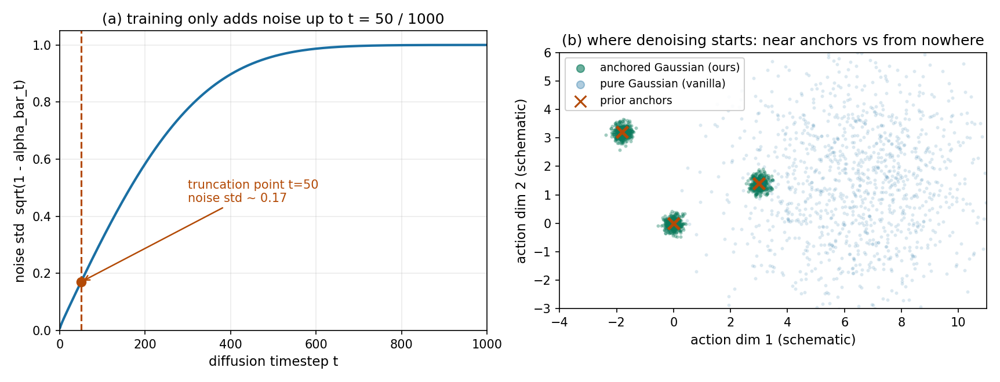

# 别从纯噪声开始去噪：把"先验多模态"直接写进扩散的起点

> **全局编号**：90 ｜ **论文**：DiffusionDrive: Truncated Diffusion Model for End-to-End Autonomous Driving ｜ **作者**：Bencheng Liao, Shaoyu Chen, Haoran Yin, Bo Jiang, Cheng Wang, Sixu Yan, Xinbang Zhang, Xiangyu Li, Ying Zhang, Qian Zhang, Xinggang Wang（华中科技大学 / 地平线） ｜ **发表**：CVPR 2025 Highlight ｜ **arXiv**：https://arxiv.org/abs/2411.15139 ｜ **代码**：公开（MIT 协议，github.com/hustvl/DiffusionDrive；NAVSIM 与 nuScenes 权重均已发布，checkpoint 在 HuggingFace）
>
> **一句话核心洞见**：扩散模型在驾驶上又慢又塌模，不是因为扩散不行，而是起点选错了——从纯高斯噪声出发去"发现"多模态动作空间，走 20 步都不够；把 K-means 先验 anchor 直接写进扩散的起点，从"每个 anchor 附近的一小团噪声"开始去噪，2 步就够，多样性反而更高。

## 机器人那套扩散策略，开上路先撞了两堵墙

2023 年的 Diffusion Policy（RSS）在机器人操作上证明了一件事：扩散模型能很好地表达多模态动作分布——同一个视觉输入，机械臂可以有好几种合理的抓取方式，扩散模型从高斯噪声出发、迭代去噪，能把这几种方式都采样出来。这对自动驾驶很有诱惑力：驾驶决策天生多模态，直行、变道、让行，同一个路口本就有多种开法。主流的端到端规划器（Transfuser、UniAD、VAD）走的是单模态回归，一条 ego query 过 MLP 直接吐一条轨迹，多模态的表达力从第一天就被砍掉了。

作者先做了一个最直接的尝试：把 Transfuser 的 MLP 回归头换成条件扩散模型（UNet），得到 TransfuserDP。结果喜忧参半。喜的是 PDMS 从 84.0 涨到 84.6，多样性分数涨了 11%。忧的是两堵墙：

第一堵是速度。vanilla 的 DDIM 扩散策略需要 20 步去噪，每步 6.5ms，光规划头就吃掉 130ms，整车 FPS 从 60 跌到 7。自动驾驶是实时系统，这个数字直接判了死刑。

第二堵更致命，是模态塌缩。作者从高斯分布里采 20 个不同的噪声，走完 20 步去噪，得到的 20 条轨迹严重重叠（论文图 2）。扩散模型在机器人上引以为傲的多模态表达力，到了开放的交通场景里消失了。

这两堵墙其实是同一个矛盾的两面：驾驶场景比机器人操作台动态得多、开放得多，动作空间更大、约束更复杂。从纯噪声出发，扩散模型要在 20 步里既"找到"合理的驾驶模式、又"修"到贴合当前场景——步数不够表达力，步数多了实时性没了。作者的措辞里藏着一个关键观察（这是我的推断，依据是引言里反复出现的对比）：人类司机根本不是从噪声开始"想"轨迹的。人类有一套固定的驾驶模式（跟车、变道、转弯），开车时只是按实时交通对这些模式做微调。如果把这套"先验模式"直接写进扩散的起点，两堵墙可能同时倒掉。

## 作者真正的底牌：一张"起点离终点很近"的路线图

论文表 2 是一张路线图，也是作者底牌的全部证据，值得一行一行读：Transfuser（84.0 PDMS，60 FPS）→ TransfuserDP（84.6，7 FPS）→ TransfuserTD（85.7，27 FPS）→ DiffusionDrive（88.1，45 FPS）。

核心技巧只有一句话：**用先验的多模态 anchor 把动作空间划分成若干子区域，每个子区域是以 anchor 为中心的小高斯；训练和推理都从这个"anchored Gaussian 分布"开始，扩散只负责在小高斯内部做精修。**

为什么 2 步就够？把去噪想象成一段路程。vanilla 扩散的路程是从"纯噪声"走到"数据分布"，又长又要自己找方向。truncated 扩散的路程是从"anchor 附近"走到"数据分布"——起点离终点本来就近。DDIM 本来就支持跳步（20 步已经是 DDPM 1000 步的加速版），当起点已经落在合理区域时，剩下的工作只是"按场景条件微调"，2 步足够。更关键的是，多样性不再依赖漫长的随机游走去"发现"——它由 anchor 的分配直接保证：20 个 anchor 就是 20 种驾驶意图的骨架，采样时每个 anchor 附近都采，模态塌缩在结构上就被堵死了。

这里要分清一个容易混淆的点。TDPM（ICLR 2023）也做过"截断去噪"，但它是从一个**隐式的**中间分布开始以加速采样。DiffusionDrive 的不同在于把**显式的驾驶先验**写进了起点——起点分布是一个以 K-means anchor 为中心的高斯混合。这也是论文反复强调的、机器人领域没做过的东西。

## 符号表：先把每个字母按住

| 符号 | 形状 | 含义 |
|---|---|---|
| $\tau = \{(x_t, y_t)\}_{t=1}^{T_f}$ | $T_f \times 2$ | 一条轨迹，$T_f$ 个航点，自车坐标系。NAVSIM 上 $T_f=8$（4 秒），nuScenes 上 $T_f=6$（3 秒） |
| $\tau^0$ / $\tau^i$ | 同上 | 干净轨迹 / 加噪到扩散时刻 $i$ 的轨迹（上标是扩散时刻，不是幂） |
| $a_k$ | $T_f \times 2$ | 第 $k$ 个先验 anchor，在训练集轨迹上做 K-means 聚类得到 |
| $N_{\text{anchor}}$ | 标量 | 训练用的 anchor 数，NAVSIM 20 个，nuScenes 18 个 |
| $N_{\text{infer}}$ | 标量 | 推理时采样的带噪轨迹数，训练后可任意调（10/20/40 都试过） |
| $z$ | 特征 | 条件信息：感知模块给的 BEV/PV 特征、agent/map query |
| $f_\theta$ | 网络 | 扩散解码器，输入带噪轨迹 + $z$ + 时刻 $i$，输出去噪轨迹和置信分 |
| $\hat{s}_k$ / $y_k$ | 标量 | 第 $k$ 条轨迹的预测置信分 / 正负标签（离真值最近的 anchor 附近采的那条为 1，其余为 0） |
| $\lambda$ | 标量 | 损失权重，**论文正文和附录都没给具体数值** |
| $\bar{\alpha}_i$ | 标量 | 噪声 schedule 的累积系数，$\bar{\alpha}_i = \prod_{s=1}^i (1-\beta_s)$ |
| $T_{\text{trunc}}$ | 标量 | 截断步数，训练时取 50（相对 1000 步的完整 schedule） |

## 式 (4)：只给 anchor 加"一点点"噪声

$$\tau_k^i = \sqrt{\bar{\alpha}_i}\, a_k + \sqrt{1-\bar{\alpha}_i}\, \epsilon, \quad \epsilon \sim \mathcal{N}(0, I)$$

这是全文承重的一式。画面是这样的：动作空间里先立 20 根"桩子"（anchor），每根桩子周围罩一小团高斯云，起点分布就是这 20 团云的混合。训练时从第 $k$ 团云里采样，解码器学着把它去噪回真值附近。

"一点点"到底是多少？算一笔。训练用的截断点是 50/1000。取 DDPM 常用的线性 $\beta$ schedule（$10^{-4}$ 到 $0.02$），$t=50$ 时 $\bar{\alpha}_{50} \approx 0.971$，噪声标准差 $\sqrt{1-\bar{\alpha}_{50}} \approx 0.17$。也就是说起点轨迹 $=$ anchor 坐标 $\times 0.985$ $+$ $0.17$ 倍标准高斯——在归一化的轨迹空间里，肉眼几乎看不出偏离 anchor，但给了模型"可塑"的余地。下图左半是这条噪声曲线的形状，右半是起点分布的示意：

*自绘示意图，非论文原图。左：线性 schedule 下噪声标准差随扩散时刻的变化，训练只把 anchor 加噪到 t=50（标准差约 0.17）就停；右：anchored Gaussian（绿，紧贴 anchor）与纯高斯（蓝，撒满全空间）的起点对比——去噪要走的"路程"差了一个量级。*

对比 vanilla：起点是标准高斯，采样点均匀撒在整个动作空间，模型 20 步里既要找到可行区域又要修形状，还经常收敛到同一个模态。truncated 版本把"找模态"的工作外包给了 K-means anchor，扩散只做"修形状"，分工变了，步数自然下来了。

## 式 (6)：两项损失，一项管"修得准"，一项管"选得对"

$$L = \sum_{k=1}^{N_{\text{anchor}}} \big[ y_k L_{\text{rec}}(\hat{\tau}_k, \tau_{\text{gt}}) + \lambda\, \text{BCE}(\hat{s}_k, y_k) \big]$$

第一项 $L_{\text{rec}}$ 是 L1 重建损失，只对正样本算：离真值 $\tau_{\text{gt}}$ 最近的那个 anchor 附近采出的带噪轨迹，去噪后要和真值对齐。它罚的是"修偏了"。

第二项是二分类交叉熵，对全部 $N_{\text{anchor}}$ 条轨迹算：正样本的分数往 1 推，负样本往 0 推。它罚的是"打分打错了"——推理时要取 top-1 执行，分数排错就全错。

这里有两个值得停下来的细节。第一，正负样本是 1 比 19 的极度不平衡。分数头本质上在学"哪个 anchor 离人类演示最近"，而不是"哪条轨迹最安全"。在训练分布内这二者高度相关，出了分布就未必了——怀疑式审读那节会回来算这笔账。第二，$\lambda$ 的具体值论文没写。正文只说"$\lambda$ balances"，附录也没给。复现的人得去代码里翻，这是论文欠的一笔账。

## 式 (3)：多样性分数 D 量的是"轨迹带子"的重叠程度

$$D = 1 - \frac{1}{N}\sum_{i=1}^N \frac{\text{Area}(\tau_i \cap \bigcup_j \tau_j)}{\text{Area}(\tau_i \cup \bigcup_j \tau_j)}$$

把每条去噪后的轨迹画成一条有宽度的带子铺在 BEV 上，$D$ 量的是这些带子互相重叠的程度：重叠越多，分子分母越接近，$D$ 越低。表 2 里 TransfuserDP 的 $D$ 是 11%（几乎塌成一束），TransfuserTD 提到 70%，DiffusionDrive 74%。

这个指标量的是"铺开的程度"，不管铺开的是不是好轨迹。一堆发散但全都撞墙的轨迹也能拿高分。所以作者还配了图 2 的定性图：top-1 贴紧真值、top-10 还能做出高质量变道——数字管"多"，图管"好"，两份证据是互补的，单独看任何一份都会被误导。

## 解码器：去噪的每一步，网络都在"看"场景的哪里

扩散解码器是论文的第二个贡献，结构按数据流走一遍：

输入 $N_{\text{infer}}$ 条带噪轨迹。先过 **deformable spatial cross-attention**：把每条轨迹的航点坐标投影到 BEV（Transfuser 的设定里只用 BEV）特征图上，在投影点附近采样特征。直译就是"轨迹想往哪走，网络就看哪的路"。再过 **agent cross-attention**：和感知模块的 agent query（Transfuser 没有向量化地图，只做了 agent 交互）做交叉注意力，知道"那条路上有谁"。然后 FFN 提炼特征。

接着是 **timestep modulation**：把扩散时刻 $i$ 编码成调制信号，作用在特征上。同一套参数在去噪早期和晚期行为不同——早期靠 $z$ 大步找方向，晚期做精细修正，时刻信息就是干这个用的。末端是 **MLP 双头**：一个头输出置信分 $\hat{s}_k$，另一个头输出**相对初始带噪坐标的偏移量**（预测 offset 而不是绝对坐标，残差式预测，好学得多）。

**级联**是指上面这一串堆 2 层，前一层的输出直接做后一层的输入，在同一步去噪内再精修一次。而推理时的 2 个去噪步之间，整个解码器复用同一套参数（跨时刻参数共享），不另学两套。

表 3 的消融是判断承重结构的最好依据。ID-2（解码器只有 ego query，不做 spatial 也不做 agent 交互）PDMS 直接掉到 55.1，EP 只剩 43.3——没有场景交互的去噪是灾难，轨迹根本不知道路在哪。加上 spatial cross-attn（ID-3）立刻回到 87.1，单这一项贡献了 32 个点。再加 agent 交互（ID-5）到 87.4，级联（ID-6）到 88.1。所以承重的是 spatial cross-attention，agent 交互和级联是装修。顺带，解码器把参数从 UNet 的 102M 压到 60M，PDMS 反而涨 2.4——UNet 是为图像设计的重型结构，用在轨迹去噪上属于杀鸡用牛刀。

## 训练和推理：两边用的不是同一套"步数"

训练时，20 个 anchor 每个都按式 (4) 加噪，加噪时刻 $i$ 在 $[1, 50]$ 里采样（50/1000 截断）。解码器见过各种噪声水平下的"anchor 附近样本"，学的是"从 anchor 附近任意一个噪声水平修回真值"。

推理时，先从 anchored Gaussian 里采 $N_{\text{infer}}$ 条带噪轨迹（训练用 20，推理可调），然后只做 **2 步 DDIM 去噪**，每步都过一遍级联解码器，最后按置信分取 top-1 输出。注意这里的不对称：训练见过 50 个噪声水平，推理只走 2 步。这正是 DDIM 跳步的常规操作——训练时把去噪函数在各噪声水平上都学好，推理时挑 2 个点跳过去。之所以跳 2 步就够，回到前面那句话：起点离终点近。

推理灵活度是附带的好处：$N_{\text{infer}}$ 在训练后随便调。表 6 显示采 10 条就有 84.9，20 条 88.1，40 条 88.2（饱和）。算力紧就少采，场景难就多采，这个旋钮是免费的。

训练配置本身：NAVSIM navtrain 从零训练 100 epoch，AdamW，8 张 4090，batch 512，学习率记为 $6\times10^{-4}$（原文此处上标在 PDF 转换中丢失，按常规配置推断，精确值以代码为准）。感知模块和 ResNet-34 backbone 沿用 Transfuser 的设定，输入是前视三相机拼成的 1024×256 图像加 BEV LiDAR。

## 表 2 路线图：从 84.0 到 88.1，每一步加了什么

把表 2 横着读，它是全篇最诚实的一张表：

**Transfuser → TransfuserDP**：只把 MLP 头换成 vanilla 扩散（UNet，20 步）。PDMS 84.0 → 84.6（+0.6），$D$ 从 0% 到 11%。代价：规划头耗时 0.2ms → 130ms（20 步 × 6.5ms），FPS 60 → 7。参数 56M → 101M。扩散的表达力是真的，但账单也是真的。

**TransfuserDP → TransfuserTD**：只换 truncated 策略，解码器还是 UNet。步数 20 → 2，PDMS 85.7（+1.1），$D$ 11% → 70%（+59%），FPS 7 → 27。这是截断策略**单独**的贡献：更快、更多样、还更准——因为起点合理了。

**TransfuserTD → DiffusionDrive**：把 UNet 换成级联扩散解码器。PDMS 85.7 → 88.1（+2.4），$D$ 70% → 74%，参数 102M → 60M，单步耗时 6.9ms → 3.8ms，FPS 27 → 45。

现在可以拆"10 倍加速"这个说法了。**10× 指的是去噪步数（20→2）**，这是截断策略的功劳，干净。但端到端 FPS 从 7 到 45（约 6.4 倍）里混了两个因素：步数少了 10 倍，单步也从 6.5ms 降到 3.8ms（UNet 换成轻量解码器）。把功劳全记在截断头上，是论文叙事上的小小慷慨——解码器轻量化至少贡献了其中的四成。

## 88.1 和 45 FPS：两个数字放在什么坐标系里看

**88.1**：NAVSIM navtest，ResNet-34，相机+LiDAR，和之前所有方法对齐 backbone。子分数：NC 98.2、DAC 96.2、TTC 94.7、Comf. 100、EP 82.2。对手里最强的是 Hydra-MDP-$V_{8192}$-W-EP（8192 个 anchor，加规则评估器蒸馏、专门拟合 EP 指标、带后处理），86.5。DiffusionDrive 赢 1.6，而且是"只学人类演示、推理无后处理"。和只差规划头的 Transfuser 比，赢 4.1，全部子项都赢。

**45 FPS**：单张 NVIDIA 4090，端到端（含感知）。Transfuser 是 60 FPS，扩散版只慢了 25%，实时性保住了。

**nuScenes 开环**：L2 平均 0.57（比 VAD 的 0.72 低 20.8%），碰撞率平均 0.08（比 VAD 的 0.22 低 63.6%），FPS 8.2（VAD 的 4.5 的 1.8 倍），backbone 都是 ResNet-50。但作者自己在 4.7 节写了，nuScenes 大多是简单场景，所以这组数字只是"不输"，证明力不如 NAVSIM。

还有一处数字值得单独点名：和 VADv2 比，anchor 从 8192 减到 20（400 倍），PDMS 反而高 7.2。这个对比的修辞效果很强，但两个 anchor 的**角色**完全不同——VADv2 的 anchor 是拿来打分选择的词汇表，DiffusionDrive 的 anchor 是拿来做去噪起点的。数量级对比成立，概念上不是同一回事。

## NAVSIM 的"闭环"，到底有多闭

论文 4.1 节自己写了：NAVSIM 用的是 **non-reactive simulation** 配闭环指标。翻译一下：自车的轨迹按规划 rollout，但周围车辆是 log 回放，**不会对自车做出任何反应**。你变道别了后车，后车照样按录像往前开。

这意味着三件事。第一，交互式失败测不出来——真实驾驶里大量事故来自连锁反应（你急刹、后车避让不及），回放式仿真里这条因果链是断的。第二，NC（无责任碰撞）里的"责任"划分是启发式规则，在对方不躲不让的前提下算出来的"无责"，和真车上的"无责"不是一回事。第三，PDMS 是加权组合，Comf.（舒适度）所有方法全是 100，这一子项没有区分度；EP（自车进度）恰恰是 Hydra-MDP 专门加监督去拟合过的指标——指标一旦成为优化目标，就不再是好的衡量。DiffusionDrive 没做这种拟合，这是它 88.1 里干净的部分，但读者要知道 88.1 的分母是什么。

结论：88.1 是"在当前最好的回放式基准上的最好成绩"，离"上路没问题"还有方法论上的一大步。作者没有撒谎，NAVSIM 的局限是领域公认的；但论文的叙事（"closed-loop metrics"反复出现）很容易让读者滑向"这已经是闭环验证了"的误读，这一笔要自己记清楚。

## "多"字的上限：20 个 anchor 决定了多样性到哪里为止

Truncated diffusion 的多样性由两部分组成：anchor 之间的差异（K-means 从训练集聚出的 20 种驾驶模式），加上每个 anchor 附近 0.17σ 的局部抖动。截断 schedule 是双刃剑：起点离 anchor 只有一小团噪声的距离，2 步去噪走不远——如果真实场景需要的机动离 20 个 anchor 都很远，模型够不着。

附录表 8 是直接证据。训练推理都用 anchored 分布：88.1；训练用 anchored、推理换成单条外推轨迹（按当前状态外推的 prior，相当于 1 个 anchor）：掉到 81.3。起点换了，整个系统就塌了 6.8 个点。这说明多样性和质量都高度依赖这 20 个 anchor 的质量和覆盖度。

所以"不依赖大词汇表"这个说法要打个折。VADv2 用 8192 个 anchor 做**选择**，DiffusionDrive 用 20 个 anchor 做**起点**——数量少了 400 倍没错，但"多模态的骨架是谁给的"这个问题没变，依然是预定义的、离线聚类的 anchor。扩散只是在骨架上长肉，没有自己长骨架的能力。附录表 9（CARLA Longest6 上用 NAVSIM 聚的 anchor，DS 64.27 对 Transfuser 的 47.30）说明这套骨架有一定跨数据集迁移能力，但 CARLA 和真实世界的长尾之间还隔着一道墙，anchor 在训练集上聚出的 20 种模式，包不包得住没见过的开法，论文没有回答。

## 随机采样开上路：安全关键系统容得下掷骰子吗

推理流程走一遍：从 anchored Gaussian 采样 $N_{\text{infer}}$ 条带噪轨迹 → 2 步去噪 → 分数头打分 → 取 top-1 执行。随机性进来两次：采样时的噪声 $\epsilon$，以及分数接近时排序的翻转。论文**没有报告多种子方差**——换一个随机种子，top-1 轨迹稳不稳定，未知。对安全关键系统，这不是小事：同样的输入，前后两帧可能因为采样噪声选出不同的 top-1，轨迹级决策出现抖动。

更深的问题在分数头。它的训练目标是 BCE、1 正 19 负，学的是"哪个 anchor 离人类演示最近"。人类演示是"一个可接受的开法"，不是"安全 oracle"。在分布外场景，离人类演示最近的 anchor 未必是最安全的选择，而分数头里没有安全概念——它和生成器吃的是同一套 $z$、同一套训练信号，自己给自己打分。从"论文里的规划器"到"车上的规划器"，中间缺一个独立的风险校验层。论文的选型（top-1 直接执行、无后处理）在 benchmark 上是优点，在车上是未回答的问题。

## 论文没写、代码里才有的几处细节，外加一处笔误

- **$\lambda$ 的具体值**：正文、附录都没给。两项损失的相对权重直接决定训练动态，这是复现时第一个要去翻代码的地方。
- **$N_{\text{anchor}}=20$ 怎么定的**：没有 anchor 数量的敏感性曲线。只做了推理时 $N_{\text{infer}}=10/20/40$ 的消融（84.9→88.1→88.2 饱和），但那是采样数，不是 anchor 数。20 个 anchor 是不是最优、10 个够不够、40 个会不会更好，未知。
- **推理 2 步取 schedule 上哪两个时刻**：没写。DDIM 跳步点的选择影响结果，这又是一个代码细节。
- **表 4 的笔误**："3 步"那一行的 EP 写成 92.2，而 1 步/2 步是 82.1/82.2，且 PDMS 保持 88.1 不变。PDMS 是子项的加权组合，EP 跳 10 个点而 PDMS 纹丝不动，数字内部不一致，疑为笔误（应为 82.2 左右）。
- **基线的出身**：TransfuserDP 是作者自己搭的（Transfuser + vanilla diffusion），不是已发表的竞争方法。用它做"10×"的对比在消融逻辑上成立，但读者要知道这个分母是作者自己选的——市面上当时并没有一个"驾驶扩散策略"的标准实现可供对比。
- 公平地说，论文也有诚实的地方：nuScenes 偏简单的自我提醒、附录里单 anchor prior 失败的对照（表 8）、anchor 跨数据集的测试（表 9），都是愿意把不利面摆出来的写法。

## 续作 DiffusionDriveV2：它替一作说出了那个困境

DiffusionDriveV2（arXiv:2512.07745，2025 年 12 月）是同一团队的续作，它的第一句话就是对 V1 的诊断，值得转述：V1 靠纯模仿学习，而模仿学习的监督对多模态是**不完备**的——每个场景只有一个真值轨迹，却要监督 20 个 anchor 的去噪。于是出现"多样性 vs 持续高质量"的两难：要多样，低质量的模态也留着；要质量，模型容易塌回保守的均值行为。V1 的 88.1 把这个张力盖住了，没有解决。

V2 的解法是拿 RL（GRPO）来约束：intra-anchor GRPO 只在**同一个 anchor 内部**做优势估计，inter-anchor truncated GRPO 给全局视角，但把跨意图（比如左转 vs 直行）的比较截断掉——因为跨意图比优势本身就会把模态压塌；再加 scale-adaptive 的乘性噪声做探索（加性噪声会破坏轨迹的光滑性）。结果：NAVSIM v1 91.2 PDMS，v2 85.5 EPDMS。

这对理解 V1 很重要：V1 的多样性是"anchor 给的"，质量是"IL 拟合的"，两者之间的张力 V1 没有机制去处理。V2 的存在，恰好说明"分数头不懂安全、采样随机性没被约束"不是吹毛求疵——作者自己沿着这条线做了下一篇。

## 能带走的两个想法

**第一，"先验划界、网络精修"的两段式。** 多模态的"多"不必由神经网络从噪声里"发现"——那是最难学的部分。可以由显式先验直接给出来：K-means 聚类、记忆检索、规则方法提议都行；网络只负责在先验附近做贴合当前场景的精修。精修是个比"从零生成"容易得多的学习问题，2 步去噪就够，参数还能更少（60M 对 101M）。下次遇到"又要多模态又要实时"的问题，先问：多样性骨架能不能由先验直接给？

**第二，截断扩散可以当"精修算子"用，不必当"生成器"用。** 任何合理的轨迹提议——规则规划器的输出、历史相似场景的轨迹、甚至上一帧的规划结果——都可以加一小团噪声、过 1~2 步条件去噪，得到贴合当前场景的版本。代价是毫秒级，收益是把离散的提议库变成了连续可微的精修空间。这个视角下，扩散模型不再是和规划器抢位置的"端到端方案"，而是一个可以插在任何提议后面的 refinement head。

## 与本课题的关联：一个现成的多模态候选生成器，以及它缺的三块拼图

本课题的蓝图是"世界模型引导 + 自适应衰减情景记忆的闭环多规划器自动驾驶 Agent"：LLM 调度多个专家规划器，执行开放式自然语言驾驶指令，在 Bench2Drive 上做闭环验证。

DiffusionDrive 在这个蓝图里的位置很清楚：**它就是"专家规划器候选集生成器"的一个极好候选**。20 个 anchor 恰好对应"多个专家"的多模态骨架，解码器的条件去噪对应"按当前场景精修"，$N_{\text{infer}}$ 可调、45 FPS，工程上可以直接拿来当候选生成模块。它的训练范式（人类演示 + 轻量精修）也和"调度器选最优"的架构天然相容——生成器只管又多又快，选哪个交给上游。

它缺什么，正好是本课题要补的三块拼图，一块不多，一块不少：

**缺开放式指令理解。** 它的条件 $z$ 是感知特征，没有语言接口。"变道超车""跟紧前车"这种自然语言指令进不来；anchor 是驾驶模式的几何聚类，不是意图的语义划分。LLM 调度器要补的正是这一层：把语言指令映射到"该激活哪些 anchor / 该抑制哪些模态"。

**缺情景记忆。** 它的 anchor 是离线 K-means、静态的；每次推理独立，没有"上次在这个路口吃过亏"的概念。自适应衰减情景记忆可以把 anchor 从静态聚类变成动态检索——记忆即 anchor：检索到的历史高价值轨迹直接作为去噪起点，衰减机制保证旧记忆不污染新场景。这是对 truncated diffusion 最自然的升级：起点分布从"数据集级先验"变成"情景级先验"。

**缺独立风险校验。** 它的 top-1 选择是生成器自己打分，没有独立于生成的第二双眼睛。多规划器调度的"仲裁"如果建立在这种自打分上，调度器只是在几个同样盲的候选里挑一个顺眼的。闭环风险校验/冲突仲裁必须是一个与生成解耦的模块——可以是规则的、可以是世界模型 rollout 的，但不能是生成器自己的分数头。

还有半块拼图是世界模型：它的去噪只在轨迹空间做，没有对"这条轨迹开出去，未来 4 秒场景会变成什么样"的显式预测。世界模型引导可以给每个候选轨迹配一个未来 rollout，让调度和仲裁有前瞻依据，而不是只看轨迹本身的几何形状。

一句话：DiffusionDrive 解决了"又快又多"的候选生成；本课题要解决的是"听得懂、记得住、敢刹车"——两者是上下游，不是竞品。读这篇论文最大的收获，是确认了候选生成这一层已经有成熟、开源、可复现的方案（代码和权重都在），课题的火力可以集中在它缺的那三块上。
