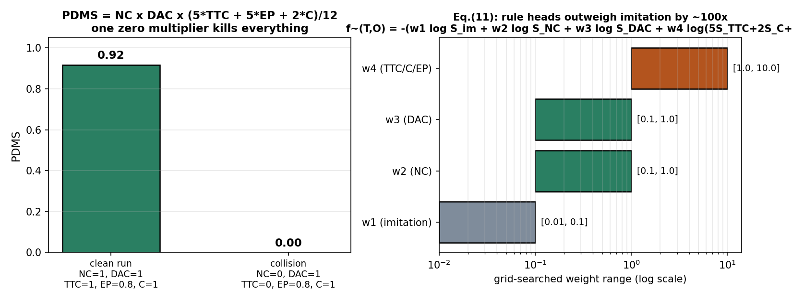

# 一台规划器，五个考官：把评测指标蒸进网络的 Hydra-MDP

> **论文信息块**
>
> - **全局编号**：88
> - **标题**：Hydra-MDP: End-to-end Multimodal Planning with Multi-target Hydra-Distillation
> - **作者**：Zhenxin Li, Kailin Li, Shihao Wang, Shiyi Lan, Zhiding Yu, Yishen Ji, Zuxuan Wu, Zhiqi Li, Ziyue Zhu, Jan Kautz, Yu-Gang Jiang, Jose M. Alvarez（NVIDIA 主导，复旦、华东师大、北理工、南大、南开合作）
> - **出处**：arXiv:2406.06978（v1 2024-06-11，v4 2024-08-30），全文 5 页。CVPR 2024 Autonomous Grand Challenge "End-to-end Driving at Scale" 赛道冠军，另获该赛道 Innovation Award。**注意：这是 workshop challenge 的冠军技术报告，不是 CVPR 主会论文。**
> - **代码状态**：仓库 https://github.com/NVlabs/Hydra-MDP 可公开访问（2026-10-09 核实，HTTP 200），但仓库内只有一个 commit、仅含一份 README，正文仍写着 "Delay in code and model release due to company policy"。**实现代码从未发布**，以下所有判断只能依据论文正文，训练细节以代码为准的那部分做不了。
> - **一句话核心洞见**：别再让规划器只学"开得像人"——直接让它学会给每条候选轨迹打"考试分"，把评测用的每一条规则都变成一个可微的打分头，推理时选总分最高的那条轨迹。

---

## "开得像人"为什么在 Navsim 上会输？——PDMS 的乘法结构

先看这篇论文要交卷的那张考卷。Navsim 用的总分叫 PDMS（Predictive Driver Model Score），论文公式 (12) 写成：

$$PDM_{score} = NC \times DAC \times DDC \times \frac{5 \times TTC + 2 \times C + 5 \times EP}{12}$$

五个子项：NC（无责任碰撞）、DAC（可行驶区域合规）、TTC（碰撞时间裕度）、C（舒适度）、EP（自车进度）。DDC（行驶方向合规）在 Navsim v1 里的权重是 0，论文正文也写了因为实现问题直接忽略了它——公式里还留着 DDC 这一项，属于写作上的小瑕疵，按官方定义它恒等于被乘掉。

关键在结构：**NC 和 DAC 是乘子**。NC 取值 {0, 1/2, 1}（无碰撞 1、非责任碰撞 1/2、责任碰撞 0），DAC 取值 {0, 1}。只要撞一次有责任的车，或者开出可行驶区域，总分直接归零——后面 TTC、EP、舒适度拿满分也没用。上面的左图（A）把这件事画出来了：一条干净利落的轨迹 PDMS 接近满分；同样一条轨迹，只要 NC 从 1 掉到 0，总分从 0.92 跌到 0。

现在看传统的模仿学习在干什么：损失是预测轨迹和人类轨迹的 L2 距离。L2 距离对"撞没撞"不敏感——一条和人类轨迹平均偏离 0.5 米但擦着行人过去的轨迹，L2 损失可能很小，PDMS 却是 0。反过来，一条为了避让而比人类多打了半把方向的轨迹，L2 损失很大，PDMS 可能接近满分。**训练目标和考试大纲错位了**，这就是作者要回答的失败：单目标模仿学习在多指标评测下顾此失彼。不是模型不够大，是优化的方向和打分表的方向不一致。

*自绘图。左（A）：PDMS 的乘子归零效应——NC 从 1 掉到 0，总分直接归零，后面三项拿满也没用。右（B）：公式 (11) 推理权重的网格搜索区间（对数轴），规则头的权重比模仿头高出约两个数量级。*

这个错位在 2024 年初并不是 obvious 的。当时端到端领域的主流信念还是"感知做好了、模仿损失降下去了，规划自然好"。VAD、UniAD 一路都是这个路子。Hydra-MDP 的作者把考卷本身摆到了台面上：既然评测是五个指标的乘加组合，训练就应该直接对着这五个指标学。

## 图 1 的三张小图，是作者走过的三条路

论文图 1 并排画了三种范式，读法不是"文献综述"，而是"我们试过什么、为什么不行"。

**(a) 单模态规划 + 单目标学习**：传感器进来，一条轨迹出去，损失就是和人类轨迹的 L2（论文公式 (1)：$L = L_{im}(T^*, \hat{T})$）。这是 Transfuser、VAD 那一路。感知可以拿真值做辅助监督，但辅助损失不进规划决策——感知头学得再好，规划头选轨迹时用不上。这是 Hydra-MDP 的感知网络部分实际在用的底座（Transfuser），作者对它很熟悉，知道它的天花板在哪。

**(b) 多模态规划 + 单目标学习**：先吐出 k 条候选轨迹，每条算一个和人类轨迹的相似度（公式 (2)，KL 散度或 max-margin），再用一个代价函数 $f(T_i, P)$ 做后处理，选代价最低的（公式 (3)：$T^* = \arg\min_{T_i} f(T_i, P)$）。这是 VADv2 的路子。注意公式 (3) 的输入 $P$ 是**预测出来的感知**（$\hat{P}$），不是真值。作者在这里埋了批判：后处理这一步不可微，而且它依赖的感知恰恰是会出错的那个版本。

**(c) 多模态规划 + 多目标学习**：Hydra-MDP 自己。还是 k 条候选，但每条轨迹的代价不再是手写规则现场算，而是**一个神经网络 $\tilde{f}(T_i, O)$ 直接从传感器观测预测出来**（公式 (5)）。训练这个网络用的监督，是教师在**真值感知** $\hat{P}$ 上跑仿真得到的分数（公式 (4) 右边那项：$L_{kd}(f(T_i, \hat{P}), \tilde{f}(T_i, O))$）。

三张图连起来看，作者的思考路径是：(a) 的问题是目标错位 → (b) 想用后处理补规则，但后处理不可微、吃的是带噪声的感知 → 那就把"规则打分"这件事本身变成网络的一个可微模块，用真值感知算出的分数去教它。这就是 hydra-distillation 的来历。"Hydra"（九头蛇）指的就是：一个身体（共享的轨迹解码器），多个头（每个评测指标一个打分头）。

## 最直接的修法：后处理选轨迹，它死在哪两个地方

在 Hydra-MDP 之前，VADv2 这类工作已经意识到光模仿人类不够，所以加了后处理：k 条候选轨迹生成之后，用感知结果（检测框、占据栅格）算每条轨迹的碰撞代价、越界代价，挑代价最小的。这是最直接的修法，作者为什么不满意？论文给了两个理由，值得展开。

**第一，不可微。** 后处理发生在网络输出之后，梯度传不回去。规划网络在训练时完全不知道"这条轨迹会撞"这件事——它只知道"这条轨迹离人类轨迹有多远"。于是网络永远学不会"环境如何影响规划"这个映射：前面有辆车停着，我就该换一条轨迹。这种"看见环境→调整选择"的能力，在后处理范式里是写死在规则里的，不是学出来的。换个新场景（比如 Navsim 里那些意图突变的场景），规则覆盖不到就失效。

**第二，后处理吃的是预测感知 $\hat{P}$，不是真值。** 检测框漏检一个行人，后处理的碰撞代价就算错，选出一条撞人的轨迹。规则规划器（比如 PDM-Closed）在真值感知下很强，145 行代码就能在 nuPlan 上打高分；但一旦把真值换成预测感知，性能就掉下来。论文引言里这句话是重点：rule-based planners struggle with imperfect perception inputs。作者的判断是：规则本身是对的，错的是规则吃到的输入。既然如此，能不能让网络**直接从传感器**学会规则的打分，而跳过"先感知、再套规则"这两步？这就是公式 (4) 里教师用 $\hat{P}$、学生只用 $O$ 的不对称设计的动机。

## Hydra-distillation：请两个老师，一个教"像人"，一个教"守规矩"

蒸馏框架里有三类角色：

- **人类教师**：log-replay 的人类轨迹 $\hat{T}$。教的是"正常人会怎么开"，对应公式 (8) 的模仿头。
- **规则教师**：在真值感知 $\hat{P}$ 上对词表里每条轨迹跑离线仿真，得到每条轨迹在每个指标上的分数 $\hat{S}_i^m$。教的是"这条轨迹守不守规矩"，对应公式 (10) 的 hydra 打分头。
- **学生**：只看传感器观测 $O$，要同时拟合上面两类监督。

"多目标"体现在：学生不是学一个总分，而是**每个评测指标学一个头**。NC 一个头、DAC 一个头、TTC 一个头、C 一个头、EP 一个头，外加一个模仿头。推理时再把这些头的输出按权重拼起来选轨迹。为什么不断一个总分头？表 1 给了直接证据：Hydra-MDP-V8192-PDM（蒸馏总 PDM 分数那一行）只有 80.2，比拆开蒸馏的 83.0 低了 2.8 个点。作者的解释是总分的分布不规则（irregular distribution）——想想 PDMS 的结构：两个乘子动不动就把总分拍到 0，总分的直方图是一个在 0 处有尖峰、在中间稀稀拉拉的分布，网络拟合这种分布很吃力。拆成子指标之后，每个头的目标分布都规整得多：NC/DAC/TTC/C 接近二值，EP 是 [0,1] 连续值。这是整篇论文里最实在的一个设计判断：**蒸馏的目标越接近评测的原子项，学起来越顺**。

## 轨迹词表是怎么造出来的：70 万条轨迹聚成 8192 个"常用动作"

规划器不直接回归一条轨迹，而是从一个固定的"轨迹词表"里选。这是跟着 VADv2 的做法。词表构建：从 nuPlan 原始数据库里随机采样 70 万条轨迹，每条是 40 个时间步的 $(x, y, heading)$（10Hz × 4 秒，正好对应 Navsim 的 4 秒仿真 horizon），然后 K-means 聚成 k 个中心，k 取 4096 或 8192。

这个离散化有两层用意。第一，它把"规划"变成了"分类+打分"：k 条候选是固定的，网络只需要给每条打分，不需要从零生成轨迹，训练稳定得多。第二，它让离线蒸馏成为可能：规则教师可以**预先**把词表里每条轨迹在每个训练场景下的仿真分数全算好，存成监督信号。代价是表达能力被词表封顶了——人类开出一条词表里没有的轨迹，学生永远选不出来。表 1 里 V8192 全面好于 V4096（83.0 vs 82.6），说明词表密度确实是瓶颈之一，但论文没有继续往上试（16384 会怎样？未确认）。

解码器结构（公式 (6)(7)）：词表 $V_k$ 先过 MLP 变成 k 个 latent query，形状 $[k, d]$；过 transformer encoder 层做自交互，再加上自车状态 $E$（ego status，位置、速度、航向这些标量拼成的向量）；然后以环境 token $F_{env}$ 为 K、V 做 cross-attention，把场景信息灌进每个候选。输出 $V_k''$ 形状还是 $[k, d]$——**每个候选轨迹一个 d 维向量**，后面所有打分头都从这个向量出。这是典型的 DETR 式 query 设计，query 的数量就是候选轨迹的数量。

## 公式 (8)(9)：模仿头到底在学什么——一个三条轨迹的小算例

模仿分支的损失是交叉熵：

$$L_{im} = -\sum_{i=1}^{k} y_i \log(S^{im}_i)$$

其中 $S^{im}_i$ 是第 i 条候选过 softmax 后的分数，$y_i$ 是" soft 的真值"。$y_i$ 的构造是公式 (9)：

$$y_i = \frac{e^{-(T_i - \hat{T})^2}}{\sum_{j=1}^{k} e^{-(T_j - \hat{T})^2}}$$

直觉：离人类轨迹越近的候选，分到的目标概率越大。注意分母是对全部 k 条候选求和，所以 $y$ 是一个 k 维概率分布——**模仿被做成了一个 k 分类问题**，而不是回归一条轨迹。这和 UniAD/VAD 直接回归 waypoint 的做法不一样，好处是多模态：人类在路口可以左转也可以直行，softmax 分布可以同时给两条候选高概率，回归只能吐一个均值。

算一个小例子。设 k=3，三条候选和人类轨迹的 L2 距离平方分别是 0.04、1.0、4.0（第一条几乎重合，第二条偏 1 米，第三条偏 2 米）。分子：$e^{-0.04} \approx 0.961$，$e^{-1} \approx 0.368$，$e^{-4} \approx 0.018$；分母约 1.347。于是 $y \approx (0.713, 0.273, 0.014)$。网络要学的就是输出接近这个分布的 $S^{im}$。温度是隐含的 1——论文没有引入温度系数，这意味着距离的尺度直接决定分布的尖锐程度：差 2 米的候选概率被压到 1.4%，基本不参与梯度。如果场景里人类轨迹本身很激进（急打方向），最近的候选也离得很远，整个分布会变平，模仿信号就弱了。论文没讨论这个，算是个小缺口。

## 公式 (10)：每个评测指标配一个头，BCE 把规则分数"灌"进网络

规则蒸馏的损失：

$$L_{kd} = -\sum_{m,i} \hat{S}^m_i \log S^m_i + (1 - \hat{S}^m_i) \log(1 - S^m_i)$$

对每个指标 $m \in M$、每条候选轨迹 $i$，用二元交叉熵拟合教师分数 $\hat{S}^m_i$。$\hat{S}^m_i$ 是离线算好的：拿真值感知，在该场景下仿真第 i 条轨迹 4 秒，按 Navsim 的官方打分逻辑算出 NC、DAC、TTC、C、EP 各项得分。$S^m_i$ 是学生第 m 个 hydra 头的输出（sigmoid 压到 [0,1]）。

这里有个细节值得停一下：EP 是 [0,1] 的**连续值**（自车进度 = 走了多远 / 人类走了多远），NC/DAC/TTC/C 是离散的（0/0.5/1 或 0/1）。BCE 天然适合二值目标，对连续的 EP 其实是在做一种 soft 回归——BCE 对 [0,1] 连续目标仍然有定义，梯度会把预测往目标值推。论文早期实验干脆没蒸馏 EP（"the continuous metric EP is not considered in early experiments"），最后一行 -W-EP 把 EP 加回来，总分从 85.7 涨到 86.5，EP 子项从 77.8 涨到 78.7。这说明连续指标用 BCE 也能学，但作者一开始对它没把握——侧面印证"拆成原子指标"这个判断是摸索出来的，不是先验的。

训练时总损失就是 $L_{im} + L_{kd}$ 再加感知头损失（论文为简洁省略了感知损失的写法）。教师只在训练时出现，推理时学生完全自给自足：传感器进来，k 条候选的各科分数出来，完事。

## 公式 (11)：推理时五个分数怎么拼成一个选择——权重告诉你谁说了算

推理时的总代价：

$$\tilde{f}(T_i, O) = -(w_1 \log S^{im}_i + w_2 \log S^{NC}_i + w_3 \log S^{DAC}_i + w_4 \log(5S^{TTC}_i + 2S^{C}_i + 5S^{EP}_i))$$

选 $\tilde{f}$ 最小的那条轨迹。先看数学形状：加权对数和 = 对数 अंदर 的连乘，即 $\tilde{f} = -\log\left[(S^{im})^{w_1} (S^{NC})^{w_2} (S^{DAC})^{w_3} (5S^{TTC}+2S^{C}+5S^{EP})^{w_4}\right]$。这是一个**几何加权平均**，神似 PDMS 自己的结构（乘子 × 加权和）。作者把 PDMS 的代数形状直接抄进了推理公式——"考试怎么打分，我就怎么写选择函数"。

再看权重。论文给了网格搜索的范围：$w_1 \in [0.01, 0.1]$，$w_2, w_3 \in [0.1, 1]$，$w_4 \in [1, 10]$。图 B 把这四个区间画在对数轴上：**规则头的权重比模仿头高出约两个数量级**。$w_1$ 最大 0.1，$w_4$ 最小 1——在最极端的情况下，TTC/C/EP 组合项的影响力也是模仿项的 10 倍起。上面的右图（B）把四个权重的搜索区间画在对数轴上，一眼能看出差距。这意味着：只要规则头说某条轨迹会撞（$S^{NC} \to 0$，$\log S^{NC} \to -\infty$），模仿头说"这条最像人"也救不回来。作者用权重投票的结果宣告了论文的立场：**像人不重要，守规矩才重要**。这和引言批判的"merely mimicking human drivers"首尾呼应。

但这里藏着一个诚实的问题，论文自己也承认了半句：权重是网格搜索出来的，"to mitigate the imperfect fitting of different teachers"——直译：因为各个老师拟合得不好，才需要权重来兜底。也就是说，hydra 头并没有完美复刻教师分数，推理时的加权组合是在**补偿蒸馏的误差**。表 1 里 -W（加权）这一项的贡献是 83.0 → 85.7，涨了 2.7 个点，比 hydra-distillation 本体相对 VADv2 的提升（79.7 → 82.6，约 2.9 个点里还混着模仿损失改动的贡献）还要实在。最承重的设计可能不是蒸馏，而是这个推理时的加权公式——论文没有做"去掉蒸馏、只留加权"的消融，这个缺口后面还要再谈。

## 走一遍：一个左转路口，三条候选轨迹各自的命运

把机制放在一个具体场景里跑一遍。场景：无保护左转路口，对向车道有车流，左侧人行道有行人准备过街。自车要左转。词表里有三条相关的候选：

- **T₁**：小半径急左转，切弯心，最贴近人类老司机的走线。人类轨迹 $\hat{T}$ 也是这么开的。
- **T₂**：大半径左转，绕开弯心，路线保守，多走 3 米。
- **T₃**：直行后掉头，完全避开冲突，但 EP（进度）会很低。

**模仿头**（公式 8/9）：T₁ 离 $\hat{T}$ 最近，$S^{im}_1$ 最高（比如 0.6）；T₂ 次之（0.3）；T₃ 最远（0.1）。如果只用模仿头，选 T₁。

**规则教师离线打分**（真值感知下仿真 4 秒）：T₁ 切弯心时和行人轨迹在 2 秒后相交 → NC 教师给 0（责任碰撞）；T₂ 全程无碰撞 → NC=1，DAC=1，TTC=1，EP=0.85（多走了路）；T₃ 无碰撞但 EP=0.3。DAC 三条都是 1。

**学生拟合后**（传感器输入，有噪声）：$S^{NC}_1 \approx 0.05$（学到了 T₁ 危险），$S^{NC}_2 \approx 0.95$，$S^{NC}_3 \approx 0.98$。

**推理组合**（取 $w_1=0.05, w_2=0.5, w_3=0.5, w_4=5$）：T₁ 的 $w_2 \log(0.05) \approx 0.5 \times (-3.0) = -1.5$，这一项直接把它拍死；T₂ 总代价最低，被选中。T₃ 虽然最安全，但 $5S^{TTC}+2S^{C}+5S^{EP}$ 里 EP=0.3 拖了后腿，输给 T₂。

**同一个场景，(b) 范式（VADv2 + 后处理）会怎么走**：后处理用**预测感知** $\hat{P}$ 算碰撞代价。如果检测头漏检了那个行人（小目标、被 A 柱遮挡一帧），$f(T_1, \hat{P})$ 算出的碰撞代价是 0，T₁ 凭着最高的模仿相似度被选中——车开出去，在第 2 秒撞上行人。这就是作者说的"后处理吃的是会出错的感知"。Hydra-MDP 的学生虽然也是从传感器看，但它学的是"**这类视觉模式 → 危险**"的直接映射，不经过"先画框、再算碰撞"两步，漏检的那一帧不会以"框不存在=没危险"的方式被放大。当然，学生也可能学错——这就是蒸馏的上限问题，下一节展开。

## 规则教师怎么把"环境如何影响规划"可微地教给学生

这是论文摘要里最关键的一句："learns how the environment influences the planning in an end-to-end manner instead of resorting to non-differentiable post-processing"。翻译成机制：

1. **教师侧（离线，只用一次）**：对训练集每个场景，取词表全部 k 条轨迹，用真值感知跑 Navsim 的 4 秒仿真，得到 $k \times |M|$ 个分数。这是一个纯 CPU/规则计算过程，不需要梯度。论文没给这个预处理的总耗时——k=8192、训练场景 1192 个（论文写的 Navtrain 拆分），每个场景要仿真 8192 条轨迹，这是九百多万次 4 秒仿真。即使单次仿真很快，这个量级也不容小觑，论文对此只字未提。

2. **学生侧（训练，可微）**：$V_k''$（$[k, d]$，每条候选一个向量）进 hydra 头，每个头是一个 MLP → sigmoid，输出 $[k, 1]$ 的分数。BCE 损失把教师分数"压"进这些 MLP 的权重里。梯度从 BCE 出发，经过 MLP、cross-attention、backbone，一直传到像素。**"前面有行人→这条轨迹危险"这个映射，被写进了网络权重**，而不是写在推理时的 if-else 里。

3. **推理侧（无教师）**：公式 (11) 的加权组合是可微的（虽然推理时不需要梯度），整个 pipeline 从传感器到选出的轨迹没有不可微的断点。

对比 (b) 范式：$T^* = \arg\min f(T_i, P)$ 里，$\arg\min$ 不可微，$f$ 是手写规则，$P$ 是带噪感知。Hydra-MDP 把这三样东西全换了：$\arg\min$ 还在（最后选轨迹总得有个选择），但选择依据 $\tilde{f}$ 是学出来的，输入是原始传感器。**不可微的后处理没有被消灭，而是被"编译"进了网络**——这是理解这篇论文最准确的一句话。

## 学生考得比老师还高？表 1 里那个反常的 91.0

表 1 最值得多看两眼的不是 Hydra-MDP 自己的 86.5，而是第一行 PDM-Closed 的 89.1 和表 2 里 Hydra-MDP-C 的 91.0。**学生超过了老师**，这在蒸馏里是反常信号。论文其实给了免责声明，只是藏在表注里：† "The official Navsim implementation of PDM-Closed is potentially prone to errors due to inconsistent braking maneuvers and offset formulation compared with the nuPlan implementation"。

翻译：89.1 这个"教师分数"用的是 Navsim 官方复刻的 PDM-Closed，而这个复刻版**本身可能有 bug**（刹车动作不一致、偏移量公式和 nuPlan 原版对不上）。真正的教师（nuPlan 原版 PDM-Closed，或作者离线仿真用的那套打分）分数应该更高，论文没有给出。所以"91.0 > 89.1"不是学生超越了教师，而是学生超越了一个**有 bug 的教师复刻版**。这个细节决定了你怎么理解这篇论文的上限：如果教师真值未知，"state-of-the-art on Navsim"的含金量就要打折扣——至少打到"在 Navsim v1 这套特定打分实现下"的范围里。作者把这句关键信息放在表注小字里，而不是正文里讨论，这是写作上不坦率的地方。

表 1 里还有几行值得逐行读：

- Vadv2-V4096（79.7）→ Hydra-MDP-V4096（82.6）：+2.9。但注意表注 "*Our distance-based imitation loss is adopted for training"——VADv2 的基线也被换上了作者自己的距离型模仿损失，所以这 2.9 里混着"模仿损失改进"和"hydra 蒸馏"两份贡献，**没有干净的只加蒸馏的消融**。
- V8192-PP（后处理，79.9）vs V8192（83.0）：后处理只比基线多 0.2 个点，而蒸馏多了 3.1 个点。这是全篇最有力的对比，支撑了"后处理不如蒸馏"的核心论点，实验设计在这里是干净的。
- V8192（83.0）→ -W（85.7）：+2.7，来自推理权重网格搜索。→ -W-EP（86.5）：+0.8，来自把连续 EP 纳入蒸馏。
- 表 2 的 scaling：换 ViT-L/V2-99 大 backbone，89.9 → 90.3 → 91.0。论文特意点名之前的文献说大 backbone 对规划提升很小（引 [11]），然后展示自己的方法能吃到 scaling 红利——言下之意：之前吃不到是因为目标错位，目标对齐之后，感知越强，规则头学得越准。这是一个漂亮的论点，但三个模型还做了 sub-score ensembling（最终提交是三个模型分数加权平均），91.0 里有多少来自单模型、多少来自集成，论文没有拆开。

## Navsim 的"闭环"到底有多闭环：4 秒非反应式仿真

论文引言和标题反复说 "closed-loop metrics"，但 Navsim 的仿真机制是：**4 秒非反应式（non-reactive）仿真**——背景车辆全部按 log-replay 的记录轨迹走，自车按 LQR 控制器跟踪规划轨迹。背景车不会因为你变道而刹车，行人不会因为你靠近而停下。这不是 CARLA 或 nuPlan 那种反应式闭环，它是一个"开环执行的仿真壳"。

这个区别对理解 Hydra-MDP 的成绩至关重要。在非反应式仿真里，"好"的规划 = 在**别人都不动（按记录动）**的前提下不撞、不出界、走得远。规则教师打的分，衡量的正是这种"对静止未来"的适应。而真实驾驶里，你的一次变道会引起后车刹车、一次犹豫会让行人改变主意——这些交互在 Navsim 里不存在。所以 Hydra-MDP 学到的"环境如何影响规划"，严格说是"**静态未来**如何影响规划"。

有意思的是，NVIDIA 官方博客在宣布夺冠时用的措辞是 "learned open-loop proxy metrics"（学到的开环代理指标）——官方自己都承认这套东西是开环代理。论文正文用 "closed-loop" 这个词，属于把仿真包装得比实际更强。审稿人如果较真，会要求作者把 "closed-loop metrics" 改成 "simulation-based metrics"。摘要里那句 "simulation-based evaluation metrics" 反而是准确的。

这对成绩的解读意味着：86.5/91.0 是在**开环代理指标**上的成绩，它和真实闭环驾驶表现之间的差距，论文没有测量，也没法在 Navsim 里测量。这不是 Hydra-MDP 一家的问题，是 2024 年 Navsim 赛道所有参赛者的共同天花板。但读者应该知道这张考卷的性质，再决定给这个冠军多大的权重。

## 蒸馏范式的三处天花板

**第一处：教师的规则本身是不是最优的。** 规则教师 = Navsim 打分逻辑 + PDM-Closed 式的仿真。这套规则是人手写的：TTC 是二值的（给定期望区间内无碰撞风险就 1，否则 0），EP 是"走了多远/人类走了多远"，舒适度是加速度阈值。这些规则定义了"好驾驶"的**操作型**含义，但它们不是驾驶的最优解——比如 EP 鼓励"走得和人类一样远"，在一个人类司机开得很保守的场景里，EP 会惩罚一条更果断但安全的轨迹。学生拟合的是这套规则的分数，不是"驾驶"本身。蒸馏的上限定理在这里是紧的：学生再努力，也只是在复刻规则教师的偏好，包括它的偏见。

**第二处：学生在拟合分数，而不是学会驾驶。** 公式 (10) 的 BCE 让 hydra 头去匹配 $\hat{S}^m_i$。但"预测分数准"和"选出好轨迹"是两回事：推理时只关心 argmin 选出的那一条，分数的绝对精度只在排序翻转的边界上重要。网络可能把容量花在拟合大量平庸轨迹的精确分数上（k=8192 里绝大多数轨迹在当前场景下根本不合理），而对真正关键的几条候选的排序区分度不足。论文没有分析"分数预测误差"和"最终选择错误"之间的关系——这是蒸馏范式里最该做、但没做的诊断。

**第三处：网格搜索的权重是在哪选的。** $w_1$ 到 $w_4$ 的范围论文给了，但没给搜索步长、没说在哪个集合上选的最优（navtrain？navtest？）。如果是用 navtest 选的，那就是在测试集上调参，86.5 这个数字有 leakage 嫌疑。论文完全没提这件事。结合表 2 的最终提交还用了三模型集成，一个合理的怀疑是：榜单成绩里有一部分来自"对测试集的充分调参"，而不全是方法的泛化能力。5 页的 workshop 报告篇幅有限，但超参数选择集这种信息不该省略。

另外两处诚实的缺失：**推理代价**——k=8192 条候选，每条过 hydra 头打分，论文没给 FPS/latency；在 8×A100、batch 256、20 epoch 的训练配置下，推理能不能上车是未确认的。**随机种子**——所有数字都没有误差棒，单次运行的结果。

## 作者的底牌是哪一张

回到时间坐标：2024 年 6 月，Navsim 挑战赛（CVPR 2024 workshop）开赛不久，VADv2 刚放出来（2024 年 2 月），PDM-Closed 证明了规则规划器在真值感知下很强。作者手里的牌：

1. **评测即目标**：Navsim 的打分逻辑是开源的（navsim devkit），任何人都能离线算出任意轨迹的分数。把"考试答案"拿来当训练监督，这条路在规则上是允许的（离线蒸馏不算作弊），在技术上是直接的。第一张图（三种范式对比）就是这张牌的视觉化——它把"我们和别人的区别"讲成了一个所有人都能看懂的故事。
2. **零迁移成本**：hydra-distillation 不挑 backbone，Transfuser、ViT-L、V2-99 都能套。表 2 的 scaling 实验就是在展示这张牌：换大模型、换 ensemble，分数继续涨。对打榜来说，这是最硬的牌——方法的天花板不在架构，而在"愿意堆多少资源"。
3. **NVIDIA 的工程体量**：8×A100、8192 词表、全量离线仿真，这些不是每个参赛队都有的。论文 5 页的篇幅、没有误差棒、没有 latency 数据，都透露出这是一份"为夺冠写的报告"，不是"为讲清方法写的论文"。

Innovation Award 的颁奖词点出了组委会看中的东西："improving any end-to-end driving model using learned open-loop proxy metrics"——**任何端到端模型都能套用的、学到的开环代理指标**。注意"any"这个词：Hydra-MDP 真正的贡献不是那个具体的网络，而是一个**训练范式**：把评测指标蒸成可微打分头。这也是这篇论文对读者最有价值的部分。

## 能带走的两个想法

**第一个：把"选择"和"生成"分开，把"打分"做成可微的。** Hydra-MDP 的网络不负责发明轨迹（词表是现成的），只负责给每条轨迹打分。这个分工值得借鉴：生成是难的、离散的、不可微的；打分是容易的、连续的、可微的。很多规划问题（包括你自己的多规划器调度）都可以套这个分工——候选可以来自任何地方（规则、别的模型、人类演示），只要打分器是学出来的、可微的，整个系统就能端到端优化。后处理没有被消灭，只是被编译进了网络——这句话值得贴在墙上。

**第二个：蒸馏目标要拆到评测的原子项。** 总分 PDMS 的分布是病态的（乘子频繁归零），直接拟合总分（表 1 的 -PDM 行，80.2）不如拆成五个头（83.0）。一般性的教训：当你的评测是多个子项的非线性组合时，**让网络学每个子项，再在推理时用评测的代数结构把它们拼起来**（公式 (11) 抄了 PDMS 的形状），比让网络直接学总分容易得多。这个技巧不依赖自动驾驶，任何多指标优化都能用。

## 与本课题的关联：多规划器 Agent 能从 Hydra-MDP 偷什么，它缺的三块正是你要补的

用户的课题是"世界模型引导 + 自适应衰减情景记忆的闭环多规划器自动驾驶 Agent"：LLM 调度多个专家规划器，执行开放式自然语言驾驶指令，在 Bench2Drive 上做真闭环验证。Hydra-MDP 和这个课题在"多候选 + 选择"的骨架上是同构的，区别在于 Hydra-MDP 的候选是静态轨迹词表、选择依据是蒸馏的考试分数。

**能偷走的训练范式**：你的多个专家规划器（比如激进型、保守型、舒适型）每个都会输出候选轨迹，现在的问题是"LLM 调度器凭什么选"。Hydra-MDP 给了一个现成的答案：**为每个 Bench2Drive 评分子项训练一个打分头**（路线完成度、碰撞惩罚、闯红灯惩罚、舒适度……），把规则知识蒸进可微的头里，调度器看到的不再是"规划器 A 说走左边"这种自然语言，而是每个候选在每个维度上的量化分数。这比让 LLM 凭感觉选要扎实，也比手写仲裁规则要灵活。公式 (11) 的加权对数结构可以直接借用——把 Bench2Drive 的 driving score 代数形状抄进你的选择函数。

**它缺的三块，正是你的课题要补的**：

1. **开放式指令理解**。Hydra-MDP 的输入只有传感器和自车状态，没有语言。它的"多目标"是评测指标，不是用户意图。"开慢点，我晕车"这种指令在 Hydra-MDP 的框架里没有位置——模仿头只会复刻 log-replay 的人类，而人类当时并不晕车。你的 LLM 调度器要处理的是**意图空间**的多目标，这比评测指标的多目标高一个抽象层级。

2. **情景记忆**。Hydra-MDP 是纯前馈的：当前帧进来，打分出去，没有记忆。打分头学到的"这类视觉模式→危险"是静态关联，不会从"我上次在这里被加塞过"里学习。你的自适应衰减情景记忆要补的正是这个：把历史交互变成可检索的经验，调制当前的选择。Hydra 的头是"考试大纲的蒸馏"，你的记忆是"亲身经历的蒸馏"，两者正交，可以叠加。

3. **在线风险校验**。Hydra-MDP 的"校验"发生在训练时（离线蒸馏），推理时没有任何安全兜底——如果 hydra 头在某个分布外场景下打出全错的分数，argmin 会自信地选出一条撞墙的轨迹。你的闭环风险校验/冲突仲裁是在线的、运行时的，这是 Hydra-MDP 完全没有的一层。在 Bench2Drive 的真闭环里（背景车会反应、错误会累积），这一层不是装饰，是必需。

一句话定位：Hydra-MDP 解决了"**怎么把已知规则教给规划器**"，你的课题要解决的是"**规则没写、考试没考的东西怎么办**"——开放指令、历史经验、在线兜底。前者是后者的地基：先把 Hydra 式的多目标打分头作为你多规划器的候选评估器，再在上面长出记忆和仲裁。这篇 5 页的冠军报告，最大的价值就是证明了这条地基打得牢。

---

*精读依据：arXiv:2406.06978v4（5 页正文，无附录），PDF 已存于本目录 `hydra-mdp.pdf`；Navsim PDMS 定义核对自 navsim 官方文档（v1：PDMS = NC × DAC × (5×TTC + 5×EP + 2×C)/12，非反应式 4 秒仿真）；代码仓库状态核对自 GitHub（2026-10-09）：仓库公开但仅含 README，实现未发布。凡正文未给出的数字（如离线仿真总耗时、推理延迟、权重搜索步长与选择集、随机种子）均已在相应位置标注未确认，不做推测。*
