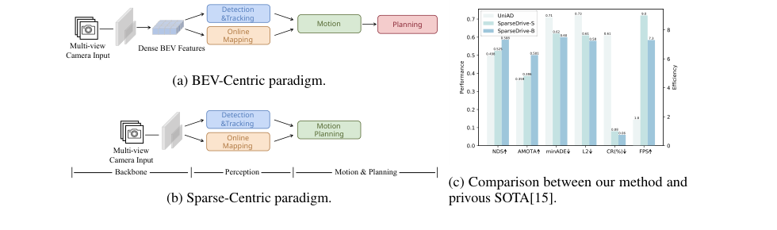
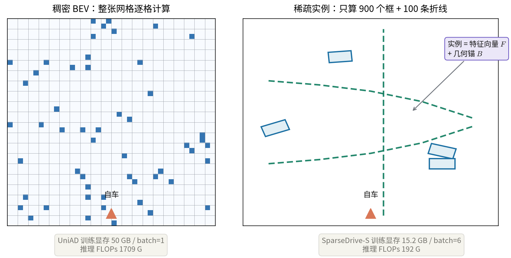
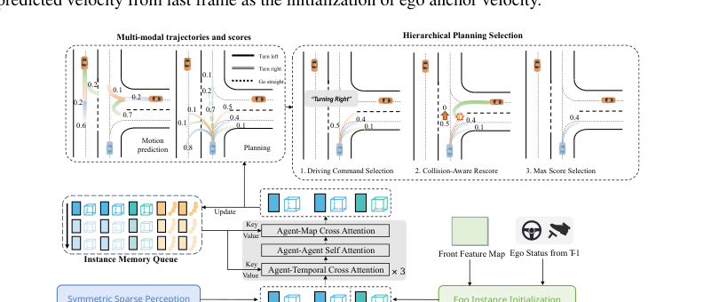
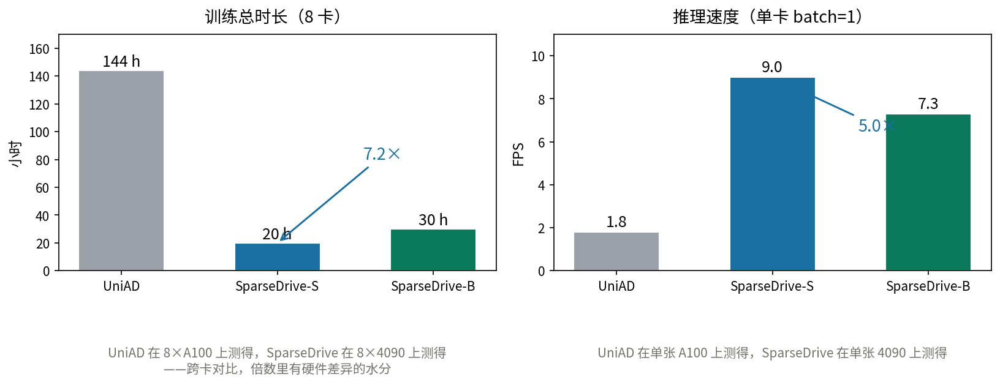

# 扔掉 BEV 网格，把规划写成预测：SparseDrive 的一次稀疏赌注

> **全局编号**：89
> **论文**：SparseDrive: End-to-End Autonomous Driving via Sparse Scene Representation
> **作者**：Wenchao Sun, Xuewu Lin, Yining Shi, Chuang Zhang, Haoran Wu, Sifa Zheng（清华大学 / 地平线）
> **发表**：ICRA 2025（arXiv:2405.19620v2，2024-05-31）
> **链接**：https://arxiv.org/abs/2405.19620
> **代码**：公开，https://github.com/swc-17/SparseDrive（MIT 协议；2024-06 发布；截至 2026-10 约 1000 star）
> **一句话核心洞见**：端到端自动驾驶不需要稠密 BEV 网格——用稀疏实例（一段特征向量加一个几何锚）统一检测、跟踪、建图，再把运动预测和规划做成同一个并行的多模态解码问题，最后用碰撞重打分从候选轨迹里挑出安全的一条；省掉的计算没有换来性能损失，nuScenes 全指标超过 UniAD 的同时训练快 7.2 倍。

## 图 1 右下角那张柱状图是作者的赌注

论文的第一张图（图 1a/1b）画了两条路线：BEV-Centric——多视角图像先变成稠密 BEV 特征，再依次做检测跟踪、建图、运动预测、规划；Sparse-Centric——图像直接变成稀疏实例，感知之后预测与规划并行。这张图本身只是示意图，真正下注的是图 1c。

*论文图 1（第 2 页）。(a) BEV-Centric 范式；(b) 提出的 Sparse-Centric 范式；(c) 与前人 SOTA UniAD 的性能与效率对比。看 (c) 时注意纵轴：NDS、AMOTA 越高越好，minADE、L2、碰撞率越低越好，FPS 越高越好——柱子方向混在一起，作者没有做归一化方向，读的时候要一根一根看。*

图 1c 想让你相信的只有一件事：**表示变稀疏之后，性能和效率同时变好**。NDS 0.498→0.588，AMOTA 0.359→0.501，minADE 0.71→0.60，L2 0.73→0.58，碰撞率 0.61%→0.06%，FPS 1.8→9.0。六根柱子全往"好"的方向倒。这在端到端自动驾驶里是不常见的——通常去掉一个大模块要付出代价，这里作者声称白捡。整篇论文就是为这张图服务的：两个判断（BEV 没必要；预测规划是同一个问题）是论证，稀疏感知和并行规划器是构造，七张表是证据。

先把时间坐标摆出来。UniAD 是 CVPR 2023 的工作，第一次把检测、跟踪、建图、预测、规划装进一个以规划为目标的统一查询框架；VAD 是 ICCV 2023，用向量化表示把效率往上提了一截。SparseDrive 投稿时（2024 年 5 月 arXiv v1）要打的就是这两个。它的作者名单里有 Xuewu Lin——Sparse4D 系列（2022–2023，地平线）的核心作者。Sparse4D 已经在纯感知任务上证明了稀疏时空融合能打，这篇论文等于把那套成熟的感知机器直接嫁接到端到端驾驶上，再补一个并行规划器。这就是作者的底气，下面单独讲。

## 第一个判断：BEV 的稠密网格又贵又没必要

2023 年前后，端到端驾驶的默认架构是 BEV-Centric：不管后面接什么任务，先把多视角图像特征提升（lift）到三维、拍扁（splat）到一张鸟瞰网格上。UniAD 的 BEV 查询是稠密的，之后检测、跟踪、建图、预测、规划全在这张网格上做交叉注意力。默认信念是：驾驶需要一张统一的、空间对齐的稠密地图，规划才能"看清"全场。

SparseDrive 推翻的正是这个默认。作者的论证分两半，一半是账，一半是表示。

先看账。表 3 把 UniAD 和 SparseDrive 放在同一张表里：训练显存 50.0 GB 对 15.2 GB（S 模型）/17.6 GB（B 模型），单卡 batch 从 1 放大到 6/4；推理 FLOPs 1709 G 对 192 G/787 G，参数量 125.0 M 对 85.9 M/104.7 M。稠密 BEV 的贵，贵在"不管有没有东西，每个格子都要算一遍"——注意力要在几万个 BEV 位置上跑，显存和计算跟着网格分辨率平方增长。稀疏表示只维护 900 个检测实例加 100 个地图实例，计算量跟着实例数走，和场景大小解耦。

再看表示。BEV 网格回答的是"每个位置有什么"，实例回答的是"有哪些东西、分别在哪"。对驾驶决策真正起作用的是后者：自车要躲的是那辆切进来的车、要跟的是那条车道线，不是一张布满空地的占用栅格。空地的信息量是零，算它就是浪费。下面这张示意图把两种表示的差别画了出来：

*自绘示意图。左：稠密 BEV 对整张网格逐格计算，大量格子是空地；右：稀疏实例只维护检测框与地图折线。数字引自论文表 3。*

这里有一个"为什么我自己想不到"的点。BEV 网格把**表示**和**计算**绑死了：表示是网格，计算就必须扫全网格。想通稀疏路线，关键一步是把两者解耦——表示换成实例集合，计算只发生在实例上。这一步属于"放弃一个所有人默认的约束"：表示不一定是空间连续的网格。约束一松，deformable attention 那套"只在感兴趣的位置采样"的机制（DETR 系传下来的）就能直接用上，而 BEV 范式里这些机制用不上，因为网格本身就是稠密的。

## 作者的底牌是 Sparse4D，不是这篇论文本身

一个研究者敢把 BEV 整个拿掉，一定是因为手里有替代品。SparseDrive 的替代品是 Sparse4D 系列已经验证过的东西：三维空间里显式放锚（anchor），把锚投影到图像上采样局部特征，迭代 refine。Xuewu Lin 是 Sparse4Dv3 的一作，那篇工作已经证明"时序传播下来的实例天然带有身份一致性"，跟踪不需要复杂的关联后处理。SparseDrive 的感知模块几乎就是把 Sparse4Dv3 的检测跟踪分支复制过来，再对称地加一个建图分支。

证据在论文的措辞里。引言反复出现的词是 sparse representation 和 parallel，而方法部分的感知章节大量引用 [31][32][33]（Sparse4D 系列）作为"we follow"。一个全新的表示范式如果从零开始训练，审稿人第一个问题就是"训得动吗"；但作者的 stage-1 本来就是在训练一个 Sparse4D 式的感知器——这个问题在投稿前已经被前作回答过了。所以这篇论文真正的风险只落在后半段：并行运动规划器。这也解释了为什么消融实验（表 4、表 5、表 6）几乎全部围绕规划器展开，感知部分没有消融——感知是底牌，不需要再证明。

目标会议的口味也藏在这里。ICRA 的审稿人看重系统完整性和效率数字，表 3 的训练推理效率对比、9.0 FPS 的实时数字，都是写给机器人会议看的。换成投 CVPR，审稿人可能会追问表示学习的理论分析，而这篇论文里是没有的。

## 一个实例 = 一段特征向量 + 一个几何锚

稀疏感知的全部内容可以压缩成一句话：场景里每一个值得关心的东西（动态的车/人，静态的车道线），都用一个二元组表示——

- 一段特征向量 $F$，$\in \mathbb{R}^{C}$，负责"这是什么、长什么样"，从图像里采样聚合而来；
- 一个几何锚（anchor），负责"它在哪、朝哪、多大、多快"，是显式的、可投影回图像的几何量。

检测分支维护 $N_d=900$ 个实例：$F_d \in \mathbb{R}^{N_d \times C}$，$B_d \in \mathbb{R}^{N_d \times 11}$。锚框的 11 个数按论文 3.2 节的定义排布：

$$\{x, y, z,\ \ln w, \ln h, \ln l,\ \sin \mathrm{yaw}, \cos \mathrm{yaw},\ v_x, v_y, v_z\}$$

位置 3 个、尺寸取对数 3 个、朝向用正余弦 2 个（避免角度不连续）、速度 3 个。拿一个具体例子：自车左前方 12 米、右方 18 米处有一辆车，长 4.5 米宽 1.9 米高 1.7 米，朝向正前方，以 6 m/s 向左前方行驶，它的锚大约是 $\{12.0, 18.0, 0.5,\ 0.64, 0.53, 1.50,\ 0, 1,\ -6.0, -2.0, 0\}$，其中 $\ln 1.9 \approx 0.64$、$\ln 1.7 \approx 0.53$、$\ln 4.5 \approx 1.50$。这 11 个数全是可微的，网络输出的是它们相对初始锚的偏移量。

建图分支是同一套东西换了个几何定义：静态地图元素用折线（polyline）表示，$N_p=20$ 个点，$L_m \in \mathbb{R}^{N_m \times N_p \times 2}$，$N_m=100$ 条；配上 $F_m \in \mathbb{R}^{N_m \times C}$。车道分隔线、人行横道、道路边界都画成 20 个点的折线——MapTR 那套"点集等价置换"的表示，这里直接拿来用。

核心张量形状汇总如下（$C$ 为特征通道数，论文未明确给出数值，按 Sparse4D 惯例一般取 256）：

| 符号 | 形状 | 含义 |
|---|---|---|
| $F_d$ | $900 \times C$ | 检测实例特征 |
| $B_d$ | $900 \times 11$ | 检测锚框（位置/尺寸/朝向/速度） |
| $F_m$ | $100 \times C$ | 地图实例特征 |
| $L_m$ | $100 \times 20 \times 2$ | 地图锚折线（20 个点） |
| $F_e$ | $1 \times C$ | 自车实例特征 |
| $B_e$ | $1 \times 11$ | 自车锚框 |
| $E_d$ | $900 \times C$ | 锚框经变换得到的高维位置编码 |

$E_d$ 值得停一下：注意力层里，query 需要位置信息。稠密范式里位置是 BEV 网格坐标，天然就有；稀疏范式里位置藏在锚框的 11 个数里，必须显式地把它升维成 $C$ 维向量 $E_d$ 才能和特征相加做位置编码。这是稀疏表示的一个小代价：几何信息不能白拿，每用一次都要编码一次。

## 可变形聚合：在锚周围撒点，回图像上采样

解码器每一层要回答：给定现在的锚框，怎么从图像里捞到更准的特征来修正它？SparseDrive 沿用 Sparse4D 的可变形聚合（deformable aggregation），过程分三步：

1. **撒点**：在锚框 $B_d$ 周围生成一组固定的或可学习的关键点（keypoints）——可以想象成在框的 8 个角和中心附近各放几个采样点，一共几十个；
2. **投影**：把这些三维点按相机内外参投影到 $N$ 个视角、$S$ 个尺度的特征图 $I \in \mathbb{R}^{N \times C \times H_s \times W_s}$ 上，落在图像上的位置做双线性插值采样；
3. **相加更新**：采样到的特征直接加到实例特征上，$F_d \leftarrow F_d + \text{sampled}$，然后 FFN 和输出层根据更新后的特征预测分类分数和锚框偏移。

注意这个动作的几何含义：网络不是在"看整张图"，而是拿着一个三维假设（锚框）去图像上"验证"。锚框越准，采样点越落在目标上，捞回来的特征越有用；特征越有用，下一次的框修正越准。这是一个迭代求精的闭环，$N_{dec}=6$ 层解码器里，第 1 层是非时序解码器（输入随机初始化的实例），后 5 层是时序解码器，多了两个多头注意力：当前实例与上一帧时序实例的交叉注意力（拿历史信息），以及当前实例之间的自注意力。

时序解码器的输入一半来自本帧、一半来自历史帧。历史从哪来？一个实例记忆队列（instance memory queue），检测分支保留 top-600 个高置信实例、建图分支保留 33 个。队列是 FIFO：每帧把更新后的实例推进去，挤掉最老的。跟踪的身份一致性就落在这个队列上。

## 检测、跟踪、建图共用一套解码器，"对称"从哪来

论文图 3 把检测分支和建图分支左右并排画出来：deformable aggregation → FFN → refinement & classification，时序部分再加 self/cross attention，两边结构镜像。所谓的"对称"（symmetric）指的就是这个：**同一套解码器结构，只换实例的几何定义**（框 vs 折线），三个感知任务就统一了。

跟踪的处理尤其能说明作者的取舍。传统跟踪是 tracking-by-detection：先检测再做数据关联，需要匈牙利匹配一类的后处理。MOTR 那一路工作把跟踪查询（track query）引进来，用 tracklet-aware 的标签分配强制同一个查询持续跟住同一个目标，结果检测和关联两个目标打架（论文引了 [55][50] 讨论这个冲突）。SparseDrive 直接沿用 Sparse4Dv3 的做法：**不要跟踪损失，不要关联模块**。规则只有一条——某个实例的检测置信度超过阈值 $T_{thresh}=0.2$，就锁定目标并分配一个 ID，之后靠时序传播一直带着这个 ID。身份一致性是时序传播的副产品，不是优化目标。

这个设计的诚实之处在于它承认了一件事：端到端跟踪里最难的不是"跟住"，而是"别跟丢别跟错"。把检测做准、把时序特征传好，ID 自然就稳了。表 1b 的数字支持这个判断：AMOTA 0.501（UniAD 0.359），ID switch 632（UniAD 906，减少 30.2%）。附录 B.1 还提到一个细节：锚框的位置用训练集 K-Means 聚类初始化，其余 8 个参数初始化为 $\{1,1,1,0,1,0,0,0\}$，即 $\ln w=\ln h=\ln l=1$、$\sin\mathrm{yaw}=0,\cos\mathrm{yaw}=1$、速度全零——朝向和速度从"静止正前方"开始学，位置从数据分布里来。

建图这边有个作者自己承认的短板：SparseDrive-B 建图 mAP 56.2%，低于单任务的 MapTR（58.7%）。结论章的 future work 第一条就写了：端到端模型的建图还打不过单任务方法。这是个诚实的注脚——对称统一带来了效率，但多任务联合优化在建图上确实交了一点税。

## 自车在相机盲区里：ego instance 的两处补救

并行规划器的第一个难题是：自车实例 $F_e$ 的特征从哪来？周围车辆的特征是从图像上采样聚合的，但自车在所有相机的盲区里——车头底下那块区域没有相机能直接看到，不存在"自车的图像特征"可以采样。

论文给了两处补救，都在 3.3 节的 ego instance initialization 里。

**第一处：特征用前视最小特征图做平均池化。**

$$F_e = \mathrm{AveragePool}(I_{front, S}) \tag{1}$$

$I_{front,S}$ 是前视相机最深层（分辨率最小）的特征图，整张图平均池化成一个 $C$ 维向量。作者给的理由有两个：最深层的特征图已经编码了驾驶场景的语义上下文；稠密特征图可以作为稀疏表示的补充——原文用了一个古怪的词 "blacklist obstacles"，指那些稀疏感知检测不出来的障碍物（比如不在检测类别里的异形障碍物），稠密特征至少还"见过"它们。

这个设计值得玩味。前面整篇论文都在论证"稠密表示没必要"，到自车这里又请回了一张稠密特征图做兜底。严格来说，"fully sparse scene representation"（摘要原话）是不成立的——自车实例的特征是稠密的。这不是错误，是诚实：稀疏表示有覆盖不到的东西，作者用一小块稠密特征打了个补丁。补丁很小（一张最小特征图的一次平均池化），但它说明作者自己清楚稀疏的边界在哪。

**第二处：速度不用真值，用上一帧的预测值。**

自车锚框 $B_e$ 的位置、尺寸、朝向是已知的（来自车辆自身的状态估计），直接填。只有速度麻烦：训练时如果直接拿真值速度初始化，会造成 ego status leakage——Li 等人 2023 年的工作 [27]（"Is Ego Status All You Need for Open-Loop End-to-End Autonomous Driving?"）已经证明，开环评测里自车状态是极强的信息泄漏源，模型靠它就能把 L2 刷得很低。所以 SparseDrive 加了一个辅助任务，用 $F_e$ 解码当前自车状态：

$$EST = \mathrm{MLP}(F_e) \tag{4}$$

$EST$ 包括速度、加速度、角速度、转向角。每一帧用**上一帧预测出的速度**来初始化本帧锚框的速度。第一帧没有上一帧怎么办？论文没写，按惯例用零初始化或一个先验值——这是论文里一个没说清的小缺口，复现时要自己定。

辅助任务的损失权重 $\lambda_{plan\_status}=1.0$，和规划回归损失同量级，说明作者希望自车状态解码得准——毕竟后面所有规划解码都建立在 $F_e$ 上。

## 第二个判断：预测和规划是同一个多模态问题

论文的第二个判断在引言里列了三条"被忽视的相似性"，转述如下：

1. **交互是对称的**。预测周围车辆的未来轨迹和规划自车的未来轨迹，都要考虑道路参与者之间高阶、双向的相互作用。但之前的方法（UniAD、VAD）是串行的：先预测别人，再根据预测结果规划自己——自车的行为对别人的影响被丢掉了。
2. **自车也需要语义和几何信息**。准确的轨迹预测需要场景理解的语义信息和预测位移的几何信息，这些信息在上游感知里只给周围车辆准备了，自车被忽视了（对应上一节的 ego instance 初始化）。
3. **两者都是多模态的**。预测和规划都有内在的不确定性，但之前的方法给规划只输出一条确定性轨迹。

这三条里面，第一条是真正有分量的。串行设计的失败场景很好构造：自车要变道，周围车辆的司机会根据自车的意图减速或让行——如果预测模块不知道自车打算变道，它预测出的周围车辆轨迹就是"自车不存在"世界里的轨迹，规划模块拿着这份预测去规划，等于在一个错误的未来里做决策。并行设计的回答是：把自车实例和周围车辆实例拼在一起做交互，让预测和规划在同一个表示空间里互相影响。

第二条是工程补全，第三条（多模态规划）之前也有工作做过（比如 Cui 等人的 Lookout [8]），但 SparseDrive 把它和并行设计绑在了一起：既然预测是多模态的，规划也应该是，两个解码头共享同一套交互后的特征。

## "并行"到底并行了什么：三次交互与记忆队列

并行运动规划器的结构见论文图 4 下半部分。先把自车实例和周围车辆拼成 agent 级实例：

$$F_a = \mathrm{Concat}(F_d, F_e), \quad B_a = \mathrm{Concat}(B_d, B_e) \tag{2}$$

$F_a \in \mathbb{R}^{(N_d+1) \times C}$——那个 "+1" 就是自车。然后是三次交互，顺序是：

1. **agent-temporal cross-attention**：每个实例看自己的历史。记忆队列大小 $(N_d+1) \times H$，$H=3$ 帧。注意和感知模块的区别：感知里是 scene-level（本帧所有实例看所有历史实例），这里是 instance-level（每个实例只看自己的历史）。作者的理由是让每个实例聚焦自己的运动连续性。
2. **agent-agent self-attention**：所有道路参与者（包括自车）之间的交互，这就是"双向影响"落的地方；
3. **agent-map cross-attention**：agent 看地图实例，拿车道结构约束。

这三层重复 3 次（图 4 里标了 ×3）。交互完之后，预测头和规划头**同时**解码：周围车辆的多模态轨迹 $\tau_m \in \mathbb{R}^{N_d \times K_m \times T_m \times 2}$ 和自车的多模态轨迹 $\tau_p \in \mathbb{R}^{N_c \times K_p \times T_p \times 2}$，以及各自的分数 $s_m \in \mathbb{R}^{N_d \times K_m}$、$s_p \in \mathbb{R}^{N_{cmd} \times K_p}$。超参数：$K_m=K_p=6$ 个模态，$T_m=12$（6 秒，2Hz）、$T_p=6$（3 秒），$N_{cmd}=3$ 种驾驶指令（左转/右转/直行，沿用 UniAD、VAD 的做法）。

"并行"这个词要打个折扣。交互和解码确实是并行的，但最后的**分层规划选择**是串行的后处理：按指令过滤、做碰撞重打分、取最大分数，三步依次发生。真正的决策（选哪条）发生在这一步，而不是并行解码里。并行解决的是表示和交互问题，选择问题还是靠规则。

## Mode query：把意图先验做成可加的向量

多模态解码的具体做法（附录 B.2，公式 5–8）：先用 K-Means 在训练集轨迹上聚出意图点（intention points），比如"直行快""直行慢""左转""右转""停住"这类典型终点，再用正弦位置编码变成 mode query：

$$\tau_m = \mathrm{MLP}(F_d + MQ_m), \quad s_m = \mathrm{MLP}(F_d + MQ_m) \tag{5,6}$$
$$\tau_p = \mathrm{MLP}(F_e + MQ_p), \quad s_p = \mathrm{MLP}(F_e + MQ_p) \tag{7,8}$$

$MQ_m \in \mathbb{R}^{K_m \times C}$，$MQ_p \in \mathbb{R}^{N_{cmd} \times K_p \times C}$。动作很简单：意图向量直接加到实例特征上，再过 MLP 解码出轨迹点和分数。几何含义是：同一个场景特征，加上不同的意图偏置，就往不同的未来走。训练用 winner-takes-all：6 条预测轨迹里和真值 ADE 最小的那条算正样本，其余算负样本，分类用 Focal loss、回归用 L1。

这里埋了一个细节：规划的 mode query 是按指令分组的（$N_{cmd} \times K_p$），每个指令下 6 个模态。意图点是 K-Means 从数据里聚出来的——它反映的是数据集中人类驾驶员的常见行为分布。如果测试场景里出现训练集没见过的意图（比如非常规的绕行），6 个先验意图可能盖不住。这是所有意图点方法的通病，论文没有讨论。

## 总损失五项，每项在罚什么

端到端训练的总损失（公式 3）：

$$L = L_{det} + L_{map} + L_{motion} + L_{plan} + L_{depth}$$

逐项看。$L_{det} = \lambda_{det\_cls}L_{det\_cls} + \lambda_{det\_reg}L_{det\_reg}$，分类用 Focal loss（$\lambda=2$）、框回归用 L1（$\lambda=0.25$），真值匹配用匈牙利算法一对一。$L_{map}$ 结构相同，权重是分类 1、回归 10——地图回归权重是检测的 40 倍，因为折线点的坐标回归需要更强的梯度信号。注意**没有跟踪损失**：ID 分配是规则式的，不需要优化目标。

$L_{motion}$ 和 $L_{plan}$ 都是"分类+回归"：$\lambda_{motion\_cls}=\lambda_{motion\_reg}=0.2$，$\lambda_{plan\_cls}=0.5$、$\lambda_{plan\_reg}=1.0$，外加自车状态回归 $\lambda_{plan\_status}=1.0$。规划的权重是预测的 2.5–5 倍——"planning-oriented"的优化目标就写在权重里。$L_{depth}$ 是深度估计辅助任务（$\lambda_{depth}=0.2$），作用是稳定感知模块的训练，纯技巧。

训练分两个阶段：stage-1 只训感知模块（SparseDrive-S：100 epoch，batch 8，lr 4e-4，backbone lr 缩放 0.5）；stage-2 感知加规划器联合训练，**不冻结任何权重**（10 epoch，batch 6，lr 3e-4，backbone 缩放 0.1）。stage-2 只有 10 个 epoch——联合优化的时间很短，大部分表示学习在 stage-1 就完成了。这意味着"端到端"的收益主要来自 stage-2 的联合微调，而不是从零开始的端到端训练。论文没有给"只做 stage-1 不做 stage-2"的对照，所以联合训练到底贡献了多少性能，读者无从得知——这是实验设计里缺的一块消融。

## 一个右转路口的完整走查

把上面的机制放在一个具体场景里走一遍。场景：自车在路口等右转，指令是 "turn right"。左方 30 米处一辆车以约 8 m/s 接近路口，感知模块给了它一个实例：锚框 $B_d$ 行为 $\{x{=}30.0, y{=}8.0, z{=}0.6,\ \ln w{=}0.64, \ln h{=}0.53, \ln l{=}1.50,\ \sin\mathrm{yaw}{=}0, \cos\mathrm{yaw}{=}1,\ v_x{=}-7.5, v_y{=}-1.0, v_z{=}0\}$，特征 $F_d$ 是 256 维向量（从图像上沿锚框撒点采样聚合而来），检测置信度 0.83——超过 0.2 的阈值，ID 锁定为 #17，之后每帧靠记忆队列传播带着这个 ID。

记忆队列里躺着 #17 过去 3 帧的实例。agent-temporal cross-attention 让当前 #17 只看自己的 3 帧历史，读出"它在匀速接近"；agent-agent self-attention 里 #17 和自车实例 $F_e$ 互相看——这是串行基线没有的一步：#17 的特征里现在混入了"自车正准备右转"的信息，它的预测会据此调整（比如预测里出现减速让行模态）；agent-map cross-attention 让它看到路口的车道线。

解码时，6 个意图 query（直行快、直行慢、左转、右转、停住、掉头）分别加到 #17 的特征上，MLP 输出 6 条未来 6 秒轨迹和分数。假设分数是 $[0.55, 0.25, 0.08, 0.06, 0.04, 0.02]$——最确信的两条都是"继续直行通过路口"，只是速度不同。

自车这边：$F_e$ 来自前视特征图的平均池化，$B_e$ 的位置朝向已知、速度取上一帧预测值（比如 2.1 m/s）。3 种指令 × 6 个模态 = 18 条候选轨迹。分层选择第一步按指令过滤，只留下 6 条 "turn right" 候选，分数假设为 $[0.05, 0.12, 0.08, 0.35, 0.25, 0.15]$。其中第 4 条（0.35）是个大半径右转，第 5 条（0.25）是小半径减速右转。

第二步碰撞重打分：拿 #17 最确信的两条预测轨迹（0.55 和 0.25 那两条直行线），逐条检查 6 条规划候选在未来 3 秒内是否与自车框重叠。第 4 条大半径右转在 $t=2.0$ 秒处切进了 #17 的直行轨迹——分数直接置 0。第 5 条小半径右转全程无重叠，保留 0.25。第三步取最大分数：第 5 条胜出，成为最终规划输出 $\tau_p^*$。

串行基线（UniAD 式）在这个场景里会怎么走？预测模块不知道自车要右转，#17 的预测是"无自车世界"里的版本；规划模块拿着这份预测做决策，两种失败都可能发生：要么过度保守（把 #17 的直行当成必然发生，原地多等两秒），要么漏掉交互（#17 其实会让行，但预测里没有）。表 4 的 ID-2 行量化了这个差距：把并行改成串行，预测 minADE 从 0.623 升到 0.641，规划碰撞率从 0.08% 升到 0.10%。

这个例子也暴露了重打分的一个脆弱点：如果感知漏检了 #17（比如被大车遮挡，置信度掉到 0.2 以下），预测模块里根本没有这个实例，重打分就无从谈起——第 4 条大半径右转会以 0.35 的最高分胜出。稀疏表示的安全兜底，完全系在检测召回率这一根线上。

## 分层选择三步：按指令过滤、碰撞重打分、取最大

论文图 4 上半部分把选择过程画成了三格漫画：

*论文图 4（第 6 页）。下半：实例记忆队列、三次交互、ego 初始化；上半左：多模态轨迹与分数（左为运动预测、右为规划）；上半右：分层规划选择三步——1. 驾驶指令选择，2. 碰撞感知重打分，3. 最大分数选择。*

三步的具体内容：

1. **驾驶指令选择**：从 $N_{cmd} \times K_p$ 条候选中取出当前指令 $cmd$ 对应的 $K_p=6$ 条，$\tau_{p,cmd} \in \mathbb{R}^{K_p \times T_p \times 2}$。指令是外部给的（评测时从数据里读），模型自己不决策"我要去哪"。
2. **碰撞感知重打分（collision-aware rescore）**：用运动预测里**最确信的两条**轨迹，检查每条规划候选是否会相撞；撞了就把分数置 0。注意：不是把轨迹修一下（那是 UniAD 的后优化做的事），而是直接判死刑。
3. **最大分数选择**：取剩下分数最高的一条。

表 5 把重打分和 UniAD 的后优化（post-optimization）放在一起比，很有说服力。UniAD 的后优化基于感知结果用手工规则去"修"轨迹，结果 L2 从 0.61 涨到 0.73（修坏了拟合），在作者重写的碰撞指标下碰撞率反而从 0.25% 升到 0.61%（修出了新的危险）。而 SparseDrive 的重打分只做选择不做修改：碰撞率 0.12%→0.08%，L2 几乎不动（0.61→0.61，3 秒点 0.95→0.96）。"只筛选、不动手"——这是重打分比后优化高明的地方，也是它"不破坏端到端范式"的底气。

但要指出：重打分本身是不可微的手工规则，它不参与梯度回传。论文批评后优化"打破端到端范式"，自己的重打分同样站在梯度流之外。区别只在于后优化改了轨迹的数值、重打分只改了选择的权重——前者污染了回归目标，后者没有。这个区分是成立的，但"完全端到端"的说法要打折扣。

表 6 还回答了"几个模态够用"：规划模态数从 1 加到 6，碰撞率 0.25%→0.07%、L2 0.69→0.61；加到 9 反而回落（0.15%、0.66）。6 是个饱和点——意图先验再细分，数据就撑不住了。

## 表 2b 的碰撞数字经历了两次重写

规划主结果（表 2b）：SparseDrive-B 的 L2 平均 0.58 米、碰撞率平均 0.06%；对比 VAD 的 0.72 米/0.21%、UniAD 的 0.73 米/0.61%。摘要里的"碰撞率降低 71.4%"就是 $(0.21-0.06)/0.21$，L2"降低 19.4%"是 $(0.72-0.58)/0.72$，基准都是 VAD——因为 VAD 是当时规划指标上最强的（UniAD 的 L2 0.73 与 VAD 0.72 接近，但碰撞率 0.61% 差得多）。

但这组碰撞数字有一个必须交代的背景：**指标是作者重写的**。附录 A 写明，之前 UniAD、VAD 的碰撞评测有两个缺陷：一是把障碍物框转成 0.5 米网格的占用图，小于一个格子的障碍物靠近自车时会产生假碰撞（引 Zhai 等人 [53]）；二是不考虑自车朝向变化、假设车头方向不变（引 Li 等人 [27]）。SparseDrive 改用"按轨迹点估计 yaw、直接检查自车框与障碍物框的重叠"来判定碰撞，并且用官方 checkpoint 把 UniAD 和 VAD 在新指标下重跑了一遍。做法是公平的（所有方法同一把尺子），但数字和原论文不可比——读者不能拿这里的 0.21% 去和 VAD 原文里的数字对照。

更值得记录的是**第二次重写**：GitHub 仓库的 README 里有一节 "Results of released checkpoint"，作者写道，发布代码后发现"之前的代码漏掉了一些碰撞情形"，于是重写了碰撞率评测。重写后的数字：SparseDrive-S 平均碰撞率 0.10%（3 秒点 0.23%），论文里是 0.08%（3 秒点 0.18%）；UniAD 在新代码下是 0.68%，VAD 是 0.24%。排名没变——SparseDrive-S 的 0.10% 仍然比 UniAD 的 0.68%、VAD 的 0.24% 低得多，但论文印刷的数字和开源代码跑出来的数字对不上，差了约 0.02 个百分点。这件事说明碰撞率这个指标在实现细节上非常敏感（框重叠的阈值、采样的时间粒度、是否计入静止障碍物），读论文时对小数点后两位的差距要留有余地。

预测指标（表 2a）相对干净：minADE 0.60 米、minFDE 0.96 米、MissRate 13.2%、EPA 0.555，相对 UniAD 分别降低 15.5%、5.9%，EPA 从 0.456 提到 0.555。EPA（end-to-end prediction accuracy，来自 ViP3D）同时惩罚漏检和预测误差，是端到端预测里更诚实的指标。

## 效率数字里跨卡对比的水分

表 3 的效率对比是论文的高光，但要拆开看。训练总时长：UniAD 144 小时（48+96，两阶段），SparseDrive-S 20 小时（18+2）、B 模型 30 小时（26+4）——7.2 倍和 4.8 倍。推理 FPS：1.8 对 9.0/7.3——5.0 倍和 4.1 倍。

*自绘。数据引自论文表 3。注意两组数字不在同一种 GPU 上测得。*

水分在表注里，作者其实写明了：UniAD 的训练时间在 8×Tesla A100 上测，FPS 在单张 A100 上测；SparseDrive 在 8×RTX 4090 / 单张 4090 上测。4090 的单精度算力高于 A100，显存带宽也占优，所以"7.2 倍"里有一部分是硬件代差，不是纯粹的方法优势。作者没有隐瞒（表注写了），但摘要里的 "7.2× faster for training" 很容易被读成同硬件对比。

去掉硬件因素，真正属于方法的效率来自两处：一是训练显存 50 GB→15.2 GB（batch 还能从 1 放到 6），这是稀疏表示砍掉稠密 BEV 注意力的直接结果；二是推理 FLOPs 1709 G→192 G（S 模型），参数量 125 M→85.9 M。这两组数字和 GPU 型号无关，是硬效率。9.0 FPS 在 4090 上离车规实时还有距离，但比起 UniAD 的 1.8 FPS，已经从"完全不可用"走到了"勉强可用"的区间。

## 开环评测：作者自己承认的边界

整篇论文的评测只有 nuScenes 验证集的开环（open-loop）评测：给定一段人类驾驶员开过的场景，用 L2 距离衡量规划轨迹和人类轨迹的接近程度，用碰撞率衡量是否撞上回放的障碍物。结论章的 future work 第二条，作者自己写了："the open-loop evaluation cannot comprehensively represent the model performance"（开环评测不能全面反映模型性能）。

开环评测有三个结构性问题，论文都没有解决：

1. **因果混淆**。L2 小只说明"像人类开"，不说明"开得对"。一个在路口急刹的人类轨迹，模型学会急刹，L2 很低；但急刹本身可能是人类驾驶员的失误。开环评测奖励模仿，不奖励正确。
2. **分布偏移**。评测时障碍物按记录回放，不会对自车的行为做出反应。前面论证"并行设计"的核心理由恰恰是"自车会影响别人"——但在开环评测里，别人是不会被影响的录像带。并行交互带来的双向建模能力，在这个评测范式下只能部分兑现。真正能验证它的需要闭环仿真（比如 Bench2Drive、CARLA），论文没有做。
3. **自车状态泄漏的阴影**。Li 等人 [27] 指出，开环评测里只要给模型一点自车状态（速度、转向角），L2 就能刷得很好，因为"下一秒的位置 ≈ 现在位置 + 速度 × 时间"这个运动学外推太强了。SparseDrive 用上一帧预测速度初始化本帧锚框速度、加辅助任务解码自车状态——做法比直接用真值干净，但上一帧的预测速度本身已经高度相关于真值速度，泄漏没有归零。0.58 米的 L2 里有多少是规划智能、多少是运动学外推，论文没有分解。

公平地说，2024 年的端到端驾驶论文几乎全是开环评测，这是领域通行做法，不是 SparseDrive 一家的毛病。但读者要清楚：表 2b 的 0.06% 碰撞率是在"障碍物不躲你"的录像带世界里测的，离"上车"还差一次闭环验证。

## 稀疏表示漏检时，谁来兜底

稀疏表示最脆弱的一环是**召回率即安全**。稠密 BEV 里，一个没被检测到的障碍物至少还以"占用"的形式存在于网格上，下游模块有机会看到它；稀疏表示里，没进实例集合的东西就是不存在——预测没有它的轨迹，重打分检查不到它，规划对它一无所知。右转路口的例子已经演示过：漏检 #17，第 4 条危险轨迹直接胜出。

作者准备了两道兜底，但都有限：

- **ego 初始化里的稠密特征补丁**（公式 1）：前视最小特征图的平均池化，名义上让自车实例"见过"检测不出的障碍物。但这是一个全局平均向量——它知道"前面好像有东西"，不知道东西在哪、有多大、往哪动。对规划解码来说，这种信息只能起微弱的偏置作用，指望它躲开一个漏检的障碍物是不现实的。
- **重打分只用最确信的两条预测轨迹**：附录 B.2 明确写了用 top-2。为什么是两条不是六条？论文没给理由。直觉上，低分数的模态更可能是小概率但危险的情形（比如对向车突然变道），而重打分恰恰把它们排除在检查之外。这是一个为了减少误杀（false positive）而牺牲召回的选择，论文没有量化这个权衡。

遮挡场景是更具体的考验：路口被大货车挡住一半，行人从车头前面鬼探头。稀疏实例在这种场景下会经历"检测置信度在阈值上下抖动→ID 反复锁定/丢失→记忆队列里的历史断裂"。论文的评测没有单独拆遮挡子集，nuScenes 的平均指标把这类长尾藏起来了。这是稀疏路线欠下的一笔验证债。

## 把规划写成预测，到底丢掉了什么

这是三个怀疑里最根本的一个。论文的第二个判断说"预测与规划本质是同一个多模态问题"，并行解码器把两者做成了一样的计算。但预测和规划有一个不对称，是再怎么共享特征也抹不掉的：**预测是描述性的（别人会怎么走），规划是规范性的（我应该怎么走）**。把规划写成"预测自车"，至少丢掉了三样东西：

1. **意图的来源不同**。预测的意图来自别人的不可观测心智，只能靠猜（所以多模态是必需的）；规划的意图来自自车的目标——我要去哪、走哪条路。前者在解码器里是 mode query 加一加就能表达的，后者在 SparseDrive 里被压缩成了 3 个离散指令（左转/右转/直行）。开放式指令（"靠边停车""跟着前车""绕开水坑"）没有入口。规划的多模态在这里退化成了"同一指令下的轨迹扰动"，和预测的多模态（"他到底想干什么"）不是一回事。
2. **约束没有位置放**。真实规划要满足交通规则、舒适性、法规要求的安全距离，这些在 SparseDrive 里唯一的载体是模仿损失（跟人类开得像）和重打分（别撞）。重打分是事后过滤，不是约束满足——它能毙掉撞的轨迹，但保证不了选出来的那条在规则上是对的（比如实线变道、闯红灯，开环 L2 看不出来）。
3. **用自己的预测给自己打分，有循环论证的味道**。重打分拿运动预测的 top-2 轨迹去检查规划候选，但这两者来自同一套交互特征、同一个前向过程。如果感知系统性地漏掉一类障碍物（比如夜间的深色车辆），预测和规划会同时对它视而不见，重打分检查的是同一份"看不见"的世界。独立的风险校验应该来自**另一个**信息源或**另一套**机制，而不是同一网络的另一个头。

并行设计真正的贡献是交互建模（自车影响别人），这是实的；但"同一个问题"这个判断走得比证据远。规划需要的意图理解和约束满足，在这篇论文里是缺位的——恰好是 agent 范式要补的东西，后文会回到这一点。

## 消融表里真正承重的是 agent-temporal 注意力

表 4 逐项拆掉规划器的部件（全用 SparseDrive-S），掉得最多的一项决定了哪个设计真正承重：

- **ID-5，去掉 agent-temporal cross-attention**：L2 从 0.61 涨到 0.77（涨 26%），碰撞率从 0.08% 到 0.16%。这是全表最大的一次退化。每个实例看自己的 3 帧历史——这个看似平淡的时序建模，是规划器里最不能少的东西。直觉上也合理：没有历史就没有速度估计，没有速度，3 秒后的位置就是瞎猜。
- **ID-4，规划退化成单模态（确定性）**：碰撞率从 0.08% 涨到 0.25%，是碰撞指标上最惨的一次。单条轨迹被迫在"平均"所有可能未来，遇到需要决断的场景（让行还是抢行）就选出一条谁都像、谁都不对的折中线。多模态首先是为安全服务的，其次才是为 L2。
- **ID-2，并行改串行**：预测 minADE 0.623→0.641，碰撞率 0.08%→0.10%。差距不大但方向一致，支持"双向交互有用"的判断——只是这个收益比论文的行文强调的要小。
- **ID-3，去掉 ego 初始化的语义几何信息**：L2 0.61→0.63，碰撞率 0.08%→0.11%。有用，但不是决定性的。
- **ID-6，去掉碰撞重打分**：碰撞率 0.08%→0.12%，L2 不动。重打分是纯粹的安全增益，不碰拟合。

排序下来：时序交互 > 多模态 > 并行 > ego 初始化 > 重打分。论文的行文把"并行"放在最显眼的位置，但数字说时序建模才是顶梁柱。这不是否定并行——没有并行，交互无从谈起——而是提醒读者：消融表是识别承重结构的仪器，要按数字排优先级，不按章节标题排。

## 能带走的两个想法

**第一个：表示和计算解耦，实例是比网格更便宜的表示。** BEV 网格把"场景表示"和"全图计算"焊死了，SparseDrive 把它们拆开：表示换成"特征+几何锚"的实例集合，计算只发生在实例上。这个想法不只属于自动驾驶——任何"空间很大、感兴趣的东西很少"的任务（显微图像里的细胞、卫星图里的舰船、点云里的行人）都面临同样的稠密税。解耦之后，deformable attention 这类"按需采样"的机制才能真正省钱。带走的时候记住它的边界：实例表示把召回率变成了单点故障，省掉的计算要用检测召回率来还。

**第二个：只筛选、不动手的后处理，比改数值的后处理更安全。** 表 5 的对比干净利落：UniAD 的后优化动手改轨迹，L2 变差、碰撞率反而上升；SparseDrive 的重打分只把撞了的候选分数置零，L2 不动、碰撞率下降。一般性的原则是：后处理离梯度流越远、对手工规则的依赖越诚实（承认自己是规则，不假装是学习），它对主模型的污染就越小。这个想法可以直接用在任何"生成候选再选择"的系统里：让网络负责生成多样性，让规则负责一票否决，别让规则去改网络的输出数值。

## 与本课题的关联

用户的课题是"世界模型引导 + 自适应衰减情景记忆的闭环多规划器自动驾驶 Agent"：LLM 调度多个专家规划器，执行开放式自然语言驾驶指令，在 Bench2Drive 上做闭环验证。SparseDrive 在这张图里的位置很清楚——

**它可以当什么**：并行多模态规划器 + 碰撞重打分，是一个现成的"专家规划器"候选。它的输入输出接口很干净（多视角图像进，一条安全轨迹出），nuScenes 上的数字证明了它的底线不差；重打分的三步结构（按指令过滤→碰撞检查→取最大）本身就是一个微型仲裁器，可以直接参照着改造成多规划器之间的仲裁逻辑——把"候选轨迹"换成"各专家规划器的提案"，仲裁器的输入输出形状几乎不用变。

**它缺什么**：三样，正好是用户课题要补的三样。其一，**开放式指令理解**——SparseDrive 的指令空间是 3 个离散 token（左转/右转/直行），LLM 调度器要处理的是自然语言指令（"前面路口掉头""跟着那辆白车"），中间需要一层指令解析和 grounded 的目标表示，这是 SparseDrive 完全没有的部分。其二，**情景记忆**——它的记忆只有 3 帧的实例队列，是为运动连续性服务的短时记忆；用户课题里的自适应衰减情景记忆要解决的是"上次在这个路口吃过亏"的长时经验复用，两者差了不止一个量级，记忆的检索、衰减、写入机制都要另起炉灶。其三，**独立风险校验**——它的重打分用的是自己预测头的输出做检查，循环论证的问题上一节已经讲过；用户课题里的闭环风险校验如果也用同一套感知做检查，会继承同样的盲区，需要世界模型提供独立的未来状态预测作为第二信息源。

一句话：SparseDrive 证明了"稀疏实例 + 并行多模态 + 选择式安全"这条路走得通，它是用户课题里专家规划器池的一个强候选；但它止步于"听懂三个词、记住三帧、用自己的眼睛检查自己"——剩下的三块拼图，恰好是 agent 范式要解决的问题。
