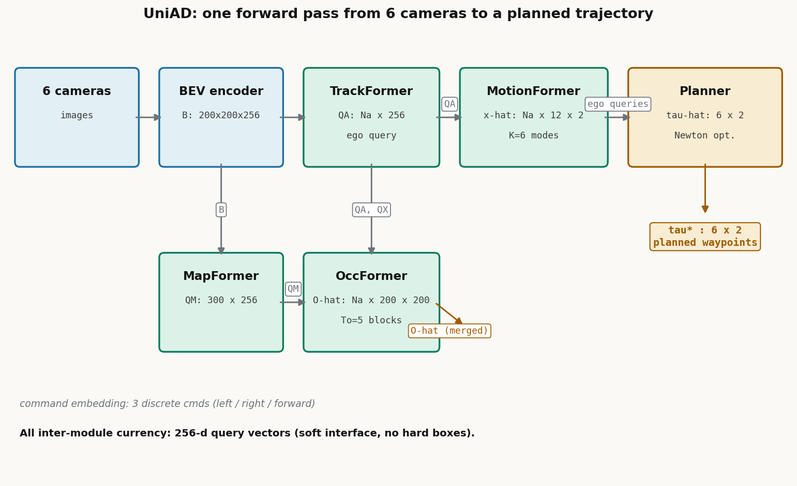

# 规划不是最后一个头：UniAD 把五个任务拧成一条为规划服务的链

> **全局编号 86**｜论文《Planning-oriented Autonomous Driving》｜作者 Yihan Hu, Jiazhi Yang, Li Chen, Keyu Li, Chonghao Sima, Xizhou Zhu, Siqi Chai, Senyao Du, Tianwei Lin, Wenhai Wang, Lewei Lu, Xiaosong Jia, Qiang Liu, Jifeng Dai, Yu Qiao, Hongyang Li（上海 AI Lab OpenDriveLab / OpenGVLab、武汉大学、商汤）｜CVPR 2023（award candidate）｜arXiv: https://arxiv.org/abs/2212.10156（v1 2022-12-20，v2 2023-03-23；本文按 v2 解读）｜代码公开：https://github.com/OpenDriveLab/UniAD
>
> **一句话核心洞见**：UniAD 的赌注是——规划不该是管线末端一个孤立的头，而应该是整条管线的组织原则。它用统一的 query 接口把跟踪、建图、运动预测、占据预测五个任务串成一条链，让每个中间任务都直接为最后的规划服务，而不是各自把自己的指标刷高。

先看一个具体的不幸。十字路口，一辆车从右侧 30 米外以 15 m/s 接近路口。检测器给了它一个框，但航向角偏了 20 度，位置偏了半米。在传统管线里，这个框经过 NMS 变成硬判决，传给预测模块；预测模块拿着一个错误的起点去回归真值轨迹，学出来的轨迹带着不真实的大曲率；规划模块拿到这条别扭的预测轨迹，只能跟着错。每一级都在自己的指标上做到了最好——检测 mAP 不低，预测 minADE 也还行——但最后车开得不对。UniAD 整篇论文要回答的，就是这一连串"各自正确、整体不对"是怎么发生的，以及怎么把它拧过来。

## 图 1 的三条路：前人到底在哪一条上撞墙了

论文的图 1 把当时的自动驾驶系统画成三条路，表 1 再把每条路上的工作按"做了哪几个任务"打勾。这张图就是作者的赌注，值得一个一个看。

**(a) 独立模型。** 工业界主流：感知、预测、规划各用各的模型，只要车载芯片带宽扛得住。研发上省心，代价是模块之间信息丢失、误差逐级累积、特征不对齐。每个模块的优化目标是孤立的：检测器把框画准就行，不管这个框传给下游时航向角偏 20 度会发生什么。上面的路口例子就是这条路的日常。

**(b) 多任务头。** 一个共享 backbone，后面插几个任务头（Transfuser、BEVerse、Mobileye、Tesla、Nvidia 都算这类）。省算力、好扩展，但任务之间会出现 negative transfer：一个头把共享特征往自己的方向拽，别的任务跟着受损。论文脚注里特意澄清，这里的 MTL 指"感知之外的任务"，纯感知内部的多任务（检测+深度+光流）不在讨论范围。

**(c.1) 白板端到端。** 从传感器直接回归规划轨迹，中间没有任何显式监督。2018–2022 年一批工作在 CARLA 闭环仿真里验证了这条路走得通。作者的判断很直接：这条路在高度动态的城区场景里，给不出安全保证，也解释不了自己为什么这么开。

**(c.2) 缺零件的端到端。** P3、MP3、ST-P3、LAV、PnPNet、ViP3D 这些工作都想把感知、预测、规划显式地串起来，但表 1 显示，每一家都缺了某几块：有的没有跟踪，有的没有在线建图，有的只有稀疏的运动预测、没有稠密的占据预测。作者的原话是 "the devil lies in the details"——缺的那些零件，恰恰是规划真正需要的。

**(c.3) UniAD。** 五个任务全要：检测+跟踪、在线建图、运动预测、占据预测、规划，并且"按对规划的贡献"来排优先级。这不是把五个模型拼在一起跑一遍，论文反复强调 "not a simple stack of tasks"。真正的区别在连接件上：所有模块之间传递的不是框、不是分割图，而是 query。

这里要先纠正一个容易产生的误读。planning-oriented 听起来像一句口号，但作者给了它一个可操作的意思：**上游任务的选择和排优先级，以"对规划有没有用"为标准**。附录 B 逐个论证了五个任务为什么缺一不可：跟踪给下游提供时序一致的历史（被遮挡的 agent 不能凭空消失）；在线建图替代昂贵易过期的 HD 地图；运动预测给出长时、保身份的稀疏轨迹，但框表示进不了可微的规划；占据预测给出稠密的代价图、方便做避碰，但丢了身份、算力贵、视界短。两个预测各走一条腿，互相补。这套论证是事后梳理过的，但每个判断都能在后面的消融表里找到对应的数字，不是空话。

## 为什么是 query，而不是框

这是全文承重的设计，理解了它，其余模块的形状都顺理成章。

先看框表示的问题。检测器输出的框是一个硬判决：位置、尺寸、航向角几个数，NMS 再砍掉一批候选。框传给下游时，上游的不确定性被抹掉了——下游看到的是"这里有一辆车，航向 30 度"，而不是"这里可能有辆车，航向大概 20 到 40 度之间"。一旦框错了，误差就硬化了，下游只能在这个错误的基础上继续错。PnPNet 和 ViP3D 当时已经意识到 tracking-in-the-loop 的重要性，但它们的模块之间仍然隔着框。

query 是另一条路。一个 query 是 $\mathbb{R}^{256}$ 里一个向量，$Q_A \in \mathbb{R}^{N_a \times 256}$ 表示 $N_a$ 个 agent 的特征，$Q_M \in \mathbb{R}^{300 \times 256}$ 表示地图元素。向量没有"对错"，只有"信息量多少"。上游传下来的 query 即使对应的框不准，里面仍然带着 BEV 特征里聚合来的上下文——感受野比一个框大得多。下游模块用 cross-attention 从 query 里取自己需要的东西，取多取少由注意力权重决定，这是一个软接口。

统一接口的第二个好处是模块之间可以直接对话，不需要翻译。跟踪输出的 agent query $Q_A$ 直接进运动预测做 agent-agent 交互；地图 query $Q_M$ 直接进运动预测做 agent-map 交互；运动预测输出的 motion query 做一次模态维度的 max-pool，拼上 $Q_A$ 和位置编码 $P_A$，就成了占据预测的 agent 特征 $G^t$；跟踪和运动预测各产出一个 ego-vehicle query，最后拼成规划的 plan query。全链条的"货币"都是 256 维向量，模块之间没有格式转换，也就没有转换中的信息损失。

核心张量一张表列出来，后面走流程时不再回头查：

| 符号 | 形状 | 含义 |
|---|---|---|
| $B$ | $200 \times 200 \times 256$ | BEV 特征，覆盖自车前后左右各 51.2 m，格子 0.512 m |
| $Q_A$ | $N_a \times 256$ | TrackFormer 输出的 agent 特征，$N_a$ 随场景变化 |
| $P_A$ | $N_a \times 256$ | agent 的位置编码 |
| $Q_M$ | $300 \times 256$ | MapFormer 输出的地图元素特征 |
| $Q_{pos}, Q_{ctx}$ | $N_a \times K \times 256$ | MotionFormer 每层的运动 query：位置先验 + 上下文，$K=6$ 个模态 |
| $\hat{x}$ | $N_a \times T \times 2$ | 运动预测输出，$T=12$（6 秒），每 agent 6 条轨迹 |
| $G^t$ | $N_a \times 256$ | OccFormer 第 $t$ 块的 agent 特征 |
| $F^t$ | $200 \times 200 \times 256$ | OccFormer 第 $t$ 块输出的未来场景稠密特征 |
| $\hat{O}^t_A$ | $N_a \times 200 \times 200$ | 实例级占据概率（保身份） |
| $\hat{O}^t$ | $200 \times 200$ | 合并后的经典占据图（给规划用） |
| $\hat{\tau}, \tau^*$ | $T_p \times 2$ | 规划输出，$T_p=6$（3 秒），优化前 / 牛顿优化后 |

*上图：UniAD 的模块与张量流。注意所有模块间的"货币"都是 256 维 query 向量，唯一的例外是最后输出给规划器的合并占据图。自绘，形状取自论文附录表 11。*

## 走一遍：六个相机到一条轨迹

场景：自车以 5 m/s 接近一个路口，导航指令是左转。前方 12 米一辆黑车在减速，右侧 30 米一辆车以 15 m/s 高速接近路口。看一个 query 从进入系统到变成一条轨迹的完整路径。

**第 1 站：BEV。** 六张环视图像进 backbone + FPN，再经 BEVFormer 的 BEV encoder 变成 $B \in \mathbb{R}^{200 \times 200 \times 256}$。这是全系统的共享地基，后面所有模块都从这里取特征。

**第 2 站：TrackFormer（感知）。** 900 个 detection query 负责发现新生目标，track query 负责延续上一帧已经建档的 agent，两组 query 都对 $B$ 做 cross-attention。这一帧里，黑车和右侧来车被 detection query 捕获，变成 $Q_A$ 里的两行；同时有一个特殊的 **ego-vehicle query**，它不参与和真值的匹配，专门负责编码自车自己——这是全文最关键的一个小设计，自车从此在系统里有了一个和别的 agent 同等规格的表示，后面可以直接和别的 agent 做交互。输出 $Q_A \in \mathbb{R}^{N_a \times 256}$（这里 $N_a=3$，加上一辆停着的车）。

**第 3 站：MapFormer（感知）。** 300 个 thing query（车道线、分隔带、斑马线）+ 1 个 stuff query（可行驶区域）做全景分割，输出 $Q_M \in \mathbb{R}^{300 \times 256}$。路口的车道线和停止线的位置结构就编码在这 300 个向量里。

**第 4 站：MotionFormer（预测·稀疏）。** 输入 $Q_A$ 和 $Q_M$。每个 agent 展开 $K=6$ 个模态，每个模态一个 motion query。3 层 decoder，每层做三路交互：agent-agent（黑车减速会影响右侧来车的预期吗）、agent-map（右侧来车走哪条车道）、agent-goal（看轨迹终点周围的 BEV 长什么样）。输出每个 agent 6 条未来 6 秒的轨迹。ego-vehicle query 也走完全程，输出自车 6 条"粗略的未来"——这已经是一次粗糙的规划了。

**第 5 站：OccFormer（预测·稠密）。** 把 $B$ 降采样到 1/4 作为当前帧场景，5 个 block 依次滚出未来 5 帧（$T_o=5$，含当前帧）。每块里，稠密场景特征做 query，agent 特征 $G^t$ 做 key/value，在 1/8 分辨率上做 pixel-agent 交互：每个格子去问"我这个位置未来是哪个 agent 占的"。输出实例级占据 $\hat{O}^t_A$，再经逐像素 argmax 合并成经典占据图 $\hat{O}^t$。

**第 6 站：Planner。** 取 tracking 的 ego query 和 motion 的 ego query，拼上"左转"的 command embedding，在模态维度 max-pool 后得到 plan query；对 $B$ 做 3 层 cross-attention（让规划看到路口的实际样子）；MLP 回归出 6 个未来路点 $\hat{\tau}$；最后在推理时用牛顿法优化一次，把轨迹从 $\hat{O}$ 预测的占据格里推开，得到 $\tau^*$。自车减速让行，等右侧来车通过后再左转。

同一个场景放在旧的框流水线里走一遍，对比就清楚了。假设检测器对右侧来车的航向角估计偏了 20 度：框流水线里，这个错框经 NMS 硬化后传给预测，预测拿着错误的起点回归真值，轨迹出现不真实的大曲率（论文 2.2 节开头明确点了这个问题），规划拿到一条别扭的轨迹。而在 UniAD 里，即使框不准，$Q_A$ 里还留着 BEV 上下文，MotionFormer 的 attention 可以从中找回正确的信息。论文附录图 12 给了一个真实证据：tracking 第一帧漏检了高速接近的车辆、两帧都漏检了一辆静止的车，但 planner 的 attention mask 上对这两辆车都有强烈反应——漏检没有传导成规划的失明。这就是软接口的价值：**上游的错不再是下游的命**。

## MotionFormer 里最值得细看的三件事

MotionFormer 是 3 层 decoder，每层的输入是一个 motion query，它由两部分相加（概念上是拼接后融合）而成：$Q_{pos}$ 提供"位置先验"，$Q_{ctx}$ 提供"上下文"。先看位置先验，因为这是论文里藏了最多心思的地方。

$$Q_{pos} = \text{MLP}(\text{PE}(I^s)) + \text{MLP}(\text{PE}(I^a)) + \text{MLP}(\text{PE}(\hat{x}_0)) + \text{MLP}(\text{PE}(\hat{x}^{l-1}_{T-1})) \tag{3}$$

四项分别是：(1) $I^s$，场景级 anchor——把所有训练轨迹的终点做 k-means 聚出 $K=6$ 个类中心，再按每个 agent 当前的位置和航向旋转平移到全局坐标系（附录式 12：$I^s_{i,T} = R_i I^a_T + T_i$）；(2) $I^a$，agent 级 anchor——同一组聚类中心但放在 agent 自身坐标系里，捕捉局部意图；(3) $\hat{x}_0$，agent 当前位置，给每个 agent 定制的起点；(4) $\hat{x}^{l-1}_{T-1}$，上一层预测的终点，逐层精化的动态 anchor。

为什么需要四个？想象只有一个起点、没有 anchor 的朴素做法：decoder 要从一个 256 维向量里凭空变出 6 条 6 秒的轨迹，搜索空间巨大。k-means anchor 把"车一般会怎么走"这个先验直接写进 query 的位置编码里：直行、左转、右转、掉头、减速停下，六个类中心大致就是这几种。场景级 anchor 回答"在全局地图上这六种走法长什么样"，agent 级 anchor 回答"在以我为原点的坐标系里这六种走法长什么样"，起点回答"我从哪出发"，上一层的终点回答"我上一轮猜到哪了、这一轮接着改"。四项相加，query 还没开始 attention，就已经知道自己负责的是"从当前位置出发、大致向左前方走"的那条轨迹。消融表 8 显示，去掉旋转后的场景级 anchor，minADE 从 0.768 恶化到 0.844——这是 MotionFormer 里单个最重的部件。不过要诚实记一笔：正文称这个部件带来 "-15.8% minADE"，但按表 8 第 1→2 行的绝对值 0.844→0.768 计算只有约 -9.0%，百分比的计算口径论文没有交代，以绝对值为准。

第二件事是 agent-goal 交互。公式 (1) 是常规操作：$Q_{a/m} = \text{MHCA}(\text{MHSA}(Q), Q_A/Q_M)$，先自注意力理顺 6 个模态之间的关系，再 cross-attention 去问别的 agent 和地图。公式 (2) 是特别的：

$$Q_g = \text{DeformAttn}(Q, \hat{x}^{l-1}_{T-1}, B) \tag{2}$$

以**上一层预测的轨迹终点**为参考点，在 BEV 特征 $B$ 上做可变形注意力，只采样终点周围的 4 个点。直觉很朴素：一条轨迹走得对不对，终点落在车道上还是马路牙子上，是最强的判断信号。与其让 query 在整张 BEV 上漫无目的地找，不如直接去看终点周围的路面长什么样，再回来修正。三路交互的结果 $Q_a, Q_m, Q_g$ 拼起来过一个 MLP，得到 $Q_{ctx}$，送进下一层。

第三件事是非线性平滑器（式 4–5），这是端到端场景下一个真实存在但容易被忽略的麻烦。传统运动预测的数据集直接给真值框，起点是对的；UniAD 的起点是上游检测器给的，可能偏了半米、航向偏 20 度。如果硬拿这个错误的起点去回归真值轨迹，网络会被迫学出大曲率、大加速度的不真实轨迹——起点错了，真值从这个起点看就是"别扭"的。作者的解法是在**训练时**把真值轨迹先过一个平滑器：

$$\tilde{x}^* = \arg\min_{x^*} c(x^*, \tilde{x}), \quad c(x^*, \tilde{x}) = \lambda_{xy}\|x^* - \tilde{x}\|_2^2 + \lambda_{goal}\|x^*_T - \tilde{x}_T\|_2^2 + \sum_{\phi \in \Phi} \phi(x^*) \tag{4–5}$$

其中 $\tilde{x}$ 是原始真值，$x^*$ 用 multiple-shooting 方法生成，$\Phi$ 是五个运动学代价：jerk、曲率、曲率变化率、加速度、横向加速度。第一项把平滑后的轨迹拉向真值，第二项特别看住终点别跑偏，第三项惩罚一切不符合车辆运动学的形状。优化完的 $\tilde{x}^*$ 才是真正拿来监督的 target。注意两点：这个平滑只在训练时做，推理时没有；它修的是"监督信号本身被上游误差污染"的问题，而不是网络结构的问题。消融显示它带来 -5.0% minADE、-8.4% minFDE（0.747→0.710、1.096→1.004，口径与表格行对得上），代价是训练时每个 batch 都要解一次非线性优化——论文没有报告这部分带来多少训练时间增加。

输出层面还有两个细节：轨迹用高斯混合建模，$\hat{x}^l \in \mathbb{R}^{K \times T \times 5}$，最后两维取 x、y 坐标，另外还预测每个模态的分数；训练时先预测每步的速度再累加成轨迹，保证时序平滑。损失是 multi-path 损失：$L_{motion} = 0.5\,L_{cls} + 0.5\,L_{nll}$。

## OccFormer：稠密和稀疏的两条腿

为什么已经有了运动预测，还要一个占据预测？附录 B 把这对矛盾说得很清楚。运动预测是稀疏的：每个 agent 几条轨迹，身份保留得好，视界长（6 秒），但"一条轨迹"这种表示很难直接喂给规划做避碰——规划要的是"未来 2 秒这片区域能不能走"，是一个稠密的代价。占据预测是稠密的：整张 BEV 每个格子有没有东西，天然就是代价图，但它不记身份（格子不知道自己属于哪辆车），而且稠密 rollout 算力贵，视界只能做到 $T_o=5$ 帧（2 秒）。两条腿各走各的短板，合在一起才是完整的未来。

OccFormer 的结构是 5 个串行的 block，每个 block 负责一帧。agent 特征先拼出来：

$$G^t = \text{MLP}_t([Q_A, P_A, Q_X]), \quad t = 1, \dots, T_o \tag{6}$$

$Q_X$ 是 MotionFormer 最后一层的 motion query 在模态维度上 max-pool 的结果（$N_a \times 256$）——"这个 agent 未来最可能怎么动"的压缩版。拼上跟踪的 $Q_A$ 和位置 $P_A$，过一个**每帧独立的** MLP（$\text{MLP}_t$ 下标 $t$ 表示每帧参数不同，让网络有时序敏感度）。场景侧把 $B$ 降到 1/4 分辨率作为 $F^0$，每块内部再降到 1/8 做交互，省算力。

pixel-agent 交互是核心：

$$D^t_{ds} = \text{MHCA}(\text{MHSA}(F^t_{ds}), G^t, \text{attn mask} = O^t_m) \tag{7}$$

稠密场景特征做 query，agent 特征做 key/value。关键在 attention mask $O^t_m$：它限制每个像素**只能**看当前时刻真正占据它的那个 agent。这个 mask 本身由 mask 特征 $M^t = \text{MLP}(G^t)$ 与场景特征相乘得到，语义上就是一张粗糙的占据图，还附带一个同形式的辅助损失监督它。消融表 9 有一个反直觉的结果：不加约束地让每个像素看所有 agent（Exp.2），效果比**不用 cross-attention**（Exp.1）还略差；加上 mask 约束后（Exp.3），近区 IoU 涨 1.0 个点。作者没有深究原因，我的推断是：没有位置约束的 cross-attention 里，每个像素要从 $N_a$ 个 agent 里自己学出"谁占我"，这个对应关系在数据量有限时学不准，反而引入噪声；mask 把"位置对应"这个先验硬写进去，attention 只需要学"怎么融合"。这是一个"先验硬编码打败纯学习"的例子。

实例级占据的生成漂亮得像 Mask2Former：

$$\hat{O}^t_A = U^t \cdot F^t_{dec} \tag{8}$$

$U^t \in \mathbb{R}^{N_a \times C}$ 是 agent 级特征，$F^t_{dec} \in \mathbb{R}^{C \times H \times W}$ 是解码后的稠密场景特征，一次矩阵乘法得到 $N_a \times H \times W$ 的实例占据图——每个 agent 一张"未来我在哪"的概率图，身份天然保留。一个经验细节：$U^t$ 从 mask 特征 $M^t$ 经 MLP 来，而不是直接从 $G^t$ 来，效果更好。论文只写了 "we empirically find"，没有给解释；我的推断是 $M^t$ 已经过 mask 辅助损失的监督，更"定位化"，而 $G^t$ 混着运动意图，位置信息更弥散。但这只是推断，论文没有证据。

最后经逐像素 argmax 把实例图合并成经典占据图 $\hat{O}^t \in \mathbb{R}^{200 \times 200}$，交给规划。占据损失是 $L_{occ} = 5\,L_{bce} + 1\,L_{dice}$，BCE 权重是 Dice 的 5 倍——占据格里正样本（被占）远少于负样本，重权重是应对类别不平衡的常规操作。

## Planner：一个 attention 头，加一次推理时的手写优化

规划器的输入是三个东西拼成的 plan query：tracking 来的 ego query、motion 来的 ego query（各过 MLP），再加上高频词——**三个可学习的 command embedding**（左转、右转、直行）。没有导航路线、没有 HD 地图时，规划需要一个高层指令告诉它"大概往哪走"，这里就是三个离散向量。三个输入在模态维度上 max-pool，取最显著的那个——max-pool 在这里做的是"多模态意图里选最强的"，和 motion 里取 top-k 的思路一致。

plan query 对 $B$ 做 3 层标准 transformer decoder 的 cross-attention（附录图 8 可视化了这个 attention mask：轨迹随导航指令明显变化，attention 落在目标车道和需要让行的关键 agent 上），然后 MLP 直接回归 $\hat{\tau} \in \mathbb{R}^{6 \times 2}$，即未来 3 秒 6 个路点。

训练时的规划损失有两项：

$$L_{plan} = 1 \cdot \|\tau - \tilde{\tau}\|_2^2 + 2.5 \cdot \omega L_{col}(\hat{\tau}, \delta), \quad L_{col} = \sum_{t,i} \text{IoU}(\text{box}(\hat{\tau}_t, w+\delta, l+\delta), b_{i,t}) \tag{15–16}$$

第一项是模仿人类轨迹的 l2，第二项是碰撞损失：把自车框按 $(\omega, \delta) = (1.0,0.0), (0.4,0.5), (0.1,1.0)$ 三档放大后，和预测到的每个 agent 框算 IoU 惩罚。三档的意思是：原尺寸全权重计一次，放大 0.5 米计 0.4 权重，放大 1.0 米计 0.1 权重——离得越近罚得越狠，远处只做轻提醒。

推理时还有一次**牛顿法优化**（式 9–11），只在推理时做：

$$\tau^* = \arg\min_{\tau} f(\tau, \hat{\tau}, \hat{O}), \quad f = \lambda_{coord}\|\tau - \hat{\tau}\|_2^2 + \lambda_{obs}\sum_t D(\tau_t, \hat{O}^t)$$

$$D(\tau_t, \hat{O}^t) = \sum_{(x,y) \in S} \frac{1}{\sigma\sqrt{2\pi}} \exp\left(-\frac{\|\tau_t - (x,y)\|_2^2}{2\sigma^2}\right) \tag{9–11}$$

第一项把轨迹往网络预测的 $\hat{\tau}$ 回拉，第二项是对占据格的高斯核"斥力"：$S$ 是轨迹点周围 5 米内被占据的格子集合，每个占据格按高斯核把轨迹点往外推，$\sigma=1.0$，$\lambda_{coord}=1.0$，$\lambda_{obs}=5.0$。在多个 multiple-shooting 采样出的候选轨迹里选代价最小的那个。

这里要诚实地说一句：**这是一次手写的后处理**。它的确有效——表 10 显示，加上占据优化（ID3→ID4）后 1 秒碰撞率从 0.30 降到 0.13——但它也暴露了代价：3 秒 L2 从 1.76 涨到 1.81。作者在正文里明确表态"更看重碰撞率而非单纯的轨迹模仿"，这个取舍是自觉的。但读者要清楚，表 7 里那个漂亮的碰撞率数字（avg 0.31%），有一部分是这个推理时优化器的功劳，不是纯网络输出的成绩。把"安全"拆成"训练时 collision loss 学一遍 + 推理时优化器再修一遍"，是务实但不够优雅的做法——务实是褒义，这里不展开。

## 损失和训练是怎么组织的：两阶段、冻结、共享匹配

UniAD 的训练分两阶段，论文说两阶段"经验上更稳定"，这话背后有具体原因。第一阶段只训感知（跟踪+建图）6 个 epoch，损失 $L_1 = L_{track} + L_{map}$，并且加载 BEVFormer 的预训练权重（backbone、FPN、BEV encoder、检测 decoder，除了 object query embedding——因为多了一个 ego-vehicle query，形状对不上）。图像 backbone 的梯度是停掉的，省显存。第二阶段才端到端全开 20 个 epoch（消融实验为了省时间只跑 8 个 epoch），损失 $L_2 = L_{track} + L_{map} + L_{motion} + L_{occ} + L_{plan}$，此时 backbone 和 BEV encoder 都冻结。直觉是：先让感知站稳，再让预测和规划在上面长；如果一开始五个损失一起从随机权重开训，上游的噪声会把下游的梯度搅浑。batch size 是 1，学习率 2e-4，AdamW，16 张 A100，训练序列长度 5 帧（消融里用 3 帧）。论文没有报告总训练时长，标为未确认。

各项损失的权重：

- $L_{track} = 2\,L_{focal} + 0.25\,L_{l1}$：分类用 focal，框回归用 l1，和 BEVFormer 一致。
- $L_{map} = 2\,L_{focal} + 0.25\,L_{l1} + 2\,L_{giou} + 2\,L_{dice}$：thing 类（车道线等）走 bipartite matching，stuff 类（可行驶区域）固定分配。
- $L_{motion} = 0.5\,L_{cls} + 0.5\,L_{nll}$：模态分类 + 高斯混合的负对数似然。
- $L_{occ} = 5\,L_{bce} + 1\,L_{dice}$，外加一个同形式的辅助损失监督 attention mask。
- $L_{plan} = 1\,L_{imi} + 2.5\,L_{col}$。

注意这些权重都是直接给定的常数，论文没有报告搜索过程，也没有敏感性分析。这是全文的一个小短板：五个任务、十几个权重，任何一组不合理都可能让某一项在训练早期主导梯度。作者用两阶段训练部分对冲了这个风险，但权重的选择依据没有交代。

**共享匹配**（shared matching）是训练组织里最容易被忽略但很重要的设计。因为全系统是实例级的，每个模块都要把预测和真值配对。跟踪模块里，新生目标用匈牙利算法匹配，track query 直接继承上一帧的分配；这个匹配结果被**复用**到运动和占据模块，保证同一个 agent 从历史轨迹到未来预测始终是同一个身份。如果每个模块各自独立匹配，一个 agent 在跟踪里是 3 号、在预测里是 7 号，跨模块的 query 交互就全乱了。实现细节：训练时只有和真值框 3D IoU 大于 0.5 的 query 才会被存下来做 track query；推理时没有真值，改用分类分数阈值（detection 0.4、track 0.35），外加 2 秒的生命周期——分数连续 2 秒低于 0.35 才算彻底消失，应对短暂遮挡。

## 以代码为准：五处论文没写准的地方

官方代码是公开的（`code/` 目录，main 分支 tarball），我对照 `projects/configs/stage2_e2e/base_e2e.py` 和 `projects/mmdet3d_plugin/losses/` 逐项核对了损失与训练配置。对得上的先说：三档碰撞损失 `(delta, weight) = (0.0, 2.5)/(0.5, 1.0)/(1.0, 0.25)` 与论文的 $(\omega,\delta)=(1.0,0.0),(0.4,0.5),(0.1,1.0)$、$\lambda_{col}=2.5$ 折算后完全一致；推理时碰撞优化的参数 `occ_filter_range=5.0, sigma=1.0, alpha_collision=5.0` 与论文的 $d=5$、$\sigma=1.0$、$\lambda_{obs}=5.0$ 一致；两阶段 6/20 epoch、学习率 2e-4、第二阶段冻结 backbone 与 BEV encoder 都对得上。

对不上的有五处，按重要性排：

1. **碰撞损失不是 IoU。** 论文式 (15) 写的是 $\text{IoU}(\text{box}(\cdot), b_{i,t})$，但代码 `CollisionLoss.inter_bbox` 的实现是：把旋转后的框角点取 max/min 退化成轴对齐框，再算**相交面积**——没有除以并集。也就是说代码算的是相交面积之和，论文写成了 IoU。训练信号的方向一致（重叠越多罚越多），但论文的表述拔高了。
2. **建图 L1 权重差 20 倍。** 论文附录说 $L_{map}$ 里 $\lambda_{l1}=0.25$，代码里 map head 的 `loss_bbox`（L1）权重是 **5.0**。这是 BEV 下 2D 框（xywh）的回归项。0.25 可能是笔误，但读者按论文复现会得到不一样的训练动态。
3. **占据损失藏了两个技巧。** 论文只写 $L_{occ}=5L_{bce}+1L_{dice}$，代码用的是 FIERY 风格的二值分割损失，带 `use_top_k=True, top_k_ratio=0.25`（每个 batch 只训最难的 25% 像素，hard mining）和 `future_discount=0.95`（未来帧的损失按 0.95 折扣）。这两个对收敛都有实质影响，论文正文和附录都没提。
4. **运动损失多了一项。** 论文说 $L_{motion}=0.5L_{cls}+0.5L_{nll}$，代码里还有 `loss_weight_minfde=0.25` 的 minFDE 辅助项，论文未提及。
5. **规划模仿项不是平方。** 论文式 (16) 写 $\|\tau-\tilde{\tau}\|_2^2$，代码 `PlanningLoss` 算的是每步欧氏距离（开了平方根）再按有效步数平均。另外代码里有 `grad_clip max_norm=35` 的梯度裁剪，论文没提。

这些出入都不动摇论文的主要结论，但说明一件事：这篇论文的附录写得已经算详细的了，仍有几个影响复现的细节只存在于代码里。复现时以代码为准。

## 表 2 是全文最值得细读的一张表：通往安全规划的路线图

如果只能细读一张表，就是表 2。它把 12 种任务组合摆在一起，每一行是一种"开哪些模块"的配置，最后一行是全开。这张表的读法是纵向对比，作者在正文里已经给出了路线图，我把关键数字重新算一遍验证：

**预测是离规划最近的，先看预测。** Exp.10（只开规划头，无中间任务，对应图 1 的 c.1）avg.L2 1.131、avg.Col 0.773；Exp.12（全开）avg.L2 1.004、avg.Col 0.430。L2 下降 11.2%，碰撞率下降 44.4%（相对值是我算的，论文没给）。中间任务不是装饰。

**两个预测互相增益。** Exp.7–9 对比：只开占据（Exp.7）或只开运动（Exp.8）都不如两个一起开（Exp.9），运动指标和占据指标同时变好。稀疏和稠密不是二选一，是一起用才各自更好——因为 OccFormer 的 agent 特征来自 MotionFormer，MotionFormer 的 query 又能从占据的稠密上下文里间接受益（通过共享的 BEV 和联合梯度）。

**感知托底预测。** Exp.4–6：只开运动预测（Exp.4）minADE 0.815；加上跟踪（Exp.5）0.751；再加上建图（Exp.6）0.736，相对 Exp.4 下降 9.7%，minFDE 下降 12.9%，MR 降 2.3 个百分点。跟踪给历史，建图给道路结构，预测吃进去都变成更准的轨迹。

**和朴素多任务基线的对比。** Exp.0 是"共享 backbone + 各自独立头"的 MTL（对应图 1 的 b），Exp.12 相对它：minADE -15.2%（0.858→0.728，我验算 15.15% 对得上）、minFDE -17.0%（1.270→1.054，对得上）、MR 降 3.2 个百分点、占据 IoU-f +4.9、VPQ-f +5.9、avg.L2 -0.15、avg.Col -0.51（0.941→0.430）。赢是赢了，但要公平地说一句：这个 MTL 基线是"各扫门前雪"的头，打赢它在意料之中；真正的对手应该是 c.2 里那些已经把部分任务串起来的工作，而表 2 里没有。

**感知指标基本没掉。** Exp.1–3 显示跟踪和建图一起训，指标和单训差不多；Exp.12 的 AMOTA 0.358 和纯跟踪 Exp.1 的 0.348 相当。这是作者想证明的一点：planning-oriented 不是牺牲感知，而是不再用"感知单项冠军"的标准要求每个模块——感知只要够规划用就行。

## 各个模块的数字，和它们的真实含金量

**跟踪（表 3）：** AMOTA 0.359，超过端到端跟踪 MUTR3D（0.294）6.5 个点、超过 ViP3D（0.217）14.2 个点，IDS 906 是几家里最低的。但作者自己承认：不如 tracking-by-detection 的 Immortal Tracker（0.378，用 BEVFormer 重实现过，保证公平）。端到端的跟踪在 association 上仍然打不过带复杂后关联的方法，UniAD 没有在这个单项上死磕——它的论点是跟踪是为规划服务的，不是为刷 AMOTA 的。

**建图（表 4）：** 车道线 IoU 31.3，比 BEVFormer 的 23.9 高 7.4 个点；但可行驶区域 69.1 反而低于 BEVFormer 的 77.5，分隔带和斑马线也不如 BEVerse。模型容量被下游分走了，感知单项出现此消彼长，这正是"不为感知单项优化"的代价，作者没有回避。

**运动预测（表 5）：** minADE 0.71、minFDE 1.02、MR 0.151，相对 PnPNet-vision（1.15）降 38.3%、相对 ViP3D（2.05）降 65.4%，EPA 0.456 翻倍于前人（0.222/0.226）。但注意评估口径：只在 vehicle 类上算，且只统计与真值匹配上（1.0 米内）的 TP。Constant velocity 基线 minADE 2.13，说明数据集里车辆运动本身不算太难预测——数字好看有一部分是任务本身的功劳。

**占据预测（表 6）：** 近区（30×30 米）IoU 63.4，超过 FIERY（59.4）4.0 个点、超过重度增广的 BEVerse（61.4）2.0 个点。近区正是规划最关心的区域，这个 +4.0 是实在的。

**规划（表 7）：** avg L2 1.03（1 秒 0.48、2 秒 0.96、3 秒 1.65），avg 碰撞率 0.31%（0.05/0.17/0.71）。相对 ST-P3（avg L2 2.11、avg 碰撞率 0.71%），L2 降 51.2%、碰撞率降 56.3%，还超过了几个激光雷达方法（NMP、SA-NMP）。这是全文最抓眼球的一组数字，也是下一节要重点盘问的一组数字。

**算力（表 13）：** 全量模型 125M 参数、1709G FLOPs，在 A100 上 1.8 FPS。FLOPs 比 BEVerse-Tiny（1921G）还低，任务却更多——说明 query 式的稀疏交互确实比稠密 BEV rollout 省。但 1.8 FPS 离上车还差两个数量级，作者在结论里承认轻量化部署是未来工作。三个模型规模（表 12）：S（R50）、B（R101，主力）、L（V2-99 + 深度预训练），backbone 越大感知越好、预测规划跟着好，说明 BEV 质量是整条链的地基。

## 怀疑式审读：这些开环数字到底值多少钱

这是读 UniAD 必须过的一关。全文所有规划数字——表 2、表 7、表 10——都来自 **nuScenes 开环评测**，没有任何闭环验证。c.1 路线的那些工作（Learning by cheating 等）是在 CARLA 闭环里证明自己的，UniAD 没有接这一棒。这不是一个小缺憾，而是端到端路线最关键的分水岭：开环指标和"车实际上开得好不好"之间，隔着几道已知的鸿沟。

**第一道：开环 L2 奖励的是"像人开"，不是"开得对"。** 评测方法是把网络输出的未来 3 秒轨迹和人类驾驶员实际开的轨迹算 l2 距离。网络见过当前帧之前的所有传感器，但它要"预测"的恰恰是人类司机接下来的操作。在 nuScenes 这种以城区跟车、路口等待为主的数据集里，相当比例的片段中自车处于低速或静止状态——这时输出"原地不动"就能拿到很低的 L2。学界对这类开环规划评测的"照抄捷径"（copycat）批评已久：一个只看自车历史速度、不看任何传感器的简单基线，在 L2 上常常不输给复杂的模型。UniAD 的 avg L2 1.03 里，有多少是真本事、有多少是数据集的低速偏差，论文没有做这个分解。这不是说数字是假的，而是说**数字的含金量需要打折**——打几折，不知道，因为作者没给能算出折扣的信息。

**第二道：碰撞率的分母是"几何重叠"，不是"事故"。** 开环下的碰撞检查是把规划轨迹和**未来真值**的 agent 框做重叠测试。但在开环里，他车不会因为自车的动作而做出反应——自车变道时，真值里的后车不会刹车。所以这个碰撞率测的是"如果世界按录像带重演、我的轨迹会不会撞上"，而不是"在交互中我能不能避免事故"。更微妙的是，静止不动的规划天然碰撞率低：avg 碰撞率 0.31% 这个数字，一部分可能来自"在很多场景里最安全的开环策略就是别动"。论文没有报告"规划轨迹的平均速度 / 与真值轨迹的速度分布对比"，这是判断有没有"靠静止刷分"嫌疑最直接的一张表，缺了。

**第三道：3 秒的视界太短，掩盖了长尾。** $T_p = 6$ 帧 @2Hz = 3 秒。3 秒在城区低速场景够用，但在高速、 merges、长尾交互场景里，真正的危险往往在 3 秒之外。UniAD 的失败案例（附录图 13、14）恰恰是长尾：白色集装箱大卡车占满路面导致跟踪估计错尺寸和航向、黑夜窄路里规划器对来车过度保守。作者诚实地放出了这些，但评测指标本身对长尾不敏感——平均指标会被大量简单场景稀释。

**第四道：牛顿后处理对碰撞率数字的贡献。** 前面算过，表 10 里加上占据优化后 1 秒碰撞率从 0.30 降到 0.13，降幅过半，而 3 秒 L2 从 1.76 涨到 1.81。这意味着表 7 里那个"碰撞率降 56.3%"的故事里，手写优化器至少贡献了一部分。如果关掉这个后处理只看网络输出，碰撞率数字会难看多少？论文没有给这个消融。公平地说，作者从没藏着这个优化器的存在，公式和参数全公开了；但读者在引用"0.31% 碰撞率"时，应该知道它不是纯学习系统的成绩。

**基线选择上缺席的对比。** 规划对比只选了开环方法（ST-P3、FF、EO、NMP），没有和任何闭环方法比；也没有报告 UniAD 在 CARLA 或 nuPlan 上的表现——而 nuPlan（也是 Caesar 等人做的，论文引用 [7]）正是为闭环 ML 规划设计的基准，作者引用了它却没有在上面跑。我的推断是：把五个任务的端到端系统搬进闭环仿真器、处理分布偏移和实时性，工作量不亚于重写一篇论文，作者选择了在开环把故事讲完整。这是一个可以理解但应该被指出的边界。

**作者诚实的地方也要记下来。** 承认端到端跟踪不如 tracking-by-detection；承认建图部分类别落后于感知专用方法；承认算力需求大（16×A100 训练、推理 1.8 FPS）；放出长尾失败案例；表 10 里 L2 变差也如实报告。措辞上，摘要和正文用的是 "we argue""we show""we observe"，几乎没有 "we prove"——作者对哲学论证的把握强于对数字绝对意义的把握，这个分寸感是对的。

综合判断：UniAD 的开环数字在**同类开环方法**里是扎实的最好成绩，表 2 的任务间互相增益的证据也是干净的；但"开环最好"到"闭环能用"之间，论文没有提供任何桥梁。引用这篇论文时，正确的说法是"它在 nuScenes 开环规划上做到了当时最好"，而不是"它解决了端到端规划"。

## 作者的底牌是哪一张

从论文的组织方式推测，作者手里最硬的一张牌不是某个模块的指标，而是**图 1 + 表 2 构成的完整论证**：先用一张图把领域现状切成三条路、指出每条路缺什么，再用一张 12 行的消融表证明"按规划优先级把五个任务串起来，每一块都让规划变好"。CVPR 2023 award candidate 的身份也佐证了这一点——审稿人买的是系统级设计的账，不是单点刷榜。

第二张牌是 query 接口的统一性。全系统 256 维向量走天下，模块之间没有格式转换，这个设计让"五个任务联合优化"从口号变成了可训练的东西。证据在附录图 12：跟踪漏检的车，规划器的 attention 还能抓住——这是只有软接口才给得出的行为。

最不硬的一张是各个单项指标。跟踪、建图都有单项打不过的对手，作者自己也承认了。好在作者从没声称自己是单项冠军，他的原话是 UniAD "benefit final planning with perceived information rather than optimizing perception with full model capacity"——感知只要够规划用。这句话是全篇方法论上最坦率的一句。

## 可以带走的一两个想法

**软接口容忍上游误差。** 模块之间传特征向量、不传硬判决，是这篇论文最值得偷走的设计。它的效果不只体现在数字上，更体现在失败模式上：上游错了，下游还有机会通过 attention 从原始 BEV 特征里把信息捞回来。任何多模块系统——包括带多个专家规划器的 agent——在设计模块间接口时都应该问一句：我是传了一个"判决"，还是传了一个"带不确定性的表示"？前者便宜但脆，后者贵但韧。UniAD 用图 12 证明了后者的价值。

**稀疏和稠密各走一条腿。** 运动预测（保身份、视界长、难进规划）和占据预测（丢身份、视界短、天然是代价图）是一对互补表示，合在一起用比二选一好。这个"双表示"的思路可以迁移到任何需要同时做"理解谁在动"和"哪里能走"的系统里。附录 B 对这对矛盾的论证过程本身，就是一篇很好的"怎么为规划挑选前置任务"的范本。

## 与本课题的关联

用户的课题是"世界模型引导 + 自适应衰减情景记忆的闭环多规划器自动驾驶 Agent"：LLM 调度多个专家规划器，执行开放式自然语言驾驶指令，在 Bench2Drive 上做闭环验证。UniAD 在这张图里的位置很清楚：**它是专家规划器池里一个成熟的候选**，而不是对立面。

能用的部分：一条经过验证的"感知→预测→规划"端到端链，nuScenes 开环数字扎实；query 接口的设计哲学——专家规划器之间、规划器与调度器之间，传表示不传判决；它的失败模式（上游误差被软接口吸收）对设计多规划器仲裁有直接参考价值。

它缺的部分，恰好是用户课题要补的三块：

1. **开放式指令理解。** UniAD 的"指令"只是三个离散的 command embedding（左转/右转/直行）。自然语言指令（"前面路口掉头后靠边停车"）它听不懂，也没有把语言 grounded 到规划 query 上的机制。这是 LLM 调度器要接管的部分。
2. **情景记忆。** UniAD 的记忆只有 track query 的 2 秒生命周期和 BEV 的 5 帧时序融合，没有长期情景记忆，更没有自适应衰减、检索、遗忘的机制。用户课题里的情景记忆模块在这里是空白，需要从零设计。
3. **独立风险校验。** UniAD 的"安全"由训练时的 collision loss 和推理时的牛顿优化器承担，两者都和规划网络同源——自己给自己当裁判。用户课题里的闭环风险校验/冲突仲裁需要的是一个**独立于**专家规划器的校验者，这是 UniAD 架构里不存在的角色。

还有一句必须写在前面：UniAD 的所有规划数字都是开环的，**不能直接当作它在 Bench2Drive 闭环里表现的证据**。如果把它作为专家规划器接入，第一个要做的实验就是在闭环里重测它的真实水平，再决定给它多少调度权重。开环第一名在闭环里翻车，是这个领域反复上演的剧情。
