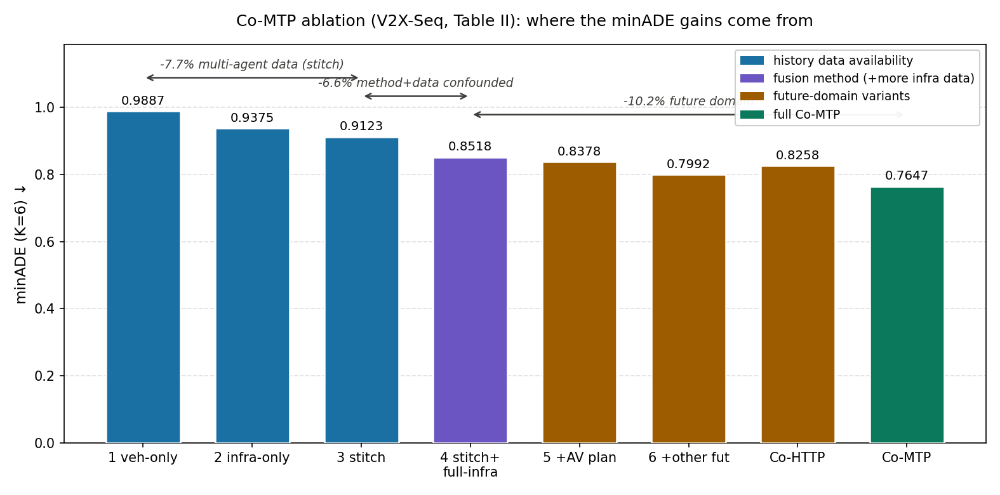

> **编号 80** · 论文精读（paper-xray · MD 分支）
>
> **标题**：Co-MTP: A Cooperative Trajectory Prediction Framework with Multi-Temporal Fusion for Autonomous Driving
>
> **作者**：Xinyu Zhang, Zewei Zhou（共同一作）, Zhaoyi Wang, Yangjie Ji, Yanjun Huang, Hong Chen —— 同济大学汽车学院
>
> **会议 / 年份**：ICRA 2025
>
> **链接**：arXiv https://arxiv.org/abs/2502.16589 · 项目页 https://xiaomiaozhang.github.io/Co-MTP/
>
> **代码**：公开，https://github.com/xiaomiaozhang/Co-MTP（本次解读未能从当前环境拉取仓库，论文与代码的一致性核对标记为未确认）
>
> **一句话核心洞见**：预测的终点不是轨迹，是规划——把自车规划动作当作已知条件喂进未来域，让网络回答"如果我这么开，周围的车会怎么反应"，历史域的多智能体融合只是为这个回答准备一份更完整的过去。

# 「如果我这么开」：把自车规划写进预测的条件里

预测模块通常被当成一个旁观者：看一眼历史，输出"别人未来会怎么走"。Co-MTP 把这件事反了过来。它问的是：自车打算这么开，未来会变成什么样？为了回答这个问题，它做了两件事。第一，在历史域里，用路侧基础设施的视角把自车看丢的那段历史补回来，而且补的方式不是简单的轨迹拼接，是把两个视角的原始观测都放进一张异构图里，让注意力自己决定信谁。第二，在未来域里，把"自车规划轨迹"和"基础设施预测的他车意图"都变成图里的节点，和历史节点一起做消息传递，得到"给定这个规划动作"的未来场景状态。在真实数据集 V2X-Seq 上，它的 minADE 是 0.76，对照的 V2X-Graph 是 1.17，差值正好是 35%。

这篇解读先把作者撞到的那堵墙摆出来，再走一遍"历史补全 + 未来交互"这两个设计是怎么被逼出来的，然后把异构图 Transformer 的每一步算清楚，最后怀疑式地检查每一个数字。

## 自车在哪个路口会因为"看不见过去"而猜错未来

先看一个具体的场景。无保护左转路口，自车停在停止线后等转弯。对向车道一辆公交车正在直行，它庞大的车身把自车右前方一辆准备左转的目标车辆 T 挡了个严实。预测模块需要 3 秒历史（V2X-Seq 的标准切分是 3 秒历史、5 秒未来，10Hz 采样），但在中间大约 1.2 秒里，自车传感器根本看不到 T。T 的历史轨迹在这些帧上的掩码 $m_i^t = 0$，位置、朝向、速度全是空的。

单车预测在这里会怎么错？它只能拿 T 剩下那段不连续的历史去猜。T 在被遮挡前正沿着左转待转区缓慢 creep，被遮挡后（自车重新看到它时）它停在原地。断裂的历史让模型读出"它正在起步左转"的趋势，输出 T 即将转弯的预测。自车据此决定跟进起步——而实际上 T 是在让行对向直行车辆 O，自车一起步就和 O 形成了冲突。

已有的协同工作能救吗？当时（2023–2024）V2X 的主流是单帧协同感知：OPV2V、V2X-Real 这些工作把同一时刻的多视角特征融在一起，解决"这一帧看不见"的问题。但预测要的是时间线索，不是单帧。V2X-Seq 数据集（2023，Yu 等人）第一次给了带时序的 V2I 真实数据，V2X-Graph（2023，Ruan 等人）用图网络融多智能体的历史轨迹，可它只做了历史域。V2XPnP（2024，Zhou 等人）做了端到端的协同感知预测一体化，但时间域的利用仍然不完整。

最直接的补救是轨迹拼接：自车看丢的那几帧，用基础设施看到的 T 的轨迹补上，按时间戳对齐拼成一条完整的 3 秒历史。V2X-Seq 官方用的就是 CBMOT 关联拼接。但拼接有三个结构性毛病。第一，关联会错：自车和路侧的检测框噪声特性不一样，同一个 T，两边的框在位置、尺寸上都有偏差，稠密场景里把 A 车的历史接到 B 车身上并不罕见，拼出来的轨迹在拼接缝处会出现不属于任何真实运动的跳变。第二，两个视角可能在同一时刻都丢了目标——路侧也被遮挡，或者目标超出路侧感知范围，拼接补不上，历史照样断。第三，拼接是"二选一"：每个时间戳只保留一个来源，另一个视角在该时刻的观测被直接扔掉，而那个被扔掉的观测里恰恰有对传感器噪声的约束信息。

所以作者面对的墙是这样的：单帧协同感知的时间粒度对不上预测任务；轨迹拼接能补形状，补不了噪声和关联错误。真正的出路不是把轨迹拼得更准，而是别在轨迹层面做"二选一"，把两个视角的原始特征都留下来，让模型在特征层面自己仲裁。这就是历史域融合要做的事。

## "历史先缝再学、未来把规划当条件"，是被两个失败逼出来的

历史域的设计走了一条"先缝、再学"的路。作者没有扔掉拼接，而是把它降级成预处理：用 CBMOT 按检测分数高低先把自车轨迹和路侧轨迹拼一遍。论文里对这一步的辩护很实在：预拼接给出了完整的时间索引（temporal index），让后面的学习少操一份"哪一帧对哪一帧"的心。这是一个工程判断，不是理论必然——先给一个还凑合的对齐，Transformer 就不用从零学时间对应关系。

但预拼接只是开胃菜。关键的一步在后面：基础设施视角下那些"没被用上"的原始观测，并没有在拼接中被丢弃，而是作为独立的节点，原样进入异构图。图里于是有两类目标节点：自车视角的（带预拼接后的轨迹）和路侧视角的（原始轨迹），它们描述的是同一个物理目标，但在图里是两个节点，靠边连起来。当自车节点去聚合信息时，它同时收到"拼接后的自车历史"和"路侧原始历史"两路特征，注意力权重决定每一时刻更信谁。这就绕开了拼接的"二选一"：缝还在（预拼接），但最终的仲裁权交给了学习。

未来域的设计来自另一个失败。预测的最终用户是规划。PiP（2020，Song 等人）早就把规划信息喂给预测：给定自车规划，预测他车反应。但 Co-MTP 的作者指出了一个陷阱，只在未来域里放自车规划，模型会系统性地高估自车的路权——它学会的其实是"世界会给我让路"，输出过于乐观的预测，导向危险的驾驶行为。论文引用了 Tang 等人 2022 年的 interventional behavior prediction 来支撑这个判断：只考虑自车动作的未来建模，本质上是在做干预（intervention）而不建模他人的反应分布。

修正的办法是对称地加另一边：基础设施对"其他车辆意图"的预测结果，也作为未来节点进入同一张图。于是未来域里有两类未来节点：自车规划轨迹节点、他车意图节点（来自路侧预测）。它们和历史节点之间建边，跑同一套异构图 Transformer。所谓"把图 Transformer 扩展到未来域"，听起来像个大动作，实际很经济：架构一行不用改，只是多了两种节点类型和对应的边类型。一次前向下来，每个历史节点都吸收了"在给定自车规划下、他车打算怎么反应"的信息，解码出的轨迹就是规划条件下的预测。

这两个设计的共同点是：都不在数据层面做硬决策（不丢视角、不只信规划），而是把"信谁"推迟到注意力里。这也是整篇论文最值得带走的一个手法。

顺带说一句作者的底牌是什么。通读下来，最硬的一张不是某个公式，是"扩展"的经济性：历史域和未来域用的是同一套异构图 Transformer，未来域的加入只是多了两种节点类型，没有新增一套架构。这意味着审稿人没法攻击"未来域是另一个模型硬拼上来的"，消融表里历史/未来的增益也因此可以直接相加比较。第二张牌是 V2X-Seq 这个真实数据集——2025 年初，带时序的真实 V2I 数据仍然是稀缺资源，先有数据再谈双域融合，故事才站得住。这两张牌一张管方法的可信度，一张管问题的存在性。

## 这张异构图里，真正承重的是哪几条边

图 $G = \{\mathcal{N}, \mathcal{E}\}$ 里有五类节点。目标节点分两种：自车视角的（轨迹经过预拼接）和路侧视角的（原始轨迹），同一个物理目标对应两个节点。地图节点：车道线、人行横道、停止线切成多段线，每段 21 个点；交通信号灯单独编码。未来节点分两种：自车规划轨迹、路侧预测的他车意图轨迹。边按"从哪个节点出发"定类型，每个节点最多连 32 条边，按距离截断——目标节点之间用最后一帧观测位置算距离，地图节点用点到多段线的最短距离。

CTCA（Cross-Temporal and Cross-Agent）融合和 STFA（Spatial-Temporal Fusion Association）模块是论文给这套机制起的名字，拨开名字看动作，它只做一件事：让每个节点按边类型分别做注意力，再把各类型的结果拼起来。真正承重的是两类边。第一类是"自车目标节点 ← 路侧目标节点"的边，这是历史域补全的发生地：注意力在这里逐时刻决定信自车的拼接轨迹还是信路侧的原始观测。第二类是"历史节点 ← 未来节点"的边，这是未来交互的发生地：自车规划节点和他车意图节点把信息送进历史节点，历史节点的隐状态于是带上了"给定规划"的条件。地图节点和信号灯编码（MLP + PointNet、Linear + GRU）是标准件，拿掉它们模型照样转，只是精度会掉；拿掉上面两类边，Co-MTP 就退化成单车预测加一个花哨的编码器。

还有一个容易被忽略的承重设计：自车视角和路侧视角的轨迹编码器不共享参数。位置先过一个共享 MLP，然后拼上包围盒、速度等属性，分别送进"自车专用"和"路侧专用"两个 MLP。这是在架构里承认了传感器异质性：车载激光雷达的噪声和路侧高位相机的噪声不是同一种分布，硬共享参数等于逼模型用一套尺子量两种误差。历史轨迹可能残缺，掩码向量 $m_i = (m_i^{t_0}, \dots, m_i^{t_h})$ 也一起喂进时序编码（两层自注意力），让注意力知道哪些帧是空的。

## 公式逐个过一遍：从局部坐标系到损失函数

每个节点先有一个局部坐标系 $(x_{\text{ref}}, y_{\text{ref}}, \theta_{\text{ref}})$。目标节点取最后一帧观测的位置和朝向；地图节点取多段线中心点和最长线段的方向。之后一切运算都在局部系里做，这样交互学习与全局位置无关。$\Gamma_{s\to n}$ 表示从源节点 $s$ 的局部系到目标节点 $n$ 的局部系的坐标变换，边编码的第一步就是把它数字化：

$$e^0_{s\to n} = \text{concat}\big(\text{MLP}_{\text{type}(s)}(\Gamma_{s\to n}),\; \text{MLP}(\Gamma_{s\to n})\big)$$

$e^0_{s\to n}$ 是边 $s\to n$ 的初始特征，$\text{MLP}_{\text{type}(s)}$ 按源节点类型选用不同参数。直觉是：边特征回答的是"$s$ 在 $n$ 的眼里处于什么相对位形"，类型相关的 MLP 让"车→车"和"地图→车"用不同的方式解读同一个相对位形。

Transformer 层（共 $K=6$ 层，隐维度 256，8 个头）按边类型分别聚合。对节点 $n$ 和边类型 $\text{type}_e$：

$$n^{k-1,\prime}_{n,\text{type}_e} = \text{MHA}_{\text{type}_e}\big(Q = n^{k-1}_n,\; K = V = \{\,e^{k-1}_{s\to n} \mid \text{type}(e_{s\to n}) = \text{type}_e\,\}\big)$$

注意这里的 Q 是节点自己的特征，K 和 V 是"入边"的特征，不是邻居节点的特征。这是一个有意的设计：节点先看"别人以什么相对位形连向我"，而不是直接看"别人是谁"。各类型的聚合结果拼起来，过一个按节点类型选参数的前馈网络：

$$n^k_n = \text{FFN}_{n}\big(\text{concat}_{\text{type}_e}(n^{k-1,\prime}_{n,\text{type}_e})\big)$$

边特征也要更新，用源节点的新状态、坐标变换和旧边特征一起：

$$e^k_{s\to n} = \text{MLP}_{s\to n}\big(\text{concat}(s^{k-1},\, \Gamma_{s\to n},\, e^{k-1}_{s\to n})\big)$$

拿一个最小的实例把形状走一遍。假设场景里只有三个节点：自车规划节点 $P$、路侧预测的他车意图节点 $O$、一个地图节点 $M$，隐维度 $d = 256$。第 $k$ 层，$P$ 有两条入边：$O \to P$（类型"意图→规划"）和 $M \to P$（类型"地图→规划"）。$P$ 的查询向量是 $1 \times 256$；对"意图→规划"类型，K、V 是 $1 \times 256$（只有一条边）；8 个头每个算一次 $1 \times 1$ 的注意力（退化成权重 1），输出 $1 \times 256$。两种类型的结果拼成 $1 \times 512$，过 $\text{FFN}_P$ 回到 $1 \times 256$。边数多了以后，同一类型的多条边之间才真正出现加权选择——比如 $P$ 同时连着 5 辆车的意图节点，8 个头在 5 条边上分配权重，决定"规划时最该在意谁的意图"。这就是未来交互在数学上的样子：不是显式的博弈求解，是注意力在意图节点上的加权。

解码器处理多模态。最后的节点隐特征复制 $K = 6$ 份（6 种可能的未来），每份先和入边特征做交叉注意力精修，再过一个自注意力层，让 6 个模态互相"看到"对方——论文的说法是模态之间存在竞争，一个模态概率上升、其他就下降，自注意力把这种此消彼长显式建模。然后分类头输出每个模态的概率 $c_k$，回归头输出轨迹。为了防止回归飘离历史趋势，回归输入里拼回了最初的节点特征 $n^0$，论文称之为动态约束，再过 MLP 和一串时序 CNN。输出形状：$Y_{\text{cls}} \in \mathbb{R}^{N \times K}$，$Y_{\text{reg}} \in \mathbb{R}^{N \times K \times T \times 2}$，$N$ 是目标数，$T$ 是未来步数，2 是 $(x, y)$。

损失函数是两项的加权：

$$L = \lambda_1 L_{\text{cls}} + \lambda_2 L_{\text{reg}}, \quad \lambda_1 = 0.1,\; \lambda_2 = 10$$

$$L_{\text{cls}} = \frac{1}{N}\sum_{n=1}^{N} \text{CrossEntropy}\big(\{c_k\}_{k=1}^K,\, I(k_n)\big), \qquad k_n = \arg\min_{k} \frac{1}{2T}\sum_{t=1}^{T}\big[l(x^t_{n,k} - x^{t*}) + l(y^t_{n,k} - y^{t*})\big]$$

$$L_{\text{reg}} = \frac{1}{2NT}\sum_{n=1}^{N}\sum_{t=1}^{T}\big[l(x^t_{n,k_n} - x^{t*}) + l(y^t_{n,k_n} - y^{t*})\big]$$

$l(\cdot)$ 是 smooth L1。训练是 winner-takes-all：先找出回归误差最小的那个模态 $k_n$，只在它身上算回归损失，分类头学的是"哪个模态会赢"。两个数字值得盯住。第一，$\lambda_2 / \lambda_1 = 100$，回归的梯度是分类的 100 倍，模态概率的校准拿到的监督很弱——而 Missing Rate 恰恰取决于概率最高的那个模态对不对。第二，$\lambda_1 = 0.1$、$\lambda_2 = 10$ 怎么来的，论文没有给搜索范围和敏感性分析，标记为未确认。分类权重这么小还能把 MR 从 0.29（V2X-Graph）打到 0.16，说明模态选择主要靠回归分支把 6 个模态本身拉开，而不是靠分类头精调概率，这是一个可以深挖但论文没展开的点。

## 把路口等转弯的例子从头走到尾，看基线在哪一步分叉

论文图 3 的子图 (d) 是一个"等待转弯"场景：目标车 T 想左转，但对向直行车 O 没有减速，T 被迫停在原地等待。把这个场景展开，看三种方法各自怎么走。下面例子里的具体数字（遮挡时长、噪声量级）是示意的，用于走通机制，不是论文的实验配置。

**输入。** 3 秒历史（降采样到 5Hz 后是 15 帧）。自车视角下，T 在第 4–9 帧被公交车遮挡，掩码为 0；路侧视角下，T 全程可见，但路侧的检测框在 T 起步 creep 的几帧里有约 0.3 米的纵向抖动。自车规划：候选动作是"停在停止线后等待"（论文里规划轨迹用五次曲线对未来真值插值模拟，后面会怀疑这一节）。路侧预测：O 未来 5 秒直行通过路口，T 原地等待。

**单车基线（HiVT + 拼接）。** 先 CBMOT 拼接：T 的第 4–9 帧用路侧轨迹补上，拼缝处因为两边检测框的系统偏差，出现一个 0.4 米的纵向跳变。HiVT 读到这条"完整"历史，时序自注意力在跳变处读出一个虚假的加速度信号——看起来像 T 在第 9 帧突然起步。解码出的 6 个模态里，概率最高的两个都是"T 左转通过"。自车据此评估"跟进起步"是安全的。错在哪一步？错在拼接把路侧的噪声焊进了历史，而单车模型没有第二个信息源可以质疑它。

**只有历史域融合（消融变体 4 的水平）。** 预拼接照样做，但路侧原始观测作为独立节点进入图。T 的自车节点在聚合时，对第 4–9 帧同时看到两路特征：拼接轨迹（含跳变）和路侧原始轨迹（含抖动但无跳变）。注意力学到的是：在掩码为 0 的帧上，路侧原始特征的权重压过拼接特征——因为训练中跳变帧与真值的不一致反复惩罚了"信拼接"的选择。T 的历史被修复为"缓慢 creep 后停住"，预测变为"原地等待"概率最高。到这一步，预测已经对了，但它回答的是"无条件的未来"。

**完整 Co-MTP。** 未来节点加入：自车规划节点 P（"停在停止线后"）、路侧预测的 O 意图节点（"直行通过"）、T 意图节点（"等待"）。T 的历史节点收到两条未来边：$P \to T$ 携带"自车不动"的信息，$O \to T$ 携带"O 不减速直行"的信息。注意力在这两条边上分配权重后，T 节点的隐状态编码了"对向有车高速接近、自车也没有让行压力"这一组合，解码出的"等待"模态概率被进一步推高，而"强行左转"模态的概率被压低——因为在训练数据里，这种未来组合下强行左转的样本都对应着高回归误差。自车拿到的最终预测是规划条件下的：给定"我等待"，T 会等待，O 会通过。规划器于是确认等待动作是自洽的。

这个例子也解释了论文引言里那句"只看孤立预测的车会不敢开"：如果没有未来域，自车看到的 T 的预测是"可能转、可能等"的无条件分布，最坏情况是 T 突然转弯，自车只能一律让行。把规划写进条件之后，不确定性被"给定我不动"切掉了一大块。

## V2X-Seq 上的数字：每一分从哪里来

先看主表（表 I，$K=6$，minADE / minFDE / MR，越小越好）：

| 方法 | 历史融合 | 未来融合 | minADE | minFDE | MR |
|---|---|---|---|---|---|
| TNT | 拼接 | 无 | 7.38 | 15.27 | 0.72 |
| HiVT | 拼接 | 无 | 1.25 | 2.33 | 0.35 |
| V2X-Graph | 学习 | 无 | 1.17 | 2.03 | 0.29 |
| Co-HTTP（自建基线） | 拼接 | 学习 | 0.83 | 1.33 | 0.19 |
| Co-MTP | 拼接+学习 | 学习 | 0.76 | 1.15 | 0.16 |

Co-MTP 对 V2X-Graph：minADE 从 1.17 到 0.76，降幅 $(1.17-0.76)/1.17 = 35.0\%$，论文摘要里的 35% 是准的；minFDE 降幅 43.4%，MR 降幅 44.8%。但 TNT 这一行值得多看一眼：7.38 的 minADE 比 HiVT 差出 6 倍。TNT 是目标驱动的两阶段方法，对输入轨迹的噪声极其敏感——拼接缝处的跳变直接打崩了它的终点采样。这与其说是"打败了 SOTA"，不如说是选了一个在这种输入下注定崩的基线。诚实的 SOTA 对照是 V2X-Graph（同数据集原生方法、历史域学习融合）和作者自建的 Co-HTTP。TNT/HiVT 那两行，论文写的是"把拼接后的轨迹拿给 TNT 和 HiVT 测"，是否重训、调参预算是否对齐，都没有交代，标记为未确认。

再看消融表（表 II），这是全篇信息量最大的表。把 minADE 一列的差值算出来：

- 变体 1（只有自车历史）：0.9887 → 变体 3（拼接双视角）：0.9123。**多智能体数据本身，用拼接融合，带来 7.7% 的下降。**
- 变体 3 → 变体 4（拼接 + 全量路侧信息做图学习）：0.8518，**再降 6.6%**。但注意这里混了两个变量：融合方法从拼接换成学习，同时输入从"拼接后的轨迹"变成了"全部路侧原始信息都做节点"。到底是学习方法好，还是数据更多好，这张表分不出来。
- 变体 4 → 变体 5（加自车规划）：0.8378，只降 1.6%。单独加规划，作用很小。
- 变体 4 → 变体 6（加他车未来意图）：0.7992，降 6.2%。他车意图比自车规划值钱得多。
- 变体 4 → 完整 Co-MTP：0.7647，**未来域总共贡献 10.2%**。
- 变体 1 → Co-MTP：minADE 总降幅 22.7%，minFDE 从 1.5996 到 1.1470 降 28.3%，MR 从 0.2224 到 0.1594 降 28.3%。
- Co-HTTP（0.8258）→ Co-MTP（0.7647）：在都有未来域的前提下，历史域从纯拼接到"拼接+学习"，差 7.4%。

现在回答任务里那个关键问题：**提升里多少来自多智能体、多少来自时序建模本身，消融隔离了吗？**

没有完全隔离。消融隔离了两组变量：第一组是"有没有多智能体数据"（变体 1/2/3：只有自车、只有路侧、拼接双视角）；第二组是"有没有未来时间域"（变体 4/5/6/完整版）。但"时序建模本身"从来不是一个被消融的变量——所有变体共享同一套时序编码器（两层自注意力 + 掩码输入），没有"去掉时序建模"的对照。更细地看，变体 3→4 混了方法与数据量；未来域的两个增量（自车规划、他车意图）都是在多智能体历史的基础上测的，没有"单智能体 + 未来域"的变体，所以"未来域的增益里有多少必须依赖多智能体"也读不出来。一个更干净的消融应该补两行：单车历史 + 自车规划的未来域，以及去掉时序自注意力、只用 MLP 编码时间的版本。论文没做，结论就只能停在"历史域和未来域都有用"这个粒度，细于这个粒度的归因都是推测。

*图：V2X-Seq 消融（表 II）minADE 分解。柱上数字为相邻变体间的相对降幅。注意 3→4 混了两个变量，不宜解读为纯粹的方法增益。*

## "他车意图"这个输入，到底是先验还是自举

未来域最关键的输入——路侧对他车意图的预测——是从哪里来的？论文的原话是：用"只带路侧信息的 Co-MTP 模型"输出其他智能体的预测轨迹。也就是说，未来节点不是真值，也不是某个独立系统的输出，是同一个模型在另一个视角下自己的预测。这有三层含义，一层比一层值得警惕。

第一，自举的误差是相关的。历史域融合之所以有效，是因为两个视角的误差来源独立（车载传感器的遮挡和路侧传感器的噪声不相关），注意力可以在它们之间仲裁。但未来域里，"他车意图"节点和主模型的预测头是同一套权重、同一套归纳偏置训练出来的，它的错误和主模型倾向于犯的错误是同构的。注意力在这里没有第二个独立信息源可以仲裁，所谓的"未来交互"更像是一种自洽性检查，而不是真正的交叉验证。论文没有讨论这一点。

第二，训练流程没有交代。路侧预测器是在主模型训练时联合训练的，还是预先训好冻结的？论文没有说，标记为未确认。如果是联合训练，存在共适应的风险：路侧预测器可以学会输出"让融合变得容易"的轨迹，而不是"准确"的轨迹——损失函数只看最终预测误差，中间这个未来节点的准确性没有任何直接监督。这是一个真实的漏洞，不是吹毛求疵。

第三，规划输入本身带真值信息。为了模拟规划轨迹，论文沿用 PiP 的做法：用五次曲线对未来真值做插值，拟合出一条"朝向任务目标"的规划轨迹。也就是说，未来域里的自车规划节点见过答案——它是从真值长出来的。这不是作者作弊，这是 prediction-informed-by-planning 这个子领域通行的做法（PiP 就是这么评测的），审稿人也接受。但读者必须清醒：所有"未来域带来 X% 提升"的数字，都是在"规划输入质量极高"的前提下测的。换成真实规划器输出的、带噪声和模式切换的候选轨迹，未来域的增益会缩水多少，论文没有测。这是一个协议层面的乐观假设，不是模型层面的。

把这三层合起来看：Co-MTP 的未来域是一个"在高质量规划和自举意图下的"未来交互建模，它证明了"给定规划做预测"这个方向有油水，但没有证明这套油水在真实规划器 + 真实通信噪声下还能榨出多少。作者在鲁棒性一节里其实诚实地承认了一半（见下一节），但规划输入的真值泄露问题，论文从头到尾没有点名。

## 0.2 米噪声、0.5 秒延迟的实验，能证明鲁棒吗

V2X 绕不开通信。论文加了两组压力测试：位置噪声 0.2 米，通信延迟 0.5 秒。结果是：噪声下 Co-MTP 的 minADE 从 0.7647 到 0.7998（+4.6%），minFDE 从 1.1470 到 1.2293（+7.2%），MR 从 0.1594 到 0.1672（+4.9%）；延迟 0.5 秒下 minADE 到 0.7753（+1.4%）。延迟的影响比噪声小得多，作者的解释是时序信息本身对延迟有对冲作用——迟到 0.5 秒的数据，靠时间建模还能对齐上。这个解释是合理的。

但有两个没说清楚的地方。第一，噪声是加在哪里的？如果只加在自车-路侧共享的历史轨迹上，而路侧预测器用的还是干净输入，那么"他车意图"这个未来节点的质量就没有被压力测试覆盖——而这恰恰是自举结构里最脆弱的一环。论文的实验描述没有细化到这个粒度，标记为未确认。第二，作者自己承认了噪声在双域里是复合的（"compounded errors affecting both history and future domain"），并写了"未来工作可以进一步研究噪声鲁棒性"——这是全篇少有的示弱句，值得尊重，但也等于承认：当前这套"历史+未来"双融合，在噪声下是双倍脆弱的，只是起点够高，掉完之后还是比别人好。

## 可以带走的四个想法

**把"条件"做成节点，而不是做成外部输入。** Co-MTP 处理"给定规划"的方式不是把规划轨迹拼到特征后面，而是把它变成图里的一类节点，和其他节点一起跑注意力。这个手法是通用的：任何"给定 X、预测 Y"的问题，都可以把 X 节点化，让交互在注意力里自然发生，而不是在特征拼接处硬编码。

**先粗缝、再精学。** 预拼接（CBMOT）+ 图学习的两段式，精髓不在拼接本身，在于"先用一个便宜的启发式给出时间对齐，再让模型在对齐的基础上做精细仲裁"。这个模式可以搬到任何多源时序融合里：别让模型同时学"对齐"和"融合"两件事，先给对齐，再学融合。

**模态之间也要做注意力。** 解码器里 6 个未来模态过一次自注意力，显式建模"此消彼长"的竞争关系。这个想法超出轨迹预测：任何多假设输出（多个候选规划、多个检索结果），在独立打分之前先让它们互相看到对方，能抑制"两个互斥假设同时拿高分"的病。

**为异质来源保留独立编码器。** 自车和路侧用不同的 MLP 编码轨迹，是在架构里承认传感器异质性。多智能体协同里，来自不同车的特征先过各自的适配器再融合，比硬共享参数更符合物理实际——不同的车，噪声分布本来就不一样。

## 与本课题的关联

这一节是重点。Co-MTP 的未来域融合，和你课题里"世界模型对候选动作 rollout"的设计，是同一个思想在单智能体/多智能体两条线上的对应物。把异同拆开，对你的设计有直接的参考价值。

**未来域融合 vs 世界模型 rollout：形似，神有三处不同。**

相同的是问题的提法。Co-MTP 的未来域回答"给定自车规划动作，未来场景状态是什么"；你的世界模型回答"给定候选动作，未来 T 步交通状态是什么"。两者都把预测从"无条件的旁观"变成"以规划为条件的推演"，都服务于同一个动机：孤立地预测未来、再拿固定的未来去评估动作，会让系统要么过保守（一律让行），要么过自信（假设世界给我让路）。Co-MTP 引言里批判的两种失败——只看孤立预测会"too afraid to drive"，只看自车规划会"overestimate priority"——正是你的冲突仲裁模块要解决的"独立打分漏掉相互影响"。

不同有三处。第一，**生成 vs 融合**。你的世界模型是生成式的：从当前状态和候选动作出发，一步步把未来推出来。Co-MTP 的未来域是判别式融合：未来长什么样不由它生成，两个未来节点（自车规划曲线、路侧预测的他车轨迹）是预先算好的，图注意力只做交互精修。它省掉了生成的负担，但把"未来长什么样"的责任推给了路侧预测器——而那个预测器是它自己的自举。对你的启发是：rollout 的每一步都可以借鉴这种"节点化条件"的结构，比如把候选动作编码成未来图里的动作节点，让它和世界模型预测的其他车辆状态节点做注意力交互，而不是只在最后拿标量风险函数打分。

第二，**一次前向评估几个动作**。Co-MTP 的一次前向只评估一个规划动作（论文里这个动作还是从真值插值的）。要评估 K 个候选，就得跑 K 次未来域融合，计算量随候选数线性增长。你的设计里世界模型对每个候选 rollout 一次，同样是线性的。但 Co-MTP 的结构提示了一个省算力的可能：多个候选动作可以做成同一张图里的多个动作节点，一次注意力让它们共享对"他车意图"的理解，只在解码时分开。这对应你设想的"世界模型中间分布复用"——Co-MTP 已经用图结构演示了复用的形状。

第三，**风险没有显式化**。Co-MTP 的输出是轨迹和概率，没有"这个规划动作有多危险"的标量。你的"世界模型对候选动作 rollout 输出量化风险分数做冲突仲裁"，是 Co-MTP 没走完的下一步。一个直接的嫁接：在 Co-MTP 的未来场景状态上，接一个风险头——给定规划条件下的未来交互越激烈（比如他车意图节点与规划节点的注意力权重集中在"冲突"型边上），风险分数越高。Co-MTP 给了你"条件未来"的表示，你的风险函数可以落在这个表示上，而不是落在原始轨迹上。

**历史域补全 vs 情景记忆：都是"用辅助信息修复不完整的现在"，但辅助信息的性质不同。**

Co-MTP 的历史补全用的是**同时空、异视角**的冗余：路侧在同一时刻看到了自车没看到的东西，补全是几何可验证的——同一个物理目标、同一个时间戳，对得上就是对的。你的情景记忆用的是**异时空、同类场景**的类比：过去见过类似的路口、类似的他车行为，补全是类比性的，核心难题是"这段记忆真的适用于现在吗"，这是外推问题，比 Co-MTP 的几何对齐难一个量级。

但手法可以借。Co-MTP 的"先粗缝、再精学"（CBMOT 预拼接给时间索引，注意力做精细仲裁）对应到记忆机制就是：检索回来的历史案例，先做一次粗对齐（把记忆里的关键帧映射到当前场景的坐标系和时间轴上），再让模型做精细融合，而不是把原始记忆文本/轨迹直接丢给 LLM。掩码向量 $m_i$ 在 Co-MTP 里显式标记"哪些帧是空的"，你的记忆检索也可以显式标记"当前观测的哪个部分是缺失的、需要记忆来补"，让补全变成有目标的行为，而不是漫灌式的上下文堆砌。

**异构图 Transformer 对冲突仲裁的直接启发。**

你的仲裁模块面对的是：多个候选动作，每个有自己的风险分数，但候选之间互相影响（选了 A 就不能选 B），且每个候选会引发不同的他车反应。Co-MTP 的未来域已经把"规划节点 vs 他车意图节点"的交互写成了带类型的注意力。照抄这个结构：建一张仲裁图，节点是 K 个候选动作 + 每个候选 rollout 出的他车反应 + 地图约束节点；边类型三种：动作-动作（互斥/兼容）、动作-反应（该动作引发的他人反应）、动作-地图（规则约束）。跑多层 typed attention 之后，每个候选动作节点输出的不再是独立打的风险分，而是在"看到"其他候选和他人反应之后的风险。这正是 Co-MTP 反对"孤立预测"的论点在你仲裁模块里的翻版：孤立给每个候选打分，和孤立地预测每辆车的轨迹，犯的是同一个错误——漏掉了交互。Co-MTP 用 10.2% 的 minADE 降幅证明了交互值得建模，你的仲裁模块值得做同样的投资。

最后，一个来自怀疑式阅读的提醒：Co-MTP 的未来域数字是在"规划输入见过真值"的前提下测的。你的世界模型 rollout 如果用 Bench2Drive 的专家轨迹做候选动作去评估风险，会掉进同一个协议陷阱——rollout 的输入质量虚高，风险分数的区分度会被高估。评测时，候选动作必须来自你自己的规划器（带噪声、带模式切换的真实输出），而不是专家演示的平滑版本。这一点，Co-MTP 的论文没有点名，但它的实验设计把坑留在了原地，值得你绕开。
