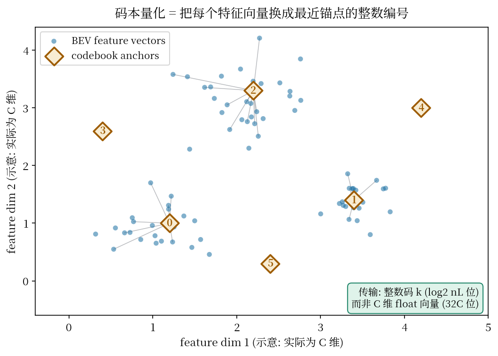
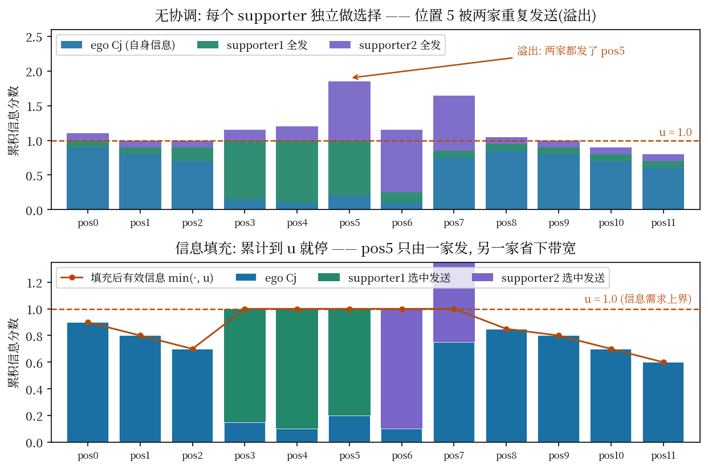

# 传整数码而不是特征图：CodeFilling 如何用千分之一的带宽做协同感知

> **编号 79** · 论文：Communication-Efficient Collaborative Perception via Information Filling with Codebook（CodeFilling） · 作者：Yue Hu, Juntong Peng, Sifei Liu, Junhao Ge, Si Liu, Siheng Chen（上海交大 MAGIC 课题组） · 会议：CVPR 2024 · 论文链接：https://arxiv.org/abs/2405.04966 · 代码：公开，https://github.com/PhyllisH/CodeFilling（2024-03-29 建库，已核实可访问）
>
> **一句话核心洞见**：把协同消息的优化拆成"表示"与"选择"两个正交动作——表示上用共享码本把高维 float 特征向量换成整数码（查字典），选择上让各智能体的本地决策联合起来填满彼此的信息需求（拼图），两个动作相乘，带宽账就对上了。

---

## 感知-通信这笔账，到底在哪个场景最难算

协同感知的起点很朴素：一辆车被大货车挡住视线，看不见路口另一侧的行人；路边的杆子（road-side unit）看得见。两边通个话，车就"看"见了。问题是"通话"按什么格式、发多少内容。发得太少，遮挡依然解不开；发得太多，V2X 的无线带宽根本扛不住——这就是这篇论文反复说的根本权衡（trade-off）。

在它之前，领域里走过两条路。第一条是 late collaboration：各家直接交换检测框（一辆车说"我看到三个框"）。带宽极小，但多篇前人工作指出它带来的感知增益很有限，还对噪声脆弱——框是高度加工过的结论，一旦某家的检测器漏检，这个信息就永远丢失了，别人想补都补不上。第二条是 intermediate collaboration：交换中间特征图。特征保留了原始信息，增益大，但一张 BEV（bird's eye view，鸟瞰图）特征图是 $H \times W \times C$ 个 float32，动不动几十 MB，带宽直接爆炸。

Where2comm（同课题组的前作，NeurIPS 2022）把第二条路走了一大步：只传空间上有用的位置——用一张空间置信图选出"值得说"的前景区域，背景不传。这是沿**空间维**的稀疏化。但论文指出了两个还没解决的痛点。第一，空间维选完了，**通道维**还是贵的：每个被选中的位置传的仍是一个 $C$ 维 float 向量（$C$ 通常是几百），$\|M\|$ 个位置 $\times C \times 32$ 位，账还是大。第二，Where2comm 的选择是**每对 supporter-receiver 独立做**的：三个 supporter 都觉得"这块区域重要"，就都发了，receiver 收到三份重复信息——多智能体同时发送时的信息溢出（overflow），带宽花在了重复上。

CodeFilling 的两个设计，正好一人负责一个痛点：码本管通道维，选择管多方重复。这就是摘要里 "representation and selection" 的来历。它不是两个并列的创新点凑数，而是把 Where2comm 剩下的那笔账沿两个维度继续算完。

## 作者手里真正的底牌是什么

判断一篇工作的分量，要看作者下注时手里有什么牌。CodeFilling 的作者（第一作者 Yue Hu 也是 Where2comm 的一作）手里有三张牌。

第一张，Where2comm 已经证明了"只传稀疏空间位置"这条路在 DAIR-V2X 真实数据上走得通。CodeFilling 不是从零开始，它站在一个已验证的基座上，赌的是"剩下的带宽大头在通道维和重复发送里"。这张牌很硬，因为它是自己实验室上一代工作的直接延续，失败模式都摸过。

第二张，码本（codebook）/向量量化在压缩领域是几十年的老工具，任务自适应码本（task-adaptive codebook，Singh 等人 2020 年的工作）在 2D 分类上证明了"为下游任务丢信息"的表示可以比无损压缩更省。把这套东西搬到 3D 协同检测，是第一次，但原理部分的坑别人已经踩过。这张牌中等硬度：迁移的域变了（2D 分类特征 vs 3D BEV 特征），"为检测任务保留什么"需要重新验证。

第三张，信息填充的优化形式（后面会细讲的公式 3a/3b）有一个解析解，求解代价 $O(\log m)$。也就是说，"联合选择"这个听起来很贵的东西，实际上可以每轮推理时都算。这张牌决定了第二个设计不是纸上谈兵。

目标会议是 CVPR，审稿人口味偏向"完整的系统 + 真实数据验证"。论文的实验设计也透露了这点：DAIR-V2X 真实数据集打头，仿真数据集 OPV2VH+ 随后，同构（纯 LiDAR、纯相机）加异构（LiDAR+相机混搭）三种设置全覆盖，还补了位姿误差和延迟的鲁棒性实验——这套实验设计下来，审稿人很难在"证据不足"上挑刺。

## 从"全传特征图"到"查字典+拼图"，这条路是被逼出来的

把方法还原成发现顺序走一遍。起点是中间协作的朴素版本：每家把整张 BEV 特征图发给别人。带宽账：$H \times W \times C \times 32$ 位。以 DAIR-V2X 的感知范围（204.8m × 102.4m）为例，BEV 网格稍大一点就是几十 MB 每帧，V2X 链路直接堵死。此路不通。

第一次修正是 Where2comm：只传空间上有信息的位置，用二值选择矩阵 $M \in \{0,1\}^{H \times W}$ 标出"发/不发"。带宽降到 $H \times W \times \|M\| \times C \times 32 / 8$ 字节，$\|M\|$ 是选中位置的比例，前景稀疏时能降一到两个数量级。但两个麻烦留下来了：单个位置的 $C$ 维 float 向量依然贵；每个 supporter 独立按自己的分数图选位置，多家视角重叠的区域被重复发送。

这时作者面临一个分岔：继续在空间维上抠（更聪明的选择），还是换一个维度下手？他们的判断是空间维已经抠得差不多（Where2comm 的稀疏选择已是 SOTA），剩下的大头在**通道维**——每个向量的表示本身。于是引入码本：所有智能体共享一本"字典" $D \in \mathbb{R}^{C \times n_L}$，含 $n_L$ 个 $C$ 维的码；发送时每个特征向量只传它最接近的那个码的**整数编号**。一个位置的代价从 $32C$ 位降到 $\log_2(n_L)$ 位。取个典型值示意（非论文数字）：$C=256$、$n_L=256$ 时，这是 $8192$ 位 vs $8$ 位，三个数量级。这就是"查字典"。

但光有字典还不够。如果每家还是独立选位置，重叠区照样被发三遍，只是每遍更便宜了而已。于是第二个修正：把选择变成**联合优化**。每个 receiver 先广播自己的信息需求（用一张轻量的信息分数图表示"我哪里已经知道多少"），各 supporter 在本地解一个带预算约束的优化，目标是让所有人的消息**加起来**刚好填满每个 receiver 的需求，填满就停——像拼图一样，谁的块能补上缺口谁发，缺口补上了别人就不发了。这就是"信息填充"。

两个设计哪个承重？看消融（论文图 9a）。只加码本表示、不加填充选择：相同检测性能下通信量降 **208 倍**——这是大头，账面上三个数量级里的大部分来自这里。再加填充选择：相同通信量下检测性能再涨 **4.8%**——把原来浪费在重复上的带宽挪去发更有用的信息。所以码本是承重的梁，填充选择是把梁的利用率再往上抬一截的装修。两个数字的口径不同（一个是降带宽、一个是涨性能），但方向一致：表示管量级，选择管效率。

## 码本量化的几何动作：每个向量去查一次字典

先看图。

*图 1（自绘示意，2D 降维版，实际是 C 维）：蓝点是各 BEV 位置的特征向量，橙色菱形是码本里的 $n_L$ 个码（锚点），灰线是每个向量到最近码的指派。传输时只传菱形的编号。*

几何上发生的事很直白。BEV 特征图上每个位置 $(h,w)$ 有一个 $C$ 维向量 $\mathcal{F}_{[h,w]} \in \mathbb{R}^C$，把它看成 $C$ 维空间中的一个点。码本 $D$ 的 $n_L$ 个码 $d_1, \dots, d_{n_L}$ 是钉在这个空间里的 $n_L$ 个锚点。量化就是对每个点做一次最近邻查找：

$$(\mathcal{I}_{i\rightarrow j})_{[h,w]} = \arg\min_{\ell} \|(\mathcal{Z}_{i\rightarrow j})_{[h,w]} - D_{[\ell]}\|_2^2 \tag{5}$$

其中 $\mathcal{Z}_{i\rightarrow j} = M^*_{i\rightarrow j} \odot \mathcal{F}_i$ 是选择矩阵筛过的稀疏特征图（只传被选中的位置）。找到最近的锚点 $\ell^*$，传整数 $\ell^*$，完事。接收方查表解码：$(\hat{\mathcal{Z}}_{j\rightarrow i})_{[h,w]} = D_{[\mathcal{I}_{j\rightarrow i}[h,w]]}$，把编号换回向量。

为什么这个"查字典"对检测任务够用？关键在码本**怎么学**。论文的公式 (4)：

$$D^* = \arg\min_D \sum_{\mathcal{F}} \sum_{h,w} \min_{\ell} \Psi(D_{[\ell]}) + \|\mathcal{F}_{[h,w]} - D_{[\ell]}\|_2^2 \tag{4}$$

两项各管一件事。第二项是重建误差：码要离它负责的那些特征向量近，这是经典向量量化的目标。第一项 $\Psi(D_{[\ell]})$ 是把码 $D_{[\ell]}$ 替换进特征图后得到的**检测性能**——码本是"任务驱动"（task-driven）的：它不在乎像素级重建保真度，只在乎换上去之后检测器还能不能检出框。论文把这种近似叫 pragmatic approximation：对重建是有损的，对感知任务是无损的。训练时网络参数和码本同时更新（损失函数里有一项 $\|\mathcal{F}_i - \bar{\mathcal{F}}_i\|_2^2$，$\bar{\mathcal{F}}_i$ 是码近似后的特征图，逼着网络学出"好量化"的特征）。

这里有个初学者容易想错的地方：码本难道不会把细微但关键的特征抹掉吗？比如远处一个只有几个点的小目标，它的特征向量很特殊，离哪个锚点都远，量化误差大，检测器就漏了。论文的回答藏在第一项里：$\Psi$ 直接度量检测性能，如果某类小目标的特征总被量化坏，训练会把锚点往那个方向推——码本的分布是被任务"拽"着走的，不是均匀铺开的。但这个回答有个前提：训练集里这类样本要足够多，码本才学得到。极端长尾的特征，码本里没有对应的锚点，照样会糊掉。这是码本方案的结构性弱点，后面怀疑式审读还会回来。

码本有两个旋钮：$n_L$（字典里有多少个词）和 $n_R$（一个向量用几个码组合表示，公式 5 是 $n_R=1$ 的简化写法）。带宽公式把代价算得很清楚：

$$\text{带宽} = H \times W \times \|M\| \times \log_2(n_L) \times n_R / 8 \quad \text{字节} \tag{6}$$

对比传原始特征的 $H \times W \times \|M\| \times C \times 32 / 8$。$\log_2(n_L)$ 是"一个整数编号占几位"——$n_L=4096$ 时是 12 位。消融（图 9d/9e）显示：所有码本配置在极端带宽下都比基线好；$n_L$、$n_R$ 越大性能越好、越小越省——一个干净的单调权衡，没有反转，说明这个旋钮的行为是可预测的，调参的人心里有底。

还有一个容易被忽略的性质：码本是**所有智能体共享**的。LiDAR 车和相机车提取的特征本来不在一个分布里，但量化之后都变成"第 137 号码"这样的整数，天然对齐到同一个离散空间。这就是论文敢说"异构设置零额外代价"的底气：异构对齐问题被"翻译"成了"大家用同一本字典说话"。新智能体加入，理论上只需往字典里加几个它自己的特征基。当然，"理论上"三个字要打折——实验里的异构是 LiDAR 和相机随机混搭、码本在两者上联合训练的，并没有展示一个训练时没见过的全新模态半路加入。这个后面细说。

## 信息填充：三家人拼一块拼图，谁都不过多发一块

现在看第二个设计。场景：ego 车在位置 3–6 被遮挡，自己的信息分数很低；supporter1 能看见位置 3–5，supporter2 能看见位置 5–7。两家视角在位置 5 重叠。如果每家独立做选择（Where2comm 的做法），两家都会发位置 5——receiver 收到两份几乎一样的信息，带宽花重复了。

*图 2（自绘一维示意）：蓝色是 ego 自己的信息分数 $C_j$，绿色/紫色是两家 supporter 发出的信息。虚线 $u=1.0$ 是信息需求上界。上图无协调时位置 5 被发两次；下图填充后每处累计截断在 $u$，不溢出。*

形式化写出来就是论文的公式 (3a)(3b)。先定义信息分数图：

$$\mathbf{C}_i = \Phi_{\text{generator}}(\mathcal{F}_i) \in [0,1]^{H \times W} \tag{2}$$

每个位置一个 0 到 1 的分数，表示"我这里有多少信息"。实现上有个省钱的技巧：$\Phi_{\text{generator}}$ 直接复用检测解码器的参数——检测头本来就要对每个位置输出"这里有没有物体"的置信度，拿来当信息分数，不引入新参数、不引入新训练目标。一个部件两种用途。

然后是两步走。第一步叫**信息披露**（information disclosure）：每个 agent 把自己的 $\mathbf{C}_i$ 广播给所有人。这一步是填充优化的前提——supporter 得先知道 receiver 哪里缺，才能决定自己补哪里。论文强调这张图很轻量（单通道 $H \times W$ 的分数，不是 $C$ 通道的特征），所以广播代价可接受。这里埋了个后面要审的问题：这部分通信到底计没计入带宽公式，先记下。

第二步是**填充优化**（filling-driven optimization），在 supporter 侧为每个 receiver 解：

$$\{\mathbf{M}^*_{i\rightarrow j}\}_{i,j} = \arg\max_{\mathbf{M}} \sum_{j=1}^{N} f_{\min}\left(\mathbf{C}_j + \sum_{i \neq j} \mathbf{M}_{i\rightarrow j} \odot \mathbf{C}_{i},\, u\right) \tag{3a}$$

$$\text{s.t.} \sum_{i,j, j\neq i} \mathbf{M}_{i\rightarrow j} \leq b, \quad \mathbf{M}_{i\rightarrow j} \in \{0,1\}^{H \times W} \tag{3b}$$

逐项拆。$\mathbf{M}_{i\rightarrow j}$ 是 supporter $i$ 发给 receiver $j$ 的二值选择矩阵，1 表示"这个位置我发"。$\mathbf{C}_j + \sum_{i\neq j} \mathbf{M}_{i\rightarrow j} \odot \mathbf{C}_i$ 是 receiver $j$ 在每个位置上的**信息累积**：自己的分数，加上各家发过来的分数（只加被选中的位置）。$f_{\min}(\cdot, u)$ 是逐元素的 $\min(\cdot, u)$：累积超过 $u$ 的部分不计分——"吃饱了就停"，超过需求的信息对目标函数零贡献，优化器自然不会选那些位置。这就是"填充"二字的数学形状：拼图缺口多大就补多少，补满了多一块都不拼。

$u$ 是信息需求上界，一个超参数。直觉：$u$ 小，receiver 容易"吃饱"，选的位置少，省带宽但性能低；$u$ 大，选得多，性能高但贵。消融（图 9c）试了 $u \in \{0.5, 1.0, 1.5\}$：带宽受限时 $u=0.5$ 的权衡最好，带宽充裕时 $u=1.5$ 最好——$u$ 就是那个把"性能-通信"曲线拨来拨去的旋钮，调它等于在曲线上选工作点。

约束 (3b) 是总预算：所有选择矩阵的 1 的总数不超过 $b$。注意这个约束是**全局**的（对所有 $i,j$ 求和），而目标函数里每个 receiver 的填充是分别算的——这正是"联合"的含义：预算在所有发送对之间统一分配，优化器会自己决定把预算花在哪个 receiver 的哪个位置上，而不是每对固定分一块。

目标里用的是 $\sum_j$ 而不是 $\max_j$，这个选择值得停一下。论文做了对照（图 9b）：如果把求和换成 max（只让分数最高的那个 collaborator 发），会出现退化——当 ego 自己的分数在某区域最高时，max  utility 下谁都不用发，等于没协作。sum 的意思是"大家凑"，哪怕 ego 已经是全场最高，别人的信息只要能把累计往 $u$ 推近一点，就值得发。这个对照做得干净：它证明了"联合"的价值不在于选最强的一家，而在于把多家的边际增益加起来。

求解代价是 $O(\log m)$，$m$ 是候选空间位置数，论文说有解析解（推导在附录）。直觉上不难理解为什么便宜：目标函数是分段线性的（min 截断），约束是基数约束，这类问题按"边际增益"排序贪心就能解；又因为只在稀疏的前景位置上算，$m$ 本身很小。附录的完整推导在公开的 arXiv 文本提取中未能看到，此处细节标**未确认**，但主文给出的复杂度和"只算前景"的限定是一致的。

解出来的 $\mathbf{M}^*_{i\rightarrow j}$ 往特征图上一乘，$\mathcal{Z}_{i\rightarrow j} = \mathbf{M}^*_{i\rightarrow j} \odot \mathcal{F}_i$，得到稀疏特征图，再送进码本查字典，变成整数码矩阵 $\mathcal{I}_{i\rightarrow j}$。这就是最终发出去的消息 $\mathcal{P}_{i\rightarrow j}$。顺序是：先选位置（空间稀疏），再压通道（码本量化）——两个动作串行，互不干扰。

## 收到整数码之后：查表、融合、训练

Receiver 收到 $\mathcal{I}_{j\rightarrow i}$（一串整数），先查表解码回特征：$(\hat{\mathcal{Z}}_{j\rightarrow i})_{[h,w]} = D_{[\mathcal{I}_{j\rightarrow i}[h,w]]}$。然后融合。论文用的融合简单到有点出乎意料：逐点取最大（pointwise maximum fusion），

$$\mathcal{H}_i = \max_{j \in \mathcal{N}_i}(\mathcal{F}_i, \hat{\mathcal{Z}}_{j\rightarrow i})$$

每个位置、每个通道，取自己和各家解码特征里的最大值，无参数。为什么不用注意力融合？一个合理的推断（论文没明说，标为推断）：特征已经被码本量化成"字典词"了，不同家的特征落在同一个离散空间里，逐点 max 足以把"谁看得清听谁的"实现——哪个家的特征在该位置激活强，就采用哪个。这很糙，但便宜，而且实验说明够用。糙也有代价：max 对噪声敏感，一家传了个高激活的误检特征，会直接污染融合结果。论文没讨论这一点。

训练损失三项合一：

$$L = \sum_i L_{\text{det}}(\bar{\mathcal{O}}_i, \mathcal{O}^0_i) + \|\mathcal{F}_i - \bar{\mathcal{F}}_i\|_2^2$$

$L_{\text{det}}$ 是检测损失（PointPillars 那套），$\bar{\mathcal{O}}_i$ 是融合后特征解出的框；第二项逼原始特征 $\mathcal{F}_i$ 和码近似后的 $\bar{\mathcal{F}}_i$ 接近，让网络学出"好量化"的特征分布。码本和网络参数同时更新。信息分数生成器复用检测解码器参数，所以没有第三个独立目标——整个训练目标很干净，没有一堆需要调权重的复合损失项，这点比很多"五个 loss 加权"的工作清爽。

## "1333 倍"到底是怎么算出来的

这是全文最抓眼球的数字，值得把口径拆开。论文摘要和 5.2 节的说法是：相对 Where2comm（当时的 SOTA），在 DAIR-V2X 上通信量低 **1333 倍**，在 OPV2VH+ 上低 **1206 倍**，且检测性能不差于对方。

关键问题：这个倍数是在什么条件下量的？不是"同一个配置下两边各跑一次比带宽"，而是**性能-带宽曲线上的等性能点之比**：画出两条"AP 随带宽变化"的曲线，找到 CodeFilling 和 Where2comm 达到相同 AP 时各自所需的带宽（字节，log2 尺度），相除。论文 5.2 节还给了更细的三组数字：DAIR-V2X 上 **1333/115/863 倍**，OPV2VH+ 上 **1206/1078/252 倍**。论文没有明说每组内三个数字的对应关系，但按与后文性能提升三元组（明确标注为 LiDAR/相机/异构）平行的结构推断，应分别对应 LiDAR / 相机 / 异构三种设置——此为推断，原文未明确标注。摘要里的 1333/1206 是每组的第一个数字。这个口径是诚实的——比较的是"达到同样效果要花多少钱"，而不是挑一个对自己有利的固定带宽点。但读者要意识到：倍数大小依赖于曲线的形状，Where2comm 的曲线在低带宽段掉得快，倍数就显得大；这是方法本身的性质，不是数字游戏。

另一组数字是性能提升口径：在带宽被压缩 **10 万倍**的极端条件下，CodeFilling 相对 SOTA 的 AP 提升为 DAIR-V2X 上 **11.093/5.271/38.357%**、OPV2VH+ 上 **14.75/28.516/28.372%**（LiDAR/相机/异构）。注意这是"极端带宽下"的提升，不是常规带宽下的——常规带宽下大家的 AP 都接近饱和，差距自然小。论文把限定条件写清楚了，算诚实。

消融给的两个内部口径前面已经提过：码本表示单独贡献 **208 倍**通信下降（相同检测性能下，相对"只用选择、不用码本"的版本）；填充选择单独贡献 **+4.8%** 检测性能（相同通信量下）。这两个数字回答了"两个设计各自值多少钱"。

推理速度：CodeFilling 在 DAIR-V2X/OPV2VH+ 上 **36/99ms**，Where2comm **34/94ms**，HMViT **90/1266ms**。码本查表和填充求解没有把推理拖慢到不可用，和 Where2comm 基本持平，比 HMViT 快一个数量级以上。这组数字的意义在于：通信省下来的代价没有转移成算力爆炸。

鲁棒性实验（图 7/8）是全文我最欣赏的一组对照。位姿误差从 0 加到 1.0m（高斯噪声）、延迟从 0 加到 500ms：所有方法的 AP 都往下掉，但基线们在位姿误差超过 **0.6m**、延迟超过 **100ms** 后，性能跌破了"不协作"（no collaboration）——协作反而帮倒忙。而 CodeFilling 在全部恶劣条件下始终压着基线，且始终高于不协作。这说明它的增益不是"在干净仿真里刷出来的"，对真实 V2X 里不可避免的位姿噪声和延迟有余量。一个可能的原因（推断）：码本的离散表示对小扰动不敏感——特征被噪声推偏一点，只要还在同一个锚点的 Voronoi 单元里，传出去的整数码不变；连续特征值则会被噪声直接污染。

## 怀疑式审读：论文没说全的四件事

**第一，信息披露那张广播的分数图，到底计没计入带宽。** 填充优化的前提是每个 agent 先把自己的信息分数图 $\mathbf{C}_i \in [0,1]^{H\times W}$ 广播给所有人。论文说它"轻量"，因为它是单通道分数而非 $C$ 通道特征。但 5.1 节的带宽公式只写了选中特征的传输量 $(H\times W\times\|M\|\times\cdots)$，没有出现广播 $\mathbf{C}_i$ 的项。$H\times W$ 个 float32 再小，也是 $H\times W\times 32/8$ 字节——在极端稀疏（$\|M\|$ 很小）的场景下，这笔固定开销可能和消息本身一个量级。论文没有交代这笔账算在哪。一个公允的猜测（标为推断）：分数图可以先二值化/量化再广播，或者复用检测头的输出本来就要算所以不计——但论文没写，读者只能自己掂量。在 DAIR-V2X 只有 2 个 agent 的场景下这笔开销很小；在 OPV2VH+ 的 10 个 agent 场景下，每个 agent 广播一次，是 $N$ 倍的固定开销。规模越大，这个缺口越值得问。

**第二，码本失配是结构性风险，论文没有正面处理。** 码本是在训练集的特征分布上学的。如果部署时遇到分布偏移——新的城市、新的传感器型号、极端天气下的点云——特征向量会系统性地偏离训练分布，量化误差变大，$\Psi$ 项在训练时保证的"任务无损"不再成立。更尖锐的是异构主张："新异构 agent 加入只需往码本里加它的有效感知特征基"。实验里并没有真的做这件事：异构设置是 LiDAR 和相机随机混搭、码本在两者上**联合训练**的，没有一个"训练时没见过、测试时半路加入"的新模态。所以"可扩展"是设计上的性质，不是实验验证过的结论。审稿人如果较真，会要求一个"留一模态"的实验：码本在 LiDAR+相机上训练，测试时加入一个只有雷达（radar）的新 agent，看加几个码能接上。论文没做，读者要自己打这个折。

**第三，$u$ 只试了三个值，填充求解器在推理时其实有个"逃生开关"。** 图 9c 的 $u$ 消融只有 0.5/1.0/1.5 三个点，没有 $u$ 在最优值附近的敏感性曲线——无法判断 0.5 是一个平坦区域的中心还是恰好选中的点。更有意思的是代码仓库的推理脚本暴露的细节：`inference_comm_bp_plus.py` 有 `--w_solver`（是否使用信息填充求解器）、`--solver_thre`（即 $u$，"期望的最大信息需求"）、`--solver_method`（max/sum 两种 utility）。`--w_solver` 的存在说明，填充优化在推理时**可以被关掉**，回退到普通的阈值选择（`--comm_thre`）。这透露了作者的工程判断：解析解虽然理论上是 $O(\log m)$，但在实际部署里，多一轮"广播分数图→等所有人→联合求解"的同步开销，可能不如各家独立阈值选择来得干脆。论文正文把填充选择讲成了必选项，代码里它是可选项——这个反差值得记一笔：联合优化的理论收益（+4.8%）和它的系统代价（多一轮同步）之间的账，论文没有算。

**第四，两个"看起来理所当然"的假设，链条其实有点长。** 其一，信息分数 = 检测置信度。直觉是"有物体的地方分数高"，但漏检恰恰发生在"有物体但检测器没信心"的地方——ego 没看到的区域 $C_j$ 低，supporter 看到的区域 $C_i$ 高，填充优化把后者补进前者，这个链条成立的前提是**双方的漏检模式不相关**（视角不同）。如果两家因为同一个原因漏检（比如都被大雾挡住），分数图在该区域都低，谁也补不上谁，填充优化无能为力。论文的遮挡场景天然满足"视角互补"，所以实验好看；但这个假设的边界没有被讨论。其二，逐点 max 融合。前面说了它糙，补充一个具体的失败模式：某家传了一个高激活的误检（false positive）特征，max 会直接把它采纳，而加权平均或注意力融合至少能被其他家的低激活稀释。论文的鲁棒性实验只加了位姿噪声和延迟，没有加"某家传感器故障/误检率上升"的实验——而这恰恰是 max 融合最脆弱的地方。

公允地说，论文做得漂亮的地方也要点名。sum vs max utility 的对照（图 9b）是一个设计精巧的阴性对照：它没有只展示"我们的方法好"，而是展示了一个"看起来合理但会退化"的替代方案（max 下 ego 最强时无人发送），从而证明了"联合求和"这个设计选择的必要性。这种对照比单纯的数字好看更有说服力。另外，位姿/延迟鲁棒性实验里"基线跌破不协作、我们始终在其上"的呈现方式，选了一个信息量很大的参照系——不是只和 SOTA 比，而是和"不协作"这条底线比，一眼能看出谁的增益是实的。

还有一处记号上的小混乱，读的时候要注意：问题形式化（公式 1）里 $\mathcal{P}_{j\rightarrow i}$ 被定义为"从第 $i$ 个 agent 传到第 $j$ 个"的消息，但文字描述写的是"the message transmitted from the $i$th agent to the $j$th agent"，下标方向 $j\rightarrow i$ 和文字 $i\rightarrow j$ 不一致；后文实际使用 $\mathcal{P}_{i\rightarrow j}$ 表示 $i$ 发给 $j$。这是笔误，不影响理解，但复现时按后文的用法为准。

## 可迁移想法：表示与选择解耦，是一套通用账本

读完这篇论文，能带走的不是"协同感知要用码本"，而是三套可复用的思考框架。

**第一套：把"传什么"和"发不发"拆成两个正交的优化。** 很多通信/传输问题的纠结在于把表示压缩和发送决策混在一起调。CodeFilling 的结构是：表示只管"一个单位信息最少用几位"（码本管通道维），选择只管"哪些单位值得占用预算"（填充优化管空间维和多方分配）。两个优化的目标函数不耦合，可以独立设计、独立消融、独立替换。对任何"多方在预算下交换信息"的系统——多智能体协作、分布式推理、联邦学习——这个拆分都值得先画出来，再决定每一半用什么技术填。

**第二套：用离散整数码作为多方协作的"通用货币"。** 连续特征向量在不同智能体之间不可比（分布不同、尺度不同），但离散编号天然可比、可数、可做集合运算。码本在这里同时干了三件事：压缩（省位）、对齐（异构统一到同一空间）、离散化（让"计数"和"去重"成为可能——填充优化本质上是在数"这个位置的信息够不够 $u$"）。下次遇到"多方表示不一致"的问题，先问能不能找到一个共享的离散中间层，而不是直接去学一个复杂的对齐网络。

**第三套：预算约束下的联合选择，目标函数里要有一个"饱和截断"。** $f_{\min}(\cdot, u)$ 是全文最值得抄的一行：它把"需求有上界"这个常识写进了优化目标，让"够了就停"成为优化器的自发行为，而不是后处理的启发式规则。任何"多方贡献、共享预算"的分配问题——算力分配、传感器调度、候选集筛选——都可以借用这个形状：效用函数在需求满足后截断，预算约束全局共享，解出来的自然是互补而非重复的分配。

## 与本课题的关联：三处直接的类比

本课题是"世界模型引导 + 自适应衰减情景记忆的闭环多规划器自动驾驶 Agent"：LLM 调度多个专家规划器执行自然语言指令，世界模型做未来预测和风险仲裁，情景记忆做历史案例检索，Bench2Drive 闭环验证。CodeFilling 的三处思想可以直接映射过来。

**第一处：码本"传整数码而非特征图" → 分层粗–细检索的"紧凑签名"。** 课题设计里的"分层粗细检索"面临同样的账：情景记忆库大了之后，每次检索都比对完整特征向量，延迟扛不住。码本的思路是：粗检索阶段只传/只比**紧凑签名**——可以是向量量化后的码索引，也可以是哈希签名、PCA 降维后的短向量。关键不是用哪种压缩，而是 CodeFilling 证明了"有损但任务无损"的表示是存在的：只要签名的训练目标（类比公式 4 里的 $\Psi$ 项）直接对准下游任务（检索出的案例对规划的实际帮助），粗检索的召回损失可以压到很小。具体做法：离线对记忆库的案例特征学一个码本（或用乘积量化），在线检索时 query 也量化成码，在码空间做最近邻，命中的案例再取完整特征做细排。带宽公式 (6) 里 $\log_2(n_L)$ 的位置，就是"签名长度"这个旋钮——$n_L$ 越大签名越长、越准、越贵，和论文里图 9d/9e 的单调权衡是同一条曲线。

**第二处：信息填充"各方消息互补而非重复" → 多规划器候选集的互补性设计。** 这是类比最紧的一处。课题里 LLM 调度多个专家规划器（比如激进型、保守型、舒适型），每个规划器输出候选轨迹，再由世界模型 rollout 仲裁。如果三个规划器输出的候选高度相关（都在同一条车道上微调），仲裁阶段的世界模型 rollout 算力就浪费在了"重复评估几乎一样的未来"上——这正是 CodeFilling 里"多家 supporter 发同一块区域"的信息溢出。填充优化的解法可以平移：在候选生成/筛选阶段加一个**互补性约束**，形式上抄公式 (3a)：设每个候选 $k$ 对"风险空间"的覆盖分数为 $c_k$（比如它在不同风险维度上的区分度），总目标为 $\sum f_{\min}(\sum_k M_k c_k, u)$，$M_k \in \{0,1\}$ 表示候选是否送入仲裁，预算约束 $\sum M_k \le b$（$b$ 是世界模型 rollout 的算力预算）。$f_{\min}$ 的截断保证：一旦某个风险区域已有候选覆盖，再选高度相关的候选就零收益，优化器自动挑**互补**的候选。这相当于检索里的 MMR（maximal marginal relevance）思想，但写成了可优化的目标。注意 CodeFilling 的教训：联合选择需要一轮"信息披露"（各家先亮出自己有什么），映射过来就是各规划器先输出轻量的候选摘要（意图、风险等级），仲裁器再决定让谁展开完整 rollout——两阶段，先轻后重。

**第三处：通信预算约束下的选择机制 → 场景驱动动态模块旁路。** 课题设计里有"场景驱动动态模块旁路"做时延优化：简单场景跳过重模块。CodeFilling 的公式 (3b) $\sum M \le b$ 和 $u$ 旋钮给了一个现成的数学框架：把**计算预算**看成通信预算 $b$，把每个模块（世界模型细粒度 rollout、记忆精排、某个专家规划器）的"信息增益"看成信息分数，场景复杂度决定 $u$（需求上界）。简单直行场景 $u$ 小，几个模块的增益就填满了，剩下的模块被优化器自然关掉（对应 $M=0$）；复杂路口场景 $u$ 大，预算放开，模块全开。$u$ 的消融结论（受限时小 $u$ 好、充裕时大 $u$ 好）直接对应"按场景自适应预算"。甚至实现上都可以抄：每个模块输出一个 0–1 的"边际增益预估"（类比信息分数图），一个轻量的求解器（$O(\log m)$，论文已证明便宜）在每帧解一次"开哪些模块"的 0–1 规划。这比手写"if 场景==直行 then 跳过"的规则更平滑，也更容易和端到端的延迟目标对齐。

还有一处次要的类比：CodeFilling 里每个 agent 同时是 supporter 和 receiver。课题里世界模型也身兼两职：作为"支持者"给调度器提供未来预测先验，作为"接收者"（仲裁者）评估各规划器的候选。这种双重角色意味着它的输出格式要同时服务两种用途——CodeFilling 用"信息分数图"这一种表示同时服务了选择和融合；课题里可以考虑让世界模型的 rollout 输出一种"风险分数图"的统一表示，同时服务调度先验和仲裁打分，一份计算、两处复用。

最后回到数字诚实性。CodeFilling 的 1333 倍是在"等性能"口径下量的，课题里如果要宣称"分层检索省了多少延迟"，建议抄这个口径：画"规划性能–延迟"曲线，比较达到相同闭环分数所需的延迟，而不是挑一个固定配置比。这样报出来的倍数才经得起审稿人问"口径是什么"。
