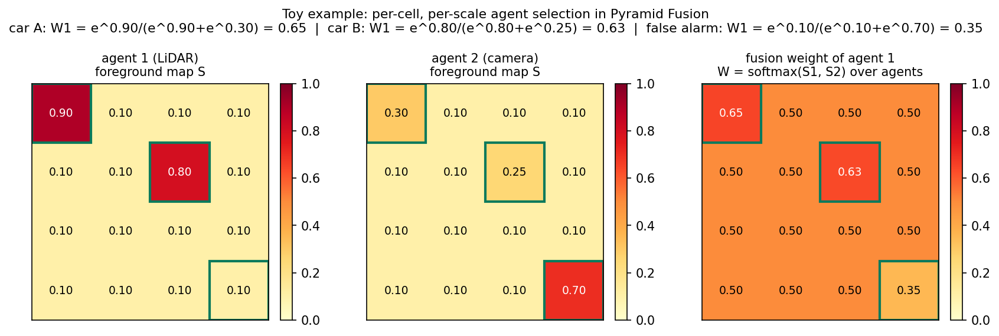
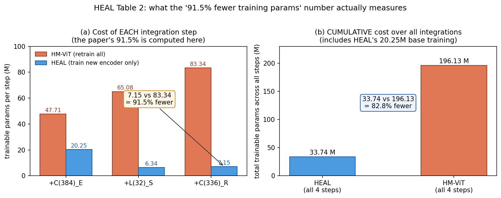

# 新来的车不用重新练：冻住后端、单训前端的异构感知联盟

> **信息块**
>
> - **编号**：78（多智能体协同驾驶 76–80；全局 51–90）
> - **论文标题**：An Extensible Framework for Open Heterogeneous Collaborative Perception
> - **框架名**：HEAL（HEterogeneous ALliance，异构联盟）
> - **作者**：Yifan Lu, Yue Hu, Yiqi Zhong, Dequan Wang, Yanfeng Wang, Siheng Chen（上海交通大学 / University of Southern California / 上海人工智能实验室 / MAGIC）
> - **会议**：ICLR 2024（arXiv:2401.13964，v3，2024-04-01）
> - **链接**：https://arxiv.org/abs/2401.13964
> - **代码**：公开，https://github.com/yifanlu0227/HEAL（仓库可访问，含两阶段训练流程与 OPV2V-H 数据说明）
> - **一句话核心洞见**：与其每来一种新传感器就把整个协同网络重练一遍，不如先让初始智能体练出一个统一的 BEV 特征空间并把它冻住，新智能体只训练自己的编码器去"投奔"这个空间——于是异构问题的代价从"重练所有人"降成了"单练新人"。

---

## 新传感器一上线，协同感知为什么就掉点？——同构假设撞墙的三个现场

2024 年之前，协同感知这个领域有一个所有人都默认接受的假设：参与协同的智能体是同构的——相同的传感器模态、相同的感知模型。在这个假设下，中间融合（intermediate fusion）的做法很直接：每个智能体把 BEV 特征发给 ego 车，ego 车拼在一起过一个融合网络，输出检测框。V2X-ViT、CoBEVT、DiscoNet 这些工作都是这条路上的。

这个假设在三个具体的现场撞墙。

**现场一：新硬件、新模型是持续发生的，不是一次性的。** 传感器技术快速迭代，不同公司对协同感知的态度也不同，开源还是闭源、交不交模型细节，各家立场不一。这意味着"所有智能体类型"在系统上线那一刻根本确定不下来，新类型会随时间不断冒出来。一个在训练集里从没出现过的异构智能体想加入协同，它和现有智能体之间存在特征域差距（domain gap），直接拼特征，融合网络认不出这些特征。

**现场二：退回 late fusion 这条路走不通。** late fusion 只融合各智能体的检测框，天然绕过异构。但论文引了两条已知的结论：它对定位噪声特别脆弱（Lu et al., 2023），对通信延迟也脆弱（Wang et al., 2020）。框级融合没有特征级的冗余，位姿一抖，框就对不上。这条退路性能上限低。

**现场三：把所有人放一起重训，代价随类型数膨胀。** 同期工作 HM-ViT（Xiang et al., 2023）处理了异构，但每加入一个新类型就要把整个模型重训一遍。论文表 2 的数字把这件事量化得很清楚：HM-ViT 的可训练参数从 47.71M（2 种类型）涨到 65.08M（3 种）再到 83.34M（4 种）。类型数 $m$ 越大，每次集成的代价越大，论文称之为 $O(m)$ 乃至 $O(m^2)$ 的复杂度增长。

最能说明"撞墙"是结构性而非调参问题的证据，藏在表 2 的 F-Cooper 那一行里：随着异构类型从 1 种加到 3 种，它的 AP70 从 0.628 一路掉到 0.517 再到 0.494。注意这不是"提升变慢"，而是**加人反而减分**——朴素的特征拼接在异构面前出现了负增长。这说明问题不在训练技巧，而在"直接把异构特征拼在一起"这个做法本身。

于是论文把问题重新命名为 **open heterogeneous collaborative perception（开放异构协同感知）**：新智能体类型持续涌现，如何在保证感知性能的同时，把每次集成的代价压到最低？"开放"二字强调的是不可预测性——新来的智能体用什么传感器、什么模型，事先不知道。

## 作者的赌注是什么——"先建一个统一空间，再把新人摁进来"

HEAL 的回答分两个阶段，论文图 2 把它画成三步：

**阶段一：协作基训练（collaboration base training）。** 拿初始的一批同构智能体（论文用 64 线 LiDAR + PointPillars 的 $L(64)_P$），端到端训练一个带新融合网络 Pyramid Fusion 的协同感知模型。这一阶段的目标不是检测精度本身，而是**练出一个统一的特征空间**——让融合网络学会"来自不同智能体的特征在这里是同一种语言"。

**阶段二：新智能体类型训练（new agent type training），即后向对齐（backward alignment）。** 新类型出现时，把阶段一练好的 Pyramid Fusion 和检测头**冻住**，作为新智能体的"检测后端"；只训练新智能体的前端编码器。编码器的训练目标还是检测损失，但梯度必须穿过冻住的后端，于是编码器被迫输出"后端读得懂"的特征——也就是统一空间里的特征。训练只在新类型的**单个智能体**上进行，不需要多智能体时空同步的数据。

推理时，所有智能体（老的新的）的特征都已经落在同一空间里，直接走同一个融合公式：

$$H_i = f^*_{\text{pyramid fusion}}\left(\{\Gamma_{j\to i}(F_j)\}_{j \in S^{[b]}\cup S^{[n_1]}\cup\cdots\cup S^{[n_T]}}\right)$$

其中 $\Gamma_{j\to i}$ 是把智能体 $j$ 的 BEV 特征变换到 ego 车 $i$ 坐标系的空间变换，$*$ 表示参数冻结。每来一个新类型，只重复阶段二。

这个赌注的本质值得说透：作者把异构问题的难度从"融合这一步怎么做"挪到了"融合器要不要每次重建"上。传统做法里，融合器是和所有智能体一起长出来的，新人一来，融合器就得推倒重来。HEAL 把融合器变成了**基础设施**——一次建成、长期复用，新人只负责"学会说这里的语言"。代价结构从"每次 $O(m)$ 重训"变成了"每次 $O(1)$ 单训"。

关于作者底气的推断（以下为推断，依据在后）：论文反复强调的"车企数据与模型隐私"叙事——新智能体可以在本地训练、不交出模型细节——很可能不只是包装。附录 A.1 用整整一节讲 DAIR-V2X 上的真实部署设想：把 Pyramid Fusion 的权重分发给想加入的公司，各家用自己的数据在本地做后向对齐。一个研究者愿意为附录写这种"部署说明书"，通常是因为这就是他最初想解决的真实问题，而不只是为了发论文编的故事。ICLR 对"可扩展性 + 真实部署"这类叙事一向友好，这也是投稿 ICLR 而非纯视觉会议的一个合理注脚。

## BEV 坐标系与多尺度——赌注成立的两个不言自明的事实

"统一空间"听起来像口号，它成立依赖两个具体的事实，论文在 4.2 节用两句话给了出来，值得展开。

**事实一：BEV 是一个与传感器无关的共享坐标系。** 无论输入是 LiDAR 点云还是相机图像，只要编码器输出的是鸟瞰图（BEV）特征，不同智能体的特征在物理空间上就是对得上的：BEV 格子 $(u,v)$ 对应 ego 车坐标系下的 $(x,y)$ 米。论文引用了 HM-ViT 的观察：单车多模态融合里传感器位置固定，而异构多智能体里传感器位置随机，BEV 恰好是处理这种随机性的表示。这一步把"模态异构"降维成"同一张地图上不同画风的标注"，是后向对齐能成立的前提。没有 BEV，"统一空间"无从谈起——这也是论文结论亲口承认的局限：keypoint-based 的 LiDAR 检测器想接入，得先改造出 BEV 特征。

**事实二：多尺度让"说不同方言"的特征有台阶可下。** 不同模态、不同骨干的特征，有效感受野天然不在一个尺度上：LiDAR 的几何特征在细尺度上锐利，相机的 Lift-Splat 特征在细尺度上受深度估计误差拖累。Pyramid Fusion 用三层 ResNeXt，每层下采样 2 倍，通道数 $[64,128,256]$。论文给的网格是 0.4m，下采样 2 倍做消息共享后是 0.8m/格，三层之后各尺度的格子边长是 0.8m、1.6m、3.2m、6.4m（$F^{(0)}$ 到 $F^{(3)}$）。

这里可以补一笔论文没有明算的账：0.5m 的位姿误差，在 0.8m/格的细尺度上是 0.6 个格子的错位，特征基本对不上；但在 6.4m/格的粗尺度上只有 0.08 个格子，几乎无感。所以"粗尺度融合对空间变换的离散化误差不敏感"不是一句空话，它是格子变大之后误差被相对稀释的算术后果。图 4 里 HEAL 在位姿噪声下保持住性能，力学解释就在这里：细尺度被噪声打乱时，粗尺度的投票还在。

---

*图 1：Pyramid Fusion 前景加权选择的玩具算例（自制，与正文第 5 节数字对应）。每个 BEV 格子独立做一次"听谁的"投票：前景分数经 softmax 变成该智能体的融合权重。注意误报格 (3,3)：相机的权重是 0.646——喊得响就会被采纳，这是这个机制诚实的一面。*

## Pyramid Fusion 到底在算什么——把式 (2) 逐项拆开看

先看阶段一的整体管线，论文式 (1)：

$$F_i = f_{\text{encoder}^{[b]}}(O_i), \quad i \in S^{[b]} \tag{1a}$$

$$F_{j\to i} = \Gamma_{j\to i}(F_j), \quad j \in S^{[b]} \tag{1b}$$

$$H_i = f_{\text{pyramid fusion}}\left(\{F_{j\to i}\}_{j\in S^{[b]}}\right) \tag{1c}$$

$$B_i = f_{\text{head}}(H_i) \tag{1d}$$

读法：智能体 $i$ 的观测 $O_i$ 经编码器变成 BEV 特征 $F_i$；其他智能体 $j$ 的特征经空间变换 $\Gamma_{j\to i}$ 对齐到 $i$ 的坐标系（附录 B：用 `affine_grid` + `grid_sample` 实现，把相对位姿矩阵去掉 $z$ 轴、按 BEV 物理尺寸归一化，本质是 2D 图像的仿射变换）；融合得到 $H_i$；检测头输出框 $B_i$。

Pyramid Fusion 本体是式 (2)。先列一张张量表，符号第一次出现就定死：

| 符号 | 形状（以论文设置为例） | 含义 |
|---|---|---|
| $F^{(0)}_{j\to i}$ | $256\times256\times64$ | 智能体 $j$ 的 BEV 特征，对齐到 ego $i$ 后（204.8m 范围 / 0.4m 网格 / 2 倍下采样，通道压到 64 做消息共享） |
| $R_\ell(\cdot)$ | — | 第 $\ell$ 层 ResNeXt，下采样 2 倍；三层块数 $[3,5,8]$ |
| $F^{(\ell)}_{j\to i}$ | $(256/2^\ell)\times(256/2^\ell)\times C_\ell$，$C=[64,128,256]$ | 第 $\ell$ 个尺度的特征 |
| $H_\ell(\cdot)$ | $1\times1$ 卷积，$C_\ell\to1$ | 第 $\ell$ 个前景估计器 |
| $S^{(\ell)}_{j\to i}$ | 与 $F^{(\ell)}$ 同空间尺寸，单通道 | 前景可能性图：每个 BEV 格子"这里有车"的概率 |
| $W^{(\ell)}_{j\to i}$ | 同上 | 对智能体 $j$ 做 softmax 后的融合权重 |
| $u_\ell(\cdot)$ | 上采样回 $256\times256$ | — |
| $H_i$ | $256\times256\times448$ | 三个尺度 concat（$64+128+256$）后的融合特征 |

计算过程逐项走一遍：

$$F^{(\ell)}_{j\to i} = R_\ell(F^{(\ell-1)}_{j\to i}) \tag{2a}$$

每个智能体的特征独立地过三层下采样，得到三个尺度的表示。注意这一步**不跨智能体**，每个 $j$ 算自己的。

$$S^{(\ell)}_{j\to i} = H_\ell(F^{(\ell)}_{j\to i}) \tag{2b}$$

每个尺度上，一个 $1\times1$ 卷积把特征压成一张单通道的"前景图"。可以把它理解成一个极简的分割头：看一眼这个尺度的特征，判断每个格子是不是前景。

$$W^{(\ell)}_{j\to i} = \text{softmax}(S^{(\ell)}_{j\to i}) \tag{2c}$$

**这是全网最关键的一行。** softmax 的维度是**智能体 $j$**，不是空间。也就是说，每个 BEV 格子、每个尺度独立做一次投票：$N$ 个智能体在该格子的前景分数一字排开，softmax 变成 $N$ 个加和为 1 的权重。谁在该格子喊"有车"喊得最响，谁的特征在这个格子占的比重就最大。

$$F^{(\ell)}_i = \text{sum}\left(\{F^{(\ell)}_{j\to i} * W^{(\ell)}_{j\to i}\}_{j}\right) \tag{2d}$$

按权重对各智能体的特征做加权求和，$*$ 是逐格相乘。背景格子上大家的前景分数都低，权重接近平均；前景格子上，看得清的智能体自动获得高权重。

$$H_i = \text{concat}\left([F^{(1)}_i, u_2(F^{(2)}_i), u_3(F^{(3)}_i)]\right) \tag{2e}$$

三个尺度上采样回同一分辨率后沿通道拼接。注意式子里从 $\ell=1$ 开始，$F^{(0)}$ 本身没有直接进入输出——最细的原始特征只作为多尺度处理的输入。

训练损失是式 (3)：

$$L = L_{\text{det}}(B_i, Y_i) + \sum_{\ell=1}^{L}\sum_{j}\alpha_\ell\, L_{\text{focal}}\left(S^{(\ell)}_{j\to i}, Y^{(\ell)}_{j\to i}\right) \tag{3}$$

第一项是检测监督：分类用 focal loss，回归用 smooth-L1，和常规 3D 检测一样。第二项是前景图监督：$Y^{(\ell)}_{j\to i}$ 是该尺度下的真值 BEV 前景 mask，每个智能体、每个尺度都要交。超参数 $\alpha_\ell = \{0.4, 0.2, 0.1\}$，细尺度权重大——直觉是细尺度的前景判断更难也更重要，所以监督给得更重。论文没有报告 $\alpha$ 的敏感性分析（未确认：0.4/0.2/0.1 是搜出来的还是拍脑袋定的，不得而知）。

## 为什么前景权重是承重的那块砖——一个两车相遇的算例

用一个 $4\times4$ 的玩具 BEV 网格把式 (2c)–(2d) 真算一遍，数字和本文图 1 对应。场景：两辆车，智能体 1 是 LiDAR（标定良好），智能体 2 是相机（深度估计有误差）。

真实车辆在格 A=(0,0) 和格 B=(1,2)。智能体 1 的前景图：$S_1(A)=0.9$，$S_1(B)=0.8$，其余 0.1。智能体 2 的前景图：$S_2(A)=0.3$，$S_2(B)=0.25$，其余 0.1，但在格 C=(3,3) 有一个误报 $S_2(C)=0.7$。

逐格 softmax（只对两个智能体）：

- 格 A：$W_1 = e^{0.9}/(e^{0.9}+e^{0.3}) = 2.4596/3.8095 = 0.646$，$W_2 = 0.354$。融合特征 $F(A) = 0.646\,F_1(A) + 0.354\,F_2(A)$——LiDAR 占主导。
- 格 B：$W_1 = e^{0.8}/(e^{0.8}+e^{0.25}) = 0.634$。同样 LiDAR 主导。
- 格 C（相机误报）：$W_1 = e^{0.1}/(e^{0.1}+e^{0.7}) = 0.354$，$W_2 = 0.646$——**相机的误报被采纳了**，因为它喊得最响。

这个算例同时讲清楚这个机制好在哪里和险在哪里。好在：它对遮挡的处理是**涌现**出来的，不是写死的规则。被遮挡的智能体在该格子的前景分数自然低，softmax 自动把它降权——不需要一个显式的"遮挡推理"模块。险在：整个机制的好坏完全取决于前景估计器准不准。误报格上相机拿到 0.646 的权重，说明"谁喊得响听谁的"在估计器犯错时会放大错误。论文的应对是训练时用真值 mask 对每张前景图做 focal 监督（式 3 第二项），把估计器先训练准；以及多尺度——孤立的误报在粗尺度上会被周围的真背景稀释掉。但这两招都是"让估计器少犯错"，没有改变"犯错即被采纳"的机制本身。这是阅读时要记在心里的一条。

消融表（表 4）给这个机制定了量：只加前景监督，AP50 从 0.729 涨到 0.753（+2.4 个点），AP70 从 0.578 涨到 0.633（+5.5 个点）。它自己不算最大的功臣，但和多尺度合在一起（0.764/0.662）才撑起后向对齐的底子。

## 后向对齐：冻住后端、只训前端——式 (4) 与它的训练流程

新类型 $n_1$ 接入时的训练是式 (4)，注意它和式 (1) 的区别：

$$F_k = f_{\text{encoder}^{[n_1]}}(O_k), \quad k \in S^{[n_1]} \tag{4a}$$

$$F'_k = f^*_{\text{pyramid fusion}}(F_k), \quad k \in S^{[n_1]} \tag{4b}$$

$$B_k = f^*_{\text{head}}(F'_k), \quad k \in S^{[n_1]} \tag{4c}$$

$*$ 表示冻结。三个变化值得逐个看。

**变化一：输入从"多智能体特征集合"变成"单个特征图"。** 式 (1c) 的融合输入是 $\{F_{j\to i}\}$，而 (4b) 只喂进单张 $F_k$。这时式 (2c) 的 softmax 面对的是单个智能体——单元素 softmax 恒为 1，融合退化成"多尺度处理直通"。阶段二根本没有在练"融合"，练的只是"让单张特征图穿过冻住的网络后能被检测头读懂"。

**变化二：梯度只流向编码器。** 损失函数和式 (3) 相同（检测损失 + 多尺度前景监督，只是 $B_i, Y_i$ 换成单智能体的）。反向传播时，梯度穿过冻住的 Pyramid Fusion 和检测头，一路流回新编码器。编码器的参数更新方向只有一个含义：**输出更像 base 类型特征的特征**。这就是"后向"二字的由来——不是用新数据去适应一个可变的后端，而是让前端去适应一个不动的后端，调整方向是"向后看齐"。

**变化三（最狠的一招）：前景估计器也冻住了，但它的监督还在。** 阶段一的前景估计器 $H_\ell$ 是跟着 LiDAR base 练出来的，它的"审美"——什么样的特征纹理算前景——被冻结保留。阶段二训练时，式 (3) 的第二项照样计算：新编码器的特征穿过**冻住的**估计器，得到的前景图要和真值 mask 对上。这相当于用旧系统的眼睛去检查新人的作业：新编码器必须生成"旧估计器认得"的前景响应。论文 4.2 节那句"保留对最重要的前景特征的有效监督"说的就是这个。附录图 8 的可视化（三个尺度、多个通道上 $L_1$、$C_1$、$L_2$ 的特征响应长得一样）是这件事的经验证据。

**变化四：训练数据不需要多智能体同步。** 附录 A.6 写明：新类型训练时，场景里所有智能体都设为新类型，随机挑一个做 ego，**只用它自己的传感器数据**做单智能体训练。采集"同一时刻多辆车开到同一路口"的同步数据是协同感知落地最贵的环节之一，后向对齐把它绕过去了——新人用自己日常采集的带标注单车数据就能完成接入。这是"低成本"里最实在的一块，比参数数字更实在。

代价数字：协作基训练 5 小时（2 张 RTX 3090），每个新类型 3 小时；HM-ViT 四种类型一起训超过 1 天。仓库 README 还补了一个论文正文没强调的点：stage2 的多个新类型**可以并行训练**——因为它们互相不依赖，各自对着同一个冻住的后端做对齐。论文正文按顺序接入是为了做实验，工程上没有顺序要求。

到这里，HEAL 的完整图像就闭合了：阶段一建一个"说 BEV 普通话"的社区，阶段二让新人"学普通话"而不是让社区"学方言"。推理时所有人已经在说同一种语言，融合公式对类型一视同仁。

## OPV2V-H 测了什么、没测什么——数据集的诚实与水分

OPV2V-H 是论文附带发布的新数据集，动机写得很诚实：原 OPV2V 数据集里 64 线 LiDAR 对相机是压倒性优势，LiDAR 智能体自己就能检出绝大多数目标——在这种数据上评测"异构协同"，协同的部分根本测不出来（HM-ViT 的作者也指出了这一点）。所以作者补采了 16 线、32 线 LiDAR 和深度相机数据，把模态差距拉平，让"协同"真正被需要。这是做 benchmark 设计的一个通用教训：**如果一个基准里单智能体就能拿高分，它就测不出协同方法的差别**。

数据集的规格（附录 A.4）：10,524 个样本，train/val/test 按 6374/1980/2170 划分；每样本 2–7 个智能体，平均约 3 个；每辆车装 3 个 LiDAR（16/32/64 线，约 10k/20k/40k 点，20Hz，上视场 2°、下视场 −25°）、4 个 RGB 相机和 4 个深度相机（800×600，前/左/右/后四个朝向）。用 OpenCDA + CARLA 联合仿真，回放 OPV2V 的交通流生成。实验用的四种智能体类型：$L(64)_P$（64 线 LiDAR + PointPillars，做协作基）、$C(384)_E$（相机 384px + Lift-Splat + EfficientNet）、$L(32)_S$（32 线 LiDAR + SECOND）、$C(336)_R$（相机 336px + Lift-Splat + ResNet50）。

水分也要如实说。第一，全是仿真：完美时间同步、完美标定，没有真实的多车数据采集误差。"异构"只覆盖了"线数 × 骨干网络"这个二维平面——真正的开放异构，比如雷达、热成像、不同的安装高度、相机内参差异、通信延迟，一个都没测。"开放"二字是在一个封闭的家族内部演示的，这是标题党成分最大的一处，读的时候要打折。

第二，真实数据集 DAIR-V2X（9K 帧，1 辆 40 线 LiDAR 车 + 1 个 300 线 LiDAR 的路侧单元 RSU）只有 2 个智能体，**做不了"递进接入 3 种新类型"的真实验证**。附录 A.1 把这包装成"潜力"——"即使只有 2 个智能体的数据，也能扩展出无限多种类型"。这句话前半是事实（确实可以分发权重、各自本地对齐），后半"无限多种"是推断，没有实验支撑。诚实的读法是：真实数据上的可扩展性尚未被验证。

## 表 2 的每个数字是什么口径——91.5% 的两种算法

表 2 是论文的门面，场景是从 1 个 $L(64)_P$ 开始，依次接入 $C(384)_E$、$L(32)_S$、$C(336)_R$。先看性能：三次接入后 HEAL 的 AP50 = 0.894、AP70 = 0.813；HM-ViT 是 0.876 / 0.755。AP50 赢 1.8 个点，AP70 赢 5.8 个点。论文正文写的"AP70 超过 SOTA 7.6%"是**相对提升**：$(0.813-0.755)/0.755 = 7.68\%$，四舍五入 7.6%（按表内数字算是 7.7%，差 0.1 个点是舍入）。读论文时要养成习惯：看到百分号先问是"个点"还是"相对"，这里是相对。

然后是门面上的核心数字"训练参数减少 91.5%"。它的算法是：$(83.34 - 7.15)/83.34 = 91.4\%$。分子分母都是**第三次接入这一步**的边际训练参数：HEAL 只训练新编码器（7.15M），HM-ViT 把 4 种类型的全部参数重训一遍（83.34M）。这个口径下数字是对的。

但还有另一种同样合理的算法——**累计口径**：把四次训练（1 次建基 + 3 次接入）的参数加总。HEAL：$20.25 + 6.34 + 7.15 = 33.74$M；HM-ViT：$47.71 + 65.08 + 83.34 = 196.13$M。累计节省是 $(196.13-33.74)/196.13 = 82.8\%$。摘要里"when integrating 3 new agent types"很容易被读成累计口径，按累计算是 82.8%，不是 91.5%。两个数字都对，说的是两本账；摘要没有说明用的是边际口径。本文图 2 把两本账并排放出来了。

同表还有几个数字值得逐个验算：

- "只用了 8.3% 的参数"：按表内数字 $7.15/83.34 = 8.58\%$，论文写 8.3%，差 0.3 个点（未确认：可能是用了表格未展示的小数）。
- FLOPs 降低 79.5%：$(0.442-0.091)/0.442 = 79.4\%$，对得上。峰值显存降低 89.8%：$(26.88-2.76)/26.88 = 89.7\%$，对得上。两者都是单步口径、batchsize 1、1 张 RTX A40 上测的。
- 训练吞吐"↑2.88×"：表内 HEAL 4.59 vs HM-ViT 1.18，$4.59/1.18 = 3.89\times$，**和标注对不上**（未确认：比较基准不明，三个接入步骤里没有哪一对能算出 2.88，疑似笔误或用了未注明的基准）。这是表 2 里唯一一个我没能复算出来的数字，记在这里。
- 训练墙钟时间是另一本账：协作基 5 小时（2×3090），每个新类型 3 小时；HM-ViT 四类型一起超过 1 天。不要拿"3 小时 vs 1 天"和"91.5%"混用，它们是不同口径。

公平性方面，有一处要替作者说话：附录 A.6 的基线训练协议其实**偏向基线**——每轮训练随机选 ego、每个智能体的类型按均匀概率随机分配（相当于数据增强），验证时用预先固定好的 JSON 保证所有方法在同一场景下比较。这个设计是厚道的：它给了重训式基线尽可能多的多样性，HEAL 赢不是赢在评测协议上。

缺的信息：全文没有报告随机种子数和误差棒（未确认：表 2、表 3 的数字是单次运行还是多次平均）。AP70 上 5.8 个点的领先不太可能被方差吃掉，但 0.4 个点这种（见下文表 3）就不好说了。

表 3 换了智能体组合（包括把 LiDAR 降级到 32 线、16 线的"退化"场景）和 DAIR-V2X 真实数据，HEAL 全部保持最好、参数最少。但有一列值得单独拎出来：DAIR-V2X 上 $L(40)_P + C(288)_R$，HEAL AP50 = 0.681，HM-ViT = 0.677——**真实数据上只赢 0.4 个点**。仿真里赢 5.8 个点、真实数据里几乎打平，这个落差论文没有讨论。一个可能的解释（推断）：DAIR-V2X 只有 2 个智能体、场景简单，异构的难度本身就小，好方法的优势施展不开；另一个可能是仿真数据的异构差距被人为拉大了。无论哪种，这个数字提醒我们：表 2 的漂亮差距有一部分来自 OPV2V-H 这个"为异构而生"的数据集。

*图 2：表 2 训练代价的两种读法（自制，数字全部来自论文表 2）。(a) 每次接入的边际训练参数：HEAL 恒为"只训新编码器"，HM-ViT 每次重训全部，第三次接入 7.15M vs 83.34M 得出 91.5%。(b) 累计口径：HEAL 也要为协作基付出 20.25M，总节省是 82.8%。*

## 消融表里真正的承重结构——后向对齐独贡献 11 个点

表 4 的消融在 $L(64)_P + C(384)_E + L(32)_S + C(336)_R$ 上逐项加减，基线（无多尺度、无前景监督、无后向对齐）AP50/AP70 = 0.729/0.578：

| 配置 | AP50 | AP70 |
|---|---|---|
| 基线 | 0.729 | 0.578 |
| +多尺度 | 0.746（+1.7） | 0.628（+5.0） |
| +前景监督 | 0.753（+2.4） | 0.633（+5.5） |
| +多尺度+前景 | 0.764（+3.5） | 0.662（+8.4） |
| **+后向对齐（单加）** | **0.841（+11.2）** | **0.732（+15.4）** |
| 多尺度+对齐 | 0.864 | 0.781 |
| 前景+对齐 | 0.879 | 0.782 |
| 全加 | 0.894 | 0.813 |

解读要分两层。第一层：后向对齐是承重墙，单加 11.2/15.4 个点，比多尺度和前景监督加起来还多两倍。第二层（论文没有明说，但数字摆在那里）：**只加后向对齐的 0.841/0.732，并没有超过 HM-ViT 的 0.876/0.755**。也就是说，"后向对齐"这个思想单独拿出来是不够打的，它必须配上 Pyramid Fusion 这个好底子（多尺度+前景把单加对齐从 0.841 推到 0.894）。这是对"哪个部分承重"最诚实的回答：承重的是**组合**，不是某一个 trick。审稿人如果问"你的贡献到底是融合网络还是对齐机制"，作者可以用这张表回答"两者缺一不可"——而这张表也确实是这么设计的。

多尺度和前景监督是"锦"：各自贡献 1–5 个点，合在一起 3.5/8.4 个点。它们的作用更多体现在"把统一空间建结实"，让后面的对齐有好地基。

缺的消融（论文没做，值得记下来）：第一，**冻住 vs 微调**——如果阶段二不冻结、允许 Pyramid Fusion 小学习率微调，会怎样？直觉上新类型适配会更好，但可能破坏已对齐的老类型的空间，论文没有测这个 trade-off。第二，$\alpha_\ell=\{0.4,0.2,0.1\}$ 的敏感性。第三，$L=3$ 层、ResNeXt 块数 $[3,5,8]$ 的选择依据。这些都没给，复现时只能照抄。

## 三个作者没有说透的问题——负迁移、冻结的代价、异构的上限

**第一，后向对齐有没有负迁移风险？** 冻住的后端是跟着 64 线 LiDAR + PointPillars 练出来的，它的"审美"——什么样的特征算前景、什么尺度配什么通道——带着 LiDAR 的烙印。相机编码器为了迎合这个后端，会不会扭曲掉自己本来能学到的表示？论文**没有**"新智能体单独做检测"的对照实验：做完后向对齐的相机编码器，如果配一个为自己从头训练的检测头，单智能体精度是升是降？不得而知（未确认）。统一空间听起来中立，它也可能是"LiDAR 中心主义"的空间——所有模态都被规训得像 LiDAR。这不是否定实验结果（协同精度确实涨了），而是指出：对齐的代价可能藏在单智能体上限里，论文没有测量它。

**第二，冻结的代价：联盟的上限被 base 时代的技术锁死了。** 后向对齐成立的前提是后端不动。但传感器和模型继续迭代，五年后的新 LiDAR 会不会觉得 2024 年的 Pyramid Fusion 是个瓶颈？如果要"重建"统一空间，就回到全量重训的老路，HEAL 的全部优势清零。论文没有回答"冻结多久、什么时候值得重建"。一个自然的改进方向是**版本化对齐**：统一空间演进到 v2 时，老成员用适配器迁移而不是重训。但那是另一篇论文了。

**第三，异构的上限：BEV 是入场券。** 结论部分作者自己承认：HEAL 要求 BEV 特征，keypoint-based 的 LiDAR 检测器要额外改造才兼容。更重要的是，所有"新模态"实验都是作者自己生成的 LiDAR/相机变体——真正的开放异构（雷达、热成像、语义分割专用模型、带时间异步的传感器）一个没测。后向对齐对"没见过的模态家族"是否还灵，是未验证的。附录 A.1 的"分发权重、各家本地训练"的部署故事很动人，但它假设各家都愿意并且能够输出标准 BEV 特征——这本身就是一个不低的门槛。

还有一处不对称值得点名：论文说后向对齐"保护新智能体的模型细节"，这是真的——新人的编码器权重不用交出来。但**联盟要把 Pyramid Fusion + 检测头的权重分发给新人**，隐私保护是单向的。车企 A 的独门融合技术如果沉淀在 Pyramid Fusion 里，分发即泄露。附录 A.1 的部署叙事里，这一点没有明说。

## 可迁移想法——写给下一个想做事的人

**想法一："冻住评判者，只训新人"。** 这是 HEAL 最通用的设计模式：任何"已有强系统 + 新成员不断加入"的场景，都可以把系统拆成" frozen 的评判后端 + 可训练的新人前端"。新成员的训练目标是"让旧后端看懂我"，而不是"重建整个系统"。这招不依赖自动驾驶，任何多智能体、多模型协同都用得上。

**想法二：前景加权的通用形式。** "每个位置听最有把握的那个"（逐格 softmax over agents）是一个与模态无关的融合算子。它比平均融合聪明的地方在于选择性是涌现的：被遮挡、看不清的源自动被降权，不需要显式的遮挡推理。任何多源 BEV 融合（甚至多传感器单车融合）都可以直接搬运这个算子，代价只是一个 $1\times1$ 卷积加一张真值 mask 的监督。

**想法三：多尺度对齐抗离散化误差。** 位姿、时间对不准时，先在粗尺度上建立对应再细化。本文算过：0.5m 误差在 0.8m 格上是 0.6 格错位，在 6.4m 格上只有 0.08 格。做跨智能体、跨时间对齐时，粗尺度是天然的缓冲带。

**想法四：用单智能体数据做协同训练。** 后向对齐打破了一个执念：协同模型的训练不一定需要多智能体同步数据。只要统一空间先建好，新成员用自己的单智能体带标注数据就能完成"为协同而训练"。数据采集最贵的那部分（多车时空同步）被绕过去了。

**想法五：数据集设计的方法论。** OPV2V-H 存在的核心理由是"原数据集里一模态占优，异构评测失真，所以补数据拉平差距"。做 benchmark 时先问：单智能体/单模型能不能在这个基准上拿高分？如果能，这个基准就测不出你想测的东西。

## 与本课题的关联——从"异构智能体联盟"到"多规划器联盟"

先说渊源：Siheng Chen 是这篇论文的作者之一，也是用户师兄所在的课题组（MAGIC）的 PI。这篇就是"家里"的工作——方向（2）"调研上交课题组 agent 相关研究并迁移"里，它是最贴近多智能体协同的一篇。读它不只是读一篇 ICLR 论文，是在读课题组看待"异构多智能体"这件事的母版思路："不要试图让所有人长得一样，要建一个所有人都能学会说的普通话"。

下面是具体的迁移，每一条都对应用户课题里的一个具体部件。

**迁移一：统一特征空间 → 统一风险/价值表示空间（核心类比）。** HEAL 里，不同传感器输出不同特征，正如用户系统里不同专家规划器输出不同格式（轨迹、waypoints、控制量、代价图）。HEAL 的解法是：不统一输入，只统一"被评判的表示"。对应到课题：世界模型 rollout 后的隐状态 + 风险头，可以构成多规划器的"统一评估后端"——所有候选动作先被世界模型推演 $T$ 步，推演出的未来状态序列就是统一表示，风险分数在这个表示上计算。规划器输出格式的差异，被"都先翻译成未来状态"这一步抹平，正如传感器差异被"都先翻译成 BEV 特征"抹平。

**迁移二：新规划器低成本接入 vs 新智能体低成本接入。** HEAL 接入新智能体只训编码器（3 小时），不碰后端；接入新规划器也应该是"训一个轻量适配器"的量级，而不是"重训调度器 + 世界模型"的量级。适配器的训练数据是单规划器离线数据（该规划器自己的历史 rollouts），不需要多规划器同步联调——正如 HEAL 不需要多车同步数据。这个类比直接决定了系统能不能开放演进：如果每加一个规划器就要重训整个 Agent，那"多规划器"的"多"就是一句空话。

**迁移三：前景加权 → 时空风险加权（与冲突仲裁咬合）。** Pyramid Fusion 的 per-cell 前景权重，对应到规划就是**时空风险权重**：在世界模型预测的高风险时空区域，让保守规划器的候选占更大权重；在低风险区域，放行激进/舒适型规划器。更进一步，仲裁权重可以直接从统一空间里的风险图读出来——哪个时空格子的预测风险高，哪个格子就听保守派的。这和用户已有的"世界模型 rollout 输出量化风险分数做冲突仲裁"设计是天然咬合的：HEAL 给了"权重从哪里来"的一个现成答案（学出来的、逐位置的、softmax 归一化的），而不是手写规则。

**迁移四：多尺度 → 分层（与课题现有设计的互证）。** HEAL 用粗尺度管鲁棒、细尺度管精确；用户设计里的"分层粗细检索""场景驱动动态模块旁路"走的是同一条直觉：不同时间尺度/空间尺度的问题用不同精度的工具。HEAL 是一个已验证的实例，说明这套直觉在 BEV 空间里 work——它给用户的分层设计提供了一个可引用的先例。

**迁移五：多车协同扩展的直接启发。** HEAL 本来就是 V2V 协同感知。用户未来扩展到多车协同（多车共享感知、协同决策）时，三件套是现成的：BEV 做共享坐标系、前景加权做消息选择（带宽有限时只传高前景权重的区域，呼应 Where2comm 一脉的"传重要的"思想）、新车型用后向对齐接入（比如车队里加入一辆传感器配置完全不同的卡车，不用重训全车队的协同模型）。附录 A.1 的叙事——真实数据只有 2 个智能体时仍能扩展——对实车验证阶段有参考价值：不一定非要凑齐大规模多车同步数据才能起步。

**诚实的保留（迁移前必须先验证的赌注）。** HEAL 的统一空间之所以 work，底气是 BEV 这个"物理上天然对齐"的表示——不同传感器的 BEV 格子天然对应同一块物理地面。规划器的统一风险空间**没有**这样天然的锚：世界模型隐状态是否稳定、是否可解释、不同规划器的候选在里面是否可比，是迁移前必须先验证的赌注，不是拿来即用的结论。另外，HEAL"冻结后端"的代价（上限被锁死）在规划系统里会更痛——驾驶策略的迭代速度比感知 backbone 更快，"一次冻结"可能很快过时，更现实的是**版本化对齐**：世界模型升级到 v2 时，老规划器的适配器做一次轻量迁移。这两点是把 HEAL 思想搬进课题之前要先想清楚的，也是未来论文里"related work + limitation"章节可以直接写的东西。
