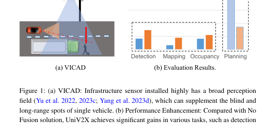
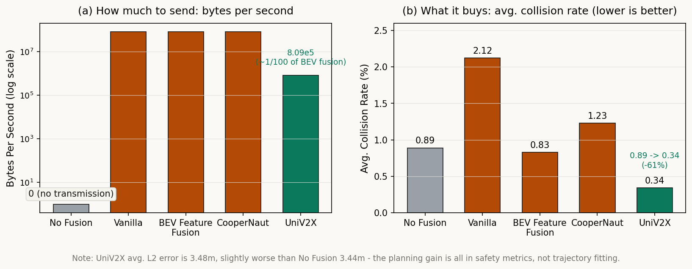
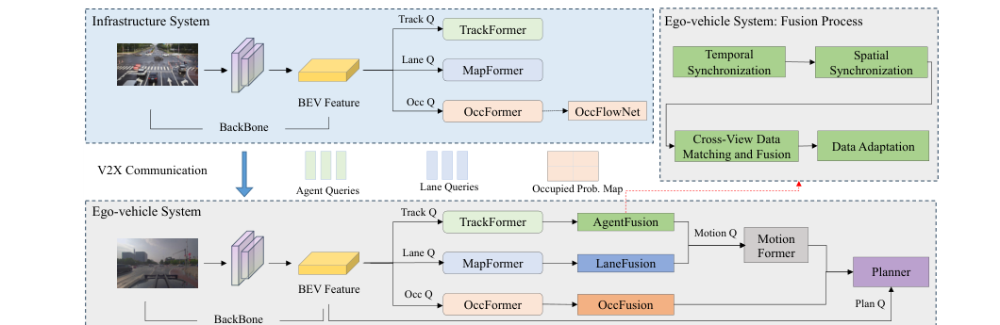
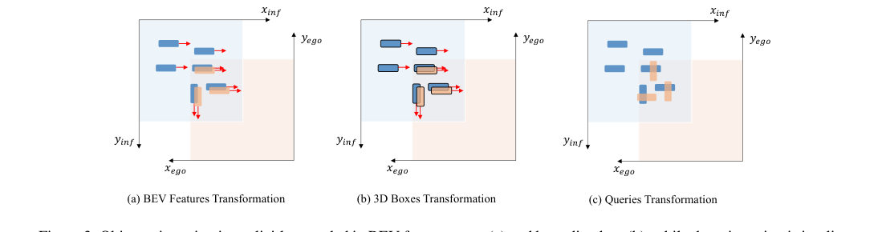

# 协同驾驶不缺数据，缺的是数据的形状：UniV2X 把实例装进 query、把场景压成概率图

> **信息块**
>
> - **编号**：77（本领域 76–80，全局 51–90）
> - **论文**：End-to-End Autonomous Driving through V2X Cooperation（框架名 UniV2X）
> - **作者**：Haibao Yu, Wenxian Yang, Jiaru Zhong, Zhenwei Yang, Siqi Fan, Ping Luo, Zaiqing Nie（前三位共同一作；清华 AIR，Yu 在港大）
> - **会议**：AAAI 2025
> - **链接**：https://arxiv.org/abs/2404.00717（v1 2024-03-31 → v3 2024-12-24，camera-ready 版）
> - **代码**：公开，https://github.com/AIR-THU/UniV2X（本次解读时因网络原因未能拉取仓库，实现细节以论文文本为准）
> - **一句话核心洞见**：协同驾驶的瓶颈不是"传不传路侧数据"，而是"传什么形状的数据"——UniV2X 把可数的实例（车、车道线）装进稀疏的 query，把数不清的场景占用压成单通道概率图，用不到 BEV 特征百分之一的带宽，把开环碰撞率从 0.89% 降到 0.34%。
> - **数据集**：DAIR-V2X（真实路口数据，约 100 个场景、28 个路口，每段 10–25 秒、10Hz，带高精地图；另在 V2X-Sim 上做了 V2V 验证）

*论文图 1（第 1 页）：(a) 路侧相机站得高看得远，补自车的盲区和远处；(b) 相对 No Fusion 的四项改善：检测 +13 个百分点、建图 +11.4、占用预测 +5.7、碰撞率 −0.5 个百分点。注意 (b) 的纵轴是百分点差值，不是相对比例——这个细节后文还会回来。*

## 表 2 里最反直觉的一行：8.19×10⁷ BPS 只买来 0.06 个百分点的碰撞率下降

先不看方法，直接看论文表 2（DAIR-V2X 上的规划结果，平均碰撞率 %）：

| 方法 | 传什么 | BPS | 平均碰撞率 |
|---|---|---|---|
| No Fusion | 不传 | 0 | 0.89 |
| Vanilla | BEV 特征，CNN 融合后 MLP 输出轨迹 | 8.19×10⁷ | 2.12 |
| BEV Feature Fusion | BEV 特征，CNN 融合后送进 UniAD | 8.19×10⁷ | 0.83 |
| CooperNaut | BEV 特征 | 8.19×10⁷ | 1.23 |
| UniV2X | query + 占用概率图 | 8.09×10⁵ | 0.34 |

读这张表要慢。BEV Feature Fusion 这一行是关键的"对照实验"：它和 UniV2X 用的是同一套 UniAD 端到端骨架，唯一的区别是传什么、怎么融。它花了 8.19×10⁷ 字节/秒——相当于每秒传约 80MB——碰撞率只从 0.89 降到 0.83。而 UniV2X 用 8.09×10⁵（约 0.8MB/s，不到前者的百分之一），碰撞率降到 0.34。

这说明两件事。第一，**信息量不是瓶颈**：整张 BEV 特征图都传过去了，规划几乎没变好，说明瓶颈在"怎么用"，不在"有多少"。第二，Vanilla 那一行（2.12，比不传还差一倍多）说明**传错了形状反而有害**：两视角没对齐的 BEV 特征直接拼起来过 CNN，引入的是噪声不是信息。这两行摆在一起，就是作者全部设计的动机：问题从来不是带宽不够，而是传过去的东西在接收端没有一个对得上的位置。

*自绘图（数据全部取自论文表 2）：左图对数坐标下各方法的每秒传输字节数，右图是它们对应的平均碰撞率。BEV 融合类方法花 100 倍带宽，碰撞率几乎不动；UniV2X 用 1/100 带宽，碰撞率降到约三分之一。底部的注记同样来自表 2：UniV2X 的平均 L2 误差 3.48m，反而略差于 No Fusion 的 3.44m——规划的改善全部来自安全指标，不是轨迹拟合，这个区分后文会细讲。*

## 在 UniV2X 之前，协同驾驶撞的两堵墙

论文表 1 把前人工作排成一张对照表，读法是：看"传什么"和"做到哪"两列。

第一堵墙是**协同感知派**：V2VNet、CoCa3D、CoBEVT、Where2comm、TransIFF、PP-VIC……这些工作把 V2X 做成了一个"更好的检测器"。传 BEV 特征或实例特征，目标是把 mAP 做高。它们的任务是单模块的，优化目标和最终"车会不会撞"之间隔着好几层。作者在引言里把这句话说得很直白：单模块目标和规划目标不对齐（misalignment），数据的潜力没有被用到规划上。

第二堵墙是**朴素端到端派**：CSA（2019）直接传原始图像、用一个 CNN 输出方向盘转角；CooperNaut（2022，CVPR）传点云 BEV 特征、用 MLP 输出规划。它们确实端到端了，但论文给了它们一个定语："Non-Explicit"——网络里没有显式的感知、建图、占用模块。作者的批评是：在结构复杂的城市场景里，这种黑盒端到端给不出任何可以检查的中间表示，安全性无从谈起。

所以 UniV2X 的真实起点不是"我们也要做 V2X"，而是一个两难：**要端到端（让规划目标指导全网），又要显式（每个中间表示都能拿出来看）**。UniAD 在 2023 年已经证明了 query 可以把感知、预测、规划串在同一个网络里（Hu et al. 2023b），UniV2X 做的就是把 UniAD 的这套 query 语言扩展到两个视角之间，并回答一个新问题：两个视角之间，到底传什么。

作者给传什么定了三个标准（effective / friendly / reliable），翻译成大白话：传过去的东西要**真有用**（能同时改善感知、建图、占用、规划），**传得起**（带宽有限、延迟敏感），**敢用**（收到的东西能被检查、被验证，不怕传错了把车带沟里）。后文所有的设计——query、概率图、flow 预测、旋转修正——都是这三个标准的推论。

## 稀疏-稠密混合传输：实例装进 query，场景压成概率图

V2X 传输的数据传统上有三档：原始数据（图像、点云）、感知结果（检测框）、中间表示（BEV 特征、query）。原始数据太贵，检测框太"硬"（下游改不了），BEV 特征贵且难解释。UniV2X 的划分不是按这三档来的，而是按**信息本身的形状**来的：

- **实例级（instance-level）**：车、行人、车道线——这些东西是可数的，一个路口同一时刻也就几十个。用 query 表示：每个 query 是一个 256 维向量，附带一个参考点（reference point，在 BEV 上的 2D/3D 位置）和分类分数。空间上稀疏（只在有东西的地方有 query），特征上也稀疏（256 个数 vs 整张特征图）。
- **场景级（scene-level）**：占用（occupancy）——"那里有没有东西"，不管它是什么。这是兜底的表示：检测器漏掉的东西，占用栅格还能抓住。它天生是稠密的（每个格子都要有个说法），但作者不传 256 通道的稠密特征，只传**单通道的占用概率图**：每个格子一个 0 到 1 之间的数。这是在通道维度上做了极致的稀疏化。

这个划分好在哪里？看附录里的带宽账本。传输频率按 2Hz 算（DAIR-V2X 的路侧-车端同步频率）：

- 传 query：每个 query 是 256 个 32 位浮点数 = 1024 字节。一次传 10 个 query 就是约 1.0×10⁴ 字节，2Hz 下约 2.0×10⁴ BPS。
- 传占用概率图：靠公式 (1) 的线性流表示（后文细讲），T 步只传两张 200×200 的图：2×200×200×4 字节 ≈ 3.2×10⁵ 字节/次，2Hz 下约 6.4×10⁵ BPS。
- 两项相加约 8.09×10⁵ BPS，和表 2 的数字对得上。

对比传 BEV 特征：8.19×10⁷ BPS。差了整整两个数量级。**省带宽的秘诀不是压缩算法，是表示的选择**：query 本来就是"只说有东西的地方"，概率图把 256 个通道压成 1 个——信息密度最高的两个端点，恰好也是规划最需要的两个端点（"那里有个行人要过来"和"那片格子不能走"）。

这里有一个"为什么我想不到"的点：为什么不用检测框代替 query？检测框是**结论**，query 是**带不确定性的半成品**。检测框一旦传过来，下游只能信；query 传过来，自车端可以用自己的 BEV 特征再 refine 一次，还能和自车的 query 做匹配融合。表 3 里 Late Fusion（传检测结果再用匈牙利方法融合）只要 6.60×10² BPS，但 mAP 只有 0.196，远低于 UniV2X 的 0.295——便宜，但上限低。query 是在"贵一点"和"下游还能改"之间取了个中间点。

## 跟着一个行人 query 走完从路侧杆子到方向盘的全程

光讲"传什么"不够，把一次完整的跨视角旅程走一遍，才能看到每个模块为什么存在。场景：一个十字路口，自车跟在一辆公交车后面，右侧盲区里有一名行人正准备横穿马路。自车的相机被公交车挡得严严实实，路侧杆子上的相机居高临下，看得一清二楚。

*论文图 2（第 3 页）：上半是路侧系统，下半是自车系统，中间三列是传的东西——Agent Queries、Lane Queries、Occupied Prob. Map。右上是自车端的融合流程：时间同步 → 空间同步 → 跨视角匹配融合 → 数据适配。看这张图时注意箭头的去向：AgentFusion 和 LaneFusion 的输出进了 MotionFormer，而 OccFusion 的输出直接连到 Planner——占用走的是"安全兜底"的短路。*

**第 1 站：路侧生成。** 路侧图像进 Backbone（BEVFormer），得到 BEV 特征 $B_{inf} \in \mathbb{R}^{200 \times 200 \times 256}$。TrackFormer（DETR 式，无需 NMS）在上面跑出 $N_a^{inf}$ 个有效 agent query：$\{Q_A^{inf}\}$，每个 256 维，附带 tracking ID 和参考点。行人的那个 query，参考点落在 (x=35, y=−12) 米处（自车坐标系下约 40 米外），分类分数 0.9。低分的 query 在这里就被过滤掉，不传——**过滤本身就是省带宽的一部分**。

**第 2 站：时间同步（抗延迟）。** 路侧数据的时间戳 $t_i$ 一定早于自车当前时间戳 $t_v$，无线传输的延迟在路口这种地方是实打实的。作者的做法不是等，而是**外推**：QueryFlowNet（一个三层 MLP）吃进 $Q_A^{inf}(t_i)$ 和上一帧的 query，输出 query 的"流" $Q_{Aflow}^{inf}$——256 个数，每个数是对应特征维度上每秒的变化量。然后：

$$Q_A^{inf}(t_v) = Q_A^{inf}(t_i) + (t_v - t_i) \cdot Q_{Aflow}^{inf} \tag{2}$$

设延迟 0.5 秒，行人正以 1.5m/s 横穿，0.5 秒走 0.75 米。公式 (2) 在特征空间里把这个 query 沿它的运动方向"推"了半秒。注意这是**特征空间的外推**，不是把参考点坐标加个位移——参考点的空间变换在下一步做。

**第 3 站：空间同步（最难的一步）。** 参考点好办：用两系统间的相对位姿 $[R, T]$ 做刚体变换，转到自车坐标系。难的是 query 特征本身：一个 3D 目标有位置、尺寸、朝向，位置可以写在参考点里，**朝向是隐含在 256 维特征里的**。论文图 3 把这个麻烦画得很清楚：

*论文图 3：(a) BEV 特征图里，朝向是画出来的——格子排布本身就带方向；(b) 3D 框里，朝向是显式的 yaw 角；(c) query 里，朝向藏在 256 维特征向量里，转坐标系时没有解析公式可用。这是整篇论文里最有"啊哈"感的一张图：它解释了为什么跨视角 query 融合不能只转参考点。*

作者的解法是 rotation-aware query transformation：

$$\text{spatial\_update}(Q_A^{inf}) = \text{MLP}([Q_A^{inf}, R]) \tag{3}$$

把 3×3 旋转矩阵展平成 9 个数，和 256 维 query 拼成 265 维，喂进三层 MLP，输出修正后的 256 维特征。说白了：**让网络学一个"带旋转条件的特征修正"**。这是一个技巧，不是理论——query 特征的几何意义是学出来的，不存在解析的旋转公式，只能靠学。作者没有回避这一点，图 3 就是在为这个设计做铺垫。

**第 4 站：匹配与融合。** 现在路侧的行人 query 和自车的 query 都在同一时空坐标系下了。按参考点的欧氏距离做匈牙利匹配：

- 匹配上的（比如两车都看到的那辆轿车）：两个 256 维向量拼起来进三层 MLP，得到融合后的 query，更新自车的对应 query。
- 没匹配上的（比如被公交挡住的行人，自车根本没看到）：**直接追加**到自车的 query 集合里——这就是协同的增益来源：补盲区。
- 最后按检测置信度再过滤一遍低分的。

**第 5 站：两个补丁。** 融合完还有两个工程补丁，论文把它们都写出来了，这很难得。

补丁一，**Ego Identification**：从路侧看，自车本身也是个"障碍物"，融合后可能在自车位置生成一个 query、把自车脚下的格子标成占用——车会以为自己撞了自己。解法很直接：把自车区域定义成一个矩形，矩形内的 query 删掉，对应格子标成未占用。作者自己承认：由于路侧和自车的相对位姿有误差（标定、定位都不完美），这个矩形扣得不一定准，"需要进一步探索"。一个诚实的注脚。

补丁二，**Decoder Input Augmentation**（公式 4）：

$$\text{update}(B_{veh}) = B_{veh} + \text{MLP}(\text{synchronized}(Q_A^{inf})) \tag{4}$$

为什么需要这个？自车的 TrackFormer decoder 的 cross-attention 是查自车 BEV 特征的——路侧新追加的行人 query，在自车 BEV 里没有对应的特征证据（自车根本没看到行人），decoder 输出会不可靠。所以把同步后的路侧 query 信息"写回"自车 BEV 特征。这个补丁暴露了一个真实的张力：**跨视角的新实例需要特征级的证据，而不仅仅是 query 级的拼接**。端到端的架构在这里露出了接缝，作者用加法把它糊上了。糊得有没有道理？消融表 6 显示 Agent Fusion-Only 把 mAP 从 16.5 拉到 29.5——糊是糊，但管用。

**第 6 站：规划。** 融合后的 agent query、lane query 进 MotionFormer 生成带多模态意图的 motion query（含自车 query），和命令 embedding（左转/右转/直行）拼成 plan query，decode 出未来 waypoints。最后两步后处理：用车道线把轨迹"摁"回可行驶区域；最小化一个代价函数避开二值占用图 $\hat{O}$ 里的占据格。行人 query 在这里真正发挥作用：它让占用图里多了一片"不能走"的格子，规划轨迹绕开。

同一场景在 No Fusion 下走一遍：自车看不到行人，query 集合里没有它，占用图里那片格子是空的，规划轨迹直行——表 2 里 0.89% 的碰撞率，就是由无数个这样的盲区时刻攒出来的。

## 公式 (1)：两张图代替 T 张图——占用概率的线性流

$$P_{future}(t) = P_0 + t \cdot P_1 \tag{1}$$

这是全篇最短的公式，也是"稠密也要省"的全部答案。$P_0 \in \mathbb{R}^{200 \times 200}$ 是当前时刻的 BEV 占用概率图（每个格子一个 0~1 的数），$P_1 \in \mathbb{R}^{200 \times 200}$ 是"概率流"——同一个格子、概率值每步的变化量。要得到未来第 $t$ 步的占用图，不用传第 $t$ 步的图，用这两张做一次线性外推。

在一个格子上算一遍。假设格子 (120, 80) 处当前 $P_0 = 0.15$（大概率是空的），$P_1 = 0.10$/步（有个东西正在移进来，占用概率每步涨 0.1）。$t=3$ 步后：$0.15 + 3 \times 0.10 = 0.45$。几何意义：每个格子的占用概率被假设为**随时间匀速变化**——这是在概率值域上做的一次一阶泰勒展开。

传 T 步的图本来要 $T \times 200 \times 200$ 个浮点数，现在只要 $2 \times 200 \times 200$ 个。T 的具体取值论文没有明确写（只给了这个相对关系，此处标**未确认**），但省带宽的倍数就是 $T/2$。

这个公式有两个没说出口的边界。第一，线性外推的概率可能跑出 $[0,1]$ 区间（比如 $P_0=0.9, P_1=0.1, t=3$ 得到 1.2），论文没有提有没有做截断，**未确认**——实现时大概率要 clip，但文本里没写。第二，匀速假设只在短时成立：格子是 0.5 米的尺度（200 格覆盖路侧 100 米范围），车速 10m/s 时一秒穿过 20 个格子，"概率匀速变化"在半秒级是合理的，三五秒后就是另一回事了。所以公式 (1) 的适用域是**短时、低速变化的场景占用**，作者把它用在"把当前概率图同步到自车时间戳"这个用途上，没有让它去做长时预测——分寸感是对的。

## 公式 (2) 与 flow 网络：外推半秒的代价，以及"不进端到端"的注脚

公式 (2) 和公式 (1) 是同构的，只是把外推对象从"每个格子的概率"换成了"每个 query 的 256 维特征"：

$$Q_A^{inf}(t_v) = Q_A^{inf}(t_i) + (t_v - t_i) \cdot Q_{Aflow}^{inf} \tag{2}$$

$Q_{Aflow}^{inf}$ 由 QueryFlowNet 产生：一个三层 MLP，吃进 $t_i$ 时刻和上一帧的 agent query，输出 256 个数——每一维都是"该特征维度每秒的变化量"。这是在**特征空间**里做匀速外推，和公式 (1) 在概率值域里的外推是同一个思想。

表 9（附录）是这个设计的对照实验，值得细看：

| 方法 | 时延 | mAP | AMOTA |
|---|---|---|---|
| UniV2X-O（无预测） | 0ms | 29.5 | 23.9 |
| UniV2X-O（无预测） | 500ms | 25.9 | 22.7 |
| UniV2X（有预测） | 0ms | 29.5 | 23.9 |
| UniV2X（有预测） | 500ms | 28.5 | 23.5 |

500ms 延迟下，没有 flow 预测时 mAP 掉 3.6 个百分点（29.5→25.9），有预测时只掉约 1.0 个百分点（29.5→28.5）。注意正文写的是"只下降 1.2%"，按表算是 1.0——0.2 的出入，可能是四舍五入，也可能是笔误，**此处存疑**，但不影响结论：线性外推吃掉了大部分延迟损失。

但这一节最值得划线的是论文里的一句原话："QueryFlowNet … is **not trained in an end-to-end manner** in UniV2X. We adopt self-supervised learning."——flow 网络是拿路侧帧对、用相似度损失单独自监督训的，梯度不进主网络。OccFlowNet 同理。所以"端到端"的领地到此为止：**时间同步这个模块是外挂的**。为什么？一个合理的推测（标为推断）：flow 的自监督目标（让外推后的特征接近真实下一帧特征）和主网络的规划目标之间没有直接的梯度通路，硬塞进联合训练可能互相干扰。作者选择了"分开训、推理时拼"，这是工程上的老实选择，但"首个端到端 V2X 框架"这个 headline 需要打这个星号。

## 四段式训练：附录里作者自己交代的分布偏移

正文说"four-stage training strategy"，附录把四段摊开：

- **第一段**：路侧系统和自车系统各训各的。路侧用路侧标注训 tracking / mapping / occupancy；自车用自车标注训 tracking / mapping / motion / occupancy / planning。
- **第二段**：训 AgentFusion 和 LaneFusion，损失 $L = L_{track} + L_{map}$（公式 5），用**协同视角**的标注做真值。
- **第三段**：所有融合模块 + 自车端所有模块一起训，$L = L_{track} + L_{map} + L_{motion} + L_{occ} + L_{plan}$（公式 6）。
- **并行**：QueryFlowNet / OccFlowNet 自监督单独训，不需要额外标注。

为什么不敢一段训完？附录里有一段非常坦率的交代：训练时用的 clip（截出来的短片段）生成的路侧 query，和推理时完整序列生成的 query **分布不一致**——TrackFormer 里 query 的时序关联和更新在短 clip 下不稳定。如果直接用 clip 生成的 query 训 fusion，推理时会晃。他们的 workaround：把训练集的路侧 query **按推理的方式预存下来**，再用存好的 query 训 fusion。原文还补了一句 "We are also exploring more friendly way"——直译：我们也在找更优雅的办法，目前没有。

这段是全文最有"人味"的地方。它说明两件事：第一，query 这种表示对时序一致性很敏感，clip 和全序列的差异大到能晃动训练；第二，作者没有把 workaround 包装成设计，而是如实写了。对于想复现的人，这是比公式 (5)(6) 更重要的信息：**照着四段训，别想着一步到位**；infra query 先离线生成存好，是个坑位标记。

## 数字解剖：61% 对得上，9.3% 对不上，L2 为什么纹丝不动

**碰撞率 0.89→0.34，相对下降 61.8%，和正文的"61%"对得上。** 但同一张表里，平均 L2 误差从 3.44 变成 3.48——没变好，还差了一点。2.5s/3.5s/4.5s 三个时刻，UniV2X 的 L2 全都略差于 No Fusion（2.59/3.35/4.49 vs 2.58/3.37/4.36）。这意味着"规划变好了"这个说法需要精确化：**变好的是安全指标（碰撞率、off-road），不是轨迹拟合精度**。这在开环评测里是常见现象：专家轨迹是唯一的拟合目标，而安全是"不撞就行"的约束；路侧信息让轨迹更保守、更避让，反而离专家轨迹远了一点。读论文时把"planning performance"自动理解成"各方面都好"，就会 miss 掉这个区分。

**off-road 的"9.3%"在表 2 里找不到。** 按表 2 算：(1.08−0.89)/1.08 = 17.6%。那 9.3% 是哪来的？(1.08−0.98)/1.08 = 9.26%——恰好等于表 8 里 occupancy-only 融合的 off-road（1.08→0.98）。是笔误把消融表的数字写进了主结果，还是另有所指，**论文没有给出能区分的信息，此处标未确认**。审稿人视角：这是一个应该被问出来的问题。

**Vanilla 的 2.12 是全表最有教学意义的数字。** 同样的 BEV 特征，Vanilla 用简单 CNN 融合+MLP 直接输出轨迹，碰撞率比不传还翻倍。这不是"方法太简单"，而是**跨视角未对齐的特征直接融合是有害的**——时空都没同步的 BEV 往一块拼，网络学到的是噪声。UniV2X 的时间同步、空间同步、匈牙利匹配，每一步都是在回答 Vanilla 暴露的问题。从这个角度看，Vanilla 不是陪跑的基线，它是作者论证"必须显式同步"的证据。

**提升来自协同，还是来自端到端？** 这是任务要求必须回答的问题。表 2 给了干净的分解：No Fusion（纯自车 UniAD）碰撞率 0.89；BEV Feature Fusion（协同数据 + UniAD 骨架，但融合方式粗糙）0.83；UniV2X 0.34。所以"端到端骨架本身"只解释了 0.89→0.83，**0.83→0.34 的大头来自协同数据和为之设计的融合**。再往下，附录表 6/7/8 把三个融合模块单独拎出来（都以 No Fusion 为基线）：agent-only 0.89→0.59，lane-only 0.89→0.59，occ-only 0.89→0.39。**occupancy 融合最承重**——合理：碰撞判定最后看的是占用栅格，occupancy 是离安全最近的表示。三个单模块都降碰撞，也说明改善是叠加的，不是某一个 trick 的运气。

**感知表的带宽-性能权衡（表 3）**：UniV2X mAP 0.295，比 No Fusion 高 13 个百分点（和图 1b 的 +13% 对上），传输代价 6.96×10⁴ BPS。V2X-ViT 的 AMOTA 0.287 确实比 UniV2X 的 0.239 高，但代价是 2.56×10⁶ BPS——37 倍带宽。Where2comm 被压缩到相近带宽后（V2X-ViT+Where2comm 一行），AMOTA 从 0.287 崩到 0.071——说明**稠密特征经不起压缩，稀疏 query 经得起**。这组对比是"sparse-dense hybrid"最硬的注脚。另外正文写 "(2.56×10⁶ vs 6.94×10⁴)"，表里是 6.96×10⁴——0.02 的漂移，无伤大雅，但说明正文数字是手写的，没和表联动。

**可靠性实验（图 4）**：随机丢弃 10%~100% 的路侧 query，感知性能平滑下降，丢光时退化到和 No Fusion 相当。曲线好看，但要分清：**丢弃是"数据缺失"，不是"数据损坏"**。真正的威胁模型是传错了的数据（位姿错了、被攻击了），随机丢弃测不出来。query 的参考点和分类分数确实提供了一定的可检查性（分数太低就不过），但 256 维特征本身没有校验位。所以"reliable"的证据目前只覆盖了"缺数据不断崖"，没覆盖"错数据不致命"。作者把"通信攻击"写进了动机，但实验没碰它——这是诚实度上的一个小缺口。

**带宽扫描（表 10）**：0→1.0 Mb/s，mAP 16.5→29.5 单调上升，0 带宽时恰好退回 No Fusion。这条单调曲线比任何形容词都有说服力：系统是**优雅降级**的，带宽不够就少传，而不是崩。

**两个公平性上的加分项**：一是所有基线都去掉了自车速度 embedding——因为 Li et al. 2024 指出开环端到端里速度 embedding 会"泄题"，作者照做了；二是 V2X-Sim 上的提升很小（碰撞率 2.0→1.75，mAP 7.0→7.6）也如实报告了，没有只挑好看的数据集。合成数据上路侧增益本就小，照实写是对的。

**最大的方法论注脚**：作者自己在结论里写了——**只做了开环评估**，闭环是未来工作。对于自动驾驶，开环的碰撞率是在专家轨迹附近算的，不代表车自己开起来不撞。这篇的全部规划结论，都要在这个限定下读。

## "可解释"三个字，有几分是真的

这是论文三个卖点里最需要打折的一个，值得单独称一称。

**站得住的两分**：第一，传的东西**粒度可读**。一个 agent query 可以画出来：参考点在哪、分类分数多少、tracking ID 是谁；一张占用概率图可以逐格看：哪片格子概率高。人能指着屏幕说"路侧告诉自车那里有个人"，而对着一张 256 通道的 BEV 特征图，谁也说不出它在讲什么。第二，**缺数据时行为可预测**：图 4 的降级曲线说明，传的东西越少，系统越接近纯自车行为，没有突变。这两点加起来，"reliable"这个词拿了一半的分。

**站不住的八分**：query 的 256 维特征向量本身，和 BEV 特征一样是黑盒——可解释的是 query 的"包装"（参考点、分数），不是"内容"。公式 (3) 的 rotation-aware MLP、融合用的三层 MLP、公式 (4) 的 BEV 写回，全是黑盒操作。真正的可解释性来自**表示的粒度选择**（实例级 vs 场景级），而不是表示的内容被打开了。表 1 里 "Reliable" 那一列的 Yes/No 是作者自评的二分法——传 BEV 特征就判 No，传 query 就判 Yes，这个划分比实际情况粗。公允的说法是：UniV2X 的传输表示**比 BEV 特征更容易被检查和可视化**，但离"可验证、可审计"还有距离。论文没有声称能防御恶意数据，这一点它没说错话，只是动机里提了攻击、实验里没测，留了个缺口。

## 作者的底牌：UniAD、DAIR-V2X 的家底，和一次诚实的报告

推测作者底气的部分（以下标为推断，并给依据）。

**底牌一：UniAD 的 query 范式已经趟平了路。** 2023 年 UniAD 证明了 query 可以把检测、跟踪、建图、预测、规划串进同一个网络。UniV2X 基本是"把 UniAD 复制两份，中间加上传输和融合"。站在一个已被验证的架构上做加法，风险结构是好的——审稿人对 query 串模块这件事已经不陌生了，争议只会集中在"跨视角传什么"这一个新问题上。

**底牌二：对 DAIR-V2X 的家底熟。** 第一作者 Yu 是 DAIR-V2X 数据集（2022）和 V2X-Seq（2023）的作者，FFNet（feature flow，2023）也是他们组的。附录里那个"训练 clip 和推理全序列的 query 分布不一致"的细节，只有真正在这个数据上训过 TrackFormer 的人才写得出来。这种家底决定了论文里那些"补丁"（ego identification、decoder augmentation、四段训练）不是凭空想的，是被数据揍出来后留下的。

**底牌三：query 省带宽已经被验证过。** Where2comm（2022）、TransIFF（2023）已经证明实例级特征传输又省又好用。UniV2X 的新意不在"传 query"，而在"**query + 概率图的混合**，以及把混合表示接到端到端规划上"。组合式创新，但组合点选得准：occupancy 是之前 query 传输方案里缺的那块（query 表示不了"不知道是什么的东西"）。

**诚实分**：V2X-Sim 上提升小照实报；CooperNaut 的 L2 反常给了合理解释（保守的短轨迹更容易待在可行驶区内）；ego identification 承认位姿误差下扣不准；结论里承认只做了开环。一篇论文里能找到四处"我承认"，可信度是加分的。扣分项在上一节已经列了：9.3% 对不上表、flow 网络外挂、可靠性实验没碰真损坏。

时间坐标也值得记一笔：v1 挂到 arXiv 是 2024 年 3 月，那时 UniAD 出来不到一年，端到端+V2X 还是空位；v3（2024 年 12 月）是 AAAI camera-ready，中间 9 个月主要是补实验（V2X-Sim、带宽扫描、时延消融都在附录，v1 时很可能不全）。这是一个"占位准、执行稳"的工作，不是一鸣惊人的那种。

## 可迁移想法

1. **先按"实例 vs 场景"划分信息，再选表示。** 任何多智能体、多模块系统要交换信息时，第一问不是"压缩率多少"，而是"这条信息是可数的实例，还是不可数的场"。实例用稀疏的、带身份的表示（query、目标级描述）；场景用稠密的、低维的表示（概率图、代价图）。UniV2X 的全部带宽优势来自这一次划分，而不是任何压缩技巧。

2. **延迟用外推扛，不用等待扛。** 公式 (1)(2) 的思想可以抽象成一条规则：时延敏感的融合里，**传"状态+变化率"而不是传"最新状态"**。接收方用线性外推对齐时间戳，代价是短时假设，收益是不被延迟卡住。这条规则不依赖自动驾驶，任何分布式感知都用得上。

3. **表示没有解析几何对应时，用条件 MLP 做坐标变换。** 公式 (3) 的 rotation-aware MLP 是一个通用模式：当你的表示是学出来的（query 特征），不存在解析的旋转公式，就把变换参数（R 展平）拼进输入，让网络学修正。别硬套解析几何，也别假装问题不存在——论文图 3 的价值就是把"这个问题存在"画出来。

4. **读消融要找"最承重"的模块，而不是"都有效"。** 三个融合模块都降碰撞，但 occ-only 的 0.39 说明离安全最近的是兜底表示。做系统时，资源优先给离最终指标最近的那个表示，而不是最fancy的那个。

5. **开环指标会撒谎，选指标即选优化目标。** L2 纹丝不动、碰撞率大降——如果你只看 L2，会得出"协同没用"的错误结论。任何端到端系统立项时，先问"哪个数字真正代表我要的"，再看论文报的是哪个数字。

## 与本课题的关联

你的课题是"世界模型引导 + 自适应衰减情景记忆的闭环多规划器 Agent"：LLM 调度多专家规划器，世界模型预测未来 T 步做调度先验，情景记忆检索历史案例，世界模型对候选动作 rollout 输出风险分数做仲裁。这篇论文和你的课题在"多源信息如何汇入一个决策"上是同构的，有四处可以直接借：

**1. 多规划器候选的"稀疏意图 + 稠密轨迹"双层仲裁表示。** UniV2X 传 query（实例意图级）+ 概率图（场景稠密级），你的仲裁器可以照搬这个双层结构：每个专家规划器输出一个**稀疏意图 query**（目标机动类型、目标点、置信度——对应 agent query 的参考点+分数），同时输出一条**稠密轨迹分布**（对应占用概率图的"哪里不能走"）。仲裁时先做意图级的匹配-融合（像 AgentFusion 的匈牙利匹配+MLP：意图一致的规划器互相印证，意图孤立的被降权），再用稠密轨迹做碰撞/风险校验（像 OccFusion 的 max 融合+阈值）。这比"各规划器投票"多了一层可解释性：仲裁器能说出"我采纳了 A 的意图、否决了 B 的轨迹因为它穿过了高风险格"。

**2. 端到端协同训练目标对闭环风险校验模块的启发。** UniV2X 的公式 (6) $L = L_{track}+L_{map}+L_{motion}+L_{occ}+L_{plan}$ 说明：**规划损失需要中间表示的辅助损失来稳定训练**。你的风险校验模块如果只训"风险分数回归"，容易塌到平凡解；可以照抄这个结构，给风险头配辅助损失——实例级风险（每个障碍物的风险 query，对应 $L_{track}$）+ 场景级风险图（对应 $L_{occ}$）+ 最终仲裁决策损失（对应 $L_{plan}$）。附录表 8 的启示是：场景级兜底表示（occupancy）对安全指标最承重，你的风险校验里"稠密风险图"那一路值得给最多的容量。

**3. 路侧视角 = 世界模型的额外观测源；flow 预测 = 世界模型的最小可用形态。** 把 UniV2X 的路侧系统类比成你的世界模型的一个"外部观测通道"：世界模型预测未来 T 步时，路侧 query 可以当作**来自未来的观测**做后验修正（类似卡尔曼的 update 步）。公式 (1)(2) 的线性外推则是世界模型在"通信延迟/算力不够跑完整 rollout"时的**最小可用形态**——你的时延优化设计（世界模型中间分布复用、异步流水线+时间戳运动学补偿）和 QueryFlowNet/OccFlowNet 是同一个问题的两种解法：一个用学出来的流外推特征，一个用运动学补偿外推状态。写论文时，这可以作为 related work 里"延迟补偿"一节的直接对照。

**4. 跨源融合必须处理"自指"：ego identification 的教训。** UniV2X 专门用一个矩形扣掉自车，防止把自己当障碍物。你的世界模型对候选动作做 rollout 时，同样有自指问题：rollout 的未来帧里自车位置是已知的，必须显式标记为"我方占据"，否则风险校验会把自车轨迹判成"与障碍物重叠"。这是一个实现时一定会踩的坑，UniV2X 把它写成了独立模块，值得照抄这个显式处理的习惯，而不是指望网络自己学会。

**5. 优雅降级曲线的设计要求。** 表 10 的带宽扫描是一条"模块缺失时性能单调退化"的曲线。你的多规划器系统也应该有这条曲线：某个专家规划器超时/崩溃、某路传感器缺失时，系统退化到"纯自车单规划器"基线，而不是崩溃。做实验时可以照搬这张表的格式：横轴是"缺失程度"，纵轴是规划安全指标，证明你的仲裁器是**缺件可跑**的。这在 Bench2Drive 闭环验证里会是审稿人爱问的一点，提前准备好这条曲线。

**6. 一个反向提醒：只做开环验证的上限。** UniV2X 的全部规划结论都停在开环，作者自己承认这是 limitation。你的计划是在 Bench2Drive 闭环基准上验证——这恰好是 UniV2X 没做到的那一步。如果你的闭环结果里出现"开环指标好、闭环打折"的现象，UniV2X 的表 2 就是现成的参照：它的 L2（开环拟合）和碰撞率（开环安全）的背离，预示了开环和闭环之间的 gap 真实存在。在论文写作里，可以把 UniV2X 当作"开环协同"的代表，把你的工作定位成"往闭环多走一步"。
