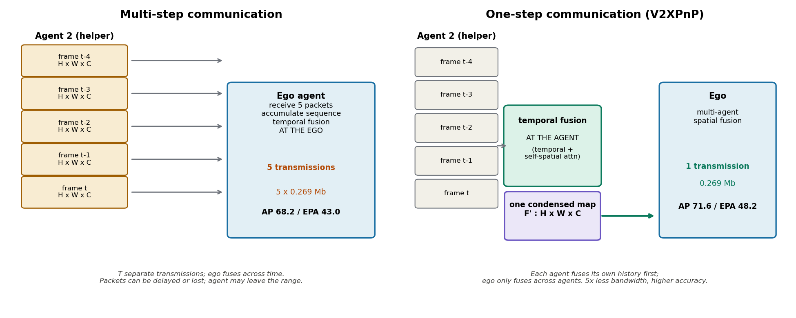
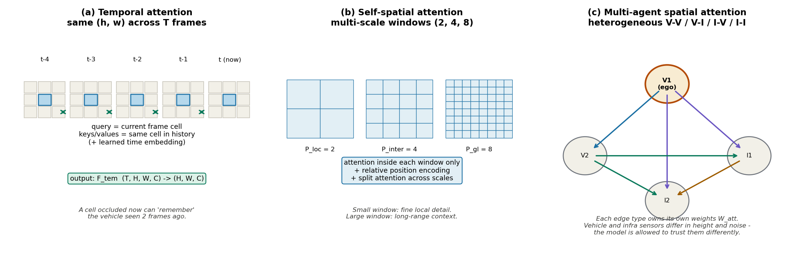

# 传一次反而看得更准：把时序融合搬回每辆车自己身上

> **编号 76**｜论文：V2XPnP: Vehicle-to-Everything Spatio-Temporal Fusion for Multi-Agent Perception and Prediction｜作者：Zewei Zhou, Hao Xiang, Zhaoliang Zheng, Seth Z. Zhao, Mingyue Lei, Yun Zhang, Tianhui Cai, Xinyi Liu, Johnson Liu, Maheswari Bajji, Xin Xia, Zhiyu Huang*, Bolei Zhou, Jiaqi Ma（UCLA Mobility Lab，*为通讯作者）｜会议：ICCV 2025｜arXiv：https://arxiv.org/abs/2412.01812（v3，2025-08-05）｜代码：公开，https://github.com/leiwanrobotics/v2xpnp（据论文与任务信息；本次写作时仓库页面因限流未能复核）｜项目页：https://mobility-lab.seas.ucla.edu/v2xpnp
>
> **一句话核心洞见**：V2X 里真正的设计自由度不是"传什么、怎么融"，而是"何时传"——让每辆车先把自己的历史帧在本地融成一张压缩特征图再发一次（one-step），而不是逐帧发、让主车去拼时间线（multi-step）；传得少了，精度反而高了。

十字路口，一辆公交车停在你右前方。公交车身后，一辆小轿车正准备右转——它的车头已经探出来了，但从你这辆车（ego）的激光雷达看过去，那个位置只有公交车厚实的侧面。单车感知到这里就结束了：被遮挡的区域就是盲区，预测模块连这个转弯车辆的存在都不知道，更谈不上预测它的轨迹。

V2X 要解决的正是这个问题：路口的摄像头（infra）站在高处，看得见公交车后面。于是这几年出现了一整套协同感知方法：车和路侧单元互相发特征图，主车把各家的观测拼在一起，盲区就被补上了。听起来问题已经解决。但这篇论文的起点是一个追问：**拼起来的东西，为什么只拼了空间，没拼时间？**

被公交车挡住的那辆转弯车，infra 在 t-2、t-1 时刻看得清清楚楚，t 时刻它也被公交车挡了一半。如果主车只收到各家在 t 时刻的单帧特征，它得到的是一张"当前时刻的完整地图"，然后预测头要从这张静态地图里推出未来 3 秒的轨迹——这要求模型从一帧里读出速度、加速度、转向意图。能读，但吃力。真正的信息在时间里：那辆车过去 2 秒是怎么走的。已有的 V2X 工作把时间砍掉了，不是因为时间不重要，而是因为"多智能体 × 多帧"的组合一摆出来，通信和计算两边都爆炸。V2XPnP 整篇论文，就是冲着这个被砍掉的维度去的。

## 被公交车挡住的那个转弯：单帧协同感知撞墙的具体场景

先把前人的位置摆清楚。2022 年前后的 V2X 感知（V2X-ViT、OPV2V、F-Cooper、DiscoNet 那一批）解决的是**单帧**问题：给定 t 时刻 N 个智能体的观测，融出 t 时刻的检测框。融合的粒度有三档，这是领域内的标准三分法：early fusion 发原始点云（信息最全，带宽最大），late fusion 发检测框（带宽最小，信息损失最大），intermediate fusion 发中间层 BEV 特征图（折中，也是后来大家默认的选择）。

这个三分法回答的是"传什么"（what to transmit）。2023–2024 年有人开始碰时间，但碰得很浅：FFNet 和 CoBEVFlow 用了 0.5 秒的历史信息，目的是**补偿通信异步**——也就是"我收到你 0.3 秒前发的特征，用光流把它 warp 到当前时刻再融合"，时间在这里是一个需要被修正掉的误差源，而不是信息源。SCOPE 用了自车的历史做检测增强。没有人系统地回答：如果我要做的是**跨 2 秒历史的时序感知 + 3 秒未来的轨迹预测**，多智能体的信息应该在什么时候、以什么形态流动。

结构性困难在这里：朴素的做法是每个智能体把 T 帧的特征图逐帧发给主车（论文叫 multi-step communication），主车攒齐 T×N 张特征图再做时空融合。这个方案有三个具体的毛病，每个都能在真实部署里咬你一口。第一，带宽乘以 T：原来发一张 H×W×C 的特征图，现在发 T 张。第二，延迟和丢包累积：T 次传输里丢一次，时间线就缺一块；更麻烦的是，某辆车在 t-2 时还在你通信范围内，到 t 时开走了，它早先的帧你永远收不齐。第三，主车侧的计算：时序融合发生在主车，意味着主车要为每个邻居跑一遍时序模块，邻居越多主车越重。

所以前人的选择不是"没想到时间"，而是"时间的代价付不起"。这篇论文的作者把这个问题重新表述了一遍：**时序融合一定要发生在主车吗？**如果每辆车先把自己的 T 帧在本地融成一张特征图，只发这一张，主车收到的就是 N 张"已经带时间记忆"的特征图，只需要做空间跨智能体融合。带宽从 T× 降回 1×，主车计算量也降了。这就是 one-step communication。直觉上它应该比 multi-step 差——毕竟压缩发生在传输之前，信息只能少不能多。但实验结果反过来了：one-step 的 AP 是 71.6，multi-step 是 68.2；EPA 是 48.2 对 43.0。传得少，看得准。这个反直觉的结果是整篇论文最值得咀嚼的地方，后面会用数字把它拆开。

## 作者的赌注：传什么 × 何时传 × 怎么融

论文的 Figure 2 把设计空间画成了一张 2×3 的表（本文自绘的对应示意见 `fig-comm-strategy.png`）：横轴是"传什么"（early / intermediate / late），纵轴是"何时传"（multi-step / one-step），每个格子再配"怎么融"（11 个融合模型）。作者真正想说的是：**这个领域之前只在"传什么"那一行里做文章，"何时传"这一列是空的**。把这一列填上，顺带把 11 个模型按统一标准重跑一遍，就是这篇论文的全部野心。

从写作上能看出来作者的底气在哪。摘要和引言反复出现的词是 "what to transmit / when to transmit / how to fuse"，三个问句各管一节。第一张图（Figure 1）画的是时序任务本身——转弯、直行、停止三个行为的检测+预测，而不是网络结构图。这说明作者押的不是某个精巧的模块，而是一个**问题 framing**：V2X 的时序任务是真实存在的、之前没人系统做过的。配合的第二张牌是数据集：V2XPnP Sequential，96 个场景、4 万帧、覆盖 VC / IC / V2V / I2I 四种协作模式的真实世界时序数据。V2X-Seq（2023）虽然也是时序的，但只做 V2I 且下载受限；DAIR-V2X、V2X-Real、V2V4Real 都是单帧的。"第一个覆盖全协作模式的真实世界 V2X 时序数据集"这张牌很硬——数据集一旦被社区采用，引用和影响力是自动续杯的。第三张牌才是模型本身：统一 Transformer 架构，temporal attention + self-spatial attention + multi-agent spatial attention 三块。

三张牌里，审稿人最容易被说服的是第二张（数据集+11 个模型的 benchmark），最需要被论证的是第一张里那个反直觉的结论（one-step 凭什么更好）。论文用 Table 2 专门回答了这个问题。下面把这笔账算清楚。

## 为什么传一次反而更准：把 one-step 和 multi-step 的两笔账算清楚

Table 2 是论文里最不寻常的一张表。同一套模型，只换通信策略：multi-step 的 AP@0.5 是 68.2，EPA 是 43.0；one-step 是 71.6 和 48.2。相对提升分别是 5.0% 和 12%。带宽账：one-step 下每个智能体每次只发 0.269 Mb（经过 32 倍通道压缩），multi-step 要发 5×0.269 Mb——因为历史长度是 2 秒@2Hz 加上当前帧，共 5 帧，每帧一张特征图。按典型的 C-V2X 传输速率估算，one-step 的单次传输延迟约 10~20 ms。

先看带宽账为什么是 5 倍对 1 倍。multi-step 里，每个智能体在每个时间步 t 只传当前帧的数据，主车要攒 T=5 个时间步才能拼出完整的时间线。one-step 里，每个智能体先在本地把 5 帧的 BEV 特征融成一张 F'_i ∈ R^{H×W×C}，只传这一张。注意这里的压缩发生在**时序融合之后**：1×1 卷积压的是通道维，时间维已经被 attention 压掉了。所以 one-step 的数据包大小和单帧协同感知相当——论文原话是 "comparable in size to single-frame cooperative perception"。这就是作者敢把 one-step 叫做"不增加传输负担"的底气：你付的带宽和以前做单帧融合一样多，白拿 2 秒的历史。

再看精度账。直觉上先压缩再传输应该丢信息，multi-step 传的是 5 张"没被时间污染"的原始特征图，主车拿到完整信息再融合，怎么会更差？论文的解释是两条。第一条是**误差累积**：multi-step 里每一帧的特征在传输、解压、对齐中都会引入小误差，主车再在时间维上融合这些带误差的特征，误差沿时间累积；one-step 里时序融合发生在本地，处理的是"无损的原始时序数据"（论文措辞），融合完再压缩传输，时间维上没有二次损伤。第二条是**现实约束**：multi-step 要求邻居在整个历史窗口内都待在主车的通信范围内——50 米通信半径，开车 2 秒能跑 30 米，一辆对向车在 t-2 时在范围内、t 时已经开出去了，它的历史帧你就收不全；one-step 只需要某一次传输成功。

这个解释有一半是诚实的，另一半值得打个问号，后面"怀疑式审读"会细说。先承认它漂亮的一面：**它把"融合"这个动作从主车手里拿走一半，分给了每个智能体**。传统 V2X 的心智模型是"主车是融合中心，邻居是传感器"，V2XPnP 把它改成了两级：每个智能体是自己的时序融合中心，主车只做跨智能体的空间融合。这个分工一改，带宽、计算、精度三个目标第一次同向了——这在系统设计里是很少见的，通常你只能三选二。

*上图：multi-step 与 one-step 通信策略对比（数字出自论文 Table 2，VC 模式）。左：每帧特征单独传输，主车在本地拼时间线——5 次传输，AP 68.2 / EPA 43.0。右：每个智能体先在本地做时序融合，只传一张压缩后的时空特征图——1 次传输 0.269 Mb，AP 71.6 / EPA 48.2。*

## 六个部件走一遍：一帧 LiDAR 从进到出

V2XPnP 的 pipeline 有六个部件，论文 Figure 3 画得很满。这里跟着一帧数据走一遍，符号第一次出现就给形状。

**部件 1：V2X 元数据共享。** 每个智能体先确定通信范围内的协作者，交换相对位姿和外参，构成一张空间 V2X 图：节点是智能体，边是通信信道。所有点云在特征提取之前先变换到主车坐标系。这一步没有学习参数，是纯几何。

**部件 2：LiDAR 特征提取。** 每个智能体 i 在时刻 t 用 PointPillar 网络提特征。PointPillar 是 2019 年的老结构，选它理由很直白：快。体素分辨率 0.4 米（x、y 方向），每个体素最多 32 个点，总共 32000 个体素。点云被拍平成 2D 伪图像，输出单帧 BEV 特征图 F^t_i；T=5 帧堆起来就是 F^{seq}_i ∈ R^{T×H×W×C}。T 是帧数，H、W 是 BEV 网格的高宽，C 是通道数。论文没有明说 H、W、C 的具体数值（**未确认**，实现细节里只给了体素分辨率和压缩倍数）。

**部件 3：多帧时序融合。** 这是 one-step 的核心，也是论文的模型主体。每个智能体在本地对 F^{seq}_i 跑 Transformer：temporal attention 沿时间维融合同一空间位置的特征，self-spatial attention 在单帧内做多尺度窗口注意力。输出是一张压缩过的特征图 F'_i ∈ R^{H×W×C}——注意时间维 T 已经消失了，5 帧压成 1 张。具体怎么做，下一节用数字走一遍。

**部件 4：压缩与共享。** 用 1×1 卷积压通道维，主车侧再用一个卷积解压回原始维度。论文报告的压缩倍数是 32 倍，传输包 0.269 Mb。Figure 6 显示即使压到 128 倍，精度仍然高于**未压缩**的 V2X-ViT*——这个对照很有力，说明时空特征里冗余确实大。

**部件 5：多智能体空间融合。** 主车拿到 N 张解压后的 F'_i，跑 multi-agent spatial attention：跨智能体、跨空间位置的注意力。关键设计是**异构**的：V-V、V-I、I-V、I-I 四种边类型各用一套独立的学习权重，因为车载和路侧传感器的架设高度、噪声特性不一样，模型被允许"区别对待"它们。

**部件 6：地图特征提取 + 双头解码。** 高清地图不经过 V2X，直接本地取用（论文假设所有智能体共享同一份高清地图）。矢量地图的 lane polyline 被投影到 BEV 网格，每个网格取最近的 5 条 polyline，每条 10 个路点、每个路点 7 个属性（x, y, dx, dy, type, xpre, ypre），MLP 编码到 256 维再对路点轴做 max-pool，得到 F_m。map-BEV attention 把地图信息注入 BEV 特征。最后检测头（两个 2D 卷积做框回归+分类）和预测头（两个 2D 卷积输出每个 anchor 在每个未来时刻的偏移量，累加得到轨迹）并行输出。

损失函数是三项加权：L = w_reg·L_reg + w_cla·L_cla + w_pred·L_pred，初始权重 2.0 / 1.0 / 2.0。分类用 focal loss（解决前景背景样本不均衡），回归用 smooth-ℓ1（对 yaw 角用正余弦编码处理旋转歧义），预测用 ℓ2（预测位置与真值的均方误差，对检测到的目标数 N_det 和有效未来步数 T_valid 取平均）。训练分四个阶段：先单智能体单帧检测 → 冻结 backbone 只训时序+预测头 → 联合微调 → 加入多智能体融合模块并用动态权重逐步加大预测损失的比重。Adam，学习率 2×10^{-3}，weight decay 1×10^{-4}，每个阶段 30 epoch，batch size 2，L40S 上训，带 early stopping。**动态 loss 权重的具体调度曲线论文没有给出**（未确认），这是复现时需要自己试的部分。

## 三个 attention 块：张量形状、几何动作和一个手算的例子

Figure 3 里真正新的东西是三个 attention 块。先把它们的输入输出形状摆清楚，再看每个在做什么几何动作，最后手算一个最小实例。

**Temporal attention（公式 2）。** 输入是单个智能体的序列特征 F^{seq}_i ∈ R^{T×H×W×C}（T=5）。先给每个历史时间戳一个可学习的时间 embedding（实现上用正弦位置编码过一个 Linear 层），加到对应帧的特征上，得到 F^{seq'}_i。然后：

$$F^{tem}_i = \text{MHSA}(Q: \text{MLP}(F^{seq'}_i),\; K: \text{MLP}(F^{seq'}_i),\; V: \text{MLP}(F^{seq'}_i))$$

关键约束：**这个 attention 只在时间维上做，空间位置固定**。也就是对 BEV 网格上的每一个格点 (h, w)，用它在 t 时刻的特征做 query，去 attend 它在 t-4…t 时刻的 5 个特征。空间不同格点之间在这里不发生任何信息交换——空间的事留给下一个块。几何上可以这么想：每个格点沿时间拉出一条长度为 5 的"纤维"，attention 在这条纤维上做加权平均，权重由当前帧特征和历史帧特征的相似度决定。4 个 attention head，堆 3 层这样的"temporal + self-spatial"模块。

**Self-spatial attention。** 单帧内、单智能体内的空间注意力。为了控制计算量，用多尺度窗口：窗口尺寸 P_loc=2、P_inter=4、P_gl=8 三档。特征图按 H、W 维切成 P_k×P_k 的 patch，每个窗口内部做 MHSA（带相对位置编码），最后用 split attention 把三个尺度的结果加权合起来。大窗口看全局结构（长期行为需要的大范围上下文），小窗口保局部细节。temporal 块之后用的 head 数是 (8, 4, 2)，multi-agent 融合之后用的 head 数是 (16, 8, 4)——越往后通道语义越复杂，head 越多。一个诚实的注脚：P_gl=8 的"全局"窗口其实只覆盖 8×8 个格点，相对整张 BEV 图依然是局部的，真正的全图交互要靠堆叠和后面的跨智能体 attention。

**Multi-agent spatial attention（公式 3）。** 主车侧的跨智能体融合。对第 i 个智能体（类型 m，如车辆）和第 j 个智能体（类型 n，如路侧）：

$$Q^m_i = \text{MLP}(F_{i,m}),\quad K^n_j = \text{MLP}(F_{j,n}),\quad V^n_j = \text{MLP}(F_{j,n})$$

$$F_{i,m} = \text{Softmax}(Q^m_i \cdot W^{(e_{i,j})}_{att} \cdot K^n_j) \cdot V^n_j$$

（对 j 求和，论文公式里求和符号被排版吞了，按上下文补上。）这里的 W^{(e_{i,j})}_{att} 是**边类型相关的关系矩阵**：V-V、V-I、I-V、I-I 四种交互各学一个。几何意义：query 和 key 的点积本来是对称的相似度，中间插一个可学习的矩阵 W，就允许"车辆问路侧"和"车辆问车辆"用不同的相似度度量——比如模型可以学会：路侧传感器的高处视角在遮挡区域更可信，给 V-I 边的 key 加更大的有效权重。8 个 head，堆 3 层。

*上图：三个 attention 块的示意。(a) temporal：固定 BEV 格点，沿 5 帧时间纤维做 attention；(b) self-spatial：三种窗口尺寸内部分别做 attention；(c) multi-agent spatial：四种边类型各用独立权重。*

**手算一个最小实例。** 回到开头那个被公交车挡住的转弯车辆。看 BEV 网格上车辆所在的那个格点，T=5 帧。设经过 MLP 和时间 embedding 之后，这个格点的特征（为手算起见取 C=4，单头）：

- f1（t-4）= [0.2, 0.1, 0.0, 0.1]：车刚进路口，信号弱
- f2（t-3）= [0.5, 0.4, 0.1, 0.2]：车身大半可见
- f3（t-2）= [2.0, 1.8, 0.3, 0.5]：infra 看得最清楚的一帧
- f4（t-1）= [1.9, 1.7, 0.4, 0.4]：开始被公交车遮挡，但还有信号
- f5（t，当前）= [0.1, 0.3, 0.0, 0.1]：被公交车完全挡住，几乎无信号

query 取当前帧 q = f5。算点积（除以 √d = 2 做缩放）：

- q·f1 = 0.06 → 0.030
- q·f2 = 0.19 → 0.095
- q·f3 = 0.79 → 0.395
- q·f4 = 0.74 → 0.370
- q·f5 = 0.11 → 0.055

softmax 后权重 ≈ [0.168, 0.180, 0.243, 0.237, 0.173]。输出 = Σ w_j·f_j，第一维 ≈ 0.168×0.2 + 0.180×0.5 + 0.243×2.0 + 0.237×1.9 + 0.173×0.1 ≈ 1.08。当前帧这个格点的原始信号只有 0.1（淹没在噪声里，检测头不会开火），融合之后变成 1.08——主要贡献来自 f3、f4，也就是车还看得见的那两帧。检测头看到的是这个 1.08，于是框能画出来；预测头看到的是同一张带时间记忆的特征图，能推出"它在转弯"的速度方向。

这个小例子同时回答了"为什么我想不到"：直觉上 attention 的 query 应该用"信息最全"的那一帧去查历史，但这里 query 恰恰是**信息最少**的当前帧。设计者的逻辑是：任务是"检测当前帧、预测未来"，输出必须锚定在当前时刻，所以 query 必须是当前帧；历史帧是来"填"当前帧的空缺的。query 弱不代表它没用——它定义了"我们现在要回答哪个位置的问题"，相似度计算里它和历史帧的点积仍然能挑出"长得像车"的历史特征。一旦想通"query 定问题、key/value 给答案"这个分工，这个设计就是唯一的自然选择。

多说一句：上面这个例子也暴露了 temporal attention 的一个隐含假设——**空间对齐**。它只在"同一个 (h, w) 格点"上跨帧 attend，默认车辆在 5 帧里待在同一个格点附近（2 秒@2Hz，格点 0.4 米，车速 10 m/s 的话 2 秒走 20 米=50 个格点，早就跑出去了）。论文没有明说怎么处理运动物体的跨格点对应（**未确认**：可能是靠 BEV 特征本身的感受野和堆叠的 self-spatial attention 把邻域信息先混进来，再做时间 attention；也可能是 PointPillar 后的下采样让有效格点变大）。这是读这篇论文时最值得追问的一个细节，原文没有正面回答。

## 四个公式逐项拆解：地图 attention 与 EPA 为什么是诚实的指标

**公式 1（map-BEV attention）。** 地图以 polyline 集合表示：每个 BEV 格点取最近的 N_m=5 条 polyline，每条 10 个路点，每个路点 7 个属性。MLP 把路点编码到 256 维，对路点轴做 max-pool（φ），得到 F_m ∈ R^{H×W×N_m×C}。然后把 BEV 特征 F 和地图特征拼起来：F_{bm} = [F, F_m] ∈ R^{H×W×(1+N_m)×C}，加上正弦位置编码 P_m，对每个格点的 6 个 token 做 MHSA：

$$F = \text{MHSA}(Q: [F_{bm}, P_m],\; K: [F_{bm}, P_m],\; V: F_{bm})$$

几何动作：每个格点上有 6 个 token——1 个是"我这个格点的场景特征"，5 个是"穿过我附近的 5 条车道线"。self-attention 让场景特征去"读"车道线：query 是场景，key 是车道线，点积高意味着"这条车道线解释了我这个格点的几何"。输出是被车道线"校准"过的 BEV 特征。预测头从这张特征图里推出轨迹，轨迹自然更容易贴着车道走。消融表（Table 3）里加地图只涨了 0.3 个 AP 点（71.3→71.6），但 EPA 涨了 3.8 个点（44.4→48.2）——地图基本不帮检测（框的位置靠 LiDAR 就够了），它帮的是**预测**：让轨迹的终点（FDE）落在合理的车道上。数字和机制对得上。

**公式 4（EPA）。** 这是论文评估体系里最值得讲的一处。预测指标 ADE / FDE / MR 有个经典的作弊空间：它们只在"检测到的目标"上计算。一个烂检测器如果只检出 2 个走直线的简单目标，它的 ADE 会非常漂亮——难的目标它根本没检出来，不计入分母。EPA（End-to-end Perception and Prediction Accuracy，引自 ViP3D）把检测和预测绑在一起算：

$$\text{EPA} = \frac{|\hat{S}_{match,hit}| - \alpha N_{FP}}{N_{GT}},\quad \tau_{EPA}=2\text{m},\; \alpha=0.5$$

|S_hat_{match,hit}| 是"检测对了、且预测的终点误差 FDE < 2 米"的目标数；N_FP 是误检数（每个扣 0.5 分）；N_GT 是真值总数。手算一个例子：真值 10 个目标，模型检出 8 个，其中 6 个的预测终点误差小于 2 米，误检 4 个 → EPA = (6 − 0.5×4)/10 = 0.40，即 40%。而那个只检出 2 个简单目标的作弊模型：(2 − 0)/10 = 0.20，ADE 再漂亮也没用。EPA 越高越好。论文在四个协作模式下都以 EPA 为主要指标，这个选择是诚实的——它逼着模型同时把检测和预测做好。

**公式 2 和 3** 上一节已经拆开讲过。这里补一个符号表，把核心张量一次摆齐：

| 符号 | 形状 | 含义 |
|---|---|---|
| F^t_i | H×W×C | 智能体 i 在 t 时刻的单帧 BEV 特征（PointPillar 输出） |
| F^{seq}_i | T×H×W×C | 智能体 i 的 5 帧堆叠（T=5：2s@2Hz 历史+当前） |
| F'_i | H×W×C | 时序融合后、待传输的压缩时空特征图 |
| F_m | H×W×N_m×C | 地图特征（N_m=5 条最近 polyline） |
| W^{(e_{i,j})}_{att} | — | 边类型（V-V/V-I/I-V/I-I）相关的关系矩阵 |
| μ^t_i, x^t_i | — | 第 i 个目标在未来 t 时刻的预测/真值位置（预测损失用） |

## 数据集是怎么造出来的：96 个场景与跨智能体 ID 对齐

V2XPnP Sequential 是论文的第二大贡献，也是最可能被后人持续使用的部分。先摆数字：96 个场景，其中 49 个是 2 车+2 路侧（2V+2I），38 个是纯车车（V2V），9 个是 1 车+2 路侧（V+2I）；每个场景 95~283 帧，10 Hz 采集，共 4 万帧；覆盖 24 个路口（含丁字路口、环岛、十字路口，不少路段有明显坡度）；10 个目标类别（car、pedestrian、scooter、motorcycle、bicycle、truck、van、concrete truck、bus、road barrier）；训练/验证/测试按场景划为 76/6/14。采集车是两辆 CAV（RoboSense 128 线 LiDAR、4 个 1920×1080 双目相机、前后左右 360°、GPS/IMU），路侧是两个智能基础设施单元（128/64 线 LiDAR、2 个 Axis 相机、GPS）。

数据集真正的技术活在**时序一致的标注**。单帧数据集不需要考虑"同一个物体在不同帧、不同智能体视角下是不是同一个 ID"，时序数据集必须解决。作者的做法是建一张多智能体时空图：节点是"某智能体某时刻的某个标注框"，边连的是"同一个物体"。单智能体内，靠时间连续性连边（t 和 t+1 帧的重叠框）；跨智能体时，把各家的标注变换到全局坐标系，IoU 超过阈值的连边。然后找连通分支，每个连通分支就是一个物体，赋唯一跟踪 ID；最后用多智能体共识修正标注偏差。28 个场景是新采集标注的（标注工具 SUSTechPOINTS，号称每目标八轮审核），其余来自把 V2X-Real 的非时序数据过一遍这条时序处理流水线。平均每个场景跟踪 136 个目标，交通密度很高。

这个数据集还顺带支持了两个附带任务，附录 C 和 D 给了 benchmark：纯时序感知（去掉预测头，只测检测）和传统轨迹预测（给定历史轨迹、预测未来，分真值轨迹输入和感知轨迹输入两种设定）。后者的结果很说明问题：VC 模式下用真值历史轨迹时 ADE 只有 0.60，用 late fusion 感知结果生成的轨迹时 ADE 是 1.59——**感知误差是预测精度的天花板**，端到端联合优化的动机就藏在这个 0.99 的差距里。

多说一句时间坐标：这篇论文 v1 挂 arXiv 是 2024 年 12 月，v3 是 2025 年 8 月，ICCV 2025 发表。当时 V2X 领域的主流还是单帧感知，FFNet（NeurIPS 2024）和 CoBEVFlow（NeurIPS 2023）刚把 0.5 秒历史用起来做异步补偿，UniV2X（2024）做了端到端但时空融合模块很简化。V2XPnP 是第一个把"2 秒历史 + 3 秒预测 + 全协作模式 + 真实数据"同时摆上桌的。放在这个坐标里，它的增量不是某个 trick，而是一次**问题升级**：把 V2X 从"单帧看全"升级到"时序看懂"。

## 表 1、表 2、表 3 到底在说什么：谁在扛精度，谁在拖后腿

**Table 1（四个协作模式 × 11 个模型）。** 先看 VC 模式（主车为中心，最多 4 个智能体）这一行：V2XPnP 是 71.6 AP / 48.2 EPA；次强是同实验室的 V2X-ViT*（69.6 / 44.7），差距 +2.0 / +3.5；FFNet* 64.6 / 42.3；CoBEVFlow* 63.3 / 41.9；early fusion 60.3 / 36.7；late fusion（解耦管线）58.1 / 33.0；No Fusion-FaF 53.4 / 31.6；纯单帧 No Fusion 43.9 / 24.3。三个现象值得停下来看。

第一，**intermediate 整体压过 early 和 late**，early 又压过 late——和单帧时代的结论一致，时序维度没有推翻它。第二，No Fusion-FaF（单车+时序卷积，无协作）AP 53.4，已经接近 late fusion 的 58.1：时间线索在单车上能补回一部分协作的收益，这反过来说明了时序维度的分量。第三，V2V 模式下 early fusion 只有 53.0 AP / 26.9 EPA，几乎垫底——传原始点云在车车场景下反而差，论文没有解释，推测和实现细节有关（early fusion 的时序扩展方式在附录里没有细说）。

跨模式看：VC 和 IC（最多 4 智能体）整体高于 V2V 和 I2I（2 智能体），符合直觉——人多看得全。IC/I2I 里路侧视角高、噪声小，预测指标（ADE/FDE）普遍更好。I2I 模式下差距最小：V2XPnP 69.2 / 42.8，对 V2X-ViT* 只领先 +3.1 / +1.2，late fusion 的解耦管线甚至拿到 61.3 / 41.6——在纯路侧场景里，简单的 late fusion 出乎意料地能打。

**Table 3（消融）。** 这是判断"哪个设计承重"的依据：无融合 43.9 AP；只加 temporal 融合 → 57.2（+13.3）；再加 multi-agent 空间融合 → 71.3（+14.1，EPA 33.8→44.4）；再加地图 → 71.6（+0.3，EPA 44.4→48.2）。读法：temporal 和 spatial 各扛了约 13–14 个 AP 点，是承重墙；地图对检测几乎没贡献，但对 EPA（预测）贡献了 3.8 个点。一个微妙之处：spatial 融合带来的涨幅（+14.1）比 temporal（+13.3）还大——论文的标题和故事主打的是"时序"，但数字说**多智能体空间融合才是第一功臣**。这不是否定，而是提醒：V2XPnP 的精度领先里，有多少来自时序、有多少来自它本来就很强的空间融合 backbone，Table 3 没有把"one-step 时序"和"普通多帧时序"拆开对比（Table 2 只对比了通信策略，且只在 VC 模式下做了一组）。

**Table 2 的另一面。** one-step 对 multi-step 的 +5.0% AP / +12% EPA 是全文引用率最高的数字，也是最需要被审视的（见下一节）。

**附录的诚实之处。** Table S2 显示：同一个 V2XPnP 模型，只做时序感知（去掉预测头）时 VC 的 AP 是 74.0，而端到端（检测+预测联合）是 71.6——多任务联合优化**吃掉了 2.4 个 AP 点**。作者在 C.3 节亲口承认了这一点，并说未来工作要研究多任务平衡。这种"报忧"的写法在论文里不多见，加分。Table S1 里 V2VNet* 在 IC 模式只有 33.6 AP / 16.3 EPA，作者解释是它没有地图、且显式的 ROI 特征匹配丢了时序信息——2020 年的老模型被 2025 年的 benchmark 吊打不意外，但把它放进 11 个模型里凑数，有"陪跑"的嫌疑。

## 怀疑式审读：五个值得追问的地方

**第一，multi-step 基线到底公不公平。** Table 2 的结论（one-step 又快又准）是全文的招牌，但论文对 multi-step 的实现只用一句话带过："the performance of our model under two communication strategies"。按上下文还原：multi-step 下每个智能体每帧传特征图，主车攒 5 帧后在主车侧跑同样的时序融合模块。这里至少有三个没有被控制的变量。其一，multi-step 的每帧特征是否也经过了 32 倍压缩？如果是，5 次"压缩-解压"引入的量化误差确实会累积，one-step 只压缩一次——那 Table 2 的差距里混进了"压缩次数"的效应，而不纯粹是"何时传"的效应。其二，真实丢包/延迟在 multi-step 实验里是怎么模拟的？第 5 节只说"多次传输导致延迟和数据丢失的累积"，但 Table 2 的数字看起来是在干净数据上跑的（鲁棒性测试是另外的 Figure 6），如果是干净数据，"数据丢失"这个理由在 Table 2 里并不成立。其三，**反方向的风险论文没有提**：one-step 是"all-or-nothing"——一次传输丢了，这个智能体的 5 帧历史全没了；multi-step 丢一帧只是时间线缺一块，退化更平滑。在真实 V2X 信道（丢包率不可忽略）下，one-step 的鲁棒性未必占优。论文的 Figure 6 测了延迟（100–500 ms）和位姿噪声（0.2m/0.2° 到 1m/1°），但没有测丢包率。这是一个真实缺口。

**第二，11 个模型 benchmark 的成色。** 六个打星号的模型（V2VNet*、F-Cooper*、DiscoNet*、CoBEVFlow*、FFNet*、V2X-ViT*）是作者用统一 backbone（PointPillar）和统一解码头重实现的——这是厚道的做法，排除了 backbone 代差。但代价是：这些模型原论文里的训练 recipe、超参数是为原 setting 调的，搬进新框架后未必是最优状态。CoBEVFlow* 在 IC 模式的异常更反常：57.6 AP，比 early fusion 的 60.5 还低。CoBEVFlow 的本行是"用 BEV 流补偿异步"，在一个同步数据集（10 Hz 对齐采集）上，它的看家本领用不上，反而可能被自己的流预测模块拖累——论文对此只字未提。另外，DiscoNet*（2021 年的知识蒸馏方法）在 VC 拿到 66.8 / 42.8，离 FFNet* 不远，说明这个 benchmark 里"老方法 + 好 backbone"依然能打，V2XPnP 的领先（+4.8 AP over DiscoNet*）是扎实的，但也没有到换代的程度。

**第三，Table 1 里 late fusion 那一行的自相矛盾。** 正文 5.2 节白纸黑字写着："Transmitting final detection results renders late fusion incompatible with end-to-end models. Thus, we benchmark Late Fusion with a decoupled pipeline"——late fusion 是解耦管线（单帧检测 + NMS + 理想 tracker + attention 预测器），不是端到端的。但 Table 1 里 Late Fusion 那一行的 E2E 列打了一个 ✓。要么是表格排版错误，要么是"✓"另有所指。结合上下文看，大概率是排版失误——但一个审稿人会问：late fusion 的数字到底是在什么 pipeline 下跑的？论文文字部分是自洽的（解耦管线+理想 tracker），表格的 ✓ 是噪音。顺带说，"假设理想 tracker"这个设定本身对 late fusion 是**偏袒**的（真实 tracker 会引入 ID 跳变和漏检），而即便在偏袒下 late fusion 依然输给 intermediate，这个结论的方向是可信的。

**第四，缺失的统计信息。** 全文没有报告随机种子、没有误差棒、没有显著性检验。EPA 的领先幅度在四个模式下是 +3.5 / +2.7 / +3.9 / +1.2，I2I 的 +1.2 能不能过显著性检验，不好说。超参数（temporal 4 头、self-spatial (8,4,2)/(16,8,4) 头、multi-agent 8 头、各堆 3 层、loss 权重 2.0/1.0/2.0、动态权重调度）全部只给终值，没有敏感性分析。四阶段训练（每阶段 30 epoch）是"从零端到端训不动、只好分阶段"的工程现实，论文在 A.4 节承认了"Training such an end-to-end model from scratch often results in suboptimal performance"——这句话的潜台词是：**分阶段训练可能是精度的重要来源之一**，但它没有被消融。

**第五，空间对齐的隐含假设。** temporal attention 只在"同一 (h, w) 格点"上跨帧做 attention（上一节手算例子里点到的问题）。2 秒内车辆可移动几十个格点，严格的同格点 attention 在物理上只对静止/慢速物体成立。论文没有讨论运动物体的跨格点对应问题。可能的解释是 BEV 特征的感受野+堆叠的 self-spatial attention 先把邻域混进来，时间 attention 看到的已经是"带邻域上下文"的格点特征——但这只是推测（**本文推断**），原文没有正面回答。这是复现和改进时第一个要验证的点。

公允地说，论文漂亮的地方也很实在：EPA 指标的选择是对抗"预测指标作弊"的清醒设计；附录承认多任务联合吃掉 2.4 个 AP 点是诚实；128 倍压缩依然 beating 未压缩 V2X-ViT* 的对照是有信息量的；训练细节、数据划分、通信范围（50 米）、评估区域（x∈[-70,70]、y∈[-40,40]）都写清楚了，可复现性在同类工作中算好的。

## 可迁移想法：读完这篇论文能带走的三样东西

**第一，"何时传"是一个被系统性低估的设计轴。** 大多数多智能体/多模块系统的论文都在优化"传什么"（特征还是结果）和"怎么融"（attention 还是拼接），V2XPnP 提醒我们：**把计算放在传输的哪一侧，本身就是一个一等设计决策**。它的一般形态是：如果你有一个"时间/序列"维度和一个"空间/智能体"维度，别把两个维度的融合都堆在接收端；让发送端先把自己的时间维压掉，接收端只处理空间维。这个模式不只适用于 V2X——任何"多个节点各自有时序观测、需要汇总决策"的系统（多机协同、分布式传感、甚至多专家模型）都能套用。检验它是否适用的判据也很具体：时间维的融合是否不依赖其他节点的信息？如果是，提前做就是纯赚。

**第二，异构 attention 是处理"不一样的传感器/不一样的专家"的通用手法。** 公式 3 里 W^{(e_{i,j})}_{att} 的精髓不是矩阵本身，而是它背后的许可：**允许模型对不同类型的输入用不同的信任度**。车载 LiDAR 和路侧相机噪声特性不同，硬塞进同一套 QK 点积里，模型只能学一个折中的相似度；按边类型拆权重，模型才敢说"我在遮挡区更信路侧"。这个思想搬到任何多源融合问题都成立：先给每种源一个类型 embedding，再给每种交互类型独立参数。代价是参数量随类型数平方增长（4 种智能体类型 → 16 种边，论文里实际用了 4 种有向边），类型多了要小心过拟合。

**第三，EPA 这类"联合指标"是端到端系统的必需品。** 只要你的 pipeline 有"上游检测/感知 + 下游预测/决策"两级，单看下游指标就会奖励"上游偷懒"（只处理简单样本）。EPA 的构造——分子是"检测对且预测准"的交集、分母是全部真值、误检扣分——是一个可复用的模板：**联合指标 = 各阶段都做对的样本数 / 全部应做对的样本数 − 各阶段犯错的惩罚**。做 Bench2Drive 这类闭环评估时，设计指标要先问：有没有一种"局部作弊"能让这个指标变好？有，就把作弊的路堵上。

## 与本课题的关联：从多智能体协商到单车多规划器仲裁

本课题是"世界模型引导 + 自适应衰减情景记忆的闭环多规划器 Agent"：LLM 调度多个专家规划器执行开放式自然语言指令，世界模型预测未来 T 步做调度先验，情景记忆检索历史案例，世界模型对候选动作做 rollout 打分、冲突仲裁。V2XPnP 表面上是讲车车协同的，但它的三个核心思想可以**平移**到"单车内的多规划器协同"——把每个专家规划器看作一个"智能体"，LLM 调度器/仲裁器看作"主车"。

**关联一：when2com → LLM 调度器的模块调用门控。** V2XPnP 之前，协作感知领域有个经典追问叫 when2com（"何时通信"）：不是每帧都值得通信，学会判断什么时候通信的收益大于代价。本课题的 LLM 调度器面临完全同构的问题：专家规划器（比如保守型、激进型、规则型、学习型）和世界模型 rollout 都很贵，不可能每帧全量调用。迁移方案是：给调度器加一个轻量门控——每一帧先用便宜的特征（当前 BEV、指令 embedding、上一步的仲裁结果）估计"这一帧需不需要动用重型模块"，只在门控开火时才调用世界模型做 T 步 rollout 或唤醒某个专家规划器。这正是 one-step 通信的逻辑在单车内的翻版：**把贵的计算留在本地、按需触发一次，对外（对仲裁器）只交压缩后的结论**。甚至可以更直接地借用论文的数字论证：one-step 用 1/5 带宽拿到更高精度，对应到调度器就是"更少的模块调用次数、更高的决策质量"——当然，门控本身的漏检风险（该调用时没调用）需要像论文测丢包一样单独评估，这是论文没做、课题里要补的。

**关联二：多智能体时空融合 → 多规划器候选轨迹的融合仲裁。** V2XPnP 的 multi-agent spatial attention 处理的是"N 个智能体各交一张特征图，主车融出一张"；本课题的仲裁环节处理的是"N 个规划器各交一条候选轨迹，仲裁器选一条/融一条"。结构完全对应，连异构性都对应得上：V2XPnP 用四种边权重区别对待车载/路侧传感器，仲裁器也可以给不同类型的规划器不同的信任权重——规则型规划器在结构化场景可信度高，学习型在长尾场景更敢走，相当于"V-V 边"和"V-I 边"的区别对待。更进一步，论文里"每个智能体先在本地做时序融合、只交压缩特征"的设计，可以变成：**每个专家规划器不交原始轨迹点列，而交"轨迹 + 自评估的风险摘要"**（比如每条轨迹附带的碰撞概率、舒适度、与指令的匹配度），仲裁器的 attention 在"轨迹-风险摘要"这个压缩表示上做融合，而不是在原始点列上。这能把仲裁器的输入维度降下来，也让每个规划器的"自我怀疑"成为一等输入——对应论文里压缩传输的思想。

**关联三：V2X 预测输出 → 世界模型先验的补充。** 本课题的世界模型负责预测未来 T 步交通状态，作为 LLM 调度的先验。V2XPnP 的预测头输出的是"基于多智能体融合特征的他车未来轨迹"——这恰好是**有真实多视角观测打底**的未来状态，比单车世界模型"凭空 rollout"更可信。两条具体的接法：其一，把协同预测的轨迹当作世界模型的**辅助监督信号**——世界模型预测的未来 occupancy/轨迹分布，除了和真值比，还可以和 V2X 融合预测的分布比（distillation 的思路，类似 DiscoNet 当年做的事）；其二，在推理时把路侧/他车传来的压缩时空特征 F'_i 直接作为世界模型的**条件输入**，相当于给世界模型开了"上帝视角"外挂，专门解决单车世界模型最头疼的遮挡区域预测。论文 Table S3 的数字是这个方向的动机：用真值历史轨迹做预测 ADE 是 0.60，用单车感知轨迹是 1.87——**感知的天花板就是预测的天花板**，而 V2X 正是抬升这个天花板的手段。

**关联四：EPA 的设计哲学 → 课题评估指标的自查。** 本课题计划在 Bench2Drive 上做闭环验证，Bench2Drive 的 driving score 本身已经是"路线完成度 × 违章惩罚"的联合指标，和 EPA 同构。但课题内部还有"调度器选规划器"和"世界模型打分"两个环节，每个环节都需要自己的离线指标。EPA 的教训是：**任何只测下游的指标都会奖励上游的偷懒**。比如单独测"仲裁器选出的轨迹有多好"时，如果规划器只在简单场景下被调用，仲裁器的分数会虚高。离线评估时要学 EPA：分母固定为"所有应该处理的场景"，分子是"全链路都做对"的场景，漏调用、误拦截都要扣分。

最后说一句定位的话。V2XPnP 是 2024–2025 年 V2X 时序方向的开山工作之一，它的最大价值不是那 2–3 个点的 EPA 领先，而是**把"何时传"这个问题摆上桌、并给出了一个完整可复现的答案**。本课题如果将来扩展到多车协同（规划里已经写了），V2XPnP 的 one-step 框架、异构 attention、V2XPnP Sequential 数据集的处理流水线（特别是跨智能体 ID 对齐的图方法），都是可以直接站在上面的肩膀。即使只做单车，上面的四条平移也足以让这篇论文的阅读时间产生回报。
