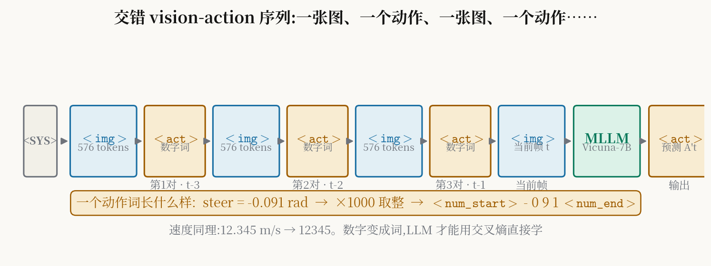
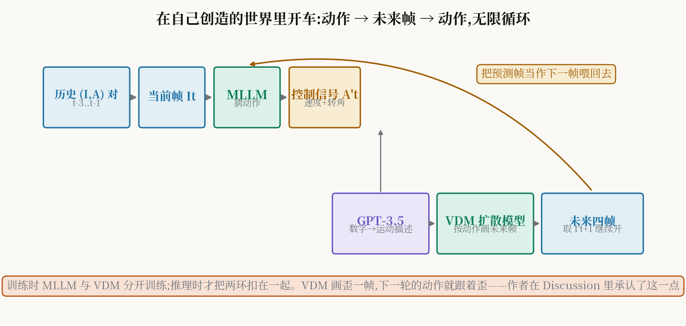

# 在自己画出的世界里开车：方向盘转角是怎样变成"话"的

> **全局编号 60 · 论文**：ADriver-I: A General World Model for Autonomous Driving
> **作者**：Fan Jia, Weixin Mao, Yingfei Liu, Yucheng Zhao, Yuqing Wen, Chi Zhang, Xiangyu Zhang, Tiancai Wang（旷视 MEGVII；另有早稻田大学、中国科大作者）
> **Venue / 年份**：技术报告（tech report），2023 年 11 月，无正式会议或期刊发表
> **链接**：https://arxiv.org/abs/2311.13549
> **代码**：未找到官方开源代码（写作时检索无结果）
> **一句话核心洞见**：把连续的控制信号写成数字词，和图像 token 交替排进同一个语言模型序列——于是"预测下一个动作"变成"说下一句话"，"预测下一帧画面"变成"按这句话把图画出来"，两者互为条件地循环下去，车就开在了自己想象出的世界里。

## 人类司机凭哪两个本事开车，模块化流水线把哪一个弄丢了

2023 年之前，自动驾驶的主流做法是四段式流水线：感知、预测、规划、控制。感知模块检测车辆行人车道线，预测模块猜周围物体的未来轨迹，规划模块据此算出自车的路径点，控制模块再把路径点转成方向盘转角和油门刹车。每一段的输入输出都定义得清清楚楚，出了事故可以一段一段往回查，解释性很好。

这篇论文的作者对这套设计的批评不在"不准"，而在"冗余"。他们的原话是：模块化设计引入了大量冗余（a substantial amount of redundancy）。冗余在哪里？一个具体的例子：感知模块用 3D 检测框把"前面有一辆车"显式地表示出来，预测模块再把这个框拿去算轨迹，规划模块又要把轨迹转回"要不要刹车"。同一个"前面有车"这件事，在流水线里被反复编码、解码、传递了三次。人类司机不这么开车。作者在引言里点出人类司机的两个特点：第一，看到画面直接动手调方向盘和踏板，不经过四段流水线；第二，会预测近未来——看到绿灯变黄灯，就知道马上变红灯，该松油门准备刹车。

注意第二个特点。它不是"预测周围物体的轨迹"，而是"预测整个场景接下来长什么样，并且这个预测直接指导我现在的动作"。2023 年的端到端方法（TransFuser、UniAD、VAD）其实已经砍掉了模块边界，但它们大多只输出轨迹或控制，不预测未来场景；另一边，GAIA-1（2023 年 9 月）能生成未来驾驶视频，但不预测控制信号；DriveDreamer（2023 年 9 月）两者都做，却依赖高精地图和 3D 检测框这种重型先验。ADriver-I 想站的位置是：既直接输出当前帧的控制信号，又预测未来帧，而且预测未来时不需要检测框和高精地图。

这就是作者押的赌注。时间坐标值得说清楚：2023 年 11 月，LLaVA-1.5 刚发布一个月，GPT-4V 的 system card 刚出来，视频扩散模型（Align Your Latents，CVPR 2023）证明了高分辨率视频生成的质量，RT-2（2023 年 7 月）证明了"视觉-语言-动作"模型可以直接输出机器人底层控制。作者的想法是把这两股风拧在一起：MLLM 负责"看懂并决定动作"，扩散模型负责"按动作把未来画出来"。而把两者拧在一起的那颗螺丝，就是 interleaved vision-action pair。

作者的底气在哪里？我认为是两张牌。第一张是数据：旷视内部近 140 万个高速场景的 vision-action 对，这是公开数据集里拿不到的东西，nuScenes 才 2.3 万个视频样本用于 VDM 微调。第二张是算力：VDM 预训练用了 32 张 A100，batch size 128，跑 4 万步。这两张牌决定了这篇工作的上限，也决定了它的可复现性下限——后面怀疑式审读会回到这一点。

## 一帧画面和一个方向盘转角，怎么塞进同一个序列

这是全篇最关键的设计，值得先看图再看公式。

*图 1：自绘。交错序列的排布：系统提示词开头，然后"图像 token—动作词—图像 token—动作词"交替出现，再接当前帧图像，MLLM 输出当前帧的动作词。下方的放大条展示一个动作词内部的数字编码。*

灵感来源论文里写得很直白：inspired by the interleaved document in MLLMs。2023 年的多模态大模型（Flamingo、LLaVA 这类）已经会处理"图文交错"的文档——一段文字、一张图、一段文字、一张图排成一个序列喂给 Transformer。作者问了一个很直接的问题：既然图文可以交错，为什么"图和动作"不能交错？一张前视图像后面跟上它对应的控制信号（速度、方向盘转角），再跟下一张图、下一个控制信号，整个驾驶过程就变成了一篇"图文交错"的文档，只不过"文"的部分不是自然语言，而是动作。

每个符号第一次出现，先把形状摆出来：

| 符号 | 形状 | 含义 |
|---|---|---|
| $I_t$ | $336 \times 336 \times 3$ 的 RGB 图像 | $t$ 时刻的前视帧 |
| $\mathtt{<TOKEN_{img}>}$ | 576 个 $d$ 维向量（$d=4096$，与 Vicuna-7B 隐层同维） | 一帧图像经 CLIP 编码 + MLP 适配器后得到的视觉 token 串 |
| $A_t$ | 2 个标量：速度 (m/s)、方向盘转角 (rad) | $t$ 时刻的底层控制信号 |
| $\mathtt{<TOKEN_{act}>}$ | 若干个词表 token | 控制信号转写成的"数字词" |
| $\mathtt{<SYS>}$、$\mathtt{<STOP>}$ | 各 1 个特殊 token | 系统提示词、对话结束符 |

576 这个数字论文没有明写，标注为推断：CLIP-ViT-L/14 在 $336 \times 336$ 输入下切出 $24 \times 24 = 576$ 个 patch，LLaVA-1.5 的标准做法是保留全部 576 个视觉 token，论文说视觉适配器"pretrained by LLaVA-7B-1.5"，所以 576 是最合理的还原。适配器是两层 MLP，把 CLIP 的特征维度（1024）映射到 LLM 的 4096 维。

对话的完整结构，论文 3.2 节写成：

$$\mathtt{Human:} \quad \mathtt{<SYS>}\ \mathtt{<TOKEN_{img}>}\mathtt{<TOKEN_{act}>}\ \mathtt{<STOP>}$$

$$\mathtt{Agent:} \quad \mathtt{<TOKEN_{act}>}\ \mathtt{<STOP>}$$

实际输入是三组历史 vision-action 对加上当前帧的图像 token，即序列形如：$\mathtt{<SYS>}, I_{t-3}, A_{t-3}, I_{t-2}, A_{t-2}, I_{t-1}, A_{t-1}, I_t$，模型要输出 $A_t$。论文列了这个设计的两个好处：多轮对话天然支持不定长度的历史帧；动作预测和未来生成统一在词嵌入空间里。第二点是真好处，第一点有一半是顺带的——三帧历史是写死的，"不定长度"更多是格式上的性质而非实验验证过的能力。

为什么这个设计是承重的？因为它一次性解决了两个模态的接口问题。之前的做法（比如论文的 baseline (b)/(c)）是把图像特征和动作特征分别编码再拼接，拼接需要手工设计融合层，不同长度的历史要改网络结构。而交错序列把一切都变成"下一个 token 预测"，历史想加长就多拼几对，MLLM 的自回归机制天然处理变长输入。这个选择属于"放弃了一个所有人默认的约束"——默认约束是"图像和控制信号是两种东西，要进两个编码器"；作者放弃它，把动作也当成语言。

## 为什么 12.345 要先变成 12345，再穿上起止符

动作变成词，细节决定成败。论文 4.1 节说：控制信号保留 3 位小数；为了降低 LLM 的收敛难度，把数字乘以 1000 转成整数。图 2 还展示了 $\mathtt{<num\_start>}$ 和 $\mathtt{<num\_end>}$ 两个标记，分别标出数字串的开始和结束。

拿一个具体例子走一遍。假设 $t$ 时刻真值是速度 $12.345\ \mathrm{m/s}$、转角 $-0.091\ \mathrm{rad}$。乘以 1000 取整得到 $12345$ 和 $-91$。喂给分词器的字符串大概长这样：

$$\mathtt{<num\_start>}\ 1\ 2\ 3\ 4\ 5\ \mathtt{<num\_end>}\ \ \mathtt{<num\_start>}\ -\ 0\ 9\ 1\ \mathtt{<num\_end>}$$

LLM 的任务就是逐 token 预测这串字符，监督信号是普通的交叉熵（论文明确说 follow LLaVA，用 cross-entropy loss）。想想这意味着什么：模型不是在"回归一个实数"，而是在"拼写一个数字"。小数点被消掉了，符号和小数位数的麻烦被起止符圈起来了，LLM 只需要学会"看到某种画面和历史动作，接下来最可能拼出哪几个数字字符"。

这个做法看起来笨，但表 3 的消融说明它是精心试过的。论文比较了四种编码方式（nuScenes 上的 L1 误差，速度 / 转角）：

| 编码方式 | 速度 L1 (m/s) ↓ | 转角 L1 (rad) ↓ |
|---|---|---|
| Num2English（数字翻成英文单词） | 2.094 | 0.536 |
| Special Token（分箱变分类） | 0.094 | 0.106 |
| Relative Diff（预测相邻帧差值） | 0.081 | 0.096 |
| Absolute Number（绝对值×1000取整） | 0.072 | 0.091 |

Num2English 崩得最惨：速度误差 2.094 m/s，比其他方法差一个数量级。原因不难想：把 "12.345" 写成 "twelve point three four five"，分词器切出的子词和数值大小之间没有任何单调关系，LLM 根本学不到"twelve"和"thirteen"在数值上只差 1。Special Token（把连续值分箱当分类做）的问题是量化误差和箱边界；Relative Diff 预测差值，差值虽小但会累积漂移。Absolute Number 直接拼写绝对值，赢了。

表 4 又试了小数位数：0 位小数时速度误差 0.212，1 位时 0.094，2 位时 0.073，3 位时 0.072。2 位和 3 位几乎没有差别，说明再往下加精度，瓶颈已经不在编码而在模型本身。这个消融做得干净，是全文最诚实的一组数字之一：它告诉你编码的收益在 2 位小数处就饱和了。

## 猜动作的那一半：Vicuna、CLIP 和两层 MLP 各自干什么

MLLM 由三个现成的部件拼起来，没有一个是新设计的：

- **LLM**：Vicuna-7B-1.5，即在 LLaMA2 上做过指令微调的 70 亿参数模型。负责读交错序列、做自回归预测。
- **视觉编码器**：CLIP-ViT-Large，在海量图文对上预训练过。负责把 $336 \times 336$ 的前视帧变成视觉特征。
- **视觉适配器**：两层 MLP，用 LLaVA-7B-1.5 的权重初始化。负责把 CLIP 的特征空间对齐到 Vicuna 的词嵌入空间。

训练分两段。第一段叫预训练：在 140 万 vision-action 对的私有高速数据集上，**冻结 LLM**，只更新视觉编码器和适配器。第二段叫有监督微调（SFT）：在 nuScenes 和私有数据集上分别做，**冻结视觉编码器**，训练其余部分。两段都只跑 2 个 epoch，batch size 16，AdamW，学习率 $2\times 10^{-5}$，8 张 A100。

这个"冻结谁、训谁"的安排值得停下来想一想。预训练时冻结 LLM 的理由是：Vicuna 的语言能力和推理能力已经够用，140 万驾驶数据要补的是"视觉-动作"的对齐，而不是语言本身。SFT 时反过来冻结视觉编码器，因为 CLIP 的视觉特征在预训练阶段已经对齐好了，微调阶段要调的是 LLM"根据视觉和历史动作拼出数字"的决策行为。两段加起来，Vicuna 的权重其实只在 SFT 阶段被更新，更新量还很小（2 epoch）。这意味着 ADriver-I 的驾驶能力主要来自预训练对齐 + 轻量微调，而不是让 LLM 从头学会开车。这既是优点（训练便宜），也是隐患：Vicuna 的先验知识里关于驾驶的内容有多少，直接决定了它在没见过的场景下怎么猜——而论文没有做任何分布外测试。

## 训练时连猜三帧、推理时只猜一帧：多轮对话到底在修什么

论文 3.1 节有一个容易滑过去的细节：训练时，MLLM 自回归地输出 $\{A'_{t-2}, A'_{t-1}, A'_t\}$，三个预测都被各自的真值监督；推理时，MLLM 只用单步直接输出当前帧的 $A'_t$。

为什么训练要多猜两帧？论文的解释是：多轮对话给中间动作预测加了监督，大大减少了推理时当前帧动作预测的累积误差。表 5 的数据：

| 对话方式 | 速度 L1 (m/s) ↓ | 转角 L1 (rad) ↓ |
|---|---|---|
| Temporal Fusion（多帧 token 先融合再一次性预测） | 0.078 | 0.092 |
| Single Round（只监督当前帧） | 0.078 | 0.094 |
| Multi Round（三帧全监督） | 0.072 | 0.091 |

Multi Round 在速度上把 0.078 压到 0.072，转角上也有小幅改善。机制上可以这样理解：在 Single Round 里，序列中 $A_{t-2}, A_{t-1}$ 的位置只作为输入出现（teacher forcing 给的是真值），模型从没被要求"自己"在这些位置产生动作；而 Multi Round 要求模型在每个历史位置都输出动作，每个位置都吃到梯度。这相当于把一条长序列上的监督密度提高了三倍，模型被迫学会"在任何前缀下都给出合理动作"，而不是只在序列末尾的位置发力。

但这里有一个微妙的 train-inference 不一致，论文没有讨论：训练时 $A'_{t-2}$ 的预测是基于真值历史 $A_{t-3}$ 算出来的，而推理时模型的输入历史里混入了它自己上一轮的预测（在无限循环模式下）。这就是经典的 exposure bias——训练时总喂真值，推理时只能吃自己的输出。作者用"多轮监督减少累积误差"来回应，但多轮监督减少的是**训练分布内**的误差；一旦进入自己生成的世界（第 8 节的循环），输入分布本身就变了。作者在 Discussion 里承认 VDM 生成质量差时会带偏控制预测，MLLM 这一侧的 exposure bias 是同一个问题的另一半，论文没有点名。

## 扩散模型按动作"画"出下一帧：历史帧怎么拼进去，数字怎么变成话

另一半是视频扩散模型（VDM），负责"按动作把未来画出来"。它的底子是 Stable Diffusion 2.1，加上类似 video latent diffusion（Blattmann et al.，2023）的时间感知模块。论文对 VDM 的结构着墨不多，关键的两处改造是：

第一，**历史条件**（history-conditioned）。做法是 reference-video control：把给定的历史帧直接拼接到扩散模型的输入上。具体说，扩散模型在隐空间里做去噪，输入是带噪的隐变量；作者把历史 4 帧的隐表示沿通道维拼到这个输入上，网络去噪时就能"看见"历史。这是一个简单直接的条件注入方式，不需要改 UNet 的主体结构。

第二，**动作条件**。SD 的文本条件模块被保留下来，用来做 action-guided 生成。但这里撞上一堵墙：扩散模型的文本编码器（CLIP 系）没有 LLM 那样的推理能力。论文原话：它理解不了"转角小于 0 是右转、大于 0 是左转"。想想确实如此——CLIP 的文本编码器见过"右转"这个词，但它没见过"-0.091"这个数字和"右转"之间的对应关系，数字对它来说只是字符。

作者的解法是一个补丁：用 GPT-3.5 把连续几帧的控制信号翻译成运动描述。图 3 展示了一个例子：输入历史帧和当前帧的控制信号数字，GPT-3.5 输出"匀速""加速""减速""转弯"这类常见驾驶状态的文字描述，再把这段文字喂给 VDM 的文本编码器做条件。

平心而论，这是全篇最"工程"的一步。它的好处是绕开了"让扩散模型理解数字"这个硬问题；代价是引入了一个闭源 API（GPT-3.5）做数据预处理，运动描述的质量、稳定性、覆盖度都没有评估，也没有消融"有/无 GPT-3.5 翻译"的对比。如果让我猜作者的真实过程：他们先试了直接把数字拼成 prompt（比如 "steer -0.091"），发现生成的视频不跟动作走，才搬出 GPT-3.5 做翻译。论文把这一步写得很体面，但它的性质就是补丁——承重结构（历史帧拼接 + 扩散生成）之外的装饰，好在作者没有把它包装成理论贡献。

VDM 的训练：继承 Stable Diffusion 权重，先在 140 万私有数据上预训练 4 万步（batch 128，32 张 A100，学习率 4e-4），再在 nuScenes 约 2.3 万视频样本上微调 4 万步（batch 32，16 张 A100，学习率 3.2e-4）。空间分辨率 $256 \times 512$，视频长度 8 帧（4 帧历史 + 4 帧未来）。推理用 DDIM 采样 50 步。注意这两组数字的量级：VDM 的训练成本远高于 MLLM，这是 2023 年视频扩散模型的常态。

*图 2：自绘。ADriver-I 的推理循环：MLLM 根据历史和当前帧猜出动作，动作经 GPT-3.5 转成运动描述，连同历史帧一起条件 VDM 生成未来四帧，取第一帧当作下一时刻的"当前帧"喂回 MLLM。训练时两部分分开训，推理时才扣成环。*

## 跟着跑四轮：看看误差从哪里开始吃掉自己

"在自己创造的世界里开车"是论文最抓人的宣称，也是最需要具体推演的一句。论文 4.5 节只给了定性图（图 7），没有定量指标。下面用一组示意数字把四轮循环走一遍，数字是构造的、量级参照表 2 的误差水平，目的是让误差累积的机制可见。

**设定**：直道跟车场景。真值历史三帧速度都是 $15.0\ \mathrm{m/s}$，转角 $0.00\ \mathrm{rad}$。为简化，VDM 每次生成未来 4 帧，只取第 1 帧继续。

**第 1 轮（真实世界）**。输入：三对真实 $(I, A)$ 加当前真实帧 $I_t$。MLLM 输出 $A'_t$：速度 $15.06$（误差 $+0.06$，表 2 的 L1 水平约 0.07），转角 $0.008$。GPT-3.5 把 $(15.0, 15.0, 15.0, 15.06)$ 翻译成"steady speed, going straight"。VDM 以历史 4 真实帧 + 这段描述为条件，画出 $I'_{t+1}\dots I'_{t+4}$。注意：$I'_{t+1}$ 里自车位置是按"速度 15.06 直行"画出来的，和真值 $I_{t+1}$（按 15.0 画）已经有肉眼不可见但存在的位置差。

**第 2 轮（半真半假）**。输入：历史三对里最新的一对是 $(I'_{t+1}, A'_t)$——图像是生成的，动作是上一轮猜的。MLLM 在这组输入上猜 $A'_{t+1}$。两个误差源叠加：动作历史里 $A'_t$ 本身有 $0.06$ 误差；图像 $I'_{t+1}$ 是扩散模型画的，细节（车道线位置、前车距离）有生成噪声。假设输出速度 $15.14$，转角 $0.015$。误差从 $0.06$ 胀到 $0.14$。

**第 3 轮**。输入里真实帧只剩两帧了。VDM 这一轮的条件历史包含 $I'_{t+1}, I'_{t+2}$ 两帧生成图。论文 Discussion 第 (1) 条在这里应验：如果控制信号变化快，VDM 生成质量下降——转角从 $0.008$ 变到 $0.015$，扩散模型要画出"轻微右偏"的连续变化，画出来的车道线可能出现抖动。MLLM 看到抖动的车道线，猜出转角 $0.03$，速度 $15.2$。误差继续放大，且出现了方向性漂移：车开始往右偏，而真值车一直在直道中央。

**第 4 轮**。输入全部来自生成世界。MLLM 的猜测越来越依赖有偏的历史，VDM 按有偏的动作画出更偏的帧。这就是正反馈：动作误差 → 画面偏差 → 更大的动作误差。

这个推演里被触发的机制，恰好对应作者自己列的局限 (1)：VDM 在控制信号快速变化时生成低质量帧，会干扰下一时刻的控制预测。论文没有量化"几轮之后误差超过阈值"，图 7 的定性展示选的是看起来稳定的片段。一个诚实的审稿人会问：循环 100 帧之后，车还在路上吗？论文没有回答。这也是"无限驾驶"这个宣称最脆弱的地方——"可以无限重复这个过程"在数学上成立（没有哪一步禁止你继续喂），但"无限开下去不翻车"没有任何证据。

## 表 2 那几个数字，放在什么条件下才读得动

控制信号预测的主结果在表 2，分 cross-model（和基线比，nuScenes 上）和 cross-dataset（nuScenes vs 私有数据）两部分。先看 cross-model（L1 误差，越小越好）：

| 方法 | 速度 L1 (m/s) | 转角 L1 (rad) |
|---|---|---|
| MLP-Only（只看历史动作） | 0.122 | 0.101 |
| CNN-Based（动作+ResNet 图像特征拼接） | 0.106 | 0.095 |
| ViT-Based（把 CNN 换成 ViT-B） | 0.103 | 0.092 |
| ADriver-I | **0.072** | **0.091** |

ADriver-I 在速度上明显好于三个基线（0.072 vs 0.103），在转角上只比 ViT 基线好 0.001。论文自己也承认了这一点，解释是：少数转角方差很大的特殊样本主导了平均 L1，而 ADriver-I 在低阈值精度 $A_{0.01}$ 上优势大（转角 $A_{0.01}$：0.411 vs 0.299），说明它在"常见小转角"上更准，被几个大转角样本拉平了均值。这个解释是合理的，但反过来也暴露了问题：三个基线是作者自己搭的（MLP 三层全连接、CNN+全局平均池化拼动作特征），不是已发表的方法，更不是当时的端到端 SOTA（如 TCP、UniAD）。"打败自己搭的基线"和"打败领域基线"是两回事。同期（2023 年 10 月）的 DriveGPT4 也是 MLLM 做驾驶，论文没有和它比控制预测精度。

再看 $A_\theta$ 精度指标，定义是预测误差小于阈值 $\theta$ 的样本比例：

$$A_{\theta}=\frac{1}{N}\sum_{i=1}^{N}F(\hat{x}_i,x_i,\theta),\quad F=1 \text{ 当 } |\hat{x}_i-x_i|\le\theta$$

ADriver-I 在 nuScenes 上速度 $A_{0.01}=0.237$：只有 23.7% 的样本速度误差小于 $0.01\ \mathrm{m/s}$。这个数字初看很低，但它恰恰说明任务的真实难度——nuScenes 包含城区复杂场景，速度分布广。阈值放宽到 $0.07$ 时精度到 0.640。读这些数字时要带着分布感：L1 0.072 m/s 听起来很小，但如果评测集里一半样本是静止或低速，这个均值会被拉低。论文没有给出速度/转角的分布直方图，这是缺的一块信息。

cross-dataset 那一行（带 $\dagger$，私有数据集）：速度 0.035，转角 0.015，比 nuScenes 好一倍以上。论文给了两个解释：私有数据主要是高速场景，速度转角方差小；SFT 数据量大得多（140 万 vs nuScenes 的量级）。两个解释都合理，但这一行数字谁也复现不了——数据不公开。这是全文所有"impressive"里最不该直接引用的一个。

## 表 6 的对比为什么不公平：1 帧生 12 帧和 4 帧生 4 帧不是一回事

未来帧生成的定量对比在表 6：

| 方法 | 输入→输出 | FID ↓ | FVD ↓ |
|---|---|---|---|
| DriveGAN | 1F → 12F | 73.4 | 502.3 |
| DriveDreamer | 1F+12B+12M → 12F | 52.6 | 452.0 |
| ADriver-I | 4F → 4F | 5.5 | 97.0 |

ADriver-I 的 FID 5.5、FVD 97 看起来把另两个甩开几条街，但三个格子的任务难度根本不在一个量级。DriveGAN 用 1 帧生成未来 12 帧，DriveDreamer 用 1 帧+12 帧的检测框+12 帧的高精地图生成 12 帧，ADriver-I 用 4 帧历史生成 4 帧。预测步数越长误差累积越严重，这是视频生成的常识；4 帧历史又比 1 帧给了多得多的约束。用"4 生 4"的分数去比"1 生 12"的分数，相当于短跑成绩和马拉松成绩放一起排名。论文在表注里写了输入输出配置，算不上隐瞒，但正文"achieves impressive performance with 5.5 FID and 97.0 FVD"的写法，读者不看表注就会误会这是同场竞技。

公平的比法应该是固定输入输出配置（比如都是 4F→4F）再比，或者至少报告 ADriver-I 在更长 horizon（8 帧、12 帧）下的 FVD 衰减曲线。论文都没做。所以表 6 能支持的结论只有一个：在"4 帧历史生成 4 帧未来"这个宽松得多的设置下，模型能生成质量不错的视频。至于"不需要检测框和高精地图先验也能生成好"，这个结论本身是对的（输入里确实没有 B 和 M），但"生成得比 DriveDreamer 好"这个隐含结论不成立。

## 作者自己承认的四处局限，翻译成人话

论文第 5 节的 Discussion 列了四条，这是全文作者语气最弱、也最值得细读的部分：

**(1) VDM 是"类反馈式仿真器（原文 close-loop simulator）"，但动作变化快时生成的帧质量差，会带偏下一时刻的控制预测。** 这就是第 8 节推演里走到的正反馈。作者把 VDM 比作 close-loop simulator，这个类比是准确的：VDM 确实在扮演"环境"的角色。但一个真正的仿真器（比如 CARLA）是物理一致的，而 VDM 是"看起来像"的——车道线抖一下、远处多一辆车，MLLM 都会当真。作者承认了耦合风险，但没有给出任何缓解方案。

**(2) 离部署还差得远，计划靠更大的私有数据堆出 scaling law。** 原话是性能"still far from satisfactory for deployment"，下一版靠"huge number of vision-control pairs"和生成视角的 scaling law。这句话的信息量在于：作者自己也不认为当前的方法有质变，指望的是数据量。这是 2023 年大模型团队的标准姿势，但"生成视角的 scaling law"在驾驶上是否存在，至今没有定论——开车是长尾问题，数据量翻倍不一定解决灰色小猫那种 corner case。

**(3) MLLM 和 VDM 分开训练，没吃到端到端优化的好处。** 这是最实在的一条自我批评。两个模型分开训意味着：MLLM 猜动作时没见过 VDM 会怎么画，VDM 画画时没见过 MLLM 会怎么猜错。推理时硬把它们扣成环，接口处的误差没有任何联合优化来缓冲。作者说需要"统一的理解与生成框架"，这句话在 2023 年底是展望，在今天看，统一的理解-生成模型（如后来的 Janus、Show-o 一类思路）正是往这个方向走。

**(4) 没有路线信息，长距离开不了。** 从驾驶距离看，系统只有 3 帧历史、没有导航，跑不出"从 A 到 B"这种任务。作者说以后可能引入导航地图。这条局限点出了 ADriver-I 的真实定位：它是一个"下一秒怎么动、下一秒世界长什么样"的短视距模型，不是一个能完成出行任务的驾驶智能体。

## 怀疑式审读：哪些结论可以信，信到什么程度

把前面各节的质疑收拢到一起，按"证据强度"排：

**可以信的**：交错 vision-action 序列这个格式是有效的——表 3、表 4、表 5 三组消融互相支撑，绝对值数字编码 + 多轮监督确实比替代方案好，且消融的变量隔离得比较干净（每次只动编码方式或监督方式）。"不需要检测框和高精地图也能生成未来帧"可以信，因为输入里确实没有这两样，图 6 的定性结果也摆在那里。

**打折扣的**：表 2 的 cross-model 对比。基线是作者自搭的三层 MLP / CNN+GAP / ViT-B，不是已发表方法；转角 L1 只赢了 0.001，靠 $A_{0.01}$ 找补。结论应读作"MLLM 方案不比简单的自搭基线差，速度预测上好一些"，而不是"超过了现有方法"。

**不能直接引用的**：表 2 带 $\dagger$ 的私有数据集行（0.035 / 0.015），数据不公开，场景单一（高速），无法验证；表 6 的跨方法视频生成对比，任务配置不对齐；"无限驾驶"的宣称，只有定性图，没有开环误差曲线，更没有驾驶任务指标（路线完成度、碰撞率、干预次数）。

**缺的信息**：nuScenes 上 MLLM 微调的具体样本量（论文只给了 VDM 微调的 2.3 万视频样本，MLLM 的 SFT 规模未确认）；速度/转角在评测集上的分布（决定 L1 数字的含金量）；训练超参（2 epoch、batch 16、学习率 2e-5）的选择过程——没有搜索范围和敏感性分析；GPT-3.5 运动描述 prompt 的具体内容和稳定性（图 3 只给了一个例子）；推理延迟——VDM 用 DDIM 50 步采样生成 4 帧 $256\times512$ 视频，这个开销在车载场景下是否可行，论文一个字没提，而这是"世界模型上车"最现实的一道坎。

**承重 vs 装饰**，收拢盘一次：承重的是交错序列格式、绝对值数字编码、多轮对话监督——三处都有消融支撑，去掉会掉点。装饰的是 GPT-3.5 翻译运动描述（补扩散模型文本编码器之短的补丁）、system prompt（图 2 里有，但无消融，不知道贡献多少）、"无限驾驶"的叙事包装（数学上可循环，实证上没走远）。

还有一个时间线上的诚实注记：这是 2023 年 11 月的技术报告，没有经过同行评审。引用它的思想时没问题，但引用它的数字时要带着上面的全部折扣。

## 两个可以带走的想法

**第一个：把连续量"拼写"出来，是塞进自回归模型的通用手法。** ADriver-I 把速度转角乘以 1000 取整、加上起止符，变成 LLM 的"拼写题"。这个手法的本质是：任何连续控制量，只要精度要求有限，都可以离散化成字符序列，从而直接复用 LLM 的交叉熵训练和自回归推理，不需要另设计回归头。下次遇到"想让语言模型输出连续值"的问题，第一反应可以是这个：先问精度要几位，再问拼写是否够用，而不是先搭一个回归头。表 4 告诉你 2 位小数就饱和了——精度需求决定编码长度，编码长度决定序列开销，这是一个可以算的账。

**第二个：生成模型可以当"可查询的环境"，但查询结果不能不经校验就信。** ADriver-I 的循环在结构上就是 model-based rollout 的雏形：用动作条件生成未来观测，把观测喂回策略。在仿真器昂贵或不可微的场景里，这是一个真实可用的替代——先用生成模型"预演"几步，再决定现实里的动作。但 ADriver-I 的教训同样具体：预演的质量上限就是生成模型的质量下限，第 8 节的正反馈说明，不加校验的 rollout 会把生成噪声当成环境真相吃下去。所以"世界模型引导"的完整形态里，生成之后必须有一道校验——可以是规则，可以是另一个模型的打分，可以是和真实观测的对齐，但不能没有。ADriver-I 没有这道校验，这正是它只能停在定性图的原因。

## 与本课题的关联：这条思想血脉是怎么流到"世界模型引导"里的

读者的课题是"世界模型引导 + 自适应衰减情景记忆的多规划器自动驾驶 Agent"，ADriver-I 是"世界模型引导"这一支柱的思想源头之一。这种继承关系可以从三个层面说清。

**第一，格式上的继承：vision-action 交错序列就是"感知和动作进同一个序列"的最早示范。** 读者课题里的世界模型先验，无论用什么架构实现（扩散、Transformer、自回归），都要解决同一个接口问题：历史观测和历史动作以什么格式进入模型。ADriver-I 的答案是"交错排成一个序列，动作写成数字词"。这个答案在今天可以直接升级：把"数字词"换成自然语言——"以 15 m/s 直行""前方路口右转"，序列格式不变，动作的表达能力从两个标量扩展到开放式指令。读者课题要做的"LLM 调度多规划器执行开放式自然语言驾驶指令"，指令侧和动作侧的统一表示，正好落在这个格式上。ADriver-I 证明了格式可行，后续工作要证明的是语义可扩展。

**第二，结构上的继承：动作→未来帧→动作的循环，就是"世界模型引导"的最小回路。** 把 ADriver-I 的两环拆开看：MLLM 是"根据世界猜动作"的规划器，VDM 是"根据动作想象世界"的世界模型，循环起来就是"在想象中预演、在预演里决策"。读者课题的"世界模型引导"无非是把这个最小回路做大做结实：世界模型从"画未来帧"升级为"预测未来状态分布"（可复用中间分布、做分层检索），规划器从"一个 MLLM"扩展为"多个专家规划器 + LLM 调度"。ADriver-I 的价值在于它用最简陋的配置验证了循环本身转得起来；它的教训（第 8 节的正反馈、Discussion (1)(3)）则指出了循环要转稳缺什么——联合优化和生成质量校验，这正是读者课题里"风险校验/冲突仲裁"模块要回答的问题。

**第三，短板上的互补：ADriver-I 缺的三样东西，正好是读者课题的三根支柱。** 一是它只有 3 帧历史、没有记忆——读者课题的自适应衰减情景记忆补的就是长时依赖，历史事故、长尾场景的经验不可能靠 3 帧窗口记住。二是它只有一个决策器、没有仲裁——VDM 画歪一帧就带偏动作，读者课题的多规划器 + 冲突仲裁就是为这种单点失效准备的。三是它没有定量评估、只有定性图——读者课题计划在 Bench2Drive 上做反馈式验证，恰好把 ADriver-I 没走完的那一步走完：用路线完成度、驾驶分数这些硬指标，回答"在自己想象的世界里开 1000 帧还稳不稳"。

一句话收束：ADriver-I 是 2023 年有人用最直接的方式把"世界模型"和"开车"焊在一起的一次尝试，焊点是 interleaved vision-action pair，焊缝处（分开训练、无校验、无记忆、无定量评估）正是后来所有跟进工作、包括读者课题要重新下功夫的地方。读它不是为了复现它的数字，而是为了拿走它的格式、它的循环结构，以及它用 Discussion 亲手标出来的四个坑。
