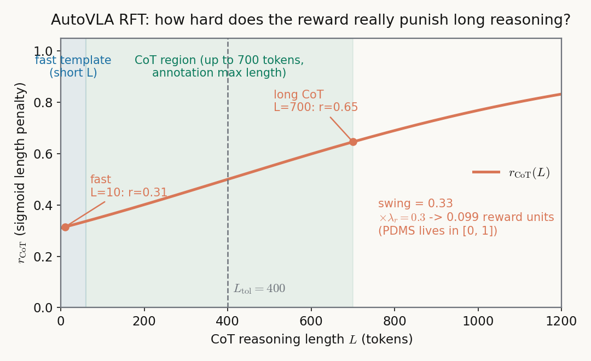

# 轨迹即母语：一个自己决定"想多久"的驾驶 VLA

> **全局编号**：54（本领域 51–60）\
> **论文**：AutoVLA: A Vision-Language-Action Model for End-to-End Autonomous Driving with Adaptive Reasoning and Reinforcement Fine-Tuning\
> **作者**：Zewei Zhou、Tianhui Cai、Seth Z. Zhao、Yun Zhang、Zhiyu Huang、Bolei Zhou、Jiaqi Ma（UCLA）\
> **会议/年份**：NeurIPS 2025（arXiv abs 页未标注；作者官方代码仓库描述注明 2025-09 接收；**新增交叉证据**：MindDrive（ECCV 2026）论文 v4 主结果表将 AutoVLA 列为 "NeurIPS 25" 基线，另有两个第三方复现仓库同步报告 2025-09 接收——多方一致，可信度较高，但仍缺官方程序册/Springer 页码确认）\
> **链接**：arXiv https://arxiv.org/abs/2506.13757 · 项目页 https://autovla.github.io/ · 代码 https://github.com/ucla-mobility/AutoVLA\
> **代码是否公开**：已公开。仓库含模型定义、数据集预处理、训练/推理脚本、NAVSIM 评测代码、动作 codebook 缓存，README 可运行。\
> **一句话核心洞见**：把连续轨迹离散成 2048 个物理可行的动作 token，让"想"（CoT 推理）和"做"（轨迹规划）变成同一个自回归语言模型的两种输出，于是可以用强化学习的奖励同时优化两件事——开得准，和在该快的时候少想。

推理不是免费的。这篇论文里最值得先看的数字不在主结果表里，而在 4.2 节的数据规模实验：nuPlan 上，训练数据超过 5 万条之后，带 CoT 推理的模型反超纯动作模型；nuScenes 上，带 CoT 的模型**全程**输给纯动作模型，L2 误差平均 0.48 米对 0.43 米。同一个 CoT，在一个数据集上是助力，在另一个上是负担。为什么？因为 nuScenes 的场景大多简单：直行、跟车、空旷路口。推理在这里不是"深度思考"，是噪声——每多生成一个 token，就多一次偏离正确轨迹的机会，还要多花推理时间。nuPlan 里复杂交互多，推理的收益才盖得过它的代价。

这个观察就是整篇论文的起点。作者没有把它写成"CoT 有时有害"这种论断，而是把它变成了一个设计问题：**能不能让模型自己学会在什么时候想、什么时候不想？** 后面所有的技术选择——动作 token 化、双思考模式、GRPO 强化微调——都是对这个问题的回答。读这篇论文时，把这句话放在手边，每一节都问一次"这一步是在回答它吗"，文档的结构就清楚了。

## VLM 直接吐轨迹，为什么两条路都走不通

在 AutoVLA 之前，想把 VLM 用到端到端驾驶上的人，撞的是同一堵墙：**语言模型输出的是 token，车要的是物理上能开的轨迹**，这两者之间差了一层"可行性"。

第一条路是让 VLM 直接输出 waypoint 的文本坐标（EMMA、OpenEMMA 一类的做法）。这条路的问题很具体：语言模型不擅长精确的数字推理。表 3 的消融把这件事量化了——同一份混合训练数据，文本 waypoint 版的 PDM Score 是 59.24，动作 token 版是 80.54；平均 L2 误差 1.29 米对 0.86 米；碰撞率 0.98% 对 0.35%。更要命的是推理时间：9.31 秒对 3.95 秒。因为输出一个"12.345"这样的小数，模型要逐字符生成 6 个 token，而一个动作 token 只需要 1 个。数字越长，误差累积越严重，时间越久。这不是调参能救的，是表示方式本身的问题：让语言模型做它最不擅长的事。

第二条路是加中间层：VLM 只输出高层语义（meta-action 如"变道"，或 latent action token），再由一个独立的规划器/解码器翻译成轨迹（DriveVLM 的双模块、ORION 的生成式规划器）。这条路把可行性问题外包了，代价是端到端断了——VLM 的梯度传不到规划器，规划器的误差也回传不到 VLM；而且多一套模块就多一套训练开销。作者在引言里把这两条路并排放进图 2，意思很直白：要么不可行，要么不端到端。

AutoVLA 的回答是换一个表示：**不要让模型输出数字，也不要加中间模块，而是把"可行"这件事提前做进词表里**。先在真实驾驶数据上把所有 0.5 秒的短运动片段聚成 2048 类，每一类是一个物理上真实发生过的动作（某个位移加转角），然后把这 2048 个动作当成 2048 个新词加进语言模型的词表。模型要做的事从"算出轨迹"变成了"说出哪几个词"——而这正是语言模型最擅长的事：next-token prediction。连续控制问题被翻译成了一个语言问题，可行性由词表保证，端到端由单一自回归模型保证。

这一步是全文的承重墙。后面会看到，GRPO 和双思考模式都是建在这面墙上的：如果动作还是连续的、不可微的数字，RL 的奖励信号很难干净地落到 token 级别的策略上；正因为动作已经是离散的词，整个"推理+动作"序列才是一个统一的、可采样的、可打分的生成对象。

## 作者手里的三张牌

从论文的组织方式反推，作者决定做这件事时，手里大概有三张牌。

第一张是**表示转换的干净**。动作 token 化这个想法本身不是新的（机器人领域的 OpenVLA、FAST 做过类似的事，论文引用了它们），但把它和"推理+动作统一自回归"绑在一起是新的。这个设计不增加模型参数，不改 Transformer 结构，任何 VLM 主干都能套。审稿人验证它的成本很低：表 3 的消融一行数字就说明问题——59.24 对 80.54，差距大到不需要统计检验。

第二张是**奖励的可验证性**。GRPO 在 DeepSeek-R1 之后成了显学，但 R1 的奖励是"数学题答案对不对"这种天然可验证的信号。驾驶里有没有对等的东西？有：PDM Score。它是 NAVSIM 官方指标，由无事故碰撞、道路合规、通行效率等子项乘加而成，算出来就是一个 0 到 1 的数，不需要人类标注，不需要学一个 reward model。这意味着 RFT 的奖励信号是现成的、便宜的、可复现的。论文把 PDMS 直接拿来当 $r_{\text{Driving}}$，这是整个 RFT 设计里最硬的一环——奖励不用学，就不会有 reward hacking 的建模负担（当然，hacking 的风险还在，后面怀疑式阅读会讲）。

第三张是**场景的天然适配**。NeurIPS 的审稿人关心"为什么是 GRPO 而不是 PPO"。论文给了两个理由：GRPO 不需要 critic 网络，训练更稳更快；规划本身是多模态的（同一场景多条轨迹都合理），GRPO 的组内相对比较天然契合"采样一组候选、挑相对好的"这个过程。第二个理由是诚实的：它把方法选择和问题结构对上了，而不是因为 GRPO 时髦。

三张牌里最硬的是第二张。可验证的奖励是 RFT 能成立的前提；没有它，后面所有的"自适应"都是空谈。

## 2048 个动作 token 到底是什么：先把"可行"做进词表

动作 codebook 的构造在附录 A，全文最值得细读的几段之一。步骤如下：

从 Waymo 开放运动数据集（WOMD）里随机切出大量 0.5 秒的短运动片段。每个片段用"最后一帧的车身轮廓"来表示——根据车辆在当前帧坐标系下的位置、尺寸、朝向算出包围盒轮廓。然后用 K-Disk 聚类选出 2048 个代表片段：贪心地一个个挑，每挑一个新的，要求它和已选的所有片段之间的平均轮廓距离不小于 $\delta = 0.05$ 米。挑出来的第 $k$ 个片段，取出它的位移和转角 $(\Delta x, \Delta y, \Delta\theta)$，记为动作 token $a_k$。于是 codebook $\mathcal{A} = \{a_1, \dots, a_{2048}\}$ 里每一个词，都是真实车流里出现过的、0.5 秒的可行小动作。

注意这个 $\delta = 0.05$ 米的含义：它保证 2048 个词互相之间不至于太像——任意两个动作的"形状"至少差 5 厘米。这是在**覆盖度**和**词表大小**之间的一次显式权衡：$\delta$ 太小，词表里全是几乎一样的直行微调，浪费容量；$\delta$ 太大，精细动作（比如贴着路边缓慢挪车）会被合并掉，量化误差变大。论文没有给 $\delta$ 的敏感性分析，这是个缺口——0.05 米是拍脑袋还是搜出来的，附录没说。

训练时，一条连续轨迹 $\mathbf{P} \in \mathbb{R}^{\tau \times d}$ 被切成每 0.5 秒一段，每段映射到 codebook 里最近的那个 token，变成 token 序列 $\mathbf{a} = [a_1, \dots, a_T]$。推理时反过来：模型自回归地吐出 token，查表拿回 $(\Delta x, \Delta y, \Delta\theta)$，从自车初始位姿开始逐段拼回去，得到自车坐标系下的连续轨迹。

走一个具体的小例子。规划时域 5 秒，每 0.5 秒一个 token，所以 $T = 10$。假设模型输出的 10 个 token 查表后是这样一组 $(\Delta x, \Delta y, \Delta\theta)$（示意数字，量级按城市道路车速构造）：

| 步 | token | $\Delta x$ (m) | $\Delta y$ (m) | $\Delta\theta$ (rad) | 累积位姿含义 |
|---|---|---|---|---|---|
| 1 | a_412 | 4.9 | 0.1 | 0.00 | 直行，约 35 km/h |
| 2 | a_408 | 4.8 | 0.3 | 0.02 | 直行微右偏 |
| 3 | a_1093 | 4.2 | 1.1 | 0.09 | 开始右转 |
| 4 | a_1101 | 3.5 | 1.8 | 0.14 | 右转中 |
| 5 | a_1105 | 3.0 | 2.0 | 0.12 | 右转中 |
| 6–10 | a_407… | 4.5 | 0.2 | 0.01 | 出弯回直 |

解码时从 $(0,0,0)$ 出发：第 1 步平移到 $(4.9, 0.1)$ 朝向不变；第 3 步在前两步的累积位姿上再叠加转角 0.09 rad，后续的 $\Delta x, \Delta y$ 都在这个旋转后的局部坐标系下累加。10 步拼完就是一条 5 秒的右转轨迹。关键点：**每一步的 $(\Delta x, \Delta y, \Delta\theta)$ 都是数据里真实出现过的动作**，所以拼出来的轨迹天然满足车辆运动学——不会出现"横向瞬移 2 米"这种 waypoint 回归模型偶尔会吐出的东西。可行性不是靠损失函数学出来的，是靠词表构造时就锁死的。

这里有一个信息损失的问题，论文没有正面讨论，值得替作者想一想：连续轨迹被量化到最近的 token，每 0.5 秒引入一次量化误差（最大约 $\delta/2$ 量级，再加上聚类本身的近似）。10 步累积下来，端点误差可能达到几十厘米。开环评测的 L2 误差里，有多少是模型规划错了，有多少是量化本身带来的底噪？论文没有分解这个。如果量化底噪是 0.2 米，那么表 3 里 0.86 米的 L2 就有一部分是表示方式交的税——动作 token 化的代价。这不是否定这个设计（59.24 到 80.54 的提升远大于这点税），但读者应该知道这笔税存在。

另外注意：真车数据和仿真各用一套 codebook（CARLA 的单独在 CARLA-Garage 数据上聚）。这说明 codebook 是和车辆动力学绑定的——换一辆动力学不同的车，词表要重聚。这是"把可行做进词表"的另一面：词表里没有的东西，模型永远说不出来。如果某个极端机动（紧急避让的大角度转向）在 WOMD 里从没出现过，codebook 里就没有对应的词，模型在生死关头也吐不出那个动作。长尾场景恰恰是数据最稀疏的地方，而这正是 VLM 方法声称要解决的问题。这个张力论文没有提。

## SFT 的两个损失到底在训练什么：公式 (1)(2) 逐项拆

SFT 阶段的输入是：多视角多帧图像 $C$、高层导航指令 $I$（如"左转""直行"）、自车状态 $S$（速度、加速度、历史动作）。输出是一个 token 序列 $\mathbf{x} = [l_1, \dots, l_L, a_1, \dots, a_T]$：前面 $L$ 个是语言 token（推理部分），后面 $T$ 个是动作 token。快思考模式下，$\mathbf{l}$ 是一个固定的短模板（大致意思是"无需推理，直接输出动作"）；慢思考模式下，$\mathbf{l}$ 以引入 CoT 的模板开头，后面跟结构化推理。

两个监督信号：

$$\mathcal{L}_{\text{LM}}=-\frac{1}{N}\sum_{i=1}^{N}\log p_{\theta}(x_{i}\mid x_{<i},C,I,S),\quad\mathcal{L}_{\text{action}}=-\frac{1}{T}\sum_{i=L+1}^{L+T}\log p_{\theta}(x_{i}\mid x_{<i},C,I,S)$$

其中 $N = L + T$。$\mathcal{L}_{\text{LM}}$ 是普通的自回归语言建模损失，对**全部** $N$ 个 token 求平均——包括推理词和动作词。$\mathcal{L}_{\text{action}}$ 只对后 $T$ 个动作 token 求平均。为什么要两个？因为在一个长 CoT 样本里，$L$ 可能有几百，$T$ 只有 10。如果只用 $\mathcal{L}_{\text{LM}}$，动作 token 的梯度会被推理 token 稀释掉（10/710 ≈ 1.4%），模型会把容量都花在"把话说漂亮"上，而不是"把车开准"。$\mathcal{L}_{\text{action}}$ 是一个显式的纠偏：不管推理多长，动作部分的每个 token 都有自己独立的、不被稀释的梯度权重。

合起来的单样本损失：

$$\mathcal{L}_{i}^{\text{SFT}}=w_{i}\cdot\left(\mathcal{L}_{\text{LM},i}+\lambda_{\text{a}}\mathcal{L}_{\text{action},i}\right),\quad w_{i}=\begin{cases}\lambda_{\text{cot}}&\text{GT 含 CoT}\\ 1&\text{否则}\end{cases}$$

论文取 $\lambda_{\text{a}} = 1$，$\lambda_{\text{cot}} = 40$。40 这个数字很扎眼，值得停下来想。训练数据里，带 CoT 的样本只占少数（nuPlan 166.3k 训练样本里只有 45.6k 带推理标注，约 27%；nuScenes 19.0k 里 2.9k，约 15%；Waymo 23.8k 里 7.2k，约 30%；CARLA 274.5k 里 53.2k，约 19%）。如果不加权，模型见得最多的就是"短模板+动作"，它会学到一个偷懒的解：永远走快思考，反正快思考的样本多、损失好降。$\lambda_{\text{cot}} = 40$ 是把少数派样本的梯度放大 40 倍，强行让模型把慢思考模式学进去。

这里有两个疑问。第一，40 为什么是 40 不是 10 或 100？论文没有给敏感性曲线。这是 SFT 阶段最关键的超参数之一——它直接决定模型初始时偏向快还是慢——但它的来源没有交代。第二，加权放大的是**整个样本**的损失（$w_i$ 乘在括号外面），包括动作部分。这意味着带 CoT 样本的动作 token 梯度也是别人的 40 倍。作者的本意可能是让模型重视推理，副作用是动作规划的学习也被 CoT 样本主导了。如果 CoT 样本的轨迹分布和纯动作样本不一样（比如推理标注集中在复杂场景），动作头会被带偏。这是一个真实存在的拉扯，论文没有讨论。

顺带记一笔训练配置，供复现参考：主干 Qwen2.5-VL-3B；SFT 学习率 $1\times 10^{-5}$，FSDP，bf16，梯度检查点，warmup 500 步、每 2000 步衰减 2%，梯度裁剪到 1.0，5 个 epoch，8 张 L40S，有效 batch 32。输入图像被缩放到 $28\times 28\times 128$ 像素（附录 C 原文如此，数值小得反常，疑似指 patch 特征维度而非原图分辨率，论文未澄清——记号不清，复现时以代码为准）。

## 快慢思考的开关到底装在哪里

这是全文最容易被误读的地方，也是作者写得最含糊的地方，值得单独审一遍。

论文说模型能"根据驾驶场景自适应切换快慢思考"。但**切换的触发机制在正文里没有明确定义**。把散落在各处的信息拼起来，实际机制是这样的：SFT 数据里，快样本的 $\mathbf{l}$ 是短模板，慢样本的 $\mathbf{l}$ 是 CoT 模板开头。推理时，模型从第一个输出 token 开始自回归生成——它先"决定"输出哪个模板（短模板还是一长串推理），然后才输出动作。所以开关不在某个分类器里，**开关就是生成过程本身的第一个分叉**：$p_\theta(l_1 \mid C, I, S)$ 这个分布里，"短模板首 token"和"CoT 模板首 token"在竞争。

RFT 阶段做的，就是用奖励去挪这个竞争的天平。奖励 $r = r_{\text{Driving}} - \lambda_r r_{\text{CoT}}$ 里，$r_{\text{CoT}}$ 惩罚长推理。简单场景下，CoT 带来的 PDMS 提升很小，盖不住长度惩罚，策略梯度就把"短模板首 token"的概率推高；复杂场景下，CoT 能把 PDMS 拉高很多（比如避免一次碰撞，无事故子项从 0 变 1），收益超过惩罚，"CoT 模板首 token"被推高。所谓"自适应"，就是这个期望奖励的比较在每个场景下重新算一遍。

这个设计的巧妙和脆弱在同一个地方：**它没有显式的场景复杂度分类器，一切交给奖励的算术**。好处是端到端，不需要人工定义"什么是复杂场景"；坏处是，切换行为完全由 $\lambda_r$、$L_{\text{tol}}$、$\gamma$ 这三个数的相对大小决定，而这三个数是手设的（$\lambda_r = 0.3$、$L_{\text{tol}} = 400$、$\gamma = 2\times 10^{-3}$）。直白地讲，"什么算复杂"不是模型从世界里学到的，是这三个超参数隐式定义的。后面的 r_CoT 曲线会看到，这个惩罚其实相当温和——作者嘴上说"惩罚不必要的推理"，手上只给了很轻的一巴掌。

还有一个推理时的细节：附录 E.4 说推理用 temperature 0.8、top-k 20、top-p 0.2 采样，"更高的采样多样性支持慢思考"。这句话反过来看很有意思——**采样温度本身就在影响快慢**。温度高时，长 CoT 序列更容易被采样出来；温度低时，短模板（高概率、集中）占优。那么评测时的"自适应"里，有多少是模型学到的场景判断，有多少是采样超参数的手动偏置？论文没有做"固定温度、只看模板选择"的消融，这个问题悬着。

## GRPO 的奖励到底在奖什么

RFT 的目标函数是（论文公式 3、4，附录 D 补了 KL 的具体形式）：

$$\mathcal{J}_{\text{GRPO}}(\theta)=\mathbb{E}_{q,\{o_{i}\}\sim\pi_{\theta_{\text{old}}}(O|q)}\left[\frac{1}{G}\sum_{i=1}^{G}\left(\mathcal{J}^{R}_{i}-\beta\mathbb{D}_{\text{KL}}(\pi_{\theta}\|\pi_{\text{ref}})\right)\right]$$

$$\mathcal{J}_{i}^{R}=\min\left(\frac{\pi_{\theta}(o_{i}|q)}{\pi_{\theta_{\text{old}}}(o_{i}|q)}A_{i},\ \text{clip}\left(\frac{\pi_{\theta}(o_{i}|q)}{\pi_{\theta_{\text{old}}}(o_{i}|q)},1-\epsilon,1+\epsilon\right)A_{i}\right),\quad A_{i}=\frac{r_{i}-\text{mean}(\{r_{j}\})}{\text{std}(\{r_{j}\})}$$

逐项看。$q$ 是一个场景查询（图像+自车状态+导航指令）。对同一个 $q$，从旧策略里采样 $G$ 个完整输出 $o_i$——每个 $o_i$ 是一整串"推理词+动作词"。$A_i$ 是组内相对优势：这个样本的奖励比组内平均高多少个标准差。$\mathcal{J}_i^R$ 是 PPO 式的截断目标：新旧策略的概率比乘以优势，截断到 $[1-\epsilon, 1+\epsilon]$ 防止单步更新过大。$\beta\mathbb{D}_{\text{KL}}$ 把当前策略拽住，不让它离 SFT 参考策略太远（$\beta = 0.04$），附录给了 KL 的无偏估计式 (S1)，是 Schulman 那个 $r - \log r - 1$ 形式，这里不展开，记住它的作用是"别把 SFT 学到的语言能力洗掉"。

真正决定行为的是奖励。论文的奖励长这样（附录公式 S2–S5）：

$$r = r_{\text{Driving}} - \lambda_r r_{\text{CoT}}$$

nuPlan 上，$r_{\text{Driving}} = \text{PDMS} = \text{NC}\times\text{DAC}\times\left(\frac{5\text{TTC}+2\text{C}+5\text{EP}}{12}\right)$，其中 NC 是无责任碰撞、DAC 是可行驶区域合规、TTC 是碰撞时间、EP 是通行效率、C 是舒适度。注意结构：**NC 和 DAC 是乘在外面的**——撞了车或开出路面，整个 PDMS 直接归零，不管效率多高。这是一个很"驾驶"的设计：安全项是一票否决，不是加权平均。Waymo 上因为 RFS 标注太少（验证集只有 480 个），改用归一化的 ADE：$r_{\text{Driving}} = (\delta - \text{ADE})/\kappa$，$\delta = 2$、$\kappa = 10$。这里有个退化：ADE 是开环的模仿误差，用它当奖励等于告诉模型"像专家一样开"，而不是"开得安全高效"。Waymo 的 RFT 奖励和 nuPlan 的 PDMS 奖励在哲学上不是一回事——一个奖模仿，一个奖驾驶质量。论文把两者都叫 $r_{\text{Driving}}$，读的时候要分开。

长度惩罚是：

$$r_{\text{CoT}}=\frac{1}{1+e^{-(L-L_{\text{tol}})\gamma}},\quad L_{\text{tol}} = 400,\ \gamma = 2\times 10^{-3},\ \lambda_r = 0.3$$

把这条曲线画出来（见下图，自绘，参数取自附录 D.3）：

图注：横轴是 CoT 推理长度 $L$（token 数），纵轴是 $r_{\text{CoT}}$。虚线是容忍阈值 $L_{\text{tol}} = 400$。蓝色区是快思考模板的实际工作区间，绿色区是 CoT 标注的最大长度（700 token）。两个红点标出快输出（$L=10$，$r=0.31$）和长 CoT（$L=700$，$r=0.65$）的惩罚值。

这张图暴露的东西，论文正文没有点破：**这个惩罚非常温和**。从最短的快模板到最长的 CoT，$r_{\text{CoT}}$ 只从 0.31 摆动到 0.65，摆动幅度 0.33；乘以 $\lambda_r = 0.3$，落到总奖励上只有 0.099 个单位。而 PDMS 本身生活在 $[0,1]$ 区间，一个碰撞就能让 PDMS 从 0.9 掉到 0。安全项的权重是长度惩罚的几十倍。$\gamma = 2\times 10^{-3}$ 这个极小的陡峭系数是故意的：它让惩罚在很宽的长度范围内缓慢爬升，而不是在 $L_{\text{tol}}$ 处一刀切。设计意图很清楚——**长度惩罚只负责在"开得一样好"的两个样本之间投出倾向快的一票，绝不允许它为了省 token 而牺牲安全**。这是一个保守但正确的选择：自动驾驶里，"想太多"的代价是延迟，"想太少"的代价是撞车，两者的不对称性决定了惩罚必须轻。

但这也带来一个推论：RFT 里 66.8% 的推理时间下降，主要功劳可能不是"惩罚把长推理压短了"，而是"策略发现简单场景下短模板的 PDMS 本来就不差"。惩罚只是轻轻推了一把，真正的信息来自 PDMS 本身在简单场景下对快慢不敏感。论文把功劳归于"CoT length penalty encourages fast thinking"，这个因果链条比它写出来的要间接。

## 跟着一个 GRPO 更新走一遍：组里四个样本的命运

用一个小例子把 RFT 的一步走完。设组大小 $G = 4$（论文只说"更大的组更好"，具体 $G$ 的值未在正文和附录中交代——这是个信息缺口，图 5(b) 的横轴数值也看不清），场景是一个简单的直行跟车。旧策略采样出 4 个完整输出：

| 样本 | 模式 | 推理长度 $L$ | 解码轨迹的 PDMS | $r_{\text{CoT}}$ | 总奖励 $r$ |
|---|---|---|---|---|---|
| o_1 | 快（短模板） | 12 | 0.91 | 0.31 | 0.91 − 0.3×0.31 = 0.817 |
| o_2 | 慢（CoT） | 520 | 0.93 | 0.56 | 0.93 − 0.3×0.56 = 0.762 |
| o_3 | 慢（CoT） | 480 | 0.88 | 0.54 | 0.88 − 0.3×0.54 = 0.718 |
| o_4 | 快（短模板） | 10 | 0.90 | 0.31 | 0.90 − 0.3×0.31 = 0.807 |

组内均值 $\bar r = 0.776$，标准差 $\sigma_r \approx 0.039$。优势：$A_1 = +1.05$，$A_2 = -0.36$，$A_3 = -1.49$，$A_4 = +0.79$。

看发生了什么：o_2 的 CoT 让 PDMS 从 0.91 涨到 0.93（+0.02），但长度惩罚多扣了 0.3×(0.56−0.31) = 0.075，净奖励反而更低。策略梯度会**推高** o_1 和 o_4（快模板首 token 的概率上升），**压低** o_2 和 o_3。注意 o_3 的命运：它的 CoT 不仅长，PDMS 还更低（0.88，推理过程可能引入了误差累积），双重惩罚下优势 −1.49，是组里被压得最狠的。这正是论文图 5(c) 定性展示的现象：RFT 之后，简单场景下模型不再输出又臭又长的推理。

现在换一个复杂场景：无保护左转，对向有来车。假设采样结果是：快模板的 PDMS 只有 0.45（转弯时机不对，TTC 子项很低），而 CoT 样本的 PDMS 是 0.89。这时 0.44 的 PDMS 差距远大于 0.075 的长度惩罚，优势的天平倒向慢样本，"CoT 模板首 token"的概率被推高。**快慢切换就是这样发生的：不是分类器，是每个场景下一次期望奖励的算术比较**。附录 F.2 的文字也印证了这一点：RFT 之后复杂场景下推理能力被保留，简单场景下冗余推理被砍掉。

这个例子也回答了"为什么不用 PPO 而用 GRPO"：规划是多模态的，同一个场景多条轨迹都合理。用 PPO 需要训练一个 value 网络去估计"这个场景的期望回报是多少"，而驾驶场景的回报方差极大（撞与不撞就是 0 和 1 的区别），value 很难学准。GRPO 用组内均值当基线，相当于问一个更简单的问题："在这 4 个我刚采出来的样本里，哪个相对更好？"——不需要知道绝对的好坏。这就是论文说的"inherent multi-modality naturally aligns with group-based optimization"。

RFT 的实现细节（附录 D.3，供复现）：视觉编码器冻结，只用 LoRA 微调（rank 8、alpha 8、dropout 0.1）；学习率 $3\times 10^{-5}$；6000 步；每步只做一次策略更新，因此可以去掉截断、不用维护旧策略（Algorithm 1 第 8 行 $\pi_{\theta_{\text{old}}} \leftarrow \pi_{\theta}$ 就是这么来的——单步更新下旧策略就是当前策略，公式 4 的截断项恒为 1，这是论文自己承认的简化）；采样温度 1.0、top-p 1.0、top-k 0（纯采样，保证组内多样性）。nuPlan 用 navtrain split 做 RFT；Waymo 用**验证集**做 RFT（480 个 RFS 标注样本不够，只好拿验证集当训练集——评测用的是另外 1505 个测试样本，流程上没毛病，但 RFT 见过验证集分布这件事，读 Waymo 数字时要放在心上）。

## 推理数据是怎么"蒸馏"出来的：72B 教师 + 标准答案提示

SFT 需要大量 CoT 标注，人工写不起。论文的解法是拿 Qwen2.5-VL-72B 当标注机（附录 B），流程值得细看，因为它决定了慢思考模式的"智力上限"：

标注分四步：场景描述、关键物体识别、周围物体意图推理、决策与元动作。关键的一招是**把真值元动作当提示喂给 72B 模型**（"ground-truth driving meta-action as hints"）。比如数据里这辆车实际执行了"停车让行"，就告诉 72B"这辆车停了，你解释一下为什么它应该停"。这保证了推理结论和真实行为一致，大幅减少胡说八道。

但这也引入了一个微妙的问题：**推理是事后解释，不是事前决策**。72B 看到的是"已经知道答案"之后的场景，它生成的因果链（"因为行人要过马路，所以减速"）是顺着答案编的，不是它自己从不确定性里推出来的。学生模型（3B）学到的，是"给定场景+给定答案，编出合理的解释"的分布。RFT 阶段虽然用 PDMS 纠偏了动作，但推理文本本身没有真值奖励——只要动作对，推理写得好不好看不影响奖励（除了长度）。所以慢思考模式的"推理质量"，本质上是 72B 事后合理化能力的蒸馏。论文用 3000 个人工抽查（88.8% 准确，二值打分：关键物体、因果、决策任一错就 0 分）证明标注质量可靠，这个检查是诚实的；但它检查的是"解释得对不对"，不是"推理过程是不是真的导向了这个决策"。

数据规模：nuPlan 45.6k、Waymo 7.2k 条 72B 生成的标注，加上 DriveLM（nuScenes+CARLA 的 VQA 数据）改写成的四步格式。推理 token 上限 700。附录 B.2 举了两个例子说明标注 pipeline 的价值：Waymo 里"在 stop sign 前停稳后可以起步"（而不是一直停着）、nuPlan 里"区分不同车道的 stop sign 和红绿灯"（而不是见牌就停）。这两个例子选得好——它们都是" naive 规则会犯错、需要语义理解"的场景，正好是 VLM 相对传统规划器的优势区。可以推测，作者挑例子时的标准就是"展示世界知识的用武之地"。

## 数字审读：哪些能信，哪些要打折

**表 1（NAVSIM 开环）**：AutoVLA one-shot PDMS 80.54，RFT 后 89.11（+10.6%），best-of-N 92.12。三个数字要分开看。80.54 是 SFT 模型的单次采样；89.11 是 RFT 后的单次采样，这是 RFT 真实贡献的证据，干净。92.12 的 best-of-N 用了 oracle scorer 从 6 个候选里挑最优——**这是上限估计，不是可部署的性能**，部署时没有 oracle。论文把它和 Hydra-MDP（91.26）、Centaur（92.10）并列，容易让读者误以为 AutoVLA 已经超过它们。公平的比较是 89.11 对 91.26/92.10：RFT 后的 AutoVLA 在开环 PDMS 上仍然低于这两个纯规划模型。作者没有隐瞒（best-of-N 标注了 oracle），但摘要里"competitive performance"的措辞把 92.12 的光环蹭了一点。读的时候记住：这篇论文的开环单次性能是第二梯队，它的真正卖点是"一个模型同时做推理+规划+自适应"，不是把 PDMS 刷到最高。

**表 3（动作 token 化消融）**：这是全文最硬的一张表。59.24 对 80.54，差距 21.3 个点，大到不需要怀疑。文本 waypoint 的失败是结构性的（逐字符生成数字又慢又不准），不是调参问题。这个消融隔离的变量也干净：同一份混合训练数据，只换输出表示。可以信。

**表 2（Bench2Drive 仿真交互）**：Driving Score 78.84、成功率 57.73%，超过 ORION（77.74/54.62）。注意两点。第一，Bench2Drive 的基线里没有 VLM 类方法（全是 UniAD、VAD、TCP、DriveAdapter、ORION 这类传统端到端），所以"超过现有端到端模型"这个说法是对的，但它没有回答"VLM 方法之间谁更好"——OpenDriveVLA、EMMA 这些都没出现在表 2 里。第二，Comfortness 一项 AutoVLA 是 39.33，明显低于 UniAD 的 43.58 和 VAD 的 46.01。动作 token 是 0.5 秒一段的离散拼接，轨迹的平滑度天然吃亏——量化表示在舒适度上交了税。论文正文没有点评这一项，表就放在那里，读者自己看。

**图 5(a) 的 66.8% 推理时间下降**：500 个测试场景的平均值，RFT 前后对比。这个数字的口径论文没有完全交代——是"生成全部 token 的时间"还是"每步规划的 wall-clock"？结合表 3 的 3.95 秒（动作 token 版生成一条轨迹的时间），可以推测 RFT 前模型在简单场景也输出长 CoT（几百 token），RFT 后切到短模板（几十 token），时间自然下来。66.8% 里有多少是"少想了"，有多少是实现优化，不得而知。但方向是对的：自回归模型的延迟和输出 token 数成正比，砍 token 就是砍延迟。

**Waymo 榜单（表 S3，截至 2025-05-22）**：AutoVLA RFS 总分 7.5566，排第 5；Spotlight（最难场景子集）6.9436，排第 1。Spotlight 第一是个有分量的信号——它说明 CoT 推理的收益确实集中在难场景，和全文"复杂场景多想"的故事自洽。但榜单是 2025 年 5 月的快照，v3 修订到 2025 年 11 月，数字可能已经变动。引用时注明时间。

**缺失的消融**：(1) $\lambda_{\text{cot}} = 40$、$\lambda_r = 0.3$、$L_{\text{tol}} = 400$、$\gamma = 2\times 10^{-3}$ 都没有敏感性曲线；(2) GRPO 组大小 $G$ 的具体值和图 5(b) 的横轴数值在文本中不可读（只知道"组越大越好"）；(3) 没有"只用 PDMS 奖励、不用长度惩罚"的消融，所以"自适应"里惩罚项的真实贡献无法分离；(4) 快慢模板的选择频率统计（RFT 前后各有多少比例走快思考）论文没有给数字——这是证明"自适应"最直接的证据，缺了。

## 作者哪里心虚

论文第 5 节的 Limitation 写得很短，但信息量不小："双过程自适应达到了近实时推理（1 Hz），但仍然高度依赖 GPU"。1 Hz 意味着每秒只能做一次规划决策。城市驾驶里，1 Hz 的规划频率是勉强够用的下限（对比：传统端到端模型通常 10 Hz 以上）。而这 1 Hz 还是在"RFT 砍掉 66.8% 时间之后"的成绩——可以想见 RFT 之前的版本有多慢。作者把"未来工作"指向模型量化，这是诚实的：3B 的 VLM 主干装上车，本来就是一件重的事。

另一个心虚的地方藏在措辞里。引言说现有 VLA 方法"suffer from mode collapse"（模式坍缩），但论文**没有任何实验测量模式坍缩**——没有 diversity 指标，没有多解采样对比。GRPO 的组采样天然产生多样性，但这不等于证明了"我们解决了模式坍缩"。这是一个写给审稿人看的论断，证据没跟上。

还有一处：摘要说"unnecessarily long reasoning"是现有模型的通病，但引用的"现有模型"（DriveVLM 除外）大多根本没有推理能力——它们的问题是"没有推理"，不是"推理太长"。这个 strawman 立得有点歪。真正的靶子只有一个：DriveVLM 的双模块双过程。论文打它打得很准（架构复杂、训练开销大、扩展性差），但把战线扩大到"所有现有模型"就稀释了。

公平地说，论文也有做得漂亮的地方。附录 D 把 GRPO 的每一步写成 Algorithm 1，连"单步更新所以不需要 clip"这种简化都交代了——很多论文会把这种实现细节藏起来。奖励设计里 NC/DAC 乘在外面的一票否决结构，是真正懂驾驶的人才会写的。Waymo 上 RFS 标注不够就老实承认、改用 ADE，并注明原因，这种"数据不够所以退一步"的坦白，比硬撑要可信。

## 两个可迁移的想法

**想法一：把"代价"翻译成"词表之外的东西"，让语言模型只做它擅长的事**。AutoVLA 最核心的一招不是 GRPO，也不是 CoT，而是**把物理可行性从"要学的东西"变成"表示自带的属性"**。这个招式可以搬到任何"语言模型+物理世界"的接口上：凡是模型输出要满足硬约束（运动学、碰撞、时序），都先问一句——能不能把约束编译进词表/表示，而不是靠损失函数去学？在你的课题里，多个专家规划器各自输出轨迹，LLM 调度器要从中选/融。专家的输出空间如果也是离散的"机动词表"，调度器的选择就变成 token 级别的分类/排序，GRPO 这类 RL 方法可以直接用；如果专家输出连续轨迹，调度器还得先学会理解连续值，难度陡增。表示先行，学习随后。

**想法二：用"奖励的算术"代替"显式的分类器"来实现自适应计算**。AutoVLA 的快慢切换没有训练一个"场景复杂度分类器"，而是让"开得好"和"想得短"两个奖励项在每个场景下重新算账，切换行为是算术的副产品。这个模式可以推广：凡是"简单情况走捷径、复杂情况走全流程"的系统，都可以试试**不手写切换规则，而是给捷径和全流程各定一个可验证的奖励，让 RL 自己发现切换边界**。代价是切换边界由超参数隐式定义（$\lambda_r$、$L_{\text{tol}}$），解释性差；好处是省掉一个分类器的标注和训练。在你的课题里，"场景驱动动态模块旁路"（简单场景跳过世界模型预测/记忆检索）正好是同一个结构：可以给"跳过"一个延迟奖励、给"不跳过"一个质量奖励，让策略自己学什么时候值得花时间，而不是手写"车速低于 X 且无行人就旁路"这类规则。AutoVLA 的教训是：惩罚项要轻（0.099 量级），安全/质量项要重（一票否决结构），否则 RL 会为了省时间牺牲正确性。

## 与本课题的关联

读者的课题是"世界模型引导 + 自适应衰减情景记忆的多规划器自动驾驶 Agent"：LLM 调度多个专家规划器，执行开放式自然语言指令，在 Bench2Drive 仿真交互基准上验证，核心优化方向之一是**场景驱动动态模块旁路**（简单场景跳过重模块，省延迟）。AutoVLA 和这条线的咬合点有三个，按重要性排序：

**第一，自适应推理就是动态模块旁路的一体两面**。AutoVLA 的"快思考"（短模板直出动作）对应你的"旁路"（跳过世界模型/记忆检索直出规划）；"慢思考"（CoT 全量推理）对应你的"全流程"。两边的优化目标函数在数学上是同构的：$\text{质量奖励} - \lambda \times \text{计算代价}$。AutoVLA 用 GRPO + 可验证奖励（PDMS）解了这个权衡，你的课题可以用同样的框架解"旁路 vs 全流程"的权衡——把 Bench2Drive 的 Driving Score 当 $r_{\text{Driving}}$，把模块调用次数/延迟当 $r_{\text{CoT}}$ 的对等物。AutoVLA 留下的具体参数经验（惩罚项要轻一个数量级、安全项用乘法一票否决）可以直接参考。更重要的是它的方法论教训：**不要手写"什么场景算简单"的规则，让奖励的算术去发现边界**——你的旁路触发机制如果写成规则（如"直道旁路世界模型"），会遇到和 DriveVLM 双模块一样的问题：规则覆盖不了长尾。而 AutoVLA 证明了，RL 可以在没有显式复杂度标注的情况下学出场景相关的切换策略。

**第二，动作 token 化给"LLM 调度多规划器"提供了一个接口范式**。你的调度器要理解多个专家规划器的输出，如果专家输出是连续轨迹，LLM 需要数值理解能力（正是 AutoVLA 表 3 证明了 VLM 不擅长的）；如果每个专家输出的是离散机动 token 序列（"直行 0.5s""右转 0.5s"这种词表），调度器的融合/选择就退化为序列层面的操作，正好落在语言模型擅长的操作范围内。AutoVLA 的 codebook 构造流程（WOMD 聚类、$\delta = 0.05$ m 去重、真车/仿真各一套）可以直接复用为你的专家输出规范。注意它的两个坑：量化误差是 L2 的底噪（舒适度表项落后）；词表里没有的动作模型永远做不出（长尾机动缺失）——你的专家词表如果也这么建，Bench2Drive 的 44 个交互场景里那些紧急避让动作要先验一下覆盖度。

**第三，SFT+ RFT 的两阶段训练是"先教会能力，再教会省"的模板**。你的 Agent 也有同样的两阶段需求：先让 LLM 学会调度（SFT，模仿专家），再让它学会在简单场景少调重模块（RFT，奖励塑形）。AutoVLA 的 SFT 教训很具体：$\lambda_{\text{cot}} = 40$ 说明少数派行为（慢思考/全流程）需要数量级级的上采样才能学会，否则模型收敛到永远走捷径的偷懒解——你的 SFT 数据里"调用全流程"的样本如果也是少数，记得做同样的加权。RFT 的教训：视觉编码器冻结+LoRA（rank 8）就够，6000 步单步更新，不需要大算力；奖励用 Bench2Drive 现成的 Driving Score/Success Rate 即可，不需要学 reward model。

**分歧点**：AutoVLA 是单模型端到端，你的课题是多规划器 Agent。AutoVLA 的"自适应"发生在单个自回归过程内部（第一个 token 的分叉），而你的"自适应"发生在模块调度层面（调哪个规划器、旁路哪个模块）。层面不同，但优化结构相同。另外，AutoVLA 没有世界模型和情景记忆——它的"知识"全在 VLM 参数里和 72B 蒸馏的 CoT 里。你的世界模型（未来预测）和情景记忆（历史经验检索）恰好补的是它缺的两块：AutoVLA 的 CoT 是"当场想"，你的记忆是"以前见过"，两者在"复杂场景多想"这个需求上是互补的。一个值得试的组合：把情景记忆检索到的相似历史场景当成 CoT 的前缀（few-shot），而不是让模型从零推理——这能把慢思考的 token 数降下来，相当于用记忆替代一部分推理，正好同时命中"自适应"和"时延优化"。
