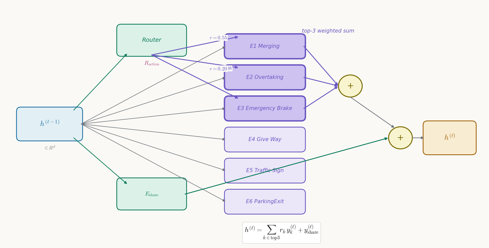

# 不再训练"全能司机"：把"看哪儿"和"怎么开"都变成按场景雇佣专家的选择题

> **全局编号 52** · VLA 驾驶（51–60）
> **论文**：DriveMoE: Mixture-of-Experts for Vision-Language-Action Model in End-to-End Autonomous Driving
> **作者**：Zhenjie Yang\*、Yilin Chai\*、Xiaosong Jia、Qifeng Li、Yuqian Shao、Xuekai Zhu、Haisheng Su、Junchi Yan（通讯作者），上海交通大学（\* 共同一作；另有复旦等单位参与）
> **会议/年份**：CVPR 2026（项目页确认已接收，BibTeX 页码 10678–10688；arXiv:2505.16278，v1 2025-05-22，v2 2026-05-18）
> **链接**：[arXiv](https://arxiv.org/abs/2505.16278) · [ar5iv 全文](https://ar5iv.org/html/2505.16278) · [项目页](https://thinklab-sjtu.github.io/DriveMoE/)
> **代码**：已公开。官方仓库 `https://github.com/Thinklab-SJTU/DriveMoE`（README 给出完整训练/评测流程）；模型权重与相机视角标注、场景标注见 Hugging Face `rethinklab/DriveMoE`；README 致谢了 `open-pi-zero` 与 `openpi` 两个上游实现。
> **一句话核心洞见**：端到端驾驶里稀有行为做不好的病根，不在数据不够，而在一个策略头被迫同时拟合互相冲突的行为模式——输出被拉向平均值；DriveMoE 把"看哪儿"（选相机）和"怎么开"（选技能专家）都变成由轻量 router 按上下文做的选择题，用人工启发式规则给出便宜的监督信号，让稀有行为拥有自己的一套参数，不再和常见行为抢同一组权重。
> **版本注记**：本文依据 ar5iv 渲染的论文正文撰写。项目页摘要提到 CVPR 版在 Action MoE 里对比了 Token-level Router 与 Trajectory-level Router 两种路由粒度，该内容在所读正文里没有出现，可能是版本差异或 ar5iv 缓存滞后，待核实。

## 单头策略到底在哪个具体场景撞墙？

先把引言里那套文献综述放在一边，看一个能说出来的失败现场。

Bench2Drive 的评测方式是这样的：220 条短路线，每条路线里埋一个 corner case，专门考某一种驾驶能力——合流、超车、紧急刹车、让行、看交通标志。模型在 CARLA 仿真里实际开，路线完成度和违章情况相乘得到 Driving Score（DS），全程无违章开完才算成功（Success Rate，SR）。

现在看一个具体输入：自车以 40 km/h 在城市道路直行，前方 25 米处一辆停着的车占了半条车道，左侧车道有车流。人类司机在这里只有两种合理选择：要么提前减速停下（Emergency Brake 那一派），要么确认左侧安全后借道绕行（Overtaking 那一派）。两种行为的未来轨迹长得完全不一样：一个是纵向速度迅速归零、横向几乎不动；另一个是先左打方向再回正，横向位移一两米。

一个统一的策略头（比如一个 flow-matching decoder 或一个 MLP 轨迹头）要同时拟合这两种样本。它学到的不是"二选一"，而是把两个分布压成一个输出：减速减一半、方向打一半——一条既不够果断停车、又没完全绕开障碍物的中间轨迹。这就是摘要里说的 **mode averaging**：模型没有在模态之间做选择，而是输出了模态的平均。论文 3.4 节原话的意思是：原来的 flow-matching decoder 本来能生成多样的轨迹，但一个模型 inevitable 地把多种行为平均掉了，导致稀有但关键的操作（比如 aggressive turning）生成不准。

作者还引用了 π0 原文里的一个观察：不同行为之间存在 interfere effect（干扰效应）。这很关键，因为它把失败定性为**结构性**的：不是数据加倍就能解决的，而是"同一组参数同时拟合冲突模式"这个设定本身有问题。只要参数是共享的、输出头是单的，梯度就会在"左转样本"和"右转样本"之间来回拉扯，最后停在中间。这也是为什么作者敢押注 MoE：MoE 的标准承诺就是用条件计算把参数隔离开，让冲突的梯度流向不同的专家。

所以这篇论文的起点可以一句话概括：**别再让一个头学会所有开法，给每种开法配一个专家，再训练一个 router 按场景点名。** Vision 那边的故事是同一逻辑的另一面：别再让模型每帧看遍所有相机，按场景只看有用的。

## π0 是个机械臂模型，凭什么被搬到车上？

理解 DriveMoE 之前要先理解它的地基 Drive-π0，因为论文里所有"提升"都是相对这个基线量的。

π0（Physical Intelligence 2024 年 10 月的 arXiv 工作）是 embodied AI 领域的一个 Vision-Language-Action 模型：输入是几张机器人视角的图像加一句自然语言指令，输出是连续的机械臂动作，用 flow matching 建模。它的骨干是一个预训练好的 VLM（Paligemma），动作部分是一个基于 flow matching 的 transformer decoder。Flow matching 在这里的作用是把轨迹/动作的生成变成"从噪声分布沿着一个学到的向量场流向数据分布"的过程，天然适合表达多模态的连续分布——这正是驾驶轨迹需要的（同一个路口可以左转也可以右转）。

Drive-π0 把这套东西整体搬到驾驶上，改动集中在输入输出的"驾驶化"：

- **输入**三件套：(i) 车载多相机的环视图像序列；(ii) 一句**固定**的文本 prompt，比如 "Please predict future trajectory"（注意是固定的，不是开放式指令，语言在这里只起一个占位 conditioning 的作用）；(iii) 自车状态：速度、横摆角速度、历史轨迹。
- **输出**：未来 10 个路点（waypoints）组成的轨迹。
- **骨干**：Paligemma-3b-pt-224 的预训练权重，微调。
- **时间建模**：用连续 2 帧前视图像估计周围交通参与者的速度；状态里同时放当前位置、速度、加速度、航向角的历史值。

轨迹到控制的最后一公里是一个 PID 控制器，所有对比方法共用，保证公平。PID 的输入是当前车速和 10 个预测路点，输出油门、刹车、转向。论文给了具体增益：转向 $K_P^{turn}=1.25$、$K_I^{turn}=0.75$、$K_D^{turn}=0.3$；速度 $K_P^{speed}=5.0$、$K_I^{speed}=0.5$、$K_D^{speed}=1.0$。期望速度从第 7 个路点算，转向角从第 10 个路点定。这个细节值得记住：它意味着模型的输出只有 10 个路点是"有效动作"，评测的是轨迹质量经 PID 转化后的闭环表现，而不是直接的控制量。

Drive-π0 本身已经不弱：Bench2Drive 上 DS 60.45、SR 30.00%，和同期用 expert 蒸馏的 DriveAdapter（DS 64.22）差距不大。这说明两件事：第一，π0 迁移到驾驶是成立的，VLA 这条路在闭环评测里走得通；第二，DriveMoE 的起点线画得比较高，后面的涨点不是从一个弱基线爬起来的——这对解读消融数字很重要。

## router 怎么知道该看哪个相机？

这是 Vision MoE 要回答的问题。先看它的输入输出在形状上长什么样。

记 $t$ 时刻相机视角 $v$ 的图像为 $\boldsymbol{I}_t^v$，$v \in \{1,\dots,N\}$，$N$ 是相机总数。特别地，前视图像记为 $\boldsymbol{I}_t^{front}$。Vision router 是一个轻量模块 $\boldsymbol{R}_{vision}$，它只看两样东西：前视图像的 embedding $\boldsymbol{e}_t^{front}$，和 route planner 给的未来目标路点 $\boldsymbol{g}_t$。输出是一个 $N$ 维的概率分布：

$$\boldsymbol{p}_t = \text{Softmax}(\boldsymbol{R}_{vision}(\boldsymbol{e}_t^{front}, \boldsymbol{g}_t)), \qquad \boldsymbol{p}_t \in \mathbb{R}^N$$

$p_t^v$ 就是" $t$ 时刻视角 $v$ 值得看"的概率。选 top-1 的那个视角作为动态视角，和固定的两帧前视一起送进 VLM：

$$\langle\text{fixed\_view}\rangle, \langle\text{fixed\_view}\rangle, \langle\text{dynamic\_view}\rangle, \langle\text{text}\rangle, \dots$$

这里有两个设计值得停下来想。

**第一，router 的输入为什么故意做得很"穷"。** 它只用前视 embedding 和目标路点，而不用全部相机的特征。原因是时机：路由发生在昂贵的 backbone 计算**之前**。如果 router 自己要先把所有相机都过一遍 backbone 才能决定看哪个，那就没有省下任何东西。所以 router 必须是一个"瞟一眼前视、看一眼导航目标就做决定"的轻量模块。没被选中的视角直接跳过 backbone，这是 Vision MoE 省算力的全部来源。代价是 router 的决策信息很有限——它看不到侧后方到底有没有车，只能凭"前视画面 + 要往哪开"来猜。这是一个用信息换算力的交换，论文没有明说，但结构上就是这样。

**第二，每个相机有自己独立的可学习位置编码（PE）。** 被选中的视角的 visual token 会加上该视角专属的 PE，保留"我是从哪个方向看的"这个信息。否则 front-left 和 front-right 的 token 混在一起，模型分不清左右。这是个小但承重的细节：动态选视角的前提是选完之后还能知道选的是哪。

router 的训练信号来自公式 (2)：

$$\mathcal{L}_{Vision-Router} = -\lambda_0 \sum_{v=1}^{N} y_t^v \log p_t^v, \qquad \lambda_0 = 0.05$$

$y_t \in \{0,1\}^N$ 是二值的相机选择标签。标签从哪来？附录 A 给了四条**人工启发式规则**，基于 Bench2Drive 数据集自带的标注信息：

- **路口转向**：`is_in_junction` 为真且当前指令是左转/右转 → 标注朝向路口出口方向的前侧相机；
- **变道**：指令是变道、或本车道前方一定距离内有障碍、或自车不在目标车道 → 若目标车道与当前行驶方向同向，标注对应侧的**后**视相机（变道要看后方来车）；若要临时借用对向车道，标注对应侧的**前**视相机；
- **高速合流 / cut-in**：场景标签是 merging 或 cut-in → 按自车车道位置和离 junction 的距离算出合流点，标注朝向合流点的侧相机；
- **让行急救车**：场景里有高速接近的急救车 → 标注朝向急救车来向的相机。

这四条规则是整篇论文里"人类先验"最浓的地方。它的意思是：**相机该看哪儿，这个监督信号不需要学习，直接用规则写出来就行**，因为"转弯看弯内、变道看后视镜"是驾校级别的常识。规则只用数据集已有的标注（junction、指令、场景标签）做判断，标注成本几乎为零。这就是作者的精明之处：Vision MoE 最难的部分（router 的监督）被一个便宜的启发式绕过去了。

但这里也要诚实：router 在验证集上 88.85% 的准确率，是**对照这些规则**量的，不是"对照真正该看哪儿"量的。规则的天花板就是 router 的天花板。如果某条规则在 corner case 下标错了（比如 cut-in 从意想不到的方向来），router 会跟着学错，而论文没有分析规则本身的错误率。这是一个没有被讨论的假设：启发式规则 ≈ 最优视角选择。

## 多一个动态视角，token 账到底怎么算？

VLA 模型原本是为"一次看一张或几张图"设计的，驾驶却要求多视角、多时刻同时输入。把 6 个相机 × 若干帧的图像块全部拼进 transformer，序列长度爆炸，训练和推理都变慢，收敛也受影响。论文把之前的解法分成两派：

- **vanilla**（LMDrive、DriveLM 的做法）：所有视角的 token 照单全收。信息全，但冗余大、算力贵。
- **query-based**（DriveMLM、Q-Former 那一路）：用学到的 query 从每张图里抽一小撮 token。token 少了，但抽出来的是一袋补丁（bag of patches），精细的几何和位置对应关系被打散，而且 Q-Former 这类模块要额外的大规模预训练。

DriveMoE 走的是第三条路：**不在 token 级别压缩，而在相机级别做选择**。VLM 实际看到的只有 3 张图：2 帧前视（固定，用来估计速度）+ 1 张动态视角（top-1）。没被选中的相机在 backbone 之前就被跳过，省掉的是整张图的全部 token 和全部 backbone 计算。

但这里要泼一盆冷水：论文通篇没有给出墙钟时间、FLOPs 或显存占用的硬数字。引言和结论里关于效率的论断，在正文里没有任何一张表支撑。3 张图 vs N 张图的算术是显然的，但 router 本身的开销、动态 batch 带来的工程麻烦、以及和 vanilla 基线在相同算力下的对比，一概没有。这是作者论述里比较虚的一块，后面怀疑式审读还会回来。

## 一个 FFN 变成 7 个专家后，前向到底怎么算？

这是全文最核心的机制，值得把每个符号的形状都摆出来。先看记号：论文 3.4 节的文字说每层有 $K$ 个 shared expert 和 $M$ 个 non-shared expert，但公式 (3) 里 router 的输出下标又写成 $k \in \{1,\dots,K\}$。结合公式 (4) 和实现细节（1 个 shared + 6 个 non-shared，top-3 激活）看，公式里的 $K$ 实际指的是 non-shared 专家的个数——论文在这里把 $K$ 和 $M$ 混用了。我下面按实际含义写，non-shared 专家记为 $M$ 个。

**符号表**（第 $\ell$ 层 decoder）：

| 符号 | 形状 | 含义 |
|---|---|---|
| $\mathbf{h}^{(\ell-1)}$ | $\mathbb{R}^d$ | 上一层的隐状态，router 和专家的共同输入 |
| $E_{share,m}^{(\ell)}$ | FFN: $\mathbb{R}^d \to \mathbb{R}^d$ | 第 $m$ 个 shared 专家，$m=1$（实现里只有 1 个） |
| $E_k^{(\ell)}$ | FFN: $\mathbb{R}^d \to \mathbb{R}^d$ | 第 $k$ 个 non-shared（技能）专家，$k=1,\dots,M$，$M=6$ |
| $\boldsymbol{R}_{action}$ | 轻量网络 | action router，输入 $\mathbf{h}^{(\ell-1)}$ |
| $r_k$ | 标量 | 第 $k$ 个技能专家的路由概率，$\sum_k r_k = 1$ |
| $\boldsymbol{y}_k^{(\ell)}$ | $\mathbb{R}^d$ | 第 $k$ 个专家对当前输入的输出，$\boldsymbol{y}_k^{(\ell)} = E_k^{(\ell)}(\mathbf{h}^{(\ell-1)})$ |

路由分两步。第一步，router 给每个技能专家打分并 softmax：

$$r_k = \text{Softmax}(\boldsymbol{R}_{action}(\mathbf{h}^{(\ell-1)}))_k, \qquad k = 1,\dots,M \tag{3}$$

第二步，加权求和。注意 shared 专家的输出是**直接相加**，不经过路由加权：

$$\mathbf{h}^{(\ell)} = \sum_{k=1}^{M} r_k\,\boldsymbol{y}_k^{(\ell)} + \sum_{m} \boldsymbol{y}_{share,m}^{(\ell)} \tag{4}$$

实际计算时是稀疏的：只取路由概率最高的 top-3 个技能专家参与求和（正文 3.4 说 top-1 或 top-2，实现细节说 top-3——表述不一致，以实现细节的 top-3 为准）。

**在一个小例子上算一遍。** 假设某层 $d=8$（真实的 $d$ 是模型的隐层维度，论文未明确给出），$M=6$ 个技能专家按顺序对应 Merging、Overtaking、Emergency Brake、Give Way、Traffic Sign、ParkingExit。某一时刻输入隐状态 $\mathbf{h}^{(\ell-1)}$，router 输出：

$$r = [0.55,\ 0.08,\ 0.20,\ 0.05,\ 0.07,\ 0.05]$$

含义：当前上下文最像 Merging（0.55），其次 Emergency Brake（0.20）。取 top-3：专家 1（0.55）、专家 3（0.20）、专家 2（0.08）。这一层的输出就是：

$$\mathbf{h}^{(\ell)} = 0.55\,\boldsymbol{y}_1 + 0.20\,\boldsymbol{y}_3 + 0.08\,\boldsymbol{y}_2 + \boldsymbol{y}_{share}$$

这里有个论文没交代的细节：top-3 取出来之后，权重是**直接用原来的 softmax 值**（加起来 0.83，不到 1），还是**重新归一化**到和为 1？论文没写。两种做法在 MoE 文献里都存在，效果差得不多，但复现时这是个分叉点。同样，shared 专家的输出直接相加，量级上和加权和是同一 scale（都是 $\mathbb{R}^d$ 向量），训练能自己适应，但初始化时 shared 分支的梯度天然更大——这可能是作者想要的（shared 先学共性），也可能只是 DeepSeekMoE 式设计的惯性。

**为什么这样能治 mode averaging？** 看梯度流向。稀疏 top-3 意味着：当前样本的梯度只回传给被选中的 3 个技能专家和 shared 专家，没被选中的专家收不到这个样本的梯度。Emergency Brake 的样本不再去拉扯 Merging 专家的权重——冲突的梯度被物理隔离了。每个专家的参数只拟合被路由到它名下的数据子集，输出就不会被拉向"所有行为的平均"。Shared 专家的存在则是为了兜底：所有样本都经过它，共性的东西（比如"轨迹要平滑""别撞"）由它学，技能专家只学差异。这正是 DeepSeekMoE 那套 shared + non-shared 划分的驾驶版。

*图：Action MoE 第 $\ell$ 层的前向。$\mathbf{h}^{(\ell-1)}$ 同时进 router 和 7 个专家；router 输出 6 维概率，只取最高的 3 个做加权和；shared 专家输出直接相加。梯度只流向被选中的专家，这是隔离冲突梯度的全部机制。*

## 5 个技能标签从哪来？为什么第 6 个专家是 ParkingExit？

Action router 的监督信号和 vision router 如出一辙：也是交叉熵，也是靠人工先验给标签：

$$\mathcal{L}_{Action-Router} = -y_k \log r_k \tag{5}$$

$y_k \in \{1,\dots,K\}$ 是驾驶技能标签。标签体系直接沿用 Bench2Drive 的划分：44 个驾驶场景被归成 5 个技能——Merging（合流）、Overtaking（超车）、Emergency Brake（紧急刹车）、Give Way（让行）、Traffic Sign（交通标志）。附录 Table 7 列出了完整的场景→技能映射。

细看这张表会发现两个有意思的点。第一，**映射是多对一且有重叠的**：比如 `EnterActorFlow` 同时出现在 Merging 和 Traffic Sign 下面，`SignalizedJunctionLeftTurnEnterFlow` 也是。这意味着同一个场景可能被标成两个技能，router 的交叉熵监督在这些重叠处本质上是模糊的——标签本身就有噪声。第二，**Give Way 下面只有 2 个场景**（InvadingTurn、YieldToEmergencyVehicle），数据量天然少，这和后面 Table 1 里 Give Way 一直停在 40.00% 纹丝不动是呼应的：专家再专，没有数据也学不出东西。

实现里用了 6 个 non-shared 专家，比 5 个技能多 1 个。第 6 个是 ParkingExit——Table 4 的消融显示，从 5 个专家加到 6 个（多一个专管 ParkingExit 场景），DS 从 73.81 涨到 74.22。ParkingExit 在 Table 7 里本来被划在 Merging 下，但作者把它单独拎出来给一个专家，大概是因为"从停车位倒出来"这个行为的轨迹模式（低速、大转角、频繁启停）和其他合流场景差异太大，硬塞进 Merging 专家里会互相干扰。这是一个很诚实的工程判断：**技能划分不应该是教科书式的，而应该按"轨迹模式是否冲突"来切**。但反过来也暴露了方法的脆弱面：专家数量和技能划分是手调的，13 个专家（按难例场景细分）和 44 个专家（每个场景一个）的配置反而掉点（DS 70.88 / 68.22），作者归因于 load imbalance——专家太多，每个分到的数据太少，专而不精。

## 三个损失项在互相拉扯什么？还有一个说好了却没出现的损失

Action MoE 的总损失写在公式 (6)：

$$\mathcal{L}_{Action} = \lambda_1 \mathcal{L}_{FM} + \lambda_2 \mathcal{L}_{Action-Router}, \qquad \lambda_1 = 1,\ \lambda_2 = 0.03 \tag{6}$$

$\mathcal{L}_{FM}$ 是 flow matching 的轨迹损失——让生成的 10 个路点接近专家轨迹分布；$\mathcal{L}_{Action-Router}$ 是公式 (5) 的 router 交叉熵——让 router 的选择接近人工技能标签。$\lambda_2$ 在第二阶段被调小到 0.025，论文的说法是 "emphasizing trajectory learning"，即训练后期更相信轨迹拟合、少管 router 对错。

这里有三处值得细看。

**第一，量级差。** $\lambda_1=1$ 对 $\lambda_2=0.03$，router 损失的权重只有轨迹损失的 3%。这意味着 router 的监督是一个弱引导：它决定"往哪个专家分"，但不主导表示学习。如果 $\lambda_2$ 太大，router 会为了分类准确牺牲轨迹质量；太小则技能标签约等于没用。0.03 这个数是怎么来的？论文没给搜索范围和敏感性分析——这是未确认项。只能从结果反推：它 work 了，但不知道是平坦区间的中心还是一个尖峰。

**第二，$\mathcal{L}_{LB}$ 失踪了。** 3.4 节正文明确说引入了一个 load-balancing 正则损失 $\mathcal{L}_{LB}$ 来维持专家利用均衡、防止 expert collapse，还说 router 里加了 DeepSeekMoE 式的噪声来鼓励探索。但公式 (6) 的总损失里**没有** $\mathcal{L}_{LB}$ 这一项，全文也没有给出它的公式和权重。这是论文里一个真实的缺口：防止 collapse 的机制被文字承诺了，却没有出现在数学里。可能的解释是作者用了某种标准形式（比如各专家平均路由概率的变异系数）但觉得太常规没写，或者 $\mathcal{L}_{LB}$ 只在某一版实现里存在。复现者在这里只能自己选一个——而 load balancing 恰恰是 MoE 训练里最容易出问题的地方（Table 4 里 13/44 专家配置掉点，作者自己就归因于 load imbalance）。

**第三，两个 router 损失之间没有直接耦合。** $\mathcal{L}_{Vision-Router}$（$\lambda_0=0.05$）和 $\mathcal{L}_{Action}$ 是各自优化的，vision 选错相机不会直接惩罚 action。这符合"先看对、再开对"的直觉分工，但也意味着两个 router 的错误会叠加：vision router 88.85% 的准确率意味着约 11% 的帧喂给规划的是次优视角，而 action router 本来就只有 65.40% 的准确率。

## 第一阶段为什么要"作弊"？

训练分成两阶段，这是 MoE 训练里经典的"先扶着走、再放手"：

- **Stage 1（10 epochs）**：vision 和 action 两个 MoE 都**只选真值专家**——即按人工标注的相机/技能标签硬指定用哪个专家，同时 router 也在联合训练。论文的说法是这样做 "significantly stabilize the training"。翻译一下：如果一开始就让随机初始化的 router 瞎选专家，每个专家收到的数据都是噪声混合，专家分化不出来，router 也学不到有意义的映射，两边一起烂掉。先用真值标签把"谁该学什么"固定住，专家先长出形状，router 在旁边看着学。
- **Stage 2（5 epochs）**：从 stage 1 的 checkpoint 继续，**切换到用 router 自己的输出选专家**，不再依赖真值标注。目的是让模型适应 router 犯错的情况——推理时没有真值标签，router 选错专家时，专家不能彻底崩掉。这是在训练分布里主动注入"router 错误"这种噪声，练鲁棒性。

优化细节：VLM 部分从 Paligemma-3b-pt-224 初始化；VLA 和 Action MoE 的专家用**两个独立的 optimizer**分别优化（都是 lr $5\times10^{-5}$、带 warmup）；梯度裁剪到范数 1.0；梯度累积模拟 batch size 1024。两个 optimizer 这个选择暗示了作者把"表示学习"和"专家分化"当成两个节奏不同的优化过程——虽然论文没解释为什么不放在一个 optimizer 里，但直觉上 router 的交叉熵和 FM 损失的梯度尺度、收敛速度确实不一样，分开调更稳。

## 走一遍：一次信号灯左转路口，两个 router 分别做了什么

场景：Bench2Drive 的 `SignalizedJunctionLeftTurnEnterFlow`——自车在信号灯路口排队，绿灯后左转进入有车流的道路。这是一个 Merging 技能下的场景，也是 Table 1 里 DriveMoE 涨点最多的能力之一。

**第 1 步：看哪儿。** $t$ 时刻，前视 embedding $\boldsymbol{e}_t^{front}$（画面：前方是排队车辆和路口信号灯）加上 route planner 给的目标路点 $\boldsymbol{g}_t$（指向左转后的出口车道），送进 $\boldsymbol{R}_{vision}$。输出的 6 维概率里，front-left 最高——因为附录规则写明"路口转向标朝向出口的前侧相机"，而训练标签就是这么标的。top-1 选中 front-left。VLM 的输入变成：2 帧前视 + front-left + 固定文本 prompt。注意 router 没看到的：正后方有没有跟车太近的车辆——它只能赌规则是对的。

**第 2 步：谁来开。** 融合后的视觉表示和自车状态进入 flow-matching decoder。每一层的隐状态 $\mathbf{h}^{(\ell-1)}$ 都过一遍 $\boldsymbol{R}_{action}$。当前上下文（低速、打左转向意图、前方路口）的路由概率大致长这样：Merging 0.5、Traffic Sign 0.2（路口有信号灯，这个场景在 Table 7 里同时属于 Traffic Sign）、Emergency Brake 0.1、其余更低。top-3 取 Merging、Traffic Sign、Emergency Brake 加权，shared 专家直接叠加。解码出的 10 个路点是一条"跟随前车蠕行、绿灯后切入左转弯道"的轨迹。

**第 3 步：执行。** PID 从第 7 个路点算期望速度、第 10 个路点算转向角，输出油门和方向。车辆起步左转。

**同一场景在 Drive-π0 基线下会发生什么。** 单头 decoder 的参数同时被"路口左转""直行跟车""紧急刹车"三类样本拉扯。在这个输入下，它输出的轨迹可能是三者的折中：转向打得不够（像直行）、速度降得不够果断（不像让行）——在 Bench2Drive 的 closed-loop 里，这种"差不多"的轨迹最容易在路口中央被横向车流逼停，或者压线。论文没有给出这个场景的逐帧对比，这是用机制反推的，但 mode averaging 的数学含义就是如此：单头输出是条件分布的均值，而驾驶需要的往往是某个分量。

上面例子里的路由概率数字是示意性的，论文没有公开逐帧的 router 输出。项目页有几个 corner case 的演示视频（ParkingExit、ConstructionObstacleTwoWays 等），可视化了 vision router 选视角和 action router 选 top-3 专家的过程，文字版无法替代，值得自己去看。

## 74.22 和 48.64 是怎么来的？

主结果在 Table 2（Bench2Drive 220 条路线，closed-loop）：

| 方法 | DS ↑ | SR ↑ | Avg. L2 ↓ |
|---|---|---|---|
| Drive-π0（自家基线） | 60.45 | 30.00% | 0.56 |
| **DriveMoE** | **74.22** | **48.64%** | **0.38** |
| DiffAD（arXiv 2025） | 67.92 | 38.64% | 1.55 |
| DriveAdapter*（ICCV 2023） | 64.22 | 33.08% | 1.01 |
| DriveTrans（ICLR 2025） | 63.46 | 35.01% | 0.62 |

（* 表示用了 expert feature distillation，DriveMoE 和 Drive-π0 没用。）

相对自家基线：DS +22.8%，SR +62.1%——论文摘要和 4.3 节的算法是对的（(74.22−60.45)/60.45≈22.8%，(48.64−30.00)/30.00≈62.1%）。和外家最强的 DiffAD 比，DS 高出 6.3 个点。开环 L2 0.38 也是全场最低——但作者自己在 4.3 节引用 AD-MLP、TransFuser++ 和 Bench2Drive 原文的观点，承认开环 L2 只是"模型是否收敛"的指标，真正的驾驶能力看闭环。这个自我限定写得诚实。

Table 1 的多能力评分更说明问题：Emergency Brake 从 48.83 涨到 65.45（+16.6），Overtaking 从 36.58 到 40.00，Merging 从 29.35 到 34.67。**涨得最多的恰恰是稀有、危险的行为**——这正是 MoE 要治的病。反例是 Give Way：40.00 → 40.00 纹丝不动。前面说了，Give Way 只有 2 个场景，专家没有数据可吃，结构再好也变不出数据。这是一个诚实的负面信号：MoE 解决的是"有数据但被平均掉"的问题，解决不了"根本没数据"的问题。

消融（Table 3、5、4、6）连起来看：

- 去掉 Vision MoE：DS 74.22 → 68.68；去掉 Action MoE：→ 67.31。两个都承重，Action 略重一点。
- Vision 消融（Table 5）最有信息量：基线 2 帧前视 60.45；固定加一张后视/前左/前右，只涨到 63–65；**动态视角无监督**直接跳到 69.71；**加监督**到 74.22。读法是："选对视角"（69.71）比"多给视角"（~64）重要得多，而"用规则监督选"（74.22）又比"让模型自己学着选"多出 4.5 个点。Vision MoE 的涨点里，router 的监督信号贡献了将近一半。
- 专家数量（Table 4）：5 → 6 涨（73.81 → 74.22），6 → 13 掉（70.88），→ 44 掉（68.22）。专家不是越多越好，数据被切得太碎会导致 load imbalance，呼应附录 B 作者自己承认的局限。
- Router 准确率（Table 6，验证集开环）：vision 88.85%，action **65.40%**。Action router 才 65% 却撑起了 +13.8 的 DS 涨点，说明两件事：top-3 的冗余和 shared 专家的兜底让"选错"不致命；以及技能标签本身有重叠噪声（Table 7 的重叠），65% 里有一部分"错"是标签模糊造成的，不是真错。但论文没有分析 router 错误和最终失败案例的相关性——router 在哪 35% 上错、错了之后轨迹坏没坏，这是审稿人该问而论文没答的。

## 作者的底牌是什么？又在哪些地方心虚？

先说底牌，一篇工作能成立，作者手里一定有几张让他敢投 CVPR 的牌。

**第一张：主场。** 通讯作者 Junchi Yan 的 ThinkLab 就是 Bench2Drive 的出品方（一作 Xiaosong Jia 也是 Bench2Drive 论文的作者）。数据集、评测流程、场景划分、标注字段——全是自己人。这意味着附录 A 那四条启发式规则不是拍脑袋：他们知道数据里有什么字段、corner case 长什么样。主场优势还体现在基线选择上：Drive-π0 这个基线是自家从 π0 迁移过来的，VLA 在 Bench2Drive 上的适配细节（PID 参数、10 个路点、2 帧前视估计速度）都是自己调顺的，对比实验的地基是实的。

**第二张：π0 迁移的新鲜感。** 2025 年初 VLA 正热，embodied AI 的 π0 刚出来（2024 年 10 月），把它第一个系统性地搬到端到端驾驶上，故事天然有"跨领域"的吸引力。Drive-π0 本身 DS 60.45 已经是当时第一梯队，说明迁移不是硬蹭。

**第三张：监督信号便宜。** 两个 router 的标签都来自现成的标注 + 手写规则，零额外标注成本。一个"加两个轻量 router、涨 14 个点 DS"的故事，审稿人很难拒绝——改动小、效果大、消融全。

再说心虚的地方，也就是论文没说全或说不圆的：

1. **$\mathcal{L}_{LB}$ 有名无实。** 防止 expert collapse 的 load-balancing 损失只在正文出现一次名字，没有公式、没有权重、没进总损失公式 (6)。而 Table 4 恰恰显示专家一多就掉点、作者自己归因于 load imbalance——最需要这个损失的地方，它缺席了。
2. **效率声明没有硬数字。** "减少 token、提升效率"贯穿引言和结论，但全文没有任何 FLOPs、墙钟时间、显存对比。Vision MoE 省算力在算术上成立，但省多少、router 开销多大、动态视角选择对 batch 推理的影响，一概未报告。
3. **Action router 65.40% 的准确率被轻轻带过。** 三分之一的帧选"错"技能，论文没有分析这些错误是否导致失败案例，也没有画 router 错误与 DS 的相关性。
4. **记号和表述的小混乱。** 公式 (3) 的 $K$ 与正文 $K$ shared / $M$ non-shared 的定义打架；正文说 top-1/top-2，实现细节说 top-3；top-k 之后权重是否重归一化没写。
5. **超参数的来历。** $\lambda_0=0.05$、$\lambda_2=0.03\to0.025$、学习率、6 个专家——都没有搜索范围和敏感性分析。Table 4 算是专家数量的敏感性分析，这是做得好的部分，但损失权重没有。
6. **随机性和方差。** 闭环 220 条路线的评测，种子数、多次运行的方差、SR 的置信区间，全都没报告。SR 从 30% 到 48.64% 看起来很大，但 Bench2Drive 的路线级方差是出了名的（一条路线一个 corner case，一次违章整条路线 DS 归零），没有方差数字就不好判断 6 个点的差距有多稳。

公平地说，论文做得扎实的部分也要点名：消融覆盖了"去 Vision""去 Action""监督有无""专家数量三档"，附录公开了完整的标注规则和场景→技能映射表，代码、模型、标注数据全部公开（README 里训练到评测的脚本链是完整的）。附录 B 主动承认 load balancing 是未解决的局限——虽然和 $\mathcal{L}_{LB}$ 的缺席放在一起看有点讽刺，但至少没藏着。

## 能带走的两个想法

**想法一：把"选择"从表示学习里拆出来，用便宜的人类先验做监督。** DriveMoE 最值得偷的不是 MoE 本身，而是 router 的训练方式：不指望端到端学出"该看哪儿""该用哪种开法"，直接用规则把标签写出来（转弯看弯内、变道看后视镜、场景名映射到技能）。规则的天花板就是性能的天花板，但规则的成本是零，而端到端学一个靠谱的 router 可能需要数量级更多的数据。任何"输入冗余、输出多模态"的系统（多传感器融合、多任务策略）都可以问自己：选择信号能不能用先验写出来，而不是学出来？

**想法二：shared 兜底 + non-shared 吃长尾的分工。** 所有样本都过 shared 专家学共性，稀疏路由只把样本分给技能专家学差异。这个结构回答了一个实际问题：router 不准的时候怎么办？——shared 分支保证输出不至于崩。设计任何"分专家"系统时，先想好 fallback 是谁，而不是假设 router 永远选对（DriveMoE 的 action router 准确率只有 65%，全靠这个兜底才没翻车）。

## 与本课题的关联

读者的课题是"世界模型引导 + 自适应衰减情景记忆的闭环多规划器自动驾驶 Agent"：LLM 作为调度器，按开放式自然语言指令调度多个专家规划器，计划在 Bench2Drive 上验证。这篇 DriveMoE 的 Action MoE 和这个课题是**高度同构**的——只是一个是"小模型版"的调度，另一个是"LLM 版"的调度。把对应关系摆出来：

| DriveMoE 的部件 | 本课题的对应部件 | 备注 |
|---|---|---|
| Action router $\boldsymbol{R}_{action}$（轻量网络，闭集 5 分类） | LLM 调度器（开放式自然语言指令理解） | 都是"按上下文把任务分发给专家"的调度器；粒度不同 |
| 6 个技能专家 FFN（Merging 等） | 多个专家规划器 | 都是"专精某种行为"的执行单元；DriveMoE 的是 FFN 级，课题的是规划器级 |
| 技能标签 $y_k$（Bench2Drive 场景映射） | 自然语言驾驶指令 | 都是"当前需要什么行为"的描述；一个是离散的，一个是开放式的 |
| Shared expert | 调度失败时的 fallback 规划器 | 都是"调度器选错时的兜底" |
| Vision router（按场景选相机） | 调度器的感知输入选择 | 课题里 LLM 也可以决定"这次规划需要看哪些视角/记忆" |
| 两阶段训练（先用真值专家、再用 router 输出） | 先行为克隆各专家、再训练/调优调度器 | 同一训练哲学：先让专家长好，再练调度 |

**四个可直接借鉴的具体点：**

1. **Router 监督信号的构造方法。** 他们用场景元信息（junction、指令、场景标签）写启发式规则，零成本拿到 router 标签。课题里的 LLM 调度器虽然理解开放式指令，但冷启动时完全可以先用同一套规则生成"指令→规划器"的配对数据，做行为克隆式的预热，再过渡到真正的开放式指令。这正是他们的 stage 1。
2. **Shared expert 的兜底设计。** 他们的 action router 只有 65% 准确率，系统没崩全靠 shared 分支。课题里 LLM 调度器选错规划器的概率只会更高（开放式指令更难），必须设计一个默认的保守规划器做 fallback，而不是假设调度永远对。
3. **稀疏激活控制算力。** Top-3 激活意味着 7 个专家里每次只算 3.5 个（3 个技能 + 1 个 shared）。课题里多个规划器如果全量运行，车端实时性会炸；调度器应该只激活 top-k 个规划器，其余不跑——这是"场景驱动动态模块旁路"的一个现成论据。
4. **专家按"轨迹模式是否冲突"来切，而不是按教科书分类。** ParkingExit 从 Merging 里独立出来就是因为轨迹模式冲突。课题里定义专家规划器时，也应该按"输出轨迹的分布是否可分"来划分，而不是按语义名称。

**三个必须警惕的区别：**

1. **闭集 vs 开放。** 他们的 router 是 5 分类，输入是隐状态向量；课题的调度器要处理开放式自然语言（"超过前面那辆慢车，但别压实线"），泛化要求高一个量级。他们的结论（MoE 治 mode averaging）在开放式指令下是否成立，是未验证的。
2. **技能划分是现成的。** 他们的 5 技能直接继承 Bench2Drive 的场景划分；课题需要自己定义规划器的技能集合，并且要论证覆盖度和正交性——这是论文里被 Bench2Drive 白送、而课题里要自己做的功课。
3. **调度粒度的代价。** 他们的专家是 decoder 里每层的 FFN，路由是每层、每前向都做；课题的规划器是模块级的，调度一次的代价大得多，router 选错一次的代价也大得多。他们的"选错不致命"（靠 top-3 + shared）不一定能平移到模块级调度——选错一个规划器可能直接输出一条危险轨迹，课题里的"闭环风险校验/冲突仲裁"模块恰好是补这一块的，这是课题设计里比 DriveMoE 高明的地方，应该保留并加强。

**一个可直接试的对照实验：** 把课题系统中的 LLM 调度器先退化成"场景分类器 + 规则映射"（就是 DriveMoE 的 action router 的翻版），在 Bench2Drive 上测出闭集调度的 DS 上界；再换上真正的 LLM 开放式调度，看差多少、差在哪类场景。这个对照能回答评审一定会问的问题："LLM 调度比一个分类器好在哪？"
