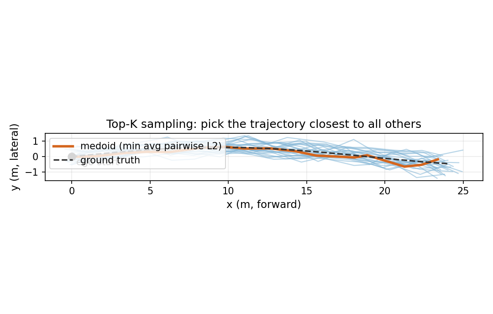

# 整辆车就是一道问答题：EMMA 把轨迹、检测框和车道线全部写成自然语言

> **全局编号**：51（VLA 驾驶，51–60）
> **论文**：EMMA: End-to-End Multimodal Model for Autonomous Driving
> **作者**：Jyh-Jing Hwang、Runsheng Xu、Hubert Lin、Wei-Chih Hung、Jingwei Ji、Kristy Choi、Di Huang、Tong He、Paul Covington、Benjamin Sapp、Yin Zhou、James Guo、Dragomir Anguelov、Mingxing Tan（共 14 人，Waymo）
> **发表**：arXiv 技术报告 2024-10（v1，2024-10-30）；v3 修订 2025-09-23；据二手来源该文已发表于 Transactions on Machine Learning Research（2025-07），见文末"未确认事项"
> **链接**：https://arxiv.org/abs/2410.23262 ｜ https://ar5iv.org/html/2410.23262
> **代码**：未找到官方公开代码（arXiv 页面无代码链接；模型与训练数据均为 Waymo 内部资产）
> **一句话核心洞见**：把驾驶所需的全部几何量（历史轨迹、未来轨迹、3D 检测框、车道线）都翻译成纯文本，塞进一个现成的多模态大语言模型做自回归生成——不加任何专用模块、不发明新 token，靠预训练的世界知识和 2400 万条内部驾驶数据硬吃几何精度。

## 一个只做过"看图说话"的模型，怎么第一次摸方向盘就赢了专用模型？

在 nuScenes 的规划榜单上，一个模型交出了平均 L2 误差 0.32 米的成绩。它没用过一个人工标注的 3D 框，没见过高精地图，训练信号只有一条：人类司机未来几秒实际开到了哪里。而它的底座，是一个原本只做看图说话的多模态大语言模型 Gemini。0.32 米这个数字本身不算魔法——榜单上专用模型也能做到——真正让人停下来的是它达到这个数字的方式：模型输出的不是回归头吐出的浮点向量，而是一串字符，比如 `(12.34, 5.67)`。坐标被当成了单词，轨迹被当成了一句话，检测框和车道线也是。

这就是 EMMA 押的赌注，可以写成一句话：**驾驶需要的所有几何量，都可以先翻译成文本，再交给语言模型按"预测下一个词"的方式生成；预训练模型在互联网规模文本里学到的世界知识，足以弥补这种表示在精度上的笨拙。** 整篇论文的方法部分（公式 1–6）其实只是在把这句话实例化六次，实验部分则在回答一个质疑：把连续的几何问题硬塞进离散的语言模型，精度到底会崩到什么程度？答案是：在 3–5 秒的时域内没崩，在 8 秒时域和远距离上开始崩。这个"没崩"的边界，就是这篇论文真正的贡献。

理解了这个赌注，再看论文的组织方式就清楚了：作者手里最硬的一张牌，是"零专用模块"——整个系统就是微调后的 Gemini，任何实验室只要有同等量级的 MLLM 和驾驶数据，当天就能复刻这个流程。这张牌决定了论文的写法：方法极简，实验极重，所有的说服力都压在数字上。

## 为什么轨迹要写成自然语言文本，而不是专用 token？

这是全篇第一个需要认真回答的"为什么"。2024 年前后，把连续动作塞进语言模型有两条路。第一条是 RT-2 的路：坐标直接写成浮点文本，比如 `12.34` 就是字符 `1`、`2`、`.`、`3`、`4`，复用语言模型原有的词表和权重，一个新 token 都不加。第二条是 MotionLM 的路：把空间离散化成几千个专用 token，每个 token 代表一个位置区间，模型输出的是这些专用 token 的编号，精度由离散化的分辨率决定。

两条路的交换很实在。专用 token 的好处是输出短：一个路点可能只要 1–2 个 token，推理快；坏处是这些 token 是新加的，预训练权重里没有它们的位置知识，等于要从零学一套"空间词汇"，而且分辨率一旦定死就改不了。文本表示反过来：一个路点 `(12.34, 5.67)` 要吃掉十几个 token，输出又长又慢；好处是数字的小数点、数量级、"12.34 比 12.35 大一点"这类知识，语言模型在预训练时已经从无数文本里见过，不需要重新学。

EMMA 选了第一条路，论文给的理由很直白：让所有任务共享同一个统一的语言表示空间，最大程度复用预训练权重。翻译一下：作者赌的是，**预训练权重里关于数字和空间的隐性知识，价值超过了专用离散化带来的精度和效率**。这是一个可以被证伪的赌注——如果文本表示训出来的轨迹精度远不如专用 token，这篇论文就不成立。实验里 EMMA 在 WOMD 上和 MotionLM（专用 token 路线的代表）打了个平手（0.681 vs 0.694 的 5 秒 ADE，见后文表格），这个赌注才算立住。

但这里有一个论文没有正面讨论的代价，值得先记下来后面用：**训练目标和评估目标是脱节的**。训练时模型优化的是 token 级别的交叉熵——"下一个字符写对了吗"；评估时看的是 L2 距离——"轨迹偏了几米"。小数点后第二位写错一个数字，交叉熵只多了一点困惑度，L2 只差 0.01 米；整数位写错一个数字，交叉熵的惩罚量级差不多，L2 却差好几米。交叉熵对这两种错误的"在乎程度"几乎一样，而驾驶只在乎后者。模型之所以没在这上面翻车，靠的是数据分布本身：训练数据里整数位正确的样本占绝大多数，模型自然把概率质量压在整数位上。但这意味着，**文本表示的精度保证是统计性的，不是结构性的**——在长尾场景下，模型"写错一位数"的概率不会像专用回归头那样被几何约束兜住。这是后文怀疑式阅读的一个伏笔。

## 一个路点在模型眼里长什么样：从 (x, y) 到 token 串

先把公式 1 拆开。论文的写法是：

$$\mathbf{O}=\mathcal{G}(\mathbf{T},\mathbf{V}), \quad P(\mathbf{O}|\mathbf{T},\mathbf{V})=\prod_{i=1}^{n}P(o_{i}|o_{<i},\mathbf{T},\mathbf{V})$$

$\mathcal{G}$ 是 Gemini 模型本身；$\mathbf{T}$ 是全部文本输入；$\mathbf{V}$ 是全部视觉输入（拼起来的多视角图片或视频帧）；$\mathbf{O}=(o_1,\dots,o_n)$ 是输出的 token 序列。等式右边就是标准的自回归分解：每个输出 token 的概率，只依赖于它之前已经生成的 token 和全部输入。**这篇论文没有任何新的训练目标**，就是语言模型最普通的"预测下一个 token"，这一点很重要——所有驾驶能力都是被"逼"进这个目标里的。

规划任务的实例化是公式 2：

$$\mathbf{O}_{\text{trajectory}}=\mathcal{G}(\mathbf{T}_{\text{intent}},\mathbf{T}_{\text{ego}},\mathbf{V})$$

三个输入各是什么，配上形状和一个具体例子：

- $\mathbf{V}$：环视相机视频。nuScenes 上是 6 个相机、360 度覆盖；内部数据上是 Waymo 自车的多相机。论文把多帧拼成视频直接喂给 Gemini 的视觉编码器。"只能处理少量图像帧"是论文自己承认的限制之一，帧数和分辨率的具体数字正文没有披露。
- $\mathbf{T}_{\text{intent}}$：路由给的高层意图，一个短字符串，比如 `"go straight"`、`"turn left"`、`"turn right"`。这是人类司机看导航 App 的那个抽象层级，模型用它来确定"我要往哪条路走"，剩下的几何细节自己填。
- $\mathbf{T}_{\text{ego}} = \{(x_t, y_t)\}_{t=-T_h}^{-1}$：自车历史状态，写成 BEV（鸟瞰）坐标系下的路点序列，**纯文本**，没有专用 token。比如 2 秒历史、2Hz 采样，就是 4 个路点，文本大概长这样：`(0.00, 0.00), (2.51, 0.03), (5.02, 0.11), (7.48, 0.22)`。论文说这个设计可以扩展到速度、加速度等高阶状态，但实验里用的是位置。

输出 $\mathbf{O}_{\text{trajectory}} = \{(x_t, y_t)\}_{t=1}^{T_f}$：未来 $T_f$ 个时刻的路点，同样是纯文本。nuScenes 上 $T_f$ 对应 3 秒，WOMD 上对应 8 秒。

现在数一下 token。一个路点 `(12.34, 5.67)` 按常见的子词切分，大约是 `(`、`12`、`.`、`34`、`,`、`5`、`.`、`67`、`)` 这 9 个 token 左右（具体切分看词表，这里是示意）。8 秒轨迹、2Hz 就是 16 个路点，光坐标就要 140 多个 token，还没算标点周围的空格和分隔符。**这就是文本表示的税**：同样一条轨迹，专用 token 可能 32 个 token 搞定，文本要 4–5 倍。推理延迟和这串长度成正比，这是 EMMA"计算开销大"的直接来源之一。

论文强调这个公式的三个性质：自监督（监督信号只有自车未来的真实位置，不需要任何人工标注）、纯相机（只有环视相机，没有激光雷达）、无高精地图（除了导航级的路由信息）。三条合在一起，意思就是：**只要有车队在跑、有相机在录、有定位知道车开到了哪，这条管线就能无限加数据**。这解释了为什么 Waymo 敢把 2400 万条内部数据砸进来——数据管线里没有人工标注这个瓶颈。作者也诚实地注明，这个大框架不是他们首创，Li 等人 2024 年的工作已经系统研究过（特别是"要不要喂历史自车状态"这个问题）；EMMA 的贡献是把这套框架搬到 MLLM 上，并证明它 work。

## 先想再开：R1–R4 的思维链到底在算什么

公式 2 是"看到画面直接写轨迹"。公式 3 在中间加了一段"先想再开"：

$$(\mathbf{O}_{\text{rationale}},\mathbf{O}_{\text{trajectory}})=\mathcal{G}(\mathbf{T}_{\text{intent}},\mathbf{T}_{\text{ego}},\mathbf{V})$$

$\mathbf{O}_{\text{rationale}}$ 是按固定顺序生成的四段文本，从粗到细：

- **R1 场景描述**：天气、时间、路况。论文给的例子："天气晴朗，是白天。这是一条四车道无隔离的街道，中间有人行横道，道路两侧停着车。"注意这段话里没有任何数字，它的作用是让模型先"看一遍全景"。
- **R2 关键物体**：可能影响自车行为的交通参与者，**必须带上精确的 3D/BEV 坐标**。例子：`pedestrian at [9.01, 3.22], vehicle at [11.58, 0.35]`。这是 rationale 里唯一带数字的部分，也是思维链和几何精度发生关系的地方——模型在这里被迫把"我觉得危险的那个行人"锚定到一个具体位置上。
- **R3 物体行为描述**：关键物体的当前状态和意图。例子："行人正站在人行道上，面朝马路，可能准备过街；前方车辆与我同向行驶，按它的未来轨迹会继续直行。"
- **R4 元驾驶决策**：12 类高层驾驶决策中的一类，总结前面的观察。例子："我应该保持当前低速。"

走一个具体场景，看这四段是怎么咬合的。假设自车在一条双车道上直行，右侧人行道上有个行人正朝马路方向看，左前方 30 米有一辆慢车。没有思维链时，模型直接从视频写轨迹，它可能"看到"了行人，也可能没看到——输出里没有任何痕迹。有了思维链，R1 先写下"白天、双车道、右侧有人行道"；R2 被迫点名 `pedestrian at [4.20, 3.10]`（坐标是示意），这个点名动作把注意力钉在了行人身上；R3 写下"行人面朝马路、可能准备过街"，这是一个意图判断，纯几何模型做不出来，要靠预训练里的常识（"看向马路的行人可能要过街"）；R4 落到"保持低速、准备让行"那一类；最后的轨迹在接近行人位置时速度降下来。**R2 的坐标是承重结构**：没有它，R3 和 R4 就是正确的废话；有了它，整条推理链才和最后的轨迹在几何上对得上。论文图 1 的右上角特意强调了这一点：rationale 里带视觉 grounding（关键物体的 3D/BEV 位置）。

这些 rationale 标签从哪来？论文的答案是"全自动，不需要新增人工标注"：先用现成的感知和预测专家模型找出关键 agent，再用精心设计的视觉+文本 prompt 让 Gemini 生成场景和行为描述，元驾驶决策则用一个启发式算法从自车的真实轨迹反推（比如真实轨迹是减速的，就标成"减速让行"类）。三步里每一步都是模型或规则生成的，没有人工写过一句话。这里要打一个问号：**R4 的标签是从 ground-truth 轨迹反推出来的**，也就是说，训练时模型看到的"正确思考过程"，其结论部分是直接从答案倒推出来的。这在多大程度上是"推理"，在多大程度上是"把答案用另一种格式再说一遍"，论文没有讨论。后面怀疑式阅读会回到这一点。

内部数据集上的消融结果（论文表 3，相对基线端到端规划的提升）：只加 R1 场景描述，+0.0%；只加 R2 关键物体，+1.5%；只加 R4 元决策，+3.0%；R2+R4 一起，+5.7%；四段全加，+6.7%。这个表信息量很大：R1（纯文本场景描述）对规划精度**零贡献**，它的价值只在可解释性；真正涨点的是带坐标的 R2 和带决策的 R4——起作用的不是"说人话"，而是"点名+定位"和"先做高层决策"。这对后文"与本课题的关联"是个直接启发：如果你要给规划器加语言中间态，别加散文，加带坐标的点名和离散决策。

还有一个反直觉的实验结论：rationale 和轨迹的**生成顺序不影响最终质量**（模型收敛后，先写轨迹再写理由，和先写理由再写轨迹，差不多）。作者从中推导出一个工程技巧：对时间敏感的应用，可以让模型先输出轨迹然后 early stopping，不必等 rationale 写完。但这个结论本身值得多想一层：如果"先想"和"后想"没区别，那么 R1–R4 对轨迹的影响，可能并不是"推理导致了更好的轨迹"这种因果链条，而更像是**多任务正则**——模型被迫同时学会描述场景和定位物体，共享的视觉表示变好了，轨迹自然也好了。这是一个推断，论文没有做区分因果和相关的实验（比如只训练 rationale、不输出轨迹，看表示迁移）。记下来，这是作者论证里最软的一块。

## 同一个模型，三种活：检测框、车道线、临时路障怎么写成文本

规划是 EMMA 的主业，但论文的野心是 generalist：同一个 Gemini，换一句 prompt，就去干检测、画车道线、判断路障。做法是标准的 instruction tuning：每种任务配一个固定的文本 prompt，训练时把各任务的数据按一定比例混在一起。公式 4–6 是三个实例化。

**3D 检测**（公式 4）：$\mathbf{O}_{\text{boxes}}=\mathcal{G}(\mathbf{T}_{\text{detect\_3D}},\mathbf{V})$，prompt 类似 `"detect every object in 3D"`。输出是一组 7 维框的文本：$\text{text}(x,y,z,l,w,h,\theta,\text{cls})$，中心点在自车坐标系下，每个数保留两位小数，维度之间用空格隔开，比如 `12.35 3.20 0.50 4.20 1.80 1.50 0.02 vehicle`（示意）。检测框之间没有天然顺序，但自回归模型必须一个一个写，**顺序的选择会影响训练**。论文沿用了 Pix2Seq 的思路，但做了一个相反的发现：Pix2Seq 说随机打乱顺序好，EMMA 发现**按深度（由近到远）排序**效果更好。为什么？一个合理的解释是：近处的物体在图像上大、特征清楚，先写不容易错；自回归生成是"一步错、步步错"，把容易的放前面能减少误差累积。这也是个推断，但它符合自回归解码的一般行为。

**车道线估计**（公式 5）：$\mathbf{O}_{\text{roadgraph}}=\mathcal{G}(\mathbf{T}_{\text{estimate\_roadgraph}},\mathbf{V})$。车道线是一组无序的折线，每条折线是一串有序的路点。文本编码的例子：`"(x1,y1 and x2,y2 and ...); (x1,y1 and ...);..."`，分号分隔不同的折线。论文只预测自车可行驶的车道（同向邻车道和从当前车道分出去的车道）。这一节的消融是全文最"工程"的一段，五个设计选择，每个都有几十个百分点的差距：

1. **动态采样好过固定采样**：固定采几个稀疏控制点（两个端点+几个中间点）不足以表达弯道的曲率；按曲率和长度动态决定每条折线的点数、保持路点密度一致，指标差出 40%–90%。这是全文最大的单项差距，说明车道线任务里，**表示方式的选择比模型本身重要得多**。
2. **以自车为原点的采样好过全局坐标系直接变换**：车道线在全局坐标系下存储时，起点和自车位置无关；直接变换到自车坐标系会引入任意的偏移，预测质量掉 25%–60%。解决办法是采样时就以自车位置为原点对齐。
3. **距离分箱+箱内打乱**：按折线端点到自车的距离分箱（近处车道一箱、远处连接车道一箱），箱内训练时动态打乱。这给了模型一个"由近及远"的粗略全局顺序，又保留了箱内的无序性。
4. **padding 防早停**：和 Pix2Seq 一样，把目标序列 padding 到固定长度，用 `invalid` token 填充折线内部的空位，每条折线末尾再跟一个 `valid`/`invalid` 标记。自回归模型有个毛病：学会"提前结束"（输出终止符）比"把剩下的写完"容易，padding 就是堵这个漏洞。
5. **标点和语言结构有用**：`"(x,y and x,y);..."` 比 `"x y x y;..."` 好。连词 `and` 和括号在这里没有任何语义作用，纯粹是让序列长得更像自然语言——而这正是预训练权重的舒适区。一个连接词能涨点，侧面印证了"复用预训练权重"这个赌注：模型对"像人话"的序列建模得更好，哪怕那些词是冗余的。

**场景理解**（公式 6）：临时路障检测，$\mathbf{O}_{\text{temporary\_blockage}}=\mathcal{G}(\mathbf{T}_{\text{temporary\_blockage}},\mathbf{T}_{\text{road\_users}},\mathbf{V})$，prompt 是 `"is the road ahead temporarily blocked?"`，外加一段文本描述前方道路使用者。这个任务测的是多线索综合（施工、事故、临时封路），论文用它来证明模型不只会画几何，还能做需要常识的判断。

## 混合训练：按数据量比例抓 batch，规划任务是定海神针

Generalist 的训练流程（2.4 节）简单到让人意外：每个任务有一个数据集 $\mathbf{D}_{\text{task}}$；每次迭代从所有数据集中随机抽一个 batch，抽中某个任务的概率正比于它的数据量，即 $|\mathbf{D}_{\text{task}}|/\sum_t|\mathbf{D}_t|$；训 $e$ 个 epoch，总步数就是 $e \times \sum_t|\mathbf{D}_t|$。没有任务权重、没有课程学习、没有梯度手术，就是按数据量比例硬混。

这个"简单"背后有个数量级现实：内部规划数据是 2400 万条（据第三方审计转述，未从原文直接核实），检测和车道线数据量小一到两个数量级。所以混合训练里，规划任务天然占了绝大多数 batch。论文的 generalist 实验结论是：三任务联合训练的模型，在三个任务上都达到或超过了各自单任务专家的水平；其中检测+规划联合：检测 +2.4%、规划 +1.6%；车道线+规划联合：车道线 +3.5%、规划 +1.4%；三者全加：检测 +5.5%、车道线 +2.4%、规划 +1.4%（以上数字据第三方审计对论文表 4 的转述，未从原文直接核实）。有意思的是**反例**：检测+车道线联合、但不加规划，规划性能反而掉 1.4%。规划任务是那个"定海神针"——它的数据量最大、监督信号（未来轨迹）最稠密，把它拿掉，联合训练就互相拖累。

这里要保持一点怀疑：规划数据占了总 batch 的绝大多数，"generalist 超过专家"的 1–5 个点，到底是任务间的知识迁移，还是共享主干在更多数据上训得更充分？论文没有做"控制总 batch 数、只改变任务混合比例"的消融，所以这两个解释分不开。公平地说，1.4% 的规划提升确实不大；但检测的 +5.5% 是个实在的数字，说明检测任务确实从规划数据的几何监督里吃到了好处（规划轨迹隐含了"哪里可行驶"的几何先验）。

## 规划实验：数字、采样技巧与四个疑问

所有实验用的底座都是 Gemini 里最小的 **Gemini 1.0 Nano-1**（论文原话"最小尺寸"；据公开资料该型号约 1.8B 参数）。选最小模型做全部实验，这个选择本身就有信息量：作者想证明的是**范式**（文本表示+MLLM 微调）而不是"大力出奇迹"，最小模型能赢，范式才硬。

**nuScenes**（表 2，标准协议：2 秒历史预测未来 3 秒，L2 误差，单位米）：

| 方法 | 需要人工/感知标注 | L2 1s | L2 2s | L2 3s | 平均 |
|---|---|---|---|---|---|
| UniAD | 是 | 0.42 | 0.64 | 0.91 | 0.66 |
| DriveVLM | 是 | 0.18 | 0.34 | 0.68 | 0.40 |
| VAD | 是 | 0.17 | 0.34 | 0.60 | 0.37 |
| OmniDrive | 是 | 0.14 | 0.29 | 0.55 | 0.33 |
| DriveVLM-Dual | 是 | 0.15 | 0.29 | 0.48 | 0.31 |
| Ego-MLP* | 否 | 0.15 | 0.32 | 0.59 | 0.35 |
| BEV-Planner | 否 | 0.16 | 0.32 | 0.57 | 0.35 |
| EMMA（随机初始化） | 否 | 0.15 | 0.33 | 0.63 | 0.37 |
| EMMA | 否 | 0.14 | 0.29 | 0.54 | 0.32 |
| EMMA+（内部数据预训练） | 否 | 0.13 | 0.27 | 0.48 | 0.29 |

论文宣称：自监督路线里超过 BEV-Planner 17.1%（(0.35−0.29)/0.35），连用了大量中间标注的 DriveVLM-Dual 也超过了 6.4%。数字本身没问题，但这张表里藏着三个值得细看的地方。

第一，**Ego-MLP 这一行是照妖镜**。Ego-MLP 是一个只看历史自车状态、连相机都不看的 MLP，平均 L2 是 0.35。EMMA 看了 6 个相机的视频，是 0.32。也就是说，在 nuScenes 这个 3 秒短时域的榜单上，**纯历史外推已经能拿到 0.35，视觉只额外贡献了 0.03**。这不是 EMMA 独有的问题，是整个开环规划评测的老问题（Li 等人 2024 年的工作专门捅过这件事）：短时域、低速场景下，"按历史速度接着开"就是个很强的基线。EMMA 的 0.32 里，有多少是真看到了场景，有多少是把历史外推做得更平滑，论文没有分离。一个相关的证据是消融行：EMMA 随机初始化（不用 Gemini 预训练权重）是 0.37，**比只看历史的 Ego-MLP（0.35）还差**；加上预训练权重才到 0.32。所以"世界知识"那 0.05 的提升是真实的，但它建立在一个 0.35 的历史外推底座上。读这张表时，0.32 对 0.35 的差距（约 8.6%）比 0.32 对 0.31 的"打败监督方法"更值得玩味。

第二，**采样技巧**。在 WOMD 的 8 秒长时域上，论文没有只用 greedy 解码，而是用 Top-K 采样（K 最多 24）生成多条候选轨迹，算所有候选两两之间的 L2 距离，选平均距离最小的那一条——也就是 24 条轨迹里的"中位数"（medoid），把它当作最终输出。图 3 显示，采样条数从 1 加到 12，ADE@5s 持续变好；超过 12 条后收益就平了。下图是这个选择规则的示意：24 条带噪声的采样轨迹里，medoid 是离其他所有轨迹都最近的那一条，它比任何单条采样的方差都小。

*图：Top-K 采样后选"中位数"轨迹的几何含义。24 条采样轨迹（浅蓝）围绕真值（虚线）散开，橙色是平均两两 L2 距离最小的一条（medoid）。这是一种测试时计算换精度：花 24 倍解码代价，买一条更稳的轨迹。图为示意，非论文原图。*

这里有个方法论上的不对称：基线 MotionLM 和 Wayformer 生成 192 条候选、k-means 聚成 6 类再选，EMMA 用 24 条选 medoid。两边都是"多采样+后选"，大方向公平；但**采样本身是一种测试时算力**，论文没有报告"同样只用 1 条 greedy 解码时 EMMA 是多少"。nuScenes 上作者倒是说了：3 秒短时域下多采样没提升，所以只报 top-1。这反而印证了采样的作用在长时域——不确定性越大，medoid 越有用。

第三，**WOMD 对比的版本变迁**。v1/v2 的表 1 在公开 WOMD 验证集上报告 ADE（1s/3s/5s/8s）：EMMA 是 0.032/0.248/0.681/1.718，EMMA+ 是 0.030/0.225/0.610/1.553，对手 MotionLM 0.045/0.251/0.694/1.766、增强版 Wayformer* 0.044/0.250/0.640/1.517。8 秒那一列 EMMA+（1.553）输给了 Wayformer*（1.517），论文的解释是：纯相机的深度估计在远距离上误差大，而 Wayformer* 用了激光雷达、毫米波雷达和相机。这个解释是诚实的，也是全文"相机-only 能力边界"最直接的证据：**近处（1–5 秒）文本+MLLM 能打平甚至超过多传感器专家模型，远处（8 秒）几何精度还是输给有激光雷达的**。

v3（TMLR 版）把 WOMD 这节改成了**内部规划基准**（与 WOMD 设置对齐），并补了思维链和 PaLI-X 的结果（下表数字据 arXiv v3 PDF 文本核对，L2 单位米）：MotionLM* 0.045/0.266/0.696、Wayformer* 0.046/0.252/0.628、EMMA‡（PaLI-X 底座）0.034/0.274/0.797、EMMA+‡ 0.031/0.239/0.680、EMMA 0.032/0.248/0.681、EMMA（+CoT）0.030/0.241/0.664、EMMA+ 0.030/0.225/0.610、**EMMA+（+CoT）0.027/0.203/0.543**。5 秒时 0.543 对 Wayformer* 的 0.628，提升 13.5%；对 MotionLM 的 0.696，提升约 22%。PaLI-X 那两行的意义在于：**这套方法不绑定 Gemini**，换一个开源 MLLM 底座照样 work，EMMA+‡ 的 0.680 和 EMMA+ 的 0.610 差距主要来自内部数据预训练，而不是底座。

第四，基线的输入不对称，论文倒是写明白了：MotionLM 的输入里，agent 的历史框是"离线感知模型"做的——那种模型能看未来帧、用人标数据训出来；车道线是人工做的；输入重度依赖激光雷达。EMMA 只有相机+自车历史。但反过来说，论文也承认"这次用了内部提供的图像输入，公开版 WOMD 里没有这些图像"，所以 v1/v2 的 WOMD 表 1 并不是严格可复现的公开基准成绩。v3 改成内部基准，等于把这层窗户纸捅破了：**最强的数字都是在内部数据上拿的**。

## 感知实验：检测的 PR 曲线与车道线的表示工程

**3D 检测**在 WOD 的 camera-primary 赛道上比，用的是 LET（纵向误差容忍）匹配。EMMA+ 的成绩：车辆类别在相同召回下精度相对提升 16.3%，在相同精度下召回提升 5.5%，超过了 BEVFormer；行人类别和 MV-FCOS3D++ 相当；分距离看，近距离尤其好。F1 分数上，EMMA+ 是 0.85，对手 BEVFormer 的 F1-max 是 0.82（据第三方审计转述，未从原文直接核实）。

这里有个评估细节值得展开：语言模型输出的是一组框，**没有置信度分数**。标准检测指标 LET-3D-AP 需要按置信度排序画 PR 曲线，EMMA 给不出，所以论文直接比"单点"的 precision/recall 和 F1。基线的 F1 取的是 PR 曲线上的最大值（F1-max，等于给基线选了最优阈值），EMMA 用的是自己唯一的输出点——这个对比其实**对基线更有利**，EMMA+ 还赢了，车辆 0.85 对 0.82 的 F1 差距是可信的。但反过来也要看到：没有置信度，实际部署时就没法调"宁可漏检不可误检"这种工作点，这是文本表示丢掉的一个实用功能。论文没提，算一个隐性代价。

**车道线估计**的指标是两套：lane-level 的 precision/recall（预测折线与真值折线的 Chamfer 距离在 1 米内算匹配）和把折线栅格化到 1 米 BEV 网格后的 pixel-level precision/recall。上一节列的五个表示工程选择（动态采样、以自车为原点、距离分箱打乱、padding、标点），每一项都带来几十个点的指标变化。把这组消融和整篇论文放在一起看，会得到一个有点"祛魅"的结论：**车道线任务上真正涨点的，是表示工程，不是 MLLM**。40%–90% 的差距来自"路点怎么采样"，而换用 Gemini 底座这件事本身，在这节里没有被单独量化。这不是批评——好的表示工程就是贡献——但它提醒读者：EMMA 的成功里，"把几何翻译成文本时怎么翻译"至少和"用什么模型"同等重要。

**数据规模**（图 4）：同一模型在内部数据的 3%、10%、30%、100% 上训练，横轴是训练 FLOPs（对数轴），纵轴是验证集困惑度。四条曲线都是"先降后升"（小数据上很快过拟合），而 100% 那条到实验结束还没看到顶。论文的结论是：驾驶质量还没饱和。内部规划数据据审计是 24,374,046 条、203,117 小时，约 355 倍于公开 WOMD——这是 EMMA+ 所有"SOTA"数字的底气，也是外部研究者复现不了的部分。nuScenes 表里 EMMA（0.32）到 EMMA+（0.29）的 0.03 差距，几乎可以全部归因于数据规模，因为两者底座和方法完全一样。

## 四处作者没说透的地方

**第一，只看 log 重放打分，撑不起"能开车"的结论。** EMMA 全部的规划数字都是开环（open-loop）下测的：把记录好的 log 重放一遍，看预测轨迹和人类司机实际轨迹差几米。训练本身也是行为克隆——模型永远学的是"人类在这个状态下开了这条轨迹"，从没见过"自己开错之后状态会变成什么样"。开环 L2 好看，不代表方向盘真能交出去，这是行为克隆的老问题，论文在 limitation 里自己承认了：要可信地验证它真能开起来，需要"逼真且计算昂贵的传感器仿真"。翻译一下：Waymo 内部有这套仿真，但论文里一个字没提 EMMA 在上面跑得怎么样。所以这篇论文回答的是"MLLM 能不能学会写轨迹"，没有回答"MLLM 能不能开车"。

**第二，24M 条内部数据是第一功臣，范式是第二。** 把 nuScenes 表里 EMMA（0.32）和 EMMA+（0.29）的差距单独看：底座一样、方法一样，差的只有内部数据预训练，0.03 的提升占了总提升（0.37 随机初始化 → 0.29）的近四成。再看 WOMD 那节：EMMA 只在内部数据上训（EMMA+）才超过 Wayformer*，只在公开数据上训的 EMMA 和 MotionLM 打平。数据规模曲线的结论"还没饱和"换个说法就是：这套范式的上限现在还看不到，但下限（公开数据能做到的）已经被 EMMA（非 +）标出来了——和专用 token 的 MotionLM 同一水平。外部研究者没有 2400 万条数据，能复现的是 EMMA 不是 EMMA+，对这篇论文的期待要按这个校准。

**第三，思维链的因果性质存疑。** 两个事实放在一起看：一是 rationale 标签的 R4 部分是从 ground-truth 轨迹用启发式反推的（答案倒推思考过程）；二是 rationale 和轨迹的生成顺序不影响最终质量。如果"思考"真的在因果上决定了"行动"，顺序应该重要；顺序不重要，更符合"多任务正则"的解释——模型被迫同时干"描述场景+定位物体+写轨迹"三件事，共享的视觉表示变好了，轨迹顺带变好。+6.7% 是真实的，但它多大程度上来自"推理"，多大程度上来自"用自动标注的感知任务给主干加了额外的监督"，论文没有做分离实验（比如冻结轨迹头、只看 rationale 训练对表示的影响）。作者把顺序无关包装成"可以 early stopping"的工程优点，这个转化是聪明的，但它恰恰暴露了因果链条的薄弱。

**第四，文本表示丢掉的东西。** 检测没有置信度（上文已谈），轨迹没有不确定性：自回归文本一次只写一条轨迹，EMMA 靠 Top-K 采样+选 medoid 来近似多模态，而 MotionLM 这类专用模型是原生输出多条带概率的轨迹。在需要"同时考虑多种可能未来"的决策里（比如路口对向车辆可能让行也可能抢行），单条 medoid 轨迹是把不确定性平均掉了。论文的规划评测只看 ADE/L2——这些指标本身就只奖励"最接近人类实际开的那条"，所以 medoid 策略在指标上占便宜，但在真实决策里可能是亏的。这不是论文的错，是开环指标和文本表示共同决定的盲区，读者要自己补上这一层。

另外两个诚实分要给作者：一是 WOMD 8 秒输给 Wayformer* 时，直说是因为纯相机的远距离深度误差，没有找补；二是 limitations 把"只能处理少量帧、没有激光雷达/毫米波雷达、计算开销大"三条全列出来了，没有藏着。摘要里那句"希望我们的工作能激励后续研究缓解这些问题"，在这类工业界论文里算坦率的。

## 可以带走的两个想法

**想法一：把"语言化"当作多任务统一接口，但先算 token 预算。** 当你有一个模型要同时输出多种异构几何量（轨迹、框、折线、决策），文本是最便宜的统一表示：不用改模型、不用加新头、prompt 一换就切任务，预训练权重还能接着用。EMMA 证明了这条路在 3–5 秒时域、近距离上精度不崩。但动手之前先算两笔账：第一笔是 token 膨胀——一个 16 路点的轨迹要 140+ token，输出长度直接决定延迟，实时系统要先看帧率允不允许；第二笔是精度下限——小数点后两位的文本精度对应厘米级，够规划用，但如果你要做的是厘米级定位或控制，文本表示的统计性精度保证可能不够，要换专用头。这个"统一接口 vs 精度/延迟"的交换，EMMA 的实验数据（近处赢、远处输、8 秒输）给了现成的参考点。

**想法二：用"联合训练 vs 单任务专家"来回答多任务是帮助还是拖累。** 很多多任务论文的论证是"加了这个任务涨点了"，但涨点可能来自更多数据、更大模型、更长训练。EMMA 的 generalist 实验范式更干净：固定底座，单任务专家和联合模型对比，并且报告**双向**结果（检测+规划、车道线+规划、三者全加，以及不加规划的反例）。那个 −1.4% 的反例和"规划是定海神针"的结论，价值不低于正向的 +5.5%。下次你设计多任务实验时，照这个格式摆一张表：每个任务组合、每个任务的相对变化、有没有哪个组合是互相拖累的。读者一眼就能看出迁移是真是假。

## 与本课题的关联

本课题是"世界模型引导 + 自适应衰减情景记忆的多规划器自动驾驶 Agent"：LLM 调度多个专家规划器，执行开放式自然语言驾驶指令，在 Bench2Drive 基准（closed-loop：模型实际控制车辆跑完全程）上验证。EMMA 与这条路线有四处具体的咬合，一处是正面弹药，三处是反面教材。

**正面：自然语言指令接口是可行的，而且可以从极简模板起步。** EMMA 的 $\mathbf{T}_{\text{intent}}$（`"go straight"` 这类路由指令）和 $\mathbf{T}_{\text{ego}}$（历史轨迹文本）证明了：LLM 完全能消费"文本指令 + 文本化自车状态"这种输入，并输出文本化轨迹。课题里的"开放式自然语言驾驶指令"（比如"前面路口右转后靠边停车"）是这个接口的超集。建议的起步顺序：先用 EMMA 式的固定意图模板（直行/左转/右转/靠边/掉头）在 Bench2Drive 上跑通 LLM→规划器的文本接口，验证调度逻辑；再把模板开放成自由语言，研究指令歧义和规划器选择的映射。这比一上来就做开放式指令更容易定位问题——接口不通和指令太难是两种失败，要分开测。

**反面一：开环 L2 好看不等于真能开起来，课题的评估重心要反过来。** EMMA 全部的高光数字都是开环的，论文自己都不敢谈模型实际开起来的表现。Bench2Drive 恰恰是 closed-loop 基准，这是课题相对 EMMA 最大的方法论优势：从第一天起就用"开错之后会怎样"来要求模型。具体做法是把 EMMA 的教训变成实验纪律——开环 L2 只做调试信号（比如检查文本轨迹解码对不对），论文里的主指标必须是模型实际开完全程的成功率/碰撞率/路线完成度。EMMA 的 Ego-MLP 对比（历史外推就能拿 0.35）更是一个警告：开环指标里藏着"不动脑子也能拿分"的捷径，只有让模型真正开起来，才能把这类捷径筛掉。

**反面二：长时域不能靠自回归硬推，这正是世界模型的位置。** EMMA 在 8 秒时域输给 Wayformer*，作者归因于相机深度误差；但更深一层的原因是：自回归写轨迹是"一步错步步错"，时域越长误差累积越狠，而它没有任何显式的未来状态预测来纠偏。课题里的世界模型（未来预测）正好补这一块：让 LLM 调度器看到的不是"一条写出来的轨迹"，而是"多个候选动作 rollout 后的未来状态+风险"，再做选择和仲裁。EMMA 的 CoT R2（带坐标的关键物体点名）可以借鉴为 world model 输出的文本接口——把世界模型预测的关键物体未来位置，写成和 R2 同格式的文本，喂给调度器做决策依据。这样世界模型和 LLM 之间就有一个 EMMA 验证过的、可读的文本契约。

**反面三：情景记忆可以放在 rationale 的位置上。** EMMA 的 R1–R4 本质上是一个"决策前必须生成的结构化中间态"，它的消融告诉我们：带坐标的点名（R2）和离散决策（R4）有用，散文式描述（R1）没用。课题的自适应衰减情景记忆，检索出来的是"过去类似场景的处置经验"，最自然的接入点就是拼在 R2/R4 旁边：`[记忆] 三天前类似路口，右侧有遮挡行人，减速通过`——同样是文本，同样进 LLM 的上下文，同样参与轨迹生成。EMMA 已经证明了这种"文本中间态"的训练是稳定的（instruction tuning 即插即用），课题要做的只是把记忆检索变成第 5 种 prompt 任务。这比为记忆单独设计一个神经接口便宜得多，也更容易做消融（有记忆 vs 无记忆，照 EMMA 表 3 的格式报告相对提升）。

一句话：EMMA 是"MLLM 直接开车"这条路的上限标杆——它告诉你纯文本接口能走多远（3–5 秒、近距离、开环评测），也标出了这条路到哪里走不下去（长时域、实际驾驶、不确定性）。课题的世界模型、情景记忆、执行中的风险校验，正好是接在它标出的边界后面的三块拼图。
