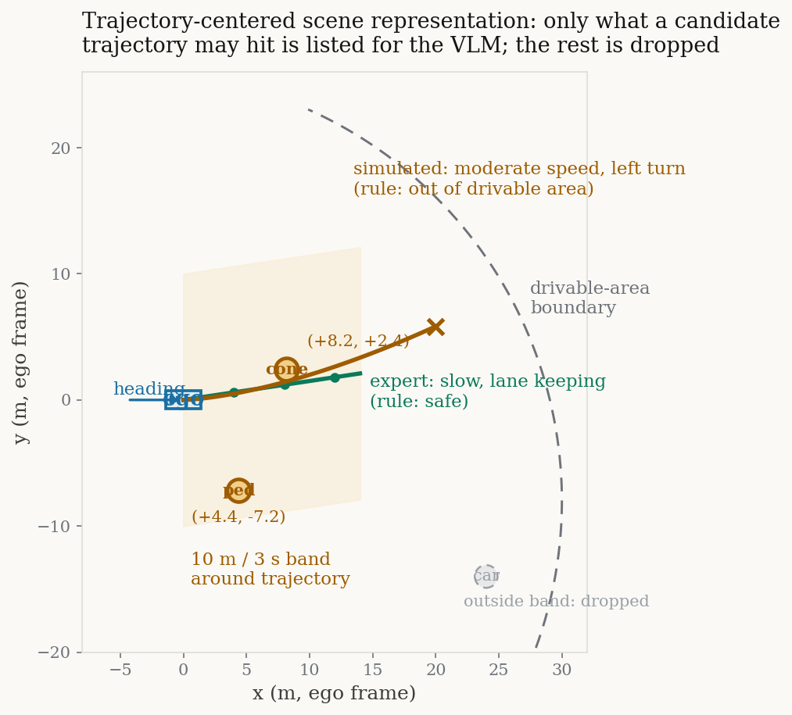

# 「如果当时左转了会怎样」：用反事实问答把 VLM 的 2D 推理搬进 3D 驾驶

> **全局编号**：57（VLA 驾驶，51–60）
> **论文**：OmniDrive: A Holistic Vision-Language Dataset for Autonomous Driving with Counterfactual Reasoning
> **作者**：Shihao Wang, Zhiding Yu, Xiaohui Jiang, Shiyi Lan, Min Shi, Nadine Chang, Jan Kautz, Ying Li, Jose M. Alvarez（NVIDIA；香港理工大学；北京理工大学；一作 Shihao Wang 为 NVIDIA 实习期间完成，通讯作者 Zhiding Yu）
> **会议/年份**：CVPR 2025（论文正文与 arXiv 页均未标注 venue；官方 GitHub 仓库 News 栏 2025-02-26 公告 "OmniDrive is accepted to CVPR 2025"，仓库内 BibTeX 亦作 `booktitle={CVPR}, year={2025}`）
> **链接**：https://arxiv.org/abs/2405.01533（v1 首发 2024-05-02；v2 修订 2025-04-16，本文按 v2 解读；PDF 共 11 页。注意 v1 曾用旧标题 "OmniDrive: A Holistic LLM-Agent Framework for Autonomous Driving with 3D Perception, Reasoning and Planning"，v2 改为当前标题，解读以 v2 为准）
> **代码**：已公开，https://github.com/NVlabs/OmniDrive。仓库 README 显示已开源：训练框架、OmniDrive 数据集、checkpoint、评测、数据生成管线、TensorRT 推理（含 DRIVE AGX Thor 的 TensorRT-Edge-LLM 支持）。数据集 2024-05-02 发布，模型 2024-07-18 发布于 HuggingFace（exiawsh/OmniDrive）。数据集规模：论文正文未给数字，第三方调研统计为 576K QA pairs（待官方确认）
> **一句话核心洞见**：VLM 做不好 3D 驾驶推理，不是因为它笨，而是因为没人给它看过"如果当时那么开会怎样"——作者用规则仿真批量算出每条候选轨迹的后果（撞/闯红灯/开出路面），再让 GPT-4 把"轨迹→后果"写成问答，造出稠密的 3D 驾驶推理数据；顺带用 Omni-L/Omni-Q 两套框架证明了一件事：把 2D VLM 对齐到 3D，比把 3D 感知栈塞进 VLM 更顺手。

## 专家轨迹为什么教不出会"想一想再开"的司机

先把时间拨回 2024 年初。LLaVA、BLIP-2、Flamingo 已经把 2D 图文推理做得很顺，自动驾驶圈正忙着把 VLM 往车上搬：DriveLM（2023-12）用图问答做端到端驾驶，DriveVLM（2024-02）把链式思考搬进来。但这些 VLM 的理解是 2D 的：它们看的是像素的排列，对"那个交通锥在自车前方 8.2 米、侧向 2.4 米处"这种 3D 几何关系，没有直接的表示。

前人撞上的第一堵墙很具体：直接把多视角图像加上 3D 标注（几十个物体的 3D 框、车道线、场景定义）一起喂给 GPT-4，让它回答驾驶问题，结果 GPT-4 处理不了。论文 2.2 节把失败写得很直白：它判断不出车辆的行驶状态，也理不清交通元素之间的关系，场景里的交通元素越多，错得越离谱。这是一个结构性的失败，不是换个 prompt 就能救的——VLM 的注意力跑在 2D token 序列上，3D 标注是另一套坐标系里的符号列表，两边没有对齐的桥梁，硬拼在一起，模型只能猜。

第二堵墙在数据里。nuScenes 的 log replay 记录的全是专家开出来的安全轨迹：模型只看到"正确的做法"，看不到"错误的做法会撞上什么"。论文引用的说法是，专家动作只提供稀疏监督（sparse supervision）。打个比方，这相当于只给学生看满分作文，从不讲扣分点在哪里。学出来的规划器只会模仿轨迹的形状，不理解轨迹为什么安全——换个没见过的路口，形状对不上就懵了。

第三堵墙在评测里，而且是作者自己组先捅破的。BEV-Planner（同组 Zhiding Yu 等人的工作，arXiv:2312.03031）和 Ego-MLP 指出：nuScenes 开环规划评测里，只要把自车状态（ego status：当前速度、加速度、转向）喂给模型，指标就好得不讲道理——模型从"我现在 5 m/s"外推出"下一秒大概还是 5 m/s"，根本不用看路。本文表 2 里，Ego-MLP 只用 ego status、完全不看图像，L2 平均误差就能做到 0.35 米，超过一票看图的模型。这意味着开环评测的高分可能和驾驶能力无关，纯粹是拟合了自车运动学。

作者的赌注就押在这里：人类司机开车时会想"如果我现在变道会怎样"，这种反事实推理（counterfactual reasoning）正是专家轨迹里缺掉的那部分监督。如果能批量生产"候选轨迹→它的后果"，稀疏监督就被补足了。论文的第一张图（Fig.1）画的就是这个赌注：VLM 的 2D 推理能力，加上以轨迹为中心的 3D 场景表示，再加上反事实问答数据，三者接起来。

## 把整幅场景围着"如果我这么开"重新组织一遍

这是全篇最硬的一个想法，值得慢下来看。

GPT-4 看图还行，但 3D 标注是一长串无序的符号，硬喂进去它会忽略图像细节。作者的绕法是：**不把"整幅 3D 场景"喂给 GPT-4，而是把场景围着一条候选轨迹重新组织**。轨迹成了一根坐标轴：哪些物体离这条轨迹近、这条轨迹会穿过哪条车道、会不会撞上什么——所有信息都按"和这条轨迹的关系"来排列。GPT-4 不需要理解 3D 空间，只需要读懂"轨迹→后果"这份清单。

数据管线分四步（论文 Fig.2，本文第 3 页）：

**第一步，按规划需求选关键帧。** nuScenes 数据冗余极大。先对前视图像提 CLIP embedding，做 K-means 聚类，取 20% 的簇中心——保证语义多样性，覆盖地标、红绿灯、车道线等静态元素。再按自车的未来轨迹做一次 K-means，取 200 个簇中心——覆盖停车、直行、左转、右转、掉头、加速、减速、匀速等驾驶行为。先在这个小集合上把规则清单和 prompt 调通，验证覆盖了各类场景，再放大规模迭代。这是一个工程上老练的顺序：先在小集合上把"对错标准"定死，再批量生产，避免大规模返工。

**第二步，生成模拟轨迹。** 把整个 nuScenes 的驾驶轨迹拿来聚类，簇中心归成 8 类行为（停、直行、左转、右转、掉头、加速、减速、匀速）。在每个场景里，把这几类行为"试开一遍"：给定当前自车位姿，按每类行为滚出一条模拟轨迹。这些轨迹里大部分是"不该这么开"的——而这正是作者想要的：反事实数据要的就是"如果这么开会怎样"。

**第三步，反事实规则清单。** 对每条模拟轨迹，用确定性规则算后果。固定三类违规走几何检查：撞物体、撞路沿/开出可行驶区、闯红灯，用的是 nuScenes 的 3D 检测标注和 OpenLane-v2 的车道中心线、路元素拓扑。规则覆盖不到的（比如"这样开合不合交规、让不让行"），先把轨迹转成高层决策描述（"中速左转""慢速直行保持车道"这类词），再让 GPT-4 看图判断。注意这个分工：**对错的判定权在规则手里，GPT-4 只负责它擅长的语言组织**。这是整条管线的承重墙——后果标签是算出来的，不是模型编的，幻觉进不来。

**第四步，专家轨迹与场景描述。** log replay 的专家轨迹同样转成高层决策；定义"需要关注"的物体：未来 3 秒内到轨迹的最小距离小于 10 米。场景描述（caption）分两步走：先把前三视角拼成一张、后三视角拼成一张，只给图让 GPT-4 写场景描述（天气、时间、场景类型、相对自车的方位，不许按视角逐个罗列）。论文明确解释了为什么分两步：图和大段场景信息一起喂，GPT-4 会忽略图像细节。

回头看，这个设计的妙处在于它承认并绕开了 VLM 的短板，而不是试图正面攻克"让 VLM 理解 3D 标注"这个硬骨头。把 3D 几何事实先算成文字清单，VLM 只做因果链条的语言组织——难的部分用规则做，容易的部分用模型做。

## 一条问答是怎么从规则清单和 GPT-4 手里造出来的

用论文表 1 的真实例子，把管线从头到尾走一遍。场景：白天，一个受控出入区域，像是停车场或商业设施的服务入口，有安检岗亭、草地和树。GPT-4 看了前后拼图之后写出的 caption 大意是这些。

先看喂给 GPT-4 的三类 prompt 上下文。Prompt type 2 是模拟轨迹："Simulated decision: Moderate Speed, Left Turn；Simulated trajectory: [PT, (+4.85, -0.08), (+9.71, -0.22), …, (+27.42, -0.93)]。Out of the drivable area"。注意最后一句"开出了可行驶区"——这是规则清单用车道拓扑算出来的几何事实，不是 GPT-4 猜的，prompt 里直接给了结论。Prompt type 3 是专家轨迹："Expert decision: Moving Slowly, Lane Keeping, Go Straight；Expert trajectory: [PT, (+0.76, +0.02), (+1.45, +0.03), …, (+3.44, +0.12)]"，下面列着按"未来 3 秒内到轨迹最小距离 < 10 米"筛出的关注物体：当前直行车道、(+8.2, +2.4) 处的可移动交通锥、(+4.4, -7.2) 处的移动行人。

然后 GPT-4 产出四类问答。Attention 类："开车经过这里要注意哪些交通元素？"→回答列出各处的交通锥位置。反事实类："如果我决定加速左转，会有什么后果？"→回答：你会开进对向车道，可能和对向来车相撞。决策规划类："下一步该怎么开，为什么？"→回答：跟着专家轨迹 [PT, (+0.76, +0.02), …]，保持直行、避开障碍，并解释这条轨迹为什么安全。通用对话类：数物体、认颜色、相对位置、OCR——补长尾物体的识别。

现在把基线做法放在同一个场景里走一遍，看它在哪一步失败。基线：直接把六张图加几十个 3D 标注框一起喂给 GPT-4，问"加速左转会怎样"。GPT-4 能看到岗亭、锥桶、行人，但它看不到"左转轨迹在 3D 空间里穿过了对向车道"这个几何事实——图像里没有画出那条假想的轨迹，3D 框的坐标它是读不懂的。它只能从像素猜，猜出来的"后果"大概率是泛泛而谈的"小心驾驶"。论文的方法在基线失败的那一步之前，先把几何事实算好写成文字："这条轨迹 out of drivable area""(+8.2, +2.4) 有锥桶"。GPT-4 拿到的输入已经包含了答案的骨架，它要做的只是把骨架长成通顺的因果陈述。这就是为什么作者敢说合成数据"高质量"：难的那部分（几何判定）没交给模型。

这里还有一个容易被忽略的细节：caption 是先单独生成的，而且 prompt 要求"描述相对自车的方位，不许按视角逐个罗列"。为什么？因为六个视角的方位关系（front-left、back-right 这些）对语言模型来说是隐式的，必须显式写出来，模型在回答"左边的锥桶"时才不会张冠李戴。这是一个 prompt 工程里的小技巧，但它是承重的：方位错了，后面的反事实问答全错。

下图把"以轨迹为中心的场景表示"画了出来：自车在原点，绿色是专家轨迹（规则判为安全），橙色是一条模拟的左转轨迹（规则判为开出可行驶区），浅色带是轨迹周围 10 米/3 秒的关注区——只有落在这个带里的物体（锥桶、行人）会被列出来喂给 GPT-4，带子外面的车直接丢掉。VLM 永远不需要理解整幅 3D 场景，它只读这份"轨迹→相关物体→规则结论"的清单。

*图：以轨迹为中心的场景表示示意（自绘，坐标为示意）。注意橙色模拟轨迹穿出了可行驶区边界——这个"出界"的结论是规则算出来的，GPT-4 在 prompt 里直接拿到结论，只负责把它写成问答。*

## Omni-L：把六张图摊平成 token，位置编码从零学起

Omni-L 走的是 LLaVA 路线：不碰 3D 感知那套东西，直接把 2D VLM 搬进 3D。视觉编码器用 EVA-02-L（用掩码图像建模蒸馏 CLIP，能提出语言对齐的视觉特征）。多视角图像特征记作 $F_m \in \mathbb{R}^{N \times C \times H \times W}$，$N$ 是视角数，$C$ 通道数，$H \times W$ 是特征图尺寸。Omni-L 把 $F_m$ 展平成一串 patch token，每个 patch 加上 3D 位置编码 $P_m$，然后过一个 MLP projector，把视觉特征对齐到 LLM 的词向量空间，再喂给大语言模型（LLaMA2-7B，词向量维度 4096）。

关键细节只有一句，但值得停下来：**$P_m$ 的权重零初始化**。训练刚开始时，位置编码的贡献是零，模型等价于纯 2D 的 LLaVA——已有的视觉-语言对齐一点没被破坏；随着训练推进，梯度慢慢把 3D 位置信息"拧"进表示里。如果随机初始化，一开始的位置噪声会污染已经对齐好的特征，训练容易晃。论文 3.2 节明说这是 "for training stability"。这是一个工程技巧，作者没替它升华成理论，就是老实承认为了稳定。

训练分两阶段。第一阶段 2D 预训练：在 2D 图像任务上训，数据、batchsize、学习率、优化器照抄 LLaVA v1.5——站在现成的对齐基础上，不重复造轮子。第二阶段 3D 微调：在 OmniDrive 数据上训 3D 驾驶任务（运动规划、反事实推理等）。损失函数只有文本生成 loss；BLIP-2 里那套对比学习 loss 和图文匹配 loss 都没用——作者的选择是，能只用生成 loss 就解决，就不引入额外的 loss 打架。微调超参：AdamW，batch size 16，projector 学习率 4e-4，视觉编码器和 LLM 学习率 2e-5，cosine annealing 调度。projector 的学习率是其他部分的 20 倍：projector 是从零训的，要大步走；编码器和 LLM 是预训练好的，只能小步微调。这个 20 倍的差距是两阶段训练里的常规操作，论文给了数字，没给搜索过程。

| 符号 | 形状 | 含义 |
|---|---|---|
| $F_m$ | $\mathbb{R}^{N \times C \times H \times W}$ | EVA-02-L 提出的多视角图像特征，$N$ 为视角数 |
| $P_m$ | 与 $F_m$ 同形 | 3D 位置编码，权重零初始化，逐 patch 相加 |
| 展平后的视觉 token | $(N{\cdot}H{\cdot}W) \times C$ | 送入 MLP projector 的序列 |
| MLP 输出 | $(N{\cdot}H{\cdot}W) \times 4096$ | 对齐到 LLaMA2-7B 词向量维度，当视觉 token 输入 LLM |

## Omni-Q：让 Q-Former 同时养两群 query

Omni-Q 的起点是一个观察：Q-Former（BLIP-2）的 Transformer decoder，和 StreamPETR 这类稀疏 query 的 3D 感知模型，架构长得很像——都是一群 query 先做自注意力交换信息，再做交叉注意力从图像里捞特征。作者的问题是：能不能把 3D 感知那套东西（3D 位置编码 + 检测头的监督）直接嫁接到 VLM 上，让 VLM 长出 3D 定位能力？

Omni-Q 初始化两群 query：detection queries $Q_d$（做 3D 感知，预测物体的类别和 3D 坐标）和 carrier queries $Q_c$（做视觉-语言对齐，当视觉 token 喂给 LLM）。先让它们做一次自注意力交换信息：

$$(Q, K, V) = ([Q_c, Q_d], [Q_c, Q_d], [Q_c, Q_d]),$$

$$\tilde{Q} = \mathrm{Multi\text{-}head\ Attention}(Q, K, V). \tag{1}$$

$[\cdot]$ 是拼接操作（论文为简洁省略了位置编码）。这一步里，两群 query 互相看：$Q_d$ 把几何先验带给 $Q_c$，$Q_c$ 把语义带给 $Q_d$。可以把 $Q_c$ 想成"翻译官"，$Q_d$ 想成"测量员"，公式 (1) 是它们开碰头会。

然后两群 query 一起做交叉注意力，从多视角图像里取特征：

$$(Q, K, V) = ([Q_c, Q_d], P_m + F_m, F_m),$$

$$\tilde{Q} = \mathrm{Multi\text{-}head\ Attention}(Q, K, V). \tag{2}$$

注意 K 和 V 的不对称：$K = P_m + F_m$（加了 3D 位置编码的特征），$V = F_m$（原始视觉特征）。这是 PETR/StreamPETR 的标准做法，分工很干净——query 用带位置的特征算注意力权重（"去 3D 空间的哪个位置看"由位置编码决定），但实际搬运的是原始视觉特征的值。位置只管寻址，不管内容。

之后分流：$Q_d$ 去接检测头，预测前景物体的类别和坐标，吃 3D 感知监督；$Q_c$ 过一个 MLP，对齐到 LLM token 的维度（LLaMA2-7B 是 4096 维），当作视觉 token 喂给 LLM 做文本生成。作者的期望是：carrier queries 既拿到 3D 位置编码的几何先验，又通过公式 (1) 的自注意力蹭到 $Q_d$ 在 3D 感知任务里学到的表示。

拿一个小实例走一遍形状。假设 $Q_d$ 有 900 个（StreamPETR 类方法的常用数量，此处为示意，论文未给具体数字）、$Q_c$ 有 32 个（BLIP-2 Q-Former 的典型值，示意），每个 query 维度 $d$。公式 (1) 里拼接后是 932 个 query 做自注意力，复杂度 $O(932^2 \cdot d)$。公式 (2) 里 932 个 query 对 $N{\cdot}H{\cdot}W$ 个图像 token 做交叉注意力。最后 32 个 $Q_c$ 输出经 MLP 变成 32 个 4096 维向量，拼到文本 token 前面进 LLM。32 个视觉 token 对 LLM 来说是个很小的上下文开销——这就是 Q-Former 路线相对"把全图展平"（Omni-L 路线，token 数是 $N{\cdot}H{\cdot}W$ 量级）的优势：token 数固定，不随分辨率涨。

两个公式都不难，难的是它们背后的赌注：3D 感知的监督信号能通过 query 之间的自注意力，"渗"进负责语言对齐的那群 query 里。这个"渗"到底发生了多少，论文没有直接测量（比如没有可视化 $Q_c$ 的注意力是否真的落在 3D 物体上），证据是间接的：消融掉感知监督（表 4/5 的 No Lane、No Object & Lane 行），规划指标变差。所以"渗"大概是发生了一点，但远不够把 Omni-Q 抬到 Omni-L 的水平。

## 两种路线对决：语言对齐赢了 3D 感知，赢在哪里

表 5 是两种路线最直接的对决（都不用 ego status，拼真本事）。Omni-L：反事实推理 AP 53.7%、AR 63.0%，语言 CIDEr 73.2，开环规划碰撞率 1.90%、出界率 3.29%。Omni-Q：AP 52.3%、AR 59.6%，CIDEr 68.6，碰撞率 3.79%、出界率 4.59%。Omni-L 全面压过 Omni-Q。作者的结论是：把 2D VLM 对齐到 3D，比把 3D 感知栈集成进 VLM 更顺手。

表里还有第三个选手 BEV-MLP：BEV 特征加 MLP projector，AP 45.6%、AR 49.5%，CIDEr 59.5，碰撞率 4.43%、出界率 8.56%，三项全垫底。它的存在让结论更扎实：光有 BEV 几何是不够的。BEV-MLP 在"是否安全"这个类别上的 recall 只有 17.3%（表 4）——模型几乎答不出安全相关的问题，说明它的预训练和语言对齐之间有断层，几何特征没有真正变成语言能用的东西。

表 4 的细节值得细看。Omni-Q 在"碰撞"类别上 recall 72.6%，略高于 Omni-L 的 71.3%，但 precision 一个 32.3%、一个 34.3%，都只有三成出头。3D 感知监督确实让模型对"会不会撞"更敏感（recall 高了一点），但误报严重——三个判为"会撞"里只有约一个真撞。消融掉车道监督（No Lane）或物体+车道监督（No Object & Lane），Omni-Q 的开环碰撞率从 3.79% 涨到 4.65%/6.77%，说明感知监督对规划有用，但依然追不上 Omni-L 的 1.90%。

表 2 的开环规划结果里，藏着全篇最干净的一个证据。Omni-L‡ 这一行：只用轨迹预测任务训练，不用 OmniDrive 的 Q&A 数据，碰撞率 3.22%、出界率 3.90%；而用了 Q&A 数据的 Omni-L，碰撞率 1.90%、出界率 3.29%。训练数据、架构、评测完全一样，唯一的差别就是有没有 Q&A 数据——碰撞率降了约四成。这是数据集论文里少见的干净消融：它直接证明 Q&A 数据让规划更安全，而不是只让问答更好看。很多数据集论文不敢做这个对照（怕提升不够看），这里做了，数字也实在。

ego status 的故事是作者的一次自我解剖。Omni-Q++（用 ego status）L2 平均误差 0.33 米，比 Omni-L++ 的 0.40 米还低，但碰撞率 0.30% 对 0.35%、出界率 3.00% 对 2.45%——L2 更好看，安全指标反而更差。作者的解读：大语言模型更容易过拟合 ego status，Omni-Q 的 VLM 底子弱，过拟合得更厉害，拟合出了漂亮的 L2 却丢了安全性。他们本可以只报用 ego status 的数字（不少论文就这么干），但他们把不用 ego status 的结果也摆出来，还引用自己组的 BEV-Planner 来解释为什么要这么做。这是诚实分。

表 3 的 DriveLM 结果要冷静地看。只用 DriveLM 训练，综合分 0.53；加 OmniDrive 预训练，0.56；加 LLaVA665k，0.57；两个都要，0.58。OmniDrive 单独加 3 个点，确实有用；但有了 LLaVA665k 之后再加 OmniDrive，只从 0.57 涨到 0.58。作者写的是 "still provides a significant improvement"——1 个点的提升配 "significant" 这个词，措辞强于证据。Accuracy 从 0.60 涨到 0.78 的大头其实是 LLaVA665k 给的（0.70→0.76 那一段）。OmniDrive 的价值更多体现在反事实推理和规划安全上，而不是通用问答分数。

## 怀疑式审读：GPT-4 造数据、GPT-3.5 当裁判，循环吗

**谁给问答当裁判。** 反事实推理的评测（表 4、表 5 的 Precision/Recall）是这么做的：让 GPT-3.5 从模型输出里抽关键词（'safety'、'collision'、'running a red light'、'out of the drivable area'），再和真值比对算 P/R。数据是 GPT-4 造的，裁判是 GPT-3.5——同一个模型家族既当运动员又当裁判。更具体的问题是：关键词抽取这一步没有人工校验（论文没提），"collision" 一词出现在回答里，到底是指"会撞"还是"不会撞"，光靠关键词匹配是分不清的。表 4 里 collision 类别的 precision 只有三成出头，有多少是模型真不行，有多少是评测管线本身的噪声？论文没有给能区分这两者的信息。这是一个真实的问题，不是吹毛求疵：当数据和评测都来自同一家族的模型，分数的水位线本身就值得打个问号。

**数据集的规模没有数字。** 全文 "large-scale" 出现了多次，但 Q&A pair 的总数、覆盖的场景数，正文里没有给出——未确认。数据集论文里这是不常见的缺失：读者无法判断 "large" 是十万级还是百万级，也就无法判断表 3 那 3 个点的提升是"数据量砸出来的"还是"数据质量带来的"（仓库已公开数据，第三方调研统计为 576K QA pairs，见信息块）。

**人类参与到底有多深。** "human-in-the-loop" 只用在 checklist 和 prompt 的设计阶段：在 keyframe 小集合上验证规则覆盖了各类场景。大规模生成阶段的质量抽查比例、拒绝率、迭代了几轮，论文都没写——未确认。人工只参与了"定标准"，没参与"验产品"，合成数据的尾部质量（最难的那些场景）处于未知状态。

**Omni-L 对 Omni-Q 的公平性。** 两者确实用了同样的两阶段训练、同样的数据、同样的视觉编码器，表面公平。但 Omni-Q 的 3D 感知监督细节——检测头的 loss 权重、和语言 loss 的配比——正文没给，未确认。这里有一个论文没排除的替代解释：Omni-Q 输，未必是"3D 感知路线错了"，可能是 Q-Former 这套两阶段对齐本来就难训（BLIP-2 的 Q-Former 以训练 tricky 著名），或者检测 loss 和语言 loss 打架了。论文把原因归结为 "weaker foundational language skills"，这个解释有点循环：Omni-Q 语言弱所以规划差，但语言弱本身可能就是架构难训的结果。到底是路线问题还是训练问题，论文的证据分不开。

**评测的尺子是自己组定的。** 表 2 的开环评测"参考了 BEV-Planner 的复现结果"，而 BEV-Planner 的作者（Zhiqi Li、Zhiding Yu、Shiyi Lan、Jan Kautz、Jose Alvarez）和本论文作者高度重合。这套"更严格"的评测协议（报告无 ego status 结果、指出 ego status 作弊）本身是合理的，作者也确实照做了——没有只报好看的数字。但读者要知道，这把尺子是同一组人做的。跨组的第三方复现还没有，这是所有结论的一个共同前提。

**开环评测的边界。** 作者在 Limitation 里自己承认：反事实仿真不考虑其他交通参与者的反应。nuScenes 开环规划（log replay）同样不考虑。所以表 2 的碰撞率/出界率都是在"别人都按 log 走"的假设下量的，真实闭环里的交互式避撞能力没有被测到。这个局限作者写出来了，算诚实，但它意味着：OmniDrive 证明的是"开环规划更安全"，离"闭环驾驶更安全"还有一段距离，而这段距离恰恰是自动驾驶最难的一段。

**哪里做得漂亮，说清楚。** Omni-L‡ 那个消融（只用轨迹预测训练，不用 Q&A）是一个设计精巧的对照：它把 Q&A 数据的贡献单独分离出来，碰撞率 3.22%→1.90%，干净得没法抵赖。主动报告无 ego status 结果、承认 LLM 过拟合 ego status，是在拿自己的短处当证据。这些地方作者没有躲，值得记一笔。

## 作者手里真正的牌，和没说出口的短板

按硬度给作者的底牌排个序。

第一张，也是全篇最硬的：**以轨迹为中心压缩场景**。GPT-4 理解不了无序的 3D 标注，但能理解"一条轨迹+它会撞到什么+高层决策描述"。这个转换把 VLM 的短板绕过去了，而且是可复用的：任何"VLM 看不懂结构化 3D 输入"的地方都能用这招。它的证据在表 1 的例子和整套管线的自洽性里，不在某个数字里——但它是所有数字的前提。

第二张：**规则定对错、GPT-4 管表达**的分工。后果标签来自确定性仿真，不是模型幻觉，这是合成数据质量控制的承重墙。如果反过来让 GPT-4 直接判断轨迹安不安全，整个数据集的地基就是沙子。作者在 2.2 节花了大篇幅讲 checklist 的设计，这个篇幅配得上它的重要性。

第三张：两阶段训练加位置编码零初始化。不破坏 2D 预训练的对齐，工程上稳，让 Omni-L 的训练几乎没有额外的不确定性。这张牌不性感，但它决定了 Omni-L 能不能训出来。

短板也有三处，作者只承认了一处。承认了的是：反事实仿真不考虑其他 agent 的反应（Limitation 原话），这是下一棒要做的事。没说出口的有两处：其一，4.6 节"语言能力与性能正相关"的结论可能是倒果为因——Omni-L 的 MLP projector 简单好训，训练稳定所以语言和规划都好；Omni-Q 难训所以两边都差；相关性不等于"语言是因"。其二，DriveLM 上 0.57→0.58 的边际提升被写成 "significant"，措辞强于证据，审稿人如果较真，这句话是会被划线的。

时间坐标也值得记一笔：v1 在 2024 年 5 月，那正是 DriveLM、DriveVLM 密集出现的窗口。OmniDrive 的差异化不在"又一个驾驶 VLM"，而在"第一个系统地用反事实推理批量造 3D 驾驶问答数据"——LingoQA（2023-12）虽然也引入了反事实问题，但没做到 3D 轨迹级别的规则仿真+大规模生成。作者把"数据集"放在标题里而不是"模型"，是诚实的：这篇工作的主角确实是数据，Omni-L/Omni-Q 只是证明数据有用的载体。

## 两个可以带走的想法

**第一，以候选动作为坐标系来组织场景表示。** 不要把"整幅世界"喂给推理模型，而是把世界表示成"每个候选动作会碰到什么"。OmniDrive 对每条模拟轨迹列出 close 物体（10 米/3 秒规则筛出来），GPT-4 只需要在这份清单上做因果推理。这个思想可以搬到任何"大模型做决策"的系统里：先枚举候选动作，再对每个动作组织它相关的上下文，模型的注意力就不用在大海里捞针。它的代价是枚举本身——候选动作从哪来、多少算够，OmniDrive 用的是"全 nuScenes 轨迹聚类出 8 类行为"这个现成的答案，换一个任务，这个枚举集要重新设计。

**第二，反事实问答是世界模型的廉价训练信号。** OmniDrive 的每条 QA，本质上是一个"（场景，动作）→ 后果"的标注，这正是世界模型要学的东西。即使不做 VLM，也可以把"规则仿真后果 + 语言模型组织成问答"这条管线拿来批量生产世界模型的训练数据或评测集：比人工标注便宜，比纯模型幻觉可信，因为后果是算出来的。一个具体的用法是拿它做世界模型的"后果预测头"——输入场景加候选动作，输出碰撞/闯红灯/出界的概率，用 OmniDrive 的 QA 做监督，训好之后这个头可以直接当规划器的风险评估器。

## 与本课题的关联：反事实标注管线 vs 世界模型在线 rollout

读者的课题是"世界模型引导 + 自适应衰减情景记忆的闭环多规划器自动驾驶 Agent"：LLM 调度多个专家规划器执行开放式自然语言指令，世界模型对候选动作做未来预测，情景记忆提供历史经验，闭环风险校验做仲裁，计划在 Bench2Drive 闭环基准上验证。OmniDrive 的反事实推理和这个课题是同源的，只是站在了时间轴的另一端。下面把对应关系一层层写清楚。

**第一层对应：反事实推理 ≈ 世界模型对候选动作的 rollout。** OmniDrive 问"如果加速左转会怎样"，用规则仿真加 GPT-4 回答；课题里，世界模型对 LLM 调度出的每个候选规划器输出做未来 rollout，评估风险。两者都是"执行前先在脑子里试一遍"，区别只在于试的工具：OmniDrive 用的是离线的、开环的规则仿真（只仿自车运动学，不仿其他 agent 的反应——这正是它写在 Limitation 里的短板）；课题用的是在线的、闭环的世界模型，需要考虑交互。换句话说，OmniDrive 的短板清单，恰好就是课题里世界模型要补的那块：把"他车会怎么反应"仿进去。如果课题的世界模型能做到这一点，它在思想上就是 OmniDrive 反事实推理的闭环升级版。

**第二层对应："以轨迹为中心的场景表示" ≈ 给世界模型和规划器的注意力做筛选。** OmniDrive 用 10 米/3 秒规则筛出 close 物体，只把这些喂给 GPT-4，剩下的场景信息直接丢掉——这是一个硬筛选。课题里的对应物是"分层粗细检索"和"场景驱动动态模块旁路"：世界模型 rollout 时，只对"与候选轨迹时空相交"的物体做精细预测，其余用粗粒度；情景记忆检索时，也只召回与当前候选动作相关的记忆片段。OmniDrive 的 10 米/3 秒是一个可以抄的起点：它是一个时空相交的充分条件，简单、可解释、零学习成本。课题可以从这里起步，再学一个更紧的筛选器。

**第三层对应：反事实 QA 数据可以拿来预训练世界模型的"后果预测"。** OmniDrive 的数据是现成的"（场景，候选轨迹）→ 后果描述"三元组。课题的世界模型通常要从驾驶 log 里学"动作→未来状态"，这是稠密但无语义的监督；OmniDrive 的 QA 提供的是稀疏但有语义的监督（"会撞""闯红灯""开出路面"）。一个具体的接法是：给世界模型加一个辅助头，输入场景编码加候选动作，预测这三类后果的概率，用 OmniDrive 的 QA 做监督。这个头训好之后，可以直接接入课题里的"闭环风险校验"模块——仲裁器不再只看世界模型 roll 出的轨迹几何，还有一个语义级的安全分类器打分。OmniDrive 表 4 里 collision 类别 precision 只有三成出头的教训也要带上：这个辅助头的误报率会高，用的时候阈值要调得保守，或者只当否决项用（判为危险就否决，判为安全不直接放行）。

**第四层对应：评估方法的借鉴。** OmniDrive 除了开环规划指标，还单独评了"反事实推理"（模型能不能说对每条候选轨迹的后果）。课题在 Bench2Drive 闭环评测之外，也可以加一层"开环反事实评测"：给多规划器输出一批候选轨迹，测仲裁模块能不能把风险顺序排对。这是规划器仲裁能力的直接度量——闭环驾驶分挂了，你不知道是规划器不行还是仲裁不行；反事实排序测的是纯仲裁能力，能定位问题。OmniDrive 用 GPT-3.5 抽关键词当裁判的做法不要学（循环论证的坑见第七节）；Bench2Drive 的仿真器本身就能算出每条候选轨迹的真实后果（撞没撞），用仿真器当裁判，比 LLM 当裁判硬得多。

最后说一句不那么顺耳的：OmniDrive 证明的是"开环规划更安全"，而课题要的是"闭环驾驶更安全"。这两者之间隔着交互、长尾和分布偏移。OmniDrive 的数据管线可以抄，它的结论（语言对齐比 3D 感知路线顺手、Q&A 数据让规划更安全）可以参考，但它的数字不能直接外推到 Bench2Drive 上。把反事实思想装进闭环世界模型里重新验证一遍，正是课题要做的那件事。
