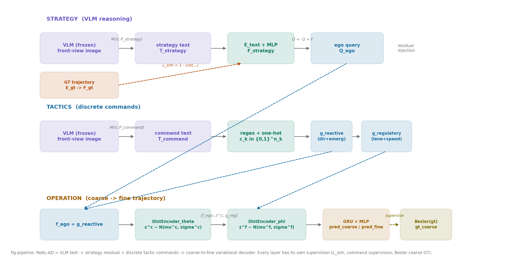
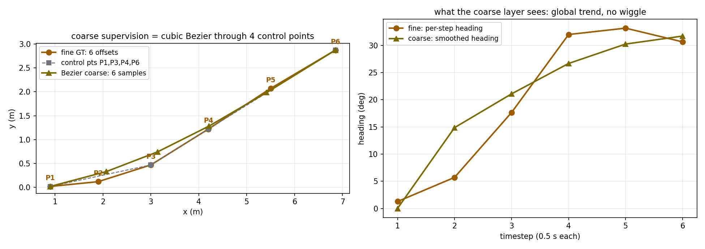

# 一条轨迹教不出三层思考：ReAL-AD 让 VLM 给端到端系统的每一层各配一个老师

> **信息块**
> - **全局编号**：55（VLA 驾驶，51–60）
> - **论文**：ReAL-AD: Towards Human-Like Reasoning in End-to-End Autonomous Driving
> - **作者**：Yuhang Lu、Jiadong Tu、Yuexin Ma（ShanghaiTech University），Xinge Zhu（The Chinese University of Hong Kong）
> - **会议/年份**：ICCV 2025（**已确认**：arXiv 页面 Comments 栏注明 "Accepted by ICCV2025"；CVF Open Access 已上线 ICCV 2025 proceedings 版本）
> - **链接**：https://arxiv.org/abs/2507.12499 ；项目页 https://4dvlab.github.io/project_page/realad（本次未能打开）
> - **代码**：论文正文未给出官方仓库链接——**未确认**
> - **一句话核心洞见**：端到端系统的监督信号只有一条稀疏的未来轨迹，而人类司机做的是三层决策；ReAL-AD 的做法是让 VLM 给每一层各生成一种监督信号——战略层是自然语言意图、战术层是离散命令、操作层是贝塞尔平滑的粗轨迹——让三层都有东西可学，而不是只在最后一条轨迹上算损失。

## 一条稀疏轨迹，教不出三层推理

先看一个具体的不对等。nuScenes 上一个典型的端到端规划网络（比如 VAD），训练时看到的监督信号是：未来 3 秒、6 个时刻的自车位置偏移量，一共 12 个数。网络要从这 12 个数里学会的东西却包括：现在该不该让行、要不要变道、方向盘打多少。人类司机做这三件事用的是三套不同的认知：先看懂局面形成意图（战略），再选机动方式（战术），最后才是手脚上的精细控制（操作）。论文图 1 把这个对比直接画了出来：(a) 是端到端系统——感知特征进、轨迹出，中间没有命名的决策层级；(b) 是人类司机——战略、战术、操作三层逐层收窄。

ReAL-AD 的起点就是这个不对等。作者的判断是：不是网络容量不够，是监督信号的形状错了。一条轨迹只能告诉网络"最后走哪条线"，教不会它"为什么走这条线"。想让网络学到分层推理，就得给每一层一个它自己的老师。这就是全文的组织原则，后面所有设计都是它的展开。

## 前人在哪个具体路口撞了墙

撞墙的地方有两个，都很具体。

第一堵墙叫"固定稀疏轨迹监督"。UniAD、VAD、GenAD 这一路工作，规划头的监督都是同一套 ground truth 未来轨迹。它的稀疏体现在两个地方：一是时间上只有 6 个点；二是语义上只有一个模态——位置。人类司机在变道前会先有一个"右侧车道空、可以过去"的判断，这个判断在轨迹监督里不存在。网络只能从 12 个数里反推这个判断，反推不出来就只好死记场景和轨迹的对应关系，换个没见过的场景就塌。这是结构性的，不是调参能救的：只要监督信号里不包含意图层的信息，任何只拟合轨迹的损失都学不到意图。

第二堵墙是 VLM 进自动驾驶的第一批用法。DriveVLM、VLM-AD、VLP 这些工作把 VLM 当辅助模块：VLM 看图说话，输出一些语义线索，拼到感知或规划特征上。论文 2.2 节对这批工作的批评很准：它们把语义推理当成一个孤立的预处理步骤，而不是嵌进决策层级里。翻译一下：VLM 在旁边说了一段话，主网络听没听、听进去多少，没有任何机制保证。Senna 往前走了一步，把高层规划和低层轨迹预测解耦成模块，但它没有给每一层配监督信号，分层停留在结构上。

所以 ReAL-AD 的位置很清楚：它不发明新的 VLM，也不发明新的感知主干（基线直接用 VAD 和 UniAD 的官方实现），它发明的是一套"分层监督"的脚手架。VLM 在这里的角色是离线标注员：对训练集的每一帧，提前生成好战略文本和战术命令，训练时当作现成的监督信号用。这一点论文没有大声说，但很关键——VLM 在训练和推理时都不参与梯度，整个"推理能力"是以冻结文本的形式注入的。

## 作者的赌注：每一层都该有自己的老师

作者押的赌注可以写成一句话：**如果给战略层、战术层、操作层各自一个可监督的中间目标，端到端网络能学到人类式的分层决策，而且三层加起来的效果大于只监督最后一条轨迹。**

这个赌注的底气有三张牌。第一张是 VLM 的现成能力：MiniCPM-V、Qwen-VL 这类模型看一张前视图像、说一段驾驶分析，已经做得不错，不需要为驾驶重新训练一个 VLM，离线跑一遍标注就行，成本可控。第二张是基线选得聪明：VAD 和 UniAD 是社区里复现最充分、实现最干净的两个端到端基线，往它们身上加模块，涨点算谁的一目了然，审稿人挑不出"基线太弱"的毛病。第三张是任务本身的形状：驾驶决策天然就是分层的，"战略-战术-操作"这个三分法在人类驾驶行为研究里是现成的框架，作者不需要论证"为什么分三层"，直接拿来用。

论文图 2 就是这个赌注的全部：多视图图像进场景编码器；Strategic Reasoning Injector 从 VLM 战略文本里提特征，加到 ego-query 上；Tactical Reasoning Integrator 把 VLM 命令变成 reactive 和 regulatory 两组特征；Hierarchical Trajectory Decoder 先后用这两组特征做粗、细两层解码。看懂这张图，全文的公式都只是它的展开。

*图：ReAL-AD 管线自绘。紫色是 VLM 生成的文本（离线、冻结），绿色是可训练的编码/变换，蓝色是进入规划主干的特征，橙色是轨迹输出，黄色是贝塞尔粗监督。虚线是监督信号。注意 VLM 本体不参与训练——"VLM 推理能力"是以冻结文本的形式注入的。*

## 战略层：一句自然语言是怎么变成 ego-query 上的一个加号的

Strategic Reasoning Injector（SRI）只做一件事：把 VLM 写的一段话，变成 ego-query 上的一个残差增量。公式 (1)–(4) 走一遍，每一步的形状都摆出来。

$$T_{strategy} = M(V, P_{strategy}) \tag{1}$$

$M$ 是冻结的 VLM，$V$ 是前视图像，$P_{strategy}$ 是提示词模板。输出 $T_{strategy}$ 是一段文本。附录 A.1 透露了质量控制的细节：提示词要求回答以 "When driving in the current scenario…" 开头，VLM 没照做就重新生成。这是一个很诚实的工程细节——作者知道 VLM 的指令跟随能力不稳定，所以用字符串前缀做硬校验，而不是相信它每次都听话。

$$F_{strategy} = \text{MLP}(E_{text}(T_{strategy})) \tag{2}$$

$E_{text}$ 是预训练文本编码器，把这段话变成一个语义向量；MLP 是一个轻量 adapter，把它映射到规划特征的空间。论文没有说明 $E_{text}$ 训练时是否冻结（**未说明**），这是复现时要自己决定的第一个坑。附录 B.1 试过把 MLP 换成 self-attention，表 6 显示两者几乎没有差别（L2 0.90 vs 0.89，碰撞率 0.16% vs 0.17%）。作者的解释是这个对齐任务不依赖长程依赖，MLP 够用了。这个消融其实暴露了一点：战略文本到规划特征的映射并不需要复杂的结构，说明文本里真正被用到的信息可能很粗。

$$\mathcal{L}_{sim} = 1 - \cos(F_{strategy}, F_{gt}) \tag{3}$$

这是 SRI 里最值得停下来想的一步。$F_{gt}$ 是把**真值轨迹** $gt_{traj}$ 用轨迹编码器 $E_{gt}$ 编出来的特征（附录算法 1：若干层 MLP + 沿时间维 max pooling + 拼接，形状 $(B, N, T, D)$ 进、全局特征出，是 VectorNet 那套子图编码的老做法）。余弦相似度损失把"文本说的意图"和"人实际开出的轨迹"拉到同一个方向。

想一下这个损失在几何上做什么。$F_{gt}$ 是"减速让行"这条轨迹的向量表示，$F_{strategy}$ 是"应该让行"那句话的向量表示。损失要求它们的夹角尽量小。训练充分后，adapter 学会了一个映射：看到"让行"这个词，就输出一个看起来像"减速轨迹"的向量。换句话说，**战略特征被训练成了轨迹特征的代理**。这带来一个怀疑：SRI 的增益到底有多少来自"VLM 的语义理解"，有多少来自"多了一个拟合真值轨迹的辅助头"？表 4 给了部分答案：去掉 $\mathcal{L}_{sim}$ 和 $F_{gt}$ 编码，L2 从 0.89 涨到 0.92，碰撞率从 0.17% 涨到 0.18%。有帮助，但不大。表 7 更直接：把余弦损失换成 MSE 反而变差（0.93/0.20%），换成 KL 散度（0.89/0.18%）和余弦（0.89/0.17%）差不多。作者自己也在附录里承认，损失函数的具体形式不是重点，重点是"把两个特征对齐"这个框架。这个坦率值得记下来：SRI 的承重部分是"文本→向量→残差注入"这条通路，而不是某个精巧的损失设计。

$$Q_{ego} \leftarrow Q_{ego} + F_{strategy} \tag{4}$$

最后一步简单得让人意外：直接相加。$Q_{ego}$ 是规划模块的 ego-query embedding（VAD 里它是一个可学习的查询向量，后面去交叉注意力里捞场景特征）。加一个残差，等于给这个查询向量叠加一个"战略偏置"。几何画面是：在 $d$ 维空间里，$Q_{ego}$ 原来指向"平均驾驶意图"，加上 $F_{strategy}$ 之后，指向被拨向"当前场景的战略方向"。后面交叉注意力用这个拨过的查询去和场景特征做点积，注意力权重自然向战略相关的物体倾斜——比如战略文本提到"注意右侧车辆"，$F_{strategy}$ 里就带有让查询向量更亲和右侧车辆特征的分量。

举一个具体的小例子。场景：自车直行，前方车辆刹车灯亮起，右侧车道空。VLM 输出（示意）："When driving in the current scenario, the leading vehicle is decelerating; the right lane is clear and a lane change to the right is advisable after checking blind spots." $E_{text}$ 把它编码成比如 768 维向量，MLP 压到 $d$ 维（与 $Q_{ego}$ 同维，论文未给出 $d$ 的具体值——**未给出**，VAD 默认实现里一般是 256）。$\mathcal{L}_{sim}$ 在训练时把这个向量往"向右变道+减速"那条真值轨迹的特征方向拉。推理时（VLM 文本已离线生成好），$F_{strategy}$ 直接加到 $Q_{ego}$ 上，规划头随后生成的轨迹就带上了"向右"的偏置。

核心符号形状总表（各符号第一次出现即定义，此处汇总备查）：

| 符号 | 形状 | 含义 |
|---|---|---|
| $T_{strategy}$ | 字符串 | VLM 生成的战略文本 |
| $F_{strategy}$ | $\mathbb{R}^{d}$ | 经文本编码器+MLP 后的战略特征 |
| $F_{gt}$ | $\mathbb{R}^{d}$ | 真值轨迹经 $E_{gt}$ 编码的特征 |
| $Q_{ego}$ | $\mathbb{R}^{d}$（或 $N_q \times d$） | 规划模块的 ego-query embedding |
| $T_{command}$ | 字符串 | VLM 生成的战术命令文本 |
| $c_k$ | $\{0,1\}^{n_k}$，$k=1..4$ | 第 $k$ 类命令的 one-hot 向量，$n_k$ 为该类选项数（**具体值未给出**） |
| $e_k$ | $\mathbb{R}^{8}$（由 $\mathbb{R}^{16}$ 反推） | 第 $k$ 类命令的嵌入向量 |
| $g_{reactive}$ | $\mathbb{R}^{16}$ | $e_{dir} \oplus e_{emerg}$，反应层命令特征 |
| $g_{regulatory}$ | $\mathbb{R}^{16}$ | $e_{lane} \oplus e_{speed}$，调控层命令特征 |
| $f_{ego}$ | $\mathbb{R}^{d}$ | 与场景交互后的自车特征 |
| $z^c, z^f$ | $\mathbb{R}^{L}$ | 粗/细两层隐轨迹编码，$L$ 为隐维度（**未给出**） |
| $\mu^c, \log\sigma^c$ | $\mathbb{R}^{L}$ | 粗层高斯分布参数 |
| $pred_{coarse}, pred_{fine}$ | $\mathbb{R}^{T \times 2}$，$T=6$ | 粗/细预测轨迹（未来 3 秒、2Hz） |

## 战术层："让一下对向来车"变成四个离散命令

如果说 SRI 处理的是"说不清道不明"的语义，Tactical Reasoning Integrator（TRI）做的就是把语义**收敛**成机器可执行的离散量。VLM 在这里被要求输出固定四类命令：Direction（方向）、Emergency（紧急）、Lane（车道）、Speed（速度）。

$$T_{command} = M(V, P_{command}) \tag{5}$$

$$ \{c_k\}_{k=1}^{4} = \text{RegexParse}\left(T_{command}, [\mathcal{P}_{dir}, \mathcal{P}_{lane}, \mathcal{P}_{speed}, \mathcal{P}_{emerg}]^\top\right) \tag{6}$$

$$i_k = \text{Lookup}(\mathcal{D}_k, c_k), \quad \mathbf{c}_k = \text{onehot}(i_k) \in \{0,1\}^{n_k} \tag{7}$$

这三步是一个"自然语言→结构化"的漏斗。VLM 先按提示词模板输出四类命令的文本（图 3 给了示例，附录图 4 给了提示词结构）；然后正则表达式按 "Direction Control:" 这类固定前缀把每类的词抠出来；再查预定义字典 $\mathcal{D}_k$ 找到序号，转成 one-hot。附录 A.2 说得很实在：每类有预定义的合法回答集合，VLM 输出不在集合里、或者格式缺失，就重新生成。正则+字典+重生成，三重保险，保证进网络的永远是干净的离散量。

为什么非要离散化？附录 B.3 做了对照实验：让 VLM 直接输出概率形式的命令（图 5 的提示词），再用 MLP 编码。结果在表 8 里：概率形式 L2 是 0.86，反而比 one-hot 的 0.97 好，但碰撞率 0.20% 比 one-hot 的 0.16% 差。作者选择了 one-hot，理由是"更直接的监督"。这个取舍值得琢磨：**L2 和碰撞率在这里指向了相反的结论**。概率形式让轨迹拟合得更准（L2 低），但安全更差；one-hot 牺牲一点拟合精度，换来更低的碰撞率。作者用"决策要果断"来解释——概率表示带来不确定性，网络学不出干脆的动作。这个现象本身比结论重要：它说明 L2 和安全性不是同一个东西，盯着 L2 调模型可能调出更不安全的车。后面怀疑式阅读还会回到这一点。

$$\begin{cases} e_{dir} = E_{dir}(c_1), \quad e_{emerg} = E_{emerg}(c_4) \\ e_{lane} = E_{lane}(c_2), \quad e_{speed} = E_{speed}(c_3) \end{cases} \tag{8}$$

$$g_{reactive} = e_{dir} \oplus e_{emerg}, \qquad g_{regulatory} = e_{lane} \oplus e_{speed} \tag{9}$$

每个 one-hot 查自己的嵌入矩阵，得到 8 维向量（由 $g \in \mathbb{R}^{16}$ 反推，论文没明说每类的维度——**未给出**，此处为反推）。然后按"控制层级"分成两组拼起来：方向+紧急进 $g_{reactive}$（反应层：本能反应，先保命），车道+速度进 $g_{regulatory}$（调控层：深思熟虑后的精细调节）。这个分组对应人类驾驶的直觉：看到行人窜出来，先踩刹车（reactive），再想是变道还是减速跟行（regulatory）。

继续上面的小例子。VLM 对"前车刹车、右侧空"的场景输出四类命令（示意）：Direction Control: change lane right；Emergency: no emergency；Lane: right lane；Speed: decelerate。正则抠出四个词，查字典得序号，one-hot 化，嵌入查表，拼成 $g_{reactive}$（"向右+不紧急"）和 $g_{regulatory}$（"右车道+减速"）。这两组 16 维向量接下来分别去条件化粗、细两层解码器。

这里埋着三层监督信号的第二个来源问题：战术命令的监督从哪来？答案是——**没有直接的分类损失**。$e_k$ 这些嵌入矩阵是靠下游轨迹损失端到端学出来的，VLM 命令只决定了 one-hot 长什么样（哪个位置是 1），不决定嵌入向量本身。这意味着：如果 VLM 的命令错了（比如该变道时它说直行），网络没有一个损失直接告诉它"你查错词了"；纠正只能靠轨迹监督间接传回来。附录 A.1 专门回应了这个担心：真值轨迹是战略文本和战术命令的"共同老师"，两者都受轨迹监督，VLM 输出不一致时，轨迹监督会把它们往同一个正确方向拽。这个说法成立的前提是轨迹监督足够强——而这正是第一堵墙里被批评"稀疏"的东西。作者用被批评的监督信号来担保新机制的可靠性，这个循环的味道，读的时候要自己闻出来。

## 操作层：先画个大概，再描细节

Hierarchical Trajectory Decoder（HTD）是三层里最"神经网络"的部分：一个两层变分编码器，先定粗的运动模式，再细化成精确轨迹。人类司机开车也是这个顺序——先决定"大概往右前方走"，手上再精修方向盘角度。论文把"先粗后细"做成了两套隐变量。

第一层，粗运动模式：

$$\mu^c, \log\sigma^c = \text{DistributionEncoder}_\theta([f_{ego}; g_{reactive}]) \tag{10}$$

$$z^c \sim \mathcal{N}(\mu^c, \sigma^c) \tag{11}$$

输入是自车特征 $f_{ego} \in \mathbb{R}^d$ 拼上反应层命令 $g_{reactive} \in \mathbb{R}^{16}$，输出一个对角高斯分布的参数，再采样得到粗隐编码 $z^c \in \mathbb{R}^k$。注意这里只用了 $g_{reactive}$（方向+紧急），没用 $g_{regulatory}$——粗层只管"往哪边、大概多快"，不管车道线级别的精修。DistributionEncoder 的具体结构在附录算法 2 里：三个 $1\times1$ 卷积（通道 $D \to 2D \to 2D \to D/2$，带 ReLU），接自适应平均池化把时间维压成 1，再一个卷积输出 $2L$ 维（一半是 $\mu$，一半是 $\log\sigma$），最后把 $\log\sigma$ clamp 到 $[\text{min\_log\_sigma}, \text{max\_log\_sigma}]$ 区间。clamp 是防数值爆炸的老技巧，附录给了超参数名但没给具体数值（**未给出**）。

第二层，细化：

$$\mu^f, \log\sigma^f = \text{DistributionEncoder}_\phi([f_{ego}; z^c; g_{regulatory}]) \tag{12}$$

$$z^f \sim \mathcal{N}(\mu^f, \sigma^f) \tag{13}$$

细层的输入多了两样：第一层采出的 $z^c$（粗模式作为条件，细层在它的基础上修），和调控层命令 $g_{regulatory}$（车道+速度，管精细调节）。这就是"层级"二字的全部含义：$z^f$ 的分布是以 $z^c$ 为条件的，细化不能脱离粗模式另起炉灶。

解码成轨迹：

$$h^c = \text{GRU}(\text{repeat}(z^c, T), f_{ego}), \quad pred_{coarse} = \text{MLP}(h^c) \tag{14a}$$

$$h^f = \text{GRU}(\text{repeat}(z^f, T), f_{ego}), \quad pred_{fine} = \text{MLP}(h^f) \tag{14b}$$

把隐向量复制 $T=6$ 份排成序列，GRU 以 $f_{ego}$ 为初态（或条件）展开成 6 个时刻的隐状态，MLP 逐时刻输出 $(x, y)$ 偏移量。这个设计直接继承自 GenAD [58] 的时序建模，只是做了双流。$pred_{fine}$ 是最终输出的规划轨迹；$pred_{coarse}$ 是中间产物，训练时有自己的监督，推理时可以丢掉。

粗层的监督是全文最漂亮的一个构造，值得单独画出来。真值轨迹是 6 个偏移量 $\{\Delta P_i\}_{i=1}^6$，先累加成绝对坐标 $\{P^{abs}_i\}$（式 21），然后只取第 1、3、4、6 个点做三次贝塞尔曲线的控制点（式 22），在 $t \in \{0, 0.2, 0.4, 0.6, 0.8, 1\}$ 上采样 6 个点，再差分成偏移量（式 23），得到 $gt_{coarse}$。选 $P_1, P_3, P_4, P_6$ 的理由：起点、终点、加两个中间拐点，保住全局运动趋势，平滑掉局部抖动。

*图：自绘示意（非论文原图）。左：一条带变道+微调的 6 步真值轨迹（橙），取 4 个控制点做三次贝塞尔插值得到粗监督（黄）。右：每步航向角对比——粗监督保留了"先右转再回正"的全局趋势，抹掉了细轨迹的局部抖动。这就是粗层解码器要学的东西：先学对大方向，再学细节。*

粗监督的妙处在于它**免费**：不需要额外标注，纯粹是真值轨迹的平滑版本。但它同时是一个可质疑的选择：贝塞尔平滑假设"粗糙=平滑"，对于急打方向避障这种"粗动作本身就很尖锐"的场景，平滑掉的可能恰恰是关键信息。论文没有讨论这一点，表 5 显示三层解码器（更粗的一层）反而变差（L2 0.93→0.97），作者归因于过拟合和细节丢失——这个解释和"粗糙=平滑"的假设是自洽的，但反过来说也暴露了粗粒度的上限：分层不是越细越好。

## 五项损失各自在罚什么

$$\mathcal{L}_{overall} = \underbrace{\mathcal{L}_{baseline}}_{\text{基线}} + \underbrace{\lambda_0 \mathcal{L}_{sim} + \lambda_1 \mathcal{L}_{gt\_recon}}_{\text{战略注入}} + \underbrace{\lambda_2 \mathcal{L}_{coarse} + \lambda_3 \mathcal{L}_{hier\_kl}}_{\text{层级解码}} \tag{15}$$

$$\mathcal{L}_{gt\_recon} = \|\text{Dec}(F_{gt}) - gt_{traj}\|_2 \tag{16}$$

$$\mathcal{L}_{coarse} = \mathcal{L}_{baseline}(pred_{coarse}, gt_{coarse}) \tag{17}$$

$$\mathcal{L}_{KL} = \beta_c D_{KL}(q_\phi(z^c_{curr} \| z^c_{fut})) + \beta_f D_{KL}(q_\phi(z^f_{curr} \| z^f_{fut})) \tag{18}$$

$$D^l_{KL} = \frac{1}{2}\left(\log\frac{\sigma^2_{fut,l}}{\sigma^2_{curr,l}} - 1 + \frac{\sigma^2_{curr,l} + (\mu_{curr,l} - \mu_{fut,l})^2}{\sigma^2_{fut,l}}\right) \tag{19}$$

$$\mathcal{L}_{hier} = D^c_{KL} + D^f_{KL} \tag{20}$$

逐项过。$\mathcal{L}_{baseline}$ 是 VAD/UniAD 原来的全部损失，原样保留——这保证了新模块是"增量"，基线行为不被破坏。$\lambda_0 \mathcal{L}_{sim}$ 前面讲过，把战略文本特征往真值轨迹特征上拉。$\lambda_1 \mathcal{L}_{gt\_recon}$ 容易被忽略但很关键：它要求**用真值轨迹编码出的特征 $F_{gt}$，经过层级解码器 Dec，能重构出真值轨迹本身**。这是一个自编码器式的约束，保证 $E_{gt}$ 编出来的特征确实落在解码器能理解的流形上；否则 $\mathcal{L}_{sim}$ 可能把 $F_{strategy}$ 往一个解码器根本用不上的方向拉，战略注入就成了摆设。

$\lambda_2 \mathcal{L}_{coarse}$ 用基线同样的损失函数（VAD 的轨迹回归损失）监督粗预测，让粗层学贝塞尔平滑版真值。$\lambda_3 \mathcal{L}_{hier\_kl}$ 是两层隐空间的 KL 正则：让"当前观测编码出的分布" $q(z_{curr})$ 向"看到未来信息后编码出的分布" $q(z_{fut})$ 靠拢。这是 GenAD 那套未来条件先验的老思想——训练时偷看未来，学一个更好的隐空间形状；推理时只用当前观测的分布。

超参数论文给了具体值：$\lambda_0=1.0, \lambda_1=0.5, \lambda_2=0.5, \lambda_3=1.0$，$\beta_c=0.5, \beta_f=1.0$。但**没有给搜索范围和选择依据**（未说明），五个新超参数的敏感性曲线也没有。这是怀疑式阅读的一个标准扣分项：$\lambda_0=1.0$ 是最大权重，意味着战略注入损失和基线损失同等重要——如果这个权重换个数据集要重调，方法的迁移成本就高。论文没有提供能判断它是"平坦区中心"还是"尖峰"的信息。

公式 (18) 有一个记号上的毛刺：$D_{KL}(q_\phi(z^c_{curr} \| z^c_{fut}))$。KL 散度的标准写法是 $D_{KL}(p \| q)$，这里把两个随机变量直接塞进条件线两边，严格说是 $D_{KL}(q(z^c_{curr}) \| q(z^c_{fut}))$ 的缩写。更关键的是，$z_{curr}$ 和 $z_{fut}$ 在正文里**从未被定义**——只在式 (18) 里突然出现。读者只能靠 GenAD 的背景去猜：$z_{fut}$ 是用未来帧信息编码的后验，$z_{curr}$ 是只用当前帧的先验。这是一个"论文跳过但不显然"的步骤，复现时只能按 GenAD 的惯例自己补。式 (19) 本身是对角高斯 KL 的标准闭式，$\frac{1}{2}(\log \frac{\sigma^2_{fut}}{\sigma^2_{curr}} - 1 + \frac{\sigma^2_{curr} + (\mu_{curr}-\mu_{fut})^2}{\sigma^2_{fut}})$，展开验证是对的。式 (20) 的 $\mathcal{L}_{hier}$ 和式 (18) 的 $\mathcal{L}_{KL}$、式 (15) 的 $\mathcal{L}_{hier\_kl}$ 是同一个东西的三个名字，记号不统一，读的时候自己对齐。

## "提升超 30%"的基线是哪一条

摘要和引言反复说的 "over 30% improvement"，值得逐字验算。它的基线是 **VAD-Base 在 nuScenes 上的开环结果**，不是别的。

表 1（nuScenes 开环）：VAD-Base 平均 L2 0.72m，平均碰撞率 0.22%；Ours (VAD & MiniCPM-V) 平均 L2 0.48m，平均碰撞率 0.15%。$(0.72-0.48)/0.72 = 33.3\%$，$(0.22-0.15)/0.22 = 31.8\%$。正文写的 "33% reduction in L2 error and 32% decrease in collision rate" 就是这么来的，数字对得上。

但正文还有一句更强的话："demonstrates over 30% improvement in both trajectory planning accuracy and safety metrics **across NuScenes and Bench2Drive datasets**"。查表 2（Bench2Drive）：VAD 平均 L2 0.94 → Ours (VAD & MiniCPM-V) 0.84，提升 $(0.94-0.84)/0.94 = 10.6\%$；碰撞率 0.20% → 0.11%，提升 45%。L2 只提升了约 11%，"across Bench2Drive"的 30% 是不成立的。这是一个摘要级表述和表格级证据之间的裂缝：30% 只在 nuScenes+ VAD 基线+开环 这个组合下成立，换数据集、换基线（UniAD 那两行提升幅度也不同），数字就变了。读宣传语的时候要把限定条件补回去。

表 1 里还有几处需要细看。第一，DriveVLM* 那一行（L2 0.31，碰撞率 0.10%）用了自车状态（ego status）做输入，表注明确说"使用自车状态的方法不参与排名"。这是一个公平的处理，但也意味着：如果允许用自车状态，ReAL-AD 的 0.48/0.15% 并不是全场最好。作者选择不跟它比，理由正当（输入信息不对等），但读者要知道这个数字的存在。第二，带 $\dagger$ 的行用 UniAD 的评测口径算的，和 VAD 口径的行不完全可比，跨行比较时要打折。第三，表 1 的基线数字是作者自己跑的还是引用的，论文没说（**未说明**）；表 2 明确说了 "We reimplement models using the official code"，表 1 没有这句话。基线数字的来源不明，是审稿人视角的标准疑问。

表 2 的 closed-loop 部分：Driving Score 39.42 → 41.17（+4.4%），Success Rate 10.00% → 11.36%。开环 L2 提升 10.6%，闭环分数提升 4.4%——闭环的增益明显小于开环。这符合直觉：开环评的是"轨迹像不像人开的"，闭环评的是"车能不能开完全程不出事"，后者难得多。但这也引出附录 A.4 的那个设计：closed-loop 评测时 VLM 太慢，作者做了一个 memory buffer——把开环数据集上每帧的环境特征和对应的 VLM 文本存起来，闭环遇到新场景时，按环境特征相似度检索最像的一帧，直接复用它的 VLM 文本和命令特征。这个 trick 让闭环跑得动，但它有两个代价：一是检索错了就用错战略，误差从检索这一步就开始累积；二是 buffer 里的 VLM 文本来自开环评测数据集，如果闭环路线和开环数据有场景重叠（Bench2Drive 的 12 个城镇、44 种场景是同一批 CARLA 资产），"最相似帧"可能相似到近乎同一场景，闭环成绩里就掺进了开环数据的红利。论文没有量化检索准确率，也没有讨论重叠问题（**未讨论**）。

## 消融表里谁承重、谁装饰

表 3 是全文最有信息量的一张表（Bench2Drive 验证集，VAD-base + MiniCPM-V，两阶段训练、共享 stage-1 checkpoint——注意这个设置和主实验不完全一致，消融的结论外推到主结果时要打折）。基线（setting 0）：L2 1.01，碰撞率 0.21%。逐项看：

- 只加 SRI（setting 1）：0.89/0.17%。L2 降 11.9%，碰撞率降 19.0%——和正文说的"约 12%、约 19%"对得上。**SRI 是三个模块里单个贡献最大的**，承重。
- 只加 TRI（setting 2）：0.97/0.16%。正文说"0.14m reduction in average L2 error"，但表里 1.01→0.97 只有 **0.04m**。0.14 这个数字在表里找不到对应——1s/2s/3s 任一列都对不上（0.51→0.52 反而变差，0.98→0.93 是 0.05，1.55→1.45 是 0.10）。这是正文和表格对不上的地方，可能是笔误，也可能是改表后忘了改文字。无论如何，TRI 单独的 L2 贡献是 0.04m，比正文宣称的小得多。碰撞率 0.21%→0.16%（降 0.05 个百分点）倒是对得上。
- 只加 HTD（setting 3）：0.93/0.14%。L2 降 0.08m，碰撞率降 0.07 个百分点，和正文说的 0.07m/0.07% 基本对得上（0.08 vs 0.07 是四舍五入差异）。
- 全加（setting 7）：0.89/0.12%。

组合行里藏着论文没讨论的东西：setting 4（SRI+TRI）L2 是 0.95，**比单加 SRI 的 0.89 还差**。也就是说，在 SRI 已经在了的情况下再加 TRI，L2 反而变差了 0.06m；但碰撞率从 0.17% 降到 0.15%，安全变好了。setting 6（TRI+HTD）0.96/0.14% 也是类似：不如单加 HTD 的 0.93。全量 setting 7 的 L2（0.89）和单加 SRI（0.89）完全一样，三个模块加在一起，L2 上没有任何超可加性，增益全落在碰撞率上（0.17%→0.12%）。诚实的读法是：**SRI 负责把 L2 打下来，TRI 和 HTD 主要在安全（碰撞率）上做贡献，且模块之间存在相互干扰**。论文的叙述是"每个模块都有效"，表格的实际故事是"分工不同、且有代价"。做改进工作的人应该盯着 setting 4 这个反常：为什么加了战术命令，轨迹拟合反而变差？一个可能的解释是离散命令的嵌入把隐空间切成了几块，拟合精度让位给了决策分明度——和表 8 里 one-hot vs 概率形式的取舍是同一个味道。

表 5（解码器层数）：1 层 0.99/0.17%，2 层 0.93/0.14%，3 层 0.97/0.15%。两层最好，一层欠拟合、三层过拟合。作者的解释（层数多了丢细节）说得通，但注意三层的构造方式：用贝塞尔再拟合一次得到"更粗"的真值做联合监督——三层那次实验里监督信号本身也变了，不只是层数变了，变量没完全隔离。

表 9（VLM 输入视角）：单前视 0.53/0.17%，多视角 0.51/0.16%，几乎没差别。作者的结论是"前视够用了"。这个结论要小心：它只在"VLM 文本离线生成、只做战略/战术提示"的设定下成立；如果 VLM 要参与精细空间推理（比如精确到厘米的避障），前视大概率不够。不要把这个结论推广到别的 VLM 用法上。

## 三层之间传误差：VLM 说错话怎么办

分层架构最怕的就是上层错、下层跟着错。ReAL-AD 里 VLM 是冻结的离线标注员，它说错话的概率不为零：前视图像里的小目标、遮挡、反光，VLM 都可能看走眼。论文对这个问题的回答散在三处，拼起来看才完整。

第一处是输入端的硬校验（附录 A.1/A.2）：战略文本必须以指定前缀开头，四类命令必须落在预定义字典里，否则重新生成。这防的是"格式错"，不防"内容错"——VLM 可以格式完美地说一句错误的判断，比如把"对向有来车"说成"路口空旷"。

第二处是附录 A.1 的"统一校正"论证：战略特征和战术命令都受真值轨迹监督，真值轨迹是最后的仲裁者。VLM 说错时，轨迹损失会把下游往正确的方向拽。但这个机制的效力取决于一个时间差：战略文本的错误在训练早期就会污染 $F_{strategy}$，而轨迹监督要经过 adapter、残差注入、交叉注意力、解码器才能把梯度传回来，路径很长。实践中更可能发生的是：网络学会**忽略**错误的战略信号（把 $F_{strategy}$ 的范数压小），而不是"纠正"它。论文没有分析 $F_{strategy}$ 在训练前后的范数变化，也没有统计 VLM 文本与真值轨迹冲突的比例（**未给出**）——所以"统一校正"到底发生了多少，是个 open 问题。

第三处是推理时的 memory buffer（附录 A.4）：闭环时 VLM 文本不是现算的，是按环境特征相似度检索来的。这里误差传递多了一跳：检索错→战略错→决策错。环境特征相似（比如都是"白天+直路+前车"）不等于驾驶语义相似（前车是刹车还是加速，特征可能很接近）。论文没有报告检索的 top-1 准确率，也没有消融"用检索文本 vs 用真值帧文本"的差距（**未做**）。这是全文工程上最脆弱的一环：开环实验里 VLM 文本是逐帧精确生成的，闭环实验里却是近似检索的，两边的输入质量不在一个档次上，闭环成绩的可比性要打折扣。

还有一个更隐蔽的传递：TRI 的离散命令是 hard 决策。VLM 在"变道/直行"之间犹豫时，正则解析只保留一个词，犹豫的信息被丢掉了。表 8 的概率形式实验恰恰说明保留不确定性时 L2 更好（0.86 vs 0.97）——hard 离散化丢掉的信息，在拟合精度上是有代价的。作者用安全换了果断，这个交换是否划算，取决于部署场景对"犹豫"的容忍度，论文没有展开。

## 作者哪里心虚：措辞强弱地图

把论文里"说得很满"和"一笔带过"的地方对照看，作者的把握程度就显出来了。

**最心虚的是式 (18) 的 KL 项。** $z_{curr}$/$z_{fut}$ 在正文里零定义，符号 $D_{KL}(q_\phi(z^c_{curr} \| z^c_{fut}))$ 的写法也不规范。GenAD 的读者能猜出它在干什么（未来条件后验做正则），但论文自己没有把生成过程讲清楚。一个需要靠读者"猜"的核心损失项，说明作者在这里更关心"公式长得像那么回事"，而不是"读者能复现"。复现者只能按 GenAD 的惯例自己补 $z_{fut}$ 的构造——而不同的补法（用未来几帧、怎么编码）可能直接影响 $\beta_c, \beta_f$ 的有效性。

**第二心虚的是表 3 的文字描述。** "0.14m reduction" 对不上表里的 0.04m（前面已验算）。以及 setting 4（SRI+TRI）比单 SRI 差这种反常，论文一个字没提。消融表的叙述是挑选过的：只讲每个模块"有效"，不讲模块之间的干扰。

**第三是超参数。** 五个 $\lambda$、两个 $\beta$、clamp 区间、命令字典大小 $n_k$、隐维度 $L$、$E_{text}$ 是否冻结——论文给了 $\lambda$ 和 $\beta$ 的取值，没给任何一个的搜索过程、敏感性、随机种子。审稿人视角的标准问题"基线有没有得到同等调参预算"也答不上来：基线用的是官方默认超参，新模块的超参是作者调过的，两边不在同一起跑线。这是领域通病，不是这篇独有，但读者要知道成绩里有多少是调参红利，分不出来。

**第四是 VLM 相关的成本和诚实度。** 全文没有报告：给 nuScenes + Bench2Drive 全部帧生成 VLM 文本花了多少 GPU 小时；用的 MiniCPM-V 和 Qwen-VL 具体是哪个 checkpoint（**未给出**，只给了模型家族名）；温度、采样参数是什么（**未给出**）。"VLM 增强"听起来像推理时有个聪明的副驾驶，实际是训练前跑批处理生成的静态标注。这个差距不是缺点——离线标注是务实的选择——但表述上容易让人高估系统的实时智能程度。

**做得漂亮的地方也要说。** 附录 A.1/A.2 把 VLM 输出校验、重生成、正则解析的工程细节全写出来了，没有藏着掖着；表 6、表 7、表 8、表 9 这些"不好看"的消融（adapter 换 self-attention 没用、损失函数换哪个都差不多、概率形式 L2 反而更好、多视角没提升）都如实报告了，没有只挑好看的放。这种诚实报告负面/中性结果的做法，在同类论文里不算多，值得肯定。它也让前面的批评更有依据——正因为作者给了表，读者才能算出 0.04m 和 0.14m 的出入。

## 两个可以带走的想法

**想法一：给中间决策配独立的监督信号，而不是只监督最终输出。** 这是全文最可迁移的一条，脱离自动驾驶也成立。任何"端到端拟合最终输出"的系统（规划、控制、甚至代码生成），如果中间存在人类可命名的决策层级，就可以给每一层造一个廉价的监督信号——不一定用 VLM，可以用规则、启发式、或对真值的变换（贝塞尔平滑就是零成本的例子）。ReAL-AD 的证据是：单加 SRI（一个文本→向量的残差）就拿下了 L2 上 12% 的降幅，而它的成本只是一个 MLP 和一个余弦损失。做自己课题时，问一句"我的系统里有没有只被最终损失监督的中间决策"，有，就值得给它配个老师。

**想法二：自然语言指令用"残差注入"进主干，而不是拼进输入。** $Q_{ego} \leftarrow Q_{ego} + F_{strategy}$ 这个设计轻得反直觉：不改主干结构、不加注意力层，就在查询向量上加一个偏置。它的好处是解耦——语言侧（文本编码器+adapter）和规划侧（VAD/UniAD）通过一个加法接口对接，任何一侧换掉都不影响另一侧。对"LLM 调度器+专家规划器"的架构，这意味着调度器的自然语言输出可以编码成向量后直接偏置规划器的查询/特征，而不必把文本拼进 prompt 或重训规划器。代价是可解释性打折：加法之后，语言的影响混进了向量的每一维，想知道"哪句话起了作用"只能靠事后分析。

## 与本课题的关联

读者的课题是"世界模型引导 + 自适应衰减情景记忆的闭环多规划器 Agent"：LLM 调度多个专家规划器，执行开放式自然语言驾驶指令，在 Bench2Drive 闭环基准上验证。ReAL-AD 的三层结构和这个课题的对应关系很直接：

- **战略层（SRI）↔ LLM 调度器的意图理解**。两者都是把开放式的语义（自然语言指令 / VLM 战略文本）变成下游可用的偏置。ReAL-AD 的做法（文本→编码器→MLP→残差加到 ego-query）可以直接借鉴：调度器输出的自然语言决策，不必翻译成 prompt 重新喂给规划器，编码成向量做残差注入更轻，且不破坏专家规划器的原有结构。
- **战术层（TRI）↔ 专家规划器的选择/机动决策**。四类离散命令（方向/紧急/车道/速度）本质上是一个**受约束的动作原语词表**，正则+字典保证可机读。课题里的 LLM 调度器如果直接输出自由文本给专家规划器，会遇到同样的"格式不可靠"问题；TRI 的三重保险（提示词模板→正则解析→字典校验→重生成）是一套现成的工程范式，可以直接抄。表 8 的教训也要一并带走：离散化换果断、丢信息，L2 和安全可能反向走——调度器的输出粒度（离散命令 vs 连续参数）要按安全指标选，不只看拟合精度。
- **操作层（HTD）↔ 轨迹生成专家**。先粗后细的两层解码、贝塞尔平滑做免费粗监督，这套做法和课题里的"世界模型中间分布复用"有呼应：都是利用层级/中间表示做渐进式精化。区别在于 ReAL-AD 的粗监督来自对真值的变换（无模型），而课题的世界模型提供的是预测性的中间分布（有模型）——两者可以叠加：用世界模型的预测做粗层条件，用贝塞尔平滑做粗层监督的正则。

三个具体的可借鉴点：第一，**每层独立监督**的思想可以直接用在调度器-规划器的接口上——给调度器的战略输出配一个对齐损失（比如与专家轨迹特征的余弦相似度，照抄式 3），而不是只在最终轨迹上算损失，这样调度器学到的是"意图"，不是"拟合"。第二，**附录 A.4 的 memory buffer** 和课题的"自适应衰减情景记忆"撞了同一个问题：都是用特征相似度检索历史决策。ReAL-AD 的实现是最朴素的版本（存全部帧、最近邻复用），没有衰减、没有遗忘机制，检索错了也没有回退——课题的情景记忆设计（时间衰减、相关性加权）恰好可以补上这一块，写论文时这是现成的对比基线。第三，**怀疑点清单可以直接转成自己实验的 checklist**：$z_{curr}$/$z_{fut}$ 这类未定义的符号、超参数搜索范围、随机种子、基线调参预算、VLM 标注成本——自己的论文里把这些写清楚，就比 ReAL-AD 严谨一档。

最后说一句定位的话。ReAL-AD 不是 VLM 驾驶的开山之作，它的增量诚实地讲就是"一套分层监督脚手架 + 三个即插即用的模块"。但它的价值恰恰在于**可拆卸**：SRI、TRI、HTD 每一个都可以单独拿下来装到别的端到端系统上（论文自己就演示了 VAD 和 UniAD 两个基线），消融表告诉了你每个件值多少钱（SRI 最值钱，TRI 和 HTD 主要保安全）。对课题而言，它最值得参考的不是某个公式，而是一种工作方法：先找到监督信号形状和人类决策层级之间的错位，然后给每一层配一个便宜的老师。
