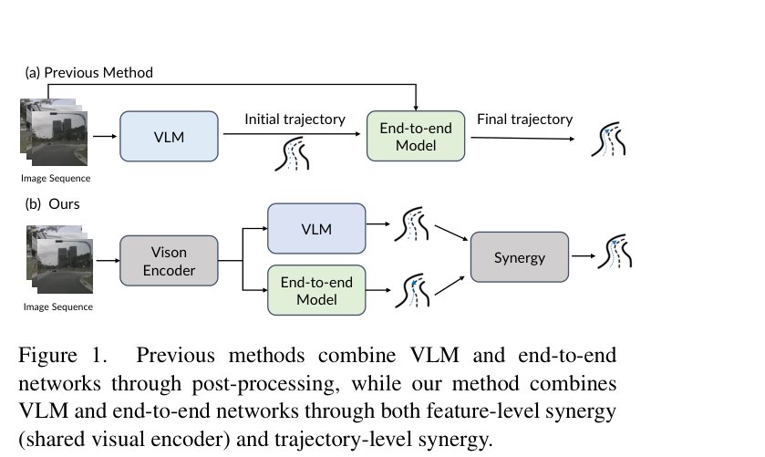
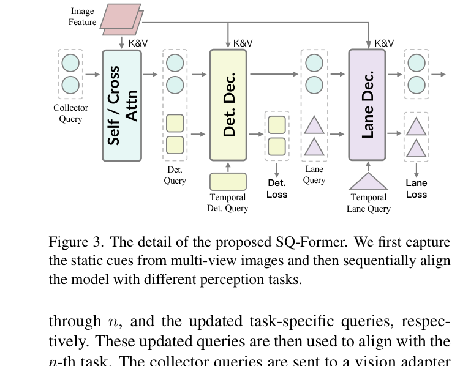
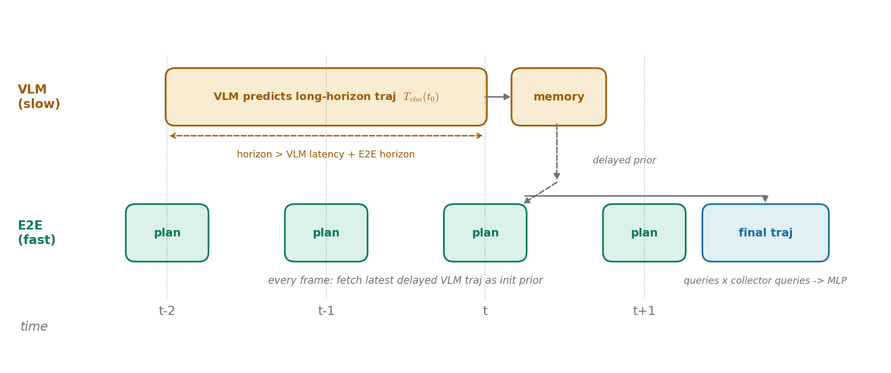
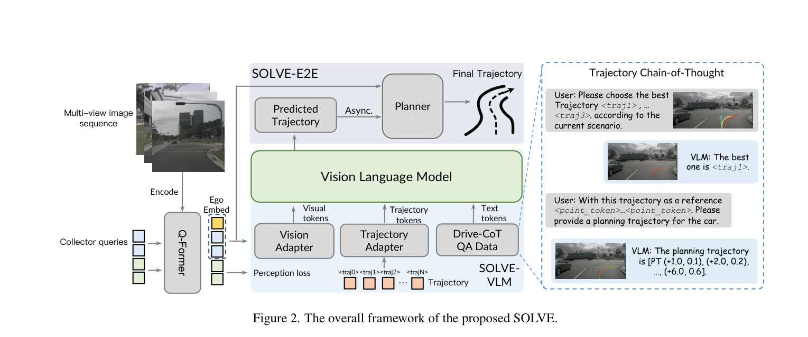

# 一个慢思考的参谋和一个快执行的驾驶员：SOLVE 让 VLM 与端到端各干各擅长的事

> **全局编号**：53（VLA 驾驶，51–60）
> **论文**：SOLVE: Synergy of Language-Vision and End-to-End Networks for Autonomous Driving
> **作者**：Xuesong Chen¹³⁴*、Linjiang Huang²*、Tao Ma¹、Rongyao Fang¹、Shaoshuai Shi³†、Hongsheng Li¹⁴†（*同等贡献，†通讯作者；¹港中文 MMLab，²北航，³滴滴 Voyager Research，⁴ InnoHK CPII）
> **会议/年份**：CVPR 2025（arXiv v1 2025-05-22；正文已通过 CVPR 2025 官方论文库链接交叉确认）
> **链接**：https://arxiv.org/abs/2505.16805
> **代码**：未找到官方代码。有一个第三方复现（含训练配置与权重），在 pqh22/colavla 仓库里，不顶替官方实现
> **一句话核心洞见**：把 VLM 与端到端的关系从"前后串联的流水线"改成"共享同一套视觉编码器的并联双轨"——编码器同时接受 VLM 的问答监督和端到端分支的感知监督，VLM 只做高质量但慢的轨迹参考，端到端每帧拿一份带时延的旧 VLM 轨迹当初始化先验，做实时精修。

## DriveVLM 那条断掉的路：为什么只在轨迹层握手不够

2024 年之前，把 VLM 接进自动驾驶的标准姿势有两种。一种是让 VLM 自己干到底：DriveGPT4、DriveLM 那一路，VLM 又做感知问答又输出控制信号，问题是自回归地吐 token 太慢，3D 感知也弱，实时性过不了。另一种是 DriveVLM 的双系统：VLM 和端到端各自独立跑，VLM 先给一条粗轨迹，端到端规划器拿这条轨迹当起点再精修，最后输出。图 1(a) 画的就是这条路。

作者在引言里挑明了这条路断在哪里，用的例子很具体，值得记住：端到端模型会把"拉着交通锥的卡车"当成路障，把"广告牌上的汽车照片"当成真车，然后来一脚没必要的急刹。这是端到端一侧的毛病——缺常识。反过来 VLM 也有毛病：它看不懂精确的 3D 几何，规划精度不够。在 DriveVLM 的串联结构里，这两个毛病互相够不着对方来治：端到端模型拿不到 VLM 的高层推理（比如"注意那辆意图变道的车"），VLM 也拿不到端到端分支的 3D 感知特征。两边只在轨迹这个最终产品上交接一次，中间的知识是断的。

把这个失败说成结构性的，依据是：它不是调参能解决的。串联结构里，VLM 的梯度到不了端到端编码器，端到端检测头的监督也到不了 VLM 的视觉 token。信息不通，不是因为超参数没调好，是因为架构上就没有通道。

所以作者的起点是一个被所有人默认接受的假设：VLM 和端到端是两个独立的模型，合作只能发生在输出端。SOLVE 推翻的就是这个假设。图 1(b) 是作者押的赌注，一眼能看懂：图像序列先进一个共用的 Vision Encoder，两条支路（VLM、端到端）从同一个编码器拿特征，各自出轨迹，最后在 Synergy 处合流。赌注的名字就叫"特征级协同 + 轨迹级协同"。

*图 1（论文第 1 页）：(a) 以往方法（DriveVLM）是串联——VLM 出初始轨迹，端到端模型精修，两边只在轨迹上交接；(b) SOLVE 是并联——共享视觉编码器，两条支路各出轨迹再协同。看这张图时注意 (b) 里从 Vision Encoder 分出去的两条线：特征级协同就发生在这里，这是全文所有增益的源头。*

这个赌注硬不硬？作者自己给的证据排位是：表 5（共享编码器的消融）> 表 1（主结果）> 表 4（T-CoT）。后面会一张张过。先记住这个顺序，它决定了这篇论文真正的承重墙是哪一面。

## 先看三张底牌：作者相信什么、凭什么相信

从论文的组织方式反推，作者手里有三张牌。

第一张是**共享编码器的联合训练**。VLM 分支用 OmniDrive 的问答数据（场景描述、感知、预测、规划四类 QA）训，端到端分支用检测和车道线监督训，两个梯度流进同一个 SQ-Former。这张牌的逻辑很直：检测监督给 VLM 补 3D 精度，问答监督给端到端补"哪些东西值得看"。表 5 是这张牌的验钞机：编码器共享之后，端到端 L2 降 1.5cm，VLM 降 0.6cm，两边都受益。注意方向是双向的，这和 DriveVLM 的"VLM 单向喂给端到端"不一样。

第二张是 **Trajectory Chain-of-Thought（T-CoT）**。VLM 自回归地一个个数值往外吐轨迹点，精度差、还慢。作者的办法是把连续回归拆成两步：先从候选库里"选"一条最接近的，再以它为参照"改"出最终轨迹。选择是离散的，VLM 擅长离散；微调有参照，数值误差被参照拴住。表 4 显示这一步带来 1.1cm 的提升。

第三张是**时间解耦（temporal decoupling）**。VLM 慢，但如果让它一次预测足够长的轨迹（长过它自己的延迟加上端到端的规划 horizon），那么端到端在当前帧拿到的"上一份 VLM 轨迹"仍然覆盖未来，延迟就被 horizon 吃掉了。端到端把这份旧轨迹当初始化先验，实时精修。表 1 里 Ours-E2E(Async) 比 Ours-E2E 好 0.01m，数字小，但机制是整篇论文里最值得带走的东西。

三张牌里最硬的是第一张，因为它是唯一一个"去掉就塌"的设计（表 5 的 1.5cm 是全文最大的单项消融）。第二张是方法创新，第三张是系统设计。三张的共同点：都不要求 VLM 跑得快，而是把"慢"绕过去。

## SQ-Former 在算什么：一串 query 先后去图像、检测、车道线里取货

共享编码器的本体叫 Sequential Q-Former（SQ-Former）。先把形状摆出来，这是读懂后面一切的基础。

| 符号 | 形状 | 含义 |
|---|---|---|
| $\mathbf{F}_i$ | $\mathbb{R}^{N \times C \times H \times W}$ | 多视角图像经 EVA-02-L 编码后的特征；$N$ 视角数，$C$ 通道，$H,W$ 空间尺寸 |
| $\mathbf{P}_i$ | 与 $\mathbf{F}_i$ 同形 | 3D 位置编码，加在特征上让 query 知道"这个特征来自哪个视角的哪个 3D 方向" |
| $\mathbf{Q}_c$ | $\mathbb{R}^{384 \times d}$ | collector queries，可学习的 384 个 query，是信息的"搬运工" |
| $\mathbf{Q}_\blacktriangle$ | $\mathbb{R}^{900 \times d}$（检测）/ $\mathbb{R}^{300 \times d}$（车道） | 任务专用 query，$\blacktriangle \in \{d, m\}$ |
| $\mathcal{M}$ | — | memory bank，来自 StreamPETR，存历史帧的 query，实现时序信息 |

流程分两步。第一步，collector queries 先去"静态线索"里取一趟货：

$$\mathbf{Q}_{c}^{(s)}=f_{s}(\mathbf{Q}_{c},\mathbf{F}_{i}+\mathbf{P}_{i}) \tag{1}$$

$f_s$ 是一个 transformer decoder，self-attention 让 384 个 query 之间先通气（避免 10 个 query 都去盯同一辆车），cross-attention 让它们去图像特征里按 3D 位置取自己需要的信息。输出的上标 $(s)$ 表示"已装载静态线索"：天气、时间、路况这类整图级别的信息。384 这个数不是拍脑袋的，表 2 试了 256/384/512，384 最好（32.3cm），两边都差（32.6cm）——query 太少装不下，太多则冗余还拖慢后面的 VLM。

第二步，按固定顺序逐个感知任务"进货"：

$$\mathbf{Q}_{c}^{(s,\blacktriangle[1:n])},\tilde{\mathbf{Q}}_{\blacktriangle[n]} = f_{\blacktriangle[n]}\big([\mathbf{Q}_{c}^{(s,\blacktriangle[1:n-1])},\mathbf{Q}_{\blacktriangle[n]}],\mathbf{F}_{i}+\mathbf{P}_{i},\mathcal{M}\big) \tag{2}$$

读法：把上一轮已经装了货的 collector queries，和本轮任务的专用 query 拼在一起（$[\cdot]$ 是拼接），送进本轮任务的 decoder。decoder 输出两样东西：collector queries 再添一笔新货（$\mathbf{Q}_{c}^{(s,\blacktriangle[1:n])}$，上标表示"静态 + 前 n 个任务的线索"都已装载），以及本轮任务自己的输出 query（$\tilde{\mathbf{Q}}_{\blacktriangle[n]}$，拿去算检测 loss 或车道线 loss）。$\mathcal{M}$ 是 memory bank，把历史帧的 query 也喂进来，让当前帧知道"刚才那辆车在哪"。

顺序是写死的：图像 → 3D 检测 → 车道线检测。为什么是这个顺序，表 3 给了答案，下一节细说。

最后，这批装满货的 collector queries 分两路走：一路过 vision adapter 对齐到 VLM 的维度，再拼上一个 ego token（自车状态），喂给 LLaVA；另一路直接喂给端到端规划器。图 3 是这个过程的示意：collector query 从左到右依次穿过 Self/Cross Attn、Det.Dec、Lane.Dec 三个柱子，每穿过一个就胖一圈，任务 query 则在每个柱子下面交出自己的 loss。

这里有一个容易错的直觉：以为"共享编码器"就是把同一个 backbone 的特征复制两份。不是。关键在**联合训练的梯度**：VLM 的 QA loss 和端到端的检测 loss 同时反传进同一批 query 的参数。检测 loss 逼着 query 记住精确的 3D 位置（VLM 自己学不会这个），QA loss 逼着 query 记住"这辆车在并线、值得注意"这类语义（检测 loss 不关心这个）。表 5 的 1.5cm 和 0.6cm 就是这么来的。后面"作者没说清"一节会追问：两个 loss 的权重怎么配的——论文没写，这是个缺口。

*图 3（论文第 3 页）：SQ-Former 细节。Collector query 依次穿过三个 decoder，每经过一个任务就被"装载"一层线索；Det.Query 和 Lane.Query 在下方各自交出监督 loss。看这张图时注意箭头方向：信息是单向累积的，后一个任务能看到前一个任务装好的货。*
## T-CoT 到底在修什么不确定性：把"凭空画线"变成"先选后改"

VLM 直接输出轨迹为什么难？想象让一个语言模型自回归地吐出 6 个坐标点：(1.0, 0.1)、(2.0, 0.2)……每个数字都是从词表里一个个 token 采样出来的，前一个点的 0.1 误差会传到下一个点的预测里，越往后飘越远。而且 VLM 的训练目标从来不是"数值精确"，它的 loss 只关心 token 对不对，不关心 0.31 和 0.33 在物理上差多少。这就是 T-CoT 要修的不确定性：**无约束连续回归的累积误差**。

作者的解法分几步走，每一步都把难度降到 VLM 擅长的形态。

**第一步：建一个候选轨迹库。** 把训练集里所有轨迹按导航指令（直行、左转、右转）分组，每组用 k-means 聚成 36 条代表性轨迹。每条聚类轨迹还带着"当时自车是什么状态、历史轨迹长什么样"这个配套信息。36 这个数字论文没有给消融，记成未确认——它是超参数，不是推导出来的。

**第二步：每帧检索 + 保底。** 当前帧，用自车状态和历史轨迹拼成一个特征向量，去跟同导航指令下 36 条聚类轨迹的配套向量算相似度，top-k 取最近的 $k_l$ 条。再加一条"保底"：一个只看自车状态和历史的 MLP（就是 AD-MLP 的路子）直接预测一条轨迹。合在一起是 $k_l+1$ 个候选。论文默认 $k_l=5$，即 6 个候选（表 4 记为 6(5+1)）。

加这条 MLP 保底的理由论文说得很实在：聚类轨迹是"别人开过的路"，和当前帧的真值之间可能有系统性偏差；MLP 那条是"按我当前速度外推的路"，是个体化的。两者互为纠偏，论文把聚类轨迹的作用叫"pull-back 机制"——把飘远的预测拉回来。

**第三步：VLM 做选择。** 每个候选轨迹的终点被 trajectory adapter 编成**一个** token，提示词长这样：

*Here are predefined trajectories \<Traj1\>, \<Traj2\>, …, \<Traj₆\>. Please select the best trajectory for the ego car according to the current scenario.*

VLM 只需要输出"第几个最好"，比如图 2 右侧的例子：*VLM: The best one is \<traj1\>.* 这一步的输出是一个离散选择，不是一个坐标——这正是 VLM 擅长的形态。终点只用一个 token 表示，既是省算力（6 个候选只占 6 个 token），也是信息瓶颈：选择阶段不需要知道整条线的形状，终点位置加场景理解足够做粗选。

**第四步：VLM 做精修。** 选中的轨迹展开成 n 个路点 $W=\{w_1, w_2, \ldots, w_n\}$，$w_i=(x_i, y_i)$，每个路点编成一个 waypoint token，提示词换成：

*With the selected trajectory as a reference \<Point1\>, …, \<Pointn\>, please provide the planning trajectory for the ego car, which has a velocity of SPEED m/s and an acceleration of ACCEL m/s².*

这一步 VLM 输出的才是最终数值轨迹，图 2 的例子：*[PT (+1.0, 0.1), (+2.0, 0.2), …, (+6.0, 0.6)]*。因为有了参照轨迹拴住大方向，VLM 只需要做局部修正，累积误差的空间被压缩了。SPEED 和 ACCEL 是把当前自车运动状态显式告诉模型，免得它从头猜。

为什么这个拆法"只能长这样"？反过来想：如果直接让 VLM 输出 6 个点，它要在 12 个连续数值上同时精确；如果只做选择不做精修，输出永远只能是库里的 36 条之一，遇到库外的新情况就抓瞎。先选后改，是"离散选择封住大方向、连续微调补上细节"的分工。表 4 的数字支持这个判断：不用 CoT 直接预测是 29.5cm，加上两步是 28.4cm，1.1cm 的差距全部来自"给了参照"。

候选数量 4/6/8 的消融也值得看：4 个候选（3+1）28.6cm，6 个 28.4cm，8 个 28.4cm。4 到 6 有 0.2cm 提升，6 到 8 一点没动。作者的解释是候选太多增加选择难度——这个解释是合理的：选择是一个多分类问题，类别越多 VLM 越容易选错，抵消了"更多样"的收益。6 是拐点。

## 选择那一步的监督从哪来：论文没写的一句话

T-CoT 有个关键问题论文正文没有交代：**训练时，"选哪个候选"这个监督信号从哪来？**

精修那一步好办：参照轨迹是选出来的，真值轨迹是数据集里的，loss 就是预测路点和真值路点的距离，这是标准的回归监督，论文虽没明写公式，但属于常规做法。

但选择那一步，VLM 要输出"第 k 个最好"，训练时必须告诉它哪个是"最好"。论文只字未提。最自然的推测是：拿每个候选和真值轨迹算 L2，离真值最近的那个当标签。这是推测，依据是除此之外没有别的现成信号。但这里有个微妙之处：如果候选里根本没有接近真值的（比如 6 个候选全偏），"最近的那个"依然是个差答案，拿它当监督等于教模型"在差选项里挑个相对不差的"。论文没有讨论候选覆盖率，也没有报告"被选中的候选离真值多远"这个中间指标。这是 T-CoT 链条上一个没被测量的环节。

还有一个相关缺口：k-means 的 36 条轨迹是在训练集上聚的，验证集的导航指令分布和训练集一致（都是 nuScenes），所以库内检索问题不大；但如果换一个驾驶风格差异大的数据集，这个静态库会不会过时？论文没做跨数据集实验。这个问题对"轨迹库"类方法都是共通的，SOLVE 没有豁免。

## 时间解耦：用一份带时延的旧轨迹，给当前帧当草稿

这是三张牌里最像系统设计的一张，也是和读者课题对应最直接的一张，先看图再看机制。

*自绘图：时间解耦的时序。VLM 每隔若干帧产出一条长 horizon 轨迹（橙色长条），存进 memory；端到端每帧都跑（绿色短条），取 memory 里最新的一份、已经带时延的 VLM 轨迹当初始化先验。VLM 的延迟被它自己的长 horizon 吃掉，端到端的实时性不受影响。*

机制按论文 3.3 节拆开：

1. VLM 被要求预测的 horizon 比"它自己的延迟 + 端到端需要的规划 horizon"更长。延迟是慢模型的原罪，但只要输出够长，旧输出在当前帧仍然覆盖未来——延迟就被长度对冲掉了。
2. VLM 轨迹写进一个 memory，端到端每帧去取"最新的一份"，天然带一个时间偏移。
3. 端到端规划器本身的结构：planning queries 先和 collector queries 做 cross-attention，再过 MLP 投成最终轨迹。planning queries 的初始化来自训练集轨迹聚类的 position embedding（跟 SparseDrive 学的），而 VLM 那份旧轨迹作为**额外的一路初始化**加进来。

注意论文在这里埋了一个和 ECCV 2025 的 Async LLM Planner（Chen et al. 2025）的区别：那篇做的是**特征级**异步（VLM 特征延迟喂给端到端），SOLVE 做的是**轨迹级**异步。作者的措辞是后者"specifically aiming to enhance trajectory accuracy"。这个区分的潜台词：特征级异步省的是编码器算力，轨迹级异步赌的是"一条高质量旧轨迹比一堆延迟特征更有用"。表 1 里 Async 行比非 Async 行好 0.01m（0.31→0.30），支持这个赌注，但 0.01 这个量级也要诚实看待——它小到可能是噪声，后面读表 1 时会再算一遍。

还有一个时延数字的缺口：**论文全文没有给出 VLM 和端到端各自的毫秒级延迟**。没有这个数字，"实时性"三个字是没法验证的。我们只知道 VLM 用的是 LLaVA-7B 级别（语言 backbone 是 LLaMA-7B），端到端是一个轻量 planner，但"VLM 每几帧跑一次""memory 里一般存几份"这些工程参数都没写。这是怀疑式阅读里要记的第一笔：时间解耦的机制讲清楚了，代价没量化。
## 训练为什么要分四段：先各自学会，再一起联调

SOLVE 的训练不是端到端一次跑完的，而是四段。理解每段在干什么，能看出作者对"联合训练会打架"的防备。

**第一段：VLM 的问答预热。** 用 OmniDrive-nuScenes 的 QA 数据（场景描述、感知、预测、规划四类问答，含离线 QA 和在线 QA 两种范式），给 LLaVA-7B 加 LoRA 做微调。这一段真正被训练的是 collector queries：QA 的梯度逼着它们把场景里"对规划重要的信息"装进来。注意这里的视觉编码器已经被换成了 SQ-Former（原 LLaVA 的 vision encoder 被替换掉），所以第一段同时在教 SQ-Former"什么叫重要"。

**第二段：trajectory adapter。** 单独训练一个小模块，把轨迹（终点、路点）编码成 VLM 能读的 token。先单独训它，是为了在 T-CoT 上线之前，保证"轨迹 token"和"文本 token"已经在同一个语义空间里。不然第三步的"选第几个"提示词，VLM 根本不知道 \<Traj1\> 指什么。

**第三段：端到端规划头，冻结其他。** 冻住 SQ-Former、vision adapter、trajectory adapter，只训端到端那个轻量 planner（planning queries × collector queries 的 cross-attention + MLP）。这是为了防止规划 loss 一上来就把第一段好不容易装好的语义特征冲掉。分阶段冻结是这类双分支工作的常规操作，论文没展开讲，但逻辑是标准的：先保住表示，再学决策。

**第四段：全开联合优化 + T-CoT 上线。** 不再冻结任何部件，VLM 和端到端规划头一起训，同时启用 T-CoT 的两步推理。最后还有一个收尾：只用历史帧的 VLM 轨迹当初始化，去精修端到端 planner——也就是把时间解耦的 inference 机制在训练里也对上。

*图 2（论文第 3 页）：SOLVE 整体框架。左边是 SQ-Former（collector queries + ego embed），中间绿色大框是 VLM（下方三个 adapter：Vision / Trajectory / Drive-CoT QA 数据），左上是 SOLVE-E2E 的 planner（Predicted Trajectory 经 Async. 喂入），右侧虚线框是 T-CoT 的两步提示词实例。看这张图时注意信息流的方向：VLM 的轨迹是"往上"进 memory 再进 planner 的，不是直接当输出的。*

哪一段最承重？从消融表反推：表 5 显示"共享"（即联合训练的存在）带来 E2E 1.5cm 的提升，所以第四段的联合是承重的；但第一段的 QA 预热同样关键——没有它，collector queries 里就没有语义，联合也无从联起。论文没有做"去掉第一段 QA、只用检测监督"的消融，这是个缺口：如果做了，能直接回答"QA 监督到底值多少"。

## 表 1 逐格读：三条 SOLVE 线和七个基线

表 1 是 nuScenes 开环规划结果，指标是 L2（米，越小越好）和碰撞率（%，越小越好），分 1s/2s/3s 三个 horizon。先看三条 SOLVE 自己的线：

| | L2 avg | 碰撞率 avg |
|---|---|---|
| Ours-E2E | 0.31 | 0.30 |
| Ours-E2E (Async) | 0.30 | 0.29 |
| Ours-VLM | 0.28 | 0.20 |

E2E 那条线：0.14/0.28/0.50。VLM 那条线：0.13/0.25/0.47。VLM 在 2s 和 3s 上明显更好（0.25 vs 0.28，0.47 vs 0.50），1s 上几乎一样（0.13 vs 0.14）——这符合直觉：短 horizon 上自车状态外推就够，VLM 的常识优势体现在中远期。

再看基线对比，论文正文里算的几个差值我逐一验算过：

- **对 UniAD（用 ego 状态，L2 0.46）**：0.46 − 0.31 = 0.15，对得上论文说的 0.15。
- **对 VAD-Base（用 ego 状态，L2 0.37）**：0.37 − 0.31 = 0.06，对得上。
- **对 BEV-Planner++（L2 0.35）**：0.35 − 0.31 = 0.04，对得上。
- **碰撞率**：UniAD 0.37 → 0.30（差 0.07），VAD 0.33 → 0.30（差 0.03），BEV-Planner++ 0.34 → 0.30（差 0.04），都对得上。

VLM 那条线对 VLM 基线：OmniDrive 0.33 → 0.28（差 0.05），DriveVLM 0.40 → 0.28（差 0.12，论文写的是和 DriveVLM-Dual 比差 0.03：0.31 − 0.28 = 0.03，对得上）。作者强调三者用的语言模型量级接近（DriveVLM 用 QwenVL-7.7B，OmniDrive 和 SOLVE-VLM 用 LLaVA1.5-7B），这个对照是公平的，值得肯定——很多论文在这里会拿小模型打大模型。

诚实的地方也要说。第一，**Ours-E2E 的 L2（0.31）和 DriveVLM-Dual 的 0.31 打平**，论文原话是 "achieved similar performance"，没有硬说成超越，这点是诚实的。但 DriveVLM 那几行的碰撞率是横线（没报告），所以安全性的对比是不完整的——SOLVE-E2E 的碰撞率 0.30 到底比 DriveVLM-Dual 好还是差，无从得知。

第二，**Async 的 0.01 提升**（0.31→0.30，碰撞率 0.30→0.29）很小。论文把它当作时间解耦有效的证据，但没有给方差或多次运行的统计。在开环 L2 这种指标上，0.01m 的波动完全可能来自随机种子。这个数字更适合读成"异步没把性能搞坏，还附带一点提升"，而不是"时间解耦带来确定性增益"。

第三，**所有参与对比的行都用了 ego 状态**（Ego Status 列全是 ✓，除了几个没 ego 的基线行）。这是 nuScenes 开环评测的老问题：给了自车速度、加速度、历史轨迹之后，L2 指标很大程度上被"按当前运动外推"这个平凡策略主导——AD-MLP 只用 ego 状态、不用任何感知，能做到 0.35，只比 SOLVE-E2E 差 0.04。所以表 1 里 0.3x 这个量级的数字，底盘是 ego 外推，真正的感知增量是上面的零点几个点。读这张表要带着这个刻度：0.15 的领先里，有多少是感知带来的，有多少是拟合 ego 更准带来的，表 1 回答不了。

## 消融表盘点：1.5cm 是谁，1.1cm 是谁，0.6cm 是谁

四张消融表（单位 cm，默认训 6 epoch）按"去掉谁掉多少"排个序：

1. **表 5，共享 SQ-Former**：E2E 分支 32.5 → 31.0，**降 1.5cm**；VLM 分支 29.0 → 28.4，降 0.6cm。这是全文最大的单项，承重墙实锤。而且它是双向的：E2E 从 QA 监督里拿了 1.5cm，VLM 从端到端分支的感知监督里拿了 0.6cm。论文还顺手踩了 DriveVLM 一脚：DriveVLM 那种"后处理式轨迹初始化"对 VLM 自身的规划能力没有提升——因为梯度根本没回去。

2. **表 4，T-CoT**：29.5 → 28.4，**降 1.1cm**。这是第二承重。注意表 4 的基线（w/o CoT，29.5）和表 5 里 VLM sharing 行（28.4）是对得上的：表 4 的 CoT 最优行 28.4 = 表 5 的 sharing 行 28.4，说明两张表用的是同一套配置，数字自洽。

3. **表 3，编码顺序**：去掉图像线索（Q→Det→Lane）33.0，加上图像（Q→Img→Det→Lane）32.3，**0.7cm**；检测在车道线之前 vs 之后，**0.3cm**。0.7cm 说明场景级线索（天气、路况）对 VLM 规划真有用；0.3cm 的顺序效应有意思：先检测后车道线更好。推测是检测 query 先把"哪里有东西"定下来，车道线 query 再去找"路在哪"，符合"先找障碍物再找路"的直觉。但这只是推测，论文没给机制解释。

4. **表 2，query 数量**：256→32.6，384→32.3，512→32.6。U 形曲线，384 最优。256 装不下（信息瓶颈），512 冗余还增加 VLM 的计算量。注意 512 那行的 1s 是 14.2，比 384 的 14.1 还差一点点——query 太多，VLM 的注意力被稀释了。

把四张表连起来看，作者的"赌注排序"得到了验证：共享编码器（1.5cm）> T-CoT（1.1cm）> 编码顺序细节（0.7/0.3cm）。消融表是按这个顺序讲故事的，说明作者自己清楚哪块承重。

## 作者没说清的五件事

**第一，时延数字。** 全文没有任何毫秒级延迟、FPS、显存数据。VLM 是 7B 量级，T-CoT 还要跑两轮 VLM 推理（选择一轮、精修一轮），这个开销在车上意味着什么，论文没量化。时间解耦的论证是定性的（"horizon 更长所以延迟被吃掉"），缺了定量的那一半。

**第二，选择步骤的监督。** 前面单列一节讲过：训练时"选哪个候选"的标签从哪来，论文没写。这直接关系到 T-CoT 能不能复现。

**第三，轨迹库的 36。** "每组 36 条"是超参数，没有消融；而且"for each navigation command"这个表述有歧义——是每组 36、共 108，还是总共 36？从表 4 的 top-k 检索逻辑看，每组 36 更合理，但论文没钉死。

**第四，路点数 n。** 精修阶段输出几个路点，正文没给数字。图 2 的例子画了 6 个（nuScenes 3s @ 2Hz 的标准是 6 个），但那是示意。复现时只能按 6 猜。

**第五，开环评测能证明什么、不能证明什么。** nuScenes 开环 L2 + 碰撞率是模仿学习的老指标，它测的是"像不像人类司机开"，不是"会不会撞"。作者在结论里说"paving the way for more robust and reliable autonomous driving systems"，这个从开环数字到鲁棒性的跳跃，论文没有给出闭环证据。Bench2Drive 这类闭环基准上的表现，是未验证的——这恰好是读者课题要补的课。
## 带得走的两个想法

**想法一：把"规划"拆成"选择 + 微调"，让语言模型只做它擅长的那一半。**

T-CoT 的通用形态是：面对一个连续输出问题，先离散化出一批候选（聚类、检索、专家预设都行），让 LLM 做选择（分类，LLM 擅长），再以选中项为锚做连续微调（回归，但搜索空间被锚点压缩了）。这个套路不只适用于轨迹。任何"LLM 直接回归精度不够"的场景——机械臂的抓取位姿、机器人的足端落点——都可以套：候选库提供覆盖，选择提供方向，微调提供精度。关键的工程问题是候选库的覆盖率：库里没有好答案时，选择步骤的监督会变成"矮子里拔将军"，这个退化行为要在设计时就留好度量（比如记录被选候选与真值的距离分布），SOLVE 恰好缺了这一块。

**想法二：慢模型的延迟可以用"输出长度"对冲，异步协同的接口放在轨迹层比特征层更划算。**

时间解耦的核心不等式是：$H_{\text{VLM}} > \text{latency}_{\text{VLM}} + H_{\text{E2E}}$。只要慢模型一次输出够长，它的旧输出在当前时刻依然有效。协同的接口选在轨迹层（而不是特征层），好处是接口窄、语义明确：一条轨迹就是一组路点，任何快模型都能拿来当初始化，不需要对齐特征空间。这对多模型系统是通用原则：**慢思考模块和快执行模块之间，传"答案草稿"比传"中间特征"耦合更松**。代价是草稿会过时，所以快模型必须有"不信任草稿"的能力——SOLVE 里这个能力就是端到端 planner 自己的 cross-attention 精修，它可以把一份过时的先验纠回来。

## 与本课题的关联：读者的多规划器 Agent 能从 SOLVE 拿走什么

读者的课题是"世界模型引导 + 自适应衰减情景记忆的多规划器自动驾驶 Agent"：LLM 调度多个专家规划器，执行开放式自然语言指令，在 Bench2Drive 闭环基准上验证。SOLVE 的"VLM 慢思考 + E2E 快执行"双层结构，和这个课题是直接对应的，对应关系可以一张表说清：

| SOLVE | 读者的多规划器 Agent | 可借鉴之处 |
|---|---|---|
| VLM（慢、高质量轨迹参考） | LLM 调度器 / 世界模型（慢、高层推理） | 慢模块不要直接输出控制量，输出"参考"让快模块精修 |
| E2E planner（快、实时精修） | 多个专家规划器（快、执行层） | 快模块保留独立决策能力，先验只是初始化，不是命令 |
| 共享 SQ-Former（特征级协同） | 世界模型中间分布复用（课题设计之一） | 两种监督（语义 QA + 几何感知）联合训练一个表示，表 5 的 1.5cm 是证据 |
| T-CoT（候选选择 + 精修） | LLM 调度多规划器 / 冲突仲裁 | "选择哪个专家"可以做成离散选择问题，T-CoT 是现成的模板 |
| 时间解耦（旧 VLM 轨迹当先验） | 异步流水线 + 时间戳运动学补偿（课题设计之一） | 不等式 $H > \text{latency} + H_{\text{fast}}$ 是设计异步系统的定量起点 |

具体能拿走的有三条。

**第一，调度器的输出形态。** 读者课题里的 LLM 调度器如果直接输出轨迹或控制量，会撞上和 SOLVE 的 VLM 一样的问题：自回归数值的累积误差。T-CoT 给了一个现成答案：调度器只做离散选择（选哪个专家规划器、选哪条候选轨迹），连续精修留给专家。这和"LLM 调度多个专家规划器"的课题设定天然咬合——调度本来就是选择问题，不需要调度器自己会画线。

**第二，慢快协同的接口设计。** 课题里的"异步流水线 + 时间戳运动学补偿"和 SOLVE 的时间解耦是同一个问题的两种解法。SOLVE 的解法更简单：让慢模块输出更长的 horizon，用长度吃掉延迟；快模块拿旧输出当初始化先验，自己负责纠偏。读者在 Bench2Drive 上做闭环时，可以先用这个简单版本当 baseline，再上时间戳运动学补偿——两个版本的效果差，就是"补偿"这个设计的真实价值，消融自己就长出来了。

**第三，评测的诚实刻度。** SOLVE 只做了 nuScenes 开环，L2 数字的底盘是 ego 状态外推（AD-MLP 不用感知都能到 0.35）。读者课题计划在 Bench2Drive 闭环基准上验证，这正好补上了 SOLVE 缺的那块。建议在论文里正面引用这个对比：开环 L2 只能证明"像人"，闭环才能证明"不撞"——SOLVE 的 SOTA 停在前者，读者的课题从后者起步，这是一个干净的站位差。

一个提醒：SOLVE 的共享编码器之所以 work，是因为两个分支的梯度真的流进了同一批参数。读者课题里的"世界模型中间分布复用"如果只是把世界模型的输出当特征拼进去（前向复用），拿不到表 5 那种双向增益；要拿到，需要让下游规划 loss 的梯度能流回世界模型的表示，或者反过来让世界模型的预测目标包含规划相关的监督。复用分"前向拼特征"和"反向通梯度"两种，SOLVE 的 1.5cm 来自后者，设计时不要混为一谈。
