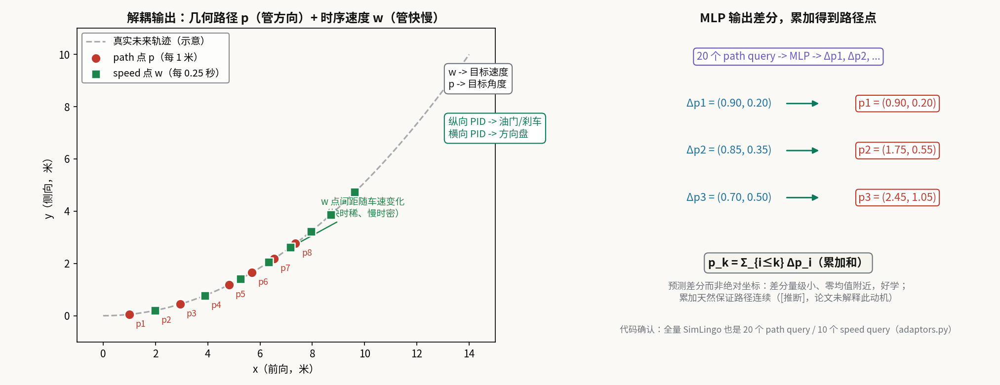
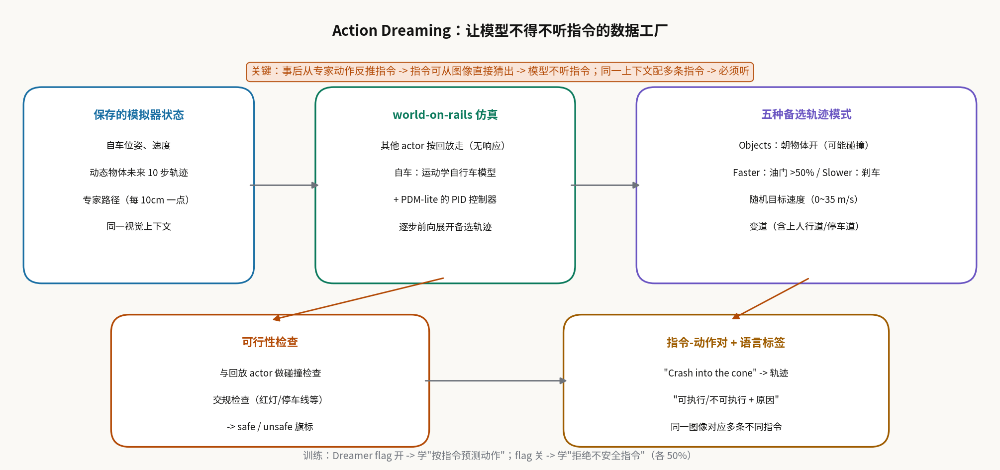
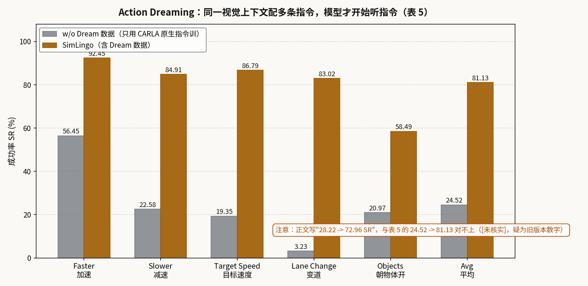

# VQA 对齐的是嘴，Dreaming 对齐的是手：SimLingo 让 VLM 在闭环里真的听指令开车

> **信息块**
> - 论文标题：SimLingo: Vision-Only Closed-Loop Autonomous Driving with Language-Action Alignment
> - 作者：Katrin Renz, Long Chen, Elahe Arani, Oleg Sinavski（Wayve、图宾根大学、图宾根 AI 中心；注：第一作者工作完成于 Wayve 实习期间）
> - 会议：CVPR 2025 Highlight（官方仓库 News 栏 2025-04-28 写"accepted to CVPR as a highlight paper"；任务给定亦为 Highlight。注：仓库 README 标题行写的是 "[CVPR 2025, Spotlight]"，疑为笔误，此处从 News 栏与任务给定）
> - 链接：https://arxiv.org/abs/2503.09594（本文按 v1，即 2025-03-12 版精读；这是目前 arXiv 上的版本）
> - 代码：公开，https://github.com/RenzKa/simlingo（含 PDM-lite 专家、数据采集、语言标签生成、dreaming 数据生成、训练与评测；2025-06-25 起陆续放出 checkpoint 与推理代码、HuggingFace 全量数据集）
> - 一句话核心洞见：VQA 测的是语言空间，模型可以嘴上说"看到红灯"、脚下照样踩油门；SimLingo 用"Action Dreaming"——在同一视觉上下文下离线仿真出多条不同指令对应的轨迹（含"撞向锥桶"这种永远不能真执行的指令）——逼模型把指令听进动作里，再配一个解耦的"几何路径+时序速度"输出头，让一个 1B 的 VLM 在 CARLA Leaderboard 2.0 和 Bench2Drive 上都拿到纯视觉 SOTA。

## 先想清楚 VQA 在自动驾驶里到底缺了什么

这篇论文的起点是一个很毒的观察：当时（2024~2025）所有"VLM+驾驶"的工作，语言能力的评估都在**语言空间**里打转——问模型"前面有什么""你为什么刹车"，模型答得头头是道。但没有任何机制保证它的**动作**和它的**回答**一致：它可以一边说"红灯"一边加速，因为回答和轨迹是两个独立的头、两套独立的监督，训练时谁也不约束谁。

作者的论点是：只有当语言输入能**因果地**改变动作时，才能说模型理解了语言。注意"因果"这个词的份量——不是"回答和动作都对"，而是"换一句指令，动作跟着变"。这个标准一立起来，当时所有 VQA 式评估都不及格，于是他们发明了两个东西：一个是数据制造方法（Action Dreaming），一个是评测（指令-动作对齐的成功率）。

但这里藏着一个更深的坑，也是这篇论文真正要解决的技术问题：**如果你事后拿专家开过的轨迹去反推"当时应该配什么指令"，这个指令-动作对是作弊的**。比如专家在红灯前停下，你反推出指令"停下"——模型根本不需要看指令，光看图像里的红灯就能猜出动作，语言通道是摆设。训练出来的"指令跟随"全是视觉 shortcut。这就是为什么作者要搞 dreaming：**同一个视觉上下文，必须配多条不同、甚至互相矛盾的指令**（"加速""减速""撞向那个锥桶"），模型才不得不去读指令。图 4 的定性结果就是证明：同一帧图像，给"左转""右转""直行"三种指令，红色的 path 点真的指向三个不同方向。

## 作者的底牌：为什么是他们能把闭环打下来

SimLingo 的作者表里有两拨人：Katrin Renz 是 DriveLM 的共同一作（PDM-Lite 的主要作者之一），Wayve 的 Long Chen 等人来自 Lingo 系列工作。这意味着他们手里同时有**最好的规则专家**（PDM-Lite，能在 LB2.0 上跑出 36~44 DS，而 TransFuser++ 的 LB1.0 专家在 LB2.0 上只有 2%）和**做驾驶语言模型的产品经验**（Wayve Lingo-1/Lingo-2）。这解释了论文里很多"老手才知道"的细节：数据桶采样、early stopping 刷 LB 分数、target point 的 shortcut 讨论、附录里对 Driving Score 非线性的吐槽。

另一个底气是**评测选择**：当时 VLM 驾驶论文大多只敢做开环（nuScenes 规划）或简化环境（HighwayEnv），作者直接上了最难的两个闭环榜——官方 CARLA Leaderboard 2.0 和 Bench2Drive，并且是**纯视觉**（不要 LiDAR）。表 1 里他们是榜上唯一一个只用相机的 entry（作者注：没算没有方法报告的 entry）。2025 年初的 LB2.0 上，纯视觉能超过带 LiDAR+多辅助任务的 TF++（5.18→6.87），这在当时是反直觉的——默认信念是 LB2.0 的 38 种场景必须靠 LiDAR 和特权信息。

还有一张暗牌：这篇论文的前身是 CARLA Challenge 2024 的夺冠技术报告（arXiv:2406.10165，题注里写了），模型当时叫 CarLLaVA。投 CVPR 时把纯驾驶的轻量版改名为 SimLingo-BASE，全功能 VLA 版叫 SimLingo。这种"先拿冠军再发论文"的路径，意味着方法里的很多选择是被 leaderboard 毒打过的，不是纸上谈兵。

## 架构：一个 1B VLM 是怎么同时吐语言和动作的

SimLingo 基于 InternVL2-1B（Mini-InternVL 家族）：视觉编码器 InternViT-300M-448px + 语言模型 Qwen2-0.5B-Instruct。输入有四样：相机图像 $I$、导航信息（GPS target point TP **或** 高级语言命令 HLC，如"turn left"，训练时随机切换）、自车速度 $v$（直接写进 prompt 的自然语言）、任务 prompt $p_{task}$。

四种任务 prompt 长得不一样：(1) 纯驾驶："Predict the waypoints."；(2) Commentary+驾驶："What should the ego do next?"；(3) VQA+驾驶："Q: 〈question〉?"；(4) Action Dreaming："〈Dreamer flag〉〈instruction〉"。Dreamer flag 是个开关：开 = 按指令预测动作；关 = 判断指令是否安全、不安全的要拒绝。

高分辨率图像处理是 VLM 驾驶的一个实操要点：CLIP 系编码器预训练分辨率只有 336/448，而红绿灯在路口可能只占几个像素。做法是把图像切成 $N_I$ 个 448×448 的 tile 独立编码（主流 VLM 的通用做法），再用 pixel unshuffle（$\rho$）把 token 数降为 1/4。每个 tile 的 ViT 输出是 $32\times32=1024$ 个 token（patch 14），$\rho$ 之后剩 256 个。本文 $N_I=2$，共 512 个视觉 token：

$$e_I = \rho([ViT(i_n)]^{N_I}_{n=0}) \in \mathbb{R}^{(N_I\cdot 256)\times D}$$

$e_I$ 里 $D$ 是 embedding 维度。导航信息：TP 用一个 MLP 编成 $e_{nav}\in\mathbb{R}^{2\times D}$（两个目标点）；HLC 用 LLM 的 tokenizer 编成 $e_{nav}\in\mathbb{R}^{N_{HLC}\times D}$。所有模态的 embedding 由 token interleaver 按全局 prompt $p_{global}$ 的占位符拼起来：

$$e_{LLM} = IL(e_L, e_I, e_{nav}),\quad p_{global} = \text{"〈image features }e_I\text{〉}\backslash n\text{Current speed: 〈}v\text{〉m/s. Command: 〈nav. features }e_{nav}\text{〉. 〈task prompt }p_{task}\text{〉."}$$

然后 LLM 一次前向同时给出语言和动作特征：

$$[o_l, o_p, o_w] = LLM([e_{LLM}, q_w, q_p])$$

其中 $q_p, q_w$ 是可学习的 query token（代码确认：20 个 path query / 10 个 speed query，和 BASE 一致）。**关键的效率选择**：语言是自回归生成的，但动作不是——所有动作 embedding 在**一次前向**里同时算出来，不搞自回归。这对闭环实时性是必需的（虽然论文没给 SimLingo 全模型的 FPS，这是个缺口）。

微调策略：视觉编码器全量微调，LLM 用 LoRA（**所有**线性层，$r=32$, $\alpha=64$, dropout 0.1，附录表 7），引用了 QLoRA 的"全线性层 LoRA 更有效"的结论。优化器 AdamW（weight decay 0.1，lr 3e-5，cosine 退火无重启），DeepSpeed Zephyr-2（应为 DeepSpeed v2，论文写"DeepSpeed v2"），8×A100 80GB，batch 96（每卡 12），14 epoch，24 小时。数据增强比 TF++ 更激进：平移 1.5 米、旋转 20 度。

## 解耦输出：为什么 path + speed 比单纯 waypoints 好 40%

这是论文里最硬的一个架构贡献，消融表 9a 的数字很干净：只用传统时序 waypoints（WPs），LB2.0 DS 3.21，静态碰撞 0.68；加上几何路径点（+Path），DS 4.49（+39.9%），**静态碰撞降到 0**。

先把两种 waypoint 的定义摆清楚。时序速度点 $w\in\mathbb{R}^{N_w\times2}$：未来 $N_w$ 个坐标，每 0.25 秒一个，表示"某个未来时刻自车在哪里"。几何路径点 $p\in\mathbb{R}^{N_p\times2}$：未来 $N_p$ 个坐标，每 1 米一个，表示"未来走过的空间位置"，**与时间无关**。从 $w$ 取目标速度（相邻点距离/0.25s），从 $p$ 取目标角度（路径点的方向），然后**两个 PID 控制器**分别算油门/刹车和方向盘。

为什么解耦有用？论文的解释是：只用时序点做转向监督时，转弯和绕障时容易出问题；而路径点提供了**更密的监督**——车静止时时序点全挤在原地、没有方向信息，但路径点照样每 1 米给出几何形状，"即使停车也在学怎么打方向"。这是一个很漂亮的直觉：**把"往哪开"和"开多快"拆成两个不同密度的监督信号**。

*图注：自绘，示意。左：左转弯道上，红色 path 点等弧长分布（静止时也有方向信息），绿色 speed 点间距随车速变化；右：MLP 预测的是差分 Δp，累加得到路径点。query 数经代码确认：全量 SimLingo 也是 20 个 path query / 10 个 speed query（adaptors.py）。*

还有一个实现细节：MLP 不直接预测绝对坐标，而是预测**差分**，再累加得到路径点（$p_k=\sum_{i\le k}\Delta p_i$）。论文没解释为什么这么做（[推断]：差分量级小、在零附近，好学；累加天然保证路径连续，不会出现预测点跳变）。损失函数是 path 和 waypoints 上的 smooth-L1 + 语言 token 的交叉熵——注意是从 L2 换到 smooth-L1 的，附录 B.3 说加入 Action Dreaming 数据后 L2 训练不稳定才换的。这是一个典型的"装饰性改动背后的真实故事"：dream 数据里有大量极端轨迹（撞锥桶、急加速），L2 对 outlier 的平方惩罚把训练炸了。

## Action Dreaming：让模型不得不听指令的数据工厂

这是论文的第二个核心贡献，一套数据生成方法 + 一个评测基准。

**为什么需要 dreaming**，开头已经说了：事后反推指令会产生视觉 shortcut。现在看**怎么做**。数据采集时，除了正常开车，还存下了一部分模拟器状态：自车位姿速度、每个动态物体未来 10 步的轨迹、专家路径（每 10cm 一个点）。然后离线做"world-on-rails"仿真：**其他 actor 按回放走、对自车无响应**（这是 [9] 的假设），自车用运动学自行车模型 + PDM-lite 的 PID 控制器前向展开。在此基础上生成五种备选轨迹：

- **Objects（碰撞）模式**：筛出自车路线 15 米内、前方 3 米外的动/静态物体，算自车能否在某未来时刻到达该物体，调路径点让路线穿过物体、配到达目标速度——生成"撞向锥桶/车辆"这类指令的动作；
- **Faster**：转向沿用原路径，油门给一个 >50% 的随机值；
- **Slower**：油门归零、踩刹车；
- **随机目标速度**：0~35 m/s 随机一个，和默认路径一起送进前向仿真；
- **变道**：排除已在变道或在路口的帧，根据车道信息（同向/对向、行车道/停车道/人行道）改路径，变道起始距离和过渡段长度随机（按当前车速条件化）。

每条备选轨迹做**碰撞检查**（和回放的 actor 包络盒相交）和交规检查，得到 safe/unsafe 旗标，再配一条语言标签说明"能不能执行+为什么不能"。

*图注：自绘。核心洞察：事后从专家动作反推指令，指令可从图像直接猜出，模型不听指令；同一上下文配多条矛盾指令，模型必须读指令。world-on-rails 假设（其他 actor 无响应）是这套方法的阿喀琉斯之踵，见怀疑式审读。*

训练时专家轨迹和 dream 轨迹 50/50 采样；dream 轨迹里 Dreamer flag 开/关各 50%——开的时候学"按指令预测动作"（哪怕指令是"加速闯红灯"也要在 dreaming 模式里画出对应轨迹），关的时候学"拒绝不安全指令"。评测（表 5）在 Town 13 的 dream 数据上做，成功率按类别分别定义（附录 B.4）：减速看速度曲线的斜率 $<-0.05v$，加速看 $>0.05v$，目标速度看最后两点推出的速度是否在指令值的 20% 内，变道看预测终点离 dream 终点是否比离专家终点更近，物体模式看路径 ADE 更接近谁。

结果：不加 dream 数据的基线平均成功率 24.52%，SimLingo 81.13%。**但正文里写的是"(28.22 to 72.96 SR)"，和表 5 的 24.52→81.13 对不上**（[未核实]，疑似旧版本数字没更新）。引用时用表 5 的数字。

*图注：按表 5 绘制。注意正文中的"28.22→72.96"与表 5 的"24.52→81.13"不一致，疑为版本更新遗留。*

定性结果（图 4、附录 D）比数字更有说服力：同一场景给"左转/右转/直行"，红色 path 点真的分叉；"Turn left"在路口前是左转、在多车道路上是先变道准备（模型理解了"左转"在不同上下文是不同动作）；误导性指令"Turn right"（路口根本没有右转道）下模型困惑了一下但闭环开起来还是直行；离谱指令"I really like my dog"也能选出合法路径（说明不是关键词 overfit）；但"Do a U-Turn"失败——训练里没见过掉头，dream 数据没覆盖，模型就不会。这个失败案例其实反证了方法的边界：**dreaming 的泛化能力 = 备选轨迹模式的覆盖范围**。

## Commentary：默认开着的 chain-of-thought，到底有没有用

SimLingo 推理时默认先做 Commentary（"下一步该做什么、为什么"），再以生成的 commentary 为条件预测动作——一个 chain-of-thought 的闭环。Commentary 的标签是全新设计的（DriveLM 的标签体系里没有），分三段：

1. **路线动作**：默认"Follow the route."，只在需要偏离车道中心的场景（障碍绕行、开门杀、让 emergency vehicle 等）换模板，还分三个阶段——偏离前（"Go around the construction site."）、偏离中（"Stay on your current lane to go around…"）、偏离结束（"Return to your original route after avoiding the obstacle."，纯前视看不见障碍时用通用句）；
2. **速度动作**：六档——Remain stopped / Come to a stop now / Maintain your current speed / Maintain the reduced speed / Increase your speed / Slow down，由当前速度、专家目标速度、限速共同决定；
3. **速度原因**：直接取 PDM-lite 的 IDM 模块算出的 **leading object**（IDM 本来就要找"让我减速的那个东西"，天然就是因果解释），按物体类型组织语言：车辆给颜色+车型+相对方位（"the red SUV that is slowing down"），行人区分儿童/成人，红绿灯带状态。路口前再加一句 junction notice（四种模板之一，如"pay attention to the vehicle in the junction"）。

这个设计聪明在**解释不是事后编的，是从专家的内部状态直接读出来的**——IDM 的 leading object 就是专家减速的真实原因，所以 commentary 和动作天然一致，绕开了开头说的"嘴手不一"问题。

但 CoT 到底给驾驶带来了多少？表 10：不开 CoT，Bench2Drive DS 84.41±1.76；开 CoT，85.07±0.95。**差 0.66 个点，标准差 1~1.8——统计上不显著**。作者在结论里亲口承认"还没有观察到统计显著的提升"，并推测需要"CoT 专用的数据和训练配方"。这是一个诚实的负结果，也给后来者指了路：**把解释拼在动作前面，不等于模型真的在用解释做推理**——commentary 可能是动作的条件，也可能只是动作的同声传译。要验证因果，需要干预实验（比如篡改 commentary 看动作变不变），论文没做。

## 实验：三个榜，三个故事

**Leaderboard 2.0（表 1）**：提交的是轻量版 SimLingo-BASE（无语言能力、50M 参数的 LLaMA 架构 transformer 从零训练，见附录图 5）。Sensor track DS 6.87，超过 TF++ 的 5.18（+32.6%，对上"33%"的说法）；Vision-Language track 6.25。**"4.6x 于 CaRINA hybrid"这个说法按表 1 的数字验算对不上**：6.25/1.23=5.08x，6.87/1.23=5.58x，都不是 4.6x（[未核实]，可能是投稿时 leaderboard 上的旧分数）。引用时建议直接用表里的绝对值。

表 1 还有两个值得玩味的细节。第一，LB2.0 的 DS 有个**已知的 metric 缺陷**（附录 B.4 讨论，引用 [67]）：DS=RC×IS，长路线上多开一段路可能多吃罚分，不如早停——作者于是加了 early stopping（跑够指定距离、方向盘接近 0 时停车），阈值 2100 米时 DS 6.87，1300 米时只有 3.93（表 9c）。**阈值这个超参数对最终分数的影响，和模型本身的改进是一个量级**。第二，LB 方差极大：同一模型交三次，6.9/5.5/5.3（std 0.87）。在这种方差下，"SOTA"三个字的含金量要打折扣——作者把方差数据放在附录 C.1，是加分的诚实。

**Bench2Drive（表 2）**：SimLingo DS 85.07±0.95，成功率 67.27±2.11；BASE 版 85.94/66.82——**全功能 VLA 版和纯驾驶版打平**，这是论文标题"unifying"的核心证据：加了一堆语言能力，驾驶没掉。公平性处理做得用心：榜上其他方法都用不开源的 Think2Drive 专家数据训的，作者用 PDM-lite 重采了数据，为了公平把最强的开源基线 TCP-traj w/o distillation 拿自己的数据重训了一遍（49.30→45.65），再调了控制器（→63.45）。即使用了同样的专家数据，SimLingo 还是领先 20 多个点，说明提升不止来自数据。Multi-ability 表 8：平均 67.03，比 DriveAdapter 的 42.08 高 25 个百分点，Merging/Overtaking/Emergency Brake/Traffic Sign 四项提升最大，Give Way 依然难（53.33）。

**语言能力（表 3）**：在 DriveLM-hard（330 种答案类型、每种 10 个样本的均衡集）和 Commentary（190 种答案类型）上，SimLingo-1B 的 GPT 分数 58.48/78.94，零样本的 InternVL2-1B 只有 33.08/14.95。两个诚实细节：一是 InternVL2 从 1B 到 4B，零样本 VQA 的 GPT 分数**反而下降**（33.08→31.22→27.11），大模型在分布外驾驶问答上没有自动变好；二是作者还训了一个**只训 DriveLM 的 InternVL2-1B**，GPT 63.85，比多任务 SimLingo 的 58.48 还高一点——多任务没有免费午餐，通用性吃掉了一点单项分数，作者把这行字写出来了。

**导航指令（表 4）**：GPS target point vs 纯语言命令"HLC"（如"turn right"），DS 85.07 vs 86.08，在方差内打平。这个结果的潜台词是 TF++ 里讨论过的 **target point shortcut**：GPS 点直接告诉模型"200 米后在那"，模型可以不看路只追点；SimLingo 用语言命令也能开一样好，说明它真的在看路。这个消融是冲着审稿人可能质疑的 shortcut 去的。

## 怀疑式审读：这篇论文哪里硬，哪里软

**训练混合比的"提升"在噪声里。** 表 6：全功能 85.07±0.95，去掉 VQA 84.41±1.38，再去 commentary 84.55±0.42，纯驾驶 84.67±1.52。正文说"Action Dreaming 略微提升驾驶"，但 85.07 和 84.67 的差（0.4）远小于标准差（~1.5）。**严格来说，这张表证明的是"加语言任务不伤害驾驶"，而不是"dreaming 帮助驾驶"**。作者的措辞（"slightly improves"）是擦边球，读的时候要自己把显著性算一遍。

**Dreaming 的 world-on-rails 假设是阿喀琉斯之踵。** 其他 actor 按回放走、不响应自车——这意味着备选轨迹的碰撞检查是**悲观**的：现实里你变道，旁车可能会让；回放里它不让，碰撞检查就判 unsafe。反过来也可能是**乐观**的：你加速闯红灯，横向车辆在回放里按原速走，现实里它可能也在加速。safe/unsafe 旗标和"能不能执行+原因"的语言标签， fidelity 上限就是运动学自行车模型 + PID + 无响应回放。论文没有量化这个仿真 gap（比如把 dream 轨迹拿到真闭环里跑，看预测的 safe/unsafe 和实际结果的一致性）。这是整套方法最值得被挑战的地方，也是后续工作最容易发力的点。

**LB2.0 的分数是 BASE 版的，不是 SimLingo 的。** Leaderboard 2024 年 6 月关闭，作者没赶上交全功能版——结论里承认了。Bench2Drive 上两者打平（85.07 vs 85.94）是间接证据，但 LB2.0 的长路线+38 种场景和 Bench2Drive 的 150 米短路线不是一回事，**"SimLingo 是 LB2.0 SOTA"这个标题句，严格来说是 SimLingo-BASE 的成绩**。

**只在仿真里。** CARLA 的纹理、光照、交通流和真实世界有 gap，作者在 limitation 里认了。更实际的问题是**延迟**：论文没给全量 SimLingo 的 FPS（BASE 版是 50M 小模型，全量是 1B VLM + 自回归 commentary + 一次前向动作），limitation 里只说"相信小 VLM 和工程优化能解决"。一个 0.5B LLM 的自回归 commentary 在车载芯片上的延迟是真实存在的成本，论文选择不谈。

**超参数给得全，但有两个缺口**：$N_w$（时序点数）和 $N_p$（路径点数）在全量模型里没写（BASE 图 5 是 20/10，[未核实]全量是否相同）；VQA 的 GPT-4 改写（每题 20 个 paraphrase）只用于 VQA，没用于 Commentary（commentary 本来就是模板生成的，多样性更低——表 3 里 commentary 的 SPICE 38.04 远低于 VQA 的 56.77，部分原因在此）。

**一个被验证的反常识**：视觉编码器消融（表 9b）——CLIP 预训练的 ViT 6.87，从零训练的 ViT 0.45，ImageNet 预训练的 ResNet-34 2.71。**互联网图文预训练对驾驶的贡献（6.87 vs 0.45）比架构选择大得多**，这和 DriveLM 的"通用 VLM 泛化更好"互相印证。做驾驶的人容易低估这一点。

## 代码核对：论文说的和代码做的，几处对得上、几处对不上

SimLingo 仓库（RenzKa/simlingo，6238 个文件，基于 carla_garage）是这次两篇论文里代码最完整的一个：PDM-lite 专家、数据采集、语言标签生成、dreaming 数据生成、base/final 训练、闭环评测都在。逐条核对论文的关键声明：

**对得上的**：`simlingo_training/models/adaptors/adaptors.py` 第 111 行 `future_waypoints = 20`、第 128 行 `future_speed_waypoints = 10`——全量 SimLingo 和 BASE 一样是 20 个 path query / 10 个 speed query（论文正文没写全量模型的 query 数，代码确认了）；第 209 行 `F.smooth_l1_loss`，和"从 L2 换到 smooth-L1"对得上；`dataloader/datamodule.py` 第 96 行 `weights_driving = 0.5`，专家/dream 50/50 对得上；`dataset_dreamer.py` 里 Dreamer flag 的逻辑和论文一致：flag 开（activate_safety）且该选项 unsafe 时，答案变成拒绝执行的安全文本，否则输出"Following the given instruction. Waypoints:"加轨迹；数据桶配置 `carla_bucket_v12_dreamer.yaml` 的桶名和概率（`all: 0.082`、各加减速桶 0.03、转向桶 0.12 等）和附录 B.2 的描述一致。

**对不上的**：Objects（碰撞）模式的物体筛选。论文附录 A.4 写"只保留自车路线 15 米半径内、前方至少 3 米的物体"；代码 `dreamer_generator.py` 实际用的是 `min_dist_to_route < 7`（到路线距离 <7 米，不是 15 米半径），外加"必须在图像中可见"（`is_vehicle_visible_in_image`）和按类别的距离上限（车辆/行人 <40 米，静态物/地标 <20 米）。15 米这个数字在代码里找不到对应。影响是：实际生成的"撞物体"指令比论文描述的更保守（只选离路线 7 米内的），dream 数据的多样性可能低于论文文字给人的印象。

**论文没细说但代码里有的**：dreamer 的 prompt 里 80% 的概率带导航条件、20% 不带（`dataset_dreamer.py` 第 129 行 `random.random() < 0.8`）；commentary 有 60% 概率做模板改写增强（`dataset_driving.py` 第 105 行）。这些采样细节论文都没提，复现时只能读代码。

## 带走什么

SimLingo 留下了三个可迁移的判断。第一，**语言-动作对齐的试金石是"换指令换动作"，不是"问答答得对"**；而拿到这个试金石的前提，是同一视觉上下文配多条矛盾指令的数据——事后反推的指令-动作对是作弊的，这个坑比方法本身更值得记住。第二，**解耦的几何+时序输出**：让"往哪开"和"开多快"用不同密度的监督分开学，静态碰撞从 0.68 降到 0，这个技巧不依赖 VLM，任何轨迹预测头都能用。第三，**解释标签要从专家的内部状态读，不能事后编**：commentary 的三段式里最值钱的是"速度原因=IDM 的 leading object"，因为那是专家减速的真实原因，嘴和手天然一致。

真正值得做的问题也有三个，都在论文的诚实之处里藏着：一是 CoT 为什么没带来统计显著的提升——commentary 到底是推理的条件还是动作的同声传译，需要干预实验来回答；二是 dreaming 的仿真 gap——无响应的回放 actor 在多大程度上扭曲了 safe/unsafe 标签，能不能用反应式仿真或真实闭环rollout 来校准；三是延迟——1B VLM + 自回归 commentary 的车载实时性，这篇论文把工程问题留给了未来，但它是 VLA 上车的最后一公里。
