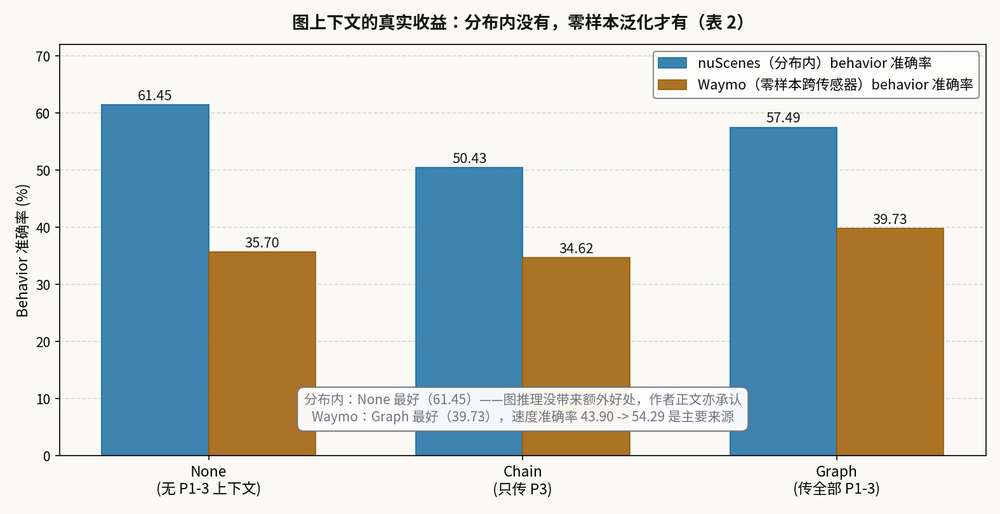
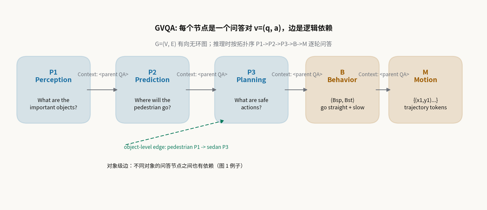
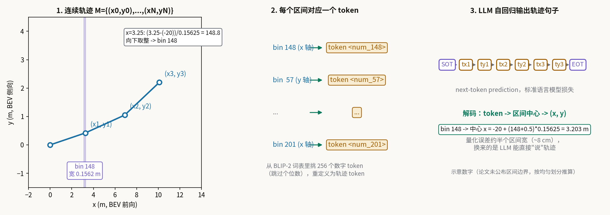

# 把驾驶决策写成一张问答图：DriveLM 的图推理到底买来了什么

> **信息块**
> - 论文标题：DriveLM: Driving with Graph Visual Question Answering
> - 作者：Chonghao Sima, Katrin Renz, Kashyap Chitta, Li Chen, Hanxue Zhang, Chengen Xie, Jens Beißwenger, Ping Luo, Andreas Geiger, Hongyang Li（OpenDriveLab / 上海 AI Lab、图宾根大学、图宾根 AI 中心、香港大学）
> - 会议：ECCV 2024 Oral（arXiv 评论栏与 ECCV 官网 oral 页面均确认）
> - 链接：https://arxiv.org/abs/2312.14150（本文按 v3，即 2025-01-16 的 ECCV camera-ready 版精读；版本历史：v1 2023-12-21，v2 2024-07-17，v3 2025-01-16）
> - 代码：公开，https://github.com/OpenDriveLab/DriveLM ——但注意：公开仓库里只有 DriveLM-Data 的处理脚本和 challenge 起始代码（LLaMA-Adapter-V2），**正文实验用的 DriveLM-Agent（BLIP-2 + 轨迹 tokenization）的训练代码不在公开仓库中**（详见"代码里有什么、没有什么"一节）
> - 一句话核心洞见：把"感知→预测→规划→行为→轨迹"写成一张有向无环图，每个节点是一个问答对，边的逻辑依赖被翻译成最朴素的文本拼接（"Context: 〈父问答〉"），让一个通用的 VLM 按拓扑序逐轮自回归地"推理"出驾驶轨迹——它的真实收益不在分布内精度（那里图推理反而拖后腿），而在零样本跨传感器、跨物体的泛化。

## 先看一个反直觉的结果，再决定要不要信这套方法

表 2（正文 4.1 节）是这篇论文最诚实的一张表，值得先看，因为它同时装着这篇论文的底气和它的边界。

在 DriveLM-nuScenes（分布内，训练和测试同一数据分布）上做开环轨迹规划：一个两阶段的 DriveLM-Agent（先预测行为 B，再由 B 预测轨迹 M，**不**给任何感知-预测-规划问答当上下文，记作 None），behavior 准确率 61.45，ADE 1.39；把完整的图上下文加上（记作 Graph），behavior 准确率掉到 57.49，ADE 升到 1.74。也就是说，**这篇论文引以为傲的图推理，在分布内是没有收益的，甚至是负收益**——作者在正文里亲口承认了这一点。

但把同一个模型、不做任何再训练，直接搬到 Waymo 数据上（传感器配置变了：Waymo 没有后视相机，且 VLM 方法只用前视）：UniAD-Single 的 ADE 从 1.80 恶化到 4.16，碰撞率从 2.62 升到 9.31，彻底垮掉；而 DriveLM-Agent（Graph）的 behavior 准确率从 35.70（None）升到 39.73，其中速度准确率从 43.90 升到 54.29，ADE 2.63，碰撞率 6.17——是全场最好的。

所以这篇论文真正想说的是：**图推理买的不是精度，是泛化**。分布内，VLM 靠行为-轨迹的直接映射就能打平 UniAD-Single（ADE 1.39 对 1.80，碰撞率 1.67 对 2.62）；分布外，显式写出来的推理步骤成了救生索。这个结论的形状很像人类司机：老路开得凭直觉，新路开得靠一步步想。

*图注：根据正文表 2 绘制。分布内 None 最好，作者正文亦承认图版本无额外优势；Waymo 零样本下 Graph 最好，主要来自速度准确率的提升（43.90→54.29）。*

读完这张表，你应该带着两个问题往下读：第一，这张"图"到底是什么，它凭什么被认为是在模仿人类司机的推理？第二，把连续轨迹塞进语言模型嘴里输出，这个看似别扭的设计是怎么 work 的？

## 作者的底牌是哪几张？

附录 A 的 Q13 是作者自己交的底，值得先看。作者承认：这篇论文**不声称算法新颖性**（"we do not make any claims regarding algorithmic novelty, intentionally constructing simple baselines"），自认的技术贡献是任务形式化（GVQA）、数据（DriveLM-Data）和把通用 VLM 适配到驾驶的验证。这是一种聪明的投稿策略：ECCV Oral 级别的评审里，"第一个把某事做成标准任务+数据集+基线"是可以成立的，但前提是这个任务真的抓住了领域的一个痛点。

作者的底气有三张牌。第一张是**问题选得准**：2023 年底，VLM 进驾驶有两条路——场景级 VQA（"车在变道因为安全"配一两个理由）和单物体级 VQA（"自车停下因为前面有穿白衬衫的行人"）。两条路都缺了人类司机推理里最关键的东西：**多个物体、多个步骤之间的依赖关系**。图 1 的例子把这点说得很具体：sedan 的规划问答节点，受到 pedestrian 的感知问答节点的影响——这种跨物体的依赖，链式结构写不出来。

第二张是**数据牌**：DriveLM-nuScenes 每帧平均 91.4 个问答对（表 1），感知/预测/规划三个阶段各约 14~15 万对，是当时文本量最大的驾驶语言数据之一；DriveLM-CARLA 全规则生成，160 万问答对，可扩展。更重要的是他们顺手做出了 PDM-Lite——第一个能在 CARLA Leaderboard 2.0 上跑起来的特权规则专家（TransFuser++ 的 LB1.0 专家在 LB2.0 官方验证路线上 DS 只有 2%，PDM-Lite 做到约 44%）。这个副产品后来被 SimLingo 等工作直接拿去用，成了一个独立贡献。

第三张是**诚实牌**：附录 A 用 13 个"motivating questions"主动回答了审稿人最可能打过来的 13 个问题（为什么不用视频输入？为什么没有闭环结果？VLM 真的比 LLM 更懂视觉世界吗？图推理的提升为什么这么小？）。Q9 尤其诚实：图推理在 VQA 分数上提升不大，可能是提示方案太简单、基座 VLM 太小、或者数据里的逻辑依赖不够强——三个可能全列出来，不挑好听的说。这种写法在 Oral 论文里不多见。

## 这张"图"到底长什么样？

GVQA 的形式化很短，但每个符号都值得停一下。图 $G=(V,E)$ 是一个有向无环图（DAG）。每个顶点 $v=(q,a)$ 是一个问答对，关联着场景里的一个或多个关键物体。边 $e=(v_p,v_c)$ 是从父问答指向子问答的有向边，表示逻辑依赖。

边的构造分两个维度。**任务级边**是纵向的推理链：感知 $P_1$（识别、描述、定位关键物体）→ 预测 $P_2$（关键物体未来可能的动作/交互）→ 规划 $P_3$（自车可采取的安全动作）→ 行为 $B$（离散化的驾驶决策，用自然语言描述）→ 运动 $M$（连续轨迹，即 $N$ 个 BEV 坐标点）。**对象级边**是横向的：不同物体的问答节点之间也有影响，比如图 1 里行人的感知节点指向轿车的规划节点。

*图注：自绘。任务级边沿 P1→P2→P3→B→M 纵向传递，对象级边在不同物体的节点间横向传递。推理时按拓扑序逐轮问答，每条边被翻译成 "Context: 〈父问答〉" 的文本前缀。*

运动 $M$ 的形式化是论文里唯一的"公式"（式 1），值得完整走一遍。记自车未来轨迹为 $M=\{(x_0,y_0),(x_1,y_1),\dots,(x_N,y_N)\}$，其中每个点是**未来位置相对当前位置的偏移**（BEV 坐标系，固定时间间隔采样）。定义相邻点差分：

$$\{x,y\}_{dist}=\{(\delta_{x,1},\delta_{y,1}),\dots,(\delta_{x,N},\delta_{y,N})\},\quad \delta_{x,i}=x_i-x_{i-1},\ \ \delta_{y,i}=y_i-y_{i-1}$$

小实例：设 $N=3$，轨迹点为 $(0.5,0.1),(1.2,0.3),(2.0,0.4)$（起点 $(x_0,y_0)=(0,0)$）。则 $\delta_x=(0.5,0.7,0.8)$，$\delta_y=(0.1,0.2,0.1)$。$x_{dist}$ 的均值是 $0.667$（米/间隔），$y_{dist}$ 的均值是 $0.133$。这两个均值接下来被映射到行为分箱里。

行为 $B$ 是 $P_{1-3}$ 到 $M$ 的接口，定义为 $B=(B_{sp},B_{st})$：速度维 $B_{sp}\in\{fast_2,fast_1,moderate,slow_1,slow_2\}$，转向维 $B_{st}\in\{left_2,left_1,straight,right_1,right_2\}$，下标数字表示强度。上面的例子：$x_{dist}$ 均值 0.667 对应纵向速度档（比如 slow 或 moderate，取决于分箱边界），$y_{dist}$ 均值 0.133 接近 0 对应 straight。**注意一个论文没说清的点**：分箱的具体数值边界在正文和附录里都没有给出（[未核实]），复现时只能自己定。这是全文为数不多的、想动手的人会被卡住的地方。

## "Context: "——把逻辑依赖翻译成最笨的办法

图有了，VLM 怎么"沿着边推理"？作者选了最朴素的实现：**对每条边 $e=(v_p,v_c)$，把父节点的问答原文拼到子节点的问题前面，加一个前缀 "Context: "**。父节点多了就全拼起来。没有图神经网络，没有注意力掩码的特殊设计，就是字符串拼接。

训练和推理的上下文来源不一样，这是理解这篇论文的一个关键细节。**训练时用 teacher forcing**：子问题的上下文是父节点的**真值**问答，所有问答对一起训练，目标是标准的 next-token prediction。**推理时是多轮交互**：按 $P_1\to P_2\to P_3\to B\to M$ 的顺序，先让模型答完前一阶段，用它**自己预测的答案**拼出后一阶段的上下文，再问下一个问题。训练和推理的图大小也可以不一样：训练用全图的所有问答，推理时按启发式在每个阶段采样一个子图（附录 F.1，原因是各帧的问答数方差超过 260，直接全跑开销不均）。

行为阶段 $B$ 的设计是全文最值得琢磨的一个判断。作者发现：几乎所有驾驶事件的决策都可以离散成"刹车/跟车/变道"这类行为，于是**行为预测的上下文直接用全部 $P_{1-3}$ 问答**，让 $B$ 成为整张图的信息汇总点，再由 $B$ 单独驱动 $M$。这个"漏斗"结构是 DriveLM-Agent 在开环规划上能打平 UniAD-Single 的直接原因——表 2 里所有 DriveLM-Agent 行的 Motion 上下文都是 B。

然后是那个诚实但扎眼的消融：None（行为阶段不看 $P_{1-3}$）在分布内全面最好。为什么？一个合理的推断（[推断]）：分布内测试时，行为-轨迹映射本身已经被训练集覆盖得很好了，前面阶段的预测答案反而引入噪声——多轮推理的每一步都在放大前一步的误差（附录图 13 的定性例子里，预测阶段把静止的卡车判成 moving 就是典型）。而在 Waymo 上，传感器变了，直接映射失效，显式的推理步骤反而成了跨域的锚点：模型至少能说出"前面有车""它在动""我应该减速"，再落到轨迹上。所以**图在这里的角色不是"更准的推理机"，而是"跨域的脚手架"**。论文没有用这个词，但表 2 的数据就是这个意思。

## 让 LLM 直接"说"出轨迹：256 区间 tokenization

通用 VLM 输出不了精细的连续数值，这是把 LLM 搬进驾驶的第一个硬坎。作者从 RT-2 那里借了一个办法：**把轨迹坐标离散化成 token**。

具体做法（正文 3.2 + 附录 E.2）：统计训练集轨迹的分布，把 $x$ 轴和 $y$ 轴各切成 256 个区间；每个区间对应词表里的一个 token。具体映射时，从 BLIP-2 的语言 tokenizer 里找出表示数字的 token ID，**跳过个位数 token**（作者的理由是"保持连贯性、保留表达数值的语言能力"——这个理由比较含糊，[推断]可能是怕个位数 token 在语言任务里太常用，重定义它们会破坏语言能力），从剩下的数字 token 里挑 256 个，一一对应 256 个区间；再加两个特殊 token：轨迹开始 SOT 和轨迹结束 EOT。训练时把轨迹写成 token 句子，用同一个 BLIP-2（独立的 LoRA 权重，只在运动阶段的问答上训练）自回归地"说"出来。

*图注：自绘，示意数字。论文只说了"按训练集轨迹统计切 256 个区间"，区间边界、256 个 token 的具体挑选规则均未公布（[未核实]）；图中使用均匀划分示意。量化误差约半个区间宽（8cm 量级），换来的是 LLM 能用标准语言模型损失直接输出轨迹。*

走一个完整的编解码：设 $x$ 轴范围 $[-20,20]$ 米（示意），区间宽 $40/256=0.15625$ 米。$x_1=3.25$ 米 → $(3.25+20)/0.15625=148.8$ → 向下取整得 bin 148 → 映射到某个数字 token，比如词表里原来表示 "148" 的那个 token。三个轨迹点共 6 个坐标，变成 6 个 token，前后加上 SOT/EOT，LLM 输出 8 个 token 的序列。解码时反查：bin 148 的中心是 $-20+(148+0.5)\times0.15625=3.203$ 米，量化误差约 4.7 厘米。

这个设计的妙处在于**零架构改动**：不需要给 VLM 加回归头，轨迹预测变成了语言建模，LoRA 微调就能训。代价是量化误差和"token 之间没有数值距离概念"（bin 147 和 bin 148 在 embedding 空间里不比 bin 1 和 bin 200 更近，模型得从数据里重新学顺序）。RT-2 在机械臂上证明了这条路走得通，DriveLM 是把它第一次系统地搬到驾驶轨迹上。

表 14 附录里有一个漂亮的 sanity check：给 BLIP-RT-2（无推理的单阶段版本）直接喂**真值行为**当上下文（记作 B*），behavior 三项准确率全到 100%，ADE 2.41——说明只要行为判对了，token 化轨迹的解码本身是可靠的，瓶颈在前面的决策，不在离散化。

## 两套数据，两种标注哲学

DriveLM-Data 是这篇论文最硬的资产，由两套互补的数据集组成。

**DriveLM-nuScenes** 走人工路线：从 nuScenes 视频里选关键帧（要求信息丰富、能预示未来状态变化），选关键物体（给预标注框，标注员可追加 GT 里没有的物体），再按 5 位领域专家设计的模板逐帧标注问答。事实类问题用规则从 nuScenes/OpenLane-V2 真值生成，开放性问题人工写。质量控制是多轮的：每批 8 个视频 clip，抽 10% 检查，不合格整批打回重标。标注员是中文母语者，标完用词表映射 + GPT-3.5 翻成英文再人工校对——**这个翻译链路是数据质量的一个隐忧**，论文没有报告翻译错误的比例。最终 4072 训练帧 / 799 验证帧，平均每帧 91.4 个问答对，感知/预测/规划各约 14~15 万对（表 1）。物体用 `<c, CAM, x, y>` 标签编码（编号、所在相机、2D 框中心坐标），附带每帧的物体字典（框大小、类别、运动状态、视觉描述）。

**DriveLM-CARLA** 走全规则路线：用自研的 PDM-Lite 专家在 CARLA 0.9.14 + Leaderboard 2.0 框架下跑路线，4 FPS 记录传感器数据，按专家决策变化抽关键帧，用手写句子模板从模拟器特权信息生成问答，再按图 10 的固定图结构连边。全程无人工，可扩展到 160 万问答对（64,285 帧；另有 5,721 帧的关键帧子集）。作者承认模板句式单一是局限，提了一句"未来可以用 GPT-4 改写扩增"，但这一版没做。

**PDM-Lite** 值得单独说，因为它是被引用最多的副产品。六个阶段：A* 全局路径规划（200 米稀疏目标点之间插值成密集路径，附带限速/红绿灯/停车线信息）→ 对 50 米内动态 actor 做 2 秒、20Hz 的恒定动作假设预测（运动学自行车模型）→ 对每辆车/行人/非绿灯/停车标志**迭代**应用智能驾驶员模型 IDM 取最小目标速度 → 用该速度前向仿真 2 秒 → 检查自车包络盒与其他车辆的相交，撞就否决该速度提案（置零）→ 横向 PID + 纵向线性回归控制器输出 steer/throttle/brake。相比 PDM-Closed 的 16 个提案+复杂代价函数，PDM-Lite 只用 2 个提案和更简单的代价函数，轻到能规模化生成问答。

IDM 参数表（附录表 8）是复现的关键，原样列出：期望速度 $v_0=0.72\times$限速；期望净距 $s_0$ 按前车类型取 4.0/2.0/6.0/4.0/2.0 米（车辆/自行车/停车标志/红绿灯/行人/静态物）；期望跟驰时距 $T$ 取 0.25/0.1/0.1/0.1/0.1 秒；最大加速度 $a=24.0\ \mathrm{m/s^2}$（这个数大得离谱，正常 IDM 取 1~2，[推断]可能是 CARLA 里的归一化单位或笔误，但论文和代码报告里就是这么写的）；最大减速度 $b=8.7$（$v\le6.02$）/$3.72$（$v>6.02$）；加速度指数 $\delta=4.0$。

**一个数字对不上，值得记下来**：正文说 PDM-Lite 在官方 LB2.0 验证路线上 DS 达到 44%，但附录表 9 的三种子平均是 36.3±28.1。44% 可能是某个最好的种子或某次提交的成绩，论文没有说明两者的关系（[未核实]）。引用时建议用附录表的 36.3±28.1，并注明方差极大（路线 7、17 的 DS 只有 3~4，路线 9、19 高达 73~87）。

## 泛化实验：图到底在哪赢了？

论文围绕四个研究问题组织实验，三个关于泛化的结果最有信息量。

**跨传感器（表 2，Waymo）**：训练只在 DriveLM-nuScenes 上，测试在 Waymo val 随机 1k 帧。UniAD-Single 因为 Waymo 没有后视相机输入直接垮掉（ADE 4.16，碰撞 9.31）；BLIP-RT-2（无推理）ADE 2.78 碰撞 6.47，已经更好——说明 VLM 的预训练视觉表征本身就比驾驶专用架构更抗传感器变化；再加上图上下文，behavior 准确率 39.73、速度准确率 54.29、ADE 2.63、碰撞 6.17，全场最优。**注意实验设计的一个细节**：Waymo 上没有标注，问题是规则生成的——先用 nuScenes 的通用感知问题问一遍，从答案里匹配"pedestrian/car/truck"等词，再自动生成后物体的预测/规划问题。这个流程里，问题的质量依赖模型自己的感知答案，定性结果（图 4、图 15）没有真值对照，只能看个大概。

**跨物体（附录表 11，DriveLM-CARLA-ped）**：训练集里完全没有行人，测试集全是行人过街帧，正确行为是停车。TransFuser++ 从 70.19 掉到 8.72，DriveLM-Agent 从 59.63 掉到 4.59——都没躲过。但 VLM 架构的好处在这里显出来：**推理时往图里加一个新问题**"Is there a person in the scene?"再加一个跟进问题，准确率从 4.59 升到 27.04；如果再给真值上下文（作弊上界），能到 92.35。失败模式作者也诚实地画出来了（附录图 16）：检测到行人但行为没转成停车、以及根本没检测到行人。27.04 这个数字本身不高，但它证明的是**图结构给了模型一个"事后打补丁"的接口**——不重新训练，只改提问方式，就能部分修复分布外失效。这是整篇论文里最有"agent 味"的一个实验。

**问题级分析（表 3）**：把各阶段代表性问题逐批加进行为问题的上下文。只加感知问题（ID 1-3）时 behavior 准确率约 54~55；加入预测问题（ID 4-6）跳到约 57~59；再加规划问题（ID 7-9）基本不动（58.95→57.49）。作者的结论是：**预测和规划阶段的问答标注是性能增益的主要来源**，规划问题相对预测是冗余的（"其他车辆的未来状态已经包含了做行为决策所需的全部信息"）。这个结论对后来者设计问答模板有直接指导意义：感知问题可以少标，预测问题要多标。

## 怀疑式审读：哪些结论可以信，信到什么程度

**指标体系是全文最软的一块。** $P_{1-3}$ 的问答评估，主指标是 GPT Score：把问题、真值答案、预测答案发给 ChatGPT-3.5，让它打 0~100 分。作者选它的理由在附录表 12 里：BLEU-4、METEOR、CIDEr、ROUGE-L、SPICE 五个传统指标在"加图上下文"这个干预下**趋势不一致**——比如 BLIP-2 在 nuScenes 上，Graph 相对 None，CIDEr 从 0.1185 掉到 0.0771，Completeness 从 1.064 掉到 0.859，但 SPICE 从 4.34 升到 7.71，GPT 从 42.97 升到 45.21。传统指标互相打架，作者于是选了"最讲语义"的 GPT Score 当主指标。这个选择有道理，但代价是：**GPT-3.5 的打分不可复现**（模型版本、采样温度都没固定，论文只给了 prompt），而且分数本身动得很少（42.97→45.21，涨 2 分也算"提升"）。更诚实的做法是像附录表 12 那样把所有指标并列，让读者自己看——正文表 4 只放了 SPICE 和 GPT 两个，读的时候要知道还有四个没放上来。

**开环评估的辩护与边界。** 附录 Q3 专门回应了开环评估的质疑：DriveLM 只在关键帧（自车意图变化的帧）上评估，ego 历史在这里指示性不强，所以没喂 ego 状态。但这仍然是开环：模型永远不用为自己的错误付出代价。作者在 Q4 承认，4B 参数模型跑 CARLA 要求的 20 FPS 需要蒸馏/量化/缓存等工程投入，闭环结果"留给未来"。考虑到他们手里有 PDM-Lite 和全套 CARLA 数据生成管线，这个缺席与其说是不能，不如说是没排上——但对读者而言，**所有驾驶性能数字都是开环的**，这是引用时必须加的限定词。

**基线选择。** UniAD-Single 是作者自己训的单帧版 UniAD（原版用视频输入，作者承认单帧 VLM 比不过有视频的 UniAD 原版）；Command Mean 是个稻草人（按导航命令取训练集轨迹均值，ADE 4.57）。BLIP-RT-2（同架构无推理）是最有信息量的基线，它和 DriveLM-Agent 的差距就是"推理"二字的全部身价——分布内这个差距是负的，分布外是正的。

**代价。** 表 5：DriveLM-Agent 总参数 3.955B（BLIP-2 flan-t5-xl），可训练 12.9M（LoRA），FLOPs 24.2T，0.16 FPS；UniAD-Single 131.9M/58.8M/1.7T/1.8 FPS。慢 10 倍，论文归因于 LLM 吞吐（8.5 tokens/s）和多轮问答。附录 Q5/Q6 的回应是"LLM 推理优化是正交方向，社区进展会解决"——这话在 2023 年底写的时候还算成立，但把实时性完全外包给"未来"，对一个自动驾驶 baseline 来说是偏乐观的。

**超参数与可复现性。** 训练细节给得意外地全：LoRA、lr 0.0001、无 scheduler、seed 1234、BLIP-2 最大序列长度 400、nuScenes 训 10 epoch（8×V100，batch 2/GPU，约 7 小时）、CARLA 训 6 epoch（4×A100，约 6 小时）。但行为分箱的数值边界、轨迹 tokenization 的区间边界和 256 个 token 的挑选规则都没给（均已标注[未核实]），DriveLM-Agent 的训练代码也未公开——**这篇论文是"可理解但不可完整复现"的**。

**附录表 13 的星号**：LLaMA-Adapter V2 有两行，一行带星号（55.31/61.97/81.43/1.86/2.03），一行不带（57.83/67.21/83.49/1.75/1.69），正文说多帧输入"略有提升"。按数字反推，不带星号的是多帧版（[推断]，论文未明确说明），提升幅度确实很小（ADE 1.86→1.75）。结合附录 Q12"多帧输入不一定提升（causal confusion）"的论述，作者对时序信息的态度是暧昧的——单帧是这篇论文的一个有意识但偏弱的选择。

## 代码里有什么、没有什么

公开仓库（OpenDriveLab/DriveLM，142 个文件，depth-1 clone）包含：DriveLM-nuScenes 的数据准备文档与脚本（docs/data_prep_nus.md、docs/data_details.md、docs/gvqa.md）、2024 年 Autonomous Grand Challenge 的起始代码（基于 LLaMA-Adapter-V2-7B 的微调/评测管线，含 GPT 评测脚本 challenge/gpt_eval.py）、官方评测服务器的提交格式。**没有**：DriveLM-Agent 本体（BLIP-2 + LoRA + 图提示训练循环）、轨迹 tokenization 的实现（256 区间划分、token 重映射、SOT/EOT）、推理时的多轮图问答调度。仓库 README 的 News 栏也写了"计划发布灵活的训练起始代码（stay tuned）"。所以论文与代码的关系是：**数据与评测可复现，模型方法不可直接复现**。文档中所有关于 tokenization 边界、行为分箱阈值的[未核实]标注，根源都在这里。

## 带走什么

这篇论文留下了两个可以迁移的想法。第一，**把决策过程写成"可提问的图"**：当你希望模型在分布外还能挣扎一下时，显式的中间问答步骤比端到端的直接映射更抗迁移——不是因为它推理得更准，而是因为它把失效点暴露成了自然语言，后续可以用"加一个问题"的方式打补丁（行人实验就是例证）。第二，**行为离散化作为语言与控制的接口**：5×5 的行为分箱看起来粗糙，但它让"LLM 说人话"和"控制器要数值"这两件事解耦了，token 化轨迹只负责把行为翻译成路点。

真正值得做的问题，作者自己在附录里点了两个：图推理在 VQA 分数上的提升为什么这么小（Q9）——是提示方案太弱、基座模型太小，还是数据里的逻辑依赖本身不够强？DriveLM-CARLA 的存在就是为了让人能控制变量地研究这个问题。另一个是问题设计的方法论（Q10）：到底应该问哪些问题，作者承认"我们给不出详细的 protocol"，表 3 的问题级分析只是一个起点。对于做 agent 式驾驶的人来说，这两个问题比论文的 baseline 本身更重要：**GVQA 的图是手写的，如果图的结构和问题能从数据里学出来，或者能按需动态展开，这套框架才算真正活过来**。
