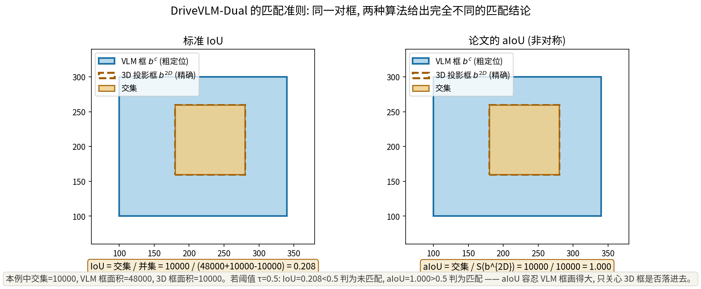
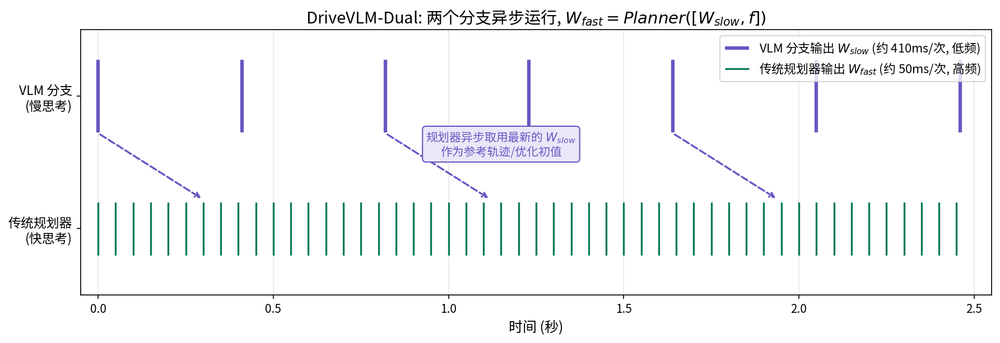

# VLM 负责看懂世界, 传统规划器负责踩准节拍: DriveVLM 的快慢双系统

> **信息块**
>
> - **论文标题**: DriveVLM: The Convergence of Autonomous Driving and Large Vision-Language Models
> - **作者**: Xiaoyu Tian*, Junru Gu*, Bailin Li*, Yicheng Liu*（*共同一作，排名随机）, Yang Wang, Zhiyong Zhao, Kun Zhan, Peng Jia, Xianpeng Lang, Hang Zhao（通讯）
> - **单位**: 清华大学 IIIS（MARS Lab）+ 理想汽车
> - **会议**: CoRL 2024（第 8 届 Conference on Robot Learning，慕尼黑）
> - **arXiv**: [2402.12289](https://arxiv.org/abs/2402.12289)（本文按 v5，2024-06-25 版精读，共 30 页）
> - **项目页**: https://tsinghua-mars-lab.github.io/DriveVLM/
> - **代码**: 未找到官方实现代码。GitHub 仓库 [Tsinghua-MARS-Lab/DriveVLM](https://github.com/Tsinghua-MARS-Lab/DriveVLM) 经核实仅为项目主页（index.html + 论文 PDF），无模型、训练或推理代码公开。以下所有机制分析基于论文正文、附录与公式，凡涉及实现细节未交代之处均已标注。
> - **一句话核心洞见**: VLM 的瓶颈从来不是"看不懂"，而是"算不准、算不快"——DriveVLM 承认了这一点，把 VLM 降格为低频的语义参谋（只出 meta-action 和参考轨迹），把高频的精确控制交还给传统规划器；快慢双系统不是两种能力的简单拼接，而是对 VLM 缺陷的诚实让步。

---

## VLM 什么都看得懂, 却开不好车: 这篇论文要回答的真问题是什么

2024 年初的自动驾驶领域有一个吊诡的局面。一边是 3D 感知、运动预测、轨迹规划组成的传统流水线，在 nuScenes 开环评测上把 L2 误差刷到了 0.3 米量级；另一边是刚刚涌现的 VLM（LLaVA、Qwen-VL、GPT-4V），能对着一张路口照片讲出交警的手势是什么意思，却连"自车前方 5 米"这种距离都说不准。

DriveVLM 的起点就是这个裂缝。作者在引言里把传统流水线的失败说得很具体，不是泛泛的"场景理解不足"，而是三个钉死的点：

1. **3D 感知只能识别它见过的东西**。检测器在训练集的类别上工作，一旦路上出现训练集里没有的物体——散落的货物、形状怪异的改装车、横穿马路的动物——它要么漏检，要么给出一个错误的类别。注意这不是"精度不够"的问题，是**开集识别**的结构性缺失：闭集分类器对集外物体没有表示它的位置。
2. **运动预测和规划停在轨迹层面**，不做决策层面的推理。"向左变道"这个意图本身不会出现在任何一个模块的输出里，轨迹是意图的结果，但意图不可读、不可干预。
3. **VLM 有两个硬伤**：空间定位不准，推理太慢。前者是架构性的（2D 图像 token 丢掉了精确的 3D 几何），后者是工程性的（几十亿参数自回归生成，车载芯片上跑不动）。

论文真正想回答的问题因此不是"VLM 能不能开车"，而是：**在一个必须实时、必须精确到分米的系统里，VLM 那个"看得懂"的长处到底应该放在哪个位置？** 作者的答案是：放在慢的那一端。快慢双系统（DriveVLM-Dual）是整篇论文承重的设计，其余都是为它服务的。

## 作者手里真正的牌: 量产车队的数据和一个敢上车的团队

读这篇论文要先还原 2024 年初的时间坐标。当时 DriveLM（2023 年底）刚把 Graph VQA 的思路带进自动驾驶，DriveGPT-4 还是个 demo 性质的工作。VLM 上车这件事，学术界几乎没人真做过——因为缺两样东西：**长尾场景的标注数据**，和**把大模型塞进车载芯片的工程能力**。

作者手里恰好有这两张牌。通讯作者 Hang Zhao 的 MARS Lab 背靠清华 IIIS，共同作者里有五位来自理想汽车（Bailin Li、Yang Wang、Zhiyong Zhao、Kun Zhan、Peng Jia、Xianpeng Lang）。这解释了论文里两个最"贵"的部分：

- **SUP-AD 数据集**：1000 个视频片段，全部是人工从量产车队日志里按"长尾物体"和"挑战场景"两个标准挖出来的，40 多个场景类别（拦路的牛群、倒下的树、积雪路面、马戏团式的三轮车……），每个样本由标注员看视频逐帧标注、3 人交叉验证。这种数据学术界实验室拿不到，是理想汽车的车队贡献的。
- **第 6 节的上车部署**：两颗 OrinX 芯片，VLM 分支实测 410ms 推理，配一整套模型压缩实验（视觉 token 压缩、量化、speculative sampling）。论文敢写"we have successfully deployed"，是因为真的有车。

底牌的硬度决定了论文的写法：第 6 节花了 4 张表讲 OrinX 上的延迟优化，这在 CoRL 论文里不常见——CoRL 的审稿人口味偏机器人系统与真实部署，这部分是写给他们看的。反过来，纯粹的方法创新（CoT 三模块、aIoU 匹配）在理论上都不算深，作者自己也清楚，所以把"新任务定义 + 新数据集 + 真实部署"摆成了三点贡献。这是**系统型论文**的典型打法：单点都不惊人，合在一起别人做不了。

## 为什么规划要拆成三段: 从 meta-action 到 waypoint 的 CoT 是怎么被逼出来的

DriveVLM 本体是一个"特殊"的 chain-of-thought。特殊在哪？一般的 CoT 是让模型自由发挥推理步骤，这里每一步的输出格式都被死死钉住。为什么？因为最后一步要输出数值轨迹，而 VLM 直接吐数字是出了名的不靠谱——论文引用了 Frieder 等人关于 LLM 数学能力的负面结论（ORION 那篇也引用了同一篇，见 014 篇文档）。

作者的解决办法是**把一次"从图像到轨迹"的跳跃，拆成三次"从语言到语言"的小跳跃，只在最后一步才碰数字**：

**第一段：场景描述**。模型先输出环境描述 E = {Eweather, Etime, Eroad, Elane}，四个槽位：天气、时间、道路类型、车道条件。为什么是这四个？论文的原话是它们"对驾驶难度有不可忽视的影响"。更实在的理由是：这四个是**离散的、可穷举的**（晴/雨/雪、昼/夜、城区/高速……），VLM 做分类式描述最不容易幻觉。开放式的"描述一下这个场景"会引出不可控的文本，槽位式描述把输出空间先锁死。

同时输出关键物体 Oc，每个物体只有两个属性：类别 c 和图像上的近似框 b = (x1, y1, x2, y2)。注意"关键"二字——**不检测所有物体，只检测会影响自车的物体**。这是论文里一个有分量的判断：传统感知是"把 50 米内所有车都框出来"，DriveVLM 学的是人类驾驶员的注意力——你开车时不会数路边停了几辆车，你只盯着那辆打着双闪别过来的车。类别和坐标被映射成语言 token id，直接喂给后面的模块。

**第二段：场景分析**。对每个关键物体分析三个方面：静态属性 Cs（那辆货车超宽的货物）、运动状态 Cm（位置、方向、动作）、特殊行为 Cb（交警的手势）。然后预测每个物体对自车的影响 I。论文明确说"不要求每个物体分析全部三个方面，实际中一到两个适用"。这是一个工程上的诚实：强行让模型对每辆车都编出三个方面的分析，只会制造幻觉。

**第三段：分层规划**，三步走：

1. **Meta-actions A = {a1, a2, …}**：17 个预定义类别（加速、减速、左转、变道、微调、等待……），输出的是一个**序列**，比如 ["Slow down", "Change lane to the left", "Go straight slowly"]。这是"任务层"的规划，纯语言，无数字。
2. **决策描述 D**：三元组（Action, Subject, Duration）——动作、交互对象、持续时间。例如"减速（Action），因为左前方的施工工人（Subject），持续到通过施工区（Duration）"。
3. **轨迹点 W = {w1, …, wn}**，wi = (xi, yi)，按固定间隔 Δt 输出未来路径点。数字只在这里出现，而且是**被前两段的语言推理约束着**生成的：模型已经用语言把自己"说服"了要减速变道，轨迹只是把这个意图翻译成坐标。

这个三段式的真正作用，是给 VLM 的幻觉**逐层收窄缰绳**。第一段锁输出格式，第二段锁注意力（只谈关键物体），第三段先语言后数字。每一层的输出都是下一层的 prompt，错误会累积——这是 CoT 的固有风险，论文没有讨论，但消融实验（表 3）间接回答了：去掉关键物体分析（CO），平均 L2 从 0.44 涨到 0.49；再去掉 3D 感知辅助，从 0.40 涨回去。CoT 的每一节都在承重。

## aIoU: 一个故意不对称的 IoU, 以及它为什么必须不对称

DriveVLM-Dual 的第一个关键设计是"3D 感知集成"。VLM 给出的关键物体框是 2D 粗框，3D 检测器给出精确的 3D 框。怎么把两者对上？标准做法是 IoU 匹配，但作者用了一个变体：

$$O^c_{matched} = \\{c^c_j, b^c_j\\}, \quad \text{if } c^c_j = c^{2D}_i \text{ and } \mathrm{aIoU}(b^c_j, b^{2D}_i) > \tau$$

其中

$$\mathrm{aIoU}(b^c_j, b^{2D}_i) = \frac{S_{b^c_j \cap b^{2D}_i}}{S_{b^{2D}_i}}$$

符号形状：$b^c_j$ 是 VLM 输出的第 j 个关键物体的 2D 框，$b^{2D}_i$ 是第 i 个 3D 检测框反投影到图像上的 2D 框，$S$ 表示面积，$\tau$ 是阈值（论文未给具体数值，[未核实]）。

注意分母：**不是并集面积，而是 3D 框自己的面积**。这个 IoU 是不对称的——交换两个框，值会变。为什么必须不对称？

想一个具体场景。VLM 说"右前方有一辆警车"，框画得很大很粗（VLM 的定位本来就糙）；3D 检测器给出的警车框又小又准。标准 IoU = 交集 / 并集，并集里那个大框占主导，IoU 可能只有 0.2，按 0.5 的阈值就判"没匹配上"——但明明说的是同一辆车。aIoU 问的不是"两个框有多像"，而是**"3D 框有多大比例落在了 VLM 框里面"**。在这个例子里，3D 框几乎完全被 VLM 框包住，aIoU ≈ 1.0，匹配成功。

上图是自绘的数值验证（`fig-aiou.py` 真实运行生成）：

*图：同一对框，标准 IoU=0.208（<0.5，判未匹配），aIoU=1.000（>0.5，判匹配）。aIoU 容忍 VLM 框画得大，只关心精确的 3D 框是否落进去。注意 aIoU 的代价：一个画得极大的 VLM 框会"吞掉"多个 3D 框，此时类别一致条件 $c^c_j = c^{2D}_i$ 是第二道防线。*

匹配上的物体（$O^c_{matched}$），把它的 3D 中心坐标、朝向、历史轨迹拼成语言 prompt 喂给 VLM 做场景分析；没匹配上的（$O^c_{unmatched}$，比如 3D 检测器根本认不出的路障），只用图像 token 分析。**这个设计最妙的地方在于它的不对称性正好对应了两个模块的能力不对称**：VLM 负责"认出这是什么"（开集），3D 检测器负责"它精确在哪、怎么动的"（闭集但精确）。长尾物体走 VLM 那条路，常见物体走 3D 那条路，两条路在场景分析模块汇合。

## $W_{fast} = Planner([W_{slow}, f])$: 慢思考只给参考, 快思考负责兜底

Dual 系统的第二个设计是高频轨迹精修，公式极简：

$$W_{fast} = Planner([W_{slow}, f])$$

$W_{slow}$ 是 VLM 低频输出的轨迹，$f$ 是传统规划器的其他输入特征（感知特征等），$Planner$ 是传统规划器。对优化型规划器，$W_{slow}$ 当优化初值；对网络型规划器，$W_{slow}$ 当输入 query。两个分支**异步**运行：传统规划器几十 Hz 地转，VLM 在另一颗芯片上慢慢想，规划器每次取最新的 $W_{slow}$ 用。

*图：快慢双系统时间线示意。VLM 分支约 410ms 输出一次 $W_{slow}$（论文实测值），传统规划器高频运行，异步取用最新的 $W_{slow}$ 做精修。*

这个公式的诚实之处在于它**没有假装 VLM 能实时**。410ms 的推理延迟（第 6 节实测）对规划环路是不可接受的——50km/h 的车速下，410ms 走了 5.7 米。但如果 VLM 只负责"战略"（前面有施工，战略上要减速靠右），战术（方向盘具体打多少）由 20Hz 的规划器根据最新感知完成，延迟就不是问题了。这正是 Kahneman 快慢思考的工程翻译：慢系统想"做什么"，快系统想"怎么做"。

表 4 是这个设计最有说服力的证据。作者把 Dual 系统里的传统规划器分别换成 UniAD、VAD 和一个最简陋的 MLP（类似 AD-MLP）：

| 配置 | 平均 L2 (m) | 平均碰撞率 (%) |
|---|---|---|
| MLP 单独 | 0.44 | 0.20 |
| DriveVLM-Dual (MLP) | 0.31 | 0.13 |
| DriveVLM-Dual (VAD) | 0.31 | 0.10 |
| VAD 单独 | 0.37 | 0.14 |

（数据来源：论文表 4，nuScenes 验证集）

看最后一行和第一行的对比：最简陋的 MLP 规划器，配上 VLM 的 $W_{slow}$ 参考之后，性能（0.31/0.13）和配 VAD 的版本（0.31/0.10）几乎一样，而 VAD 单独跑是 0.37/0.14。**规划器头的选择几乎不重要，重要的是 VLM 给的参考轨迹**。这说明 $W_{slow}$ 里装的是传统规划器学不到的东西——长尾场景下的语义判断。这个消融是论文里最漂亮的一个：它把"VLM 到底贡献了什么"隔离出来了。

但同一张表也暴露了 Dual 的上限：Dual (MLP) 的碰撞率 0.13%，只比 VAD 单独的 0.14% 好一点点。VLM 贡献的是**意图正确性**（L2 从 0.44 砍到 0.31），对**碰撞避免**这种分米级精度的事，帮助有限——因为 VLM 的空间精度本来就不行。这和论文自己的论断是一致的，也是诚实的。

## SUP 任务与两个评测公式: 当标准答案本身是语言时, 怎么打分

论文的第三个贡献是形式化定义了"场景理解与规划"（SUP）任务，并配了数据集和评测指标。这部分值得细读，因为**评测公式里藏着作者对"什么是好的驾驶理解"的全部假设**。

### 场景描述评分：GPT-4 当裁判，幻觉要扣分

$$\text{Score} = \frac{1.0 \times n_{matched} + 0.5 \times n_{partial}}{n_{gt}} - \frac{0.25 \times n_{hallucination}}{n_{gt}}$$

$n_{gt}$ 是人工标注里提取的关键信息条数，$n_{matched}$ 完全命中的条数，$n_{partial}$ 部分命中的条数，$n_{hallucination}$ 是模型输出里有、标注里没有的信息条数。提取和比对都由 GPT-4 按表 10 的 prompt 完成。

拿附录表 10 的实例验算一遍。参考描述提取出 9 条关键信息（天气、时间、路况、车道选项、自车位置、交警查车、前方交警示意停车、左车道排队、右车道不可变道），模型输出命中了其中 4 条（天气、时间、交警、停车手势），另有 1 条幻觉（"远处有辆车"参考里没提）。得分 = (4×1.0 − 1×0.25)/9 = 3.75/9 ≈ 0.417。论文表 10 的 GPT-4 回复原文算的也是 0.417，对得上。

这个公式的三个权重（1.0 / 0.5 / −0.25）是作者拍的，没有敏感性分析（[未核实]论文未报告权重搜索）。−0.25 的幻觉惩罚相对较轻：模型多说 4 条废话才抵消 1 条命中。这解释了表 1 里 GPT-4V 得分低（0.38）的原因——论文说 GPT-4V 用 in-context learning，会输出大量"额外信息"，在裁判眼里全算幻觉扣分。这里有个微妙的循环：**用 GPT-4 评测 GPT-4V 的输出，又拿这个分数去证明微调过的 Qwen-VL（0.71）更强**。裁判和被测模型是同一家族，微调模型恰好学会了裁判喜欢的"槽位式"表达。0.71 vs 0.38 的差距里，有多少是真能力，有多少是格式对齐，论文没有把这两部分拆开。

### Meta-action 评分：带"保守动作"折扣的动态规划

Meta-action 是 17 个预定义类别的序列，评分用动态规划做序列比对，递推式是：

$$S^{missing}_{r,c} = S_{r-1,c} - p_{missing}, \quad S^{redundant}_{r,c} = S_{r,c-1} - p_{redundant}, \quad S^{matching}_{r,c} = S_{r-1,c-1} + 1.0$$

$$S_{r,c} = \max(S^{missing}_{r,c}, S^{redundant}_{r,c}, S^{matching}_{r,c}), \quad \text{Score}_{action} = \frac{S_{r,c}}{N_r}$$

$r$、$c$ 分别是参考序列和模型输出序列的位置，$N_r$ 是参考序列长度。关键在惩罚项：如果漏掉/多出的那个动作是"保守动作"（slow down、wait、go straight slowly 这类只改变激进程度、不改变基本语义的），$p = 0.5$；否则 $p = 1.0$。

算一个小例子。参考序列 ["Slow down", "Stop", "Wait"]（$N_r=3$），模型输出 ["Stop"]。最优比对：Slow down 缺失（保守动作，−0.5），Stop 命中（+1.0），Wait 缺失（保守动作，−0.5）。总分 $S = 0.0$，$\text{Score}_{action} = 0$。等等——模型明明做对了最关键的"停"，得分却是 0？再算一遍：如果模型输出 ["Slow down", "Stop", "Wait"] 全中，得 3.0/3 = 1.0。如果输出 ["Stop", "Wait"]，得 (1.0+1.0−0.5)/3 ≈ 0.5。这个公式的脾气是：**宁可错杀保守动作，不放过关键动作**——漏掉 "Stop" 扣 1.0，漏掉 "Slow down" 只扣 0.5。驾驶语义上这是对的：没减速但停了，问题不大；该停没停，出大事。

另外论文还用 GPT-4 给每条参考序列生成"语义等价"的变体序列（表 11），比对时取与任一变体（或原标注）的最高分。这一步是为了鲁棒性，但同样引入了 GPT-4 的主观性：变体序列的质量决定了分数的上限。

## 实验数字: 哪些是真提升, 哪些要打折

**SUP-AD（表 1，自有数据集）**：DriveVLM（Qwen-VL 微调）场景描述 0.71、meta-action 0.37；CogVLM 微调版 0.49/0.22；GPT-4V（in-context）0.38/0.19。差距显著，但如上节所说，裁判是 GPT-4，分数里混着格式对齐的红利。且 SUP-AD 是作者自有数据，外界无法独立复现这张表。

**nuScenes 开环（表 2）**：DriveVLM-Dual（配 VAD）平均 L2 0.31m、平均碰撞率 0.10%，确实是表内最好。但注意两个细节：第一，DriveVLM **单体**（0.40/0.27）其实不如 VAD-Base（0.37/0.14）——VLM 自己直接输出轨迹，比不过传统方法，这恰恰是 Dual 存在的理由，论文没有回避这个数字，是加分的诚实。第二，nuScenes 开环评测本身的水分：同年稍晚的 AD-MLP（表里引用了 [56]）和 BEV-Planner 指出，开环 L2 主要拟合的是自车状态，一个纯 MLP 都能刷到 0.35。ORION 的论文（014 篇）在附录里也承认了这一点。所以表 2 的 SOTA 更多是"入场券"，不是"奖杯"。

**消融（表 3）**：Base（只要分层规划）0.49 → +关键物体分析 0.44 → +3D 感知 0.40。每一节 CoT 都在掉点时被验证承重。但缺了一个关键消融：**如果只保留场景描述、去掉场景分析**，或者**三段 CoT vs 一段直接输出**，会怎样？表 3 的 "Base" 定义是"只给分层规划结果、不用 CoT 推理"，它和完整版的差距（0.49→0.40）就是 CoT 的总贡献，但三段之间各自的贡献没有拆开。

## 上车: 410ms 是怎么抠出来的, 以及为什么选"宽而浅"的模型

第 6 节是论文最"贵"的一节。部署配置：两颗 OrinX，一颗跑高频传统端到端系统，一颗跑 DriveVLM，异步协作。VLM 分支平均推理 **410ms**。

为了把延迟压到 410ms，作者做了四层优化（表 5–9）：

1. **选小模型**：只考虑 4B 以下的 LLM。表 5/6 的结论反直觉——"宽而浅"的 Qwen 系列（层数少、每层宽）在 Orin 上比"窄而深"的模型推理更快。原因是 Orin 的算力瓶颈在访存而非计算：层数多意味着更多的逐层访存和 kernel 启动开销，同样参数量下，宽而浅的访存模式更友好。这是一个**硬件决定的选型结论**，换 A100 可能反过来，论文没有明说这点，但做部署的人都懂。
2. **视觉 token 压缩**：LDPNetV2 把 576 个 token 压到 144 个（75% 压缩），SUP-AD 分数几乎不掉（表 8：59.30→59.30，RefCOCO grounding 从 21.29 涨到 34.32——压缩反而涨了，可能是卷积替换平均池化引入了更好的局部性，论文把平均池化换成了卷积层）。
3. **短时记忆 bank**：只提当前帧特征，与历史帧特征做加权融合（SE block），避免每帧重复编码历史。
4. **Speculative sampling**：Eagle 相对基线 2.7× 解码加速（表 9：decode 从 109 tok/s 到 295 tok/s；再砍词表到 1024 后到 518 tok/s，4.33×）。注意"砍词表到 1024"这个操作——驾驶场景的输出词汇本来就集中在那 17 个 meta-action 和少量描述词上，词表从 15 万砍到 1024 对任务无损，这是**任务先验换速度**的典型。

410ms 对应约 2.4Hz。配合 Dual 的异步设计，这个频率只够做"战略"更新——论文的 demo 视频里，VLM 负责的是"前方施工，准备变道"这种秒级决策，方向盘的高频控制全在另一颗 Orin 上。系统能工作，恰恰是因为**承认了 VLM 慢**，而不是假装它快。

## 怀疑式审读: 这篇论文哪里硬, 哪里软

**硬的地方**：

- 表 4 的 Dual（MLP）≈ Dual（VAD）是最干净的一个证据，VLM 参考轨迹的贡献被隔离出来了，0.44→0.31 的 L2 下降不能拿"换了个好规划器"来解释。
- 附录 B 把两个评测公式的 prompt 和算例全文公开（表 10、表 11），包括 GPT-4 的原始回复。这种透明度在"LLM 当裁判"的论文里很少见，读者可以自己判断裁判靠不靠谱。
- DriveVLM 单体不如 VAD 的数字（0.40 vs 0.37）没有藏，Dual 的动机因此是自洽的。

**软的地方**：

- **SUP-AD 既是训练集又是评测集**（7.5:1:1.5 划分），且是自有数据。表 1 的 0.71 vs 0.38 没有外部可复现性。更关键的是评测用 GPT-4 做裁判——裁判、被测的微调模型、生成变体的模型，三者都是 GPT 家族或按它的偏好微调的，分数的客观性要打折扣。
- **没有闭环评测**。全文实验都是开环（nuScenes L2/碰撞率）加自有数据集。2024 年初 Bench2Drive 还没发布（2024 年中），情有可原，但今天回头看，0.31m 的开环 L2 不能推出闭环驾驶能力——ORION（014 篇）在 Bench2Drive 闭环上 77.74 分，而 DriveVLM 从未报告过闭环分数。
- **aIoU 的阈值 τ 全文未给**（[未核实]）。匹配准则的核心超参数缺失，别人复现 Dual 只能自己调。
- **CoT 的误差累积没有讨论**。三段串行，每段的幻觉都会进下一段的 prompt。场景描述里一个错框的"关键物体"，会在场景分析里被认真分析一通，最后进规划。论文没有任何机制做自我纠正。
- **17 个 meta-action 的类别是拍脑袋定的**（[推断]：论文未说明这 17 类的来源，依据是附录 A.1 按速度/转向/车道三组列出，但为什么是 17 不是 15 或 20，没有消融）。类别设计的粒度直接决定表 1 的分数，粒度越粗越容易"命中"。
- **"co-tuning 不掉点"的结论**（5.1 节末尾）只说 SUP-AD 分数"几乎不变"，但没有报告 co-tuning 前后在通用基准（MMMU 等）上的具体数字——"LLM 泛化能力得以保留"这个声明缺直接证据。

**一个更大的判断**：这篇论文的方法增量其实不大。CoT 三段式是对 DriveLM 思路的工程化，aIoU 是个小技巧，Dual 是快慢系统的又一次实例化（同期 Senna 做了类似的事）。它的真实分量是**系统性的**：第一个把 VLM 完整塞进量产车验证的团队，第一个为"场景理解"定义任务和数据集的工作。CoRL 2024 收它，收的是这个系统分量。如果只看方法新颖性，它够不上同年的 spotlight 级别——作者自己把贡献写成三点"我们做了"，而不是"我们发现了"，措辞是诚实的（"we introduce""we present""we have successfully deployed"，没有 "we prove"）。

## 带走的东西和没回答的问题

**可迁移的想法**有两个。第一，**VLM 在实时系统里的正确位置是"慢参谋"**：当你有一个 400ms 量级的模型，不要想办法把它加速到 20ms，而是重新设计系统，让 400ms 的延迟只影响战略层。这个思路后来被 ORION、Senna 反复验证：VLM 的输出越是"意图级"（meta-action、参考轨迹），系统越受益；越是"控制级"（直接方向盘转角），越糟糕。第二，**aIoU 背后的通用原则**：当两个模块的误差特性不对称（一个粗但开集、一个精但闭集），匹配准则也应该不对称。IoU 的对称性是一种数学洁癖，不是工程最优。

**没回答的问题**：VLM 分支的 410ms 里，有多少是"思考"、有多少是"把话说完"（自回归生成的 token 数）？表 9 显示输出 token 数 37–41，说明生成长度被压得很短——CoT 三段的语言输出加起来才 40 个 token？这和第 3 节描述的"详细场景分析"对不上（[推断]：部署版很可能只跑了规划部分的短输出，完整的场景描述/分析只在离线评测里跑，论文未明说）。如果属实，车上跑的 DriveVLM 和表 1 里评测的 DriveVLM 不是同一个推理流程——这是部署章节最大的未解之谜，论文没有交代，代码也没有公开，无法验证。

---

*精读完成。PDF 已下载（`paper.pdf`，30 页，v5）。官方仓库仅为项目主页，无实现代码公开，代码一致性检查无从做起。两张自绘图均由 `fig-aiou.py` / `fig-dualsystem.py` 真实运行生成。*
