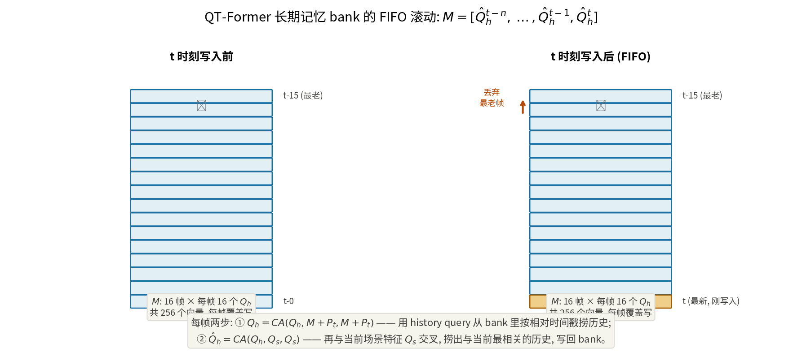
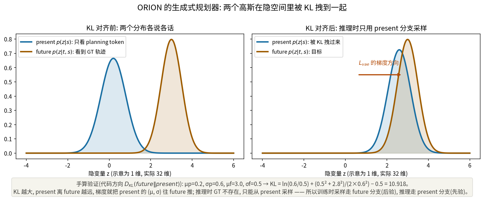
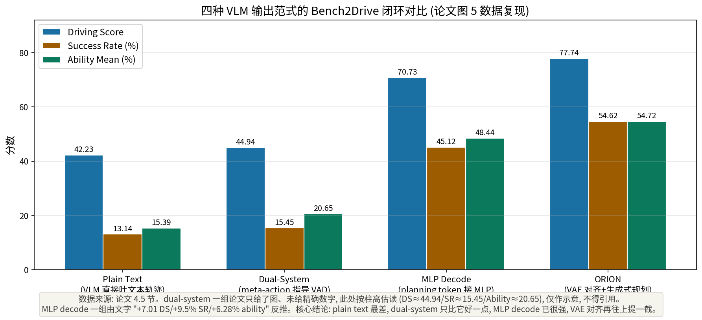

# 让推理的分布和动作的分布说同一种语言: ORION 的 VAE 对齐

> **信息块**
>
> - **论文标题**: ORION: A Holistic End-to-End Autonomous Driving Framework by Vision-Language Instructed Action Generation
> - **作者**: Haoyu Fu*, Diankun Zhang*, Zongchuang Zhao*（*共同一作）, Jianfeng Cui, Dingkang Liang（†项目负责人）, Chong Zhang, Dingyuan Zhang, Hongwei Xie（†）, Bing Wang, Xiang Bai
> - **单位**: 华中科技大学 + 小米 EV（Fu 与 Zhao 在小米 EV 实习期间完成）
> - **会议**: ICCV 2025
> - **arXiv**: [2503.19755](https://arxiv.org/abs/2503.19755)（本文按 v1，2025-03-25 版精读，正文 9 页 + 附录 6 页，共 18 页）
> - **项目页**: https://xiaomi-mlab.github.io/Orion/
> - **代码**: 官方公开，[bedoctor/orion](https://github.com/bedoctor/orion)（训练/推理框架、Bench2Drive 开环与闭环评测、Chat-B2D 数据集、模型权重均已发布）。本文核对了关键实现（`mmcv/models/detectors/orion.py`、`mmcv/models/utils/distributions.py`、三阶段训练配置），论文与代码不一致之处已在正文标出。因网络原因采用稀疏/单文件方式拉取，未做完整克隆，但核心模块（VAE、KL 损失、解码器、训练配置）均已读到源码。
> - **一句话核心洞见**: VLM 的推理空间和轨迹的动作空间是两个分布族，硬接只会互相拖累——ORION 不让 LLM 直接吐数字，而是用一个条件 VAE 把 planning token 和 GT 轨迹同时投影到同一个 32 维高斯隐空间，用 KL 散度把"只看到推理"的分布拽向"看到真值"的分布，让规划器的梯度一路反传回 LLM；推理和动作第一次在一个统一的分布里联合优化，而不是靠一个 hand-crafted 的 meta-action 接口传话。

---

## 闭环分数上不去, 不是 VLM 不够聪明, 是两个空间说着不同的语言

2025 年初，VLM 进自动驾驶已经不新鲜了。OmniDrive、EMMA、DriveVLM（013 篇）都能在开环评测上给出漂亮的数字和像模像样的文本解释。但 Bench2Drive 的闭环榜单一摆出来，局面就尴尬了：这些 VLM 方法要么根本不敢报闭环成绩，要么报出来比传统端到端方法还难看。DriveTransformer（ICLR 2025，一个纯传统方法）在 Bench2Drive 上是 63.46 分，此前最好的 VLM 系方法连它的尾灯都看不到。

ORION 的作者把病根定位得很准，而且是一个**表示层面的诊断**，不是"模型不够大"这种正确的废话：VLM 的能力长在**语义推理空间**（文本、概念、因果），而端到端驾驶最后要的是**动作空间**里的一串纯数字（未来 3 秒每 0.5 秒一个 x,y 坐标）。这两个空间之间有一道鸿沟，之前所有工作都是在鸿沟上搭便桥：

- **便桥一（图 1b）：让 VLM 直接输出文本形式的轨迹**（OmniDrive、EMMA）。问题有两个。第一，VLM 不擅长数学计算和数值推理——论文引用了 Frieder 等人对 ChatGPT 数学能力的系统性负面评估，LLM 的自回归 token 生成机制决定了它是在"背"数字的模式，而不是在"算"几何。第二，自回归一次只出一个结果，而人类驾驶天然是多模态的（这个路口可以左转也可以直行掉头），单点输出与规划的不确定性本质冲突。
- **便桥二（图 1c）：VLM 输出 meta-action，传统 E2E 方法照着做**（Senna、DriveVLM-Dual）。这条路在 013 篇里我们已经看到它能work，但 ORION 指出了它的结构性代价：推理空间和动作空间被一个人工设计的接口（"turn left"这种离散词）**解耦**了，轨迹优化的梯度传不回 VLM，VLM 推理过程的梯度也下不来。两边各训各的，VLM 的能力没有真正进到规划里。

ORION 的赌注是：**不要搭桥，要填沟**。找一个能同时装下两种数据的统一表示，让推理和动作在同一个分布里联合优化。这个"统一表示"就是生成式模型的隐空间——条件生成领域（文生图）早就证明，语义信息可以精确控制另一模态的生成过程。作者把这一思想搬了过来：planning token 是语义侧的条件，轨迹是动作侧的生成对象，VAE 是缝合两者的针。

## 作者的底牌: 生成式先验、32 卡 A800, 和一个敢报闭环的榜单

这篇论文的底气有三张牌，硬度各不相同。

**第一张：生成式建模的统一分布思想**。这是论文真正的智力来源。引言 2.3 节花了整整一段讲条件生成（"semantic information controls the generation of detailed image features"），结论是"generative model can construct a unified distribution of diverse types of data"。这个类比不是装饰——整个方法就是它的实例化：推理空间的 token 和动作空间的轨迹，被当成"两种模态的数据"，VAE 负责学它们的联合隐分布。审稿人（ICCV 口味）对这种跨领域迁移的干净类比一向买账，因为它把一个工程难题转化成了一个已有成熟工具的问题。

**第二张：算力和工程**。论文明写：32 块 A800（80GB），三阶段、每阶段 6 个 epoch。Chat-B2D 数据集用 Qwen2-VL-72B 自动标注了 211 万 VQA 对。这是小米 EV 的工业级投入，学术界实验室很难复现——这既是底牌，也是软肋（见怀疑式审读）。

**第三张：Bench2Drive 闭环榜单本身**。2024 年中 Bench2Drive 发布后，闭环评测成了 E2E 领域最硬的货币。ORION 的 77.74 分比第二名高出 14.28 分——在 DS 这个 0–100 的尺度上，这是断层式领先。论文把这个数字放在摘要第一句，是写给所有审稿人看的：**不管你信不信我的方法，这个数字你绕不过去**。

## QT-Former: 历史不是拼在一起的, 是用 query 捞出来的

ORION 的第一个模块 QT-Former 解决的是长时序建模。之前 VLM 系方法的笨办法是把多帧图像 token 直接拼起来喂给 LLM——token 长度爆炸，计算量也爆炸。QT-Former 的思路是：**不拼图像，用一组可学习的 query 去"捞"**。

论文定义了三种 query（$C_q$ 是 query 通道数）：

- 场景 query $Q_s \in \mathbb{R}^{N_s \times C_q}$，$N_s = 512$：提炼当前帧的关键场景信息；
- 感知 query $Q_p \in \mathbb{R}^{N_p \times C_q}$，$N_p = 600$：做目标检测、车道线、交通灯状态、运动预测（走辅助头监督）；
- 历史 query $Q_h \in \mathbb{R}^{N_h \times C_q}$，$N_h = 16$：专门负责从长期记忆里捞历史。

$Q_s$ 和 $Q_p$ 先做一次自注意力交换信息，再一起对图像特征 $F_m$（带 3D 位置编码 $P_m$）做交叉注意力。$Q_p$ 随后进检测/运动/交通灯辅助头，$Q_s$ 成为当前场景的压缩表示。

历史建模是 QT-Former 最精巧的一段，公式只有两行：

$$Q_h = \mathrm{CA}(Q_h, M + P_t, M + P_t), \quad \hat{Q}_h = \mathrm{CA}(Q_h, Q_s, Q_s) \tag{1}$$

$$M = [\hat{Q}^{t-n}_h, \cdots, \hat{Q}^{t-1}_h, \hat{Q}^t_h] \tag{2}$$

$M \in \mathbb{R}^{(N_h \times n) \times C_q}$ 是长期记忆 bank，$n = 16$ 帧，每帧存 16 个 history query 的向量，共 256 个。$P_t$ 是相对时间戳编码。

把公式翻译成动作。$\mathrm{CA}(Q, K, V)$ 是交叉注意力：Q 是"我要找什么"，K 是"我按什么索引"，V 是"找到后拿走什么"。第一行：$Q_h$ 当查询，$M + P_t$ 同时当索引和内容——16 个 history query 在 256 个历史向量里做注意力，**按相对时间戳加权地捞出历史信息**。注意 $P_t$ 加在 K 和 V 上：没有它，bank 里 16 帧的向量就没有时间顺序，注意力分不清"3 秒前的红灯"和"现在的红灯"。

第二行是点睛之笔：捞出历史的 $Q_h$ 再去和**当前场景** $Q_s$ 做一次交叉注意力。这一步在干什么？它在问："历史里那些东西，哪些和**现在这一帧**最相关？" 论文明确对比了 StreamPETR 这类只存压缩历史、不做二次提取的方法——它们把历史存下来就完了，取用时不加选择。QT-Former 多做的这一次 $CA(Q_h, Q_s, Q_s)$，是把历史信息**按当前场景的相关性重新加权**。直觉上：你在路口等红灯，历史里"刚才变灯的全过程"都存着，但当前决策最需要的是"灯是什么时候变绿的"——第二行就是干这个筛选的。

然后 $\hat{Q}_h$ 按 FIFO 写回 $M$，顶掉最老的一帧（式 2）：



*图：长期记忆 bank 的 FIFO 滚动。每帧 16 个 $Q_h$ 向量，bank 共存 16 帧；新帧写入时丢弃最老帧。*

最后 $\hat{Q}_h$ 和 $Q_s$ 各过一个两层 MLP，变成 LLM 推理空间的 history token $x_h$ 和 scene token $x_s$。

**论文与代码的不一致**（重要）：论文第 3.1 节描述的这套"history query + FIFO bank（$N_h=16, n=16$）"机制，在公开代码里**没有找到同名的实现**。代码中的 `OrionHead` 用的是 StreamPETR 风格的时序记忆（`memory_len=600` 的 embedding bank，带时间戳、自车位姿、canbus，`reset_memory`/`pre_update_memory`），`PETRTemporalTransformer` 做时序融合，没有 `QTFormer` 这个类。可能的情况有两种：论文投稿后代码重构改名了，或者公开代码对应的是另一个版本。无论哪种，**论文图 3 和式 (1)(2) 的具体实现无法从公开代码中逐行对应**，复现者只能按论文描述自己实现。这是这篇论文"以代码为准"原则下的最大缺口，如实记录。

## Planning token: LLM 的全部推理, 最后坍缩成一个向量

LLM 部分（第 3.2 节）的设计目标很明确：让 LLM 做它擅长的事（文本推理），不让它碰它不擅长的事（数字）。用户指令经 tokenizer 变成 $x_q \in \mathbb{R}^{L \times C}$（$L$ 是 token 长，$C$ 是 LLM 维度，Vicuna v1.5 是 4096），和 $x_s$、$x_h$ 一起喂进 LLM。

LLM 在驾驶场景里做四类 VQA：场景描述、历史回顾、场景分析、动作推理。关键设计是最后一个 QA 对——planning QA 模板里藏了一个特殊的 **planning token $s$**：

$$s \sim p(s \mid x_s, x_h, x_q, x_a) \tag{3}$$

$x_a$ 是 LLM 生成的回答文本。$s$ 的 embedding 会**累积整个驾驶场景的理解和推理上下文**，然后作为条件去控制轨迹生成。

为什么需要这个 token？想象没有它：LLM 输出一长串文本，规划器要从文本里抠出"到底要怎么开"——这就是图 1c 的 meta-action 接口，离散、有损、不可微。有了 $s$：它是 LLM 隐空间里的一个**连续向量**（4096 维）， carries 全部推理的压缩表示，而且**梯度可以从规划器一路反传回来**。这就是论文标题里 "Vision-Language **Instructed** Action Generation" 的含义：不是 VLM 输出动作，而是 VLM 的推理**指导**动作生成，指导的载体就是 $s$。

$s \sim p(\cdot)$ 的写法是采样记号，实际实现中 $s$ 就是 LLM 最后一轮对话里 planning token 位置的 hidden state（代码中 `return_ego_feature=True` 取的就是这个向量，推理时 `do_sample=True, temperature=0.1`）。

## 生成式规划器: 论文公式的方向写反了, 代码是对的

这是全文承重的部分，也是最值得慢讲的。第 3.3 节提出：把当前轨迹 $a$ 建模成条件分布 $p(a \mid s)$，$s$ 是 planning token。用 VAE 对齐两个空间：

$$p(z_s \mid s) \sim \mathcal{N}(\mu_s, \sigma_s^2), \quad p(z_t \mid t) \sim \mathcal{N}(\mu_t, \sigma_t^2) \tag{4}$$

$$\mathcal{L}_{vae} = D_{KL}(p(z \mid s),\, p(z \mid t)) \tag{5}$$

两个两层 MLP（论文原话 "two-layer MLPs"）分别把 $s$（4096 维）和 GT 轨迹 $t$ 投影成隐空间 $z$ 的高斯参数。然后 KL 散度把两个分布拽到一起，最后用 GenAD 的 GRU 解码器从 $z$ 解码出轨迹。

先看**训练-推理的不对称**，这是理解整个设计的关键，论文正文一笔带过但代码写得很清楚：

- **训练时**：$future\_distribution$ 的输入是 `present_features`（$s$ 的 4096 维）**拼接** GT 未来轨迹（`ego_fut_trajs.reshape(B, ..., -1)`，6 个时间步 × 2 坐标 = 12 维，正好对应代码里的 `future_distribution_in_channels = 4096 + 12`）。采样走 **future 分支**（后验）：`mu = future_mu, sigma = exp(future_log_sigma)`。
- **推理时**：GT 不存在，`future_distribution_inputs=None`，采样走 **present 分支**（先验）：`mu = present_mu, sigma = exp(present_log_sigma)`。

KL 损失的作用就是让"只看到 $s$"的 present 分布去逼近"看到 $s$ + GT"的 future 分布。推理时虽然只能从 present 采样，但 present 已经被训练成了 future 的样子——这正是条件 VAE 的标准剧本（后验训练、先验推理）。

**但论文式 (5) 的 KL 方向写反了**。论文写的是 $D_{KL}(p(z|s) \,\|\, p(z|t))$，即 $D_{KL}(\text{present} \,\|\, \text{future})$。而代码 `ProbabilisticLoss` 的实现是：

```python
kl_div = (present_log_sigma - future_log_sigma - 0.5
          + (var_future + (future_mu - present_mu)**2) / (2 * var_present))
```

对照标准公式 $D_{KL}(P\|Q) = \log\frac{\sigma_Q}{\sigma_P} + \frac{\sigma_P^2 + (\mu_P-\mu_Q)^2}{2\sigma_Q^2} - \frac12$：这里 $\log(\sigma_{present}/\sigma_{future})$ 对应 $\log(\sigma_Q/\sigma_P)$，分子是 future 的方差、均值差平方，分母是 present 的方差——所以 $P = \text{future}$，$Q = \text{present}$，代码算的是 **$D_{KL}(\text{future} \,\|\, \text{present}) = D_{KL}(\text{后验} \,\|\, \text{先验})$**。

两个方向在数学上都是合法的"对齐"，但含义不同：$D_{KL}(\text{future}\|\text{present})$ 是标准 VAE 的方向（后验向先验靠，mode-covering），而论文写的 $D_{KL}(\text{present}\|\text{future})$ 是反方向（mode-seeking）。**代码的方向才是对的、也是标准 VAE 的做法；论文公式 (5) 的方向写反了**。这是一个论文与代码的实质性不一致，如实记录——复现时应以代码为准。



*图：VAE 对齐示意（1 维示意，实际隐空间 32 维）。下方用代码的真实 KL 方向手算验证：$\mu_p=0.2, \sigma_p=0.6, \mu_f=3.0, \sigma_f=0.5$ 时 $D_{KL}(\text{future}\|\text{present}) = 10.918$。脚本 `fig-vae-align.py` 真实运行。*

代码里还有几个论文没细说的实现细节，值得记录：

- **隐空间维度**：`latent_dim = 32`。planning token 是 4096 维，GT 轨迹信息是 12 维，两者都被压到同一个 32 维高斯里。32 维装 6 个时间步的多模态轨迹分布，是紧的——这解释了为什么需要 KL 而不是直接回归：32 维瓶颈强迫模型学分布的形状，而不是记轨迹的坐标。
- **数值稳定**：`log_sigma` 被 clamp 到 $[-5, 5]$（`MIN_LOG_SIGMA`/`MAX_LOG_SIGMA`）。$\sigma$ 的范围因此是 $[e^{-5}, e^5] \approx [0.0067, 148]$。没有这个 clamp，KL 里的除法在训练初期极易爆炸——这是 VAE 训练的老坑，代码里处理了，论文没提。
- **KL 权重**：三个训练配置里 `loss_vae_gen=dict(type='ProbabilisticLoss', loss_weight=3.0)`。KL 项权重 3.0，和规划回归损失（`loss_plan_reg` 权重也是 3.0）同量级。论文式 (7) $\mathcal{L}_{gp} = \mathcal{L}_{vae} + \mathcal{L}_{mse} + \mathcal{L}_{col} + \mathcal{L}_{bd}$ 写成等权相加，实际代码里各项权重不同（3.0/3.0/1.0 等）——论文公式是示意，代码是真相。
- **解码器**：`PredictModel` 是 GRU（输入 32 维 → 隐层 1024 → 3 层）+ 三层 MLP，还原到 4096 维，再由 `ego_fut_decoder`（8192→8192→ReLU→6×2）输出 6 个模态的未来轨迹。6 个模态对应 Bench2Drive 的 6 种导航指令（NC），anchor-free。
- **训练时采样、推理时也采样**：`distribution_forward` 里训练和推理都用了 `torch.randn_like` 采样（重参数化 $z = \mu + \sigma \cdot \epsilon$），没有像某些 VAE 推理时直接取 $\mu$。这意味着**推理是有随机性的**——同一个场景跑两次，轨迹可能不一样。论文没讨论这一点，闭环评测的分数因此带一点方差，论文没报告多次运行的误差棒（见怀疑式审读）。

## 训练目标与三阶段: 先对齐视觉-语言, 再对齐语言-动作

总损失（式 6–8）：

$$\mathcal{L}_{qt} = \mathcal{L}_{det} + \mathcal{L}_{tra} + \mathcal{L}_{m}, \quad \mathcal{L}_{gp} = \mathcal{L}_{vae} + \mathcal{L}_{mse} + \mathcal{L}_{col} + \mathcal{L}_{bd}, \quad \mathcal{L} = \mathcal{L}_{qt} + \mathcal{L}_{ce} + \mathcal{L}_{gp}$$

$\mathcal{L}_{det} = \mathcal{L}_{cls}(\text{focal}) + \mathcal{L}_{reg}(\text{L1})$ 是检测损失，$\mathcal{L}_{tra}$ 交通灯状态（focal），$\mathcal{L}_m$ 运动预测（分类 focal + 回归 L1），$\mathcal{L}_{ce}$ 是 LLM 的自回归交叉熵，$\mathcal{L}_{col}$/$\mathcal{L}_{bd}$ 是 VAD 风格的碰撞/边界损失。

三阶段训练（附录 B，代码配置已核实每阶段 6 epoch、batch 配置见下）：

1. **3D 视觉-语言对齐**：冻住生成式规划器，在 Chat-B2D 的 VQA 对上训练 QT-Former 和 VLM（含 LoRA），目标是把视觉空间和推理空间对齐；
2. **语言-动作对齐**：解冻规划器，LLM 用 LoRA 继续训（论文说此阶段"除 LLM 外训练整个模型"，LLM 只动 LoRA），**不带 VQA 辅助**，只做轨迹预测——把推理空间的世界知识传到动作空间；
3. **端到端微调**：VQA + 规划联合训练。

附录表 A2 验证了渐进对齐的必要性：跳过第一阶段直接训规划（ID-1）只有 57.96 DS；加了第一阶段（ID-2）到 65.10；三阶段走完（ID-3）到 74.65（此表未加 memory bank 和碰撞损失，故不是最终的 77.74）。每一阶段都在加分，说明"先对齐再联合"不是玄学。

**论文与代码的 batch size 不一致**：论文 4.2 节写 "total batch size of 32"，但配置里 `num_gpus = 32`、`batch_size = 4`（`samples_per_gpu=4`），即每步 128 个样本。除非 `orion_dist_train.sh` 覆盖了 GPU 数，否则论文的 32 与代码的 128 对不上（[未核实]：未运行训练脚本，`$GPUS` 参数未知）。记录为待核实项。

## Chat-B2D: 211 万 VQA 对是怎么用 72B 模型"印"出来的

Bench2Drive 本身没有 VQA 标注，作者用全自动管线"印"了一个 Chat-B2D：211 万训练 + 12 万验证 VQA 对，四类任务（场景描述、关键物体行为、meta 决策与动作推理、历史信息回忆）。

管线三步（附录 A.1，图 A1）：

1. **关键物体选择**：按规则筛——3 秒内可能碰撞的物体、当前/相邻车道的前车、生效的交通灯、行人/骑行者。这一步是规则式的，不是模型选的，保证了"关键"的定义稳定；
2. **描述生成**：当前帧 + 前 5 帧的视频片段，加上自车状态和关键物体的 GT 信息（2D/3D 坐标、速度），喂给 **Qwen2-VL-72B**，按三类 prompt（表 A3）生成场景描述、物体分析、动作推理。注意 prompt 3 把**专家的未来驾驶行为**（speed/command 决策）也喂进去了，让 72B 模型做"事后解释"——这是在用大模型给专家轨迹配解说词；
3. **历史信息**：维护一个队列，存环境动态变化和自车运动对比，拼成历史类 VQA。

表 6 的结果值得玩味：只训 VQA（ID-1），语言指标 CIDEr 65.65/BLEU 50.82；只训规划（ID-2），闭环 74.10/44.66；**联合训（ID-3），两边都涨**——规划到 77.74/54.62，语言到 65.77/52.49。VQA 辅助没有拖累规划，反而帮了忙。这说明 planning token $s$ 的表示同时被语言损失和轨迹损失塑造，两种监督在 $s$ 上是互补的——这正是"统一空间联合优化"承诺的兑现，也是图 1d 那句 "Backpropagation" 箭头穿过整个 pipeline 的实证。

但要看到这条管线的**循环论证风险**：Chat-B2D 的"动作推理"答案是 Qwen2-VL-72B 看着专家未来行为编的解释，然后 ORION 的 Vicuna（7B）在这些解释上微调，再用 CIDEr/BLEU 去量它和 72B 的文本有多像。语言指标涨，很大程度上是在量"学生有多像老师"，不是"推理有多对"。好在闭环分数（77.74）是独立的、不依赖文本的验证——规划涨了 3.64 DS 是硬的。

## 实验: 77.74 分是怎么构成的, 以及藏在表里的两个诚实数字

**主结果（表 1，Bench2Drive 闭环，base set）**：ORION 77.74 DS / 54.62% SR。减法验算：DriveTransformer 63.46/35.01，差值 +14.28/+19.61，与摘要一致；DriveAdapter 64.22/33.08（带专家蒸馏 + 摄像头+激光雷达双模态），差值 +13.52/+21.54。ORION 是纯摄像头、无蒸馏、只用导航指令（NC，不用目标点 TP）——条件更弱，分数更高。

**Multi-Ability（表 2）**：平均 54.72%，超车 71.11%、紧急刹车 78.33%、交通标志 69.15% 都是断层领先。但作者诚实地写了反例：**并线（Merging）25.00% 和让行（Give Way）30.00% 不如 DriveAdapter**（28.82%/50.00%）。解释是换道时机的多样性让因果难学。这个自我批评是可信的——换道确实是 Bench2Drive 里专家行为最不一致的场景（不同专家换道时机差几秒），VAE 的隐空间在这里学到的可能是平均行为。

**四个范式的对决（图 5，Sec 4.5）**：在同一套 sensor/vision encoder/QT-Former/VLM、同一训练策略下，只换 VLM 的输出范式——plain text 42.23 DS / 13.14% SR 最差；dual-system（meta-action 指导 VAD）只好一点（论文只给了图，柱高估读约 44.94/15.45，精确值未在文字中给出）；MLP decode（planning token 接 MLP）70.73/45.12；ORION 77.74/54.62。作者对 dual-system 的解读是"瓶颈在传统 E2E 方法的能力"——这个推断有点快：复现的 dual-system 接口是作者自己搭的，未必是 Senna 的最优设计，把锅全甩给"VAD 不行"证据不足。但 MLP decode 已经 70.73、ORION 再涨 7 个点的事实是硬的：**planning token 这个连续接口本身就值 25 个点**（70.73−44.94），VAE 对齐又值 7 个点。



*图：论文图 5 右侧数据的复现。注意 dual-system 一组论文未给精确数字，图中值为按柱高估读，仅作示意。脚本 `fig-paradigms.py` 真实运行。*

**VAE vs Diffusion（表 3）**：同样框架下把 VAE 换成 diffusion（K-means 轨迹 anchor 做先验，20 个模态），diffusion 得 71.97/46.54，VAE 得 77.74/54.62。作者的解释是 VAE 隐空间"更直接"地对齐、训练更稳定。但数字里还有一层作者没点破的意思：**连 diffusion 版都比 DriveTransformer 高 8.51 DS**——说明框架的主干（QT-Former + planning token + 联合优化）贡献了大头，生成器选型是次要的。这个消融其实削弱了"VAE 是关键"的叙事，强化了"统一空间+联合优化"的叙事，作者没有点破，但数字自己会说话。

**QT-Former 消融（表 4）**：ID-1（无交通灯监督）56.33 → ID-2（+交通灯状态监督）74.65，**+18.32 DS**。这是全表最大的单项涨幅，承重的是"显式交通灯监督"而不是 fancy 的 memory 结构。作者的解释有见地：之前的方法加交通灯监督效果不明显是因为因果混淆（causal confusion）——红灯前专家行为混杂（有的停有的走），模型学不到"灯→行为"的因果；而 ORION 里 VLM 的推理先把因果链想清楚（"因为红灯所以停"），监督信号才能被正确利用。ID-3（+运动预测）只涨了 0.4% SR，DS 还微降（trade-off）；ID-4（+memory bank + 历史 QA）到 77.74/54.62，memory 贡献 +3.67/+4.85。

**History query 数量（表 5）**：$N_h=0$ 时 65.10，8 时 68.09，**16 时 74.10 最优**，32 时掉到 62.46——比 0 还差。作者的解释是 query 太多会挤占 VLM 对当前帧的注意力。这是一个"时序信息 vs 当前帧"的容量权衡，16 是甜点。注意这张表的训练配置是简化的（只训规划+历史 QA），数字和主结果不直接可比。

**表 6 的数字小瑕疵**：正文写联合训练带来 "+3.64 DS and +9.66% SR"，但表里 ID-2→ID-3 的 SR 是 44.66→54.62，差值 **9.96**，不是 9.66。0.3 的出入，可能是笔误，也可能是某一版实验的残留。数字敏感的读者会注意到，论文没解释——记为一处未修正的小不一致。

## 怀疑式审读: 断层领先背后, 哪些问题作者没答

**1. Comfortness 塌了。** 表 1 里 ORION 的 Comfortness 是 **17.38**，而 UniAD-Tiny 47.04、VAD 46.01、TCP-traj 18.08。DS 77.74 的车，开起来跟 TCP-traj（59.90 分）一样颠。Efficiency 151.48 倒是很高（开得快）。"又快又准但颠"——KL 对齐让轨迹跟上了专家意图，但 VAE 采样的随机性（推理时 `torch.randn_like` 真采样，不是取均值）可能引入了抖动。论文全文没提舒适度问题，Limitation 只说了"计算复杂"。这是用闭环总分掩盖单项短板，审稿人如果看表会问。

**2. 算力门槛与复现成本。** 32 卡 A800、三阶段每阶段 6 epoch、211 万 VQA 对的 72B 模型标注——这篇论文的复现成本是工业级的。附录 B 的三阶段配置在代码里能找到，但论文没给训练总时长、没给各阶段学习率 schedule 细节（只给了优化器 AdamW lr=8e-5 的片段信息，[未核实]完整 schedule）。"Without bells and whistles"（摘要原话）指的是方法简洁，不是训练便宜——这个措辞有误导性。

**3. nuScenes 开环的平庸与作者的解释。** 附录表 A1：ORION 在 nuScenes 上平均 L2 0.34m、碰撞率 0.37%，不如 DriveVLM-Dual（0.31/0.10，见 013 篇），和 VAD-Base（0.37/0.14）相当。作者的解释是"nuScenes 轨迹是单模态高斯（70% 直行），VAE 隐空间不占优"。这个解释偏弱：32 维高斯隐空间完全可以退化去拟合单模态分布，拟合不好更可能的原因是**训练数据（Bench2Drive CARLA）和评测数据（nuScenes 真实）的域差距**，以及三阶段训练是按 Bench2Drive 调的。作者选择了对自己有利的解释，读者应该知道另一种可能。

**4. 推理随机性无误差棒。** 代码里推理时从 present 分布**真采样**（`noise = torch.randn_like(present_mu)`），不是取 $\mu$。Bench2Drive 闭环 77.74 这个数字是单次运行还是多次平均？论文没说。采样型规划器的方差在 DiffusionDrive 等工作里是被讨论过的，ORION 只字未提。

**5. 图 5 dual-system 对比的公平性质疑。** 作者复现的 dual-system（meta-action 指导 VAD）结果"和 VAD 官方接近"，据此得出"瓶颈在传统 E2E 方法"。但 Senna 的接口设计（VLM 输出 meta-action 的粒度、VAD 侧如何消费）是经过调优的，作者的复现版本未必达到了 Senna 的水平。用"我复现得不好"来论证"这条路不行"，逻辑上有缺口。好在 MLP decode 的对比是干净的（同一 planning token，只换解码头），VAE 的 +7.01 DS 增益可信。

**6. KL 方向论文写反（已在上节详述）**：式 (5) $D_{KL}(p(z|s)\|p(z|t))$ 与代码 $D_{KL}(\text{future}\|\text{present})$ 不一致。以代码为准。

**7. QT-Former 的代码缺位（已在上节详述）**：论文式 (1)(2) 的 history query + FIFO bank 在公开代码中无同名实现，代码用的是 StreamPETR 风格时序记忆。复现者注意。

**8. Merging/Give Way 的弱势没有后续。** 作者承认了换道/让行不如 DriveAdapter，归因于"决策时机多样"。但 VAE 的多模态建模本该最擅长处理"时机多样"——6 个模态里应该有一个学到早换道、一个学到晚换道。实际没学好，说明 KL 对齐在这里没有把多模态分开，可能是 KL 权重 3.0 把 present 压得太靠近 future 的均值，坍缩了模态。论文没做这个方向的诊断。

**9. Chat-B2D 的标注质量上限。** 211 万 VQA 对全是 Qwen2-VL-72B 生成的，12 万验证集也是。学生（Vicuna-7B）在老师（72B）的数据上训，语言指标（CIDEr 65.77）本质是蒸馏保真度。如果 72B 在某些场景的解释是错的（比如把"减速"归因到错误的物体），错误会被蒸馏进 ORION。论文没有做标注质量的人工抽检报告——DriveVLM 的 SUP-AD 是 3 人交叉验证的人工标注，ORION 是全自动，质量保证只靠"prompt 写得好"。这是全自动管线的固有风险。

**公平地说，硬的地方也很硬**：摘要的每个数字（77.74/54.62/+14.28/+19.61）在表 1 里都能验算对上；Merging/Give Way 的弱势、nuScenes 开环的平庸、diffusion 也 work 的事实，作者都没有藏；三阶段消融（表 A2）、query 数量甜点（表 5）、VQA+规划双赢（表 6）三个实验设计得干净，变量隔离得好。措辞上 "we observe"/"we argue" 居多，"we prove" 一次没有——作者对自己结论的把握程度是诚实的。

## 带走的东西和没回答的问题

**可迁移的想法**有两个。第一，**"接口连续化"比"接口语义化"更重要**。图 1c→1d 的演进说明：VLM 和规划器之间传离散的 meta-action（"turn left"），不如传连续的 planning token。前者是信息瓶颈（几个词装不下全部推理），后者是可微通道。以后设计 VLM+下游任务的缝合，优先保证梯度能穿过去，再考虑可解释性——可解释性可以用 VQA 文本另起一路来满足（ORION 就是这么干的：$x_a$ 文本解释和 $s$ 向量并行），不要让它卡在主梯度通路上。

第二，**条件 VAE 在这里的角色不是"生成多样性"，而是"分布翻译"**。通常 VAE 用来建模多模态、采样多样性；ORION 用它来做的是把两个异构空间的表示"翻译"到同一个高斯族里，让 KL 成为可微的距离。这个用法可以搬到任何"推理空间→动作空间"的缝合处：只要两边都能被编码成高斯参数，KL 就能当缝合线。代价是隐空间维度的选择（32）和 KL 权重的选择（3.0）目前全靠试，论文没给敏感性分析——这是留给后来者的超参坑。

**没回答的问题**：第一，planning token $s$ 到底"记住"了多少因果？如果把 $s$ 可视化/探针分析，能否看到"红灯→停"的因果方向？论文只给了定性图（图 4），没有探针实验，"因果推理能力"的声明缺机制证据。第二，32 卡 A800 训出来的 77.74，有多少来自 QT-Former+VAE 的架构，有多少来自 211 万 VQA 对的数据规模？表 6 证明 VQA 有用，但没有"无 Chat-B2D、只用 Bench2Drive 原生数据"的对照——数据和架构的贡献没拆开。第三，Comfortness 17.38 的坑，下一版打算怎么填？采样改取均值、还是加平滑损失？Limitation 里没提，可能是作者也不想提。

---

*精读完成。PDF 已下载（`paper.pdf`，18 页，v1）。官方代码已核对关键模块（VAE/ProbabilisticLoss/解码器/三阶段配置），发现论文与代码不一致三处：KL 方向写反、QT-Former 无同名实现、batch size 存疑，均已在正文标出。三张自绘图由 `fig-vae-align.py` / `fig-memorybank.py` / `fig-paradigms.py` 真实运行生成。*
