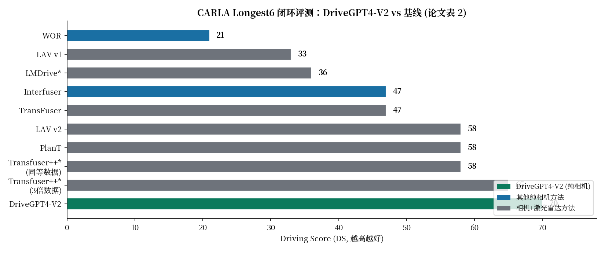
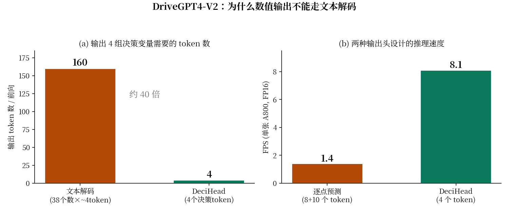

# LLM 开车最难的不是推理，是输出数字：DriveGPT4-V2 的 DeciHead 与特权专家 DAgger

| | |
|---|---|
| 论文标题 | DriveGPT4-V2: Harnessing Large Language Model Capabilities for Enhanced Closed-Loop Autonomous Driving |
| 作者 | Zhenhua Xu, Yan Bai, Yujia Zhang, Zhuoling Li, Fei Xia, Kwan-Yee K. Wong, Jianqiang Wang, Hengshuang Zhao（香港大学、清华大学、美团） |
| 会议 | CVPR 2025, pp. 17261–17270 |
| 链接 | https://openaccess.thecvf.com/content/CVPR2025/papers/Xu_DriveGPT4-V2_Harnessing_Large_Language_Model_Capabilities_for_Enhanced_Closed-Loop_Autonomous_CVPR_2025_paper.pdf |
| 代码 | 未找到官方代码。论文摘要写 "The code and data of DriveGPT4-V2 will be publicly available"（将来时）；GitHub 上没有官方仓库，V1 的官方仓库 `tonyxuqaq/DriveGPT4` 现已不可访问（404）。第三方跟进仓库 `shiftwilliam/DriveCode`（2026 年跟进论文 DriveCode 的仓库）含有 V1&V2 数据集的训练/评估代码，但非官方实现。以下所有判断只依据论文正文。 |
| 一句话核心洞见 | 这篇论文真正的赌注不是"LLM 能开车"，而是两个工程判断：第一，数值决策不走文本解码，改走四个专用回归头（DeciHead），把一次前向的输出从约 160 个 token 压到 4 个；第二，behavior cloning 的分布漂移不靠人工标注解决，靠训练一个能读特权信息的同构"专家 LLM"，用 DAgger 在它犯错的时刻自动接管并记录样本。 |

## 先把最刺眼的数字摆出来：DS 70，而且是纯相机

论文表 2 是全文的底气所在，我把 Driving Score 一列单独画出来：



CARLA Longest6 是 36 条长路线、对可靠性和智能要求很高的闭环基准。DriveGPT4-V2 拿到 DS 70、RC 91、IS 0.77。往下看三个细节，它们决定了这个数字的分量：

第一，**它是全场唯一纯相机输入（C）跑到 70 的**。排在它后面的 Transfuser++（65）用的是相机+激光雷达（C&L），而且用了三倍数据增强。作者专门做了一个 Transfuser++†——去掉数据增强、训练数据量和自己对齐——它的分数掉到 58。也就是说，Transfuser++ 的 65 分里有 7 分是数据增强撑起来的；对齐数据量之后，DriveGPT4-V2 对它的领先是 70 对 58。

第二，**DS = RC × IS / 100 这个关系在表里是自洽的**：91 × 0.77 = 70.07 ≈ 70；90 × 0.72 = 64.8 ≈ 65；89 × 0.65 = 57.85 ≈ 58。数字没有编造痕迹，至少乘法这一关过了。

第三，**全场唯一能闭环跑的 LLM 基线 LMDrive 只有 36 分**。这个数字是作者自己用官方开源代码复现的（表里标了 *）。LMDrive 是 CVPR 2024 的工作，vicuna-7B，BEV 输入。36 对 70 的差距，就是这篇论文要讲的故事：之前的 LLM 驾驶工作全卡在开环，第一个把 LLM 真正塞进闭环并且跑赢传统方法的，是 DriveGPT4-V2。

先别急着信。LMDrive 的 36 分是作者自己跑出来的，复现质量只有作者自己知道；Transfuser++ 的 65 也是作者自己实现的版本（标 * 的都含这层意思）。这些留到怀疑式阅读一节细说。先往下看方法，因为这篇论文的方法部分有一个非常实在的设计，值得先弄明白。

## 作者手里到底有哪几张牌

一个研究者敢把 LLM 往闭环驾驶里塞、投 CVPR，手里得有让他相信"这事做得成"的东西。我读出三张牌，一张比一张实在。

**第一张：DeciHead 的 token 经济学，闭式、可验证。** 这是全文最硬的一张牌。LLM 输出数字如果走文本解码，一个带三位小数的浮点数（比如 1.538）要 5 个 token；四个决策变量（目标速度、目标角度、8 个 waypoint、10 个 route point）一共 38 个数，走文本要约 160 个 token。自回归生成 160 个 token，延迟直接判死刑。DeciHead 把 LLM 的词表输出头整个换掉，换成四个 MLP：LLM 只输出 4 个 token，每个 token 进一个 MLP，直接回归出数值。表 6 的数字任何人十分钟就能验算：逐点预测（18 个 token）1.4 FPS，DeciHead（4 个 token）8.1 FPS，DS 几乎不变（64 对 63）。这张牌硬在它不依赖任何"LLM 很聪明"的叙事，纯粹是算术。

**第二张：用 LLM 自己当 DAgger 的专家，零人力成本。** Behavior cloning 在闭环里会漂移，这是 2011 年 DAgger 论文就讲透的老问题。LBC（CoRL 2020）给过标准解法：训一个能看特权信息的专家网络，在线监督 agent，agent 犯错时专家接管并记录样本。DriveGPT4-V2 的改动是把专家也换成 LLM——特权信息（周围物体的真值、红绿灯/碰撞 hazard）本来就是结构化的，直接拼成文本喂给专家 LLM 就行，不需要为专家单独设计网络结构。整个在线纠偏流程不需要一个人标数据。这是第二张牌：**把 LBC 的"特权专家"思想嫁接到 LLM 上，成本几乎为零**。

**第三张：时机。** LMDrive（CVPR 2024）已经证明了 MLLM 可以闭环开车，但它只用 behavior cloning，分数难看（36）。领域里所有人都知道漂移是那堵墙，但没人把"LLM 专家 + DAgger"这套组合拳打出来。DriveGPT4-V2 恰好站在这个位置上。

三张牌里最硬的是第一张，因为它是一个任何人都能复算的工程事实；第二张是方法论上的聪明，但"专家 LLM 到底有多强"这个数字论文没给，这是它的软肋，后面会讲到。

## 为什么开环好好的，一进闭环就翻车

先把问题说清楚，因为整个第 3.2 节都是对这个问题的回答。

Behavior cloning 是在专家轨迹上采样、做监督学习：给定状态 s，学一个映射去拟合专家动作 a*。训练时模型见到的所有状态都来自专家策略滚出来的轨迹分布。部署时模型用自己的预测去开，只要某一步的预测和专家差了一点点，车就到了一个训练时没见过的状态；在这个新状态上模型的误差更大，下一步偏得更远。误差复利，这就是漂移（论文引言里叫 drifting issue，DAgger 原论文里叫 compounding errors）。

DAgger 的解法是让训练分布去追部署分布：把当前策略放到环境里跑，在它实际访问到的状态上问专家"这一步你怎么做"，把（s， a*_expert(s)）加进数据集。重复几轮，训练分布就覆盖了策略自己的失误区域。

DriveGPT4-V2 的版本是这样走的（论文图 5b）：

1. Stage 1：规则 autopilot 在 CARLA 里收集 350K 样本（2Hz，过滤掉 autopilot 卡住之类的坏样本后剩 300K），DriveGPT4-V2（记作 MA）和专家 LLM（记作 ME）都在这上面做 behavior cloning。区别只有输入：ME 能看到特权信息。
2. Stage 2：把 MA 放到训练路线上去开，ME 在旁边同步预测。每一时刻比较两者的决策输出，差值超过阈值就判定为 exception：这一刻改由 ME 的预测控制车辆，同时把（当前观测， ME 的输出作为 label）记一条样本进数据集。
3. 跑完训练路线，用聚合后的数据集 fine-tune MA。论文说通常一轮 DAgger 就够了。

这里有几个论文没说清楚、但复现时非知道不可的细节。第一，**"差值超过阈值"的阈值是多少**？四个决策变量（速度、角度、waypoint、route point）各有一个阈值还是一套？论文一个字没写。第二，**比较的是哪个量的差值**？是四个头输出的向量差，还是只看 target speed/angle？也没写。第三，ME 接管的那一刻，记录的 label 是 ME 的四个头输出——但 ME 自己的输入里有特权信息，MA 永远看不到这些信息，MA 要从纯视觉输入拟合 ME 的输出，这本身是一个知识蒸馏式的跨模态拟合，论文没有讨论它的难度。

## 直接让 LLM 输出油门刹车方向盘，为什么不行

DriveGPT4-V2 不直接预测 throttle/brake/steer，而是预测四个高层决策变量，再用两个 PID 控制器转成底层控制信号：

- **Target Speed**（目标速度）：纵向，速度 PID 根据当前速度和目标速度算油门刹车。
- **Target Angle**（目标角度）：横向，转向 PID 算方向盘。
- **Waypoints**：未来 4 秒的 8 个 x-y 位置点。
- **Route Points**：前方全局路线上均匀采样的 10 个点。

为什么绕这一圈？论文 4.6 节给了理由：直接预测底层控制信号要求时间一致性，否则车会走之字形。更深一层的原因是，throttle/brake/steer 是执行器层面的量，它们的数值分布又尖又怪（大部分时间油门在一个小区间里，急刹时突然跳变），LLM 回归这种分布很吃力；而 target speed/target angle 是语义层面的量，变化平滑得多。这是一个表示选择问题：**让 LLM 预测它"想得明白"的量，把"算得准"的活留给 PID**。

但注意一个反直觉的细节：**推理时只用 target speed 和 target angle**，waypoint 和 route point 纯粹是训练时的辅助监督（论文 4.2 节原话："only the predicted target speed and target angle were used by the PID controllers, while waypoints and route points served as additional supervision"）。也就是说，模型每次前向都要自回归生成 4 个 token，但后两个 token 的输出在部署时直接扔掉。为什么还生成它们？因为自回归的因果结构里，后面的 token 能看到前面的 token——等等，不对，顺序是 speed、angle、waypoint、route point 依次生成，waypoint 的 token 在 speed/angle 之后，它不影响前面的预测。那它对推理有什么用？纯粹是训练时的正则：逼着 LLM 的隐状态里保留对未来轨迹和全局路线的表征。消融表 4 里 "+WP&RP" 这一行 DS 从 60 涨到 63，说明这个辅助监督确实有用，尽管推理时不用它的输出。

## 一个 token 怎么变成 16 个数：DeciHead 的形状

这是全文最值得算一遍的地方。LLM 最后一个 transformer block 输出 4 个 token 的隐向量，记作 $h_1, h_2, h_3, h_4 \in \mathbb{R}^{d}$（$d$ 是 LLM 隐维度，Qwen-0.5B 的 $d=896$[未核实，论文未写]）。每个 $h_i$ 进一个独立的 MLP（DeciHead）：

- $h_1 \xrightarrow{\text{MLP}_1}$ target speed，1 个数（一对一）；
- $h_2 \xrightarrow{\text{MLP}_2}$ target angle，1 个数（一对一）；
- $h_3 \xrightarrow{\text{MLP}_3}$ waypoints，16 个数（8 个 x-y 点，一对多）；
- $h_4 \xrightarrow{\text{MLP}_4}$ route points，20 个数（10 个 x-y 点，一对多）。

每个 DeciHead 都是"一个 token 进，$k$ 个数出"的回归头。论文没写 MLP 的层数和隐维度[论文未写]，只说是 MLP。训练时四个头同时用 L1 监督，可以直接对数值做回归优化，而不用走词表分类——这是 DeciHead 相对文本解码的第二个好处：**优化目标从离散的 token 交叉熵变成了连续的回归损失**，梯度直接打在数值误差上。

## 1.538 为什么是 5 个 token：token 经济学小算

论文 4.6 节举的例子：浮点数 1.538 走文本要 5 个 token，走 DeciHead 只要 1 个 token 里的一个回归输出。5 个 token 是怎么来的？LLM 的分词器对数字的处理一般是按"数字串"切分，"1.538" 会被切成类似 "1"、"."、"538" 的片段，再加上可能的前导空格或符号位，凑出 5 个 token 是合理的（具体切分取决于 Qwen 的分词器，论文没展开）。

四个决策变量一共 38 个数：1（speed）+ 1（angle）+ 16（waypoint）+ 20（route point）= 38。38 × 4~5 ≈ 152~190，论文说"约 160 个 token"，对得上。图（a）把这个对比画出来了：



左图是输出 token 数的对比（160 对 4，约 40 倍）；右图是表 6 的 FPS（1.4 对 8.1）。注意右图对比的不是"文本解码 vs DeciHead"，而是"逐点预测（8+10=18 个 token，每个点一个 token）vs DeciHead（4 个 token）"——即使把文本解码优化成逐点回归，token 数还是 18，FPS 只有 1.4。DeciHead 的 8.1 FPS 是 5.8 倍的提升，而 DS 只掉了 1 个点（64→63）。这个交换非常划算。

## MV-VT：三张 384×384 的图，LLM 一次要吃多少个 visual token

MV-VT（multi-view visual tokenizer）的结构是 LLaVA-1.5 那套：三张前视图像（左前、正前、右前，每张 384×384）各自过 SigLIP 视觉编码器，特征拼起来再过一个 projection 层映射到文本域。

论文没写 visual token 的具体数量，但可以从 SigLIP 的结构推断：384×384 的图，patch 16×16，得到 24×24 = 576 个 token；三张图就是 1728 个 visual token，再加上文本 token（车速、目标点）一起喂给 LLM。[推断，论文未明确写出]。1728 个 visual token 对 0.5B 的 LLM 是一次不小的前向，但因为输出只有 4 个 token，整体延迟主要花在输入编码上——这也是为什么输出侧的 token 经济学如此关键：输入侧已经很重了，输出侧不能再重。

为什么只要前视、不要后视？论文的原话是，在 CARLA 基准里后视图"利用率有限、对规划性能没有可测量的提升"，为了计算效率主动砍掉。这是一个诚实的工程取舍，但也意味着这个结论只在 CARLA Longest6 上成立——真实路况里变道、倒车对后视是有需求的，论文没讨论这个外推。

## 专家 LLM 到底"特权"在哪里

专家 ME 和 agent MA 结构相同（都是 0.5B 级 MLLM + DeciHead），唯一的区别是输入多了一段文本：

```
Objects: <Object ID, position, speed, state>
Hazard information: <Traffic light, stop sign, vehicle collision, pedestrian collision>
```

这是 CARLA 仿真器直接给的真值：30 米内所有物体的 ID、位置、速度、状态，加上红绿灯/停车标志/车辆碰撞/行人碰撞的 hazard 信息。MA 只能从三张图像里猜这些，ME 直接被告知答案。所以 ME 的活比 MA 好做得多——它几乎是在做"给定完美感知，输出驾驶决策"的规划题。

这个设计有一个漂亮的性质：**特权信息是文本，LLM 天然会读文本**。LBC 原版的专家是一个专门设计的特权网络，而这里专家和 agent 是同构的，只是 prompt 里多了一段真值描述。训练 ME 不需要任何新标注——stage 1 的 300K 样本本来就记录了这些真值（autopilot 收集时本来就要记），ME 只是在同样的样本上多看一列输入。

但这里埋着全文最大的一个未回答的问题：**ME 自己在 Longest6 上能跑多少分？** 老师有多强，直接决定 DAgger 的天花板。论文给了 MA 的 70 分，但 ME 的分数一个字没提。如果 ME 只能跑 75 分，那 DAgger 的 70 分就很接近天花板了；如果 ME 能跑 90 分，那 MA 还有很大空间，说明在线纠偏的样本效率或拟合有问题。这个数字的缺失，让"专家监督贡献 7 个点"（表 4 最后一行 63→70）这个结论少了一块关键的参照系。

## 四项等权 L1：不打架吗

损失函数是全文最短的一节，就一个公式：

$$L = L_{TS} + L_{TA} + L_{WP} + L_{RP} \tag{1}$$

$L_{TS}$、$L_{TA}$、$L_{WP}$、$L_{RP}$ 分别是目标速度、目标角度、waypoint、route point 上的 L1 损失，四项直接相加，没有权重。

四个问题，每个都值得问：

第一，**量纲不一样**。target speed 单位 m/s（0~10 量级），target angle 可能是弧度（±0.5 量级）[论文未写单位]，waypoint 是 x-y 坐标（CARLA 里几十米量级）。L1 直接加，数值大的项天然主导梯度。论文没提任何归一化。

第二，**项数不一样**。$L_{WP}$ 是 16 个数的 L1，$L_{RP}$ 是 20 个数的，$L_{TS}$ 和 $L_{TA}$ 各 1 个数。如果是 sum 而不是 mean，waypoint 一项的梯度就是 speed 的 16 倍起。论文没写是 sum 还是 mean。

第三，**推理时只用 speed 和 angle**，但训练时四个头等权——辅助任务的权重和主任务一样大，这在多任务学习里是比较粗糙的做法。通常要么调权重，要么用不确定性加权。论文就这么直接加了，还 work 了。一种解释是 0.5B 小模型+60 epoch 的充分训练把这些都磨平了，但这只是推测。

第四，L1 对 outlier 不敏感，这是选 L1 而不是 L2 的合理理由（waypoint 里偶尔有 autopilot 记录的坏点），论文没说，但可以这么理解。

## 表 2 细读：那几个带星号的数字是怎么来的

表 2 的脚注是理解这张表的钥匙："*" 表示作者自己用官方开源代码实现的，"†" 表示去掉数据增强、训练数据量和 DriveGPT4-V2 对齐的版本。逐个看：

- **Transfuser++\* 65 分**：作者自己实现的，带三倍数据增强（"repeatedly collecting expert trajectories for augmentation"）。官方 leaderboard 上的 Transfuser++ 分数论文没引用[未核实]，所以 65 这个参照系本身是作者复现的。
- **Transfuser++\*† 58 分**：去掉增强、数据量对齐后掉 7 分。这个 7 分的落差说明 Transfuser++ 的 SOTA 里数据增强占了不小比重，也反衬 DriveGPT4-V2 的 70 分是在"正常"数据量下拿到的。
- **LMDrive\* 36 分**：作者复现的，唯一能闭环跑的开源 LLM 方法。论文给的解释是 LMDrive 把多模态数据转成 BEV 再映射到文本域，而 BEV 没有好的预训练 MLLM，从零训严重拖累性能。这个解释合理，但 36 分这个数字的复现质量无法独立验证——LMDrive 原论文主要在 LangAuto 基准上评测，Longest6 不是它的主战场。
- **DriveGPT4-V2 70 分**：纯相机。注意它的 Veh（车辆碰撞率）是 0.80，比 LAV v2 的 0.69 和 Transfuser++\* 的 0.99 处在中间；Red（闯红灯）0.04 是全场最低；Ped 0.00、Dev 0.00 全场最好。短板是车辆碰撞率没做到最好。

## 表 3：8B 模型为什么没有更好

表 3 是全文最有信息量的一张小表：

| LLM | DS | 训练/epoch | FPS |
|---|---|---|---|
| LLaVA-LLaMA3.1-8B | 65 | 11.2h | 0.4 |
| TinyLLaVA-LLaMA-1.5B | 63 | 3.0h | 2.9 |
| LLaVA-Qwen-0.5B | 63 | 1.3h | 8.1 |

8B 模型 DS 只比 0.5B 高 2 个点（65 对 63），但训练慢 8.6 倍、推理慢 20 倍。论文的结论是"单纯放大 LLM 得不到对应的性能提升"，所以主力用 0.5B。

这个现象其实不意外，值得把道理说透：在这个任务里，LLM 干的活是"从 1728 个 visual token 里提取驾驶相关的特征"，这是一个感知- grounding 的活，不是开放域推理。0.5B 的模型容量对"看懂红绿灯、估计前车距离"这种任务已经够了；8B 多出来的常识和推理能力，在"输出目标速度"这个窄任务上用不上。边际收益递减在这里非常陡峭。这也解释了为什么 DriveGPT4-V2 敢用 tiny LLM：**VLA 驾驶里，LLM 的瓶颈在视觉 grounding 和输出表示，不在语言智能**。

## 怀疑式审读：这篇论文没告诉你的事

**1. 消融是累积式的，不是独立的。** 表 4 的五行是 Baseline → +预训练 → +MV-VT → +WP&RP → +专家监督，每一行都在前一行的基础上加。好处是故事线清晰，坏处是你不知道每个组件的独立贡献。比如专家监督那 7 个点（63→70），如果单独加到 Baseline 上是多少？不知道。更关键的是，表头写了"ablation studies is not trained with DAgger data by default"——也就是说表 4 的前四行都没用 DAgger，只有最后一行用了。那 "+Expert Supervision" 这一行的 7 个点，到底是专家的功劳，还是 DAgger 数据的功劳？两者是绑定的，消融没有解开。

**2. "Baseline" 到底是什么？** 表 4 第一行 Baseline：DS 47、RC 78、IS 0.60。47 分恰好和 TransFuser（47）、Interfuser（47）一样。Baseline 的定义是"去掉 LLM 视觉预训练、MV-VT、WP&RP、专家监督"的版本——但去掉 MV-VT 之后输入是什么？单图？论文没写。一个没定义的 baseline 让后面所有的 "+X" 都悬空了一半。

**3. DAgger 的阈值没写。** "discrepancy exceeds a threshold"——阈值是四个决策变量各一个，还是统一一个？数值是多少？这是 DAgger 流程里最关键的超参数，决定了专家多久接管一次、收集多少纠偏样本（stage 2 收集了约 150K 样本）。没写，复现者只能自己试。

**4. 专家的分数没给。** 上面已经说了，这是全文最大的参照系缺失。

**5. 随机种子和方差没报。** 全文没有任何关于多次运行、误差棒的字样。Longest6 的 36 条路线，DS 70 对 65 的差距（5 个点）是否显著，无法判断。

**6. 训练 60 个 epoch。** 300K 样本、lr 2e-5、cosine、60 epoch、16×A800 跑 75 小时。60 epoch 在 LLM 微调里算很多的（通常 1~3 epoch），说明 0.5B 小模型需要反复刷数据才能拟合。一个隐含信息：这个任务对小模型来说并不"好学"，预训练的泛化红利大部分被"拟合驾驶数据分布"吃掉了。

**7. 摘要里的 MV-VT 和官网上写的 HR-VT。** CVF 开放获取页面的摘要写的是 multi-view visual tokenizer（MV-VT），而 cvpr.thecvf.com 的会议页面摘要里写的是 high-resolution visual tokenizer（HR-VT）。同一个方法两个名字，可能是版本迭代时的笔误，但说明至少有一处摘要不是最终版。

**8. 推理只用两个头，但四个 token 都要生成。** 8.1 FPS 是生成 4 个 token 的速度。如果推理时能砍掉后两个 token（比如训练一个只输出 speed/angle 的蒸馏版），FPS 还能涨，但论文没做。

## 如果让我复现，清单是什么

按论文给出的信息，一个复现者需要：CARLA 仿真器、Transfuser++ 的规则 autopilot（论文引用 [21] 的实现）、SigLIP 384×384 编码器（冻结）、Qwen-0.5B 或 TinyLLaMA（全量微调）、LLaVA 式的视觉指令微调流程。数据：stage 1 在 Town 1/2/3/4/5/6/7/10 以 2Hz 收集 350K 样本、过滤到 300K；stage 2 在精选训练路线上跑 DAgger 收集约 150K 样本。训练：lr 2e-5、cosine、60 epoch、16×A800 约 75 小时。推理：两个 PID 控制器（速度 PID、转向 PID），单张 A800 FP16。

缺的三块拼图：DAgger 的接管阈值、四个 DeciHead MLP 的具体结构、waypoint/route point 损失是 sum 还是 mean、有没有归一化。这三块论文都没写。

## 带走什么

这篇论文留给后来者两个可以偷走的想法。第一，**LLM 做数值预测时，别让它"写"数字，让它"给"特征**：DeciHead 把词表输出头换成回归头，token 数从 160 压到 4，FPS 从 1.4 涨到 8.1，DS 基本不掉。这个技巧不依赖任何驾驶先验，任何"LLM 输出连续量"的任务都能用。第二，**特权信息是文本，专家就可以是同构的 LLM**：DAgger 的专家不需要专门设计网络，把真值拼成文本喂给同一个架构的 LLM 就行，在线纠偏不需要一个人标数据。

它没回答的问题也有两个：专家自己的天花板在哪里（没给分数），以及 0.5B 模型 60 epoch 才收敛所暗示的"小模型拟合驾驶分布其实很吃力"这件事——这对"LLM 驾驶是否需要大模型"这个更大的问题，是一个反直觉的数据点。
