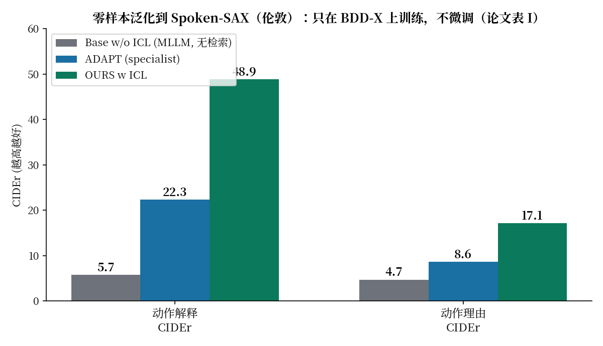
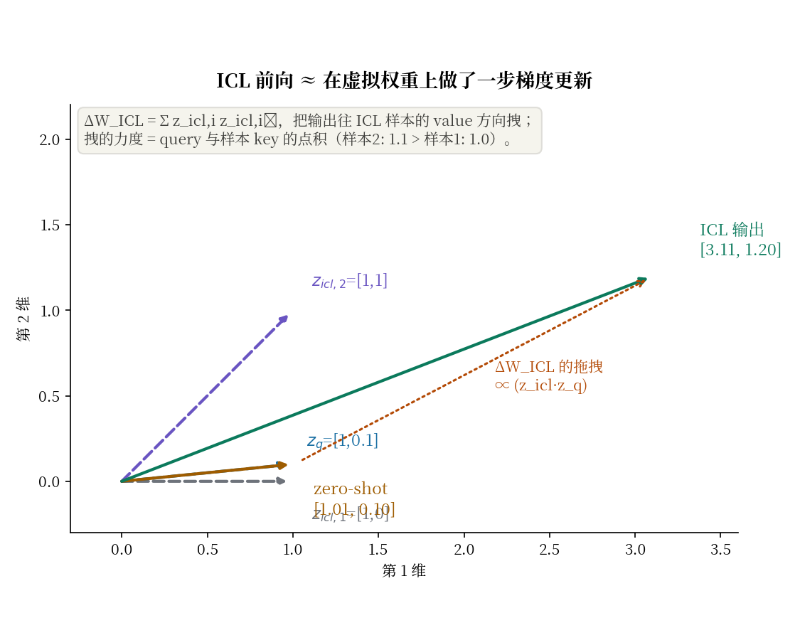

# 不靠微调靠翻书：RAG-Driver 用检索到的驾驶经验给 MLLM 做上下文

| | |
|---|---|
| 论文标题 | RAG-Driver: Generalisable Driving Explanations with Retrieval-Augmented In-Context Learning in Multi-Modal Large Language Model |
| 作者 | Jianhao Yuan, Shuyang Sun, Daniel Omeiza, Bo Zhao, Paul Newman, Lars Kunze, Matthew Gadd（牛津大学、北京智源人工智能研究院） |
| 会议 | RSS 2024；arXiv:2402.10828（本文读的是 v3，2026-03-06 更新） |
| 链接 | https://arxiv.org/pdf/2402.10828 |
| 代码 | 官方代码已公开：https://github.com/YuanJianhao508/RAG-Driver，已 clone 到本目录 `code/`。但代码与论文多处对不上（margin、训练轮数、MLP 结构、输出维度），详见"代码和论文对不上的地方"一节。 |
| 一句话核心洞见 | 把领域泛化从"怎么训"变成"怎么查"：部署到新环境时不更新任何参数，而是从记忆库里捡两个"驾驶动作语义最像"的历史样本贴进 prompt，用 ICL 让注意力层做一次隐式的梯度步；理论包装借的是 Dai et al. 的"ICL≈梯度下降"。 |

## 先看那张让人停下来的图：OOD 下 CIDEr 从 5.7 到 48.9

论文图 1 右边画了两组柱子：在分布内（BDD-X 测试集）和分布外（伦敦街头录的 Spoken-SAX）上，动作解释和理由两个任务的 CIDEr。分布内那组差距不大，真正刺眼的是分布外那组：

数据来自论文表 I 下半部分。Base w/o ICL（同一个 MLLM，不加检索）在 Spoken-SAX 上的动作解释 CIDEr 只有 5.7——基本等于胡说八道；加上检索到的两个 ICL 样本，涨到 48.9。连 specialist 基线 ADAPT（在 BDD-X 上专门训的 caption 模型）也只有 22.3。

先别急着鼓掌，两个冷静的注脚放在这里，后面展开：Spoken-SAX 只有 58 个问答对，样本量很小；CIDEr 在这种小样本下方差不会小，论文没报方差。但即便如此，5.7 到 48.9 的 gap 大到不是方差能解释的——检索确实把模型从"崩了"拉回了"能说话"。

## 这篇论文到底在解哪三道题

RAG-Driver 一次做三个任务，输入都是 8 帧驾驶视频 + 当前控制信号：

1. **Action Explanation（动作解释）**："自车在干什么"，一句话描述，比如"自车正在减速"。
2. **Action Justification（动作理由）**："为什么这么干"，比如"因为前方行人正在过马路"。
3. **Control Signal Prediction（控制信号预测）**：下一时刻的方向盘转角（course）和速度，数值。

前两个是文本生成任务，用 BLEU-4、CIDEr、METEOR 评；第三个是数值任务，用 RMSE 和容忍准确率 A_σ（预测落在真值 ±σ 内算对）评。三个任务共用同一个 MLLM，控制信号也走"语言 token 预测"——把浮点数写成文本 token 让 LLM 自回归生成。论文附录 D 承认这不是理想的表示（LLM 的分词把连续数切碎了，加减乘除的线性结构丢了），但先这么用着，理由是 RT-2、DriveGPT4 都验证过这条路能走通。

训练数据是 BDD-X：77 小时美国驾驶视频，整理成 16,803 个训练 QA 对、2,123 个测试 QA 对。泛化测试用的是作者自己录的 Spoken-SAX：伦敦街头，专业驾驶教练边开边解说，58 个测试 QA 对。BDD-X 到 Spoken-SAX 的跨度是：美国→英国（左舵→右舵、交规不同）、普通司机→专业教练的解说风格、不同的光照和街景。这个分布偏移是真实的，不是人工构造的。

## 为什么是检索+ICL，而不是微调

论文引言花了很大篇幅论证"微调这条路走不通"，逻辑链是三节：

第一，**标注贵**。驾驶+语言的配对数据很少，BDD-X 这种规模（77 小时）在通用视觉语言数据面前是小巫见大巫。新环境来了重新标注不现实。

第二，**训不起**。7B 的 MLLM 微调一次要 8×A100 跑 6 小时（论文给的数字），部署后持续微调不现实。

第三，**灾难性遗忘**。在新数据上继续微调，旧环境的能力会掉（引 Kirkpatrick et al. 2017）。对驾驶这种安全相关的系统，这是不可接受的。

所以作者换了一条路：**参数冻结，换输入**。把"适应新环境"变成"给模型看两个新环境里最像的历史案例"。检索库就是 BDD-X 训练集本身（向量+文本双库），推理时查两个最像的样本贴进 prompt。这套东西在 NLP 里叫 RAG+ICL，论文的贡献是把它第一次完整地搬到多模态驾驶里，并且给了检索空间一个驾驶语义的组织原则（三元组损失那节讲）。

这个论证链条里有一个可以质疑的环节：灾难性遗忘和"训不起"在 2024 年都有缓解方案（LoRA、adapter），论文直接判了微调死刑，多少有点为了立论服务。但公平地说，LoRA 也要为每个新环境存一份 adapter、有版本管理问题，"零参数更新"的检索方案在工程上确实更干净。

## 作者的底牌：三张，一张比一张偏理论

**第一张：Dai et al. 的"ICL≈梯度下降"（2022）。** 这篇引用 [17] 的工作说，transformer 的注意力层在做 ICL 时，前向过程等价于在某个虚拟权重上做一步梯度更新。RAG-Driver 把这套理论搬过来，给了自己的推导版本（Eq 5–10，附录 C 还有完整版）。这张牌的价值不在数学上（后面会讲它的局限），而在叙事上：它让"贴两个样本进 prompt"这个看起来 heuristic 的做法，有了一个"隐式 meta-optimization"的理论外衣。审稿人吃这一套。

**第二张：检索空间按"动作语义"组织，不按"长得像"。** 消融表 III 显示，只用视觉相似度检索（video embedding 直接比）效果明显差于 hybrid 检索。作者的解释是：视觉上最像的样本，不一定在推理过程上最有参考价值。这个观察是实在的——两段都是"直行"的视频，一段在高速、一段在学校门口，视觉可能很像，但驾驶决策的语义完全不同。

**第三张：时机。** DriveGPT4（2023 年底）刚证明 MLLM 能做驾驶解释，但它在 OOD 下的表现没人细究；RAG（2020）和 ICL（2020）在 NLP 里已经是显学。把这两样搬到驾驶 MLLM 里，是 2024 年初最自然的下一步。

## 检索怎么做：三元组损失与 TF-IDF 定的正负样本

记忆库里的每条经验由两部分组成：视频 embedding $\mathbf{z}_{vo}$（LanguageBind 编码器提的，论文写 $\in \mathbb{R}^{2048 \times 1024}$）和控制信号 $\mathbf{c} \in \mathbb{R}^{28}$（speed、course、acceleration、curvature 四种信号各 7 个值——论文没明说 7 是什么，代码 `matching.py` 里 `expected_length=7` 表明每种信号取 7 个时间步[代码证据，论文未写]）。

检索分两步。第一步训一个轻量 MLP，把视频 embedding 和控制信号拼起来投影到同一个 hybrid 空间 $\mathbf{s} \in \mathbb{R}^{1024}$。训练用三元组损失：

$$\mathcal{L}_{Tri}(\mathbf{a}, \mathbf{p}, \mathbf{n}) = \max(\|\mathbf{a}-\mathbf{p}\|_2 - \|\mathbf{a}-\mathbf{n}\|_2 + \text{margin}, 0) \tag{4}$$

$\mathbf{a}$ 是 anchor（当前样本），$\mathbf{p}$ 是正样本，$\mathbf{n}$ 是负样本。关键问题是：**正负样本怎么定？** 作者的选择很聪明：不看视觉，看文本——用 BDD-X 里人工标注的 action + justification 文本算 TF-IDF 相似度，文本越像的算正样本对，越不像的算负样本对。

为什么这个选择聪明？因为检索的最终目的是给 ICL 提供"推理过程的类比"，而驾驶推理过程的语义恰恰写在 action/justification 文本里。"减速因为行人过马路"和"减速因为红灯"在文本上接近，在决策语义上也接近；视觉上两段视频可能天差地别。用文本定正负，等于把"什么算相似"的定义权交给了人类标注的语义，而不是像素。

在一个小实例上验算三元组损失。设 margin=0.5（论文附录 A 的值），anchor $\mathbf{a}=(0,0)$，正样本 $\mathbf{p}=(0.4,0)$，负样本 $\mathbf{n}=(0.7,0)$：

$$\|\mathbf{a}-\mathbf{p}\|_2 = 0.4, \quad \|\mathbf{a}-\mathbf{n}\|_2 = 0.7$$
$$\mathcal{L} = \max(0.4 - 0.7 + 0.5, 0) = \max(0.2, 0) = 0.2 > 0$$

有损失，梯度会把 $\mathbf{p}$ 往 $\mathbf{a}$ 拉、把 $\mathbf{n}$ 往外推。如果负样本换成 $\mathbf{n}=(1.2,0)$：$\max(0.4-1.2+0.5,0) = \max(-0.3,0) = 0$，已经分得够开，不产生梯度。margin 就是"够开"的标准：正负距离差超过 margin 就不再优化。这个机制的几何画面很直观：**每个 anchor 周围画一个半径 margin 的"语义邻域"，文本语义相近的样本被拽进邻域，不相近的被推出去**。

第二步，推理时把 query 的视频+控制信号过同一个 MLP 得到 $\mathbf{s}_q$，和库里所有 $\mathbf{s}^{(i)}$ 算余弦相似度，取 top-2 作为 ICL 样本。注意这里有个微妙的不对称：**训练三元组损失用欧氏距离，推理检索用余弦相似度**。论文没解释为什么两者不一致。一种可能是 MLP 输出没做归一化，欧氏和余弦差一个模长因子；严格来说这是个小瑕疵，但实践中只要 embedding 模长比较均匀，影响不大。

## Eq(1)–(3)：先把符号的形状钉死

论文的公式不少，每个符号第一次出现就把形状写清楚，后面不回头。

**跨模态投影（Eq 1）：**

$$f_p(\mathbf{z}_{vo}) = \text{GELU}\left(W_2 \cdot \text{GELU}(W_1 \cdot \mathbf{z}_{vo})\right) \tag{1}$$

$\mathbf{z}_{vo} \in \mathbb{R}^{2048 \times 1024}$ 是冻结的 LanguageBind 视频编码器的输出：2048 个 token，每个 1024 维。两层 MLP（中间维度论文没写[论文未写]）把它投影到 $\mathbf{z}_v \in \mathbb{R}^{2048 \times 4096}$，4096 是 Vicuna-1.5 的词向量维度。注意这里有个数字对不上的地方，留到怀疑一节：正文 V-A 说每个 ICL 样本引入"1024-token fixed-length video sequence"，但这里 $\mathbf{z}_{vo}$ 是 2048 个 token。2048 和 1024，论文自己打架了。

关于 2048 这个数字本身也值得问一句：LanguageBind 基于 ViT-B/32，输入 8 帧 224×224，每帧 7×7=49 个 patch，8 帧一共 392 个 patch token。2048 是怎么来的？论文没解释[未核实]。可能是某种上采样或重复，不影响主线，但数字的来源是断的。

**LLM 自回归（Eq 2）：**

$$P(\mathbf{x}_{n+1:L} \mid \mathbf{z}_{1:n}) = \prod_{l=n+1}^{L} P_\theta(\mathbf{x}_l \mid \mathbf{x}_{1:l-1}, \mathbf{z}_{1:n}) \tag{2}$$

标准写法：$\mathbf{z}_{1:n} = [\mathbf{z}_v, \mathbf{z}_t]$ 是多模态前缀（视频 token + 文本 token，共 $n$ 个），输出从第 $n+1$ 个位置开始自回归，每个 token 以之前所有输出和前缀为条件。没什么特别的，就是 decoder-only LLM 的标准条件概率。

**训练损失（Eq 3）：**

$$\mathcal{L}_{CE} = -\sum_{i=n+1}^{L} \mathbf{y}_l \log P(\mathbf{x}_l \mid \mathbf{z}_{1:n}) \tag{3}$$

标准的 next-token 交叉熵。注意一个笔误：求和指标写的是 $i$（$\sum_{i=n+1}^{L}$），里面用的却是 $l$（$\mathbf{y}_l$、$\mathbf{x}_l$）。应该是 $\sum_{l=n+1}^{L}$。小问题，但说明公式没经过仔细校对。

## Eq(5)–(10)：ICL 前向如何被解释成一步梯度更新

这是论文理论部分的全部家当，值得一步一步走。起点是 Dai et al. 的结论，作者用 SimA（softmax-free attention，引用 [41]）给了自己的推导。

先看单头注意力。标准 attention 是 $\text{softmax}(QK^\top/\sqrt{d})V$，论文把它写成转置形式：

$$\mathcal{F}_{\text{ICL}}(\mathbf{z}_{1:n}) = W_V[\mathbf{z}_{icl}; \mathbf{z}_q] \, \text{Softmax}\left(\frac{(W_K\mathbf{z}_{1:n})^\top (W_Q\mathbf{z}_{1:n})}{\sqrt{d^i}}\right) \tag{5}$$

其中 $[\mathbf{z}_{icl}; \mathbf{z}_q]$ 是 ICL 样本 embedding 和当前 query embedding 的拼接。$W_V$ 左乘、softmax 作用在 $K^\top Q$ 上——和常规的 $ \text{softmax}(QK^\top)V$ 是转置等价的，只是记号习惯不同。

然后去掉 softmax（SimA 的做法），得到线性注意力：

$$\mathcal{F}_{\text{ICL}}(\mathbf{z}_{1:n}) = W_V[\mathbf{z}_{icl}; \mathbf{z}_q]\,(W_K[\mathbf{z}_{icl}; \mathbf{z}_q])^\top W_Q\mathbf{z}_{1:n} \tag{6}$$

展开乘法，把 ICL 部分和 query 部分分开：

$$= \underbrace{W_V\mathbf{z}_{icl}(W_K\mathbf{z}_{icl})^\top}_{\Delta W_{ICL}} W_Q\mathbf{z}_{1:n} + \underbrace{W_V\mathbf{z}_q(W_K\mathbf{z}_q)^\top}_{W_{ZSL}} W_Q\mathbf{z}_{1:n}$$

$$\mathcal{F}_{\text{ICL}}(\mathbf{z}_{1:n}) = (\Delta W_{ICL} + W_{ZSL}) W_Q\mathbf{z}_{1:n} \tag{7}$$

其中（论文 Eq 8，多个 ICL 样本时求和）：

$$\Delta W_{ICL} = \sum_i W_V\mathbf{z}_{icl,i}(W_K\mathbf{z}_{icl,i})^\top, \quad W_{ZSL} = W_V\mathbf{z}_q(W_K\mathbf{z}_q)^\top \tag{8}$$

$W_{ZSL}$ 只和 query 有关（zero-shot 部分），$\Delta W_{ICL}$ 是 ICL 样本带来的增量。现在对比梯度下降。线性层 $y = (W_0 + \Delta W)x$，一步梯度更新 $\Delta W = \eta \frac{\partial L}{\partial y}\big|_{y_i} x_i^\top$，作用在输入上：

$$\Delta W x = \sum_i \eta \frac{\partial L}{\partial y}\Big|_{y_i} x_i^\top x \tag{10}$$

把两边的结构对齐：

$$W_V\mathbf{z}_{icl,i}(W_K\mathbf{z}_{icl,i})^\top \longleftrightarrow \eta \frac{\partial L}{\partial y}\Big|_{y_i} x_i^\top$$

$$(W_{ZSL} + \Delta W_{ICL})W_Q\mathbf{z}_{1:n} \longleftrightarrow (W + \Delta W)x$$

结论：ICL 样本在前向里起的作用，形式上等价于在"虚拟权重"$W_V(W_K\cdot)^\top$ 上做了一步以 ICL 样本为 mini-batch 的梯度更新——**没有反向传播的前向"训练"**。这就是论文反复说的 implicit meta-optimization。

## 一个 2D 小实例：亲眼看着 ICL 把输出"拽"过去

上面的推导是符号游戏，下面让它变成看得见的东西。取单头、$W_Q=W_K=W_V=I$（单位阵），两个 ICL 样本、一个 query：

- $\mathbf{z}_{icl,1} = [1, 0]^\top$（样本 1）
- $\mathbf{z}_{icl,2} = [1, 1]^\top$（样本 2）
- $\mathbf{z}_q = [1, 0.1]^\top$（当前 query）

算 $\Delta W_{ICL}$：

$$\Delta W_{ICL} = \begin{bmatrix}1\\0\end{bmatrix}[1,0] + \begin{bmatrix}1\\1\end{bmatrix}[1,1] = \begin{bmatrix}1&0\\0&0\end{bmatrix} + \begin{bmatrix}1&1\\1&1\end{bmatrix} = \begin{bmatrix}2&1\\1&1\end{bmatrix}$$

$W_{ZSL} = \mathbf{z}_q\mathbf{z}_q^\top = \begin{bmatrix}1&0.1\\0.1&0.01\end{bmatrix}$。

zero-shot 输出（只有 $W_{ZSL}$）：

$$W_{ZSL}\mathbf{z}_q = \begin{bmatrix}1&0.1\\0.1&0.01\end{bmatrix}\begin{bmatrix}1\\0.1\end{bmatrix} = \begin{bmatrix}1.01\\0.101\end{bmatrix}$$

ICL 输出（加上 $\Delta W_{ICL}$）：

$$(\Delta W_{ICL}+W_{ZSL})\mathbf{z}_q = \begin{bmatrix}3&1.1\\1.1&1.01\end{bmatrix}\begin{bmatrix}1\\0.1\end{bmatrix} = \begin{bmatrix}3.11\\1.201\end{bmatrix}$$

画出来就是下面这张图：

zero-shot 的输出 $[1.01, 0.10]$ 几乎就是 query 自己；加上 ICL，输出被拽到 $[3.11, 1.20]$——第二维被样本 2 的 $[1,1]$ 模式明显带起来了。拽的力度正比于 query 与样本 key 的点积：样本 2 的点积是 $1\times1 + 0.1\times1 = 1.1$，样本 1 的是 $1.0$，所以样本 2 拽得更狠。这就是"隐式梯度步"的几何画面：**每个 ICL 样本都是一次"把输出往我的 value 方向拉"的投票，票数权重是它和 query 的匹配度**。

## 这个理论包装的边界在哪里

上面的推导是对的，但它的解释力有三层边界，论文都没点破：

第一，**$\Delta W_{ICL}$ 不是任何明确目标函数的梯度**。对应关系里，$W_V\mathbf{z}_{icl,i}$ 对应 $\eta \partial L/\partial y$，$(W_K\mathbf{z}_{icl,i})^\top$ 对应 $x_i^\top$——但这里没有损失函数 $L$，没有学习率 $\eta$，没有"拟合 ICL 样本"这个优化目标。这是一个形式类比，不是真的在优化什么。"Meta-gradient"的说法是解释性的。把类比当成证明，是这节最容易让读者滑过去的地方。

第二，**推导只覆盖了单头、单层、去 softmax 的线性注意力**。真实模型是 32 层（Vicuna-1.5 7B）、多头、带 softmax、后面还跟 MLP。论文用"interpreted"这个词，算是留了余地，但正文的语气（"we provide a new, alternative derivation"）比实际的严谨程度要自信。

第三，**它解释不了"为什么是两个样本"和"为什么文本相似度定的正负样本管用"**。理论部分和检索部分在论文里是脱节的：Eq(5)–(10) 对任何 ICL 样本都成立，没用到"hybrid embedding"或"TF-IDF 正负样本"的任何性质。真正决定效果的是检索质量（表 III 的 visual vs hybrid 对比），而理论对检索只字未提。两部分是各讲各的。

## 表 I 细读：在分布内赢的是 CIDEr，在分布外赢的也是 CIDEr

表 I 上半（BDD-X 分布内）。OURS 对 DriveGPT4（同为 generalist MLLM，参数量相近）的提升：

- 动作解释：B4 30.0→34.3（+14.3%），CIDEr 214.0→260.8（+21.9%），METEOR 29.8→30.7（+3.0%）
- 动作理由：B4 9.4→11.1（+18.1%），CIDEr 102.7→109.1（+6.2%），METEOR 14.6→14.8（+1.4%）

（百分比是我按表里数字验算的，和论文的 ∆ 行一致：(34.3−30.0)/30.0=14.33%≈14.3%，其余同理。）六个指标平均提升 10.8%，和论文正文说的"average performance improvement of 10.8%"对得上。

和 specialist ADAPT 比：OURS 动作解释 CIDEr 260.8 对 247.5，赢了；B4 34.3 对 34.6，基本打平；理由 B4 11.1 对 11.4，略输。**MLLM 追平 specialist，这是之前 MLLM 方法没做到的**（DriveGPT4 全线输 ADAPT），论文把这点作为核心卖点之一，是成立的。

但注意指标的脾气：CIDEr 涨 21.9%，METEOR 只涨 3.0%。CIDEr 对"和参考文本的 n-gram 共识"敏感，ICL 样本里贴了两个同分布的标注文本，模型输出的措辞自然更接近标注风格——CIDEr 大涨里有一部分是"学到了标注的说话方式"，不全是"推理变好了"。METEOR 涨得少，说明语义层面的提升比措辞层面的小。这是读这张表时要打的折扣。

表 I 下半（Spoken-SAX 零样本）。最值得玩味的不是 OURS 的 48.9，而是另外两个数字：**ADAPT 的 22.3 和 Base w/o ICL 的 5.7**。ADAPT 是在 BDD-X 上训的 specialist，到伦敦街头 CIDEr 还有 22.3；而同一个 MLLM 不加 ICL 只有 5.7。也就是说，7B MLLM 的零样本 OOD 崩塌比 specialist 还严重——它的"通用性"在分布偏移面前是纸糊的。ICL 把 5.7 拉回 48.9，说明 MLLM 的问题不是"学不会"，而是"不知道该用什么风格/ prior 回答"；两个检索到的样本起到了校准 prior 的作用。

还有一个诚实的细节：∆ 行第一格写的是"+−%"。B4 从 0.0 涨到 9.9，百分比没法算（除零），作者直接写了个"+−%"。处理得诚实，虽然看起来滑稽。

## 表 II 细读：控制信号里那个反常的 A0.1

控制信号预测（BDD-X 分布内）：

| | Course RMSE | Speed RMSE |
|---|---|---|
| ADAPT | 5.87° | 2.68 m/s |
| DriveGPT4 | 4.57° | 1.09 m/s |
| OURS | 4.48° | 0.69 m/s |

OURS 全面最好。但看容忍准确率 Speed A0.1（预测落在真值 ±0.1 m/s 内）：OURS 51.12%，DriveGPT4 56.93%。**RMSE 更低，A0.1 反而更低**——这两个指标打架了。

打架的原因不难想：RMSE 是平方平均，对大误差敏感；A0.1 是个极严的阈值（±0.1 m/s，约 ±0.36 km/h）。一种可能是 OURS 的预测有个微小的系统性偏差（比如整体偏 0.15 m/s），大误差少了（RMSE 好看），但落在 ±0.1 内的比例反而低了。另一种可能是 DriveGPT4 的预测更"尖"（经常命中，但偶尔大错）。论文没讨论这个反常，挺可惜的——它直接关系到"ICL 到底改善了数值预测的哪一方面"。

## 表 III 细读：推理时才加 ICL，模型直接崩了

这张消融表是全文最有教学意义的一张：

| 检索策略 | ICL 时机 | Act B4/C | Jus B4/C | Speed Err | Course Err |
|---|---|---|---|---|---|
| Visual Search | 训练+推理 | 29.8/222.1 | 5.9/58.9 | 0.67 | 5.61 |
| Visual/Hybrid | 只推理 | 0.0/0.0 | 0.0/0.0 | N/A | N/A |
| Hybrid Search | 训练+推理 | 34.3/260.9 | 11.1/109.1 | 0.69 | 4.48 |

"只推理"加 ICL 的两行：模型生成随机字符串和非浮点数，指标算不出来（N/A）。**预训练 MLLM 根本不会做 ICL**——至少不会做这种"前面贴两个带视频 token 的驾驶样本"的多模态 ICL。ICL 能力是 instruction tuning 阶段"教"出来的：训练数据里（Fig 4 的格式）每个 query 前面都贴了两个检索样本，模型才学会"看例子说话"。

这对"ICL 是涌现能力"的流行叙事是一个具体的反例：在多模态驾驶这个格式下，zero-shot ICL 不存在，必须经过带 ICL 样本的微调（论文引用 Wei et al. 的 symbol tuning 也是这个意思）。想直接把 RAG 这套搬到别的 MLLM 上用，不经过这一步训练是行不通的。

Visual Search vs Hybrid Search：纯视觉检索（29.8/222.1）明显差于 hybrid（34.3/260.9）。作者的解释是视觉相似优先捡"长得像"的样本，而不是"推理过程像"的。这组对比是 hybrid embedding 存在的全部理由。

## 表 IV 和表 V：两个样本是上限，不是选择

表 IV：1 个 ICL 样本 vs 2 个。2 个在文本指标上更好（Act C 257.2→260.9，Jus C 99.3→109.1），但 Course Err 从 4.15 升到 4.48——论文正文承认了"slightly decreasing the course control signal accuracy"。为什么作者只试到 2？V-A 节给了硬约束：Vicuna-1.5 的 context window 是 4096 个 token，每个 ICL 样本约 1800 个 token（1024 个 video token + 对话文本），2 个样本 + query 刚好塞满。**2 不是调出来的最优，是塞不下的上限**。更大的 context window（比如 32k）能不能继续涨，论文没做，这是个开放问题。

表 V：用 Spoken-SAX 的目标域数据再微调一下检索器，OOD 的 Act C 从 48.9 涨到 52.1，Jus C 从 17.1 涨到 19.0。涨幅不大，但说明检索器本身还有 headroom。注意这一步用了目标域数据，严格来说不再是"zero-shot"，论文把它放在 fine-tuning retrieval engine 一节，标题是诚实的。

## 怀疑式审读

**1. 附录 A 自己打架。** 原文："We leverage a three-layer MLP as the embedding projector to fuse the video 1×1024 and control signal 1×28 embedding into a hybrid embedding. The architecture of the lightweight projector is a four-layer MLP with GELU activation. It has an input dimension of 1052 and an output dimension of 1024." 同一段里先说 three-layer，后说 four-layer。到底几层？看代码（下一节）是五层。附录的数字不可信。

**2. 附录的算术错误。** "batch size of 4 with a gradient accumulation step of 2 on 8 A100 GPUs, which leads to an effective training batch size of 128"——4×2×8=64，不是 128。**warmup 5 epochs 但总共只训 2 epochs**："We use a warm-up strategy in the first 5 epochs with a warm-up ratio of 0.03. We train the model for 2 epochs." warmup 比总训练还长，学习率永远走不完 warmup。这两处说明附录是赶工写的。

**3. 训练轮数三个版本。** 正文说检索 projector 训 300 epochs，附录 A 说 200 epochs，代码 `train.py` 写 `num_epochs = 2000`。三个数字，没有一个对得上。

**4. 推理 4 秒一轮，谈不上实时。** 论文原话："the overall single round inference time is roughly 4 seconds on a single A100 GPU"。4 秒才做一次决策，闭环驾驶用不上。论文的定位是解释和开环控制信号预测，不是闭环控制——V-D 节也承认了闭环评测是未来工作。这和 DriveGPT4-V2（8.1 FPS 闭环）是两条路线，读者不要混淆。

**5. Spoken-SAX 只有 58 个样本。** OOD 那组漂亮数字（48.9 CIDEr）的分母是 58 个 QA 对。CIDEr 在小样本下方差大，论文没报任何方差或显著性。结论的方向可信，幅度的精确值要打折。

**6. 记忆库就是训练集。** "memory database is constructed using the BDD-X training split"——检索库和训练集是同一批数据。ICL 样本是模型训练时见过的样本的"重播"。这在 RAG 范式里是常规做法，但"zero-shot generalisation"的说法要准确理解：模型没在 Spoken-SAX 上训过，但它检索到的"经验"全部来自 BDD-X。泛化能力 = BDD-X 经验库的覆盖度 × 检索器的跨域匹配能力。如果新环境里出现 BDD-X 完全没有的场景（比如雪地），库里没有可捡的，ICL 也救不了。

**7. 2048 vs 1024 的 token 数。** 正文 III-A 说 video embedding 是 2048×1024，V-A 又说每个 ICL 样本含"1024-token fixed-length video sequence"。同一个量两个数，论文没解释。

## 代码和论文对不上的地方

官方仓库 `code/` 是 2024 年 5 月作者还在维护的版本（README 写 "Code update is in Progress"），但和论文的出入不少，按严重程度排：

1. **检索 MLP 的结构完全不同。** 论文 Eq(1) 是两层 MLP（$W_1, W_2$），附录说输入 1052 维输出 1024 维（三层/四层，自己打架）。代码 `retrieval/train.py` 的 MLP 是：`LayerNorm(1052)` + 五个 Linear（1052→2048→4096→2048→4096→8192），输出 8192 维。层数、宽度、输出维度全对不上。
2. **Triplet loss 的 margin。** 论文/附录：0.5。代码：`nn.TripletMarginLoss(margin=1.0, p=2)`。
3. **优化器。** 附录：Adam，lr 1e-5，200 epochs。代码：`torch.optim.Adam(lr=0.001)`，`num_epochs=2000`。
4. **`rag.py` 的 `random_subset` 名不副实。** 注释写"随机选 1 到 5 个"，实际 `num_elements = 2` 写死，固定选 2 个随机样本。看起来是消融基线脚本，但注释和行为不符。
5. **ICL 样本的拼接格式。** 代码 `video_process/create_bddx_json.py` 显示，ICL 上下文是纯文本拼接：`"Here are also some historical driving experience..."` + `"Experience {id}:{sample}\n"`，视频则是把匹配到的视频路径和当前视频拼在一起（`all_video_path = rag_path + [video_path]`）。和论文 Fig 4 的描述一致，这部分代码和论文是对得上的。

总的来说，MLLM 主干的训练/推理流程代码和论文基本吻合，出入集中在检索器的 MLP 和训练超参上。复现检索器时，以代码为准还是以论文为准，需要自己判断——我的建议是两个都试，因为两边的数字都没法完全信。

## 带走什么

这篇论文留给后来者两个实在的东西。第一，**"训练时见过 ICL 格式"是多模态 ICL 的前提**：表 III 那两个 N/A 是全文最有警示意义的数字——别指望预训练 MLLM 零样本就会看例子开车，instruction tuning 时必须把 ICL 样本贴进训练数据。第二，**检索空间的组织原则决定 RAG 的上限**：用文本语义（TF-IDF）定正负样本、而不是用视觉相似度，这个选择是 hybrid 检索赢过 visual 检索的全部原因；"什么算相似"应该由任务的语义定义，而不是由 embedding 的余弦距离定义。

它没回答的问题：context window 放大到 32k 之后，ICL 样本数能不能继续涨（论文卡在 2 个是硬件限制不是理论限制）；4 秒一轮的推理怎么进闭环（作者自己承认没做）；以及那个形式漂亮的"ICL≈梯度下降"推导，到底能不能指导检索器的设计——目前它是解释，不是工具。
