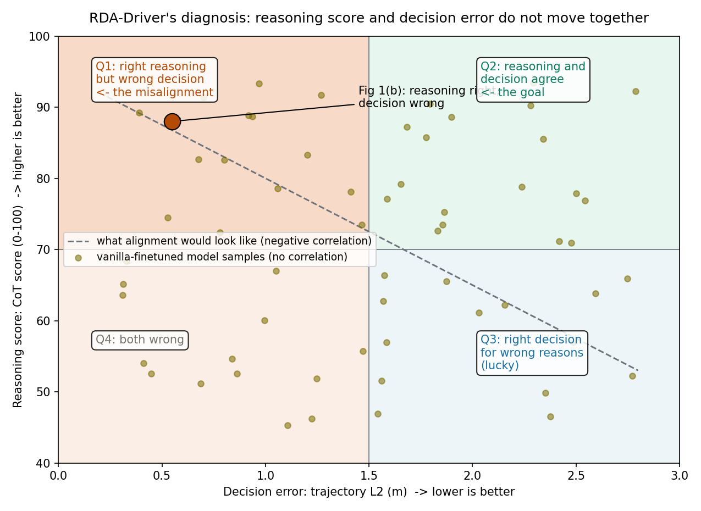
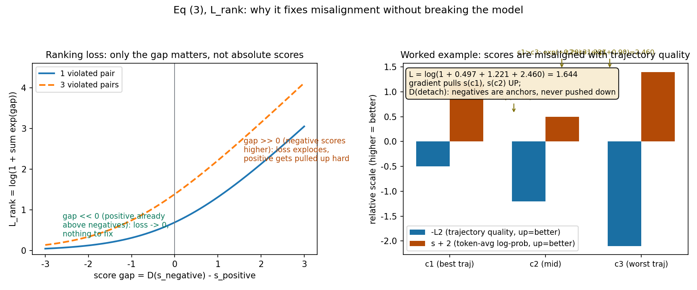

# 让模型的嘴和手保持一致：用排序损失对齐 CoT 推理与轨迹决策

> **论文标题**：Making Large Language Models Better Planners with Reasoning-Decision Alignment（RDA-Driver）
> **作者**：Zhijian Huang\*、Tao Tang\*（共同一作）、Shaoxiang Chen、Sihao Lin、Zequn Jie、Lin Ma、Guangrun Wang、Xiaodan Liang（通讯）
> **会议**：ECCV 2024；arXiv:2408.13890（v1，2024-08-25；无后续版本）
> **链接**：https://arxiv.org/abs/2408.13890
> **代码**：官方仓库 https://github.com/zhijian11/RDA-Driver 仅含一个 README，无实现
> **一句话核心洞见**：vanilla 微调的 LLM 驾驶规划器会出现"嘴上说得对、手上做得错"——CoT 推理正确，轨迹决策却错；作者的办法是让模型对同一个场景采样多条 CoT，用轨迹 L2 的好坏给它们排好名，再用一个带 detach 的排序损失把好 CoT 的 token 平均对数概率往上拉（坏的不往下压），同时把相似场景下错配的 CoT 当负例做二元对齐，逼着推理和决策说同一种话。

## 一个推理正确、决策却错的例子：这怎么可能

论文的图 1(b) 放了一个让人停下来的例子。模型在 CoT 里写得明明白白：注意到了正前方的车 `<c4,CAM_FRONT>`，判断它"正在往前开，所以自车应该保持静止"——推理链条完整、结论正确。然后它输出的轨迹是：自车往前开。嘴上说"别动"，手上踩了油门。

图 1(a) 把这个现象量化了：横轴是决策误差（预测轨迹的 L2，越小越好），纵轴是 CoT 分数（越高越好），拿 vanilla 微调的 LLaVA 在样本上画散点。如果推理和决策是一致的，这团点应该呈负相关——CoT 写得越好，轨迹误差越小。但实际画出来是一团没有结构的云。推理的质量和决策的质量互不相干。

*上图：错位问题的四象限示意。横轴是轨迹 L2 误差（越小越好），纵轴是 CoT 分数（越高越好）。理想的对齐模型样本应落在右上象限（Q2）；论文图 1(b) 的例子落在左上象限（Q1）——推理正确但决策错误，这正是 RDA-Driver 要消灭的区域。*

先把一个容易产生的误解纠正掉：这不是"模型太笨"。恰恰相反，vanilla 的监督微调（SFT）目标函数本身就不要求推理和决策一致。交叉熵损失只关心一件事：模型生成的下一个 token，和标注里的下一个 token 像不像。标注里的 CoT 写得再漂亮、轨迹标得再准，损失函数也只是在 token 层面逐个比对，它从来没有被问过一个问题："你这段推理推出来的结论，和你输出的轨迹，在语义上是不是一回事？" 训练目标里没有这一项，模型自然没有动力去保证它。推理头和轨迹头在同一个解码器里共用参数，但从损失函数的视角看，它们是两条互不相干的流水线——都努力拟合标注，但彼此之间没有约束。这就是结构性的错位：不是调参能修好的，是目标函数缺了一块。

这也是论文真正的起点。作者没有去设计更花哨的 CoT 模板（虽然他们也重做了 CoT，见后文），而是先承认：只要损失函数不惩罚"说一套做一套"，模型就会说一套做一套。解决办法必须是一个显式的对齐约束。

## 作者的底气是什么：把 AFT 的排序损失搬进驾驶

读到这里，一个做过 LLM 对齐的人会立刻想到：这不就是 RLHF / DPO / RRHF 那套东西吗？把"人类偏好"换成"轨迹好坏"，把"回答"换成"CoT+轨迹"，然后做偏好对齐。作者的底气（推断，有依据）正在于此：2023 年下半年，Wang 等人的 AFT（Aligning LLM to Better Reasoners，arXiv:2309.02144，论文引用 [42]）已经证明了，用排序损失（ranking loss）直接对齐 LLM 的打分行为，可以在不训 reward 模型的情况下提升数学推理能力。RDA-Driver 把这套机制原样搬到自动驾驶：不需要人类标注偏好，轨迹的 L2 误差本身就是现成的、客观的"偏好信号"——L2 小的 CoT 就是"好"的。

这张底牌有多硬？相当硬。第一，它不依赖任何新的人工标注：负样本来自模型自己的采样和训练集里相似场景的交叉组合（3.2 节的 dataset generation），数据是免费的。第二，它和主任务（轨迹预测）共享同一个评价标准，审稿人很难质疑"你的对齐目标和真实目标不一致"。第三，实现上只多了两个损失项，不动架构，任何 LLM 驾驶模型都能接。论文的实验也确实显示，加上这两个损失，nuScenes UniAD 指标下 L2 从 0.85 降到 0.80、碰撞率从 0.44% 降到 0.32%（表 4），CoT 的 GPT-3.5 打分从 62 涨到 71（表 3）。

但底牌硬不代表没有疑问。AFT 原本对齐的是"打分行为"（模型给不同推理链打的分），而这里要对齐的是"推理文本和轨迹输出的一致性"——从"给分"到"生成"，中间隔了一层。作者用了一个关键的桥接假设：**一条 CoT 的 token 平均对数概率，可以作为这条 CoT"质量"的代理分数**。这个假设值得单独审视，后文讲公式 (2) 时会回到它。

## 先看骨架：三段式架构里谁在训练、谁被冻住

RDA-Driver 的整体结构（图 2）是对 LLaVA 的直接模仿，分三段：

1. **视觉编码器**：多视角图像 → BEV 特征。作者没有用 CLIP，而是用了一个 LSS 风格的 lift-splat 编码器，把每个像素按深度分布投影到 3D 体素、再 splat 聚合成 BEV 网格。记 BEV 特征为 $B \in \mathbb{R}^{C \times H \times W}$，$C$ 是通道数，$H, W$ 是 BEV 网格的高和宽。这个编码器先用 BEVFusion 的 camera-based 3D 检测配置在检测任务上预训练，然后在 LLM 微调阶段**冻住**。
2. **Adapter**：把 BEV 特征变成 LLM 能吃的视觉 token。作者不用 Q-former（嫌它在只有 4072 个训练样本时难训、还丢细节），而是做了一个极简的区域编码：把 BEV 切成 $h \times w$ 的小格，每格内部展平当成一个 token。于是视觉 token 数从 $H \times W$ 降到 $(H/h) \times (W/h)$，每个 token 的维度是 $C \cdot h \cdot w$，记作 $F_V \in \mathbb{R}^{(C \cdot h \cdot w) \times (H/h) \times (W/h)}$。再过一个 2 层 MLP，把维度对齐到语言 token 的维度。这个 MLP 是**可训练**的。
3. **LLM 解码器**：作者用 Llama（引用的是 LLaMA-1 的论文；具体是 7B 还是 13B，正文和附录都没写——[未核实]）。tokenizer 冻住，LLM 本体用 **LoRA** 微调。

输入的文本侧是多轮 CoT 提示 $T$，包含自车状态 $T^s$（速度、横摆角速度、加速度、最近三帧的历史轨迹）和 CoT 问答 $T^c$。输出是 CoT 回答加最后的轨迹点。

表 5 的编码器对比值得细看，因为它回答了一个"为什么我想不到"的问题：直觉上 CLIP 是 LLM 的标配视觉编码器，换成 BEV 似乎是多此一举。但数据说：CLIP-based 是 0.84/0.48（L2/碰撞率），BEV+pooling 反而更差（1.35/0.87），而 BEV+flatten（区域展平）是 0.84/0.41——L2 和 CLIP 打平，碰撞率明显更好。为什么 pooling 会崩？BEV 网格上每个 cell 都有明确的空间含义（"左前方 10 米有个东西"），pooling 把相邻 cell 平均掉，等于把"哪里有障碍物"这个对规划最关键的信息抹平了。flatten 保留了每个区域的完整特征，只是把 token 数降下来。几何直觉就是：**规划要的是"哪里有什么"，不是"整张图的感觉"**，任何丢掉空间对应关系的压缩都会伤到规划。CLIP 的问题则反过来：它是透视图的语义编码，天生不知道"转成 BEV 坐标系下障碍物在哪"，LLM 得自己学这个视角变换，难。

## 公式 (1)：vanilla 微调到底在优化什么

$$\mathcal{L}_{van} = -\sum_{j=1}^{|r_i|} \log P(r_{i,j} \mid r_{i,<j}, T_{k,<j}, V; \theta) \tag{1}$$

逐项拆开。训练集是 $N$ 个样本 $\{V_i, T_i, A_i\}$，$V_i$ 是多视角图像，$T_i$ 是文本提示，$A_i$ 是真值轨迹（论文在这里记号有点乱：数据集定义用 $A$ 表示真值轨迹，公式里却用 $r_i$ 表示要生成的 token 序列——按上下文，$r_i$ 是包含 CoT 回答和轨迹 token 的完整输出序列；另外条件里的 $T_{k,<j}$ 下标 $k$ 应该是 $i$ 的笔误，指第 $i$ 个样本在第 $j$ 个 token 之前的多轮子提示）。

- $r_{i,j}$：输出序列的第 $j$ 个 token。输出不只是轨迹数字，还包括前面几轮 CoT 的自然语言回答，最后才到 `Trajectory:<SOT>[(x1,y1),...]<EOT>` 这样的轨迹 token。
- $r_{i,<j}$：第 $j$ 个 token 之前的所有输出 token——标准的自回归条件。
- $T_{k,<j}$：多轮 CoT 里，当前轮之前的提示文本。因为 CoT 是多轮问答（perception → prediction → decision → planning），生成第 $j$ 个 token 时，能看到的提示只到当前轮。
- $V$：视觉输入（BEV token）。
- $\theta$：模型参数（实际只更新 LoRA 和 adapter）。

这就是普通的下一 token 交叉熵。关键在它**没有**什么：损失是每个 token 独立求和的，CoT 部分的 token 和轨迹部分的 token 在损失里是平权的、可加的。模型可以把 CoT 写得天花乱坠（这部分 token 损失很低），同时轨迹 token 拟合得一塌糊涂，或者反过来——两者之间没有任何一项在说"你前后一致吗"。这就是上一节说的结构性缺口的形式化版本。

## 公式 (2)：一条 CoT 的"分数"长什么样

$$s_{\theta}^{c} = \frac{1}{|c|}\sum_{j=1}^{|c|}\log P(c_j \mid c_{<j}, V, T; \theta) \tag{2}$$

$s_{\theta}^{c}$ 是一条候选 CoT $c$ 的 token 平均对数概率。$|c|$ 是这条 CoT 的 token 数，$c_j$ 是第 $j$ 个 token。注意它不是采样时用的 beam score 的变体——它是在**给定**整条 CoT 文本的条件下，让模型做一次 teacher forcing，把每个位置的对数概率加起来再除以长度。

为什么除以 $|c|$？因为对数概率是负数，累加的话越长的序列分数越低（每个 token 都在乘一个小于 1 的概率）。不平均，模型会系统性地偏爱短 CoT。平均之后，$s_{\theta}^{c}$ 的含义变成：**模型平均每个 token 有多"愿意"写出这条 CoT**——可以粗糙地理解成模型对这条推理的"自信程度"。

这里藏着论文最关键、也最大胆的一个假设：**"模型更愿意写出的 CoT" = "更好的 CoT"**。这个假设在 AFT 里是成立的（数学推理里，模型给正确推理链的似然确实更高——经过验证的观察），但在驾驶里，它是被**训练目标逼出来**的，而不是天然成立的。vanilla 微调的模型恰恰违反它（图 1(a) 的散点云就是证据）。所以公式 (2) 与其说是一个度量，不如说是一个"待办事项"：我们希望 $s_{\theta}^{c}$ 成为质量的代理，但目前它不是；公式 (3)(4) 的全部工作，就是把这个希望变成现实。理解了这一层，就理解了为什么对齐损失要长成排序损失的样子——它不是在直接优化轨迹，而是在**重塑模型内部的打分函数**，让"愿意写"和"写得对"重新挂钩。

小实例验算一下形状。假设一条 CoT 有 $|c|=50$ 个 token，模型在每个位置给出的正确 token 概率平均是 0.7，那么 $\log 0.7 \approx -0.357$，$s_{\theta}^{c} \approx -0.357$。另一条更差的 CoT，平均概率 0.4，$s \approx -0.916$。分数都是负数，越大（越接近 0）越好。排序损失只关心相对大小，不关心绝对值——这就是为什么它比直接做回归更稳：不需要 $s$ 去拟合某个绝对的 L2 数值，只需要好坏分出先后。

## 公式 (3)：排序损失里那个 detach 到底在干什么

$$\mathcal{L}_{rank} = \log\left\{1 + \sum_{c_i \succ c_j} \exp\big(\mathbf{D}(s_{\theta}^{c_j}) - s_{\theta}^{c_i}\big)\right\} \tag{3}$$

先搭脚手架。训练流程是：先用公式 (1) 训出一个 vanilla 模型 $\tilde{\theta}$；对每个训练样本，让 $\tilde{\theta}$ 采样 $k$ 条 CoT（含轨迹）；按**预测轨迹和真值轨迹的 L2** 给这 $k$ 条排好名次：$c_1 \succeq c_2 \succeq \cdots \succeq c_k$。$c_i \succ c_j$ 表示"第 $i$ 条比第 $j$ 条好"。$\mathbf{D}(\cdot)$ 是 detach（截断梯度）。

求和遍历所有"好坏对" $(i, j)$，$i$ 排在 $j` 前面。每一项是 $\exp(\text{坏的分数} - \text{好的分数})$。

*上图左：$L_{rank}$ 只和"分数差"有关。差为正（坏的分数反而高）时损失爆炸，梯度把好的分数往上拉；差为负（好的已经排在前面）时损失趋近于 0。上图右：一个三条采样的具体算例——按轨迹 L2 排好名后，token 平均对数概率 $s$ 却是错位的（最好的轨迹 $c_1$ 分数不是最高），三对好坏关系全部"违例"，贡献 $\exp(差距)$ 求和后取 $\log(1+\cdot)$ 得 1.644。*

现在看梯度，这是 detach 的精妙处。对 $s_{\theta}^{c_i}$（好的那条的分数）求导：

$$\frac{\partial \mathcal{L}_{rank}}{\partial s_{\theta}^{c_i}} = -\frac{\sum_{j: c_i \succ c_j} \exp(\mathbf{D}(s_{\theta}^{c_j}) - s_{\theta}^{c_i})}{1 + \sum \exp(\cdot)} < 0$$

梯度为负，意味着优化会**增大** $s_{\theta}^{c_i}$——把好 CoT 的对数概率往上拉。而对 $s_{\theta}^{c_j}$（坏的那条），因为包了 $\mathbf{D}$，梯度是 0——**坏 CoT 的分数不会被往下压**。

为什么只拉不压？这是从 RRHF/AFT 一脉相承的设计哲学：如果同时把坏的往下压，模型会找到一个作弊解——把所有 CoT 的分数整体下移，好坏相对顺序不变，损失照样降，但模型整体的生成质量被破坏了（所有回答的似然都变低，语言能力退化）。只拉好的，坏的当"锚点"不动，模型的整体概率质量守恒，改变的只是好坏之间的相对排序。用一句话说：**对齐是重排座次，不是掀桌子**。

再看 $\log(1 + \sum \exp(\cdot))$ 这个外形。它是 softmax 交叉熵的变体：如果把"选出最好的 CoT"看成一个 $k$ 选 1 的分类问题，这个损失就是在说"好 CoT 被选中的概率要高"。当所有好坏对的差距都足够大（好的分数远高于坏的），$\exp(\text{负大数}) \to 0$，损失 $\to \log(1) = 0$，梯度消失，训练自动停手——不需要早停，它自己知道什么时候对齐好了。

一个自然的问题：排名依据 L2 是**轨迹**的 L2，但被排序、被拉分的是整条 **CoT**（含自然语言推理部分）。这里的逻辑链条是：同一条采样里，CoT 和轨迹是绑定的（一次前向同时生成），轨迹好的那条采样，其 CoT 被认定为"好推理"。这是一个代理假设：轨迹好 $\Rightarrow$ 推理好。它不完全严谨（可能存在"瞎推理但蒙对轨迹"的 Q3 象限样本），但在统计上，vanilla 模型采样出的 $k$ 条里，轨迹和推理的相关性足以让这个信号有用。论文没有讨论这个代理假设的失效模式，这是个缺口。

## 公式 (4)：二元损失管的是"张冠李戴"

$$\mathcal{L}_{binary} = \log\left\{1 + \sum_{c_n \in \mathbf{G}_N} \exp\big(\mathbf{D}(s_{\theta}^{c_n}) - s_{\theta}^{c_p}\big)\right\} \tag{4}$$

形式和 (3) 一模一样，只是好坏关系的来源不同。(3) 的好坏来自**同一个场景**下模型采样的 $k$ 条（model-based）；(4) 的好坏来自**不同场景**的交叉组合（data-based）：取同一场景不同时刻的两个样本 $(V_u, T^s_u, T^c_u, A_u)$ 和 $(V_v, T^s_v, T^c_v, A_v)$，把 $u$ 的视觉和自车状态配上 $v$ 的 CoT（或 $v$ 的轨迹），拼出负例。正例永远是原配 $(V_u, T^s_u, T^c_u, A_u)$，记分 $s_{\theta}^{c_p}$；负例集合 $\mathbf{G}_N$，记分 $s_{\theta}^{c_n}$。

直觉：驾驶中经常出现"场景看起来差不多、决策完全不同"的情况（比如同样是路口，这次直行、上次左转）。如果模型只记住"这种路口一般直行"，它就会把上次的 CoT 套用到这次。data-based 负例专门惩罚这种"张冠李戴"：视觉是 $u$ 的，CoT 是 $v$ 的，模型必须给原配打更高的分。这是在教模型**推理必须和眼前的视觉输入绑定**，不能靠死记硬背场景模板。

论文在举例时写了三个负例：$(V_u, T^s_u, T^c_v, A_u)$、$(V_u, T^s_u, T^s_u, A_v)$、$(V_u, T^s_u, T^v_u, A_v)$。中间那个 $(V_u, T^s_u, T^s_u, A_v)$ 里 $T^s_u$ 出现了两次、第三个里冒出来一个从没定义过的 $T^v_u$——按上下文推断，这两处都是笔误，应该分别是 $(V_u, T^s_u, T^c_u, A_v)$ 和 $(V_u, T^s_u, T^c_v, A_v)$ 一类的组合（视觉+自车状态固定，CoT/轨迹交叉来自另一时刻）。记号不影响机制理解，但说明这部分写作比较仓促。

## 公式 (5)：三个损失直接相加——权重呢

$$\mathcal{L} = \mathcal{L}_{van} + \mathcal{L}_{rank} + \mathcal{L}_{binary} \tag{5}$$

三个损失等权重相加。论文没有给任何加权系数，也没有做权重敏感性分析。这是一个值得记下来的疑问：$\mathcal{L}_{van}$ 是几十个 token 的交叉熵求和（量级随序列长度变），$\mathcal{L}_{rank}$ 和 $\mathcal{L}_{binary}$ 是 $\log(1+\sum\exp)$（量级在 0 到几之间）。三者直接相加，实际的梯度贡献比例完全由数据决定。表 4 的消融显示 rank 和 binary 各自都有贡献（0.85→0.83，0.85→0.87→ 注意单加 binary 时 L2 反而从 0.85 升到 0.87，但碰撞率从 0.44 降到 0.39），合起来最好（0.80/0.32）。但如果有人想复现，权重的缺失是个坑：等权重在作者的数据上work，不代表在别的数据上work。论文没有提供能判断权重敏感性的信息。

## CoT 重设计：让模型像人一样分四步想

除了对齐损失，论文还重做了 CoT 本身（3.3 节，"Thinking Chain"），分成四轮：

1. **Perception**："当前场景里重要的物体有哪些？它们的位置？"——模型要输出关键物体的 ID（如 `<c1,CAM_BACK>`）。
2. **Prediction**："自车开到下一个可能位置时，应该第几个注意到哪个物体？它的状态是什么、自车该做什么？"——对每个关键物体做细粒度运动预测和优先级排序。
3. **Decision-making**："预测自车的行为"——方向（直行/转弯）+ 速度（停/加速），总结前两轮。
4. **Planning**："规划一条 3 秒 6 个航点的安全可行轨迹"——输出 `Trajectory:<SOT>[...]<EOT>`。

表 6 的消融把四轮拆开测（在 DriveLM-nuScenes 验证集上，UniAD 指标）。单轮全开（ID2）L2 0.90/碰撞 0.45，多轮全开（ID6）0.80/0.32——多轮确实更好。缺 perception（ID5）0.91/0.41，缺 prediction+decision（ID3）0.87/0.37，说明每一轮都有贡献，perception 缺失时掉得相对多一点（0.80→0.91）。注意 ID1（单轮、无 CoT）是 1.01/0.48，所以 CoT 本身（0.90/0.45）和多轮（0.80/0.32）是两档独立的提升。

这里有个诚实但容易被忽略的细节：表 6 的 ID2（单轮但三类 CoT 全有）L2 0.90，比 ID3（多轮但只有 perception）0.87 还差。说明**轮次结构**（多轮递进）比**内容覆盖**（三类都有）更重要。直觉上也对：多轮让每一轮的输出成为下一轮的显式条件，错误可以在中间被纠正；单轮是把所有东西一股脑写出来，模型更容易前后矛盾。

## 实验数字：0.80/0.32 是怎么来的，含金量如何

主结果在 nuScenes 验证集上（表 1），分两种评价口径（ST-P3 指标和 UniAD 指标，两种口径对 L2 平均方式和碰撞判定的细节不同，论文跟随 GPT-Driver 同时报两种）：

- **UniAD 口径**：RDA-Driver L2 平均 0.80（1s/2s/3s：0.23/0.73/1.54），碰撞率平均 0.32%（0.00/0.13/0.83）。对比：GPT-Driver 0.84/0.44，DME-Driver 0.98/0.29，UniAD 1.03/0.31。L2 是 LLM 方法里最好的；但碰撞率 0.32% 略高于 DME-Driver 的 0.29%——论文正文说"low collision rates"，这个表述在和 DME-Driver 比时不完全成立，诚实起见应该说"和最好的持平"。
- **ST-P3 口径**：RDA-Driver 0.40/0.10。对比：GPT-Driver 0.44/0.17，VAD 0.37/0.14，DriveVLM 0.40/0.27。注意 VAD 的 L2 是 0.37，**比 RDA-Driver 的 0.40 还低**——VAD 是纯视觉端到端模型，不用 LLM。所以"state-of-the-art planning performance"这个 headline 只在"LLM-based 方法"这个子集里成立；论文摘要的说法是"achieves state-of-the-art planning performance on the nuScenes dataset"，严格来说需要加上限定语。

DriveLM-nuScenes（表 2）是更难的测试：这个数据集专门挑自车意图变化的关键帧，历史轨迹不再能预测未来，缓解了"ego status"问题（纯靠自车状态外推就能拿低 L2 的作弊）。在这里 UniAD 的 L2 从 1.03 暴涨到 3.00，ST-P3 从 2.11 到 2.04（本来就差），GPT-Driver 碰撞率从 0.44 涨到 0.67。而 RDA-Driver 只从 0.80 微涨到 0.82、碰撞率 0.32 到 0.38。这组对比是论文最有说服力的证据：它说明 RDA-Driver 的低 L2 不是靠"记住自车惯性"刷出来的，而是真的在看场景做推理。作者只用了 4072 个 DriveLM 样本训练（约 nuScenes 训练集的 1/7），能在完整 nuScenes 验证集（6019 样本）上保持，数据效率是真实的。

## 那个"CoT 分数 62→71"：裁判是 GPT-3.5，考场是训练集

表 3 报告：加对齐损失后，CoT 质量从 62 分涨到 71 分。评分方法是公式 (6)：对每个样本的每一轮 CoT，用 DriveLM 的 prompt 让 GPT-3.5 对照真值打分（0-100），再平均。

怀疑式阅读时间。这个评估有三个软肋，论文都写了，但很容易滑过去：

1. **考场是训练集**。因为 DriveLM-nuScenes 验证集不公开 CoT 标注，作者从训练集里切了 200 个样本来评测。模型在这些样本上训练过，CoT 分数天然虚高。62→71 的"提升"是相对值，方向可信，但绝对值（71 分到底是什么水平）没有意义。
2. **裁判是 GPT-3.5**。GPT-3.5 给驾驶 CoT 打分，它的判断标准和人类驾驶员的一致性没有验证过。更微妙的是：被评估的 CoT 是 RDA-Driver（Llama 微调）写的，裁判是另一个 LLM——LLM 之间有已知的"互相给高分"倾向（self-preference bias），虽然这里是跨模型，仍不能排除风格偏好。
3. **只评了 200 个样本**。没有误差棒，没有显著性检验。62 到 71 差 9 分，在 0-100 量表上不算大；200 个样本下，均值标准误可能就有 1-2 分。

所以表 3 的正确读法是："有证据表明对齐损失让 CoT 写得更像真值了"，而不是"CoT 质量提升了 14.5%"。论文正文说"demonstrating that our approach not only enhances reasoning ability but also improves the final decision-making performance"，前半句的证据强度是中等，后半句（决策性能）有表 4 的硬数字支撑，是强的。

## 怀疑式审读：这篇论文哪里没把话说全

**基线数字是重跑的还是抄的？** 论文没说。表 1 里 ST-P3、VAD、UniAD、GPT-Driver、DriveVLM、DME-Driver 的数字，写法上像是引用的（没有"we reproduce"的声明）。不同论文的评估细节（比如碰撞判定的 BEV 网格精度）有差异，直接拼表会有噪声。作者同时报两种评价口径，部分缓解了这个问题，但"重跑对齐"这件事没做，读者要打一点折扣。

**排名信号的循环性**。model-based 数据生成用"预测轨迹 vs 真值轨迹的 L2"给 CoT 排名。但 L2 本身在开环评估里是个有争议的指标——它奖励"像人类开"，而人类轨迹里混着自车惯性（ego status 问题，论文自己也承认）。如果 vanilla 模型的 $k$ 条采样里，最好的那条恰好是"惯性外推最准"而不是"推理最对"的，那么排序损失就在奖励"惯性拟合"。论文在 DriveLM-nuScenes 上的表现部分对冲了这个担忧（意图变化场景下依然好），但训练时的排名信号仍然是 L2，这个循环没有被打破。

**超参数**。三个损失等权重相加，无敏感性分析；LoRA 的 rank、alpha、学习率 warmup 等细节，正文只给了 lr=1e-4、cosine、AdamW、10 epoch、8×A100、每卡 batch 4。k（每个样本采样几条 CoT）没写——[未核实]，这是复现排序损失最关键的超参数之一。

**Llama 具体版本和尺寸没写**。只引用了 LLaMA-1 论文。是 7B 还是 13B，直接决定读者对"0.80 L2 花了多少算力"的判断。训练 10 个 epoch 在 8×A100 上，batch 32，按 4072 样本算约 1270 步/epoch，总步数约 1.27 万步——这个量级下 LoRA 微调是便宜的，这是论文"数据高效"主张的另一面：它确实没花多少算力。

**官方代码库是空的**。仓库只有一个 README，没有实现。这意味着表 4-6 的所有消融、公式 (3)(4) 的 detach 实现细节、data-based 负例的具体构造代码，全部无法核查。读者只能信论文的文字。

## 带走的东西

这篇论文承重的只有一处：**公式 (3) 的排序损失 + detach 设计**。BEV 编码器、adapter 的 flatten、CoT 四轮重设计，都是让它 work 的配套工程（表 5、表 6 证明它们各自有用，但都不是决定性的；表 4 证明拿掉对齐损失，0.80 就回落到 0.85）。

可迁移的想法有两个。第一，**"打分函数"本身可以作为对齐对象**：当你有一个现成的、客观的质量信号（这里是轨迹 L2），不一定非要去做 RLHF 那套重型 machinery；用排序损失重塑模型内部"什么算好"的打分，比直接优化输出更稳定，因为它不碰生成分布的整体形状（detach 保证了这一点）。第二，**data-based 负例的构造思路**——"相似场景、不同决策"的交叉组合——是对驾驶这种"长尾在分布内"的领域的针对性设计：自动驾驶的难例往往不是"没见过的场景"，而是"见过但这次不一样"的场景，负例就应该从这里来。

没解决的问题：开环评估的天花板（所有数字都是开环的，闭环会怎样不知道）；CoT 质量没有可靠的自动评估（GPT-3.5 打分只是权宜之计）；以及那个最根本的——公式 (2) 的代理假设（"模型更愿意写 = 更好"）在训练后期是否依然成立，论文没有追踪 $s_{\theta}^{c}$ 和真实质量相关性的变化曲线。如果我是审稿人，我会要求补这一张图。
