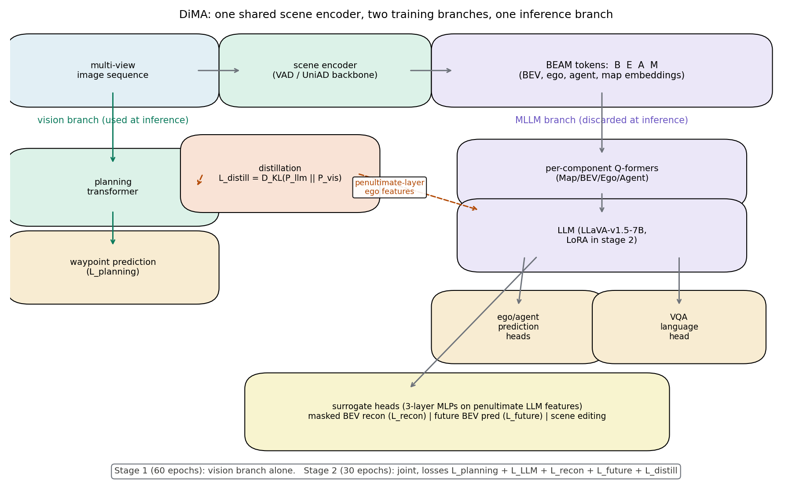
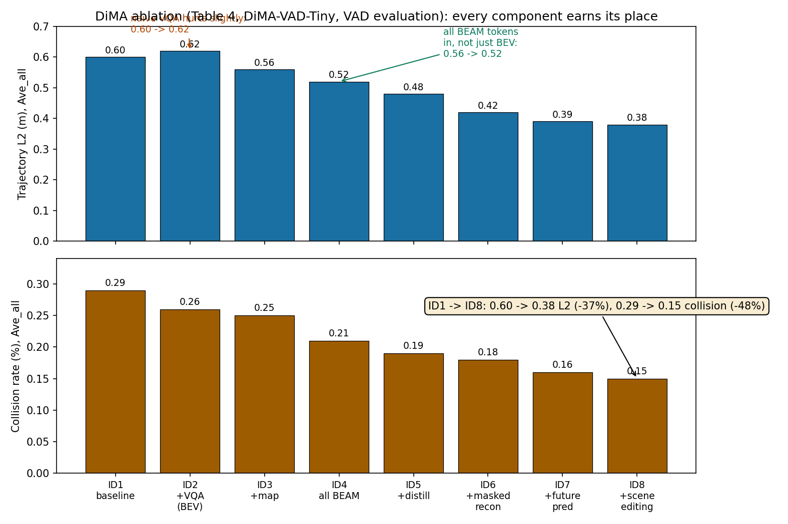

# 推理时把 LLM 扔掉，但把它的理解留下：联合训练加蒸馏的视觉规划器

> **论文标题**：Distilling Multi-modal Large Language Models for Autonomous Driving（DiMA）
> **作者**：Deepti Hegde\*、Rajeev Yasarla\*（共同一作）、Hong Cai、Shizhong Han、Apratim Bhattacharyya、Shweta Mahajan、Litian Liu、Risheek Garrepalli、Vishal M. Patel、Fatih Porikli（Johns Hopkins University + Qualcomm AI Research）
> **会议**：CVPR 2025；arXiv:2501.09757（v1，2025-01-16；无后续版本）
> **链接**：https://arxiv.org/abs/2501.09757
> **代码**：未找到官方代码（GitHub/API/网页检索均无作者发布的实现）
> **一句话核心洞见**：LLM 规划器长尾场景强但推理太贵，视觉规划器便宜但长尾拉胯——DiMA 在训练时让同一个场景编码器同时喂给 LLM 做问答、遮蔽重建、未来预测和"场景编辑"反事实推理，并把 LLM 倒数第二层的 ego 特征用 KL 散度蒸馏回视觉规划器；推理时 LLM 分支直接丢掉，视觉规划器以原来的延迟跑，但它的场景表示已经被语言"开过光"，长尾场景的轨迹误差降了约四成。

## 开头先看一个零样本的掉头

论文图 1 放了两个 nuScenes 长尾场景。第一个是超车（overtake），第二个是三点掉头（3-point turn）。关键信息在图注里的一句话：三点掉头这个场景**只出现在验证集里，训练集没有**——是个零样本场景。

数字（表 3，standardized 评估，Ave_all）：三点掉头上，VAD-Tiny 的轨迹 L2 是 1.55 米，VAD-Base 是 1.57 米，PARA-Drive 是 1.29 米，TOKEN（LLM 规划器）是 1.18 米，DiMA(VAD-Base) 是 1.05 米，DiMA 的 MLLM 分支是 1.04 米。超车场景：VAD-Base 1.06 米，TOKEN 0.74 米，DiMA(VAD-Base) 0.66 米。

这组数字把整篇论文的动机钉死了：纯视觉的 VAD 在长尾场景下误差是 LLM 方法（TOKEN）的 1.3 到 1.4 倍；但 TOKEN 要在推理时跑 LLM，又贵又慢。DiMA 的赌注是：**能不能让视觉规划器在训练时"偷学"LLM 的理解，推理时自己上，效果还向 LLM 看齐？** 表 3 的回答是：在三个长尾场景上，DiMA(VAD-Base) 的 L2 全面低于 TOKEN（1.05 vs 1.18，0.66 vs 0.65 打平，0.66 vs 0.74），而推理延迟和 VAD-Base 完全一样（226ms，表 2）——因为推理时用的就是 VAD-Base 本体。

先纠正一个可能的误读：DiMA 不是"又一个 LLM 驾驶模型"。它的 MLLM 分支在论文里更像一个**训练脚手架**——搭起来是为了让视觉分支学到更好的表示，盖完楼就拆掉。能拆，是因为知识传递的通道（联合训练的共享编码器 + KL 蒸馏）发生在训练期。这和 DriveVLM、TOKEN 那种"推理时必须带着 LLM"的路线是反方向的。这个方向选择本身，就是论文最值得讨论的判断，后文会回到它。

## 为什么之前的 MLLM 驾驶路线走不通：两个具体的坎

引言点名了两个坎，都很具体。

**第一，推理成本**。LLM-based 规划器（DriveVLM、TOKEN、OmniDrive）在测试时要跑自回归生成，延迟是百毫秒到秒级。自动驾驶规划要在几十毫秒内出结果，这条路在量产上走不通。论文表 2 的延迟列是诚实的注脚：ST-P3 628ms、UniAD 556ms、VAD-Tiny 59.5ms、VAD-Base 224ms——DiMA 各变体的延迟和它基于的视觉规划器**完全一致**（DiMA(VAD-Tiny) 59.5ms，DiMA(VAD-Base) 226ms），因为推理时 MLLM 分支不存在。

**第二，视觉到语言的桥接在驾驶里格外难**。通用 MLLM（LLaVA 那套）的做法是：冻住的 CLIP 编码器吐稠密 token，LLM 直接吃。但驾驶需要的不是"这张图里有什么"，而是"自车周围三维空间里谁在哪、往哪走、和我什么关系"。TOKEN 已经意识到这个问题，用场景编码器当 tokenizer，但它是**冻住**的。DiMA 的判断是：tokenizer 必须跟着一起训，让场景表示在语言任务的梯度下重新组织——"grounded and disentangled"。表 4 的 ID2→ID4 是这个判断的证据：只给 BEV token 做 VQA（ID2），L2 反而从 0.60 微涨到 0.62（天真地加语言任务甚至有害）；把 map、agent、ego 全加上（ID4），才降到 0.52。语言监督有没有用，取决于喂给 LLM 的是不是**结构化的场景语言**，而不是像素汤。

## 骨架：一个编码器，两条训练分支，一条推理分支

*上图：DiMA 的信息流。场景编码器是唯一的视觉入口，同时服务两条分支：左边是视觉规划器（推理时保留），右边是 MLLM（推理时丢掉）。两条分支之间有两条知识通道——KL 蒸馏（倒数第二层 ego 特征对齐）和共享编码器的联合训练梯度，外加三个代理任务头。*

**视觉分支**：就是标准的 VAD（或 UniAD）。场景编码器把多视角图像序列变成 BEV，再用可学习的 query 做 cross-attention，得到四组结构化 token：BEV token $B$、ego token $E$、agent token $A$、map token $M$。论文把它们统称为 **BEAM token**。planning transformer 吃这四组 token，输出自车和周围 agent 的未来轨迹，训练用 VAD/UniAD 原来的 planning 约束损失（记作 $L_{planning}$）。

**MLLM 分支**：BEAM token 先过四个**各自独立**的 Q-former（Map/BEV/Ego/Agent Q-former），把每组 token 压缩成定长、高维、和语言 token 同空间的序列，再和问题文本一起喂进 LLM（LLaVA-v1.5-7B 的 LLM 部分）。LLM 后面挂一串解码头：ego/agent 轨迹预测头（MLP，和 VAD 同构）、VQA 语言头、三个代理任务头（各 3 层 Linear+ReLU）。

两个值得停下来的实现细节：

1. **每个模态一个 Q-former，而不是一个共享的**。为什么？BEV 是稠密空间网格，agent 是稀疏实例集合，ego 是单个向量——它们的"语言"不一样。用一个 Q-former 硬压，会把结构差异抹掉；分开压，每组 token 保持自己的"方言"，LLM 看到的是四个各有分工的 token 段。这和 RDA-Driver 的 flatten adapter 是同一个直觉：**别在进 LLM 之前把结构弄丢**。
2. **agent token 要截断再上采样**。agent 数量随场景变，LLM 的上下文有限，所以输入 LLM 前只取一部分 agent token，过完 LLM 再做 sequence-wise 上采样恢复。这个"截断-上采样"的具体比例论文没写（[未核实]），但它引入了一个信息瓶颈：LLM 实际看到的 agent 是子集。好在规划头在视觉分支，不依赖这条路。

**训练分两阶段**：第一阶段只训视觉分支 60 epoch（感知+预测+规划约束），学出像样的场景表示；第二阶段联合训练 30 epoch，把 MLLM 分支接进来，所有损失一起上，LLM 本体用 LoRA 微调。优化器 AdamW，lr 2e-4，weight decay 0.01，cosine 退火。

为什么分两阶段？推断（有依据）：如果从零开始联合训，MLLM 分支的梯度（VQA、重建）会和规划梯度打架，场景编码器两头不讨好。先让视觉分支收敛到一个好的规划表示，再用语言任务去"精修"它，是更稳的课程。这是个工程判断，论文没做一阶段 vs 两阶段的消融——缺口之一。

## 公式 (1)：遮蔽重建在重建什么

$$\mathcal{L}_{recon} = \|\hat{B} - B\|_2 \tag{1}$$

输入 MLLM 的是 $\{m(B), E, A, M\}$，$m(\cdot)$ 是对 BEV token 的随机遮蔽（遮蔽比例在 [0.2, 0.4] 之间随机采——注意不是固定值，是个区间，每次迭代随机）。LLM 倒数第二层的隐状态里，对应 BEV token 位置的那些向量，被送进重建头，输出 $\hat{B}$，和**没遮蔽的**完整 BEV token $B$ 算 L2。

几何上在发生什么：BEV 网格被挖掉 20%-40% 的格子，模型要靠剩下的 BEV 格子 + ego/agent/map token + 语言上下文，把挖掉的格子"脑补"回来。这和 MAE 的精神一样，但目的不同：MAE 是为了学通用视觉表示，这里的重建头输入是**经过 LLM 推理的**隐状态——重建损失逼着 LLM 把语言理解"翻译"回空间表示。它实际在检查的是：LLM 是不是真的理解了场景的空间结构，还是只是在背问答模板。如果 LLM 只记住了"看到红灯就答刹车"，它重建不出被遮掉的 BEV 格子。

形状：$B$ 是 BEV token 嵌入矩阵，假设 $N_{bev}$ 个 token、每维 $d$，则 $B, \hat{B} \in \mathbb{R}^{N_{bev} \times d}$，L2 是全部元素平方和开根（论文写 $\|\cdot\|_2$，实现上通常是 MSE 的变体——[未核实]具体是 mean 还是 sum）。

## 公式 (2)：未来预测为什么是两步

$$\mathcal{L}_{future} = \|\hat{F}_t - B_{t+1}\|_2 + \|\tilde{F}_t - B_{t+2}\|_2 \tag{2}$$

$\hat{F}_t$ 和 $\tilde{F}_t$ 是预测头在时刻 $t$ 输出的、对未来 $t+1$、$t+2$ 时刻 BEV token 的预测；$B_{t+1}$、$B_{t+2}$ 是那两个时刻真实的 BEV token（由场景编码器在对应帧上算出，作为监督目标）。

为什么预测的是 **BEV token** 而不是直接预测轨迹？因为 BEV token 里编码了整个场景（静态地图 + 动态 agent），预测它等于预测"世界下一秒长什么样"——这是世界模型味道的代理任务。它和 $L_{planning}$ 的分工是：planning 损失只关心自车轨迹对不对，future 损失关心场景演化理解得对不对。一个只拟合自车轨迹的模型可以靠惯性作弊（ego status 问题），但它预测不出下一秒 BEV 里那个行人往哪走。

为什么是两步（$t+1$、$t+2$）而不是一步或五步？论文没解释。推断：nuScenes 是 2Hz 标注（论文 4.4 节说每秒预测 2 个航点、规划 3 秒共 6 个点），$t+1$、$t+2$ 对应未来 0.5 秒和 1 秒——短到 BEV 变化可预测，长到超出"复制当前帧"的 trivial 解。一句话：选的是"难到需要理解运动、又不至于不可预测"的甜点区。但这只是推断，论文没给步数敏感性实验。

## 公式 (3)：蒸馏的方向为什么是 P_llm || P_vis

$$\mathcal{L}_{distill} = D_{KL}(P_{llm} \| P_{vis}) \tag{3}$$

$P_{llm}$ 是 MLLM 分支倒数第二层、对应 ego token 的隐特征分布；$P_{vis}$ 是视觉 planning transformer 倒数第二层的隐特征分布。最小化从 $P_{llm}$ 到 $P_{vis}$ 的 KL 散度。

KL 散度的方向是有讲究的。$D_{KL}(P\|Q) = \sum P \log(P/Q)$，优化 $Q$ 去拟合 $P$ 时，$Q$ 会努力覆盖 $P$ 的所有模式（mean-seeking），而不是只抓 $P$ 的峰（那是反方向的 mode-seeking 行为）。这里 $P_{llm}$ 是目标、$P_{vis}$ 是被优化的，所以视觉分支的特征分布被拉向"覆盖 LLM ego 特征的全部模式"。直觉：LLM 的 ego 特征里编码了语言理解的场景知识（"左边有车所以不能变道"这类），蒸馏让视觉分支的对应特征也长出同样的结构。

但这里有个诚实的技术疑问：**KL 散度是定义在概率分布上的，而"隐特征"本身不是分布**。论文没有写 $P_{llm}$、$P_{vis}$ 具体怎么从特征向量变成分布——是过 softmax 归一化？是假设高斯？温度系数多少？这些全都没写（[未核实]）。这是蒸馏类论文常见的"一句话带过但复现时要命"的细节。没有官方代码，这个 $D_{KL}$ 的具体实现无从查证。

另外注意蒸馏只发生在 **ego token** 的特征上，不是全部 BEAM。为什么只蒸 ego？因为规划的最终输出是自车轨迹，ego token 是离决策最近的表示。agent 和 map 的知识被认为已经通过联合训练的共享编码器传递了（梯度是通的）。这个选择是合理的，但论文没有做"蒸全部 vs 只蒸 ego"的消融。

## 公式 (4)：总损失里没写出来的权重

$$\mathcal{L} = \mathcal{L}_{planning} + \mathcal{L}_{LLM} + \mathcal{L}_{recon} + \mathcal{L}_{future} + \mathcal{L}_{distill} \tag{4}$$

五个损失直接相加——但紧接着正文补了一句："loss weights are chosen to bring each value to the same scale"（权重被选成让每项数值在同一量级）。**具体的权重数值论文里没有**。这是全文最大的复现缺口：五个量级完全不同的损失（交叉熵、L2、KL），"调到同一量级"的权重是成败手，而它没公开。附录 B.1 给了优化器、学习率、mask 比例，但权重依然缺席。没有代码，这个缺口补不上。

还有一个正文和附录的不一致：**场景编辑（scene editing）的损失在公式 (4) 里没有出现**。正文 3.2.2 说场景编辑"contributes to the existing planning constraint loss and VQA loss"，附录 A 才揭晓：场景编辑头输出的自车航点用 $L_{scene}$ 监督——一个带更新后 agent 的 ego-agent 碰撞约束损失（引 VAD 的碰撞约束）。所以公式 (4) 是不完整的：它漏了 $L_{scene}$ 这一项（或者 $L_{scene}$ 被算进了 $L_{planning}$ 里，但正文没说）。读者按公式 (4) 实现，会漏掉场景编辑的轨迹监督。

## 场景编辑：这篇论文原创性最高的代理任务

三个代理任务里，遮蔽重建和未来预测都是已有范式的迁移（MAE、世界模型），**场景编辑是新的**，值得展开。

做法：在 BEV 空间里**人工增删 agent**。加车：根据地图约束、预测出的地图、自车包围盒和已预测 agent 的轨迹，找出自车附近"能放一辆车"的空位，随机放一辆 car/truck（尺寸不超过自车 2 倍），用一个线性层生成它的 agent token，再给它按地图约束生成一条航点轨迹。删车：把一辆现有的车拿掉。然后构造一个问答对："新加的这辆车对自车行为有什么影响？"——答案按模板生成，比如"自车不能左变道/左转"（左边加车）、"自车可以加速，前方空了"（前方删车）。附录图 6 给了八个方向的完整模板。

这个任务在训练什么？**反事实推理**："如果场景里多/少一辆车，自车该怎么做"。正常的 VQA 问的是"这个场景是什么"，场景编辑问的是"场景变了会怎样"。它逼着模型把"agent 的存在"和"自车的决策"之间的因果链显式化，而不是记住"这个路口一般怎么开"。对长尾场景的意义是直接的：长尾之所以难，就是因为"和平时不一样"，而场景编辑在训练时批量制造"不一样"。

怀疑的地方也有。第一，**加车的轨迹是按规则生成的**（"given map constraints... create a way-point trajectory"），不是真实数据分布——模型可能学到的是"规则生成器的 artifacts"而不是真实交互。第二，**问答对是模板化的**（附录图 6 的八个句式），语言多样性很低，VQA 头可能只是在做模板分类。第三，增删只针对 car/truck，不碰行人、自行车——而行人恰恰是长尾的高危类别。表 4 显示场景编辑带来最后一段提升（L2 0.39→0.38，碰撞 0.16→0.15），有用，但边际递减。

## 数字：37%、80%、44% 都经得起算吗

论文摘要的三个 headline 数字，逐个验算（用表 1 standardized 评估、VAD-Base 为基准，取 1s/2s/3s 平均那列）：

- **L2 降 37%**：VAD-Base 0.91 → DiMA(VAD-Base) 0.57，$(0.91-0.57)/0.91 = 37.4\%$ ✓。
- **碰撞率降 80%**：0.37% → 0.07%，$(0.37-0.07)/0.37 = 81\%$ ✓（四舍五入 80%）。
- **长尾场景 L2 降 44%**：表 3 三个场景（VAD-Base vs DiMA(VAD-Base)，Ave_{1,2,3s}）：三点掉头 1.87→1.30（-30%），起步恢复 1.72→0.71（-59%），超车 1.26→0.82（-35%）。三个的平均降幅约 41%，用 Ave_all 算也是约 41%。**44% 这个数字从表 3 的公开数字里算不出来**——最接近的是 41-42%。可能是用了别的平均方式（比如加权、或者包含了 MLLM 分支），但论文没写。标为[未能完全复现]：方向没问题（长尾提升确实显著），但精确到 44% 的口径不透明。

表 2（VAD 评估口径，方便和已有文献对比）：DiMA(VAD-Base) Ave_all 0.29/0.10，VAD-Base 是 0.72/0.22——L2 降了六成；对 DriveVLM-Dual(VAD-Base) 的 0.31/0.10，L2 略好、碰撞打平——而 DriveVLM-Dual 推理时要跑 LLM，DiMA 不用。这是"拆掉脚手架还更强"的直接证据。

表 1 里还有一组容易被忽略的对比：**DiMA(VAD-Tiny) 的 L2（0.61/0.51）打败了 VAD-Base（0.91/0.78）和 PARA-Drive（0.66/0.56）**，延迟却是 59.5ms vs 224ms。也就是说，DiMA 让小模型超过了大一号的基线——知识蒸馏的"模型压缩"效应在这里是真实发生的，不只是"保持"。

延迟表（表 2）还有一个诚实之处：DiMA-Dual+（推理时同时用两个分支）延迟 286ms，比 VAD-Tiny 的 59.5ms 慢近 5 倍，L2 只从 0.38 降到 0.29。作者没有吹 Dual，反而让数字自己说话：dual 是"可选项"，性价比不高。

## 表 4 消融：ID2 那次倒退是诚实的好证据

*上图：从 VAD-Tiny 基线（ID1）一步步加到完整 DiMA（ID8），L2 从 0.60 降到 0.38（-37%），碰撞率从 0.29% 降到 0.15%（-48%）。注意 ID2 的 L2 不降反升——天真地加 VQA 是有害的。*

逐行读（VAD 评估，Ave_all）：

- **ID1→ID2**（+VQA，只用 BEV token）：L2 0.60→0.62，**变差了**；碰撞 0.29→0.26，略好。论文没有藏这个倒退，反而用它论证"结构化输入"的必要性：只给 BEV、没有 agent/map/ego 的语言监督，对规划是噪声。这是整篇论文论证链条里最诚实的一环——如果作者只报 ID1→ID8 的总提升，读者会以为"加 LLM 就行"；ID2 的存在证明了"怎么加"才是关键。
- **ID2→ID3→ID4**（依次加 map、加全部 BEAM）：0.62→0.56→0.52。结构每完整一分，提升一分。
- **ID4→ID5**（+蒸馏）：0.52→0.48，碰撞 0.21→0.19。KL 蒸馏独立贡献约 8% 的 L2 下降——说明联合训练的梯度之外，显式的特征对齐还有额外增益。
- **ID5→ID6→ID7→ID8**（三个代理任务）：0.48→0.42→0.39→0.38。遮蔽重建贡献最大（0.06），未来预测次之（0.03），场景编辑最小（0.01）。

ID8 相对 ID1：L2 -37%，碰撞 -48%。和摘要的 37%/80% 口径不同（那是 standardized 评估下 VAD-Base 的数），这里不要混淆。

## DiMA-Dual：两个分支的特征拿来 max-pooling 是什么操作

论文还评估了一个 hybrid 推理模式 DiMA-Dual：把视觉 planning transformer 和 MLLM 的 ego 预测头**倒数第二层特征做 max-pooling**，融合后的特征再喂回**两个**头做航点预测。

max-pooling 在这里的含义：两个分支各有一个 ego 特征向量，逐元素取 max。效果是哪个分支在某个维度上激活更强，融合结果就采用哪个分支的值——一种 element-wise 的置信度投票。它要求两个特征向量**维度对齐且语义对齐**（第 $i$ 维在两个分支里表示相近的东西），而这正是 $L_{distill}$ 在训练时逼出来的（KL 让两个分布贴近）。所以 Dual 不是拍脑袋的 trick，它是蒸馏的副产品：既然两个特征空间已经对齐了，推理时融合一下是顺手的。

效果（表 3 长尾）：DiMA-Dual(VAD-Tiny) 在三点掉头上 1.04，和 DiMA(VAD-Base) 的 1.05 打平——小模型+Dual 追平大模型。但代价是推理时要跑 LLM（286ms）。论文把它定位成"可选项"，态度是克制的。

## VQA：能回答，但别指望它当司机

图 4 和附录展示了 MLLM 分支的问答能力：能回答"什么动作会导致和 `<c1,CAM_BACK,1088.3,497.5>` 碰撞"这类 DriveLM 风格的问题，回答和真值大意一致。但附录图 12 也放了**失败案例**：问"什么动作会导致碰撞"，模型答"没有"，真值是"适度右转"；另一个把"加速直行"答成"直行并刹车"。作者没有只挑好看的放，这点值得肯定。

更值得玩味的是附录图 13/15 里和 GPT-4 的对比：在某个右转场景，DiMA 正确预测右转，GPT-4 建议直行。作者的潜台词是：通用大模型不懂驾驶，领域化的结构输入+联合训练才是正道。但这个对比的输入是不对等的——GPT-4 吃的是"拼接的多视角图片+文本 prompt"，DiMA 吃的是 BEAM 结构化 token。GPT-4 输了，输的可能是输入表示，不是推理能力。这个对比的论证力是有限的。

## 怀疑式审读：这篇论文的软肋清单

**损失权重没公开**（见公式 (4) 节）。五个损失"调到同一量级"，具体数值未知，无代码可查。这是复现的头号拦路虎。

**$P_{llm}$、$P_{vis}$ 怎么从特征变成分布，没写**（见公式 (3) 节）。KL 散度的实现细节缺失。

**场景编辑的 $L_{scene}$ 在正文公式 (4) 缺席**，只在附录出现。正文和附录的损失函数对不上。

**QA 数据的质量**。除 DriveLM 原生的 300k 问答对（4k 样本）外，其余 nuScenes 样本的 QA 是"规则生成数值描述 + Llama3-70B 按模板生成"。附录图 8 的 system prompt 和图 10 的生成样例显示，问答高度模板化（"What are objects to the back right of the ego car?" → "There is one car and one bicycle..."）。模板化 QA 训练出的 VQA 头，回答的是"分类题"而不是"理解题"——它对规划表示的"语言 grounding"作用，可能不如论文暗示的那么强。行为（behavior）QA 更是纯规则生成的（按未来轨迹分类成"slightly steering right, moderate speed"这类）。这些合成数据的噪声和偏差没有量化。

**评估口径的双轨制**。论文同时用 standardized（表 1、表 3）和 VAD（表 2、表 4）两种评估。standardized 是 PARA-Drive 提出的新口径，DiMA 在上面最好看；VAD 口径是为了和没公开代码的旧工作对比。双轨本身是诚实的（都标明了），但读者对比数字时必须看清表头——比如摘要的 37%/80% 是 standardized 口径，表 4 的 -37%/-48% 是 VAD 口径，两者不能直接比。

**子集选择的自由度**。targeted split（689 样本）来自 PARA-Drive，长尾三场景来自 TOKEN，都是人工挑选的子集。在子集上提升 40%+，不等于在完整分布上提升 40%+。完整验证集上的提升是 37%/81%（standardized，VAD-Base），这个是硬的；长尾子集的数字（尤其是那个算不出来的 44%）要打折扣看。

**开环评估**。所有数字都是开环的。规划真正重要的是闭环表现，论文没做（也没声称做）。蒸馏来的"理解"在闭环里会不会变成"过度自信"，未知。

**没有官方代码**。上面所有的实现疑问（KL 怎么做、权重多少、agent 截断比例、$L_{scene}$ 细节）都无从核查。这篇论文的复现难度评级是高的。

## 带走的东西

这篇论文承重的是一个**训练范式判断**，不是某个具体损失：**LLM 在自动驾驶里的最佳位置可能是"训练期的老师"，而不是"推理期的司机"**。论证链条是完整的：动机（长尾 vs 成本）→ 机制（共享编码器 + 结构化 token + 蒸馏 + 代理任务）→ 证据（ID2 的倒退证明"怎么加"重要；小模型超大基线证明知识真的过去了；延迟表证明成本真的没加）。

可迁移的想法有两个。第一，**"可拆卸的脚手架"设计模式**：当你有一个强大但昂贵的模型（LLM）和一个便宜但弱的模型（视觉规划器），不一定非要二选一或做在线蒸馏；让它们共享一个可训练的表示层（这里是场景编码器），用辅助任务把强模型的知识"压"进共享层，再把强模型拆掉。这个模式不只适用于驾驶。第二，**场景编辑**这类反事实数据增强：对"分布内长尾"问题（难例不是没见过，而是"这次不一样"），人工构造"如果不一样会怎样"的训练信号，比单纯堆数据更对症。

没解决的问题：开环到闭环的 gap；合成 QA 的质量天花板；以及一个更根本的——DiMA 证明了"视觉规划器可以学会 LLM 理解过的表示"，但它没有回答"这种表示的上限是不是就是 LLM 本身"：在三点掉头上，DiMA(VAD-Base) 1.05 米 vs DiMA(MLLM) 1.04 米，视觉分支已经追平了 MLLM 分支——这是蒸馏的成功，但也暗示，如果 LLM 本身在某个场景下是错的，蒸馏只会把错误也搬过去。老师的天花板，就是学生的天花板。
