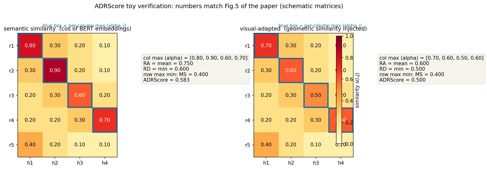
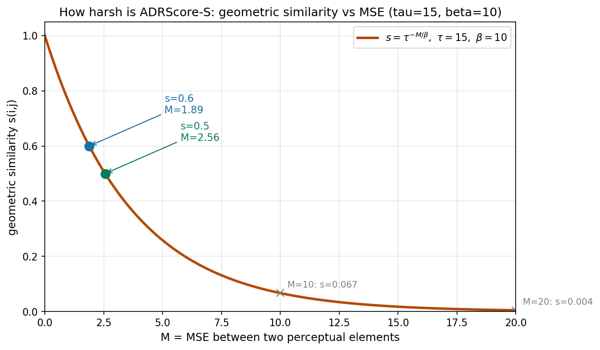

# 答案对了不算对，步骤对了才算：Reason2Drive 的链式推理评测与感知增强

> **论文标题**: Reason2Drive: Towards Interpretable and Chain-based Reasoning for Autonomous Driving
> **作者**: Ming Nie, Renyuan Peng, Chunwei Wang, Xinyue Cai, Jianhua Han, Hang Xu, Li Zhang（复旦大学数据科学学院 + 华为诺亚方舟实验室）
> **会议**: ECCV 2024（arXiv:2312.03661，v3 为 2024-07-20 修订版，即发表版本）
> **链接**: https://arxiv.org/abs/2312.03661
> **代码**: 未找到官方代码——官方仓库 https://github.com/fudan-zvg/reason2drive 仅含 README 与示意图，无模型/指标实现代码；TODO 列表只勾选了 benchmark mini 版数据发布
> **一句话核心洞见**: 这篇论文真正的赌注不是 60 万问答对，而是一个判分标准：用"假设链→参考链"的对齐向量算出覆盖（RA）、冗余（RD）、遗漏（MS）三项，再把几何误差塞进相似度里得到 ADRScore-S——答案蒙对不给分，每一步都要站得住；配套的模型改动（prior tokenizer + instructed vision decoder）则是为了让 VLM 在编码端和解码端都真正吃进物体级感知信息，而不是把坐标当成文本念给 LLM 听。

先看一个让 BLEU 束手无策的场景。

假设参考答案是这样一条推理链："这是一个车辆（感知）。它在移动，轨迹是 <MOT>（预测）。它将并入自车道，保持安全距离（推理）。" 模型输出了另一条链："这是一个车辆。它停着不动，轨迹是 <MOT'>。它会并入自车道，保持安全距离。" 两条链的结论一字不差，BLEU 会给高分——n-gram 重合度很高。但第二步"停着不动"和第三步之间是断裂的：一辆停着的车，为什么会并入自车道？结论是对的，推理是坏的。在自动驾驶里，这种"结论蒙对、过程胡说"的输出是最危险的：下游规划模块拿到"并入自车道"这个结论会减速避让，理由却是错的；一旦场景稍变，错的推理就会导出错的结论，而你无从诊断是哪一步先坏的。

这就是论文要解决的具体失败：2023 年底的驾驶 VQA 数据集（NuScenes-QA、DriveLM）把驾驶简化成了"看图答题"，评测用的又是 BLEU/CIDEr 这类只看整段文本像不像的指标。一个在中间步骤上胡说八道、但结论撞对的模型，和一个步步扎实的模型，在这些指标下分不出来。作者的第一张图（Fig.1b）押的就是这个赌注：现有数据集的问答是封闭的（yes/no、stopped/parked/moving 三选一），而驾驶决策是感知→预测→推理的多步链条。

## 作者手里真正的底牌是什么

一个投 ECCV 的工作，需要让视觉审稿人相信两件事：数据是真的有用，指标是真的能区分好坏。作者的底牌有三张，按硬度排序：

第一张最硬：**评测指标是可计算的、不依赖 GPT 的**。同期不少工作用 GPT-4 当裁判给推理打分（论文附录 C.2 自己也做了 GPT-4 对比实验），但 GPT 裁判贵、不可复现、版本一迁移分数就变。ADRScore 只用一个预训练 BERT 算句向量余弦，外加几何误差公式，任何人都能复现。附录里那句"our metrics are not gpt-dependent…ensuring the independence and stability"就是说给审稿人听的。

第二张：**数据是自动造的，所以规模上得去**。632,955 个问答对（表2总计，摘要写 over 600K），来自 nuScenes、Waymo、ONCE 三个数据源。手工标 60 万条带推理链的问答是不可能的，作者的办法是：把三个数据集原有的 3D 标注解析成"物体中心数据库"，填进手工写的问答模板，再用 GPT-4 做改写扩增。这个 pipeline 的代价是推理链的"推理"部分带着模板味（后面会细说），但规模这张牌打出来，审稿人很难说"数据不够"。

第三张：**模型改动小而准**。prior tokenizer 是一个两层 MLP，instructed vision decoder 是一个 transformer decoder 加两个头。改动不大，但消融表（表6、表7）显示每一块都贡献了百分点级别的提升。这种"小改动、大可解释"的设计在 ECCV 很吃香。

时间坐标值得说一句：arXiv v1 是 2023 年 12 月，和 DriveLM（2023 年 12 月，OpenDriveLab）几乎同时。DriveLM 当时也在做驾驶问答，但 DriveLM 的问答是图结构的行为推理，Reason2Drive 赌的是另一条路——**线性推理链 + 步骤级判分**。两条路后来都活下来了，但"给推理步骤打分"这个想法，是 Reason2Drive 先系统提出来的。

## 数据集：60 万问答对是怎么"自动"长出来的

### 为什么之前的方法在这里会撞墙

手工标注推理链的代价是线性甚至超线性的：标一个"感知"框只要几秒，标一段"它为什么危险"的因果链需要标注员理解整个场景。NuScenes-QA 之所以停在感知层问答，不是因为作者不想做推理，是因为推理标注贵。作者看到的结构性机会是：nuScenes、Waymo、ONCE 本来就有 3D 框、跟踪 ID、速度、车道线标注——**感知和预测的"事实部分"已经标好了**，缺的只是把它们组织成"问题-推理链-答案"的语言形式。数据不在野外，在仓库里落灰。

### 构造 pipeline：数据库 → 模板填空 → GPT-4 改写

Fig.2 展示了全流程，我按一个具体例子把它走一遍。假设 Waymo 的某一帧里有一个物体条目：

```
{Category: vehicle, Location: (762, 441), Attribute: moving, ...}
```

**第一步，解析成物体中心数据库。** 按关键帧组织，每帧存一批物体条目，字段包括位置、类别、运动属性等。这是纯工程活：把三个数据集各自的标注格式统一成 JSON。

**第二步，填模板。** 论文准备了 15 个感知子任务、14 个预测子任务、6 个推理子任务的模板（附录表9）。比如推理类的风险模板是："Please analyze the risk of the referred object step by step." 填上数据库字段后得到：

> Q: Please analyze the risk of the referred object step by step.
> A: This object is a vehicle. It is moving. The motion is \<MOT\>. It will merge into ego lane. Based on previous analysis, this object is a risk.

注意答案的结构：**类别判定 → 运动状态 → 轨迹 → 意图判断 → 风险结论**，这就是一条五步推理链。特殊 token 的定义：\<Inst\*\> 指代某个实例，\<MOT\> 是一段预测轨迹坐标序列，\<LOC\> 是位置坐标。

**第三步，GPT-4 改写扩增。** 附录图8 给出了 prompt：system 指令要求"只改同义词和语序，不许动 \<LOC\>/\<MOT\> 特殊 token，要忠于原问答的事实"。改写后的版本比如：

> A: The object is a moving vehicle, following a path of \<MOT\>. It's expected to merge into the ego vehicle's lane, making it a potential risk.

### 这里埋着两个诚实的问题

**第一，推理链是"长"出来的，不是"想"出来的。** 模板填空的答案本质上是把数据库字段按固定顺序串起来："它是车。它在动。轨迹是 X。它要并线。所以危险。" 这种链条的因果是模板保证的，不是模型推出来的。用这样的数据训练，模型学到的是"按这个顺序说话"，而不是"按这个顺序思考"。论文没有回避这一点——它把这叫作 chain-based reasoning 的"格式"，但读者要清楚：**数据里的推理深度 ≈ 模板的深度**。

**第二，任务和数据源是绑定的。** 表1（正文第6页，我对着 PDF 原页核实过排版）显示：Perception↔nuScenes，Prediction↔Waymo，Reasoning↔ONCE。三类任务各自主要来自一个数据源。这个绑定在后面的实验里会变成一个纠缠（见"任务消融"一节），这里先记下。

数据分布（表2）：感知 246,112（38.9%）、预测 216,137（34.1%）、推理 170,706（27.0%），目标维度上多物体任务最多（248,689），自车相关最少（58,670）。训练/验证按 segment 划 7:3，场景不重叠——这一点做得干净。

## ADRScore：论文真正的核心，一个公式一个公式地算

### 先猜：你会怎么给一条推理链打分

假设参考链 r 有 K 步，模型生成的假设链 h 有 N 步。最朴素的想法是：h 的每一步，在 r 里找最像的一步，看像不像。这就是论文公式 (1)(2) 的全部内容：

$$align(h \to r) = \{\alpha_1, ..., \alpha_N\}, \tag{1}$$

$$\alpha_i = \max_{j=1}^{K} s_{i,j}, \quad s_{i,j} = \cos(h_i, r_j). \tag{2}$$

符号形状：$h_i$ 和 $r_j$ 是**句子**（推理链里的一步），$\cos(\cdot)$ 是它们 BERT 句向量之间的余弦相似度。$\alpha_i \in [0,1]$——论文这么写，但余弦相似度的数学范围是 $[-1,1]$。作者敢写 $[0,1]$，依据是 BERT 句向量在实际文本上余弦几乎恒为正（这是经验事实，不是数学保证；如果某天出现负值，RA 会被拉低，指标没有做截断处理——一个小瑕疵，但不影响大局）。

这个对齐向量的几何意义：把 h 的每一步"投影"到 r 上，看它有没有着落。$\alpha_i$ 接近 1，说明第 $i$ 步在参考链里找到了依据；接近 0，说明这一步是凭空编的。

### 三个分量各惩罚一种坏法

$$\text{RA} = \frac{1}{N}\sum_{i=1}^{N} align(h_i \to r), \tag{3}$$

$$\text{RD} = \min_{i=1}^{N} align(h_i \to r), \tag{4}$$

$$\text{MS} = \min_{i=1}^{K} align(r_i \to h), \tag{5}$$

$$\text{ADRScore} = \frac{1}{3}(\text{RA} + \text{RD} + \text{MS}). \tag{6}$$

逐项说清它在惩罚什么：

- **RA（Reasoning Alignment，均值）**：整条链平均有多少步能在参考链里找到依据。链条整体跑偏，RA 就低。
- **RD（Redundancy，最小值）**：找 h 里**最不像话**的那一步。哪怕前面九步都对，只要有一句是编的（比如"它停着不动"），RD 就把整条链拉下来。这是专门对付"九真一假"的。
- **MS（Missing Step，反向最小值）**：反过来，对 r 的每一步，检查 h 里有没有对应的内容。参考链里说了"轨迹是 \<MOT\>"，h 里压根没提轨迹，MS 就低。这是专门对付"跳步"的——结论对了，但关键论据没给。

回到开头的例子：模型说"它停着不动……它会并入自车道"。第二步"停着不动"在参考链里找不到依据，$\alpha_2$ 接近 0，RD 被打到接近 0，ADRScore 直接掉三分之一。BLEU 给高分，ADRScore 不给——这就是论文要的"解决推理歧义"。

### 在论文图5的玩具例子上完整算一遍

论文图5给了两组数字。语义相似度版本：RA=0.75，RD=0.6，MS=0.4。我构造了一个 5×4 的示意对齐矩阵（行=r₁..r₅，列=h₁..h₄），它的列最大值恰好是 [0.80, 0.90, 0.60, 0.70]，行最大值恰好是 [0.80, 0.90, 0.60, 0.70, 0.40]：



验算：RA = (0.80+0.90+0.60+0.70)/4 = 0.75；RD = min = 0.60；MS = 行最大值里的最小值 = 0.40；ADRScore = (0.75+0.60+0.40)/3 = **0.583**。和论文图5的三个分量数字完全对上。

### ADRScore-S：把几何误差塞进相似度

语义相似度对"位置/轨迹"太宽容了：模型输出框 (100, 200)，真值是 (105, 205)，文本上"located at (100, 200)"和"located at (105, 205)"的 BERT 余弦可能高达 0.95，但在驾驶里 5 个像素的误差和 50 个像素的误差是两回事。所以公式 (7)：

$$s_{i,j} = \tau^{\frac{-M(h_i, r_j)}{\beta}}, \tag{7}$$

其中 $M(\cdot)$ 是两个感知元素之间的**均方误差**，$\tau=15$、$\beta=10$ 是"按经验选的"归一化参数（正文 5.1 节）。

先看这个函数的形状。$M=0$ 时 $s=1$；$M$ 增大，$s$ 指数衰减。我把曲线画出来了：



几个关键点（验算过）：图5例子里的 $s_{2,2}=0.6$ 对应 $M = -10\ln(0.6)/\ln(15) \approx 1.89$；$s_{3,3}=0.5$ 对应 $M \approx 2.56$。而 $M=10$ 时 $s = 15^{-1} \approx 0.067$，$M=20$ 时 $s \approx 0.004$。在零点处的斜率是 $-\ln(15)/10 \approx -0.27$/单位 MSE——**这个归一化极其严厉**：MSE 只要到 3.7 左右（RMS 误差约 1.9 个坐标单位），相似度就掉到 0.37。

这里有三个诚实的问题：

1. **$M(\cdot)$ 的坐标单位论文没说。** \<LOC\> 是 224×224 裁剪图上的像素坐标？还是归一化坐标？轨迹 \<MOT\> 是几个点的序列，MSE 是在多少个点上平均的？这些都没交代。$M$ 的量级直接决定 $s$ 落在曲线的哪一段，而 $\tau=15$、$\beta=10$ 的选择又和 $M$ 的量级强耦合——论文只说"after empirical practice"，没有给敏感性分析。
2. **严厉程度可能主导了分数。** 表3里 Ours 的 ADRScore-S（0.432）只比 ADRScore（0.463）低 0.031，说明模型的几何预测大多落在曲线的高分段；但基线 InstructBLIP 的 ADRScore-S（0.214）比 ADRScore（0.351）低了 0.137。ADRScore-S 拉开差距，到底是因为基线的空间推理真不行，还是因为指数归一化把中等误差放大成了低分？两者都有，但论文没有分解。
3. **三个分量高度相关。** RA、RD、MS 都是同一个对齐向量的函数（均值、最小值、反向最小值），三者简单平均等于把同一份证据数了三遍。RD 和 MS 还都是 min，对链条长度敏感：假设链越长（N 越大），min 越容易小，长链条天然吃亏。论文没有讨论长度归一化。这是从 ROSCOE（Golovneva et al., 2022，论文引的 [17]）继承的设计，ROSCOE 里也是一样的问题——这是领域通病，不是这篇独有的错。

## 模型：让 VLM 真正吃进物体级感知信息

### 作者观察到的两个具体堵点

论文 4.1 节开头说得很直白：现有 VLM 在物体级感知信息上有两个堵点——（一）没有专门的 tokenizer 处理感知先验，（二）decoder 只有一个语言模型，输出不了精确的定位。翻译成大白话：你把"有个车在 (762, 441)"写成文本喂给 LLM，LLM 对数字位置的理解是灾难性的；你让 LLM 用文本输出框坐标，它也只能瞎编数字。两个堵点各加一个模块。

### Prior tokenizer：公式 (9) 的文字和公式对不上

$$f_v = F_v(V_1) \oplus F_v(V_2) \oplus \dots \oplus F_v(V_N), \tag{8}$$

$$f_p = F_p(f_r + E(P)), \tag{9}$$

$$f_q = Q(f_v, f_p), \tag{10}$$

$$\hat{y}_t = F(f_t, f_q). \tag{11}$$

逐项过。$V_1..V_N$ 是 $N$ 帧视频帧（实验用 $N=5$，224×224）。$F_v$ 是冻结的视觉编码器（附录 B.1：EVA-CLIP 的 ViT-G/14，去掉最后一层、用倒数第二层特征；正文 4.1 写"pretrained Blip-2 visual encoder"，和附录一致，因为 InstructBLIP 的视觉编码器就是 EVA-CLIP ViT-G/14）。$\oplus$ 是沿 token 维拼接：5 帧 × 每帧 256 个 patch token（ViT-G/14 在 224 输入下是 16×16=256，加 CLS 是 257，论文没细说，[未核实]每帧具体 token 数）拼成 $f_v$。

公式 (9) 是 prior tokenizer。$P$ 是感知先验（已知的物体位置/运动）；$f_r$ 是按 $P$ 的位置从 $f_v$ 里用 RoIAlign 抠出的区域特征，对齐到 7×7 再"融合成一个 embedding"（怎么融的——展平接全连接还是平均池化？论文没说，[未核实]）；$E(\cdot)$ 是位置编码，把几何位置和运动映射到和 $f_r$ 相同的维度；$F_p$ 是一个两层 MLP。

**这里有个文字与公式不一致的地方**，值得单独拎出来。正文写的是："We design a novel tokenizer $F_p$, implemented as a two-layer MLP, **to independently extract** local image features and positional embeddings from visual priors"，但公式是 $f_p = F_p(f_r + E(P))$——$f_r$ 和 $E(P)$ 是**先相加、再一起过 MLP**，并没有"独立地"抽取两个分支。两种可能：文字是笔误（想说的是"分别从图像和几何两处取信息"）；或者实现里真有两个分支但公式简写了。官方仓库没有实现代码，无法对证。我倾向于前者是文字不严谨——因为"independently extract"的自然读法是两个独立编码器，而公式明确是一个 MLP 吃求和输入。审稿时这种不一致通常会被揪出来，作者在 camera-ready 里没改，说明可能没人细看公式 (9)。

$Q$ 是 Q-Former（BLIP-2 那套），把视觉特征对齐到文本空间；$F$ 是 LLM（FlanT5-XL 或 Vicuna-7B），$f_t$ 是问题文本的 embedding。

### Instructed vision decoder：给 LLM 加两个"感知占位符"

$$\hat{P} = D(f_v, f_h). \tag{12}$$

做法受 LISA（Lai et al., 2023，论文引 [23]）启发：给 LLM 词表加两个新 token \<LOC\> 和 \<MOT\>。当 LLM 生成答案时想输出感知结果，就先吐一个 \<LOC\> 占位；取 LLM 最后一层在这个 token 位置的隐状态，过一个 MLP 投影得到 $f_h$；再把 $f_h$ 和视觉特征 $f_v$ 一起喂给 instructed vision decoder $D$（一个 transformer decoder + 位置头和轨迹头），解码出框和轨迹。

直觉：LLM 不擅长直接念坐标数字，但它擅长"决定在这里应该输出一个位置"。把"要不要输出位置"（语义决策，LLM 擅长）和"位置具体是多少"（几何回归，检测头擅长）分开，前者用 token 占位触发，后者用专用 decoder 算。这就是论文标题里"chain-based"的另一半——推理链里 interleaved 的感知结果是真算出来的，不是文本编的。

训练损失：

$$L = L_{txt} + \lambda_{per} L_{per}, \quad \lambda_{per} = 1.0, \tag{13}$$

$$L_{per}(P, \hat{P}) = -\sum_{i=1}^{N} \log \hat{P}_{c,i} + \lambda_{reg}\sum_{i=1}^{N} L_{reg}(P_{b,i}, \hat{P}_{b,i}), \quad \lambda_{reg}=0.25, \tag{14}$$

$L_{txt}$ 是自回归交叉熵；$L_{per}$ 是分类的二元交叉熵加回归的 MSE（$\lambda_{reg}=0.25$ 取自目标检测的常用设置，附录 B.2 明说"as a common setting"——诚实，说明这个数不是搜出来的）。

训练策略分两阶段：预训练阶段从 InstructBLIP 初始化，冻结 LLM 和视觉编码器，只训 prior tokenizer、Q-Former 和 vision decoder；微调阶段用 LoRA 训 LLM 做驾驶推理，vision decoder 全量微调。优化器 AdamW（weight decay 0.01），cosine 学习率最大 3e-4，前 1000 步线性 warmup，8 张 V100 上 batch size 8（是总共 8 还是每卡 8，论文没说清，[未核实]）。

## 实验：数字逐项核实

### 表3：主结果，差距主要在 ADRScore-S 上

| 方法 | LLM | ADRScore | ADRScore-S |
|---|---|---|---|
| InstructBLIP | Vicuna-7B | 0.351 | 0.214 |
| Ours | Vicuna-7B | **0.463** | **0.432** |

同 LLM 下 ADRScore 提升 0.112（11.2 个百分点，相对 +31.9%），ADRScore-S 提升 0.218（21.8 个百分点，相对 +102%）。论文的判断——"传统指标区分度不够，差距在 ADRScore-S 上更显著"——数字支持：B@4 上 Ours 只领先 InstructBLIP-Vicuna 0.049（0.457 vs 0.408），CIDEr 领先 0.087，而 ADRScore-S 翻倍。这个对比是全篇最有说服力的证据：**基线不是不会说话，是不会定位**。

基线公平性：论文说基线也给了感知先验（以文本形式输入），输入帧数一致，按官方策略微调。这是能做的最公平的对比了。但文本形式的坐标先验对 LLM 本来就是不利的输入方式——这个对比设计天然有利于"我们有个专门吃坐标的 tokenizer"的故事。不是作弊，是立场问题：它证明的是"坐标就该这么吃"，而不是"我们的 LLM 更聪明"。

### 表4：任务消融，4.1% 和 6.8% 是百分点不是百分比

逐行（ADRScore / ADRScore-S）：感知单训 0.282/0.253；感知+预测 0.297/0.264；推理单训 0.351/0.323；推理+感知 0.407/0.364；三者全训 0.463/0.432。

论文写"perception and prediction tasks additionally enhance…improvements of 4.1% and 6.8%, respectively"。验算 ADRScore-S：0.364−0.323=0.041（4.1 个百分点），0.432−0.364=0.068（6.8 个百分点）。**这里的 % 实际是百分点**，相对提升分别是 12.7% 和 18.7%。论文没写"percentage points"，容易误读，我按绝对值理解并在此注明。

两个更深的问题：

1. **没有"推理+预测"这一行。** 表里只有"推理+感知"和"全量"，预测的 6.8 个百分点是在"推理+感知"的基础上加的，预测的独立贡献无法从这张表分离。严格说，"prediction 带来 6.8 个点"这个结论依赖于"它和感知的交互为零"这个没验证的假设。
2. **任务消融和数据源纠缠。** 前面记下的：感知↔nuScenes、预测↔Waymo、推理↔ONCE（表1）。"推理任务最重要"这个结论，有没有可能部分来自 ONCE 的数据特点（比如场景更复杂、问答更长），而不是"推理"本身？论文没有做"同一数据源内做任务消融"的对照，这个因果链条是断的。这是全篇实验设计里我最在意的一个缺口。

### 表5-表7：感知质量与模块消融，数字都对得上

表5：框准确率 Ours 0.806 vs MiniGPT-4 0.723、Kosmos-2 0.745；轨迹 ADE 1.875 vs 2.334/2.563。轨迹提升幅度（ADE 降 19.7%）比框更大，和"instructed vision decoder 专门管运动预测"的设计对得上。

表6（ADRScore-S）：单帧→多帧 0.379→0.394（+1.5 个百分点）；加 region-level 特征 0.394→0.418（+2.4 个百分点）；加位置编码 0.418→0.432（+1.4 个百分点）。论文文字和数字一致。

表7：预训练 0.361→0.396（+3.5 个百分点），文本 embedding（$f_h$ 那路）0.396→0.425（+2.9 个百分点），MLP 头 0.425→0.432。**承重的是前两项**：没有预训练对齐和没有 $f_h$ 这路语义触发，decoder 就是个普通检测头。

### 表8：下游规划，附带一个拼写错误

在 nuScenes 上微调预测控制量（速度/方向盘 RMSE）：直接微调 InstructBLIP 是 3.743/5.926；先在 Reason2Drive 上预训练再微调是 3.086/5.151；Ours 是 2.842/4.866。Reason2Drive 预训练确实给下游带来了提升（速度 RMSE 降 17.5%）。表注写"B: B@4. M: METHOR."——METHOR 是 METEOR 的拼写错误。RMSE 的单位论文没给（速度大概是 m/s？方向盘是度？[未核实]）。

### 附录里的三张表：诚实分和保留分

表10（换视觉编码器）：ViT-L/14 换 ViT-G/14，Ours 的 ADRScore-S 从 0.397 涨到 0.432——视觉编码器本身贡献了 3.5 个点，说明这个 benchmark 对视觉 backbone 是敏感的，VLM 的推理分里有一部分是"看得清"带来的。

表11（GPT-4 当裁判）：Ours 0.593/0.561，GPT-4 打分 0.628，依然领先。这一方面验证了 ADRScore 和 GPT 裁判的方向一致，另一方面也诚实地暴露了：**连最好的模型 ADRScore 也只有 0.463，离"推理可靠"还差得远**。

表12（跨数据源泛化，报的是 ADRScore-S）：只在 nuScenes 上训，到 Waymo+ONCE 上测，Ours 从 0.443 掉到 0.385（掉 13%），而 InstructBLIP 从 0.255 掉到 0.116（掉 54%）。但注意前面的纠缠问题：nuScenes↔感知任务，如果跨数据源测试时 Waymo/ONCE 的问答类型分布不同，这个"泛化"里混着"任务泛化"。论文把功劳归于"LLM 的世界知识帮助泛化"，这个解释是可能的，但不是唯一解释。

附录 D.2 的失败案例值得作者加分：四个失败例子里，自车静止被判成转弯、远处风险物体漏检——**相对位移编码和远处小物体的特征**是作者自己点名的短板，没有藏着。

## 怀疑式审读：这篇论文哪里站得住，哪里心虚

**站得住的：** ADRScore 的动机是真实的（BLEU 确实区分不了推理好坏，表3的数字证明了新指标的区分度）；prior tokenizer + instructed vision decoder 的分工是干净的（编码端吃先验、解码端吐感知，消融表各自贡献了百分点）；失败案例和跨数据源掉点都如实报告了；指标不依赖 GPT，可复现。

**心虚或没说清的：**

1. RA/RD/MS 三项同源，简单平均等于重复计分；RD/MS 的 min 对链条长度敏感，长链天然吃亏。无长度归一化。
2. ADRScore-S 的 $\tau=15$、$\beta=10$ "按经验选"，无敏感性分析；$M(\cdot)$ 的坐标单位没定义，而归一化参数和 $M$ 的量级强耦合。
3. 任务消融与数据源纠缠（感知↔nuScenes、预测↔Waymo、推理↔ONCE），"推理任务最重要"的因果不断。
4. 表4 缺"推理+预测"行，预测的 6.8 个百分点无法分离独立贡献。
5. 公式 (9) 的"independently extract"和 $F_p(f_r + E(P))$ 对不上；RoIAlign 后"融合成一个 embedding"的方式没说。
6. 数据集的推理链是模板填空+GPT 改写，推理深度≈模板深度；GPT-4 改写的人工核验规模没交代。
7. 官方仓库无实现代码，prior tokenizer 的细节、ADRScore 的 $M(\cdot)$ 实现都无法对证。
8. "4.1%/6.8%"等提升说的是百分点，论文没注明，容易误读为相对提升。

## 带走什么

**可迁移的想法（两个）：**

1. **步骤级判分的三件套：覆盖、冗余、遗漏。** 不管评测什么链式输出（代码生成、数学推理、agent 轨迹），"平均对齐度+最差一步+反向最差一步"都是一个好用的骨架。拿去用的时候记得加长度归一化，并且别把三项简单平均——它们相关性太高。
2. **"语义决策"和"几何回归"分开。** LLM 决定"这里该有个位置"（token 占位触发），专用头决定"位置是多少"。这个分工比"让 LLM 直接念坐标"可靠得多，做任何 VLM+定位的任务都值得抄。

**真正值得做的具体问题：** ADRScore-S 的严厉程度（$\tau$、$\beta$）和 $M$ 的单位定义是整套指标里最 ad-hoc 的部分。做一个 $\tau$、$\beta$ 的敏感性曲线，看在什么取值下 ADRScore-S 和人类对"这条推理链行不行"的判断最一致——这篇论文没做，做了就是一篇 workshop 论文的量级。另一个是解开任务-数据源纠缠：在同一个数据源内重做表4 的消融。
