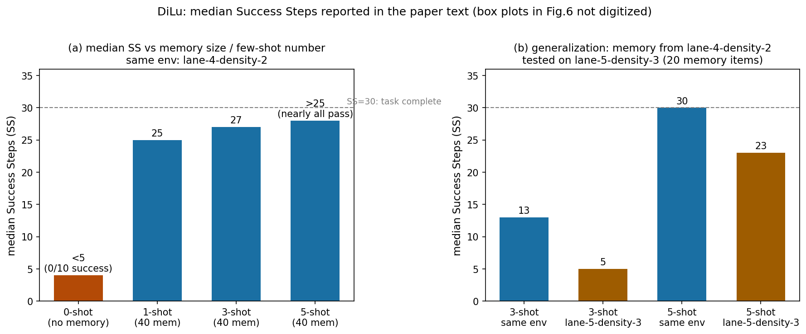
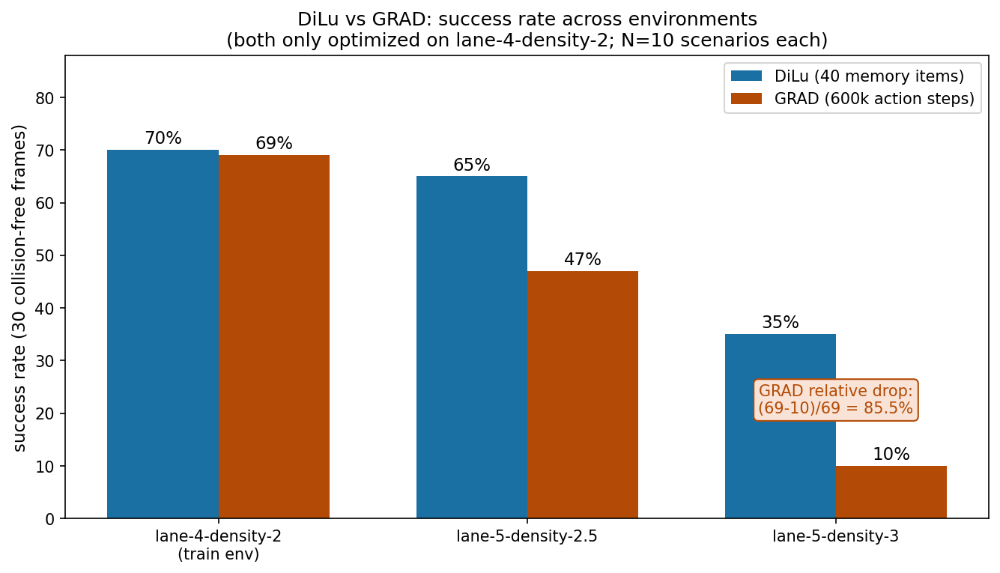

# 撞一次就记住：DiLu 让 LLM 靠文字记忆和自我反思学会开车

> **论文标题**: DiLu: A Knowledge-Driven Approach to Autonomous Driving with Large Language Models
> **作者**: Licheng Wen, Daocheng Fu, Xin Li, Xinyu Cai, Tao Ma, Pinlong Cai, Min Dou, Botian Shi, Liang He, Yu Qiao（上海人工智能实验室 / 华东师范大学 / 香港中文大学；Wen、Fu、Li 为共同一作）
> **会议**: ICLR 2024（arXiv:2309.16292，v3 为 2024-02-22 修订版，即发表版本）
> **链接**: https://arxiv.org/abs/2309.16292
> **代码**: 公开，https://github.com/PJLab-ADG/DiLu（2024-01-22 发布；本文核对了 vectorStore / driverAgent / run_dilu 等关键实现）
> **一句话核心洞见**: DiLu 把强化学习的"经验回放"翻译成了纯文本版本——记忆模块存的不是梯度、不是 Q 值，而是"场景描述 + 正确的推理过程"这样的自然语言经验；开车时用 embedding 相似度召回几条最像的经验塞进 prompt 做 few-shot，撞车后用 GPT-4 把那次错误的推理改对再存回去。整个系统不做一次梯度更新，靠 LLM 的常识打底、靠越攒越多的文字经验进化。

## 先看 0-shot 的惨状：没有任何经验的 GPT-3.5 会开车吗

论文 4.1 节的第一个实验是当头一棒：把记忆模块拿掉（0-shot），让 GPT-3.5 直接开 highway-env。10 次试验，**无一完成**，中位数 Success Steps（连续无碰撞帧数）不到 5。SS=30 才算完成一次 30 秒的驾驶任务——0-shot 的车平均 5 秒内就撞了。

这个数字是整篇论文的起点，也是它最诚实的一张牌。很多 LLM-agent 论文会含糊地说"LLM 有常识所以能开车"，DiLu 先用实验告诉你：**不能**。常识告诉你"别撞"，但没告诉你"前方 32 米有辆车比你慢 3 m/s 时该不该减速"。驾驶需要的不是泛泛的常识，而是**把常识实例化到具体数值上的判断力**——而这正是经验的作用。人类学车要 20 小时（LeCun 在引言里引的那个问题），DiLu 的回答是：给 LLM 一个"驾校"（5 条人工写的初始经验）加一个"行车记录本"（记忆模块），让它在开车中自己攒经验。

## 范式：环境、驾驶员、记忆，三者缺一不可

Fig.1 提出了 knowledge-driven 范式，三个部件：

1. **可交互的环境**（highway-env 仿真器）：agent 能观察、能行动、能撞车。没有闭环交互，经验无从谈起——这也是它和同期开环 VQA 工作（比如上面那篇 Reason2Drive）最根本的区别。
2. **驾驶员 agent**：三种能力——回忆（recall，从记忆里找相似场景）、推理（reasoning，用 LLM 做 CoT 决策）、反思（reflection，复盘对错）。
3. **记忆模块**：独立于 LLM 参数的外部存储，存文字经验。

Fig.2 是 DiLu 的具体框架：推理模块观察环境→场景描述→从记忆召回 few-shot 经验→拼 prompt→LLM→决策解码器输出动作，循环 30 帧；反思模块在一次驾驶结束后，把成功的关键帧直接存档、把撞车那次的错误推理交给 GPT-4 修正后存档。

注意这个设计的取舍：**记忆在 LLM 参数外面**。好处是经验可读、可迁移（CitySim 的真实轨迹经验能直接拿来用，4.3 节）；代价是每次决策都要做 embedding 检索 + 拼一个很长的 prompt，论文结论自己承认决策延迟 5~10 秒（含 LLM 推理和 API 往返）。这是一个 proof-of-concept 的速度，不是车载速度——作者没藏着，这点值得肯定。

## 记忆模块：驾校、回忆录、错题本

### 初始化：先上 5 节课的驾校

"Initialization … is akin to a human attending driving school before hitting the road." 5 条人工书写的"场景描述 + 正确推理 + 决策"经验作为冷启动。这 5 条的质量决定了系统的起点——论文没有消融"初始经验写得烂会怎样"，这是个缺口（见怀疑式审读）。

### 回忆：场景描述 → 向量 → 找最像的 k 条

每帧决策前，场景描述文本被 embedding 成向量，作为记忆的 key 去检索最相似的场景。论文正文写的是"clustered and searched to find the closest scenarios (Johnson et al., 2019)"——Johnson et al. 2019 是 FAISS。但**代码里实际用的是 Chroma 向量数据库 + OpenAI text-embedding-ada-002**（附录 A.1 和 `vectorStore.py` 一致），检索是 `similarity_search_with_score(query, k=top_k)`，**没有聚类那一步**。论文正文的"clustered"和代码对不上——可能是早期方案改了但正文没跟上。这是个小的不一致，但说明正文的方法描述不能全信，要以代码和附录为准。

召回的经验以 few-shot 对话形式拼进 prompt（附录图9的例子：3 条经验里 2 条是 keep speed、1 条是 decelerate；论文特意注明"few-shot 经验的决策不需要一致"）。

### 存储：只存文字，所以跨环境

记忆条目 = 场景描述（key）+ 推理过程（value）。因为全是自然语言，**记忆是环境无关的**：highway-env 里攒的经验，描述的是"前车 32 米、慢 3 m/s"这种通用驾驶知识，CitySim 真实数据转写成同样格式就能用。这是 4.3 节跨域实验成立的前提。

## 推理模块：从场景文本到动作编号，一步一步走

Fig.3 的五步流程，我按论文 Fig.4 的真实例子走一遍。

**第 1 步：场景描述器。** 把仿真器底层的车辆信息（只有位置、速度、加速度，**没有**意图和风险信息——附录 A.1 强调这点，保证了 agent 不是在"开卷考试"）转写成固定句式的英文。比如：

> You're driving on a road with 4 lanes... Your current speed is 25.0 m/s, acceleration is 0.0 m/s², and lane position is 361.18 m. There are 2 vehicles driving around you:
> - Vehicle `496` is driving on the lane to your right and is ahead of you. The speed of it is 21.2 m/s, acceleration is 0.2 m/s², and lane position is 372.81 m.
> - Vehicle `640` is driving on the same lane as you and is ahead of you. ...

代码里车辆编号是 `id(sv) % 1000`——Python 对象的内存 id 取模，**每次运行都不一样**。记忆检索靠的是整段描述的 embedding，不是这个编号，所以不影响功能，但这是个 sloppy 的工程细节。

**第 2 步：召回 few-shot 经验**（见上节）。

**第 3 步：拼 prompt。** 三部分：system prompt（固定：任务介绍、输入输出格式、用 `####` 分隔每步推理的要求）、场景描述、few-shot 经验。附录图8给了完整模板。

**第 4 步：LLM 做 CoT。** 论文用 CoT 的理由写得很实在：场景复杂多变，直接让模型输出决策容易幻觉；而且**链式推理过程是反思模块定位错误的依据**——没有中间步骤，GPT-4 连错在哪都找不到。这是 CoT 在这里的第二个作用，不只是为了准，更是为了可修正。

Fig.4b 是 GPT-3.5 的真实输出，我验算了它的算术：

> The distance between me and car `640` is 393.69 − 361.18 = 32.51 m, and the difference in speed is 25.00 − 25.00 = 0.00 m/s.

393.69−361.18=32.51 ✓，25.00−25.00=0.00 ✓。接着推理："Car 640 距离 32.51 米、速度相同，这个距离我可以一直保持期望速度，所以不加速；也不需要减速；保持当前速度。"最终输出 `####` 后跟动作编号。

**第 5 步：决策解码器。** 论文 Fig.3 画了一个"Decision Decoder"框，听起来像个模块。**代码真相是 `driverAgent.py` 里的一行**：`decision_action = response_content.split(delimiter)[-1]`，然后 `int(decision_action)`。就是按 `####` 切分取最后一段转整数。temperature=0 保证了输出稳定，但本质上是个字符串解析——脆弱但够用。仓库里还有个 `outputAgent.py`，用**第二个 GPT-3.5 调**用把推理文本解析成结构化动作（action_id/action_name/explanation），但 `run_dilu.py` 主流程根本没调它，是个遗留文件。论文里没提这第二调用，读者如果只看代码会困惑，我在这里说明：以 `run_dilu.py` 为准，决策解码 = 切分取整。

动作空间：5 个离散元动作（加速、保持、减速、左变道、右变道；代码里映射为 0..4）。但附录图8 的 system prompt 截图里"Available actions"只列了 4 个（IDLE/Turn-right/Acceleration/Deceleration，**没有左变道**）——而附录 A.1 文字说 5 个动作"including lane changes to the left and right"。一个可能的解释（推断）：那个例子里自车在最左道，左变道非法，所以可用动作列表是按场景动态生成的。但论文没有明说，截图和文字就这么并排放着。这是个小瑕疵。

## 反思模块：论文最漂亮的一章，也是自我验证的一章

### 成功和失败走两条路

一次驾驶 session 结束（30 帧开完或撞车），反思模块拿到完整的"prompt 序列 + 决策序列"（Fig.5 例子里是 #0~#4 五帧）。两条路：

- **没撞**：从序列里采样几个关键帧（"sample several key decision frames"——**采样几个、按什么标准，论文没说**，[未核实]），连同场景描述和正确推理直接存入记忆。这是"成功经验"。
- **撞了**：把撞车那帧的场景 + LLM 原始的错误推理一起喂给 GPT-4，要求输出三样东西：错误分析、修正后的推理与决策、以后如何避免同类错误。修正版存入记忆。这是"错题本"。

注意分工：**推理用 GPT-3.5，反思用 GPT-4**（附录 A.1）。理由是 GPT-4 的自我修正和事实核查能力更强（引了 Bubeck et al. 2023 和 Olausson et al. 2023）。翻译一下："自我进化"这个叙事里，纠错的那个自我比开车的那个自我更强。系统能进化的上限，一部分来自 GPT-4 的能力，而不是纯粹的自举。这不是否定，是把 credit 归因说准确。

### Fig.12：一场真实的撞车复盘，全程验算

这是全篇我最喜欢的一个例子，因为它把"反思"从一个名词变成了一次真实的改错。场景：自车在右二道，GPT-3.5 决定向右变道，撞上了 408 号车。

**原始决策的错误**（作者用红色标出了问题句）："The distance between us is appropriate"——408 号车"距离合适"。实际上 408 只比自车靠前 0.34 米。GPT-3.5 的推理里**根本没算相对距离**，只看了"右道那辆车更慢"，就觉得变道可行。

**GPT-4 的修正**（绿色标出新增的计算）：

> The distance between us is 481.25 − 480.91 = 0.34 m. Given the relative speed, the time to collision would be 0.34 / 1.52 = 0.22 seconds, which is too short to safely change lanes.

验算：481.25−480.91=0.34 ✓；17.82−19.34=−1.52 m/s ✓；0.34/1.52=0.2237≈0.22 s ✓。**"time to collision"这个计算在原始推理里完全不存在**，是 GPT-4 补上的——这正是反思的价值：不是换个答案，而是补上缺失的推理步骤。修正后的决策：减速。经验总结："变道不仅要看速度和距离，还要看相对位置，保证有足够的时间和空间。"

### 但反思有个盲区：只从撞车里学

触发反思的唯一信号是 session 因碰撞终止（代码里就是 env 的 `done`）。**没撞的 near-miss 呢？** 一次以 0.1 米擦身而过的变道，在系统看来和一次完美的变道没有区别——都会被当成"成功经验"采样存档。人类司机恰恰是从"好险"里学到最多的。一个只从撞车里学习、从不从惊险里学习的系统，它的经验库是 biased 的：存的全是"没出事=做得对"。论文没有讨论这一点，这是反思机制设计上真实的缺口。

## 附录里的 case study 藏着两个算术 slip：LLM 连自己的数都算不对

Fig.11 Case 1（推理模块的成功案例），我对着 PDF 原页（第 17 页）逐字核实，发现 GPT-3.5 的输出里有两处自相矛盾，**不是文本提取误差**：

1. 它先算对了："the difference in speed is 16.29 − 16.02 = **0.27** m/s"，紧接着下一句写"its speed is **1.27** m/s faster than mine"。0.27 和 1.27，同一个数的两种说法——LLM 在复述自己刚算出的数字时手滑了。
2. "The distance 29.55 m is **larger than** my preferred car following distance 30 m"——29.55 < 30，这个比较是错的。

有意思的是，最终决策（向右变道）在这个场景里是合理的，实验也把它当成功案例。但这两处 slip 恰好证明了论文自己的两个论点：(a) CoT 的中间步骤不可靠，结论 5-10 秒延迟之外，**幻觉是 DiLu 承认的第二大局限**（结论部分原话）；(b) 反思模块存在的必要性——如果连"29.55 > 30"这种比较都会错，那么"让 GPT-4 复查"就不是装饰，而是必需品。作者把这样的原始输出原样放进附录，是诚实；但正文里没有讨论"推理过程的算术不可靠"这个问题，是保留。

## 实验：数字逐项核实

### 4.1 记忆越多、few-shot 越多，开得越好（图6a/6b 的文字数字）

- 0-shot：中位数 SS < 5，10 次试验无一完成（SS=30 才算完成）。
- 记忆 40 条时：1-shot 中位数 25，3-shot 中位数 27，5-shot 中位数 >25 且"几乎全部通过"。
- 记忆 20 条、5-shot：多数情况下能开满 30 帧。
- 跨环境（记忆来自 lane-4-density-2，测 lane-5-density-3）：3-shot 中位数 13→5，5-shot 中位数 30→23。few-shot 越多，泛化掉得越少。

每组 10 个随机种子，画的是箱线图。N=10 不算大，但趋势（记忆量↑、few-shot↑ → SS↑）在四个设置里一致，可信。

### 4.2 对打 GRAD：70% vs 69%，以及那个"85% 下降"

三个环境（都在 lane-4-density-2 上优化/训练，然后迁移测试）：

| 环境 | DiLu（40 条记忆） | GRAD |
|---|---|---|
| lane-4-density-2 | 70% | 69% |
| lane-5-density-2.5 | 65% | 47% |
| lane-5-density-3 | 35% | 10% |

"GRAD 有 85% 的性能下降"：(69−10)/69 = 85.5% ✓，数字对得上。DiLu 在最难环境保持 35%，确实更抗迁移。

但这里有三点要说清楚：

1. **"600,000 training episodes"很可能是笔误。** 摘要、引言、4.2 节都写 GRAD 训练了 600,000 episodes，但附录 A.4 原话是"Each model is trained for **600,000 action steps**"。按 1Hz 决策、每 episode 最多 30 步，60 万 action steps 对应 2 万~60 万 episodes（提前撞车会更少）。"600,000 episodes"这个说法在附录面前站不住，大概率是把 action steps 写成了 episodes。我按附录的 600,000 action steps 理解，并在上图标注了它。
2. **"40 条记忆 vs 60 万步训练"这个对比是苹果对橘子。** DiLu 的 40 条记忆坐在 GPT-3.5 的预训练（整个互联网）之上，还用了 GPT-4 做纠错；GRAD 是从零开始、用"每存活一步 +0.2、速度映射 0~0.8"这种稀疏奖励硬训出来的。论文的叙事是"知识驱动吊打数据驱动"，但公平的说法是：**DiLu 把数据换成了预训练知识+人工经验，比较的不是"谁更努力"，而是"哪种知识载体更有效"**。这个结论依然有价值，但 credit 要分给 LLM 预训练，不能全记在框架头上。
3. **GRAD 的"SOTA"头衔是论文自己封的。** GRAD（Xi & Sukthankar 2022）是一篇 NeurIPS 2022 workshop 论文。说它是"highway-env 上的 SOTA RL 方法"是作者的 framing，我没有独立验证当时 highway-env 上有没有更强的 RL 基线。读者要知道这个比较的对手是一个 workshop 方法，不是当年最强的 RL。

### 4.3 泛化与迁移：CitySim 的真实经验真的有用

用 lane-4-density-2 的 20 条记忆去开 lane-5-density-3（更密、5 车道）：5-shot 中位数只从 30 掉到 23。更值得说的是 CitySim 实验：从真实无人机轨迹数据（CitySim）转写 20 条文字经验，和从 highway-env 攒的 20 条对比，在更拥堵环境下**真实数据的记忆鲁棒性更好**（图7b）。这个实验的分量在于：它证明了"文字记忆"这个载体真的跨过了 sim-to-real 的第一步——不是靠域随机化，而是靠"自然语言本身就是环境无关的抽象"。

### 4.4 两种记忆都有用（表1）

基线（20 条初始记忆）中位数 SS 只有 10.0；加 12 条成功记忆后 24.5；加 6 条修正记忆后 21.5；两种都加 24.5，且 MIN/Q1/Q3/MAX 全线最好。**修正记忆（错题本）的条数只有成功记忆的一半，效果接近**——单位经验的信息量更高。这个细节支持了"反思"的价值：一次撞车换来的经验，顶得上好几次顺风开。

## 怀疑式审读汇总

**站得住的：** 0-shot 基线先证明"LLM 裸上不行"，再谈记忆的贡献——因果链条干净；反思的 case study（Fig.12）是真实的改错，TTC 计算可验算；延迟 5~10 秒、幻觉未根除，局限自己写进了结论；代码公开且关键实现可对证。

**心虚或没说清的：**

1. "600,000 training episodes" vs 附录"600,000 action steps"——正文疑似笔误，按附录应为 action steps。
2. 论文写记忆检索"clustered and searched (Johnson et al., 2019)"，代码实际是 Chroma + ada-002 的普通 top-k 相似度检索，无聚类。
3. "40 条记忆 vs 60 万步 RL"的对比把 LLM 预训练的功劳记在了框架头上；GRAD 的"SOTA"是作者自封的 workshop 方法。
4. 附录 case study 里 GPT-3.5 的算术 slip（0.27→1.27；29.55>"30 m"），正文未讨论 CoT 算术不可靠的问题。
5. 反思只从撞车触发，near-miss 会被当成成功经验存档——经验库有系统性偏差。
6. 动作列表图8截图 4 个 vs 文字 5 个（含左变道），未解释。
7. 决策解码器 Fig.3 画成一个框，实际是 `split('####')[-1]` 转 int；仓库里第二个 LLM 调用的 OutputParser 是遗留文件，主流程没用。
8. 初始 5 条人工经验的质量决定冷启动，无消融；每组实验 N=10，无置信区间。
9. SS 指标可被"开慢点" game——30 帧无碰撞即成功，对速度没有要求；论文没讨论保守策略刷分的问题。

## 带走什么

**可迁移的想法（两个）：**

1. **经验回放的文字版。** RL 的 replay buffer 存的是 (s, a, r, s') 数值四元组，DiLu 存的是"场景描述 + 推理过程"文字二元组，检索靠语义相似度而不是时序差分。任何"LLM 做序列决策 + 能复盘"的任务（网页 agent、运维 agent）都可以抄这套：**把一次执行的 prompt 和 CoT 存下来当 few-shot，把报错的那次用强模型改对再存**。反思模块的"错误分析 + 修正 + 教训"三段式输出格式可以直接复用。
2. **CoT 的第二个作用：给纠错留接口。** 大家用 CoT 都是为了"准"，DiLu 提醒你：链式中间步骤的真正价值可能是"可被另一个模型审查和修改"。设计 agent 流程时，多问一句：这一步的输出，下游有没有办法验证和修正它？

**真正值得做的具体问题：** near-miss 挖掘。给仿真器加一个"最小车间距/TTC 阈值"监控，把没撞但 TTC < 1 秒的帧也送进反思模块，看经验库的质量和泛化能提升多少——这篇论文的框架不用大改就能做，做的就是它的盲区。另一个是把决策延迟打下来：5~10 秒里多少花在 prompt 长度上（few-shot 经验越长越慢），做一次"经验条数-延迟-成功率"的三维权衡，车载化才有依据。
