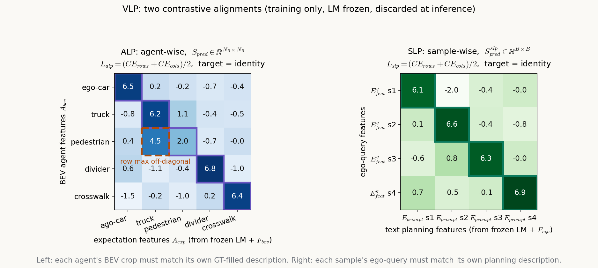

# 语言模型不上车：VLP 把 LLM 当成只在训练期存在的教练

> **信息块**
> - 论文标题：VLP: Vision Language Planning for Autonomous Driving
> - 作者：Chenbin Pan, Burhaneddin Yaman, Tommaso Nesti, Abhirup Mallik, Alessandro G Allievi, Senem Velipasalar, Liu Ren（Syracuse University；Bosch Research North America & Bosch Center for Artificial Intelligence）
> - 会议/年份：CVPR 2024（pp. 14760–14769）；arXiv:2401.05577（v4，2024-11-23，camera-ready 版）
> - 链接：https://arxiv.org/abs/2401.05577
> - 代码是否公开：未找到官方代码。Bosch 已就该方法申请美国专利 US20250153736（"Systems and Methods for Vision-Language Planning (VLP) Foundation Models for Autonomous Driving"），推断不会开源。
> - 一句话核心洞见：VLP 里的语言模型从不参与驾驶。它是一个只在训练期存在的"教练"：用灌满真值的文本描述做对比学习，把 BEV 特征和自车 query 拉向语义规整的空间；推理时整个语言分支被丢掉，不增加一个参数，不增加一毫秒算力。

## 语言模型不上车：VLP 真正的赌注是什么

2024 年初，LLM 进自动驾驶的标准姿势是把模型请上车：GPT-Driver 把场景写成文字喂给 GPT 做规划，DriveVLM 用 VLM 做链式推理再输出轨迹。这些设计的代价都一样——推理时多跑一个大模型，延迟和成本直接翻倍。

VLP 赌的是另一条路：语言模型可以只在训练时出现。图 2a 把这一点画得很直白，整个 VLP 分支标着 "Training-only"。训练时，一个被冻结的语言模型把真值填好的文本模板编码成向量，BEV 特征和自车 query 用对比学习向这些向量对齐；推理时，语言模型、模板、对比损失全部丢掉，车上跑的还是原来的 UniAD 或 VAD，一点没变。

这个赌注的底牌很硬。自动驾驶量产最怕的就是"效果好但上不了车"——多一个模型的延迟、显存、功耗，整车厂都要重新算账。VLP 把语言模型的代价全部留在训练机房，推理侧的账单是零。论文 3.4 节原话："the off-the-shelf LM head is discarded during inference, and thus, our method introduces no additional parameters and computations to the original ADS." 审稿人几乎找不到角度攻击它的部署成本，这是它能中 CVPR 的结构性原因之一（推断）。

但硬币的另一面也要先摆出来：既然语言模型在推理时不存在，"常识推理"到底发生在哪？第 8 节会回到这个问题。先把机制讲透。

## ALP：每个智能体的 BEV 块都要能"说出"自己是什么

ALP（Agent-centric Learning Paradigm）管的是 BEV 特征图。BEV 图是下游所有任务的信息池，论文的判断是：BEV 是从多视角图像"拼"出来的俯视图，不是真正的俯视照片，局部细节和真实语义之间存在偏差。ALP 的做法是：对 BEV 图上的每个智能体，抠出它对应的局部区域，压成一个向量，然后逼这个向量去匹配一段文字描述的编码——那段文字用真值写成，精确描述这个智能体应该是什么。

### 公式 (1)：从 BEV 图上抠智能体

$$A^{Ego}_{bev} = Pool(Crop(BEV, bbox^{Ego}_{3D})), \quad \in \mathbb{R}^{C}$$

$$A^{FG}_{bev} = Pool(Crop(BEV, bbox^{FG}_{3D})), \quad \in \mathbb{R}^{C}$$

$$A^{Lane}_{bev} = Pool(Seg(BEV, SegMask^{Lane})), \quad \in \mathbb{R}^{C}$$

$$A_{bev} = Batch([A^{Ego}_{bev}; A^{FG}_{bev}; A^{Lane}_{bev}]), \quad \in \mathbb{R}^{N_B \times C}$$

符号形状一次说清：$BEV$ 是编码器输出的俯视特征图；$bbox^{(\cdot)}_{3D}$ 是真值 3D 框；$SegMask^{Lane}$ 是车道线的真值 panoptic 分割掩码；$Crop$ 按框在 BEV 图上裁一块区域，$Seg$ 按掩码取出车道区域；$Pool$ 把区域压成一个 $C$ 维向量（$C=256$，见附录表 11 的 decoder 维度）；$Batch[;]$ 把一个 batch 里所有样本的三种智能体向量拼起来，$N_B$ 是 batch 内智能体总数。

三种智能体：自车（ego-vehicle）、前景物体（foreground objects，车和行人）、车道元素（lane elements）。注意抠区域用的全是真值——3D 框和分割掩码都是标注，不是模型预测的。这意味着 ALP 的监督信号里，真值以两种形式出现：一次用来定位（抠哪里），一次用来描述（见公式 2）。抠区域这一步如果换成预测框，噪声会污染对齐；用真值框是合理的训练期选择，推理时反正不用抠。

一个记号上的小毛病：公式 (1) 最后一行写 $\in \mathbb{R}^{N_{batch} \times C}$，而正文定义的是 $N_B$。$N_{batch}$ 和 $N_B$ 指的是同一个数（batch 内智能体总数），论文混用了两个名字。

### 公式 (2)：把真值写成一句话，喂给冻结的语言模型

$$A^{Ego}_{exp} = F_{bev}(LM(T^{Ego}[y^{Ego}])), \quad \in \mathbb{R}^{C}$$

（FG、Lane 同理，拼成 $A_{exp} \in \mathbb{R}^{N_B \times C}$。）

$T^{(\cdot)}$ 是文本模板，$y^{(\cdot)}$ 是填进模板的真值，$LM$ 是被冻结的语言模型，$F_{bev}$ 是一个可训练的 MLP，把语言模型的输出维度映射到 BEV 特征空间（$C$ 维）。训练时只更新 $F_{bev}$，$LM$ 的参数一动不动。

模板长什么样，图 2b 给了原文。Ego 模板：

> This is the self-driving car. It is {class}, and its 3D bounding box is {[cx, cy, w, l, cz, h, sin, cos, vx, vy]}. It is currently {command}. Its future trajectory will be {[[x1, y1]…[xn, yn]]}.

FG 模板：

> This object is {class}. Its 3D bounding box is {[cx, cy, w, l, cz, h, sin, cos, vx, vy]}. Its future trajectory will be {[[x1, y1]…[xt, yt]]}.

Lane 模板：

> This lane belongs to a {lane-label}. The label belongs to {thing/stuff} class. Its 2D bounding box on the BEV map is {[cx, cy, w, h]}.

看清楚这里发生了什么：模板里的花括号全部由真值填充——类别、3D 框的 10 个数、未来轨迹的坐标点、高层指令（command）。语言模型收到的不是"推理题"，而是一份用自然语言格式化的真值清单。它输出的向量，本质上是这份真值清单的语义编码。

这里的 "LM" 需要正名。论文正文写的是 "the pretrained LM in CLIP"，即 CLIP 的文本编码器，不是 GPT 那样的自回归大模型。附录表 12 试了 GPT-2 和几个 CLIP 变体（CLIP-RN50x64-LM 等，名字里的 RN50x64 指该 CLIP 模型的视觉骨干，文本编码器是配套的那个——论文没明说，这是推断）。默认用的是 CLIP 的文本编码器。

### 公式 (3)：对比学习，目标是一个单位矩阵

$$S_{pred} = \alpha_{alp} \times \left(\frac{A_{bev}}{\|A_{bev}\|_2} \otimes \frac{A_{exp}}{\|A_{exp}\|_2}\right)$$

$$L_{alp} = (L_{CE}(S_{pred}, S_{gt}, dim=0) + L_{CE}(S_{pred}, S_{gt}, dim=1))/2$$

逐项拆。$A_{bev}$ 和 $A_{exp}$ 都是 $N_B \times C$，先各自按行做 L2 归一化（$\|\cdot\|_2$ 按行算，每行变成单位向量）。$\otimes$ 在这里是矩阵乘法——论文 3.2 节正文写了 "matrix multiplication is performed between the normalized two-modality tensors"。注意右项隐含了一次转置：$\tilde{A}_{bev} \tilde{A}_{exp}^\top \in \mathbb{R}^{N_B \times N_B}$，论文的公式里没写转置符号，读的时候要自己补上。$\alpha_{alp}$ 是一个可学习的 logit 缩放系数（CLIP 里也有同样角色的 temperature 参数）。

$S_{pred}$ 的第 $i$ 行第 $j$ 列，是第 $i$ 个智能体的 BEV 特征和第 $j$ 个智能体的文本期望特征的余弦相似度，再乘 $\alpha_{alp}$。$S_{gt}$ 是 $N_B \times N_B$ 的单位矩阵：对角线为 1，其余为 0。$L_{CE}(S_{pred}, S_{gt}, dim=0)$ 是把 $S_{pred}$ 的每一列做 softmax 后、要求第 $i$ 列的最大值落在第 $i$ 行（交叉熵的目标就是单位矩阵）；$dim=1$ 是对每一行做同样的事。两个方向的交叉熵取平均，就是 $L_{alp}$。

几何上在说什么：$N_B$ 个 BEV 向量和 $N_B$ 个文本向量住在同一个 $C$ 维球面上（都归一化了）。损失要求每个 BEV 向量离自己的文本向量最近，同时离别人的文本向量都远；反过来，每个文本向量也一样。这就是 CLIP 的训练目标原样搬过来，只是两边从"图像-文本"换成了"BEV 智能体特征-真值描述文本"。

## 一个三智能体的算例：0.023 的损失是怎么来的

取 $N_B=3$（ego-car、truck、pedestrian），$C=4$，$\alpha_{alp}=10$。假设某一步训练中，归一化后的特征如下（示意数字）：

$A_{bev}$ 的三行：ego $[0.90, 0.30, 0.20, 0.24]$，truck $[0.25, 0.92, 0.20, 0.22]$，pedestrian $[0.30, 0.35, 0.85, 0.25]$；
$A_{exp}$ 的三行：ego 描述 $[0.95, 0.20, 0.15, 0.18]$，truck 描述 $[0.20, 0.94, 0.18, 0.20]$，pedestrian 描述 $[0.25, 0.30, 0.90, 0.22]$（均已按行归一化）。

相似度矩阵：

$$S_{pred} = 10 \times \tilde{A}_{bev}\tilde{A}_{exp}^\top = \begin{bmatrix} 9.91 & 5.48 & 5.46 \\ 4.92 & 9.98 & 5.65 \\ 5.29 & 5.94 & 9.96 \end{bmatrix}$$

对角线元素（同智能体的相似度）接近 10，非对角线在 5 附近。对每一行做 softmax：

$$P_{rows} = \begin{bmatrix} 0.977 & 0.012 & 0.011 \\ 0.006 & 0.981 & 0.013 \\ 0.009 & 0.017 & 0.973 \end{bmatrix}$$

行方向交叉熵 $L_{CE,rows} = -\frac{1}{3}(\log 0.977 + \log 0.981 + \log 0.973) = 0.0232$，列方向同理得 0.0230，$L_{alp} = 0.0231$。损失很小，因为每个 BEV 向量已经站到了自己文本向量的旁边。

现在看损失在惩罚什么。假设 pedestrian 的 BEV 特征学坏了，塌向了 truck 的方向：第三行变成 $[0.28, 0.88, 0.30, 0.24]$（归一化后）。新的相似度矩阵第三行变成 $[5.31, 9.87, 6.53]$——pedestrian 的 BEV 向量离 truck 的文本描述最近。行 softmax 后对角概率变成 $[0.977, 0.981, 0.034]$，行交叉熵从 0.023 跳到 1.142。

这个跳变就是 ALP 的全部作用：BEV 图上行人的局部特征如果和卡车的文本描述更像，损失就把它拽回来。所谓"用语言模型的常识整顿 BEV"，落实到数字上，就是这 1.142 和 0.023 的差别。

自绘图（示意，非论文原图）：

图注：左图是 ALP 的 agent-wise 相似度矩阵（示意），紫色框出对角线即训练目标（单位矩阵），红色虚线框标出一处"行人在 BEV 里的特征反而更接近卡车的文本描述"的混淆，行 softmax 会把概率质量放错位置，交叉熵随之变大；右图是 SLP 的 sample-wise 矩阵。两图的损失都是行列两个方向交叉熵的平均。

论文原图对照：VLP 的整体框架见论文图 2a（第 4 页），prompt 模板见图 2b（第 4 页）；上面的示意图是对公式 (3)(6) 的展开，论文里没有画出来。

## SLP：被对齐的为什么是自车 query，而不是轨迹

SLP（Self-driving-car-centric Learning Paradigm）管的是规划端。ALP 整顿的是 BEV 这张"地图"，SLP 整顿的是自车 query 这个"决策者"。

### 公式 (4)：原来的规划流程

$$E^q_{feat} = M_{inter}(E_{query}, A^{FG}_{query}, A^{lane}_{query}) \in \mathbb{R}^{B \times C}$$

$$y^{plan}_{pred} = M_{plan}(E^q_{feat}) \in \mathbb{R}^{B \times P \times 2}$$

$E_{query}$ 是一个可学习的自车 query；$M_{inter}$ 让它和前景物体 query、车道 query 在 BEV 上交互，汇聚感知与预测信息，得到自车 query 特征 $E^q_{feat} \in \mathbb{R}^{B \times C}$（$B$ 是 batch size）；$M_{plan}$ 是规划头，输出未来 $P$ 个时刻的轨迹点 $y^{plan}_{pred} \in \mathbb{R}^{B \times P \times 2}$。$P=6$，对应 3 秒（2Hz），和基线一致。

论文对这套流程的批评是：只靠数字真值监督，模型学不到决策背后的理由，自车 query 的特征空间不连续、不规整，换环境就抖。SLP 的回答和 ALP 同构：给自车 query 也配一段真值描述，用对比学习把它拉向文本空间。

### 公式 (5)(6)：规划描述与样本级对比

$$E_{prompt} = F_{ego}(LM(T^{Ego}_{slp}[y^{plan}])) \in \mathbb{R}^{B \times C}$$

$$S^{slp}_{pred} = \alpha_{slp} \times \left(\frac{E^q_{feat}}{\|E^q_{feat}\|_2} \otimes \frac{E_{prompt}}{\|E_{prompt}\|_2}\right)$$

$$L_{slp} = (L_{CE}(S^{slp}_{pred}, S^{slp}_{gt}, dim=0) + L_{CE}(S^{slp}_{pred}, S^{slp}_{gt}, dim=1))/2$$

规划 prompt 模板（图 2b）：

> The self-driving car is driving in an urban area. It is currently {command}. The future trajectory of the car for the next P timestamps will be {[[x1, y1]…[xp, yp]]}.

填进去的是高层驾驶指令（command，如直行、左转）和自车未来轨迹的真值坐标。$LM$ 和 ALP 共用同一个冻结模型，$F_{ego}$ 是另一个可训练的 MLP 适配器。

和 ALP 的区别只有一级：ALP 的对比是 agent-wise 的（$N_B \times N_B$，一个 batch 里所有智能体两两比），SLP 是 sample-wise 的（$B \times B$，一个 batch 里 $B$ 个样本两两比）。ALP 修的是"每个局部特征像不像它应该表达的东西"，SLP 修的是"每个样本的自车决策特征像不像人类驾驶员在这种场景下的决策描述"。

为什么不对齐轨迹本身？轨迹 $y^{plan}_{pred} \in \mathbb{R}^{B \times P \times 2}$ 是 12 个坐标数，本身没有语义结构；自车 query 特征 $E^q_{feat}$ 是规划头之前的瓶颈表示，对齐它等于给整个决策过程立了一个语义锚点。这个选择是合理的：表示层的对齐比输出层的对齐约束更根本，而且不和原来的规划损失 $L_{plan}$ 抢梯度（$L_{plan}$ 照旧监督轨迹坐标）。

### 总损失里的两个权重：论文没给数值

$$L_{vlp} = \omega_{enc} L_{enc} + \omega_{dec} L_{dec} \tag{7}$$

$$L_{dec} = L_{perc} + L_{pred} + L_{plan} + L_{slp}, \quad L_{enc} = L_{alp} \tag{8}$$

$L_{perc}$、$L_{pred}$、$L_{plan}$ 是原来基线（UniAD/VAD）自己的感知、预测、规划损失，原样保留；$L_{alp}$ 挂在编码器侧，$L_{slp}$ 挂在解码器侧。论文给了公式，但 $\omega_{enc}$ 和 $\omega_{dec}$ 的具体数值在正文和附录里都没有出现。这不是小事：对比损失和任务损失的量级差着好几个数量级（上面的算例里 $L_{alp}$ 是 0.02 量级，而检测/规划损失通常是 1~10 量级），权重决定了语言分支到底是"教练"还是"摆设"。复现这篇论文的人，第一个要猜的就是这两个数。论文在这里没说清。

## 35.9% 和 60.5%：把减法做一遍

摘要里最抓眼球的两个数字，来自表 1（nuScenes 验证集开环规划）。拿 VAD 那两行验算：

- 平均 L2：VAD 基线 0.78 米 → VLP-VAD 0.50 米，降幅 $(0.78-0.50)/0.78 = 35.9\%$。对得上。
- 平均碰撞率：VAD 基线 0.38\% → VLP-VAD 0.15\%，降幅 $(0.38-0.15)/0.38 = 60.5\%$。对得上。

UniAD 那两行同样成立：L2 从 1.03 到 0.74，降幅 28.1\%；碰撞率从 0.31\% 到 0.16\%，降幅 48.4\%。论文 4.2 节写的 28.1\% 和 48.4\%，和表 1 的数字一致。

表 1 的细节值得多看两眼。第 9 行（只加 SLP 的 VLP-VAD）：1 秒 L2 是 0.26；第 10 行（SLP+ALP 全加）：1 秒 L2 反而变成 0.30。加上 ALP 之后，短时域的 L2 变差了，3 秒 L2 也从 0.78 变成 0.84。ALP 的贡献全在碰撞率上：第 9 行平均碰撞率 0.23\%，第 10 行 0.15\%。在 VAD 上，ALP 拿 L2 换了安全性。这个交换论文正文没有点出来，但做规划的人应该知道：L2 和碰撞率经常是跷跷板的两头。

## 谁在承重：SLP 与 ALP 各贡献多少

把表 1、表 7、附录表 13 放在一起看，承重结构就清楚了。

规划任务上，SLP 是顶梁柱。表 1 第 6 行（VLP-UniAD 只加 SLP）：平均 L2 从 1.03 降到 0.92，碰撞率从 0.31\% 降到 0.22\%；第 9 行（VLP-VAD 只加 SLP）：L2 从 0.78 降到 0.50，碰撞率从 0.38\% 降到 0.23\%。光 SLP 一个，就吃掉了大部分涨幅。

ALP 的主场在感知和局部表示。表 7（VAD 的向量化场景分割）：只加 SLP，mIoU 从 39.8\% 涨到 47.2\%；再加 ALP，mIoU 回落到 45.7\%。附录表 13 更直接：规划验证 L2，只加 SLP 是 0.50，只加 ALP 是 0.52，两个都加是 0.55——全加上反而比单加 SLP 差。场景分割 mIoU：基线 39.8，只加 SLP 47.2，只加 ALP 47.6，全加 45.7。

读到这里要停一下。两个都加在某些指标上不如只加一个，这说明 ALP 和 SLP 的梯度方向不完全一致：ALP 把 BEV 特征往"每个智能体像自己的文本描述"拉，SLP 把自车 query 往"整段规划描述"拉，两个目标在共享的 BEV 编码器处会互相拽。论文的叙事是"两个模块各管一头、合起来更好"，但数据里至少有三处（表 1 的 VAD 1 秒 L2、表 7 的 mIoU、表 13 的规划 L2）显示合起来并没有单用 SLP 好。论文没有讨论这个张力。

公平地说，ALP 并非装饰。表 9b 的长尾 3D 检测：只加 SLP 的 mAP 是 19.1，加上 ALP 后到 20.4（基线 17.6）。长尾类别（工程车、公交、摩托、自行车、拖车，约占 nuScenes 的 6\%）的检测，ALP 的 agent-wise 对齐确实帮上了忙——这也符合直觉：长尾物体的 BEV 特征最容易学偏，文本描述的锚定作用在这里最值钱。

## "常识"从哪来：一个被冻结的文本编码器里没有推理

现在回到开头那个问题。论文通篇在讲 "human-like reasoning"、"common sense"（第 10 节还单开一节 "Why human-like?"），但机制部分没有任何推理发生：

1. 语言模型是冻结的，它只做前向编码，不生成、不推理、不做链式思考。
2. 它编码的文本是模板加真值数字，不是问题。没有哪个 token 在"思考"该怎么开。
3. 推理时整个分支被丢掉，车上没有任何语言模型的残留。

所以"常识"这个词在这里的实际含义是：真值被格式化成自然语言后，文本编码器输出的向量空间自带语义结构（"truck" 和 "car" 的向量近，"truck" 和 "divider" 的向量远），对比学习把 BEV 特征拽进这个结构里。这是一种借语言之形的真值蒸馏，不是一次推理。

有没有证据支持这个更朴素的解释？有，附录表 12。作者换了四种语言模型：GPT-2（纯文本自回归模型，没见过图像，和视觉空间毫无对齐）、CLIP-RN50x64 的文本编码器、CLIP-RN101 的文本编码器、CLIP-ViT-L/14 的文本编码器。规划指标上，四种模型带来的提升几乎一样（UniAD 平均 L2：0.75、0.74、0.76、0.73；基线 1.03）。如果起作用的真是"视觉-语言联合空间的常识"，纯文本的 GPT-2 应该明显更差——它根本没学过图文对齐。但它和其他三个打平。这说明起作用的不是图文对齐，而是"把真值写成结构化文本再编码"这个行为本身：任何一个像样的文本编码器都能把"卡车，框是 [...]，轨迹是 [...]"变成一个有区分度的向量，对比学习用这个向量当锚点就够了。

表 17 还藏着一个反例，论文正文没提。用 CLIP-ViT-L/14 的文本编码器时，UniAD 的感知指标反而变差了：AMOTA 从 35.2 掉到 32.6，IDS（身份切换）从 720 涨到 923，建图和 occupancy 的多项指标也低于基线，但规划的平均 L2 却从 0.93 降到 0.57。语言分支的锚点把表示空间拽向了对规划有利、对感知不利的方向——"换什么 LM 都一样好"的说法，在这里不成立。作者在正文里只强调了规划指标的一致性，对感知指标的分化没有解释。

## 表 3 那段文字写错了对象：5.5% 属于 divider，不是 drivable

4.3 节在线建图那段，原文写的是：SLP "enhances the IoU for drivable areas and crossings by 5.5% and 6.5%, respectively"，以及全量 VLP "with IoU achieving by 6.6% and 10.2% for drivable areas and crossings, respectively"。

拿表 3 的数字逐项算相对涨幅（基线 → 只加 SLP）：lanes 31.3→32.0（+2.2%），drivable 69.1→69.5（+0.6%），divider 25.7→27.1（+5.4%），crossing 13.8→14.7（+6.5%）。5.5% 对应的是 divider，不是 drivable。全量 VLP：drivable 69.1→70.2（+1.6%），divider 25.7→27.4（+6.6%），crossing 13.8→15.2（+10.1%）。6.6% 同样对应 divider。

两处都把 divider 写成了 drivable areas。数字本身是对的，对象贴错了标签。审稿时没人拦下这个错误，说明大家都没亲手算一遍。

## 表 4 那句话也被自己的数字反驳了

4.3 节运动预测那段写道："the inclusion of the SLP contributes to a reduction in minADE, minFDE, and MR"。看表 4 的 UniAD 行：基线 minADE 0.71、minFDE 1.02、MR 0.151；只加 SLP 后变成 0.72、1.04、0.154——三项全都轻微变差了。VAD 那边倒是确实变好了（0.78→0.77，1.07→1.03，0.121→0.110）。这句话对 VAD 成立，对 UniAD 不成立，论文把它写成了对两者都成立。差值很小（0.01 量级），可能是噪声，但文字不应该这样概括。

## 附录的基线数字为什么和正文对不上

这是通读附录时最扎眼的地方。正文表 1 的 VAD 基线：平均 L2 0.78，平均碰撞率 0.38%。附录表 12 的 VAD 基线行：平均 L2 0.82，平均碰撞率 0.93%。附录表 16（VAD 的 prompt 消融）的基线行：平均 L2 0.98，平均碰撞率 0.80%。三个地方的"同一个基线"，数字各不相同，论文没有任何解释。

UniAD 那边也一样：正文表 1 基线是 1.03/0.31%，附录表 17 基线行是 0.93/0.38%。表 10（prompt 信息消融）的全真值行是 0.52/0.17%，和表 16 的全真值行完全一致，说明表 10 是 VAD 体系下的；但表 10 的全空行是 0.64/0.23%，表 16 的全空行是 0.98/0.80%——同一个"去掉所有真值信息"的配置，数字差了一大截。表 10 的实验配置在论文里没有交代清楚。

可能的解释（推断）：附录的消融是在不同随机种子、不同检查点、甚至不同评测脚本下跑的；VAD 的碰撞率对评测细节很敏感（0.38% 到 0.93% 差了一倍多）。但无论原因是什么，基线数字在正文和附录之间漂移，会让所有"相对提升百分比"的可比性打折扣。表 12 里那些 "+27.2%"、"+68.8%" 是相对附录自己的基线算的，不能和正文的 35.9%/60.5% 直接比较——论文没有提醒读者这一点。

## 新城市实验：测的是什么，没测的是什么

表 8 的新城市泛化是论文着力宣传的点（图 1 就是它，还宣称是 nuScenes 上的首次）。做法：在 Boston 子集上训练、Singapore 子集上测试，反过来再做一次。数字验算无误：VLP-VAD 在 Boston 测试（训练集是 Singapore，推断——表格列标题写的是测试城市，论文没明说，这是推断）L2 降 15.1%、碰撞率降 18.5%；在 Singapore 测试 L2 降 19.2%、碰撞率降 48.7%。

肯定两点。第一，跨城市的绝对值确实下来了，而且 VLP 的相对优势在跨城市时比在域内更大（域内 VAD 碰撞率降 60.5%，跨城市 Singapore 降 48.7%——量级相当，没有塌）。第二，基线选的是同体系的 VAD/UniAD，对比干净。

也要看到限度。Boston 和 Singapore 都是 nuScenes 的数据，同一套传感器、同一套标注流程、同一个数据采集年代；真正的"新城市"还包括不同的传感器配置、不同的交通规则细节（比如 Singapore 是靠左行驶，Boston 靠右——论文没讨论这个差异对结果的影响）。跨城市后的绝对碰撞率还在 0.20%~0.34%，离"可部署"还有距离。以及一个方法论细节：nuScenes 的官方划分本来就是跨城市的（训练集和验证集都混了两个城市），作者为了做这个实验自己重划了训练/测试 split，重划的细节（样本量、场景数）在正文和附录里都没给。

## 长尾实验与引用 [27] 的划分

表 9 的长尾评测用的是引用 [27] 的 long-tail split 方法（按类别出现频次划分长尾）。长尾类别是工程车、公交、摩托车、自行车、拖车，约占全数据的 6%（附录第 8 节）。数字验算：UniAD 的 AMOTA 29.6→30.7（+3.7%），Recall 39.2→42.1（+7.4%），和正文写的 3.7%/7.4% 一致；VAD 的 mAP 17.6→20.4（+15.9%），一致。

这里 VLP 的故事是自洽的：长尾物体的 BEV 特征在训练数据里见得少，最容易学偏；ALP 给每个智能体配的文本锚点恰好在数据稀缺时最值钱。表 14 显示只加 SLP 时长尾 mAP 到 19.1，再加 ALP 到 20.4——ALP 的增量在长尾上比在全量上更明显。这个分工比规划任务上的"两个都加不如单加"要干净。

## 论文没说清的几件事

1. $\omega_{enc}$ 和 $\omega_{dec}$ 的数值（前面已讲）。没有这两个数，对比损失的实际权重无从判断。
2. $\alpha_{alp}$、$\alpha_{slp}$ 的初始值和学习方式（是标量参数还是固定值，论文只说 "learnable logit scale"）。
3. $N_B$ 的典型取值：一个 batch 里通常有多少个智能体参与对比，直接决定 $N_B \times N_B$ 矩阵的规模和负样本数量。
4. 训练总时长：8 张 A100，UniAD 训 20 个 epoch、VAD 训 60 个 epoch，batch size 8——按 nuScenes 的量级，这是数天的训练。语言模型的前向（每个 batch 对所有智能体描述编码一次）加了多少训练开销，论文没提。
5. 超参数敏感性：对比损失的权重、logit scale、prompt 里各项真值的取舍，都没有敏感性曲线。

## 读完能带走的

VLP 真正可迁移的想法只有一句话：**把大模型当训练期的监督源，而不是推理期的部件。** 它的全部机制可以压缩成三步：真值填模板、冻结编码器出向量、对比学习拉特征。这三步里的每一步都可以换——模板可以换成别的结构化描述，编码器可以换成别的文本模型（表 12 证明了 GPT-2 也行），对比学习可以换成别的对齐目标。VLP 的贡献不是某一个具体公式，而是证明了"训练期引入、推理期丢掉"这条路在自动驾驶规划上走得通，而且涨点是跨任务、跨基线的。

同时要带走它的反面教材：叙事（"human-like reasoning"）和机制（"真值蒸馏"）之间的距离。这篇论文的机制是扎实的，叙事是飘的。读的时候把两者分开，学机制，淡化叙事。

对后续工作的具体问题：ALP 和 SLP 在共享编码器处的梯度冲突（表 13）值得认真对待——如果两个对比目标真的互相拽，简单的加权求和可能不是最优的组合方式；$\omega_{enc}$/$\omega_{dec}$ 的缺失让这个问题更难判断。一个自然的跟进是：把两个对齐目标做成课程式的（先 ALP 整顿 BEV，再 SLP 整顿 query），看能不能吃掉那部分被冲突吃掉的涨点。

---

**原图存档**：论文图 1（新城市泛化柱状图，第 1 页）已按 2 倍分辨率裁切存档：``。图注：左组 Boston、右组 Singapore，蓝色是 VAD 基线，橙色是 VLP-VAD，每组两根柱子分别是 L2 误差和碰撞率（归一化显示）。四组里橙色柱子都明显更短——这就是论文押的那个赌注：跨城市时语言分支带来的表示规整度优势还在。

**输入缺口说明**：官方代码未公开，以上所有机制判断均来自论文正文与附录；$\omega_{enc}$/$\omega_{dec}$、$\alpha$ 初值、$N_B$ 典型值等训练细节论文未披露，相关复现判断因此做不了，只能标出缺口。
