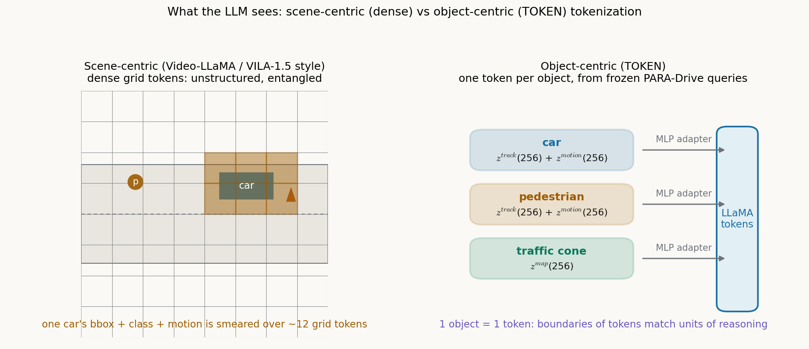

# 一个物体一个 token：让 LLM 按物体的边界来思考

> **信息块**
> - 论文标题：Tokenize the World into Object-level Knowledge to Address Long-tail Events in Autonomous Driving
> - 作者：Ran Tian, Boyi Li, Xinshuo Weng, Yuxiao Chen, Edward Schmerling, Yue Wang, Boris Ivanovic, Marco Pavone（NVIDIA；UC Berkeley；University of Southern California；Stanford University）。注：PMLR 书目页把第一作者写成 "Thomas Tian"，论文 PDF 内页署名 Ran Tian（其 GitHub 账号为 thomasrantian），此处按论文内页。
> - 会议/年份：CoRL 2024（第八届，2024 年 11 月，慕尼黑）；PMLR v270:3656–3673（2025 年 1 月出版）
> - 链接：https://proceedings.mlr.press/v270/tian25b.html
> - 代码是否公开：未找到官方代码。只找到第一作者的项目展示页仓库（thomasrantian/token_mm-llm_for_autodriving），无训练/推理代码。
> - 一句话核心洞见：LLM 做规划最缺的不是更大的模型，而是输入的边界与它推理的单位对齐——TOKEN 把预训练好的端到端驾驶模型（PARA-Drive）冻结成"场景分词器"，一个物体只给 LLM 一个 token，于是"找出关键物体 → 定交互策略 → 生成轨迹"这条思维链的每一步都有对应的 token 可抓。

## 长尾问题的真正卡点：分词器不在驾驶的频道上

引言第 2 页讲了一个当时（2024 年中）MM-LLM 进自动驾驶的真实困境。主流做法分两步：先用预训练好的视觉编码器（通常是 CLIP 的 ViT）提特征，再用一个 querying transformer（BLIP-2 那套）把特征压成若干 latent token 喂给 LLM。训练这样一个场景分词器需要海量问答对——Flamingo 用了超过 10 亿 QA 才达到满意效果。而自动驾驶领域的 MM-LLM 数据集，QA 数量不到 100 万（DriveLM、nuScenes-QA 的量级）。差了三个数量级。

数据不够时，latent query 学出来的是什么？论文的判断很直接： unstructured and redundant tokens——没有结构的、冗余的 token。一个物体的信息可能散在十几个 token 里，一个 token 也可能混了几个物体的信息。LLM 拿到这样的输入，3D grounding 和行为推理都做不好。这不是 LLM 的错，是分词器的错：它是在图文对齐的频道上训练的，不在驾驶的频道上。

TOKEN 的回答是：别从头训分词器了，拿一个现成的、在驾驶任务上训好的端到端模型当分词器。它的 query 本来就是按物体组织的——一个 query 跟踪一个物体，一个 query 管一片地图元素。把这些 query 的输出直接当 token，物体的边界就是 token 的边界。这是整篇论文的起点，后面的一切都是它的展开。

## 一个物体恰好一个 token：PARA-Drive 的 query 是现成的分词器

TOKEN 用的分词器是 PARA-Drive（Weng et al., CVPR 2024），一个 transformer 结构的端到端驾驶模型。它先从多视角视频里训出 BEV 特征，然后用四组 querying transformer 分头解码四个任务：目标跟踪（track）、运动预测（motion）、建图（map）、占据预测（occupancy）。每个 query 用交叉注意力去 BEV 特征里抓自己负责的东西，输出一个 latent token。

关键在"物体级任务"的 query 长什么样（论文图 3，第 4 页）：

- 跟踪 query $Q^{track}_i$ 输出 $z^{track}_i \in \mathbb{R}^{1 \times 256}$，编码第 $i$ 个物体的 3D 框和语义类别；
- 运动 query $Q^{motion}_i$ 输出 $z^{motion}_i \in \mathbb{R}^{1 \times 256}$，编码第 $i$ 个物体的动态行为；
- 地图 query $Q^{map}_j$ 输出 $z^{map}_j \in \mathbb{R}^{1 \times 256}$，编码第 $j$ 个地图元素的几何和语义（比如路口区域）。

TOKEN 的组装方式：非地图物体的 token 是跟踪 token 和运动 token 的拼接，$z^{agent}_i = z^{track}_i \,\|\, z^{motion}_i$（$\|$ 表示拼接，维度 $256+256=512$）；地图元素的 token 直接用 $z^{map}_j$。占据预测模块的 token 不用，但训练分词器时保留这个模块——目的是和 PARA-Drive 原论文的训练配置对齐，让后面的对比公平。

为什么这个设计聪明？它把两个难题一起解了。第一，数据稀缺：分词器不需要用 QA 从头训，它在检测、跟踪、分割这些驾驶任务上已经训好了，自带空间、时间和语义信息。第二，分词低效：token 天然是解耦的（disentangled），一个 token 就是一个物体，LLM 不需要再从一堆纠缠的向量里把物体"解"出来。论文第 3 页的原话点破了这层关系：驾驶是高度结构化、面向物体的任务，自车的行为本来就被周围的交通参与者和地图元素约束着——分词器的结构和任务的结构是同构的。

自绘图（示意，非论文原图）：

图注：左图是场景级分词（Video-LLaMA / VILA-1.5 式），ViT 的网格 token 把一辆车的信息打散在十几个格子里；右图是 TOKEN 的物体级分词，每个物体（car、pedestrian、traffic cone）恰好对应一个 token，token 的边界就是推理的单位。论文原图对照：整体框架见论文图 1（第 1 页），分词器结构见论文图 3（第 4 页）。

## 两个 adapter：map token 为什么单独走一个 MLP

物体 token 出来之后，还不能直接喂给 LLaMA。PARA-Drive 的 token 住在驾驶任务的特征空间里，LLaMA 的词向量住在文本空间里，两个空间的维度和几何都不一样。TOKEN 在中间放了一个 adapter（MLP），把 token 映射到 LLaMA 的输入维度。

细节：**两个** MLP，不是共用一个。所有非地图物体 token 共用一个 adapter，所有地图元素 token 共用另一个。这个区分是有道理的：$z^{agent}$ 是 512 维（跟踪+运动拼接），$z^{map}$ 是 256 维，输入维度本来就不一样；更重要的是，地图元素（车道线、路口）和交通参与者（车、行人）在语义上是两类东西，用同一个 MLP 硬压会互相干扰。分开之后，每个 adapter 只需要学一类映射。

另外论文留了个后门：除了物体级 token，还可以加一些从头学的场景级 latent token，用来补物体 token 覆盖不到的信息（比如天气）。正文实验里没用这个选项，但它说明作者知道物体级表示的盲区在哪。

## 三个训练阶段：分别在修什么

分词器冻结，LLaMA-2-7B 用 LoRA 微调（rank 64，附录 H）。训练分三个阶段，附录 C 给了完整配置：

**第一阶段：表示对齐（representation alignment）。** 关掉 LoRA，只训 adapter。用 15 万个感知 QA，训 5 个 epoch，学习率 5e-4。目标只有一个：让 adapter 输出的向量落在 LLaMA 能理解的区域。注意这里只用感知 QA（"这是什么物体""它在哪个车道"），不碰规划——先让模型"看懂"，再让它"开车"。

**第二阶段：推理对齐（reasoning alignment）。** adapter 和 LoRA 一起训，用推理 QA 和规划 QA，10 个 epoch，学习率 1e-4。这一步教的是思维链：先找关键物体，再定交互策略，最后给轨迹。

**第三阶段：规划微调。** adapter 和 LoRA 一起训，只用规划 QA，再训 10 个 epoch，学习率 1e-4。把最后的规划指标往上顶。

三个阶段的学习率从 5e-4 降到 1e-4 再保持，adapter 先独训再联训——这是典型的"先对齐空间、再教任务"的课程设计。表 4 的消融会证明这三个阶段不是摆设，缺了任何一级，长尾上的表现都会掉。

## 层级规划的链条是怎么被写进 QA 的

TOKEN 的规划不是让 LLM 直接吐轨迹坐标，而是走三步，每一步的输出都是下一步的输入：

1. **找关键物体**：当前场景里哪些物体是 critical 的（会影响自车规划），它们的类别和在自车坐标系下的 2D 位置；
2. **定行为模式**：和这些关键物体的交互计划（比如 overtake），以及车道级决策（比如 left lane change）；
3. **生成轨迹**：未来 3 秒的运动规划，6 个轨迹点。

为了让第 1 步有监督信号，作者构造了两类行为推理 QA：一类问"这个物体是不是 critical，为什么"（物体级行为分析），一类问"把所有 critical 物体的位置标出来"（场景级 grounding）。第 2 步的监督来自一套交互标注：先用启发式规则，再人工校验。标注体系借用了 CTT（附录 B.3）：agent-ego lane mode 描述交通参与者和自车的车道拓扑关系（LEFT、RIGHT、AHEAD、BEHIND、NOTON——NOTON 表示不在任何可推导车道上，比如停车场里的静止车辆），homotopy 描述两者之间的相对运动（S 静止、CW 顺时针、CCW 逆时针）。把车道关系、相对运动、物体的真值状态、场景上下文拼在一起，就能标出"自车从左侧超车""绕行施工锥桶"这类交互语义。人工校验覆盖了五类：绕行锥桶过施工区、让行人、让车辆、压线超车、变道超车。

还有一个容易被忽略但很重要的设计：高层指令的重新标注。以前的工作用真值轨迹的相对位置定义指令（"keep forward""turn right"），作者认为这不真实，而且把行为规划的活干掉了——指令里已经泄漏了答案。TOKEN 把 nuScenes 重标成路网级的导航信号："keep forward along the current road"（沿当前道路直行）、"prepare to turn right/left at the next intersection"（准备在下个路口右转/左转）、"turn right/left at the intersection"、"left/right U-turn"、"left/right 3-point turn"。指令只说导航意图，不说怎么开，行为规划的难度被保留了下来。这个处理是诚实的，也是后面的长尾评测能成立的前提。

## 27% 和 39%：能对上吗

摘要写的是 "27% reduction in trajectory L2 error and a 39% decrease in collision rates in long-tail scenarios"。我把论文里所有相关的表都算了一遍，结论是：**27% 能对上，39% 对不上**，分开说。

27% 有两个独立的来源都能算出来。表 1（规划，3 秒 L2）：BEV-TOKEN 2.02 米 → TOKEN 1.47 米，降幅 $(2.02-1.47)/2.02 = 27.2\%$。表 4（长尾 split，全时域平均 L2）：无对齐基线 1.06 米 → TOKEN 0.78 米，降幅 $(1.06-0.78)/1.06 = 26.4\%$。两个都约等于 27%，这个数字是站得住的。

39% 在正文和附录的所有表里都找不到精确对应的口径。最接近的是表 4 长尾碰撞率：0.61% → 0.35%，降幅 42.6%。其他候选：表 1 相对 BEV-TOKEN 是 61.5%（0.39%→0.15%），表 2 相对 PARA-Drive 按四场景平均是 56.6%。没有一个是 39%。**此处标 [未核实]**。推断：摘要的数字可能来自 arXiv 初版的表格，camera-ready 改表后摘要没同步——版本漂移在会议论文里常见，但读者只能按终版的表验算，39% 目前验不出来。

## 表 1：TOKEN 赢 BEV-TOKEN 赢在哪

表 1 是 5.1 节的核心实验，对比了四种分词方案，LLM 骨干都是 LLaMA-2-7B，训练流程相同，变量只有分词器：

| 方案 | 物体分类准确率 | 车道关联准确率 | 关键物体 grounding 精度/召回 | 3 秒轨迹 L2 | 碰撞率 |
|---|---|---|---|---|---|
| Video-LLaMA（ViT+query） | 0.28 | 0.39 | 0.22 / 0.27 | 6.34 米 | 2.64% |
| VILA-1.5（可训练 ViT） | 0.37 | 0.22 | 0.19 / 0.16 | 4.41 米 | 1.98% |
| BEV-TOKEN（PARA-Drive 的稠密 BEV 特征） | 0.68 | 0.64 | 0.58 / 0.62 | 2.02 米 | 0.39% |
| TOKEN（物体级 token） | 0.92 | 0.68 | 0.87 / 0.76 | 1.47 米 | 0.15% |

三层对比，每层都干净。第一层，Video-LLaMA 和 VILA-1.5 垮掉：它们的编码器是在图文对齐上训的，不到 100 万的驾驶 QA 根本不够把 3D grounding 能力补起来，关键物体 grounding 精度只有 0.2 左右——连场景里哪个物体重要都找不对，后面全错。第二层，Video-LLaMA 和 BEV-TOKEN 用的是同一种分词机制（query transformer 压 latent token），只差视觉特征：一个用 CLIP ViT，一个用 PARA-Drive 的 BEV。BEV-TOKEN 全面占优，说明**在驾驶任务上预训练过的特征**本身就值很多钱。

第三层，BEV-TOKEN 和 TOKEN 用的是同一份视觉特征（都来自 PARA-Drive），只差分词方式：稠密 BEV 特征 vs 物体级 token。TOKEN 在 grounding 精度上从 0.58 涨到 0.87，碰撞率从 0.39% 降到 0.15%。同样的特征，换一种切分方式，效果差这么多——这就是"token 边界对齐推理单位"的价值，也是论文的 Takeaway 1。

还有一行容易被滑过去：表 1 最后给了 PARA-Drive 自己的规划成绩（灰色底纹，纯参考）：3 秒 L2 1.50 米，碰撞率 0.19%。TOKEN 是 1.47 米 / 0.15%——**用 LLM 当规划器，在验证集上小胜了分词器本体的规划头**。这个细节很重要：它说明 LLM 不是在"复述"分词器的规划，而是在物体 token 之上做出了更好的决策。5.2 节的长尾实验会把这一点放大。

## 表 4：四个格子说明表示对齐和推理对齐缺一不可

表 4 是全篇方法论上最漂亮的一个消融，2×2 四个格子：

| 表示对齐 | 推理对齐 | 验证集 L2 / 碰撞率 | 长尾 L2 / 碰撞率 |
|---|---|---|---|
| ✗ | ✗ | 0.96 米 / 0.22% | 1.29 米 / 0.61% |
| ✓ | ✗ | 0.86 米 / 0.19% | 1.13 米 / 0.52% |
| ✗ | ✓ | 0.95 米 / 0.24% | 1.24 米 / 0.47% |
| ✓ | ✓ | 0.81 米 / 0.15% | 0.95 米 / 0.35% |

读法：第一行（✗✗）是把 TOKEN 当成普通端到端模型训——直接预测轨迹，不做任何对齐。第二行只加表示对齐，验证集和长尾都有改善。第三行只加推理对齐、不加表示对齐：验证集几乎没动（0.96→0.95），长尾略好（1.29→1.24，碰撞率 0.61%→0.47%）。第四行两个都加，最好。

这个四格实验讲了一个反直觉的结论：**光教 LLM "怎么想"（推理对齐）是不够的，如果它连输入都看不懂（表示没对齐），思维链是空转的**。表示对齐是地基，推理对齐是上层建筑；地基没打好，上层建筑在验证集上几乎没有增益，只在长尾上有一点（0.61%→0.47% 的碰撞率下降，说明 LLM 的常识在表示模糊时还能抢救一部分）。论文的 Takeaway 3 就是这句话。这也是 TOKEN 和同期很多"给 LLM 加 CoT 就完事了"的工作的真正区别。

附录 J.2 从另一个角度佐证：把 TOKEN 的结构化推理（显式推理物体交互语义）换成 Agent-Driver 式的粗粒度 CoT（先生成转向/加速度的文字描述，再给轨迹），得到 TOKEN−interact.。验证集 L2 从 0.81 退到 0.86，长尾从 0.95 退到 1.13，碰撞率从 0.35% 退到 0.59%。CoT 的**内容**很重要，不是随便来一段"让我想想"就行——推理步骤必须和驾驶的语义单位（关键物体、交互方式）咬合。

## 与 Agent-Driver 的对比：一个 token 对 60 个词

5.3 节把 TOKEN 和当时的 SOTA LLM 规划器 Agent-Driver（Mao et al., 2023）放在一起比。表 3：验证集上两者打平（L2 都是 0.81 米，碰撞率 0.13% vs 0.15%）；长尾上 TOKEN 拉开差距（L2 1.54→0.95 米，碰撞率 2.67%→0.35%）。

附录 H 把两者的差异拆得很坦率，值得逐条看：

1. **场景表示**：Agent-Driver 用工具（检测、建图等）查出文本化的场景信息，当 prompt 喂给 LLM；TOKEN 用物体级 token。信息密度差了一个量级：同一个物体的语义+几何+动态信息，在 Agent-Driver 里约 60 个文本 token，在 TOKEN 里是 1 个 token。
2. **LLM 骨干**：Agent-Driver 全量微调 GPT-3.5；TOKEN 用 LoRA（rank 64）微调 LLaMA-2-7B。模型小了一大截，效果在长尾上反而更好——论文借此论证"对齐比模型大小更重要"。
3. **CoT 粒度**：Agent-Driver 的推理是粗粒度的（直接生成转向/加速度的文字描述）；TOKEN 的推理是结构化的（先推理物体的语义影响，再定交互计划）。

公平性上有两点要说明。第一，Agent-Driver 的 prompt 里带了自车状态（当前速度、加速度），TOKEN 基础版没带。为了对齐，作者训了 TOKEN+（加上自车状态输入）：附录表 6 里 TOKEN+ 在所有 split 上都超过 Agent-Driver（验证集 L2 0.64 vs 0.80 米，长尾各场景全面领先）。这个对照做得干净——"打平"的结论用的是不带自车状态的 TOKEN 对带自车状态的 Agent-Driver，其实已经让了一手。

第二，Agent-Driver 的数字是直接用的官方仓库预测结果，不是重跑的。跨论文抄数字对比，长尾 split 的定义、评测脚本都可能不一致。作者在附录 H 开头交代了数字来源，算诚实，但可比性不如 TOKEN vs PARA-Drive 那组（同一分词器、同一评测脚本）硬。

## 长尾评测集到底有多大

5.2 节的长尾实验是论文的高光，但评测集的规模必须如实交代。附录 F 列出了全部四个长尾场景的构建方式（作者人工检查 nuScenes 挑出来的，每个场景在训练数据里占比不到 1%）：

- **三点掉头（3-point turn）**：训练集里 0 个场景，评测集里 1 个场景（scene-0778，第 6–30 帧），抽 25 个关键帧。这是严格的 zero-shot。
- **完全停止后起步**：训练 14 个场景 70 帧（占训练样本 0.28%），评测 8 个场景 40 帧。
- **借对向车道超停放车辆**：训练 14 个场景 248 帧（占 0.9%），评测 5 个场景 102 帧。
- **绕行施工区**：训练集里有 2 个场景（scene-0980、scene-0535），评测集里 0 个——作者把 scene-0980（第 16–30 帧）从训练集挪到评测集，取 15 个关键帧。

四个场景的数字（表 2）逐项验算，论文正文的百分比都对得上：三点掉头的 heading L2 全时域平均从 0.90 降到 0.36（降 60%）；起步场景的纵向加权 L2 从 1.56 降到 1.13（降 27.6%，正文写 28%）；超车场景碰撞率从 2.3% 降到 0（降 100%）；施工区从 6.70% 降到 2.22%（降 66.9%，正文写 67%）。

但样本量摆在那里：施工区的结论建立在 15 帧上，超车建立在 102 帧上。碰撞率从 6.70% 降到 2.22%，按 15 帧算，就是"撞 1 次"和"撞 0.33 次"的区别——统计显著性很弱。作者在附录 L 里用"关键帧评测"为开环指标辩护（只取行为变化的关键帧，减少开环评测的偏差），这个做法是对的，但它不解决样本量小的根本问题。读这组数字时，要把"方向对"和"幅度精确"分开：TOKEN 在长尾上优于 PARA-Drive 的方向是可信的（四个场景一致，定性可视化也一致），但 67%、100% 这种具体幅度不要当成精确值。

## scene-1065：同一批帧同时出现在训练和评测里

附录 F 的超车场景，训练 split 的场景列表里有 scene-1065（第 24–35 帧），评测 split 的场景列表里也有 scene-1065（第 24–35 帧）——**同一个场景、同一批帧，同时出现在训练集和评测集里**。

这可能是附录的笔误（比如评测集想写的是另一个场景号），但按白纸黑字写出来的版本，这就是训练-评测泄漏。超车场景评测集一共 5 个场景 102 帧，其中 scene-1065 贡献了 12 帧（第 24–35 帧）。如果这 12 帧模型在训练时见过，表 2 里超车场景"碰撞率 2.3%→0"的 100% 降幅就要打折扣。论文正文没有任何地方提到这个重叠。这是我通读全文时发现的最实质的方法论瑕疵。

## TOKEN*：40 个合成样本的 few-shot

三点掉头是严格 zero-shot（训练集 0 个场景），TOKEN 在这上面 heading L2 降了 60%，但定性图（图 4）显示它在 t=8s 靠近路缘要倒车的那一下还是没学会——数据里根本没有倒车行为，LLM 的常识也变不出没见过的动作序列。

于是作者做了个 few-shot 实验：生成 40 个合成的三点掉头轨迹样本（占训练数据的 0.12%），加进训练集，得到 TOKEN*。图 4 的深灰色线显示 TOKEN* 的轨迹明显更贴近真值的三点掉头形状。表 2 里 TOKEN* 的 heading L2 全时域平均是 0.33（TOKEN 是 0.36，PARA-Drive 是 0.90）。

这个实验的真正含义不在数字，在效率：40 个样本、千分之一的数据量，就让 LLM 规划器学会了一个全新的机动动作。附录 J.3 从反方向又补了一刀：从训练集里删掉 50% 的长尾场景重训，PARA-Drive 的长尾 L2 恶化 24%（0.91→1.12），TOKEN 只恶化 9%（0.78→0.85）。两件事合在一起，说明 TOKEN 的长尾能力不完全依赖"见过"，部分来自 LLM 的泛化——这正是论文标题里 "Address Long-tail Events" 的底气来源。

## 失败案例：分词器没看到，LLM 只能瞎开

附录 K 放了一个失败案例（图 10），论文没有藏着掖着：一辆对向驶来的摩托车，PARA-Drive 的跟踪 query 没检测到，于是 TOKEN 的输入里根本没有这个物体的 token，LLM 以为路面清空，给出了危险的直行规划。

这个案例把 TOKEN 的架构边界钉死了：**系统的感知上限 = 分词器的感知上限**。LLM 再会推理，也推理不出输入里不存在的物体。冻结分词器是 TOKEN 实验设计干净的原因（和 PARA-Drive 的对比完全隔离了规划器变量），也是它最大的结构性弱点。作者在第 6 节承认了这一点，未来的方向是联合训练分词器，让 LLM 的知识回流去改进场景分词。

图 6 的超车案例还暴露了另一个裂缝：TOKEN 的文字回答正确预测了"减速、向右打方向"，但生成的轨迹只体现了减速，没有体现转向——行为描述和运动规划对不上。作者的解释是训练数据里缺少"低层运动"和"中层行为"之间的关联样本。这是把轨迹当文本生成的代价：每个数字都是一个 token，LLM 在"说话"和"画线"之间没有硬约束。

## 推理速度：1.3 秒 + 1.8 秒，上不了车

附录 L 给了实测数字（A100，无任何加速优化）：生成中层行为描述约 1.3 秒，再生成运动规划约 1.8 秒。3 秒多的延迟，别说实时规划，连影子模式都勉强。

作者自己也清楚，给出的部署设想是：TOKEN 不做全量规划，只做低频的"决策级监控"——比如以很低的频率输出"绕行施工区"这种路网级行为，喂给传统的运动规划器。以及未来的蒸馏方向：把 7B 的 TOKEN 蒸馏成小模型，保留长尾推理能力。这个定位是清醒的：TOKEN 的论文价值在于证明"物体级分词 + 对齐"这条路走得通，不在于给出一个能上车的系统。闭环评测也没有做（附录 L 承认了），所有结论都是开环的。

## 读完能带走的

TOKEN 可迁移的想法有两层。表层是工程性的：**拿一个在驾驶任务上训好的模型的 query 输出当 LLM 的 token**，解决 MM-LLM 在驾驶领域的数据稀缺和分词低效问题。这个 trick 可以抄：任何 query 结构是物体级的预训练模型（检测、跟踪、分割），都能当分词器。

深层是方法论的：**对齐分两层，缺一不可**。表 4 的四格实验是全篇最值得记住的一张表——表示对齐是地基，推理对齐是上层建筑；地基没打好，思维链空转。这个结论不只适用于自动驾驶，任何"预训练编码器 + LLM 推理"的系统都适用：先让 LLM 看懂输入的分布，再教它怎么想，顺序不能反。

以及一个具体的跟进问题：scene-1065 的训练-评测重叠需要澄清。如果重跑，把重叠的 12 帧从评测集里拿掉，超车场景的 100% 碰撞率降幅还剩多少？这是决定表 2 那组数字可信度的关键。另外，TOKEN+map（附录 J.1）显示加上 HD 地图和历史状态后验证集 L2 能从 0.81 降到 0.58——说明当前版本的信息瓶颈很大一部分在输入侧（没有地图、没有历史），而不是 LLM 的推理能力。给分词器加地图，可能是比换更大 LLM 更划算的涨点方向。

---

**原图存档**：论文图 1（TOKEN 总览，第 1 页）已按 2 倍分辨率裁切存档：``。图注：上半是"场景级分词 vs 物体级分词"的对照，下半是层级规划的问答示例（场景理解、推理、规划三类 QA）。这张图就是论文的全部赌注：一旦分词按物体切，后面的 grounding、推理、规划就都有了具体的落点。

**输入缺口说明**：官方代码未公开，以上所有机制判断均来自论文正文与附录；每场景的物体 token 数量、LoRA 的目标模块、adapter 的具体维度、除 15 万感知 QA 外的 QA 总量，论文未披露，相关判断因此做不了。摘要的 39% 碰撞率降幅在终版表格中找不到对应口径，已标 [未核实]。
