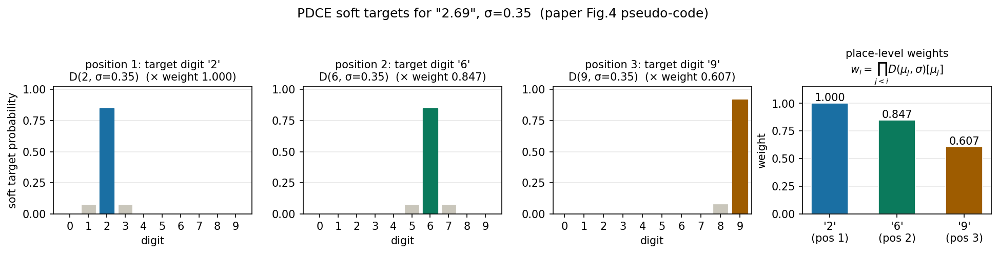

> **论文**: SafeAuto: Knowledge-Enhanced Safe Autonomous Driving with Multimodal Foundation Models
> **作者**: Jiawei Zhang（芝加哥大学，一作；工作完成于 Nuro 实习期间）, Xuan Yang（UIUC）, Taiqi Wang（Nuro）, Yu Yao（Nuro）, Aleksandr Petiushko（Nuro）, Bo Li（芝加哥大学 / UIUC / Virtue AI，通讯）
> **会议**: ICML 2025（PMLR 267，温哥华）
> **链接**: https://arxiv.org/abs/2503.00211（本文按 v2 精读，2025-06-06 更新）
> **代码**: 公开，https://github.com/AI-secure/SafeAuto。仓库约 102MB（含数据与 checkpoint），完整 clone 超时；已按 GitHub API 逐个拉取关键实现文件核对：`pgm/pgm.py`（MLN 训练与推理）、`pgm/config.py`（谓词与规则）、`llava/model/language_model/llava_llama.py`（PDCE loss 实现）、`retrieval/`（RAG 训练）、`scripts/finetune_*.sh`（训练脚本）。下文"代码"均指这些文件。
> **一句话核心洞见**: MLLM 开车控不准的根子，是交叉熵把每个数字 token 都当成普通单词——"2"和"9"在它眼里错得一样远；SafeAuto 用位置衰减的高斯软目标让 CE 训出 MSE 的形状（PDCE），再把加州交规写成一阶逻辑、学成马尔可夫逻辑网对高层动作做事后验算，最后用"文本相似度排序当老师"训出多模态统一检索，把最像的驾驶经验塞进上下文。

# 「别把数字当成单词」：SafeAuto 让交叉熵长出 MSE 的形状，再给 MLLM 配一个交规检查员

## 同一个路口采样 200 次，速度预测冒出两个峰

论文第 4 页的 Figure 2(a) 是全文的起点，值得先盯着看半分钟。作者拿 BDD-X 上的同一个驾驶场景，用标准交叉熵（CE）微调好的 Video-LLaVA 以 temperature=1.0 采样 200 次，画速度预测的分布。真值是 12.46。正常人的直觉是：分布应该是个以 12.46 为中心的单峰，离真值越近采样到得越多——这正是 MSE 训练出来的模型该有的样子。实际画出来的是**两个分离的峰**，一个偏左一个偏右，真值 12.46 反而落在两个峰之间的低谷里。

这个现象把整篇论文的动机说透了：CE 训练时，"12.46"被拆成 '1','2','.','4','6' 五个 token，每个位置的目标都是 one-hot。模型把 '1' 预测成 '2' 和预测成 '9'，受到的惩罚**完全一样**——CE 不懂数字之间的距离。于是模型学到的不是"真值附近的数概率高"，而是"训练集里这个场景下常见的几个具体数字概率高"，采样出来就成了几个孤立的峰。Figure 2(b) 是同一个实验换上 PDCE loss 之后的结果：单峰，以真值 12.46 为中心的钟形。这就是论文要回答的第一个问题：**能不能让 CE 在训练数字时，表现得像 MSE 那样懂得"接近"？**

## 在 SafeAuto 之前，人们试过哪两条路，为什么都不满意

论文引言把 MLLM 控车的两条旧路摆得很清楚，值得复述一遍，因为 SafeAuto 的每个设计都是冲着这两条路的毛病去的。

第一条路是 DriveGPT4 的做法：控制信号直接当文本生成，用 CE 硬训。优点是 MLLM 的自回归能力完整保留，问"车在干什么""为什么"这种高层问题不受影响；缺点就是上面 Figure 2(a) 的样子——数字精度粗糙，不如传统回归方法。

第二条路是 Time-LLM 的做法：在 MLLM 输出的 hidden embedding 后面挂一个线性层，直接解码出浮点数，用 MSE 训。数字准了，但代价是模型退化成一个纯编码器：线性头只能吐数字，整个"先回答高层动作、再解释、再给控制信号"的对话流程断了，高层问答能力丢掉。论文还引用了 Tan et al. (2024) 的观察：这样用 LLM backbone 做回归，效果并不比传统方法好。

所以真正的约束是：**数字精度要上去，自回归的文本能力一点不能动**。PDCE 就是在这个约束下被逼出来的形状。

另一条线是安全。之前的工作（Sima et al., Mao et al., Wang et al.）试过把交规"写进 prompt"，让 MLLM 自己遵守。作者的判断是：这属于隐性知识路线，MLLM 的幻觉倾向决定了它偶尔还是会输出违法动作——红灯时加速这种错，错一次就可能是事故。SafeAuto 的选择是把安全做成一个**显性的、可学习的后验算层**：交规先翻译成一阶逻辑公式，再嵌进马尔可夫逻辑网（MLN），MLLM 的输出必须过这一关，冲突就改写。

## PDCE 的两个原则：数字要"近"，位置要"重"

PDCE 全称 Position-Dependent Cross-Entropy，论文第 3.1 节。它的构造只依赖两个原则，原文用英文写的是：(1) Digit-Level Proximity——同一个位置上，离目标数字越近的数字，损失越小；(2) Place-Level Importance——越靠前的数位（十位 vs 个位 vs 小数位），对损失的影响越大。

先看原则一。它把每个数位的 one-hot 目标换成一个软分布 $D(\mu, \sigma)$，以目标数字 $\mu$ 为中心的高斯离散化。公式 (1) 长这样：

$$
\text{PDCE loss} = \sum_{i=1}^{n} w_i \cdot \mathrm{KL}(P_i \parallel D(\mu_i, \sigma))
$$

符号逐个过一遍。$n$ 是这个浮点数占几个数字 token（不含小数点；"12.46" 的 $n=4$）。$\mu_i \in \{0,\dots,9\}$ 是第 $i$ 个数位的目标数字。$P_i$ 是 MLLM 在第 $i$ 个数位上输出的、整个词表上的预测分布（形状是词表大小，$P_i \parallel D$ 的 KL 只在 10 个数字 token 上求和，其余位置目标概率为 0）。$D(\mu_i, \sigma)$ 是把 $\mathcal{N}(\mu_i, \sigma^2)$ 按"每个整数 $k$ 分到 $[k-0.5, k+0.5)$ 区间的高斯质量"离散化、再归一化得到的 10 维分布。$\sigma$ 控制软硬：$\sigma \to 0$ 时 $D$ 退化成 one-hot，PDCE 退化成普通 CE；$\sigma$ 越大，邻居数字分到的概率越多，"接近"的信息越强。$w_i$ 是第 $i$ 个数位的权重，定义为之前所有数位"猜对"的概率的连乘：$w_i = \prod_{j=1}^{i} D(\mu_j, \sigma)[\mu_j]$，其中 $D(\mu_j,\sigma)[\mu_j]$ 表示分布 $D(\mu_j,\sigma)$ 在目标数字 $\mu_j$ 处的概率值。

原则二就藏在 $w_i$ 里：它是前面所有位置猜对概率的乘积，位置越靠后，乘的项越多，$w_i$ 越小。直觉是：如果十位都猜错了，个位猜对没有意义——"29.46"和"12.46"差 17，"13.46"只差 1，高位错了低位再准也救不回来。所以权重必须随位置衰减。这个设计还有一个附带的好处：$w_i$ 是概率的乘积，天然落在 $[0,1]$ 区间，不需要额外调一组超参数，衰减速度由 $\sigma$ 一个旋钮控制。

## 在 "2.69" 上手算一遍，看看每个数长什么样

论文 Figure 1 右上角的插图用的例子是速度 "2.69"，$\sigma=0.35$（实验用的终值）。按论文附录 Figure 4 的伪代码把三个数位的软目标算出来：

位置 1，目标数字 '2'，权重 $w_1 = 1.0$。$D(2, 0.35)$ 把 $\mathcal{N}(2, 0.35^2)$ 离散化：数字 2 分到 $[1.5, 2.5)$ 区间的质量，算出来是 0.847；邻居 1 和 3 各分到 0.077；其余数字接近 0。所以第一位的目标不再是"2 的概率 1、其余 0"，而是"2 的概率 0.847，1 和 3 各 0.077"。模型把 '2' 猜成 '1' 只损失一点，猜成 '9' 损失很大——"接近"第一次有了价格。

位置 2，目标数字 '6'，权重 $w_2 = D(2,0.35)[2] = 0.847$。分布形状和位置 1 相同（σ 相同，中心换成 6）：6 的概率 0.847，5 和 7 各 0.077。

位置 3，目标数字 '9'。按正文公式 (1) 的字面连乘，$w_3 = D(2,0.35)[2] \times D(6,0.35)[6] = 0.847 \times 0.847 = 0.717$。但我实际跑附录 Figure 4 的伪代码，得到的是 **0.607**，不是 0.717——伪代码的更新式里藏了一个平方项（下一节细说）。公式、文字、伪代码三者在"权重到底怎么衰减"上已经分叉。分布 $D(9, 0.35)$：9 分到 0.917，8 分到 0.083（9 的区间是 $[8.5, 9.5)$，高斯中心 9 离上界近，质量更集中）。

下图就是这三个分布和权重。注意小数点本身不进 PDCE：代码里小数点 token 的 mask 为 0，它继续用普通 CE 训练——小数点猜错的代价不需要"接近"，非对即错，这个处理是合理的。



*自绘图：按论文附录 Figure 4 伪代码复现，"2.69" 在 σ=0.35 下的三个数位软目标分布（左三）与位置权重（右一）。权重按伪代码的字面逻辑计算，含下节讨论的平方项。*

训练时还有两个工程细节。第一，数字格式统一：BDD-X 里所有数写成 5 个字符，"8.1" 写成 "08.100"，保证每个样本的 $n$ 一致、位置语义对齐（十位永远是第 1 位）。第二，σ 退火：从 0.01 开始、每个优化步按几何级数涨到 0.35。直觉是先让模型把数字"猜准"（σ 小≈CE），再慢慢引入"接近也有分"的软信息，避免一开始软目标把训练带偏。论文说退火"每个优化步"涨一次，代码里是每个 forward step 按 `init_sigma * (final/init)^(global_step/max_step)` 算一次——开了梯度累积时 forward 比 optimizer step 多，这个"每步"的口径两边不完全一样，是个小出入。

## 论文的公式、伪代码和 released 代码，三处对不上

这是精读里最值得停下来的一节。PDCE 在论文里出现了三个版本：正文公式 (1)、附录 Figure 4 的伪代码、GitHub 上 `llava_llama.py` 的真实实现。它们在"位置权重到底怎么衰减"这一点上，**三个版本给出三个答案**。

先看伪代码的字面逻辑：

```
digit_probs = distribution_dict[digit] * weight   # 整个分布乘以当前累积权重
weight *= digit_probs[int(digit)]                 # 注意：乘的是已经缩放过的分布在目标处的值
```

`digit_probs[int(digit)]` 等于 `distribution_dict[digit][digit] * weight`，所以更新式实际是 $w \leftarrow D(\mu_i,\sigma)[\mu_i] \cdot w^2$——**权重被平方了**。按这个逻辑，"2.69" 的 $w_3 = 0.847 \times 0.847^2 = 0.607$，和我上节算出来的一致。而正文公式 (1) 写的是 $w_i = \prod_{j=1}^{i} D(\mu_j,\sigma)[\mu_j]$，按它算 $w_3 = 0.847^3 = 0.607$——前三个位置恰好撞上了，因为 $D(2)[2] = D(6)[6]$。但第 4 个位置开始分叉：伪代码给出 $w_4 = D(\mu_3)[\mu_3]\cdot w_3^2 = 0.847 \times 0.607^2 = 0.312$，公式给出 $w_4 = 0.847^3 \times 0.917 = 0.557$。一般地，伪代码的权重是 $w_i = \prod_{j<i} D(\mu_j)[\mu_j]^{2^{i-1-j}}$，指数按 2 的幂增长，衰减比公式狠得多。到第 5 个数位（"08.100" 有 5 个数字），伪代码的权重只剩约 0.08，公式还有 0.51。**"小数点后第二位几乎拿不到梯度"和"还能拿到一半权重"，是两种训练动态。**

released 代码跟的是伪代码，不是公式：`calculate_probabilities` 里 `next_weights *= digit_probs[int(digit)]`，而此时的 `digit_probs` 已经乘过 `next_weights`，平方项原样保留。所以真实训练用的是最激进的那版衰减。这也能解释 Figure 3 的一个现象：σ 从 0.15 变到 0.45，RMSE 几乎不动——当位置衰减本身已经把后几位压到接近 0，σ 的具体取值对总损失的影响自然就小了。论文把 Figure 3 解读为"方法对 σ 不敏感、很稳定"，这个结论没错，但机制可能不是"设计鲁棒"，而是"衰减太狠、σ 没机会发挥作用"。

第二处出入是高斯的中心。论文正文和伪代码都说分布以目标数字 $\mu_i$ 为中心（整数）。released 代码里 `prob_range(float(digit + '.' + new_part[i+1:]), ...)`，均值取的是"当前位及后面所有位拼成的小数"，比如 "12.46" 第 1 位的均值是 1.246 而不是 1。这是"前视"版本：目标分布不对称地偏向真实后缀的方向。想法是好的（让第 1 位的软目标就感知到后面是 ".246" 而不是 ".000"），但论文里一个字没提。

第三处是归一化。伪代码最后 `loss = -(tgt_probs * log_softmax(logits)).sum()`，没有除任何东西；released 代码里 `kl_loss = (kl_loss.sum(-1) * weights).sum() / len(shift_labels)`，除以了**全部**有效 token 数（文本 token 也算）。这改变了 PDCE 项和 CE 项的相对尺度：对话里数字越多，PDCE 的有效学习率越大。论文没讨论这个选择。另外 `get_kl_weight` 里每个数还有一个统一的 `n/prob_sum` 系数（把位置权重按"每数平均权重为 1"重新归一），伪代码里没有。这几处都不影响"PDCE 有效"的结论，但复现时按论文公式写和按代码写，训出来的不是同一个 loss——以代码为准。

还有一个小毛病：`get_kl_weight` 中间遇到非数字 token 时，只有严格符合"2 位整数 + 2~3 位小数"（如 "12.46"、"08.100"）的才进 PDCE；但序列**结尾**的数字走了另一条分支，没有这个格式检查，任何尾随数字都会被算进 PDCE。实际对话都以控制信号结尾，触发概率低，算是个边界 bug，不影响主要结论。

## MLN：把交规写成带权重的逻辑公式，让数据决定每条规则有多硬

3.2 节是论文的第二个部件。先把 MLN（Markov Logic Network，Richardson & Domingos 2006）的机制讲清楚，因为论文正文讲得比较 compressed。

一个 MLN 是一组一阶逻辑公式 $F$，每个公式 $f$ 配一个权重 $w_f$。谓词是布尔函数，比如 `SolidRedLight(x)`（场景 x 里有红灯吗）、`Stop(x)`（场景 x 该停吗）。把公式里的变量代入具体场景得到 ground 谓词，每个公式在给定真值指派 $a_f$ 下有一个示性函数 $\phi_f(a_f)$（公式被满足取 1，否则 0）。所有 ground 谓词的一个完整真值指派叫一个"可能世界" $X$，MLN 定义它上面的分布：

$$P(X) = \frac{1}{Z}\exp\left(\sum_{f \in F} w_f \sum_{a_f \in A_f} \phi_f(a_f)\right)$$

$Z$ 是配分函数。直觉：权重大的公式被违反时，整个世界的概率指数级下跌；权重小（甚至接近 0）的公式，违反了也没什么事。这就是"软约束"——交规不是非黑即白，"红灯必须停"权重 10.02，"慢行标志别加速"权重可以小一点，数据说了算。

SafeAuto 的谓词分三类。**待推断的**（unobserved）：`Keep/Accelerate/Decelerate/Stop/TurnLeft/...` 共 16 个（BDD-X），是最终要输出的动作。**观测到的**（observed）分两类：MLLM 动作谓词（`MLLMStop(x)` 等，把 MLLM 生成的"the car is slowing to a stop"用 GPT-4o 映射成谓词，相当于"MLLM 建议了什么"），环境谓词（`SolidRedLight(x)` 等，用在 LISA 数据集上微调过的 YOLOv8 从视频里检测；再加上 `HCSStop(x)` 这类从历史控制信号经 GPT-4o 提取的"历史行为"谓词）。**公式**分两类：交规公式（35 条，BDD-X），如 `SolidRedLight(x) ⟹ ¬Accelerate(x) ∧ ¬LeftPass(x) ∧ ¬Yield(x)`；对齐公式（16 条），如 `MLLMStop(x) ⟹ Stop(x)`，意思是"默认相信 MLLM，除非交规反对"。

交规公式本身怎么来的也值得一说：作者用 GPT-4o 两步走——先从加州驾驶员手册里按模板抽结构化规则（"When [条件], you should/should not [动作]"），再转成一阶逻辑。prompt 全贴在附录 Table 7/8。这条管线意味着"结构化知识"的源头其实是 LLM 的转述，规则的质量取决于 GPT-4o 的转换，论文没有评估转换的准确率——这是个诚实但没被讨论的依赖。

## 走一遍 Figure 8：红灯前加速的车是怎么被拦下来的

这是论文第 18 页的案例，也是理解 MLN 推理最好的具体场景。输入是一个夜晚路口的视频：红灯亮着。MLLM 先回答 high-level action query："The car accelerates"（图里绿框）。同时两条管线抽谓词：YOLOv8 从最后一帧检出红灯 → `SolidRedLight(x)=1`，`StopSign(x)=0`……；GPT-4o 把 "The car accelerates" 映射成 `MLLMAccelerate(x)=1, MLLMKeep(x)=1`。

推理时，MLN 枚举所有"可能世界"——论文说因为车不可能同时加速又减速、同时左转又右转，候选世界很少。学好的权重（图里表格）：红灯规则 10.02，`StopSign ⟹ Stop ∨ Decelerate` 8.03，`NoLeftTurnSign ⟹ ¬TurnLeft` 8.47，`MLLMAccelerate ⟹ Accelerate` 8.77。对每个候选动作算 $\sum w_f \phi_f$，softmax 归一化：`Accelerate(x)` 得 0.02，`Stop(x)` 得 0.88。0.88 vs 0.02，MLN 判定 MLLM 的建议违反安全知识，于是把 high-level query 改写成 "The ego vehicle should stop. What is the action of ego car?" 重新问 MLLM，得到 "The car slows to a stop"。注意这个设计：MLN 不直接输出最终答案，而是**改写问题、让 MLLM 重新生成**，这样后续的 justification query（"Because the light is red"）和 low-level 控制信号都建立在修正后的动作上，对话不断。

权重表还透露一个信息：最高的几条权重是 `MLLMStop ⟹ Stop`（10.55）、`MLLMKeep ⟹ Keep`（10.51）这类"相信 MLLM"的对齐公式，其次才是红灯规则（10.02）。论文正文说"红灯规则在各自 MLN 里权重最高"，严格按 Figure 8 的表看并不成立——对齐公式更高。不过公允地讲，对齐公式高是好事：它表示"默认听 MLLM 的"，只有当环境谓词触发某条交规、且交规权重压过对齐权重时才推翻。10.02 的红灯规则 vs 8.77 的 `MLLMAccelerate ⟹ Accelerate`，红灯场景下推翻加速的数学条件正是 $10.02 > 8.77$。整个安全机制就浓缩在这一次权重比较里。

## 代码里的 MLN 和论文写的 MLN，不是同一个东西

`pgm/pgm.py` 读完，最大的感受是：released 的 MLN 是一个**判别式的 softmax 回归**，不是论文 3.2 节写的那种生成式 MLN。

训练时，`compute_log_likelihood` 算的是 `Σ_d (sat_d · w) − log Σ_d exp(sat_d · w) − 0.5·reg·||w||²`，其中 `sat_d` 是第 d 个训练样本的公式满足度向量。这个 softmax 的归一化是**在整个训练集上**做的：它在最大化"观测到的谓词向量得分高"，分母是所有训练样本的得分和。标准的 MLN 权重学习用的是伪似然（每个谓词给定其马尔可夫毯）或对比散度，分母是"当前证据下所有可能世界"。论文正文说"学习权重 $w_f$ 以最大化 $P(U|O)$"，代码实际最大化的是训练集上的判别似然——目标函数就不是同一个。

推理时，`generate_possible_instances` 对每个场景生成 16 个候选：动作部分是 16 维 one-hot（一次只置 1 个动作为真），拼上观测到的条件谓词，然后 `softmax(sat @ weights)` 取 argmax。也就是说推理空间是**16 个单动作世界**，附录 Table 18 列的那 70 多个"可能世界"（含 `(Decelerate, Stop)`、`(ChangeToRightLane, Merge)` 这种复合世界）在推理里根本没出现。更有意思的是，Table 18 里还列着 `(Accelerate, Decelerate)`、`(TurnLeft, TurnRight)`、`(LeftPass, RightPass)`——正文第 5 页白纸黑字写"车辆不可能同时加速和减速、同时左转和右转，所以推理很高效"，附录的表自己打了自己的脸。这张表大概率是训练数据里观测到的谓词组合的枚举（从数据里数出来的），不是推理用的候选集，但论文没交代它的来源。

另外三处论文-代码出入，逐条记：第一，附录 A.4 说 MLN 学习率和正则化都是 $1\times10^{-5}$，代码 `argparse` 默认 `--regularization 0.01`，差了三个数量级（除非实验时手动覆盖，默认行为和论文不一致）。第二，论文说"训练 300 个 epoch，早停"，代码是 `max_iter=10000` 次梯度步、按对数似然和 GT 概率双条件早停，没有 epoch 概念。第三，论文说训练"混合真实数据和仿真数据，仿真各种谓词真值组合以覆盖罕见危险场景"，released 代码的训练入口只从 `train_pgm_vectors.pkl` 读真实数据，仿真数据的生成脚本不在仓库里。罕见场景恰恰是安全验证最需要的数据，这部分无法从公开材料复现。

DriveLM 的 `DriveLMPGM` 还有一个论文没细讲的设计：7 个动作谓词拆成速度块（Normal/Fast/Slow/Stop）和方向块（Left/Right/Straight），两个块**分别做 softmax**。这对应 Table 21 的 12 个可能世界（4×3），是"速度和方向独立决策"的假设。BDD-X 那边 16 个动作是一次 softmax。两种归一化口径不同，论文没解释为什么这样拆——推断是 DriveLM 的高层行为本来就是速度/转向两道选择题（Table 2 的 Speed/Steer 两列），顺手对齐了评测形式。

## RAG：为什么拿"文本相似度"当老师，以及环境谓词为什么是承重墙

3.3 节的多模态 RAG 要解决一个实际问题：训练时有"当前场景的文本描述"（动作+理由，如 "The car is slowing to a stop for the red light at the intersection ahead"），它天然融合了视频、控制信号、环境三方面的语义；但推理时没有这段文本。作者的思路是：训一个统一嵌入 $Z_u$，让它在**样本间相似度排序**上模仿文本嵌入 $Z_t$ 的排序。推理时只用 $Z_u$ 检索最像的 $K$ 个训练样本，把它们的对话拼进 MLLM 的上下文。

具体构造：视频经 LanguageBind 编码后全局平均池化得 $Z_v \in \mathbb{R}^{1\times1024}$；28 个历史控制信号拼成 $Z_c \in \mathbb{R}^{1\times28}$；$M$ 个二值环境谓词拼成 $Z_p \in \{0,1\}^{1\times M}$。各自过 4 层 MLP 投到同一维度、ℓ2 归一化，加权相加（$w_v=w_c=0.4, w_p=0.2$）再过一个融合 MLP 得 $Z_u$。训练 loss 是 $S_u = Z_u' {Z_u'}^\top$ 和 $S_t/\tau = Z_t' {Z_t'}^\top / \tau$（$\tau=0.5$）之间相似度矩阵的 KL 散度，行列各算一次取平均——代码 `retrieval/training.py` 和论文描述完全一致。文本编码器用 sentence-t5-xl。这是一种"关系蒸馏"：不要求 $Z_u$ 等于 $Z_t$，只要求"谁和谁像"的相对关系一致，检索要的正是这个。

Table 6 是这一节最诚实的一张表，值得逐行读。Base（无 RAG）的高层动作谓词准确率是 61.75%；**去掉环境谓词的 RAG（RAG w/o EP），K=1 时掉到 59.06%，K=2 时 59.91%——比不用 RAG 还差**；加上环境谓词（RAG w/ EP）直接跳到 91.47%/91.00%。结论很硬：视频+控制信号的原始嵌入做检索，找回来的是噪声，混进上下文反而干扰 MLLM；二值环境谓词才是让检索 work 的东西。作者的解释是二值谓词"去掉了原始模态的噪声"，这个解释说得通：16~29 个 hand-crafted 的二值信号（红灯？停牌？历史是停吗？）构成的汉明空间，比 1024 维视频嵌入的余弦空间更能抓住"场景类型"。

但这里要诚实地补一句怀疑。环境谓词里有一半是 `HCS*`——从**历史控制信号**经 GPT-4o 提取的"历史行为"谓词，比如 `HCSStop(x)`。历史控制信号是模型的合法输入（MLLM 本来就能看到 7 帧速度序列），所以这不算数据泄露；但它意味着检索 essentially 在做"找历史行为相同的训练样本"，而历史行为和当前动作高度相关（停着的车下一帧大概率还是停）。CIDEr 从 221.5 跳到 334.8（+51%）、谓词准确率从 61.75% 到 91%，这个幅度的增益里，有多少是"检索到了几乎同义的文本直接抄"，论文没有拆。Table 4 的消融也印证了 RAG 是高层指标的绝对承重墙：PDCE+MLN 只能把谓词准确率推到 62.97%，加上 RAG 才到 92.18%。做改进的人应该知道，SafeAuto 高层性能的上限基本由"谓词空间里的最近邻质量"决定。

## 数字核验：摘要里有一处和正文对不上，还有几处措辞要小心

先把论文声称的数字逐个按表验算（表 1–3）：

- BDD-X 速度 RMSE：RAGDriver 0.69 → SafeAuto 0.65，降幅 $(0.69-0.65)/0.69 = 5.8\%$ ✓；course RMSE：4.48 → 3.85，降幅 14.1% ✓。摘要的两个数都对得上。
- BDD-X 高层动作 CIDEr：260.8 → 337.4，涨幅 29.4%。**摘要写的是 28.0%**，正文第 8 页写的是 29.4%。337.4 按任何表内基线都算不出 28.0%（按 RAGDriver 是 29.4%，按 ADAPT 247.5 是 36.3%）。摘要和正文互相矛盾，28.0% 可能是 v1 旧数字没改干净 [未核实具体来源，但矛盾本身是文本内可验证的]。
- 高层动作 BLEU4/METEOR：论文写"提升 11.6%、15.6%"。验算：BLEU4 38.6 vs RAGDriver 34.3 是 +12.5%，vs ADAPT 34.6 才是 +11.6%；METEOR 35.5 vs 30.7 = +15.6%（RAGDriver）。也就是说三个百分比用了两个不同的基线：BLEU 对 ADAPT，CIDEr/METEOR 对 RAGDriver。单个看都没算错，但并排放容易让人以为是同一个"SOTA"。
- DriveLM 高层行为准确率：61.60 → 74.60，论文写"提升 13.00%"。这是 **13 个百分点**，相对涨幅是 21.1%。措辞有歧义，读的时候要换算一下。
- DriveLM ADE：1.51 → 0.84，降幅 44.4% ✓；且 0.84 接近纯做低层规划的 UniAD-Full 的 0.80，"comparable"的说法公允。

再记几笔怀疑式阅读的账：

**学习率笔误。** 论文第 7 页写微调用"学习率 $5\times10^{-2}$"。0.05 的学习率微调 7B 的 Vicuna，训练会直接爆炸。仓库 `scripts/finetune_bddx.sh` 和 `finetune_drivelm.sh` 写的都是 `--learning_rate 2e-5`，batch（8×8×2=128 / 8×8=64）、epoch（2/4）都和论文一致，只有学习率对不上。论文的 $5\times10^{-2}$ 几乎可以断定是 $5\times10^{-5}$ 之误——但错的是论文不是代码，以代码为准。

**Justification 指标反而降了。** Table 1 里理由生成的 CIDEr：RAGDriver 109.1，SafeAuto 96.0；BLEU4 11.1→9.4。论文正文承认"略低于 SOTA"，归因一笔带过。结合 RAG 的机制看，这不奇怪：检索拼进上下文的是**动作**相似的样本，它的"理由"文本未必和当前场景的理由措辞一致，CIDEr 这种 n-gram 共识指标对措辞漂移敏感。动作准了、理由的措辞共识掉了，是 RAG 路线的内在 trade-off。

**低层消融里 MLN 和 RAG 基本没用。** 附录 Table 13：Base 速度 RMSE 0.76 → PDCE 0.63，PDCE+MLN 0.64，PDCE+RAG 0.65。低层的全部增益来自 PDCE，MLN/RAG 在低层是零作用甚至轻微负作用——符合预期（它们只动高层），但说明论文标题里的"更准"和"更安全"是两个正交部件各管一摊。

**Violation rate 表里有个没解释的现象。** 附录 Table 15：BDD-X 上 Base 违规率 11.64%，只加 PDCE 降到 8.44%。PDCE 只改数字 token 的 loss，为什么高层动作的交规违反率会降？论文没讨论。可能的解释是 PDCE 改变了整个模型的表示（共享 backbone），或者数字预测准了之后连带的动作描述也更靠谱——但这只是推断，论文没给证据。

**基线选择。** BDD-X 低层对比里，UniAD（纯低层 SOTA，DriveLM 表里 ADE 0.80）没有出现在 BDD-X 的 Table 3 里；BDD-X 高层对比里没有 GPT-4V 这类零样本 MLLM 基线。DriveLM 表里 BLIP-RT-2 只有 ADE 没有高层分数。都没到" cherry-pick"的程度，但读者要知道比较的边界在哪里。

## 作者的底牌：三张牌里最硬的是"不用改架构"

从论文的组织反推，作者手里有三张牌。第一张是 PDCE：**不增加参数、不改任何模块、任何 MLLM 控车工作都能零成本换上**，附录给了 numpy 伪代码，审稿人半小时能看懂、一天能复现。第二张是 MLN 后验算：把"安全"从 prompt 玄学变成带权重的公式，权重是学出来的，Figure 8 的案例一眼能看懂，安全社区的审稿人会买账。第三张是 RAG 里"二值谓词去噪"的发现：Table 6 的 RAG w/o EP 反而有害，是全文最反直觉、也最诚实的一个实验。

最硬的是第一张。一个不要求别人改架构的 loss，传播阻力为零——这也是它适合 ICML 方法 track 的原因。MLN 那张牌的硬度被代码实现打了折扣（判别式近似、推理只枚举单动作），但作为"第一版把符号交规做成可学习后验算层"的工作，方向的价值不受影响。

## 能带走的两个想法，和三个值得做的问题

第一个可迁移的想法是"让 CE 长出距离感"的通用手法。任何"把连续值当文本训"的场景（时间序列、机器人动作 token 化、RT-2 那类分箱），都可以套用 PDCE 的模板：高斯软目标给"接近"定价，位置权重给"高位"定价。注意 released 代码的平方衰减可能过于激进——小数点后第二位基本拿不到梯度；真要复用，建议先按论文公式 (1) 的纯连乘实现，再对比平方版的训练曲线。

第二个想法是把符号知识做成**可学习的后验算层**。MLN 在这里的角色不是"替代神经网络做决策"，而是"用带权重的逻辑公式给神经网络的输出当考官，考不过就打回重写"。这个"生成—验算—重写"的回路，比"把规则塞进 prompt"多了一个可审计的环节：最后是交规拦下了加速，而不是 MLLM 自己"想通了"。

三个值得做的具体问题：第一，PDCE 的软目标现在是各向同性的高斯，但"把 2 猜成 3"和"把 2 猜成 1"在驾驶语义里不对称（低估速度比高估危险），能不能学一个非对称的 $D$？第二，MLN 的谓词现在全靠 YOLOv8 和 GPT-4o 抽，漏检一个红灯整个安全网就穿了——谓词提取的**不确定性**怎么进 MLN（比如把检测置信度变成软证据）？第三，RAG 的检索增益有多少来自"抄最近邻的文本"，换一个"检索到但屏蔽其动作描述、只给视频"的消融，能把检索的信息增益和文本泄露拆开吗？这三个问题每个都够一篇 workshop。

---

*阅读底本：arXiv:2503.00211v2（ICML 2025 终版，21 页正文+附录）。原图引用：Figure 2（p.4，CE vs PDCE 预测分布）、Figure 8（p.19，MLN 纠正案例）已按 2 倍分辨率渲染为 `paper-fig2.png` / `paper-fig8.png` 存于本文档同目录；`fig-pdce-soft-targets.png` 为自绘（脚本 `fig-pdce-soft-targets.py` 已运行验证）。关键实现文件已从官方仓库逐个拉取至 `code/` 目录核对（完整 clone 因仓库约 102MB 超时未完成）。*
