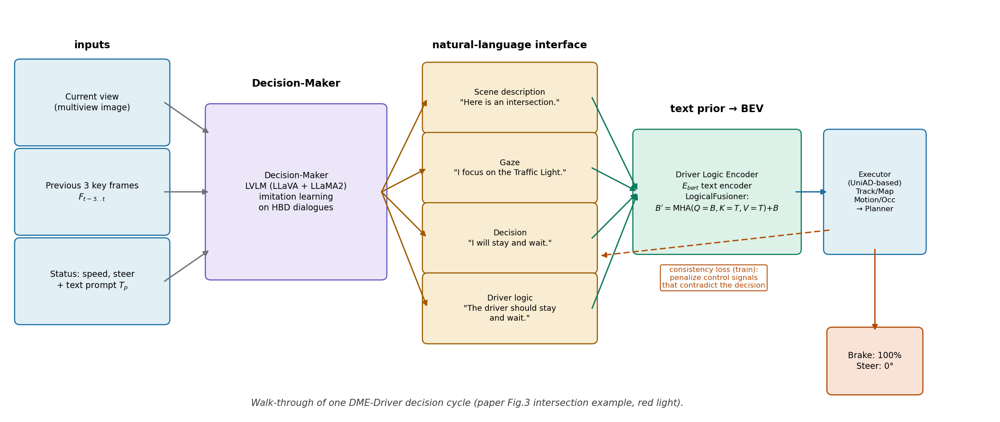

> **论文**: DME-Driver: Integrating Human Decision Logic and 3D Scene Perception in Autonomous Driving
> **作者**: Wencheng Han, Dongqian Guo, Cheng-Zhong Xu, Jianbing Shen*（*通讯作者），澳门大学 SKL-IOTSC / CIS
> **会议**: AAAI 2025（vol. 39, pp. 3347–3355）
> **链接**: https://ojs.aaai.org/index.php/AAAI/article/view/32346（本文按 ojs.aaai.org 的 camera-ready PDF 精读，共 9 页）
> **arXiv 说明**: 任务简报写"无 arXiv"，实际有一份预印本 arXiv:2401.03641（2024-01-08 提交，仅 v1）。预印本与 AAAI 终版在个别数字和表格上有出入（见正文"版本出入"一节），本文所有数字以 AAAI 终版 PDF 为准。
> **代码**: 未找到官方代码。arXiv 页面无代码链接；按作者名与标题在 GitHub 检索，只找到同第一作者的另一篇论文（Prompt4Driving, AAAI 2025）的仓库，没有 DME-Driver 或 HBD 数据集的官方发布。
> **一句话核心洞见**: 把系统拆成"决策者"和"执行者"，中间用自然语言传话——LVLM 模仿人类驾驶员输出场景描述、注视点、决策和逻辑，规划式感知模型（UniAD 式）把这些文本当先验，用交叉注意力注入 BEV 感知与规划器；可解释的语言决策和精确的控制信号各归其位，互不拖累。

# 「决策」和「执行」分开：DME-Driver 把人类驾驶员的注视与逻辑变成 BEV 感知的先验

## Figure 1 的三张结构图，讲的是两种旧路线的各自心病

论文第 1 页的 Figure 1 并排画了三种系统结构，值得先看懂它在对比什么。(a) 是 UniAD 那类 planning-oriented 方法：tracking、mapping、motion、occupancy 四个感知模块全上，最后进 planner 吐控制信号。感知精度高、端到端可训，但整个系统是个黑箱——遇到 bad case（模型处理不了的场景），你没法知道它"为什么"错，因为它从来没有过"理由"这个概念。(b) 是 GPT-Driver、DriveGPT4 那类 LLM 方法：把感知模块的输出当成给定条件喂给 LLM，LLM 输出驾驶逻辑和控制信号。能说会道、可解释，但论文指出了一个要害：**感知错了，错会累积进决策，而决策的 loss 传不回感知模块**——LLM 和感知是两套分离的东西，感知模块的误差在 LLM 这里是既定事实，没法被决策 loss 修正。

DME-Driver 的赌注是 (c)：两个都要。Decision-Maker（基于 LVLM）负责"像人类驾驶员一样思考"，输出自然语言的场景描述、注视点、决策；Executor（规划式感知模型）负责把语言翻译成精确的控制信号。语言是两个模块之间的接口。这个分工的巧妙之处在于：**可解释性只要求决策者可解释，精度只要求执行者精确**，不像 (b) 那样要求一个模型同时干两件事。

但这个赌注成立的前提是：决策者的语言输出真的对执行者有用，而不只是"看起来有道理"。论文的全部技术内容，就是让这个前件成立的三个东西：HBD 数据集（教决策者说什么）、Driver Logic Encoder（把说的话变成执行者能用的先验）、consistency loss（让执行者的输出别跟决策者说的矛盾）。

## HBD 数据集：四个方面为什么是这四个

论文的第一个贡献是 Human-driver Behavior and Decision-making（HBD）数据集。作者先问了一个问题：要让 LVLM 学会"人类驾驶员的逻辑"，需要哪些 raw data？答案是四个方面，原文的排序本身就有讲究：

**人类驾驶员的注视（gaze）**。开车时很多反应是下意识的，注视点是唯一能观测到的"注意力"信号。人类驾驶员会本能地盯住当前场景里最关键的东西——红灯、行人、加塞的车。把注视点变成文本（"我注视着交通灯"），就得到了一种**人类标注的注意力先验**，比模型自己学的注意力可信。

**场景的逻辑描述**。不是普通的 image caption（"马路上有车"），而是"跟驾驶决策有关的要素及其关系"，比如 "I am in a scenario at an intersection where the vehicle is in a left-turn lane with a red light for turning." 这种描述的价值在于：另一个人类司机读了它，不用看图就能做出正确决策——它压缩了"决策所需的全部信息"。

**决策与理由**。人类司机综合各因素做决定的过程，以及"为什么"。这是可解释性的直接来源。

**精确的控制信号**。再漂亮的逻辑最后都要变成刹车和方向盘，这是执行者的训练目标。

没有一个公开数据集同时有这四样，所以作者拼了三旧一新：Look-Both-Ways（眼动仪采集的真实注视点）、BDD-X（人工标注的决策与理由）、nuScenes（控制信号），再加一个**新采集的 CARLA 子集**——人类开模拟器（方向盘+踏板），戴眼动仪，每时每刻记录决策和理由。数据规模：重标注部分 591,574 张图、985,739 个目标、191,786 段对话（每段 2~3 轮）；新采部分 2,608,038 张图、300 万+目标、207,150 段对话（每段 5 轮，覆盖逻辑理解的全部方面）。

标注流水线（Figure 2）分四步，每一步都有讲究：①采集（四路数据源）；②prompt 设计——针对每种数据类型给 GPT-4V 写专用 prompt，比如注视数据先把 gaze 点转成框画在图上，再让 GPT-4V 解释"司机在看哪里、为什么"；③人工修正——GPT-4V 完全答错的重跑，细节不符合人类司机思维的手工改；④对话生成——转第一人称、拼成多轮对话、再用 GPT-3.5 改写扩增（换说法不换内容）。

怀疑式阅读要在这里停一下。**人工修正的量和一致性，论文一个字没报告**：修正了多少比例？修正者之间的一致性如何？GPT-4V 预标注的准确率是多少？这些数字决定了 HBD 的"人类逻辑"到底有多人类——如果 90% 是 GPT-4V 的输出只经过轻微润色，那决策者学的与其说是人类司机，不如说是 GPT-4V 的驾驶知识。CARLA 新采部分也有同样的问题："人类驾驶员"是什么水平？是老司机还是实验室学生？驾驶风格差异怎么处理？论文没说。以及最实际的一点：**HBD 数据集没有公开发布**，所有关于它的判断都只能基于论文的文字描述，无法独立验证。

## Decision-Maker：四个公式里有两个记号问题

决策者基于 LLaVA，输入三个模态。论文给了四个编号公式，逐个过。

**公式 (1)**：$F_v = E_{CLIP}(F_{t-3} \oplus F_{t-2} \oplus F_{t-1} \oplus F_t)$。$E_{CLIP}$ 是预训练的 CLIP 视觉编码器；$F_{t-3}\dots F_t$ 是当前帧和前三个关键帧的图像；$\oplus$ 是拼接。注意这里的下标 $t$ 是时间，$F_t$ 表示第 $t$ 帧的图像——记住这个，下一段有用。四个帧的图像拼成一个 image array，一起过 CLIP 编码成视觉 token。为什么拼 4 帧而不是只用当前帧？驾驶决策需要运动信息（前车是在接近还是远离、红灯是刚变还是早就红了），单帧给不了速度，4 帧是最廉价的时序上下文。

**公式 (2)**：$F_t = \mathrm{Tokenizer}(T_p) \oplus \mathrm{Tokenizer}(T_s)$，$t = \mathrm{LLaMA2}(F_t + F_v)$。这里有两个记号毛病。第一，$F_t$ 被重用了：公式 (1) 里 $F_t$ 是第 $t$ 帧的图像，到公式 (2) 突然变成"文本特征"。同一个符号在相邻两个公式里指代不同东西，读的时候要自己换名字（比如把 (2) 的 $F_t$ 读成 $F_{txt}$）。第二，$F_t + F_v$ 的加号：$F_t$ 和 $F_{txt}$ 都是 token 序列，"相加"在这里实际是拼接（和 $\oplus$ 一个意思），论文混用了 $+$ 和 $\oplus$。第三，输出也叫 $t$，和时间下标 $t$ 又撞了。三个小毛病都不影响理解，但说明公式是写完没回头检查的。实质内容很简单：prompt 文本 $T_p$ 和车辆状态 $T_s$（RT-2 式 tokenizer 统一编码）拼上视觉 token，喂进 LLaMA2，输出经 de-tokenizer 变回自然语言。决策者最终输出四种文本：场景描述、注视点、决策、驾驶逻辑（见下节例子的具体话术）。

训练分两阶段，和 LLaVA 的 recipe 一致。**预训练**：593K CC3M 图文对 + 100K WebVid-10M 视频文本对，只训 video tokenizer，CLIP 和 LLM 权重冻结——学的是"视频和文本对齐"这个通用能力。**微调**：39K HBD 视频文本对 + 80K LLaVA 的指令跟随图文对，LLM 和 visual tokenizer 一起训——把通用对齐拧到"可解释自动驾驶"这个任务上。

**版本出入**：arXiv v1（2401.03641，2024-01-08）在同一段写的是"30K video-text pairs from HBD"，AAAI 终版写的是"39K"。9K 的差值，推断是终版前又补了一批 HBD 标注（新采的 CARLA 数据可能扩充了）。以终版 39K 为准，v1 的 30K 是旧数字。论文没有版本更新说明，这个出入是我对比 v1 网页文本和终版 PDF 发现的。

## Executor：先验是怎么"注入"BEV 的

执行者基于 UniAD：backbone 把多视角图像编码成 BEV 特征 $B$；TrackFormer、MapFormer、MotionFormer、OccFormer 四个感知模块；Planning 模块出控制信号。DME 的改动是加了一个 **Driver Logic Encoder**，它是全文唯一的新模块，两个公式：

**公式 (3)**：$F_t^{pcp} = E_{bert}(T_{des}) \oplus E_{bert}(T_{gz})$，$F_t^{plan} = E_{bert}(T_{act})$。$E_{bert}$ 是 BERT 文本编码器。决策者的四种文本输出在这里被分成两路：场景描述 $T_{des}$ 和注视理解 $T_{gz}$ 拼起来给**感知**模块（TrackFormer 和 OccFormer）——"看哪里"指导"感知哪里"；决策结果 $T_{act}$ 单独给**规划**模块——"要做什么"指导"怎么走"。这个分工是合理的：注视点是空间先验，应该影响感知；决策是意图先验，应该影响规划。论文正文里把 $F_t^{plan}$ 写成 "$Ftp$"（少了下标格式），又是一个小笔误。

**公式 (4)**：$B' = \mathrm{LogicalFusioner}(B, T) = \mathrm{MHA}(Q{=}B, K{=}T, V{=}T) + B$。这是先验注入的实际动作，值得在脑子里播一遍：BEV 特征 $B$（形状是 BEV 网格 × 通道，比如 $200\times200\times256$，每个 query 是一个 BEV 位置）当 query，文本编码 $T$ 当 key 和 value，做一次多头交叉注意力，再残差加回 $B$。几何意义：每个 BEV 网格位置去"查"文本先验——"交通灯"这个词的 embedding 会和路口那个方向的 BEV 格子算出高注意力分，那个格子的特征就被"红灯要停"的语义增强了。残差连接保证：文本先验是**增强**不是替换，BEV 原有的几何信息还在。这是标准的 cross-attention 用法，不新，但放在"语言先验注入 BEV"这个位置上是贴切的。

**Consistency loss** 是论文里最语焉不详的部分。正文只有一段：训练规划模块时加一个辅助 loss，决策者的决定被分成几类（直行、加速、停止等），每类定规则判断控制信号是否"符合"该类决定，不符合就惩罚。具体规则是什么、权重多大——"详见补充材料"。但 ojs.aaai.org 的 PDF 只有 9 页正文，**没有附补充材料**，arXiv v1 也没有。这意味着 consistency loss 的全部细节都无法核验。更值得玩味的是版本变化：arXiv v1 的 Table 4 消融表有四行，最后一行是 "Decision-Maker + Executor + CL"，L2=0.98、碰撞率=0.29——**加了 CL 的 L2 反而比不加（0.96）差**；AAAI 终版的 Table 4 只有三行，"+CL" 这一行被删掉了，Decision-Maker+Executor 的数字也从 0.96/0.28 微调成 0.97/0.27。一个"显著增强决策对齐"的部件，它的消融行在终版里消失了，而正文还在讲它的重要性。这个处理，审稿人视角看是减分项。

## 走一遍 Figure 3 的路口：红灯前，信息是怎么流的

把论文 Figure 3 的例子完整走一遍，所有状态量都用原文的话术。场景：自车停在路口，红灯。

决策者收到当前多视角图像、前 3 关键帧、当前状态（速度 0、方向盘 0）加 prompt，输出四段第一人称文本——场景描述："Here is an intersection."（这里是个路口）；注视："I focus on the Traffic Light."（我注视着交通灯）；决策："I will stay and wait."（我会停下等待）；驾驶逻辑："The driver should stay and wait."（司机应该停下等待）。这四段话就是"人类驾驶员的逻辑"的文本化。

Driver Logic Encoder 用 BERT 把四段话编码：$T_{des}$（路口描述）+$T_{gz}$（注视交通灯）拼成感知先验，注入 TrackFormer 和 OccFormer——Occupancy 预测时，交通灯方向的格子被"注意红灯"增强；$T_{act}$（停下等待）注入 Planning 模块。Backbone 的 BEV 特征 $B$ 经过 LogicalFusioner 变成 $B'$，感知模块在 $B'$ 上做 tracking/mapping/motion/occupancy，Planner 输出控制信号：Brake 100%，转向 0°。训练时 consistency loss 在后面盯着：如果 Planner 吐出"加速"的控制信号，而决策者说的是"stay and wait"，就罚。

下图是这个流程的示意（自绘，基于论文 Figure 3 的例子）：

*自绘图：DME-Driver 一次决策循环的数据流（论文 Figure 3 路口红灯例子）。注意 consistency loss 是训练时的辅助项，推理时 Planner 直接输出控制信号。*

和 SafeAuto 的"MLN 改写问题"对比一下：SafeAuto 是决策者犯错后由符号层纠正（事后）；DME 是决策者的语言先验在执行时全程参与（事中），但没有纠错回路——如果决策者本身说错了（比如把绿灯看成红灯），执行者会被错误的先验带着走，系统里没有第二个检查者。这是"决策-执行分离"架构的内在风险：接口是自然语言，误解没有校验和。

## 实验数字核验：提升是实的，幅度是小的，裁判是自己人

**规划精度（Table 2，nuScenes 开环）**。DME-Driver（纯视觉）：L2 0.43/0.91/1.58，平均 0.97；碰撞率 0.04/0.14/0.64，平均 0.27。UniAD（纯视觉）：L2 平均 1.03，碰撞率平均 0.31。提升是实的：L2 平均降 5.8%，碰撞率平均降 12.9%。但幅度不大，且表里还列了 lidar 方法（NMP、FF、EO）——视觉方法和 lidar 方法混在一张表里比，传感器都不一样，这种对比更多是"展示"，不是"证明"。公允的比较是只看 Vision 行：DME vs UniAD vs ST-P3，DME 确实最好，但领先 UniAD 的幅度（0.06 米 L2）不算大。考虑到决策者先验带来的全部增益就这些，说明"语言先验"对开环规划精度的贡献是锦上添花，不是改天换地。

**决策逻辑理解（Table 3）**。用"advanced version of ChatGPT"（即 GPT-4）当裁判，在 HBD 测试集上给 Gaze / Scene / Logic 三个维度打分：DME-Driver 85.2/81.6/78.5，GPT-4V 75.3/79.8/67.1，LLaVA-13B 48.3/60.5/45.3。这里有个方法论上的硬伤：**HBD 的训练标签本身就是 GPT-4V 预标注+人工修正的，裁判又是 GPT-4**——学生（DME 的决策者）学的是老师（GPT-4V）的输出，然后请老师的兄弟（GPT-4）来判分。同源模型之间互相打高分是已知现象，DME 在 Logic 上比 GPT-4V 高 11.4 分，有多少是"更像 GPT-4 家的说话方式"，论文没有用人评或第三方模型做对照。这个 85.2/81.6/78.5 要打折扣看。

**消融（Table 4）**。三行：纯 Executor 1.03/0.31；GT+Executor（用真值语言先验）0.94/0.28；Decision-Maker+Executor 0.97/0.27。细读能读出两层意思。第一，真值语言先验确实有用（1.03→0.94），说明"语言先验注入 BEV"这个机制本身成立，不是安慰剂。第二，决策者生成的先验（0.97/0.27）vs 真值先验（0.94/0.28）：L2 不如真值，但**碰撞率反而更好**（0.27 < 0.28）。这个交叉很有意思：决策者不完美的语言先验，在 L2 上输了，却在安全性上赢了——推断是决策者偏保守的措辞（多说"停下等待"）让 Planner 更谨慎。论文没有分析这个交叉，算是个被浪费的观察。

**版本出入**再记一笔：arXiv v1 的 Table 2 里 DME-Driver 行是 0.45/0.91/1.58/0.98 和 0.05/0.15/0.68/0.29，终版变成 0.43/0.91/1.58/0.97 和 0.04/0.14/0.64/0.27——终版数字整体更好，应该是训练或评测细节有更新，但论文没有 changelog。结合 30K→39K 的 HBD 数据扩充看，终版实验是重跑过的。

## 三个没回答的问题

**第一，整套系统跑多快？** 决策者是一个 LVLM（LLaVA-7B 量级 + LLaMA2），每帧要做一次多轮文本生成；执行者是 UniAD 量级的 BEV 模型。论文给了训练配置（8×H800），但**推理延迟、吞吐、显存占用一个数字都没给**。自动驾驶是实时系统，LVLM 每帧推理的延迟是决定这个架构能不能上车的第一性问题，论文只字未提。做后续工作的人要知道：DME-Driver 目前是一个"精度和可解释性"的原型，不是"可部署"的系统。

**第二，补充材料缺失。** 正文三次提到 supplementary material（consistency loss 细节、GPT-4 评测流程、其他感知任务的实验），但 ojs 版本没有附带，arXiv v1 也没有。这三个恰恰是审稿人最可能追问的点：CL 的规则长什么样？GPT-4 裁判的 prompt 是什么、打分稳定性如何？感知任务（tracking/mapping）上先验有没有用？都无从核验。

**第三，可复现性。** 无官方代码，HBD 数据集未发布，CARLA 采集工具未发布。论文的全部实证结果都不可独立复现。这在 AAAI 2025 的系统类论文里不算罕见，但读者要清楚：你读到的是一份"设计说明书+作者自报的数字"，不是一份可验证的报告。

## 作者的底牌：数据集是真壁垒，分工是真想法

反推作者的底气，有两张牌。第一张是 **HBD 数据集**：注视+场景逻辑+决策+控制四合一，别人没有。数据集论文在 AAAI 这种会议上是硬通货——即使模型部分被质疑，数据集的贡献独立成立。第二张是"决策-执行分离"的 clean 分工：LVLM 只管说人话，UniAD 只管吐控制，接口是自然语言。这个分工把"可解释"和"精确"两个互相打架的目标解耦了，审稿人容易接受——每个部件都有现成的 baseline 可以比（决策者比 GPT-4V，执行者比 UniAD），故事好讲。

较真一句：这个分工的代价是**延迟翻倍、误差来源翻倍**，而论文一个字没提代价。Table 2 里 0.06 米的 L2 提升，值不值得多跑一个 7B LVLM？这是读者要自己掂量的。

## 能带走的东西

第一个可迁移的想法是"**人类注意力当先验**"。注视点是人类驾驶员免费留下的注意力标注——真实司机用眼睛告诉你场景里什么重要。DME 把它变成文本再注入 BEV，这个"眼动→文本→注意力偏置"的链条，在任何需要空间注意力的具身任务里都能复用。比模型自己学注意力可信，比手工标注意力框便宜。

第二个是"**语言当模块接口**"。决策和执行之间不传 embedding、不传 logit，传自然语言。好处是接口可读、可调试、可换件（把 LLaVA 换成更大的 LVLM 不用改执行者）；坏处是带宽低、误解无校验。SafeAuto 用 MLN 给语言接口加了个校验层，DME 没有——两个工作放在一起看，正好是一正一反的参照。

值得做的具体问题：第一，决策者先验的**因果效应**到底多大？做一个"随机打乱先验文本"的对照：如果打乱后规划精度不变，那 Table 2 的提升就来自执行者训得好，不是先验的功劳。第二，consistency loss 的规则能不能公开/重做？它是"语言决策约束控制输出"最直接的机制，现在是个黑箱。第三，注视先验能不能绕过语言、直接变成 BEV 上的空间注意力 mask？少一次 BERT 编码和一次 cross-attention，延迟直接减半，效果可能差不多——这是个值得一试的工程问题。

---

*阅读底本：ojs.aaai.org 的 AAAI 2025 camera-ready PDF（pp. 3347–3355，无补充材料）。原图引用：Figure 1（p.3347，三种系统结构对比）、Figure 3（p.3351，系统详细结构与路口例子）已按 2 倍分辨率渲染为 `paper-fig1.png` / `paper-fig3.png` 存于本文档同目录。版本差异说明：arXiv:2401.03641（v1, 2024-01-08）与终版在 HBD 微调数据量（30K vs 39K）、Table 2 数字、Table 4 消融行数（v1 有 "+CL" 行，终版删除）上有出入，v1 侧的数字来自 arXiv 网页文本的检索快照、未逐字全文核对，文中已标注。`fig-dme-cycle.png` 为自绘（脚本 `fig-dme-cycle.py` 已运行验证）。未找到官方代码与 HBD 数据集发布，信息块已如实标注。*
