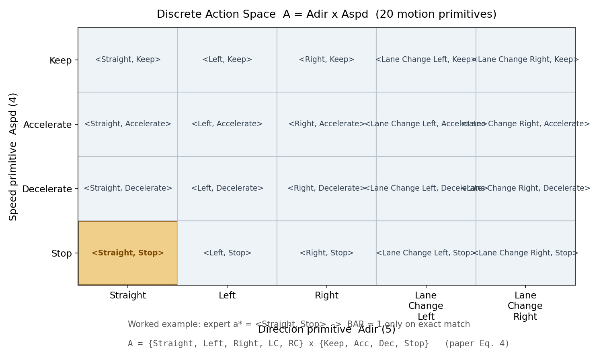

# 让 VLM 从"解说员"变成"开车顾问"：一句建议如何变成一条轨迹

> **信息块**
>
> - **论文标题**：Driving with Advice: Large Model as Motion Advisor for Joint Planning
> - **作者**：Junyin Wang（武汉理工大学）*、Jinlei Yu（华中科技大学）*、Hao Lin（岚图汽车）、Huikai Liu（武汉理工/岚图）、Wenqian Zhu（岚图）、Shengwu Xiong（武汉理工，通讯作者）（*为共同一作）
> - **会议**：AAAI 2026，vol. 40(2)，pp. 1168–1176
> - **链接**：https://ojs.aaai.org/index.php/AAAI/article/view/37088（DOI: 10.1609/aaai.v40i2.37088）
> - **代码**：论文正文未给出官方代码链接，未找到官方代码
> - **一句话核心洞见**：VLM 不再只负责"看懂场景并解说"，而是被训练成一个给出可执行驾驶建议的"顾问"——建议先被压缩进"方向 × 速度"的 20 个离散动作原语，再由一个扩散轨迹规划器在"听建议/不撞/平滑"三重奖励下用 GRPO 学会照着建议开。

---

先看一个具体的别扭场景。十字路口，红灯，前面排着几辆车。一个人走到一半停在斑马线边上，弯腰系鞋带。一个装了 VLM 的自动驾驶系统能把这个场景描述得头头是道："路口拥堵，路面湿滑，行人位于车辆左前方三米处……"然后呢？描述归描述，方向盘归方向盘。市面上大多数 VLM 驾驶系统（论文图 1c 那一类，DriveGPT4、DriveVLM 之类）就停在这一步：语言是感知的一个副产品，和轨迹生成之间隔着一堵墙。规划器照样从 BEV 特征里回归连续轨迹，它从来没"听见"过那句"行人可能突然起步，建议保持停止"。

这篇论文要修的正是这堵墙。作者的判断是：问题不在于 VLM 不够聪明，而在于没有一个机制把语言变成规划器能用的东西。于是他们设计了一条三段式流水线：先让大模型（InternVL3-78B）当老师，用问答对把"驾驶道理"蒸馏进一个小模型（Qwen2.5-VL-3B），这叫 Semantic-Intentional Pretraining（SIP）；然后把小模型的输出约束到一个离散动作空间里（方向 5 种 × 速度 4 种 = 20 个动作原语），用 GRPO 把它对齐到专家动作上；最后训练一个扩散轨迹生成器，以"建议"为条件、用"对齐建议/避免碰撞/平滑"三项奖励再做一次 GRPO。终点是在 NAVSIM 闭环评测上 PDMS 91.5，超过 Hydra-MDP++ 的 91.0。

0.5 个点的领先幅度很小，先把这个记下来，后面会细算它到底意味着什么。但这篇论文值得读的不是这 0.5 个点，而是一个在 VLA 驾驶里反复出现的结构性难题：**语言和动作之间到底应该用什么接口**。连续轨迹太细，VLM 说不好；纯文本太粗，规划器用不上。作者给出的答案是"离散动作原语"，这个选择本身比实验数字更有讨论价值。

## VLM 驾驶的三代范式，为什么前两代都绕开了"听建议"这件事

论文图 1 把现有方法分成四格，值得一张一张看，因为作者押的赌注就藏在这张图的叙事里。

(a) 模仿学习：传感器直通控制命令，黑盒。(b) BEV 联合建模：UniAD、VAD 那一路，用结构化的鸟瞰图做空间推理，但在连续动作空间里输出轨迹，高层意图被埋在回归层里。(c) VLM 系统：生成自然语言描述或问答，但语言和轨迹执行解耦。(d) 本文：VLM 当 motion advisor，建议直接塑造规划过程。

这个四格漫画的潜台词是：前三代有一个共同的默认假设——**语言是感知的输出，不是规划的输入**。作者推翻的就是这个假设。注意措辞的强度分布：引言里对 (c) 的批评用的是"fail to exploit the full cognitive potential"这种比较虚的表述，真正的硬论据在方法部分——他们确实造出了一个让语言梯度能流进轨迹的训练闭环。这是从叙事到机制的兑现，兑现得怎么样，后面逐项验。

还有一个时间坐标值得摆出来。这篇论文投的是 AAAI 2026，写作时（2025 年中）正是 GRPO 借着 DeepSeek-R1 在 LLM 推理上大火、而自动驾驶社区开始把 R1 范式往规划上搬的窗口期（同期的 ReCogDrive、AlphaDrive、DiffVLA 都是这个路数）。作者的底气之一，我推测，就是"把 R1 那套搬到驾驶建议上"这个时机——论文里 GRPO 被用了两次（离散策略一次、扩散策略一次），引用的是 DeepSeekMath 那篇 GRPO 原始论文（Shao et al. 2024b）。这是推断，依据是参考文献列表里 GRPO 的引用条目正是 DeepSeekMath，而正文两次写"via GRPO"时没有任何驾驶领域的适配说明。

## 作者手里到底有几张牌

先数作者单位：武汉理工大学、华中科技大学、岚图汽车（VOYAH，东风旗下的新能源品牌）。这是一个"高校 + 车企"的组合，通讯作者 Shengwu Xiong，致谢里列了 NSFC、国重研发计划、湖北省重点研发等一串纵向课题。这种组合通常意味着：实验要在真实感强的闭环基准上跑（NAVSIM），指标要贴着安全走（NC、DAC），算力不差（后文会看到 48 张 A800）。

再看押注的第一张图。图 1(d) 的"Ours"那一格，VLM 和 Planner 之间画了一个双向的闭环箭头，标着"Motion Reinforcement"和"Advice-Following"。整篇论文的修辞都围绕"closed-loop advisor-planner architecture"这个词组转。作者真正想让你相信的不是某一个模块，而是一个架构主张：**建议和规划之间要有训练时的闭环，而不是推理时的拼接**。

底牌的硬度可以这样评估。最硬的一张是 NAVSIM 闭环评测上的 PDMS 91.5——NAVSIM 是 2024 年 NeurIPS 提出的非反应式数据驱动仿真基准，评测协议公开，数字不好掺水（但 0.5 点的 margin 另说）。第二张是方法上的完整性：SIP 蒸馏、离散动作、两次 GRPO，三个阶段环环相扣，审稿人很难说"缺了一块"。最软的一张是"语言作为认知接口"这个叙事——好听，但论文里并没有证明换成非语言的中间表示就不行，消融实验也没有"去掉语言、只留离散动作"的对照。这是一个诚实的提醒：叙事和证据之间有一道缝。

## SIP：让小模型先学会"为什么"，而不是"做什么"

第一阶段 Semantic-Intentional Pretraining 要解决的问题，论文用一句话点得很准：现有端到端方法"learn what to do without understanding why to do it"。在分布偏移下，没有"为什么"的策略是脆的——这句话是对的，而且是这篇论文里少数几个经得起推敲的动机陈述。

具体做法分三步。先定义两类问题，公式 (1)：

$$Q = Q_{sem} \cup Q_{drv}$$

$Q_{sem}$ 问场景理解（"前面交通状况如何？"），$Q_{drv}$ 问行为推理（"自车是否该准备右转？为什么？"）。两个集合都是自然语言问题模板的集合，没有数学结构，就是个并集记号。这里的记号有点唬人——并集符号背后没有任何集合运算，纯粹是"我们有两类问题"的意思。论文里这类"用数学记号包装一句大白话"的地方不少，读的时候要自动降噪。

然后老师生成答案，公式 (2)：

$$a \sim p(a \mid O_t, q; \theta_{teacher})$$

$O_t = \{I_t, L_t, R_t\}$ 是一个多模态观测三元组：$I_t$ 是相机图像（论文写 cameras-$I_t$），$L_t$ 是 LiDAR 点云，$R_t$ 是自车相关状态（ego related，速度、导航指令之类）。$\theta_{teacher}$ 是冻结的 InternVL3-78B。注意这个 $a$ 不是动作（action），是答案（answer）——论文在这里复用了字母 $a$，后面公式 (5) 的 $a_t$ 又是动作。记号冲突，先记下来，后面统一按上下文区分。

老师是怎么"看"到 LiDAR 的？论文没说。InternVL3-78B 是纯视觉语言模型，吃的是图像 token。$O_t$ 里 $L_t$ 和 $R_t$ 如何喂给老师——是渲染成 BEV 图，还是转成文字描述拼进 prompt？论文 3.1 节只写了"conditioned on both visual context and temporal dynamics"，实现细节缺失。这是一个真实的信息缺口：SIP 的数据质量直接决定后面一切，而 QA 对的生成方式恰恰是黑箱。附录也没有（全文 9 页，无附录）。

最后学生蒸馏，公式 (3)：

$$\min_{\theta} \mathbb{E}_{(O,q,a)\sim \mathcal{D}_{QA}} [-\log p_{\theta}(a \mid O, q)]$$

这就是标准的监督微调（SFT）：Qwen2.5-VL-3B 在 $\mathcal{D}_{QA}$ 上做 next-token 预测。$\mathcal{D}_{QA}$ 的规模论文没给数字，只说了"large-scale"。结合"48×A800"的算力，我推测是几十万到百万量级 QA 对，但这是推断，论文没有证据。 LoRA 被用作参数高效微调（实现细节节提到"standard LoRA configurations"，秩、alpha、学习率都没给）。

走一个小例子。设 $O_t$ 是"红灯路口跟车"场景。$q_1 \in Q_{sem}$："描述当前场景的关键要素。"老师输出："三车道城市路口，自车在中间车道排第二，红灯，前车静止，右侧车道有公交车正在进站。"$q_2 \in Q_{drv}$："自车下一步该做什么？为什么？"老师输出："保持静止直到绿灯，因为红灯表示不允许通行；绿灯后谨慎起步，注意行人。"学生模型在成千上万个这样的 $(O, q, a)$ 上做 SFT，学到的不是"红灯→刹车"这个映射，而是"红灯→不允许通行→保持静止"这条带因果链的表述。论文把这称为学到了一个"latent intention space"——这个词是修辞，机制上就是 SFT 让模型输出带理由的文本。叫它"意图空间"不算错，但读者要清楚它没有额外的数学结构。

SIP 真正的价值不在玄学，而在工程：它给了第二阶段一个"会说话"的初始化。表 3 显示，只做 SIP（不做 DAG）时动作全匹配准确率是 76.4%，PDMS 87.1——说明光会"讲道理"不够，还得把道理钉到动作上。这就引出第二个阶段。

## 离散动作空间：20 个格子为什么是整篇论文最关键的设计

公式 (4)：

$$A = A_{dir} \times A_{spd}$$

其中 $A_{dir} = \{\text{Straight}, \text{Left}, \text{Right}, \text{LC}, \text{RC}\}$（5 个横向意图：直行、左转、右转、左变道、右变道），$A_{spd} = \{\text{Keep}, \text{Acc}, \text{Dec}, \text{Stop}\}$（4 个纵向意图：保持、加速、减速、停止）。笛卡尔积一共 20 个动作原语，每个 $a_t \in A$ 是一个"符号化的人可理解的机动单元"，比如 `<Right, Stop>` 读作"右转并停止"。

*上图：离散动作空间 $A = A_{dir} \times A_{spd}$ 的 20 个原语。高亮格是后文例子的专家动作 `<Straight, Stop>`。这张图就是 VLM 建议和轨迹规划器之间的"接口"——所有语言层面的建议必须先落进这 20 个格子中的一个，才能被下游使用。*

为什么这个设计是承重的？想想替代方案。最直接的做法是让 VLM 直接输出自然语言建议（"减速，注意行人"），然后让规划器"看着办"——这就是图 1(c) 被批评的模式，语言和控制之间没有可微、可验证的接口。另一个极端是让 VLM 直接输出连续轨迹点——VLM 的自回归文本生成不擅长精确数值，而且每一步的误差会累积。离散原语卡在中间：粗到 VLM 能稳定输出（20 分类问题），细到规划器能当条件用（一个 20 维 one-hot 或 embedding），而且人类可读（可解释性白拿）。

这里有一个"为什么我想不到"的点：放弃连续动作空间在直觉上是"亏"的——20 个格子显然装不下真实驾驶的全部精细操作。但作者接受这个局部亏损，换来的是整个训练闭环的可操作性：分类奖励好定义（公式 5 的精确匹配）、GRPO 好做（离散策略的标准动作空间）、建议好验证（人类一眼能看懂 `<Left, Acc>` 对不对）。精细的连续控制被推迟到第三阶段的扩散模型去补。这是一种分层：VLM 管"做什么"，扩散模型管"怎么做"。分层的代价是信息瓶颈——如果正确动作恰好落在格子之间（比如"轻微左打方向同时缓慢减速"），离散化会丢精度。论文没有讨论这个代价，这是如实记录的一处缺口。

## GRPO 第一遍：用 0/1 奖励把建议钉到专家动作上

离散策略 $\pi_{\theta}(a \mid O_t)$（由 Qwen2.5-VL-3B 参数化）在专家轨迹上做行为克隆，但不用最大似然，而用 GRPO。奖励是二值的，公式 (5)：

$$r^{align}_t = \mathbb{I}(a_t = a^*_t)$$

$a^*_t$ 是从 NAVSIM 专家轨迹提取的"真值"动作原语。指示函数 $\mathbb{I}$ 在预测的两个分量（方向和速度）**同时**命中时才给 1，否则 0。这是一个非常硬的奖励：`<Straight, Dec>` vs `<Straight, Stop>` 得 0 分，尽管它只错了一半。

策略更新写成公式 (6)：

$$\max_{\theta} \mathbb{E}_{\pi_{\theta}}\left[ \sum_{t=1}^{T} r^{align}_t \cdot A^{GAE}_t \right]$$

这里的写法值得停下来看。$A^{GAE}_t$ 是 Generalized Advantage Estimation（Schulman et al. 2015）算出的优势。标准做法是最大化 $\mathbb{E}[A_t \log \pi(a_t)]$（REINFORCE/PPO 风格），奖励只通过优势间接起作用。论文把 $r_t$ 和 $A^{GAE}_t$ 直接相乘放在期望里，这在数学上是不标准的——它看起来像把"奖励加权的优势"当目标，而 GAE 本来就是从奖励算出来的，两者相乘属于重复计算。我认为这是**记号上的潦草**，实际实现大概率是：从二值奖励序列算 GAE 得到优势，再做 PPO 式的策略梯度更新。论文把两步压缩成了一个公式，压缩丢了精度。这不是致命问题，但读者如果照着公式 (6) 去实现，会得到一个和作者实际跑的东西不一样的目标。记下来，这是全文公式层面最可疑的一处。

GRPO 的"Group Relative"体现在哪里？论文没有明说。按 DeepSeekMath 的 GRPO 原意：对同一个状态（这里是同一个 $O_t$）采样一组（比如 $G=4$ 或 8 个）候选动作，用组内奖励的均值/标准差做归一化得到优势，取代 PPO 的 critic。走一个小例子：对某个路口观测，策略采样出 4 个动作，专家真值是 `<Straight, Stop>`。采样结果：`<Straight, Stop>`、`<Straight, Dec>`、`<Straight, Stop>`、`<Left, Keep>`，BAR 奖励为 $[1, 0, 1, 0]$。组均值 0.5，标准差 0.5，归一化优势为 $[+1, -1, +1, -1]$。策略梯度把两个 `<Straight, Stop>` 的对数概率往上推，另两个往下压——不需要学一个价值网络，这就是 GRPO 相对 PPO 省掉的东西。在离散 20 分类上，这套机制是合适的：采样便宜，奖励稀疏但明确。

表 3 是这个阶段的成绩单：SIP 之后直接用正则表达式从 VLM 输出里抠动作（Regx）能到 89.5% 全匹配准确率，而 BAR+GRPO 训练出的策略到 97.5%。这个对比有意思：它说明 VLM 的文本输出里本来就藏着正确答案（正则都能抠出 89.5%），GRPO 的作用是把"说得出"变成"稳定输出"。但这里埋着一个关键问题：**$a^*_t$ 是怎么从专家轨迹反推出来的？** 论文只说"expert trajectories extracted from NAVSIM... paired with a corresponding ground-truth motion primitive"，没有给出轨迹→原语的映射规则。如果映射规则本身很简单（比如看未来 2 秒横向位移是否超过阈值就判变道），那么 97.5% 的准确率有一部分是"标签本身好猜"的功劳，而不是策略学得多好。这个映射是整个离散化方案的地基，论文却一笔带过——这是我读完全文后觉得最该追问的缺口之一。

## 扩散规划器：建议如何变成连续轨迹

第三阶段先训练一个参考模型（Ref Model），再用多目标奖励做 GRPO 精修。参考模型是一个条件扩散模型，公式 (7)：

$$p_{\psi}(T \mid O_t, a_t) = \int p_{\psi}(T_{1:H} \mid O_t, a_t, z_{1:H})\, dz$$

$T \in \mathbb{R}^{H \times 2}$ 是未来轨迹：$H$ 个航点，每个航点是 $(x, y)$ 坐标。$z_{1:H}$ 是 $T$ 步去噪过程中的隐变量。条件有两个：传感器观测 $O_t$ 和离散建议 $a_t$——**建议在这里第一次真正进入轨迹生成**，通常的做法是把 $a_t$ 编成 embedding，和观测特征一起做交叉注意力。

前向加噪，公式 (8)：

$$z_t = \sqrt{\alpha_t}\, T + \sqrt{1 - \alpha_t}\, \epsilon, \quad \epsilon \sim \mathcal{N}(0, I)$$

这里的记号需要整理。标准 DDPM 写法是 $z_t = \sqrt{\bar{\alpha}_t}\, T + \sqrt{1-\bar{\alpha}_t}\, \epsilon$，其中 $\bar{\alpha}_t = \prod_{s=1}^t \alpha_s$ 是累积乘积。论文把 $\bar{\alpha}_t$ 简写成了 $\alpha_t$，属于记号简化（或者潦草），读者按 DDPM 的标准含义理解即可。几何上这一步在做什么：把干净轨迹 $T$ 往各向同性的高斯噪声方向"拖"，$t$ 越大拖得越远；$\sqrt{\alpha_t}$ 和 $\sqrt{1-\alpha_t}$ 的平方和为 1，保证整体方差不变（方差保持型扩散）。

训练目标是变分下界（VLB）损失，公式 (9)：

$$\mathcal{L}_{diffuse} = \mathbb{E}\left[ \sum_{t=1}^{T} \beta_t \cdot \|\epsilon - \epsilon_{\psi}(z_t, t, O_t, a_t)\|_2^2 \right]$$

$\epsilon_{\psi}$ 是一个 DiT 风格（Peebles & Xie 2023）的去噪网络，输入是带噪轨迹 $z_t$、时间步 $t$、观测和建议，输出对噪声 $\epsilon$ 的预测。$\beta_t$ 是每步的权重。形状对一下：$z_t \in \mathbb{R}^{H \times 2}$，$\epsilon$ 同形状，网络输出同形状，MSE 逐元素平均。这就是 Diffusion Policy（Chi et al. 2023 那一路）在驾驶上的标准用法，论文在这里没有新东西，引用 Transfuser 做条件生成的灵感也是诚实的——"inspired by Transfuser"写得明白。

关键的第二步是 Trajectory Reinforcement：把参考模型当起点，再用 GRPO 优化一个策略模型 $\pi_{\phi}(T \mid O_t, a_t)$，目标是公式 (10)：

$$\max_{\phi} \mathbb{E}_{\pi_{\phi}}\left[ \sum_{t=1}^{H} r^{total}_t \cdot A^{GAE}_t \right], \quad r^{total}_t = \sum_{k=1}^{3} w_k r^{(k)}_t$$

三项奖励：$r^{align}_t$（运动对齐：生成轨迹和 VLM 建议原语之间的"分类度量"）、$r^{safe}_t$（BEV 占用重叠惩罚，即别撞）、$r^{smooth}_t$（jerk 惩罚，即别顿挫）。权重 $w_k$ 论文没有给数值，也没有敏感性分析——三项奖励"有没有互相拉扯"这个问题，论文没有回答。表 4 的消融显示三项全开最好（PDMS 88.7），但注意这个数字和主结果的 91.5 对不上：表 4 的三项全开只有 88.7，说明**奖励消融是在一个缩水配置上跑的**（可能是小模型或去掉了某个阶段），论文没有说明表 4 的实验配置。这是一个 as-is 记录的不一致，读者不能把表 4 的 88.7 和表 1 的 91.5 直接比较。

$r^{align}_t$ 的"分类度量"具体是什么？论文只说"computed based on a classification metric between the generated trajectory and the advised primitive"，没有公式。一条连续轨迹和一个离散原语之间怎么做分类度量？合理的猜测是：把生成轨迹反向映射回离散原语（用和提取 $a^*_t$ 同一套规则），再和 $a_t$ 比对。但这又是推断，论文没写。如果猜对了，那么整个系统的"对齐"本质上是一个自洽性检查：建议→轨迹→反推建议，三者一致就给奖励。这个设计是聪明的（它让离散接口在训练时真正闭环），但论文没有把它讲透，可惜。

还有一个没有回答的问题：**对扩散模型做 GRPO，组是从哪里采的？** 对同一个 $(O_t, a_t)$ 采样 $G$ 条轨迹，算三项奖励，做组内归一化——这是最自然的实现。扩散采样本身有随机性（$G$ 次去噪），所以组内方差天然存在。但扩散模型的参数量大、采样慢，GRPO 的 on-policy 采样开销不小。论文没有报告训练步数、采样组大小 $G$、KL 约束系数等任何 RL 超参数。48 张 A800 的算力很可能相当一部分烧在这里。这是工程层面的又一个黑箱。

## 实验：91.5 这个数字到底该怎么读

先讲 PDMS 的定义，因为不理解它就读不懂表 1。论文给出的公式：

$$\text{PDMS} = \text{NC} \times \text{DAC} \times \text{DDC} \times \frac{5\times\text{TTC} + 5\times\text{EP} + 2\times\text{C}}{12}$$

NC（无责任碰撞）、DAC（可行驶区域遵守）、TTC（碰撞时间）、EP（自车进度）、C（舒适度）都是 0–1 分数，DDC 因评测工具限制被排除（与前人工作一致）。注意 NC 和 DAC 是**乘在外面的**：一次碰撞（NC=0）整个 PDMS 归零——安全项是硬门槛，不是加权平均里的一项。

现在验算表 1。Ours 行：NC=99.2，DAC=97.7，TTC=96.1，EP=86.9，C=100.0（表中是百分制）。如果直接拿平均值相乘：$0.992 \times 0.977 \times (5\times96.1 + 5\times86.9 + 2\times100)/12 = 0.992 \times 0.977 \times 92.92 \approx 90.0$，但表里写的是 91.5。对 Hydra-MDP++ 同样验算：$0.986 \times 0.986 \times 92.0 \approx 89.4$，表里是 91.0。两次都对不上，但偏差方向一致（实际值高于乘积）。这说明什么？NAVSIM 的 PDMS 是**先在每个场景内算乘积、再对场景取平均**，而表里的 NC、DAC 等是**先对场景取平均**。乘积的平均不等于平均的乘积（Jensen 不等式方向取决于分布），所以用表里的平均数反推 PDMS 是注定对不上的。这是一个读 NAVSIM 论文必须知道的细节：**表 1 的 PDMS 列和它的分项列之间没有初等算术关系**，不要试图用分项去"验证"PDMS。论文没有说明这一点，但这不是论文的错，是 NAVSIM 评测协议的固有属性，我在这里补上。

再看 91.5 vs 91.0 这 0.5 个点。navtest 只有 136 个场景，论文没有报告随机种子数、没有误差棒。0.5/91 ≈ 0.5% 的相对差距，在 136 个场景的平均值上，完全可能落在 run-to-run 方差里。作者没有做显著性检验，也没有说基线是重跑的还是抄的（Hydra-MDP++ 的 91.0 与原论文报告一致，看起来是抄的）。所以"state-of-the-art"这个定语要打折扣：**数字上是第一，统计上没证明显著**。这是怀疑式阅读里最该说清楚的一句。

分项看，Ours 的优势集中在 NC（99.2 vs 98.6）和 EP（86.9 vs 85.7），DAC 反而略低于 Hydra-MDP++（97.7 vs 98.6）。NC+0.6 意味着在 136 个场景里少撞了大约一次（0.6% × 136 ≈ 0.8 个场景）——这个量级的改进和"多目标奖励里有碰撞惩罚"是自洽的。EP+1.2 说明车更敢走了，这和"建议"带来的意图明确性也对得上。故事是圆的，但样本量小，圆得有点勉强。

表 2 的消融（VLM 大小 × DAG × Trajectory Reinforcement）显示：3B 全开 91.5；3B 去掉 DAG 和 RL 掉到 88.1（setting 3→4，+3.4）；0.5B 全关 87.5，全开 88.7（setting 1→2，+1.2）。注意表格的开关是 DAG 和 Trajectory Reinforcement 一起动的，没有单独只关 DAG 的对照——论文正文却写"Disabling DAG drops performance significantly"，把两者的功劳都算在了 DAG 头上。严格来说，表 2 只能证明"DAG+RL 这一整段管线"贡献了 3.4 个点，拆不开。从 setting 3→4 的幅度看，离散接口加 RL 精修确实是承重设计，这个判断成立，只是论文的表述比证据多走了一步。表 5 的去噪步数：T=5→89.4，T=10→91.5，T=20→91.1——10 步是个甜点，再多反而轻微下降（可能是过平滑或采样噪声累积），这个现象是可信的，扩散规划里常见。

## 一个完整的场景推演：红灯路口，基线错在哪一步

把论文的方法和图 1(c) 那类基线放在同一个场景里走一遍。场景：自车在中间车道排第二等红灯，前车静止，右侧有行人弯腰（论文图 5 里真实出现过的例子："A man is bent over near a black car"）。

基线（VLM 只做描述/问答，规划器独立回归轨迹）：VLM 输出"行人在车辆附近，请注意周围"；规划器从 BEV 特征回归出一条"缓慢起步"的轨迹——因为训练数据里"排队等灯"场景下绿灯一亮就走是主流模式，规划器学的是条件期望，没有"行人可能突然站起来走进车道"这个显式推理。错在**意图没有进入规划**这一步。

本文方法：第 1 步，Qwen2.5-VL-3B（经 SIP 微调）输出建议文本"行人靠近车辆，保持警惕"并映射到离散原语 `<Straight, Stop>`；第 2 步，GRPO 训练过的离散策略确认这个原语（BAR 奖励在训练时已经把"行人近→Stop"的映射钉牢了）；第 3 步，扩散规划器以 `<Straight, Stop>` 为条件生成轨迹，多目标奖励里的 $r^{align}$ 压住任何"提前起步"的采样（反推原语不一致就扣分），$r^{safe}$ 压住靠近行人的采样。最终输出一条"保持静止"的轨迹，并且系统能说出为什么：因为建议是 `<Straight, Stop>`，理由是行人。

这个推演里每一步的输入输出都是论文机制的直接应用，没有编造。但要注意一个诚实的边界：论文图 5 的定性例子排版混乱（同一张图里四个子图大量重复文字），例子本身的说服力一般；真正的证据还是表 1–5 的数字。

## 没写出来的东西，和一句公道话

集中列一下论文没交代、但复现或评价时必须知道的事：专家动作原语 $a^*_t$ 从轨迹反推的规则（地基缺失）；QA 数据集 $\mathcal{D}_{QA}$ 的规模和 LiDAR/$R_t$ 如何喂给老师模型；三项奖励的权重 $w_k$ 和 RL 超参数（组大小 $G$、KL 系数、训练步数）；表 4 消融的实际配置（为什么全开只有 88.7）；推理时延（VLM + 扩散去噪 10 步，车上跑不跑得动，论文一个字没提）；随机种子和误差棒。

公道话也要说。这篇论文有一个真实的优点：**它把"语言指导驾驶"从一句口号变成了一个可训练的闭环**。SIP→离散动作→扩散+GRPO，每一步的输入输出都写得清楚，消融表也确实指向离散接口是承重墙。在 2025 年中那个"R1 范式到处找落地"的窗口期，能拿出 NAVSIM 闭环评测和完整三阶段训练的工作不多。0.5 个点的 SOTA 幅度不大，但架构主张（advisor-planner 闭环、离散原语做语言-动作接口）是可以在别人的系统里复用的。扣分项主要在写作的严谨性：公式 (6)(10) 的记号潦草、关键实现细节缺失、小样本上没有统计检验。这些不是否定工作，而是决定了读者应该以什么姿势使用它：**学它的接口设计，不要照抄它的公式写法；信它的架构直觉，对它的数字保持距离**。

带走的两个可迁移想法。第一，VLM 和规划器之间的接口值得单独设计，离散化是一个被低估的选项：它把"可解释"和"可优化"同时买到了，代价是精度上限，适合放在分层架构的上层。第二，把 R1 式的组相对奖励用在驾驶上时，奖励设计比算法选择更重要——这篇论文真正的功夫花在 BAR 和三项奖励上，而不是 GRPO 本身。GRPO 只是个顺手的优化器，换 PPO 大概率也work，论文没有证明非 GRPO 不可，不要被引用链带偏。

真正值得继续做的问题：离散原语的粒度该怎么定？20 个格子是拍脑袋还是搜出来的？如果有一个办法让原语集合从数据里长出来（比如对专家轨迹做聚类），"建议"和"执行"之间的信息瓶颈可能会小得多。论文没有碰这个问题，留给了后来人。
