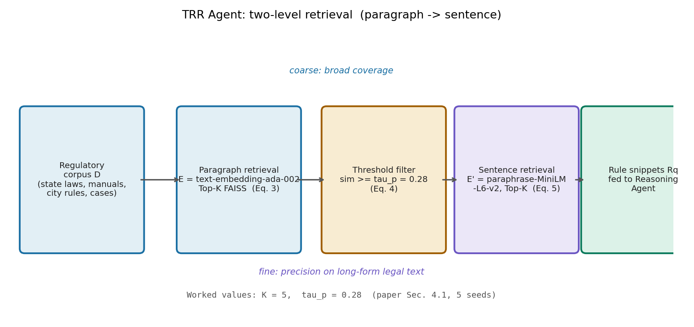

# 交规不该靠背诵：给自动驾驶装一个会查法条的检索器

> **信息块**
>
> - **论文标题**：Driving with Regulation: Trustworthy and Interpretable Decision-Making for Autonomous Driving with Retrieval-Augmented Reasoning
> - **作者**：Tianhui Cai*、Yifan Liu*（共同一作）、Zewei Zhou、Haoxuan Ma、Seth Z. Zhao、Zhiwen Wu、Xu Han、Zhiyu Huang（通讯作者）、Jiaqi Ma，全部来自 UCLA
> - **会议**：AAAI 2026，vol. 40(45)，pp. 38287–38295
> - **链接**：https://ojs.aaai.org/index.php/AAAI/article/view/41168（DOI: 10.1609/aaai.v40i45.41168）
> - **代码**：论文给出 https://github.com/Vickycth/driving-with-regulation，实际克隆验证仓库仅含一行 README，无实质代码；另有扩展版 https://arxiv.org/abs/2410.04759
> - **一句话核心洞见**：别指望 LLM 把各地交规背下来——把交规当成外部文档，用两级 RAG（段落粗召回 + 句子精排）在决策时现查现用，LLM 只负责对照查到的条文做"合规/安全"二值判定，并把引用的条文摆出来。

---

先看一个让所有"背交规"式自动驾驶系统都难受的事实。红灯时右转：在波士顿，这是被允许的（美国大多数州默认允许红灯右转）；在新加坡，这是违法的。同一个动作，同一个路口几何， verdict 完全相反。再想想波士顿的一条本地规则：除非超车或准备左转，司机必须保持在最右侧车道——这种条文不会出现在任何通用驾驶数据的主流分布里，一个靠预训练"见多识广"的 LLM 大概率答不上来。

这就是这篇论文的起点。它的判断很直接：交规有三个让现有方法难受的性质——**复杂**（条件嵌套，一条规则带好几个例外）、**上下文相关**（同一个词在不同场景下指向不同义务）、**地区相关**（换个城市答案就变）。规则引擎（if-then、手写状态机）被"地区相关"打死：每进一个城市重写一遍规则库，扩展性为零。纯 LLM 方案被"复杂"和"上下文相关"打死：模型凭预训练记忆作答，编造条文（hallucination）防不胜防，而且你问它"依据哪一条"，它给你的引用可能是现编的。

作者的答案是 RAG，但不是把 RAG 当噱头贴上去。整篇论文其实只做了一件事：**把"懂交规"从模型的参数记忆里搬出来，搬进一个可检索、可引用的外部文档库，再让 LLM 做它真正擅长的事——对照条文做推理**。这个搬运工就是 Traffic Regulation Retrieval（TRR）Agent，推理的是 Reasoning Agent（TRA）。两件事分开，各干各擅长的。

## 系统长什么样：先查条文，再做判断

方法总览（论文图 1）是一条直线流水线，没有花哨的循环。给定多视角图像 $I$ 和导航意图 $g \in \{\text{Left}, \text{Right}, \text{Forward}\}$，先做环境分析：一个 VLM 按结构化 CoT 走三步——先概述场景（道路布局、交通结构），再聚焦关键要素（交通标志、道路使用者、车道线，特别是和意图 $g$ 相关的），最后压缩成一句自然语言检索 query。记作 $V(I, g) \to (c, q)$，其中 $c$ 是结构化场景描述，$q$ 是给检索器的 query。

然后两个 agent 接力，公式 (1)：

$$\text{TRR}(q; \mathcal{D}) \to R_q, \quad \text{TRA}(a, c, R_q) \to (l_c, l_s)$$

$\mathcal{D}$ 是法规文档库，$R_q$ 是检索到的规则片段集合。对候选动作集 $A_{cand}$ 里的每个动作 $a$（从全局规划的意图 $g$ 派生，论文没有细说候选动作怎么枚举，这是文本场景评测，动作大概是几个文字选项），推理 agent 输出两个二值指标：$l_c \in \{0,1\}$ 表合规（compliance），$l_s \in \{0,1\}$ 表安全（safety），1 为通过。最终决策是公式 (2)：

$$A^* = \{a \in A_{cand} \mid l_c(a) = 1 \land l_s(a) = 1\}$$

既合规又安全的动作才能入选。这个公式本身平淡无奇，真正的设计在 $l_c$ 和 $l_s$ 的**分层定义**里：$l_c = 1$ 要求不违反任何**强制性**规则（mandatory rules，法律条文）；$l_s = 1$ 要求同时满足强制性规则和**非强制性**安全指南（safety guidelines，驾驶手册里的建议性做法）。注意这个定义的逻辑后果：$l_s = 1$ 蕴含 $l_c = 1$，所以安全通过的一定合规，但合规的不一定安全。论文图 5(a) 的波士顿斑马线例子正是这个分层的活广告：绿灯、无行人时加速通过斑马线——不违法（$l_c=1$），但按"接近斑马线应谨慎"的指南，它不安全（$l_s=0$）。"合规但不安全"这五个字，就是这篇论文区别于纯规则引擎的地方：它把法律和常识分成了两层，让系统能表达"我不违法，但我选择更谨慎"。

这个两层设计回答了一个"为什么我想不到"的问题：直觉上，安全和合规好像是一回事，混在一起判就行。但混在一起会丢掉一种重要的表达能力——人类司机每天都在做"合法但我不做"和"不违法但我更小心"的判断。把它们拆成两个二值输出，代价很小（多一次 LLM 调用里的多一个判断），表达能力多了一整层。这是整篇论文里我最欣赏的一个小设计：它不是从性能出发的，是从"人怎么开车"出发的。

## TRR：两级检索为什么是必要的，而不是为了显得复杂

检索部分是论文公式最密集的地方，也是最值得细读的地方。法规文本有一个要命的特点：**长**。一条法规段落可能几百词，里面真正和当前场景相关的只有一句话。如果直接做段落级检索返回整段，LLM 的上下文会被无关条文淹没；如果直接做句子级检索，又会因为句子脱离上下文而召回不准（"不得右转"这句话，脱离段落你不知道它说的是红灯还是施工路段）。两级检索就是对这个矛盾的回答：先用段落保证召回的上下文完整性，再用句子保证传给 LLM 的精度。

第一级，段落检索。query $q$ 和文档库 $\mathcal{D}$ 的每个段落 $p_i$ 都用句子 embedding 模型 $E(\cdot)$ 编成稠密向量：$v_q = E(q)$，$v_{p_i} = E(p_i)$。用 FAISS 做 top-$K$ 相似度检索，公式 (3)：

$$P^{cand}_q = \text{TopK}_{FAISS}\left(v_q, \{v_{p_i}\}_{i=1}^{|\mathcal{D}|}\right)$$

然后只保留相似度超过阈值 $\tau_p$ 的段落，公式 (4)：

$$P_q = \{p_i \in P^{cand}_q \mid \text{sim}(v_q, v_{p_i}) \ge \tau_p\}$$

论文取 $\tau_p = 0.28$，$K = 5$。注意阈值和 top-$K$ 是**串联**用的：先取 top-5，再砍掉低于 0.28 的。这意味着返回的段落数是 0 到 5 之间的变量，不是固定 5 个。这个细节是合理的——场景简单时别硬塞无关条文进来。

第二级，句子精排。把 $P_q$ 里每个段落切成句子 $s_j$，用一个**更轻量**的编码器 $E'(\cdot)$ 编码（$v_{s_j} = E'(s_j)$，$v'_q = E'(q)$），再做一次 FAISS top-$K$，公式 (5)：

$$R_q = \text{TopK}_{FAISS}\left(v'_q, \{v_{s_j}\}_{j=1}^{|S|}\right), \quad S = \bigcup_{p \in P_q} \text{Sentences}(p)$$

实现上 $E$ 是 `text-embedding-ada-002`（OpenAI，1536 维），$E'$ 是 `paraphrase-MiniLM-L6-v2`（384 维，本地可跑）。这个不对称选型是务实的：段落级语料大、要准，用强的云端 embedding；句子级是在已过滤的小集合上精排，用轻量本地模型省钱省时。论文没有解释这个选择，但从工程角度看是说得通的，我标记为"合理的未解释设计"。

*上图：TRR 的两级检索引擎。粗召回保证不漏（段落带上下文），精排保证准（句子去冗余）。$\tau_p = 0.28$、$K = 5$ 是论文 4.1 节给出的实际取值。*

走一个具体例子。场景：新加坡路口，自车意图右转，红灯。VLM 生成的 query $q$ 大意是"新加坡，红灯，右转意图，相关交通法规"。第一级：5 个段落的相似度分数假设为 $[0.62, 0.45, 0.31, 0.22, 0.18]$（余弦相似度，ada-002 的典型区间）。$\tau_p = 0.28$ 砍掉后两个，剩下 3 个段落——比如《新加坡公路交通法》红灯条款段、驾驶手册"路口转弯"段、某判例段。第二级：3 个段落切出约 20 个句子，MiniLM 重排，top-$K$ 挑出最相关的几句，其中关键句类似"红灯亮时，司机不得右转，除非有箭头信号允许"。这句进了 $R_q$，TRA 看到它，对动作"右转"输出 $l_c = 0$（违反强制性规则），$A^*$ 里就没有右转，只剩下"等待"。而在波士顿，同样的流程检索到的是"红灯右转允许"的条文，$l_c = 1$。**同一套代码，换个城市的文档库， verdict 就变了——这就是 RAG 相对"把交规背进参数"的结构性优势**：地区适配的成本从"重训/重写"降到了"换文档"。

怀疑式阅读要问：$\tau_p = 0.28$ 和 $K = 5$ 怎么来的？论文只说"set to"，没有敏感性分析。0.28 这个阈值在 ada-002 余弦相似度的尺度上不算高也不算低，但换个 embedding 模型就得重调——论文没有讨论这个超参数的可迁移性。另外，两级都用 top-$K$ 且 $K$ 都是 5，是巧合还是调过？没说。还有一个更实质的问题：**检索失败时系统怎么表现**？如果 TRR 没捡到关键条文，TRA 只能靠 LLM 自己的知识做判断，那就退化成了基线。论文没有做"检索失败率"或"无检索回退"的分析，而这恰恰是 RAG 系统最该报告的健壮性指标。

## TRA：LLM 在这里到底在干什么

推理 agent 用 GPT-4o（论文写"e.g., GPT-4o"，表示可换）加 CoT prompting 和 few-shot。它做三件事：先从 $R_q$ 里过滤出和当前场景、意图相关的规则；再把规则分成强制性（mandatory）和指南性（guideline）两类；最后对每个候选动作输出 $(l_c, l_s)$ 并附带引用具体条文的简短解释。

这里有一个容易被忽略的设计：TRA 的第一步是**再过滤**（"first filters $R_q$ to identify rules relevant"）。也就是说，检索器给的规则不是直接当真理用的，LLM 还要再筛一遍。这个"检索-再筛"结构是整套系统防幻觉的真正闸门：TRR 负责"别漏"，TRA 负责"别错"。但论文没有单独报告这个过滤步骤的准确率——筛掉了多少？有没有误筛掉关键条文？这是消融实验里缺的一块。

评估指标是动作级的分类准确率：compliance accuracy 和 safety accuracy，分别指 $l_c$、$l_s$ 预测和真值一致的动作占比。注意这是一个**分类任务**，不是轨迹规划任务。这篇论文评的不是"车开得好不好"，而是"对每个候选动作，系统能不能判对它合不合规、安不安全"。这个定位要摆正：DriveReg 是一个高层决策支持框架，不是端到端规划器。论文标题里的"Decision-Making"是诚实的，没有夸大成规划。

## 数据集：500 个场景是怎么攒出来的

DriveReg Scenarios Dataset 是论文的第二个贡献：500 个场景，覆盖波士顿、新加坡、洛杉矶三个城市。构成是 360 个假设性文本场景（每城 120 个：100 normal + 20 hard）加 140 个真实场景（nuScenes 波士顿/新加坡前视图像 + 作者在洛杉矶部署采集的数据）。

假设场景的构造值得细看。Normal 场景要求覆盖该城市法规文档的**所有类别**，每个场景只涉及 1–2 条简单规则，测的是"基本理解"。Hard 场景专挑地区特异性规则和复杂条件，要求 3 条以上相关规则，比如"信号灯故障路口的校车处理"。表 2 给了波士顿的分布：路权 20、路口 15、行人 15、路面标线 10、特殊驾驶情形 11、超车规则 8、标志信号 8、施工 5、服务车辆 8、hard 20。加总正好 120。这个分布是作者按法规文档的章节结构铺的，覆盖面是全的。

和已有数据集的对比（表 1）：VioHawk 27 条规则/42 场景，TARGET 54/284，LawBreaker 24/173，DriveReg 562 条/500 场景，还有真实数据和多地区两个对勾。数字上确实是最全的，但也要诚实地说：前三个数据集本来就很小，"最全面"这个第一拿得不算难。而且 562 条规则这个数字——论文没有给出三城市各自的条数分布，扩展版里可能有，正文里没有。

怀疑式阅读必须问一句：**假设场景是谁写的、谁标的？** 论文说是"constructed"，标注了相关规则和两级标签，但没有报告标注者间一致性（inter-annotator agreement），也没有说写场景的人和做系统的人是不是同一批。如果是同一批人写场景、定规则、再评测，存在"考自己出的题"的循环风险。这在学术界是这类基准的常见做法，不算学术不端，但读者要知道这个局限：hard 场景的"难"是出题人定义的难。

真实场景的筛选也有讲究：nuScenes 本来没有规则级标注，作者人工翻前视图像，挑"车辆行为明显受交规影响"的样本。这个筛选标准是主观的，140 个真实场景里波士顿/新加坡/洛杉矶各多少，正文没给（只说了来源）。样本量本来就不大，再按三城一切，每个城市的真实场景可能只有四五十个——表 4 里城市级的数字就是基于这个量级的，方差不会小。论文报告了 5 个随机种子的均值±标准差（表 3），这点是加分的，但表 4 的真实场景结果没有标准差。

## 实验数字逐项验

表 3（假设场景，三城平均）：DriveReg 在 normal 场景 98% 合规 / 98% 安全（F1 97.6%），hard 场景 99% / 94%（F1 94.6%）。最抓眼球的是 hard 场景的合规率：GPT-4o 裸跑 86%，DriveReg 99%，13 个点的提升。作者的解释是 hard 场景多是地区特异性规则（比如波士顿"保持右车道"那条），预训练知识覆盖不到，检索补上了。这个解释和数字是对得上的：看基线们的 +R 列（喂了 TRR 检索规则后的成绩），hard 场景普遍涨 8–13 个点（DeepSeek-V3 0.82→0.92，Llama3.3 0.81→0.93），说明**涨的大头来自检索本身**，而不是 TRA 的推理。DriveReg 比各基线 +R 又高 4–6 个点，这部分才是双 agent 架构（过滤+分层判定）的增量。把 13 个点的总提升拆成"检索的 8 点 + 架构的 5 点"，论文的贡献就看得更清楚了——论文没有这么拆，是我根据表 3 的 +R 列算出来的。

表 3 里还有两个 p-value：4.2e-03 和 3.5e-03。**p-value 是什么检验的？** 论文一个字没说。是配对 t 检验？是和哪个基线比？显著性水平下比较的是什么量？这是全文统计报告里最可疑的一处：p 值没有检验对象就没有意义。我只能把它记为"报告了但无法解读的数字"。

表 4（真实场景 vs GPT-4o）：波士顿 0.94/0.92 vs 0.86/0.91，洛杉矶 0.95/0.93 vs 0.91/0.93，新加坡 0.91/0.93 vs 0.84/0.89。DriveReg 全面领先，但注意一个细节：GPT-4o 的 safety 分数普遍高于它的 compliance 分数（0.91 vs 0.86，0.93 vs 0.91，0.89 vs 0.84）。作者的解读是：VLM 从预训练里学到了通用安全模式（别撞行人、保持车距），但学不到精确的法律条文。这个观察是可信的，而且它恰好说明了为什么需要这篇论文：**安全直觉可以靠预训练，法律精确性不行**。

表 5（检索对比，20 个波士顿 hard 场景，top-5）：BM25 0.60，QLM 0.50，LLaDA 的 TRE 0.55，TRR 1.00。数字对比强烈，但样本只有 20 个场景，而且指标是"全部真值规则都被捡到"这种严格指标。在小样本上，1.00 和 0.85 的差距可能就是两三个场景的事。结论的方向我信（语义检索打关键词检索在法规文本上是合理的），但幅度的精确性要打折。另外 LLaDA TRE 是作者按原论文复现的（脚注†说明了），复现质量无法验证。

表 6（vs Agent-Driver，波士顿真实场景）：DriveReg 0.98/0.97 vs Agent-Driver 0.91/0.86。但比较方法是：Agent-Driver 输出的是轨迹/高层计划，没有显式的合规指标，所以作者"随机从 DriveReg 的合规安全动作集里抽一个动作"来和 Agent-Driver 的高层计划比。这个比较设计是有点别扭的：等于用 DriveReg 自己的输出当裁判尺子。方向性结论（DriveReg 更懂交规）大概成立，但这个数字不要当成严谨的 head-to-head。

真实部署：在洛杉矶的实车上做影子模式测试——人类司机开，系统并行跑，不实际控制车辆。结论是"可靠地检索相关规则并做出安全合规决策"。时延：GPT-4o 详细推理输出平均 2 秒/决策，只输出标签约 1 秒。作者说这对高层决策"足够"。这个判断是诚实的：1–2 秒确实做不了底层控制，但做"要不要右转"这种高层决策是够的。论文没有夸大成实时控制，加分。

## 没写出来的东西，和一句公道话

集中列一下缺口。第一，官方代码仓库是空的（我实际克隆验证过，只有 README）。一个 2026 年的 AAAI 论文，代码链接给了但仓库没内容——复现无从谈起，扩展版 arXiv 里有没有代码我没验证，记为[未核实]。第二，超参数 $\tau_p$、$K$ 的选择依据和敏感性分析缺失。第三，TRA 的规则过滤步骤没有单独评估。第四，p-value 的检验对象不明。第五，假设场景的编写和标注过程、标注一致性没有报告。第六，检索失败时的系统行为没有分析。第七，候选动作集 $A_{cand}$ 的枚举方式没有细说。

公道话也要说。这篇论文有一个难得的诚实：它没有宣称自己解决了规划，只老老实实做"决策支持"；没有宣称实时，只是说高层决策够用；影子测试不控制车辆，安全边界交代得清楚。在自动驾驶论文里，这种分寸感是少见的。它的真实贡献是两点：一是把 RAG 做进了交规这个具体场景，并且证明了"换文档即换城市"的地区适配路径是走得通的；二是合规/安全两层判定，这个设计抓住了人类驾驶的一个真实结构。当然，13 个点的提升里大头是"检索"这个通用想法的功劳，TRR 的两级设计和 TRA 的分层判定是增量——增量是真实的，但读者要清楚它的量级。

带走的两个可迁移想法。第一，**凡是"知识重、变化快、地区相关"的约束，都不要背进参数，要做成可检索的外部记忆**。交规是这样，未来还会有：各城市的自动驾驶路测法规、保险条款、车企自己的安全策略。RAG 在这里不是时髦，是结构性的对症。第二，**把"必须遵守"和"最好遵守"拆成两个判定**，这个模式可以搬到任何有"硬约束+软偏好"的决策问题上。它的成本只是一次额外的二分类，换来的是一种更接近人类驾驶员的表达能力。

真正值得继续做的问题：检索和推理之间的接口现在还是文本（规则片段喂给 LLM），如果法规库大到百万级，段落-句子两级还够吗？以及，当检索到的条文互相冲突时（不同层级法规打架，州法 vs 市条例），TRA 现在没有任何冲突仲裁机制——论文的法规库里收了"法院判例"，判例和成文法冲突时听谁的？这个问题论文完全没有碰，但它恰恰是"可信交规推理"最难的部分。
