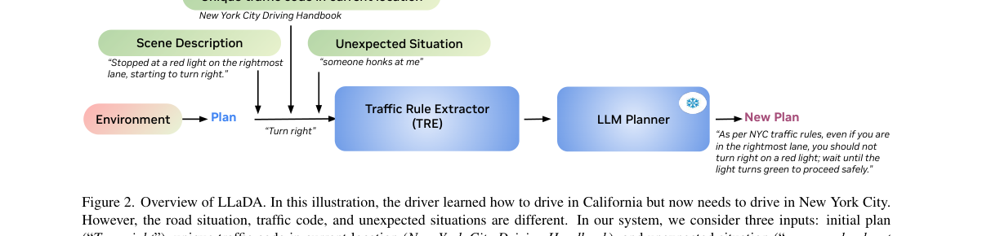
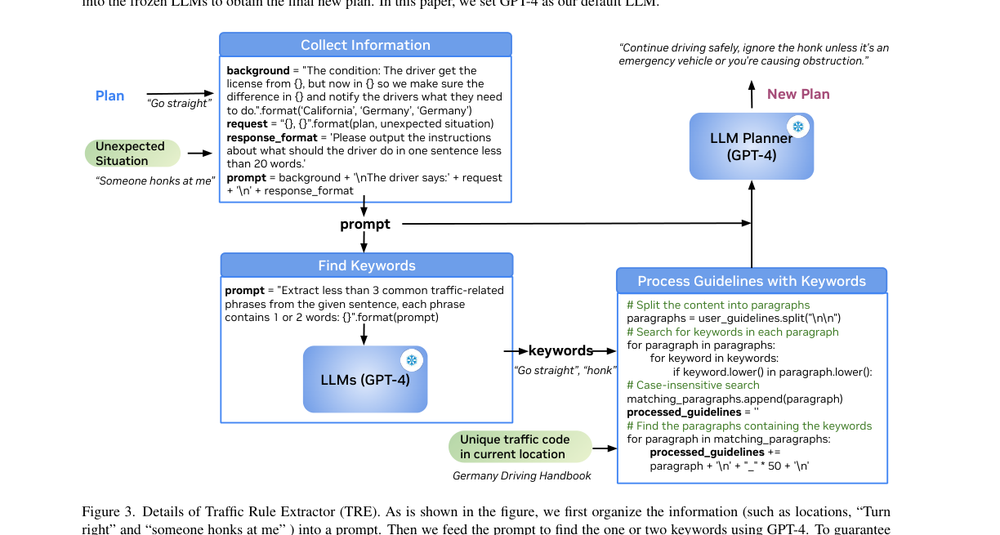
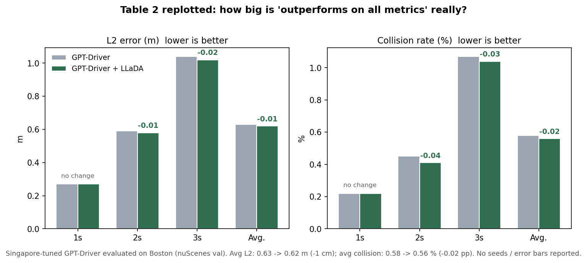

# 把驾驶手册当数据库：LLaDA 如何用两次 GPT-4 调用适配异地交规

> **信息块**
>
> - **论文标题**：Driving Everywhere with Large Language Model Policy Adaptation
> - **作者**：Boyi Li, Yue Wang, Jiageng Mao, Boris Ivanovic, Sushant Veer, Karen Leung, Marco Pavone（NVIDIA / USC / UW / Stanford）
> - **会议与年份**：CVPR 2024，pp. 14948–14957
> - **链接**：[arXiv:2402.05932](https://arxiv.org/abs/2402.05932)（本文依据 v2，2024-04-10） · [CVF open access](https://openaccess.thecvf.com/content/CVPR2024/html/Li_Driving_Everywhere_with_Large_Language_Model_Policy_Adaptation_CVPR_2024_paper.html) · [项目页](https://boyiliee.github.io/llada/)
> - **代码是否公开**：未找到官方代码。项目页只写了 "stay tuned"，GitHub 上没有作者发布的官方仓库，论文里的 TRE 伪代码（图 3）是唯一的实现依据。
> - **一句话核心洞见**：把"在新地区按当地交规开车"这个问题，从"重新训练规划器"降格为"拿着当地驾驶手册去问 GPT-4"——用一次 GPT-4 调用从场景里抽关键词、用字符串匹配从手册里捞段落、再用一次 GPT-4 调用把原计划改写，全程零训练，赌的是大模型对交规文本的零样本理解能力。

---

## 为什么作者盯住的是"交规差异"，而不是"感知差异"

自动驾驶跨地区部署的障碍通常被分成两层。第一层是感知层：传感器配置、天气、建筑风格变了，检测器掉点。第二层是规则层：同一个路口，在旧金山红灯可以右转，在纽约市不行；在加州走右边超车，在伦敦必须走右边超车（因为靠左行驶）。第一层过去几年已经被大量域适应工作啃过，第二层几乎没人碰。

没人碰的原因很具体：此前的思路是把交规写成形式逻辑公式（MTL、LTL、STL），再喂给规划器做约束。写一条规则的公式不难，难的是"全部"——一个地区的驾驶手册有几百条规则，每条还有例外（比如纽约市"红灯禁右转"，但 Staten Island 在 2024 年之前是例外，论文引用 [23] 的 NYC DOT 页面讲的正是这个）。把整本手册形式化，工作量随地区数量线性增长，每个新地区都要重新请专家编码。这条路在工程上走不通，不是因为逻辑不够表达力，而是因为"把自然语言交规翻译成机器可读形式"这个步骤本身不可扩展。

LLaDA 的起点就是把这一步整个删掉：手册保持自然语言原样，翻译工作交给 LLM。注意这个选择的性质——它不是"用 LLM 替代规划器"，而是"用 LLM 替代那个把手册翻译成公式的人"。论文第 2 节相关工作里特意划了一条线：此前用 LLM 做驾驶的工作（GPT-Driver 微调、DriveGPT4 端到端问答）都是把 LLM 塞进驾驶栈里承担驾驶本身；LLaDA 只让 LLM 干"读手册、改计划"这一件事，底层的轨迹规划还是原来的规划器（实验里是 GPT-Driver）。这个分工决定了整篇论文的气质：它是一篇"适配器"论文，不是"驾驶模型"论文。

## LLaDA 的输入输出到底是什么

先把接口钉死，因为论文里"四输入"的说法和图 2 的画法容易让人看岔。LLaDA 接收四个自然语言输入：

1. **nominal execution plan**（名义执行计划）：一句话，比如 "Turn right"。可以来自人类司机，也可以来自某个规划器的高层语义输出。
2. **traffic code of the current location**（当地驾驶手册全文）：自然语言文本，比如整个纽约市驾驶手册。
3. **scene description**（场景描述）：自车视角的一句话，比如 "Stopped at a red light on the rightmost lane, starting to turn right."。人类写，或者 VLM（如 GPT-4V）生成。
4. **unexpected situation**（意外情况描述）：一句话，比如 "someone honks at me"。默认是 `normal status`，只在司机察觉到异常时才需要填写——这是论文自己承认的一个大前提：LLaDA 不会自动发现异常，它只在被问到时才回答。第 4 节明确写了，做一个"意外场景检测器"超出本文范围。

输出也是自然语言：一句改写后的驾驶指示，比如 "As per NYC traffic rules, even if you are in the rightmost lane, you should not turn right on a red light; wait until the light turns green to proceed safely."

所以 LLaDA 本质上是一个函数：`f(计划, 手册, 场景, 意外) → 新计划`。它不输出轨迹点，不输出控制量。在 AV 实验里（图 4），它的输出被当作"guideline"再喂给 GPT-Driver，让 GPT-Driver 重新生成轨迹 `[(x'1,y'1),…,(x'6,y'6)]`。这个两级结构很重要：LLM 只改"语义层"的计划，几何层的轨迹还是神经网络规划器负责。作者在引言里把这叫作 policy adaptation 而不是 planning，措辞是准确的。

## 为什么 TRE 长成这个样子：直接把整本手册塞给 GPT-4 会怎样

这是全篇最值得停下来想一想的问题。既然 GPT-4 能读手册，为什么还需要 Traffic Rule Extractor？论文给的理由只有一句话：整本手册里只有一小部分和当前场景相关，多余的信息会损害 LLM Planner 的性能。

把这个理由展开。假设直接把纽约市驾驶手册全文（几万词）连同场景一起塞进 GPT-4 的上下文，会发生三件事。第一，相关规则被淹没在一堆无关条文里，大模型在超长上下文里本来就有"找不准重点"的问题，2024 年初的 GPT-4 上下文利用率随长度下降是公开的弱点。第二，token 花费随手册长度线性增长，每次查询都要重传整本手册。第三，手册里可能包含与当前场景矛盾的一般性建议（比如"一般情况下红灯可以右转"和"纽约市内禁止"同时存在），模型可能各取一半，拼出一句模棱两可的话。

TRE 的回答是做一次"检索式过滤"，而且是用最便宜的方式做的。它的三步是：

1. **Collect Information**：把地点、计划、意外拼成一个 prompt。图 3 里给出了模板原文，大意是：司机在 California 考的驾照，现在在 Germany，请指出两地差异并告诉司机该怎么做；司机说：计划是 "Go straight"，意外是 "Someone honks at me"；请用不到 20 个词的一句话输出指示。
2. **Find Keywords**：把上面这个 prompt 再喂给 GPT-4，指令是"抽出不到 3 个交通相关的常用短语，每个短语 1–2 个词"。对 "Go straight" + "Someone honks at me"，抽出来的是 `"Go straight"`, `"honk"`。
3. **Process Guidelines with Keywords**：把手册按 `\n\n` 切成段落，对每个关键词做大小写不敏感的子串匹配，命中任一关键词的段落全部保留，段与段之间用 50 个下划线分隔，拼成 `processed_guidelines`，最后把"原始 prompt + 过滤后的手册段落"一起喂给 GPT-4（LLM Planner）得到新计划。

注意这里 GPT-4 被调用了**两次**：一次抽关键词，一次做最终改写。图 3 的题注里那句"by using GPT-4 twice"不是笔误，是有意的。整个 TRE 没有训练任何参数，没有向量检索，没有排序模型——关键词抽取靠 GPT-4 的语义理解，段落匹配靠 Python 的 `in`。这是一个 2024 年初风格的典型设计：凡是需要语义的地方都外包给大模型，凡是确定性的地方都用最糙的代码实现。

上图是论文的 Figure 2，看的时候盯住三处。第一，Environment → Plan 这条线：名义计划来自环境/原有系统，LLaDA 不负责生成它，只负责改它。第二，三个绿色输入（手册、场景、意外）里，只有"计划"和"意外/场景"参与关键词抽取，手册是被检索的对象，不进 GPT-4 的第一次调用。第三，LLM Planner 右上角有个雪花图标——frozen，表示 GPT-4 参数不动，这是"training-free"这个说法的字面依据。

## 跟着"纽约红灯右转"把 TRE 完整跑一遍

纸上谈检索容易漏掉魔鬼细节。用论文第 3 节的 NYC 例子，把每个中间产物写出来。

**输入。** plan = `"turn right"`；scene = `"Stopped at a red light on the rightmost lane, starting to turn right."`；unexpected = `"someone honks at me"`（被横向车流按喇叭）；手册 = 纽约市驾驶手册全文；license_from = California，current = NYC。

**第 1 步：拼 prompt。** 按图 3 的模板，background 说明"司机在 California 考的驾照，现在在 NYC，请指出差异"；request 把 plan 和 unexpected 拼进去；response_format 要求"一句话、不到 20 个词"。这个 prompt 本身已经包含了全部的场景信息——注意，它**没有**包含手册。

**第 2 步：抽关键词。** GPT-4 读到 "turn right"、"red light"、"honks"，按指令输出不到 3 个、每个 1–2 词的交通短语。合理的结果是 `"turn right"`、`"red light"`、`"honk"`。这里埋着第一个脆弱点：关键词的质量完全取决于 GPT-4 当次的输出，没有约束解码，没有候选校验。如果 GPT-4 输出 `"right turn"` 而手册里写的是 `"turn right"`，子串匹配就miss——虽然这个例子碰巧两种写法都会命中，但"红灯"在手册里可能写成 `"red signal"`、`"steady red"`，关键词 `"red light"` 一个都匹配不上。TRE 没有同义词、没有 embedding 回退，miss 了就是 miss 了。

**第 3 步：段落过滤。** 手册按空行切段，逐段检查是否包含任一关键词（转小写后子串查找）。假设手册里有这么一段："In New York City, right turns on red are prohibited unless a sign permits it."——它包含 `"turn right"` 吗？注意子串匹配是按字符来的：`"right turns on red"` 里并没有连续的 `"turn right"`，只有 `"right turn"`。关键词 `"turn right"` 匹配 `"right turns"` 失败！能命中的是 `"red"`（如果关键词里有 red）或者 `"honk"` 命中的其他段落。这个细节说明：1–2 词的关键词 + 精确子串，在真实手册的措辞变化面前非常脆。论文的例子能跑通，相当程度上是因为演示用的手册段落措辞配合了关键词。这不是说方法无效，而是说它的鲁棒性完全系于"GPT-4 抽出的词恰好是手册里用的词"这一个巧合上，而论文没有任何地方量化这个巧合发生的概率。

**第 4 步：改写。** `processed_guidelines`（命中的段落，用下划线分隔）+ 原始 prompt 进 GPT-4，得到 "As per NYC traffic rules, even if you are in the rightmost lane, you should not turn right on a red light; wait until the light turns green to proceed safely."。数一下：这句话 30 个词，超过了 response_format 里"不到 20 个词"的要求。prompt 里的格式约束并没有被严格执行——这是一个小信号，说明整个系统的 prompt 工程是演示级的，没有做约束解码或输出校验。

走完这一遍，TRE 的真实形状就清楚了：它是一个**用 LLM 做语义关键词抽取、用字符串匹配做召回、用 LLM 做改写**的三段式 RAG，但每段都是最简实现——没有向量索引、没有重排序、没有 top-k 截断（命中的段落**全部**保留，极端情况下 prompt 会爆炸）。理解了这一点，就能理解为什么论文 5.2 节说"没有手册 LLM 给不出准确指示"：在这个架构里，手册是唯一的外部知识源，GPT-4 的第一次调用只负责抽词，不负责答题。

这里还有一个值得追问的点：GPT-4 真的不知道"纽约市红灯禁右转"吗？这条规则是常识级的，GPT-4 的预训练语料里一定有。论文 5.2 节的说法是"我们发现没有驾驶手册模型给不出准确信息，我们猜是因为 GPT-4 没有上下文或复杂的 prompt 调优给不出细节指示"。注意"我们猜"——作者自己用的也是推测语气。更准确的表述应该是：对手册的依赖程度取决于规则的生僻程度。纽约红灯右转这种名规则，GPT-4 裸答也能答对；Rettungsgasse（德国应急车道）、阿米什马车（表 1 例 6）这种生僻规则，才是手册真正起作用的地方。论文没有做"有手册 vs 无手册"的定量对比（图 5 只是定性展示），所以"手册不可或缺"这个结论的边界在哪里，是没测出来的。

## 表 2 的 1 厘米改进到底意味着什么

论文唯一的定量规划实验是表 2：在 nuScenes 上，把 GPT-Driver 在新加坡子集上微调，然后在波士顿验证集上测，加不加 LLaDA 的 guideline 做对比。指标是 3 秒时域的平均 L2 误差（米）和碰撞率（%）。数字如下：

| | L2 1s | L2 2s | L2 3s | L2 平均 | 碰撞 1s | 碰撞 2s | 碰撞 3s | 碰撞平均 |
|---|---|---|---|---|---|---|---|---|
| GPT-Driver | 0.27 | 0.59 | 1.04 | 0.63 | 0.22 | 0.45 | 1.07 | 0.58 |
| + LLaDA | 0.27 | 0.58 | 1.02 | 0.62 | 0.22 | 0.41 | 1.04 | 0.56 |

L2 平均从 0.63 米降到 0.62 米，差 1 厘米，相对改进 1.6%；碰撞率从 0.58% 降到 0.56%，差 0.02 个百分点。1 秒处的两个指标纹丝不动（0.27→0.27，0.22→0.22）。论文的表述是 "LLaDA outperforms baseline planning approaches on all our metrics"，字面上没错——每个数字确实都变好或持平了。但"baseline**s**"是复数，实际只有一个基线（GPT-Driver 自己）；而且没有报告随机种子、没有误差棒、没有显著性检验。在 nuScenes 开环评测这种本身方差就不小的设置下，1 厘米的 L2 差异很可能落在噪声带里。

这张图把"全面超越"的真实分量画出来了：改进集中在 2–3 秒的中远期，幅度是厘米级。公允地说，这个实验的设计思路是对的——新加坡靠左行驶、波士顿靠右行驶，GPT-Driver 在新加坡上微调后会染上"靠左"的习惯，LLaDA 的 guideline（图 4 里那句 "In Boston, drive on the right side and use the left lane for overtaking"）纠正的正是这个系统性偏差。这是全文唯一一个"LLM 的陈述性知识确实补上了学习型规划器的短板"的证据，也是这个实验最有价值的地方。但证据的强度只到"方向对了"为止，离"显著改进"还有距离。审稿人视角下，这张表更像一个 feasibility demo 而不是一场胜利。

还有一个方法学上的缺口：新加坡→波士顿的差异不只有交规，还有道路几何、驾驶风格、数据分布。L2 下降 1 厘米里，多少来自"靠右行驶"的纠正、多少来自 prompt 带来的保守驾驶（比如降速），论文没有分解。如果 guideline 只是让车开得更慢更保守，L2 和碰撞率也会变好，但这和"交规适配"就不是一回事了。

## 用户研究的那 24 个人：70.3% 的分母是什么

5.5 节的用户研究是论文"human drivers find LLaDA helpful"这个贡献点的唯一证据。细节值得拆开：

- 24 个参与者，每人看 8 个 case，每个 case 答 2 道题（"指示是否遵守当地法律""指示有多大用"）。
- 参与者构成：54.2% 有 10 年以上驾龄（13/24），20.8% 有 5–10 年（5/24），75% 来自美国（18/24）。
- 结果：70.3% 认为指示严格遵守当地法律；82.8% 认为非常有帮助或极有帮助。

先算分母。70.3% 不可能是 24 人的比例（0.703×24=16.9，不是整数）。0.703×192=135.0，0.828×192=159.0——分母是 192 = 24人×8个case。也就是说，百分比统计的是"人-case"对，而不是人。每个 case 的回答被当作独立样本，但同一个人的 8 个回答显然不独立——一个觉得系统好的人可能 8 个 case 全打高分。论文没有报告按人聚合的结果，也没有报告 8 个 case 各自的得分（是 8 个 case 都 ~70%，还是 6 个 100% 加 2 个 0%？后者意味着系统在某些规则上完全不可靠）。

再看实验设计本身。问卷给参与者提供了四个条件：地点、场景、意外、**相关的当地法律原文**，然后问"LLaDA 的输出是否遵守这条法律"。这相当于把标准答案先发给阅卷人再让他判卷——参与者不需要自己懂纽约交规，照着给定的法律条文核对就行。这测的不是"用户在真实驾驶中能否靠 LLaDA 做对"，而是"给定法律条文，LLaDA 的输出与条文是否一致"。前者是论文标题承诺的（drive everywhere），后者是一个文本蕴含判断任务。两者之间的距离，论文没有讨论。

另外 75% 的参与者来自美国，评判的却是德国 Rettungsgasse、伦敦超车规则、新加坡右转规则——他们同样是靠问卷里给的法律条文做判断。这进一步说明这个用户研究测的是"输出与给定条文的一致性"，样本的驾驶经验（10 年驾龄）在这种任务里几乎不起作用。82.8% 的"有帮助"是在这种设定下得到的，解读时要打折。

## 安全消融的 0% 错误率是谁判的

5.7 节处理了一个合理的担忧：LLM 生成的驾驶指示会不会教人做危险动作？作者选了 4 个关键场景（stop sign 是否停、红灯是否停、大雨是否减速、行人是否让行），每个随机生成 50 个例子，检查 LLaDA 的输出会不会导致危险行为，结果是 0% 错误率。

问题在于裁判是谁。原文的判定规则是："if the answer will cause potentially dangerous behavior, we will treat it as an error"——主语是 we，作者自己。没有独立的标注员，没有双人交叉验证，没有报告标注一致性。50 个例子×4 个场景=200 条输出，作者团队自己一条条看过去说"都没问题"。考虑到这些场景（"红灯停""雨天减速"）都是 GPT-4 闭着眼睛也不会答错的常识，0% 并不意外；真正危险的是长尾规则（比如德国高速左道、伦敦环岛），而那些恰恰不在这个消融里。这个实验的姿态是对的（主动回应安全质疑），但它的信息量约等于"常识题没答错"。

## 论文里几处对不上的地方

精读时顺手记下的几处内部不一致，按严重程度排：

**GPT-4 还是 GPT-4V？** 第 3 节正文写"we pass the TRE's output along with the original plan to a pre-trained LLM (GPT-4V [24] in this paper)"，但图 2 的题注写"we set GPT-4 as our default LLM"，图 3 里两次调用都标的是 GPT-4。GPT-4V 是带视觉的版本，在纯文本的改写任务里用它没有意义；5.8 节用 GPT-4V 是做"看图生成场景描述"，那是另一个位置。最合理的解读是第 3 节那句是笔误，实际用的都是 GPT-4。但一处笔误出现在方法核心句里，说明这部分的写作没有被仔细校对过。

**表 1 的题注与表的内容对不上。** 题注写"We compare the outputs with and without LLaDA"，但表的列是：Example / Original Location / Target Location / Plan / Unexpected Situation / Outputs (New Plan)——根本没有 "without LLaDA" 那一列。读者无法验证"without"长什么样，"significantly improves"也就无从谈起。这很可能是从某个早期版本复制来的题注，表格改了题注没改。

**5.5 节乱入的一句话。** Evaluator-based Assessment 那节末尾突然出现一句："This highlights that LLaDA brings about a significant enhancement in the performance of baseline video diffusion models in both the alignment and visual quality." LLaDA 和 video diffusion model 没有任何关系——这句话是从另一篇论文的手稿里复制粘贴时没删干净的。在 CVPR 正式版本里留着这样一句话，说明至少这一节没有被认真重读过。它不影响技术结论，但影响对论文严谨程度的判断。

**"nuScenes 只有 12 条简单指令"的说法。** 5.3 节写"NuScenes only contains 12 simple instructions such as 'accelerate'"。这个数字没有引用来源，nuScenes 官方并没有"12 条指令"这个概念（可能是作者对某个规划接口的归纳）。[未核实]——我在 nuScenes 官方文档里没找到对应说法，论文也没给引用。读者如果要复述这个数字，需要自己去核实。

**超参数基本处于"演示级"。** 关键词"不到 3 个、每个 1–2 词"、段落分隔符 50 个下划线、"一句话不到 20 个词"——这些数字的来源论文只字未提，没有敏感性分析。GPT-4 的版本、temperature、随机种子同样没报告。考虑到整个系统的行为完全由 GPT-4 的输出决定，不报告这些等于实验不可复现。作者在 Limitations 里承认了运行时问题，但没承认可复现性问题。

## 作者的底牌是什么

从论文的组织方式看，作者手里真正的牌有三张，按硬度排：

第一张是**"training-free 即插"**。2024 年初，LLM for driving 的主流是微调（GPT-Driver 微调 GPT-3.5）或端到端问答（DriveGPT4），都要数据、要算力、要训练。LLaDA 什么都不训练，调两次 GPT-4 API 就能挂到任何已有驾驶栈上。这张牌的说服对象是工业界：你们现有的 planner 不用动，加一个文本补丁模块就行。图 4（LLaDA + GPT-Driver）就是为这张牌画的。

第二张是**问题本身的新颖性**。"跨地区交规适配"在当时确实没人用 LLM 做过，论文声称"to our knowledge, the first to propose traffic rule-based adaptation via LLMs"，这个 claim 在 2024 年 2 月的时间点上是站得住的。审稿人对"第一个吃螃蟹"的宽容度，解释了为什么定量实验这么弱还能进 CVPR。

第三张是**演示的完整性**。人类司机助手、AV 规划适配、nuScenes/n nuPlan 随机视频、多语言输入（荷兰语计划→英语输出）、YouTube 野生视频+GPT-4V——论文把"drive everywhere"这个标题里的 every 尽量撑满了。这是一种 demo 论文的写法：不追求单点打深，追求覆盖面。CVPR 对这种"新方向+完整演示"的组合一向比较友好。

三张牌里最硬的是第一张，因为它是一个**结构性的工程优势**，不依赖 GPT-4 某次输出的质量。后两张都是叙事层面的。这也解释了论文的一个深层特征：它的技术深度很浅（TRE 就是 prompt+字符串匹配），但它的**问题 framing**很准——把"交规适配"从"重训练"问题重定义为"检索+改写"问题。这个重定义本身就是贡献，哪怕 TRE 的实现很糙。

## 这篇论文真正值得带走的东西

去掉演示的外壳，LLaDA 留下两个可以迁移的想法。

第一个是**"交规手册是现成的、零标注的结构化先验"**。每个地区的驾驶手册都是人类社会已经写好的规则文本，不需要标注、不需要训练，直接可用。RAMP 这类做多规划器调度的系统，世界模型和情景记忆解决的是"物理世界长什么样"，但"这个路口允不允许掉头"是纯粹的社会约定，学是学不出来的，只能查。LLaDA 提示了一个架构位置：在调度器做决策之前，加一个"规则检索"步骤，把自然语言的规则变成决策的约束条件。TRE 的实现（关键词+子串）太糙，但"规则作为外部知识源"这个位置是对的——今天的 RAG 工具箱（向量检索、重排序）可以把它做得比 2024 年好得多。

第二个是**"LLM 适合做计划的语义补丁，而不是规划器本身"**。LLaDA 从不让 LLM 输出轨迹点，只让它输出一句自然语言的 guideline，再由原来的规划器去落实几何细节。这个分工绕开了 LLM 在空间精度和实时性上的两个死穴。回头看，这几乎是后来所有"LLM+驾驶"务实派的共同选择（包括 LeapAD 的双进程：慢思考只出高层决策）。论文第 2 节里那句"our method focuses on policy adaptation via LLMs rather than the wholesale replacement of modules with LLMs"是全文最清醒的一句话。

## 结尾：剩下的问题

如果让我给这篇论文续写，最值得做的具体问题有两个。第一，把 TRE 的检索环节做实：用向量检索替代子串匹配，测"有手册 vs 无手册"在生僻规则上的真实边界——现在的论文只证明了"有名规则+手册"能work，没证明"手册不可或缺"。第二，把新加坡→波士顿实验里的"交规纠正"和"保守驾驶"拆开：对比"LLaDA guideline"和"一句空泛的'开慢点'"，看 L2 的 1 厘米里有多少真的来自交规知识。这两个实验都不需要新数据，原文的框架就能做，做了之后这篇论文的结论会硬得多。

而对读者来说，合上这篇论文应该带走的判断是：LLaDA 的技术实现只有 2024 年初 demo 的水准，但它的问题定义——**跨地区驾驶的瓶颈不在感知，在规则；规则不需要学，只需要查**——是一个到今天都成立的好判断。实现会过时，问题不会。
