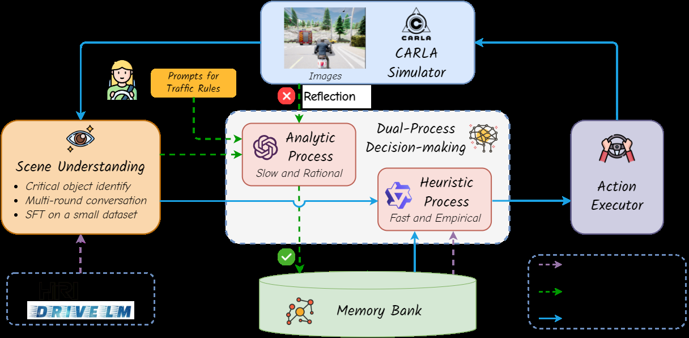
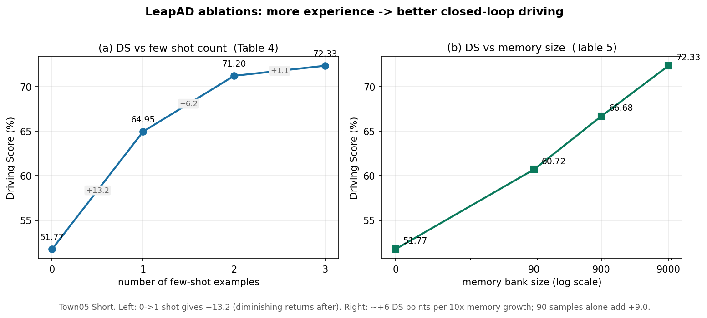

# 慢思考攒经验，快思考开车：LeapAD 的双进程记忆-反思闭环

> **信息块**
>
> - **论文标题**：Continuously Learning, Adapting, and Improving: A Dual-Process Approach to Autonomous Driving
> - **作者**：Jianbiao Mei*, Yukai Ma*, Xuemeng Yang, Licheng Wen, Xinyu Cai, Xin Li, Daocheng Fu, Bo Zhang, Pinlong Cai, Min Dou, Botian Shi‡, Liang He, Yong Liu‡, Yu Qiao（\* 共同一作，‡ 通讯；浙江大学 / 上海人工智能实验室 / 华东师范大学 / 上海交大）
> - **会议与年份**：NeurIPS 2024
> - **链接**：[arXiv:2405.15324](https://arxiv.org/abs/2405.15324)（本文依据 v2，2024-10-25） · [项目页](https://pjlab-adg.github.io/LeapAD/)
> - **代码是否公开**：公开，Apache 2.0。https://github.com/pjlab-adg/leapad（本文已 clone，`code/` 目录，读过 `team_code/` 核心实现，论文与代码的对照见"论文和代码的六处对照"一节）
> - **一句话核心洞见**：把 Kahneman 的双进程理论做成工程结构——GPT-4 做慢而准的 System-II，在闭环仿真里自动攒驾驶经验、反思事故；经验经监督微调蒸馏进 1.8B 小模型做 2Hz 的 System-I 快决策；记忆库检索 + 事故反思构成越开越好的闭环。

---

## 开环评测为什么测不出驾驶能力

读这篇论文要先理解它开火的对象。2023–2024 年涌现了一批"LLM 开车"的工作：GPT-Driver、DriveGPT4、LMDrive、Agent-Driver。它们的评测方式大多是开环的：拿一段人类驾驶数据，把模型输出的轨迹/决策和真值比误差。LeapAD 的引言直接质疑这种评测：开环误差小，不等于开得好。

这个质疑有一个具体的技术依据。开环评测里，模型每一帧都拿到真值历史作为输入，误差不会累积；闭环里，模型上一帧的输出决定下一帧的输入，一个小偏差会滚雪球。更关键的是，开环数据是人类司机开出来的，分布里天然没有"我犯错之后如何补救"的样本——而驾驶能力的相当一部分恰恰是犯错后的恢复。所以一个在开环 L2 上很好看的模型，进闭环可能连一个路口都过不去。论文引用 [13]（"Is ego status all you need"）支撑这个观点：开环指标和闭环表现经常脱钩。

LeapAD 的底气就来自这里：它是当时少数几个**在 CARLA 里做闭环评测**的 LLM 驾驶系统。表 1 的 Town05 Short benchmark 上报的是 Driving Score（DS）、Route Completion（RC）、Infraction Score（IS）——都是闭环跑出来的。这意味着它的每一个数字都经过了"犯错-累积-恢复"的考验，信息量和开环的 L2 不是一个量级。理解这一点，才能理解为什么作者敢拿 11K 数据去碰 3M 数据的 InterFuser：比的不是同一个东西的多少，而是"在闭环里开完路线"这个更硬的任务。

## "数据驱动只有归纳没有演绎"到底在指什么

引言里有一句很重的话：数据驱动方法"主要对观测到的模式做归纳，没有演绎能力，所以性能被标注数据的覆盖范围锁死"。翻译成具体场景：一个纯模仿学习的规划器见过一万次"前车刹车我也刹车"，它学到的是"前车刹车灯亮→我减速"这个统计关联；但它没有"前车刹车是因为它前面有障碍物，障碍物也可能影响我"这层因果链。一旦遇到训练分布外的组合（比如前车为了避让对向车辆而急停），关联可能还在，但该做的决策变了。

论文把"演绎能力"的来源指向 LLM/VLM 里沉淀的世界知识和交通规则常识。这是一个 2024 年很流行的论点，但 LeapAD 的版本有一个具体的工程落点：它不指望 LLM 直接开车（太慢），而是让 LLM 在**离线/低频**的位置做两件事——积累高质量驾驶经验（Analytic Process 跑闭环攒样本），和反思事故（找出哪一帧想错了）。"演绎"在这里不是玄学，它就是"用语言把因果链写出来，存进记忆库"。

## VLM 为什么只描述"关键对象"：这是在省什么

LeapAD 的第一个模块是场景理解，输入是车载相机图像，输出是自然语言的场景描述。但它不描述全图，只描述**关键对象**（critical objects）——那些可能影响驾驶决策的物体和设施。这个选择是在省两样东西。

第一，省决策模块的认知负荷。人类司机开车时不会逐像素处理画面，注意力只放在前车、行人、红绿灯等少数对象上。如果把整图 dense caption 喂给 LLM，prompt 里会混进大量无关细节（路边的树、远处的广告牌），干扰决策，还浪费 token。

第二，省检索的噪声。后面的 Heuristic Process 要靠场景描述的 embedding 去记忆库里检索相似场景（公式 1、2）。描述越冗长，embedding 里混进的无关信息越多，相似度计算越不准。先做"关键对象过滤"，等于在检索前做了一次特征选择。

每个关键对象 $O_i$ 的描述包含四个属性，论文给了明确定义：

- $A_{s,i}$（语义属性）：类别，是车辆、骑行者、行人，还是红绿灯、停车标志这类基础设施；
- $A_{l,i}$（空间属性）：边界框、所在车道、与自车的距离——碰撞避让直接用的量；
- $A_{m,i}$（运动属性）：运动方向；
- $C_{r,i}$（行为推理）：**为什么**这个对象关键、它如何影响自车决策。比如"自车直行时，右侧的停车标志很重要，因为它要求在路口停车"。注意 $C_r$ 已经不是感知，是推理——VLM 在这里被要求输出因果判断。

整个场景的描述记为 $D = \{A_{s,i}, A_{l,i}, A_{m,i}, C_{r,i}\}_{i=0}^{N-1}$，$N$ 是关键对象个数。$N$ 通常是个位数，这就是"简化环境描述"的定量含义：从百万像素到几个结构化对象描述。

VLM 本体是 Qwen-VL-7B，论文没有直接用开源权重，而是做了 SFT，指令微调数据 11K：6K 来自 Rank2Tell 和 DriveLM（真实世界驾驶问答数据），5K 来自 CARLA 自采（Town 01–04、06、07、10）。训练配置：AdamW（$\beta_1=0.9$、$\beta_2=0.95$）、余弦退火、初始学习率 $1e^{-5}$、batch 16、5 个 epoch、8 张 A100、约 26 小时、输入分辨率 $448\times448$。附录 B 给了 CARLA 自采数据的自动标注规则：前后左右视野内，20 米内的车辆/骑行者、或自车道内 60 米内的车辆/骑行者，40 米内的行人，以及控制行车方向的红绿灯和停车标志——这些阈值就是"关键"的操作定义。

看这张架构图时盯住三条线。蓝色实线是驾驶主回路：CARLA 图像 → 场景理解 → Heuristic 快决策 → 动作执行器 → 回到仿真器。绿色虚线是慢回路：事故触发反思（Reflection），Analytic 分析历史帧，修正后的经验落进记忆库（Memory Bank），再经 SFT 倒进 Heuristic。紫色虚线是 few-shot 检索：Heuristic 决策时从记忆库捞相似场景当例子。整张图的赌注就是：**绿线和紫线加起来，能让蓝线越开越好**。

## 公式 (1)(2)：场景压缩编码与余弦检索到底在算什么

全文只有两个公式，都在 3.4 节，管的是"怎么从记忆库里捞出相似场景"。先说它们要解决的问题：直接拿原始场景描述 $D$（几段自然语言）算文本相似度，冗余的语言信息会淹没真正决定驾驶行为的要素——"前面 8 米有辆车"和"前面 80 米有辆车"，在词袋层面可能很相似，在驾驶层面天差地别。所以先压缩，再编码，再比相似度。

**公式 (1)**：$$\mathbf{e} = T_e(F_c(D))$$

- $D$：当前场景的完整描述（上面那四个属性的对象集合），自然语言文本。
- $F_c$：压缩过程（compressing）。它把 $D$ 压成一句"压缩字幕"（compressed caption），只保留对驾驶决策最关键的要素：关键对象的**类别、所在车道、与自车的距离**。比如 $D$ 里对一辆车的描述有五六句话，$F_c$ 输出可能是 `"vehicle, ego lane, 8m"` 这样的短串。论文没有公布 $F_c$ 的具体实现（模板抽取还是 LLM 改写，[未核实]），但从代码看（`fetch_scene_summary`），它是一个把场景消息提炼成摘要的步骤——功能上就是一次有损压缩，**故意丢掉**语义细节，只留类别-车道-距离三元组。
- $T_e$：文本编码器，论文用的是 OpenAI 的 embedding 模型，把压缩字幕变成 embedding 向量 $\mathbf{e}$。维度未在论文中说明（OpenAI 当时的 text-embedding 系列是 1536 或 3072 维，[未核实]具体用的是哪一款）。
- $\mathbf{e}$：最终的场景向量，记忆库里每个样本都预存了一个。

几何直觉：$F_c$ 是把场景从"语言空间"投影到"驾驶要素空间"，$T_e$ 再把它变成高维向量。压缩的代价是信息丢失（比如丢掉了运动方向 $A_m$ 和行为推理 $C_r$），换来的是检索时**距离真正重要**——两个场景相似，当且仅当"关键对象在相似的位置上"。

**公式 (2)**：$$s(\mathbf{e}_q, \mathbf{e}_i) = \frac{\mathbf{e}_q \cdot \mathbf{e}_i}{\|\mathbf{e}_q\| \|\mathbf{e}_i\|}$$

标准的余弦相似度。$\mathbf{e}_q$ 是当前场景的向量，$\{\mathbf{e}_i\}_{i=0}^{M-1}$ 是记忆库里 $M$ 个样本的向量。取相似度最高的 top-$k$ 个样本，把它们的场景描述 $\{D_i\}$、推理 $\{R_i\}$、决策 $\{S_i\}$ 连同当前场景描述 $D_c$ 一起喂给 Heuristic Process，输出当前推理 $R_c$ 和决策 $S_c$。这就是 few-shot prompting 在这里的精确含义：例子不是手写的，是从记忆库里**检索**来的。

拿一个三维小例子验算一遍，确认公式的行为。设压缩字幕的 embedding 只有 3 维（示意）：

- 当前场景 $\mathbf{e}_q = (0.9, 0.1, 0.4)$（"自车道 8 米有车"）
- 记忆样本 A $\mathbf{e}_A = (0.85, 0.12, 0.38)$（"自车道 10 米有车"）
- 记忆样本 B $\mathbf{e}_B = (0.1, 0.9, 0.2)$（"左侧车道有车，距离远"）

算 $s(\mathbf{e}_q, \mathbf{e}_A)$：点积 $= 0.9\times0.85 + 0.1\times0.12 + 0.4\times0.38 = 0.765 + 0.012 + 0.152 = 0.929$；$\|\mathbf{e}_q\| = \sqrt{0.81+0.01+0.16} = \sqrt{0.98} \approx 0.990$；$\|\mathbf{e}_A\| = \sqrt{0.7225+0.0144+0.1444} = \sqrt{0.8813} \approx 0.939$；相似度 $\approx 0.929/(0.990\times0.939) \approx 0.999$。

算 $s(\mathbf{e}_q, \mathbf{e}_B)$：点积 $= 0.09+0.09+0.08 = 0.26$；$\|\mathbf{e}_B\| = \sqrt{0.01+0.81+0.04} = \sqrt{0.86} \approx 0.927$；相似度 $\approx 0.26/(0.990\times0.927) \approx 0.283$。

0.999 对 0.283——检索会毫不犹豫地选 A。这就是压缩编码想要的效果：方向（余弦）只关心"要素的相对配比"，不关心向量的绝对长度（比如描述文字的长短）。但反例也在这里：如果两个场景的要素配比相同但**绝对距离**不同（8 米 vs 80 米），压缩字幕里距离是作为文本 token 进去的（"8m" vs "80m"），embedding 能不能分出这两个 token 的数值差异，完全取决于 OpenAI embedding 模型对数字的敏感度——论文没有验证这一点。这是一个真实的隐患：余弦相似度对"8m/80m"这种数值差异的区分能力，是未经检验的。

## 跟着一次追尾把反思机制走完

反思（reflection）是"持续改进"这个标题承诺的核心机制。把它完整走一遍，看每个状态量。

**触发。** Heuristic Process 以 2Hz 输出 meta-action（AC/DC/IDLE/STOP），经动作执行器变成油门刹车方向盘。系统维护一个队列 $\mathbf{Q} = \{(D_i, R_i, S_i)\}_{i=0}^{9}$：最近 10 个样本，每个样本是（场景描述，推理，决策），采样频率 1Hz。注意 2Hz 决策但 1Hz 存档——队列覆盖的是**过去 10 秒**。一旦 CARLA 的事件系统报告事故（碰撞、闯红灯等），反射立即触发。

**输入。** 队列里 10 个样本的 $(D, R, S)$ 全部送进 Analytic Process（GPT-4），附带事故的事件消息。prompt（附录 C 图 11，代码里的 `REFLECTION_SYSTEM_PROMPT`）要求它做三件事：定位是哪一帧的推理错了，指出错误是什么，给出修正后的推理和决策。代码里对 GPT-4 输出的解析是写死的正则：用 `## Time\ntime=\d+` 找它指认的关键帧，用 `## Reasoning.*?## Decision\n\w+` 抠出修正后的推理和决策。也就是说，反思机制的有效性依赖于 GPT-4 **严格遵守输出格式**——格式一乱，正则抠空，这次反思就白做了。论文没提格式失败率。

**入库。** 被修正的样本（修正后的 $R$、$S$，配上原场景 $D$）写进记忆库。注意代码里还有一个论文没写的细节：`history_info[::SAMPLE_INTER]`，`SAMPLE_INTER=2`——10 个样本隔一个取一个，实际只送 5 帧给 GPT-4。可能是为了省 token，论文里没交代。

**效果。** 附录 F 图 16 给了一个具体案例：追尾发生后，Analytic 回看发现第 -2 帧错了——Heuristic 把 6.98 米外的前车误判为非关键对象，对"自车速度 vs 安全距离"的关系理解错误，在应该 STOP 的地方输出了 IDLE。修正样本入库后，同类场景下次会被检索出来当 few-shot 例子。这就是"从错误中学习"的完整回路：错误 → 定位 → 修正 → 入库 → 下次检索命中。

这个机制真正聪明的地方在于**触发条件**：只在事故时调用 GPT-4。平时开车全是 1.8B 小模型在跑，贵的大模型只在"出事"这个稀有事件上花钱。这是对"LLM 太慢太贵不能进闭环"这个死结的一个务实回答——不是让 LLM 变快，而是让它少干活。

## GPT-4 的慢思考是怎么"倒"进 1.8B 小模型的

Heuristic Process 的本体是 Qwen1.5-1.8B，一个 18 亿参数的小模型。论文直说：不做 SFT 的小模型"完全给不出像样的驾驶决策"。知识的转移分两路：

**第一路：SFT 蒸馏。** Analytic Process（GPT-4）+ VLM 在闭环里跑，攒下 9.0K 个样本（场景描述 $D$、推理 $R$、决策 $S$），存进记忆库。然后用这 9K 样本对 Qwen1.5-1.8B 做监督微调，5 个 epoch，约 6 小时（VLM 的 SFT 用了 26 小时）。这就是一次经典的**知识蒸馏**，只不过老师不是输出 soft label，而是输出"带推理过程的驾驶样本"，学生学的是"在场景 $D$ 下，先写推理 $R$，再输出决策 $S$"这个完整行为。论文报告 Heuristic 比 Analytic 快约 5 倍——注意这个"5 倍"没有给绝对延迟数字（GPT-4 API 调用 vs 本地 1.8B 推理，[未核实]具体毫秒数），但方向是对的：2Hz 的决策频率下，GPT-4 的 API 延迟根本进不了闭环，1.8B 本地模型可以。

**第二路：few-shot 检索。** SFT 之后的小模型开车时，每次决策前先从记忆库捞 top-3 相似场景（公式 2），把它们的 $(D, R, S)$ 当例子拼进 prompt。这相当于给小模型配了一个**外挂记忆**：SFT 把经验压进权重，few-shot 把经验摆在眼前。表 2 的消融显示，只开 SFT 不开 few-shot（Town05 上 66.40），只开 few-shot 不开 SFT（69.90），都开（78.07）——两路是互补的，不是重复的。

这里有一个微妙的设计选择：记忆库的样本是**自然语言**的（$D$、$R$、$S$ 都是文本），所以它"可迁移"——换一个小模型，只要会读文本就能用。论文 4.4 节验证了跨 town 的迁移（Town05 攒的经验拿到 Town01/Town04 用），但没有验证跨模型迁移（比如把记忆库给另一个 1.8B 模型）。"transferable memory bank"这个说法，目前只被验证了一半。

## 表 1 到底赢了谁、没赢谁

主实验是 CARLA Town05 Short benchmark。先把表 1 的关键行摆出来（DS / RC，单位 %）：

| 方法 | 模态 | 类型 | 标注量 | DS | RC |
|---|---|---|---|---|---|
| InterFuser | 激光+相机 | 数据驱动 | 3M | 94.95±1.91 | 95.19±2.57 |
| TransFuser | 激光+相机 | 数据驱动 | 228K | 54.52±4.29 | 78.41±3.75 |
| VAD | 相机 | 数据驱动 | 228K | 64.30 | 87.30 |
| NEAT | 相机 | 数据驱动 | 130K | 58.70±4.11 | 77.32±4.91 |
| Roach | 相机 | 数据驱动 | - | 65.26±3.63 | 88.24±5.16 |
| WOR | 相机 | 数据驱动 | 1M | 64.79±5.53 | 87.47±4.68 |
| VLM + GPT-4 | 相机 | 知识驱动 | 11K | 81.31±2.37 | 94.22±3.18 |
| LeapAD（w/o Town05） | 相机 | 知识驱动 | 11K | 75.73±1.36 | 92.10±1.44 |
| LeapAD | 相机 | 知识驱动 | 11K | **83.11±0.28** | **94.98±0.54** |

（数字已从原文 HTML 版逐格核实；LBC、CILRS 等低分方法略去。）

三个结论是实的。第一，在**纯相机**方法里，LeapAD 的 83.11 确实是最高的，超过 VAD（64.30）、NEAT、Roach、WOR 等一众数据驱动方法。第二，数据效率的差距是数量级的：11K 对 3M（InterFuser），272 倍；对 228K（VAD/TransFuser），约 20 倍。摘要里"1–2 个数量级"的说法，取的是中间值，基本诚实（272 倍严格说是 2.4 个数量级，往多了说了点）。第三，LeapAD（w/o Town05）用没见过 Town05 的记忆库就能到 75.73，超过所有纯相机数据驱动方法——说明知识驱动范式本身有东西，不全是"在测试 town 上刷经验"刷出来的。

但有两个限定必须同时说。第一，**Town05 Long 上 LeapAD 没赢**。附录 E 的表 3：LeapAD DS 51.7、RC 100、IS 51.7；TCP（纯相机，420K 标注）DS 57.2。摘要里"超越所有纯相机方法"这个说法没有加"在 Town05 Short 上"的限定，读到附录才发现 Long 上被 TCP 反超。Long 路线更长（平均路线长度大一个量级），LeapAD 的 RC 是 100%（全程跑完）但 IS 只有 51.7——说明它**能跑完但一路违章**，长距离下小模型的错误累积还是压不住。这是双进程架构的一个真实短板，论文把它藏在了附录里。

第二，**83.11 对 81.31（VLM+GPT-4）的对比不完全公平**。VLM+GPT-4 是"没微调的 GPT-4 直接当决策器"，记忆库是空的；而完整版 LeapAD 的记忆库是 18K 样本，其中包括在 Town05 本地攒的经验和 0.1K 条 Town05 反思数据。也就是说，一个是没见过考场的 GPT-4，一个是见过考场的 1.8B+记忆库。论文自己也报告了公平的对比：LeapAD（w/o Town05）75.73 < VLM+GPT-4 81.31——**没见过测试 town 时，蒸馏后的小模型打不过 GPT-4 本人**。这个差距恰恰说明了 GPT-4 世界知识的价值，也说明 LeapAD 超过 GPT-4 的那 1.8 个点（83.11 vs 81.31）主要来自"在测试 town 上积累的本地经验"，而不是"蒸馏出了更强的通用能力"。论文把三个配置都摆出来了，这一点上是诚实的；但摘要只提了 83.11，叙事重心放在"小模型超越 GPT-4"上，读者需要自己去看 w/o Town05 那一行才能看到完整故事。

## 两张消融曲线：经验越多，开得越好吗

4.4 节的消融是"持续学习"这个标题承诺的定量证据。两张表值得画出来看。

**表 4（few-shot 数量）**：0-shot 51.77 → 1-shot 64.95 → 2-shot 71.20 → 3-shot 72.33。0 到 1 的跳跃最大（+13.2），1 到 2 次之（+6.3），2 到 3 只有 +1.1。典型的收益递减。注意 0-shot 的 51.77 是"SFT 过但不用记忆检索"的小模型——光靠权重里的蒸馏经验就能跑 51.77，说明 SFT 本身已经把不少东西压进了 1.8B 参数。

**表 5（记忆库规模）**：0 → 90 → 900 → 9000，DS 是 51.77 → 60.72 → 66.68 → 72.33。横轴取对数后接近直线——记忆规模每扩大 10 倍，DS 涨约 6 个点。这就是"持续改进"最直观的证据，也是全文最漂亮的一张潜在曲线：它暗示只要接着攒经验，分数还会往上涨（当然外推要谨慎，收益递减迟早会到来，论文没有测 9K 以上的点）。

看右图时注意一个细节：记忆库从 0 加到 90，DS 涨了 8.95 个点——90 条经验就有这么大作用，说明 few-shot 检索的**精度**很高（捞出来的例子确实相关），而不是靠量堆出来的。这和公式 (1) 的压缩编码设计是自洽的：检索准，例子才有用。

## 表 4 里对不上的那个数字

论文 4.3 节明确定义：DS = RC × IS（路线完成度乘以违章扣分）。拿这个定义去验算表 4：

- 1-shot：RC 100.0，IS 64.95 → 100×64.95/100 = 64.95，DS 也是 64.95。对上了。
- 3-shot：100×72.33/100 = 72.33，对上了。
- 0-shot：99.72×52.45/100 = 52.30，DS 却是 51.77。差 0.53。
- 2-shot：94.86×73.60/100 = 69.82，DS 却是 71.20。**差 1.38，对不上了。**

这不是笔误，而是一个常见的统计口径问题：DS 是**每条路线先算 RC×IS，再对所有路线取平均**；而表里列出的 RC、IS 也是各自取平均。"平均的乘积"不等于"乘积的平均"——当 RC 和 IS 在不同路线上负相关时（跑得远的路线违章多），两者就会分开。2-shot 那一行 RC 掉到 94.86（有路线没跑完），恰恰是分歧最大的。所以正确的读法是：**不要拿表里的 RC×IS 去复算 DS**，DS 是独立统计量。这个细节论文没有说明，但它提醒读者：CARLA leaderboard 的 DS 方差来源比看起来复杂，1–2 个点的差异可能只是路线构成不同。

## 论文和代码的六处对照

clone 下来的仓库（`code/`）和论文对得上多少，逐项记：

**对上的四处。** 第一，PID 增益：论文附录 A 纵向 $K_P=5.0, K_I=0.5, K_D=1.0$（40 帧缓冲）、横向 $K_P=1.0, K_I=0.5, K_D=0.2$（20 帧缓冲），代码 `setup()` 里 `speed_KP/KI/KD=5.0/0.5/1.0, speed_n=40`、`turn_KP/KI/KD=1.0/0.5/0.2, turn_n=20`，逐字一致。第二，决策频率：论文 2Hz，代码 `LLM_FREQENCE=2`。第三，few-shot 默认 3，代码 `FEW_SHOT=3`。第四，反思队列 10 个样本，代码 `REFLECTION_SAMPLES=10`，`queue_for_reflection` 满 10 踢出最老——和附录 D 的 $\mathbf{Q}=\{(D_i,R_i,S_i)\}_{i=0}^{9}$ 一致。meta-action 的语义也一致：代码 `update_desired_speed` 里 AC 加 1.0、DC 减 1.0、STOP 置零，对应论文"AC 是加速 1m/s"。

**对不上的两处（都是代码比论文新）。** 第一，论文写 Analytic 用 GPT-4，代码 `request_openai` 的默认模型是 `gpt-4o`——仓库是论文发表后继续维护的，模型升级了，论文冻结在 GPT-4。第二，论文说反思时把队列样本送进 Analytic，代码里实际送的是 `history_info[::SAMPLE_INTER]`（`SAMPLE_INTER=2`，隔一取一，只送 5 帧）——论文没提这个子采样。此外论文说文本编码器用 OpenAI embedding 模型，代码里记忆库是预计算好的 `test.npy` 向量 + chromadb 做余弦检索——功能一致，实现上把在线编码换成了离线查表，这属于工程优化，不算矛盾。

代码里还有一处论文完全没写的工程现实：`SYSTEM_PROMPT`（`prompts.py`）里塞了大量手写交通规则（红灯、停车标志距离阈值、跟车距离等，十几条 if-else 式的规则）。也就是说，Analytic 的"常识"不全是 GPT-4 自带的，有一部分是作者手写的 prompt 规则。论文附录 C 说"我们发现给 LLM 配上特定交通规则的 prompt 更安全"，但没展开说这些规则占多大比重。从代码看，这个 prompt 是系统安全的实际兜底——如果哪天 GPT-4 换了版本，这些手写规则才是行为下限。这不算学术不端（prompt 工程本来就是方法的一部分），但读者应该知道：LeapAD 的安全性里有一块是**人工规则**，不是学出来的。

## 几处硬伤，和几处诚实

**硬伤一：引用错误。** 4.4 节写"our approach surpasses several methods (e.g., CLIRS [63], LBC [48] in Table 1)"。参考文献 [63] 是 Raffel 等人的 T5 论文（"Exploring the limits of transfer learning with a unified text-to-text transformer"），和驾驶毫无关系。作者想引的显然是 CILRS（Codevilla 等，"Exploring the **limitations** of behavior cloning"，[47]）——名字像、主题对、就在表 1 里。这是把 CILRS 错打成 CLIRS 又错挂了编号，一处笔误叠一处编号错误。审稿时没被抓出来，说明大家都没细看这行。

**硬伤二："无人工标注"的限定词游戏。** 论文多次强调标注效率："dual-process decision module does not involve human annotations"。主语限定在"决策模块"是准确的——记忆库确实是闭环自动攒的。但 VLM 的 11K 微调数据里，6K 来自 Rank2Tell 和 DriveLM，这两个都是**人工标注**的真实世界数据集。摘要里"requiring 1-2 orders of magnitude less labeled data"没提这 6K 的人工成分。一个不细读的读者会以为整个系统 11K 全是自动来的。公允的表述应该是：决策经验零人工标注，感知部分用了 6K 人工标注数据。论文没有主动澄清这一点。

**硬伤三：反射实验的路线是挑过的。** "Reflective experiments are conducted by selecting routes with scores below 50"——专门挑低分路线做反射，然后报告分数涨了。低分路线重跑一次，分数回归均值也会涨一部分；CARLA 仿真本身有随机性（论文自己也承认"individual sequence scores temporarily decrease, potentially due to the inherent randomness"）。这个实验设计里，"反射的功劳"和"重跑的运气"没有分开。正确的做法应该是设一个对照组：同样这些低分路线，不加反射直接重跑，看涨多少。但论文没做。

**硬伤四：±0.28 的标准差。** LeapAD 的 DS 报的是 83.11±0.28，而 VLM+GPT-4 是 ±2.37，InterFuser 是 ±1.91。CARLA 闭环评测里 0.28 的标准差小得不寻常——它可能是多次运行的标准差（那说明系统极其稳定，好到可疑），也可能是"多次路线"的标准误（那和别人的 ± 不是一个口径）。论文没有说明这个 ± 是怎么算的、几次运行、什么随机种子。在没有这个信息的情况下，83.11 和 81.31 的差距（1.8 个点）是否显著，无法判断。

**诚实一：失败案例。** 附录 F 放了两个失败案例：闯红灯（单帧输入没有黄灯剩余时间信息，DC 减速过线被判闯红灯）、被撞（VLM 没看到视野边缘的车，且 CARLA 里其他车不会让行）。"单帧无时序"是架构的原生缺陷，作者没有藏着，还指出了 VLM 视野边缘漏检这个具体机制。这种自我解剖在 LLM 驾驶论文里不多见。

**诚实二：局限性。** 第 6 节承认三点：只用单帧图像、VLM 不能参与反射、CARLA 和真实世界的 gap。特别是第二点——VLM 不参与反射意味着感知错误（比如漏检）永远进不了记忆库的修正流程，反思只能修正决策错误，修正不了"看错"。这个自我批评是准的，它指出了双进程架构的一个结构性不对称：慢思考能教快思考怎么做决定，但教不了它怎么看。

## 作者的底牌是什么

三张牌。最硬的一张是**闭环评测本身**。2024 年中的时间点上，LLM 驾驶论文绝大多数是开环的，LeapAD 拿 CARLA Town05 的 DS/RC/IS 说话——这个评测选择本身就是壁垒：它逼着系统处理误差累积，而这是 LLM 最不擅长的。审稿人看到闭环数字，会天然地给更高权重。第二张是**数据效率的叙事**：11K 对 3M，272 倍，标题里"Continuously Learning"的"持续"二字配上记忆规模的对数增长曲线（表 5），讲的是一个"越开越便宜"的故事——这对工业界的胃口。第三张是**云边架构的现成映射**：结论里明确写 Heuristic 跑在车端、Analytic 跑在云端。这不是事后贴金，整个双进程设计（慢模型只在事故时触发）就是按这个部署图长的。

三张牌的共同点是：**都不依赖某一次 GPT-4 输出的质量**。这是 LeapAD 和同期很多"GPT-4 开车" demo 的本质区别——它的贡献在架构和流程，不在某次惊艳的输出。这也是为什么它能进 NeurIPS 而不只是一个 workshop demo。

## 带走什么：给 RAMP 的三条

读完这篇，对 RAMP 项目（世界模型+自适应衰减情景记忆+多规划器调度）有三条具体的启示。

第一，**记忆检索前的压缩是必要的**。LeapAD 的公式 (1) 说明：直接对原始场景描述算相似度，冗余语言信息会污染检索；先压成"类别-车道-距离"三元组再编码，检索精度才够。RAMP 的情景记忆检索面临同样的问题——完整的场景描述里混着大量与决策无关的细节。LeapAD 的压缩要素（类别、车道、距离）可以照搬，RAMP 还可以加一个自己的要素：**风险等级**。风险加权记忆的检索键应该是"要素+风险"，而不是纯要素。

第二，**反思机制和风险加权是互补的**。LeapAD 的反思是"事故触发、GPT-4 复盘、修正入库"；RAMP 的风险加权衰减是"高风险记忆留得久"。两者可以拼起来：反思产生的修正样本，天然就是高风险样本，应该给更高的初始权重和更慢的衰减。LeapAD 的论文没有做"记忆按重要性差异化保留"，它的记忆库是只增不减的（9K→18K），长期跑下去检索会越来越慢、旧经验会稀释新经验——这正是 RAMP 的自适应衰减要解决的问题。从这个角度看，RAMP 的创新点 A（风险加权自适应衰减）恰好补上了 LeapAD 留下的洞。

第三，**慢思考的触发条件值得抄**。LeapAD 只在事故时调用大模型，平时全用小模型。这个"稀有事件触发慢思考"的模式，可以直接用在 RAMP 的闭环风险校验上：世界模型的未来预测平时用轻量 rollout，只在预测到高风险分叉时才触发完整的 LLM 调度器重规划。把贵的计算花在刀刃上，而不是每一帧都全量跑——LeapAD 已经验证了这个模式在闭环里是 work 的。

结尾回到这篇论文的位置。它不是第一个把 LLM 用在驾驶上的，也不是开环指标最高的，但它是第一个把"人类怎么学会开车"（慢思考攒经验→快思考开车→事故后复盘）完整工程化、并在闭环 benchmark 上跑出数字的。它的所有设计——关键对象过滤、压缩检索、事故触发反思——都在回答同一个问题：**大模型太慢太贵，怎么做才能让它在驾驶系统里真正干活？** 答案是：让它少干活，只在攒经验和复盘时干。这个答案到今天都成立。
