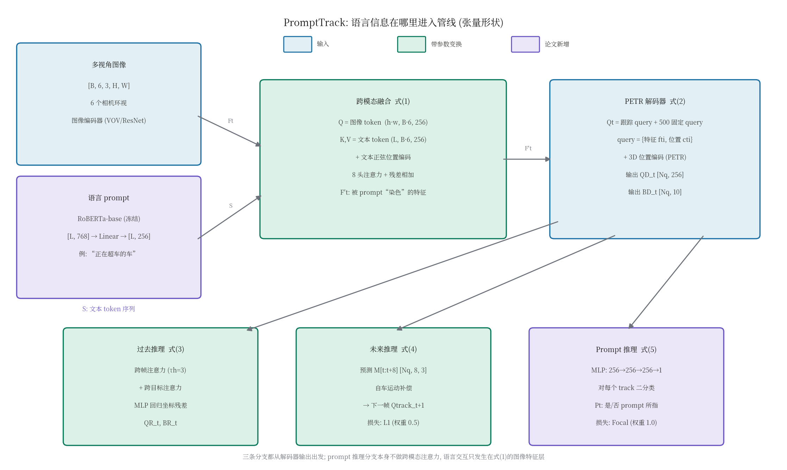

# 先给图像染上语言的颜色，再去跟踪：NuPrompt 与 PromptTrack

> **论文标题**：Language Prompt for Autonomous Driving
> **作者**：Dongming Wu*, Wencheng Han*, Yingfei Liu, Tiancai Wang, Cheng-zhong Xu, Xiangyu Zhang, Jianbing Shen（* 为共同一作；工作完成于第一作者在 MEGVII 实习期间，通讯作者 Jianbing Shen）
> **会议**：AAAI 2025（AAAI-25），pp. 8359–8367
> **链接**：https://ojs.aaai.org/index.php/AAAI/article/view/32902（DOI: 10.1609/aaai.v39i8.32902；本文依据该 ojs 官方 PDF 精读）
> **代码**：公开，https://github.com/wudongming97/Prompt4Driving（本文核对了关键实现，论文与代码不一致处见"代码告诉你的三件事"一节）
> **一句话核心洞见**：这篇论文真正的赌注是数据集 NuPrompt——用"属性标注→逻辑组合→LLM 造句"的半自动管线，把 3D 环视多帧场景里的语言指代做成一个可以规模化标注的问题；模型 PromptTrack 只是证明这个任务可解的基线，它的全部语言能力集中在一个 8 头交叉注意力里（图像 token 去查文本 token），而那个听起来很重的"prompt 推理分支"，在代码里只是一个二分类 MLP。

先看一个具体的场景，这是论文 Fig. 1（p. 8359）押的赌注。nuScenes 的一段 20 秒视频，6 个相机环视。prompt 是英文一句："the cars in the process of overtaking"（正在超车的车）。被指代的目标：一辆从本车后方出现、从左侧车道超过本车、开到前方的轿车。它的轨迹跨越了 Back、Back Left、Front Left、Front 三个相机的视野，在 20 秒里从远到近再到远。

这个问题为什么难？把它和此前的语言指代数据集并排放。Talk2Car（2019）：一张图里指一个目标，"指"是单帧单目标。Refer-KITTI（2023，第一作者 Wu 的上一篇工作）：视频里可以指多个目标，但那是 2D 单目图像。NuScenes-QA（2023）：3D 多视角了，但问的是场景级问答，不做实例级的细粒度对应。NuPrompt 要的，是**一张 prompt 同时指住 3D 空间里、多个相机之间、连续多帧上的任意多个目标**，平均每个 prompt 指 7.4 条轨迹。之前的任何一个数据集都不支持这个任务，因为没有人有 40,147 条"3D 实例–文本"对。

所以这篇论文首先要回答的不是"模型怎么做"，而是"数据从哪来"。3D 实例和文本的配对标注贵到做不下去——给 850 段视频里的每个目标逐帧写自然语言描述，人工成本是天文数字。作者的解法是把标注拆成三步，让人工只做最便宜的那部分，让 LLM 做最贵的那部分。这条管线是全文最值得细看的东西，模型反而是顺带的。

## 时间坐标：2023 年的 PF-Track，2025 年的 AAAI

把这篇工作放回时间线，它的每个选择都好理解了。

2023 年 6 月，PF-Track（Pang et al., CVPR 2023）发表：纯相机 3D 多目标跟踪，用"过去推理 + 未来推理"两条分支做时序建模，在 nuScenes 跟踪榜上是当时的强 baseline，而且代码公开。2023 年 9 月，本文第一作者 Wu 把 Refer-KITTI（CVPR 2023）做出来：2D 视频多目标指代。同年 9 月，本文的 arXiv v1 上线（arXiv:2309.04379）。2024 年 12 月被 AAAI 2025 接收，2025 年 3 月更新 v2（即 ojs 正式版）。

这个时间线解释了两个关键选择。第一，基模型选 PF-Track：2023 年下半年它是"拿来就能用的最强开源 3D 跟踪器"，作者不需要重新发明跟踪，只需要在它的输入端加语言。第二，文本编码器用 RoBERTa 而不是 CLIP 文本塔：2023 年的 3D 感知社区用 RoBERTa/BERT 做语言端是常规操作（DETR 系的指代工作都这么干），CLIP 的文本编码器虽然见过图像，但在 3D 驾驶这种长尾属性词（"正在超车"、"打着双闪"）上的优势并不确定，而 RoBERTa 便宜、稳定、冻结后不占训练显存。

还要说清楚这篇论文的类型：**数据集 + 新任务定义 + baseline 模型**。它的分量大头在 NuPrompt 和任务形式化上，PromptTrack 在摘要里自己就说是 "a simple end-to-end baseline"。读的时候如果把 PromptTrack 当成一个精心设计的 SOTA 模型来期待，会失望；如果把它当成"证明这个任务能被端到端模型解到什么程度"的标尺，它是合格的。

## 作者的底牌：三张牌，第四张是诚实

推测作者投稿时的底气（以下为推断，依据附后）：

第一张牌是**标注管线本身**。领域里所有人都说"缺 3D 实例–文本对"，作者拿出了一条把 850 段 nuScenes 视频变成 40,147 条 prompt 的半自动管线：人工只点"属性标签"，组合和造句交给规则 + GPT-3.5。这张牌的硬度在于可复现的成本数字：23,368 个人工标注的语言元素，变成 40,147 条 prompt，人工只做了第一步里的点选。这是对"数据瓶颈"这个公认痛点的直接回答。

第二张牌是**评测协议的设计**。新任务最怕评测含糊。作者把 nuScenes 跟踪社区最认的 AMOTA 拿过来，改成类别无关（class-agnostic）、按 prompt-video 对平均。审稿人一看就懂，不需要学一套新指标。

第三张牌是**站在 PF-Track 肩膀上**。新任务没有 baseline 可比，作者干脆把 DQTrack、ADA-Track、CenterPoint 这些开源跟踪器都接上自己的 prompt 模块一起测。基线是"改过的"，这一点后面要细说，但至少每个数字都是在同一套评测协议下跑出来的，不是抄的。

第四张牌比较特殊，是**诚实**。全文最好的 AMOTA 是 0.259——绝对值很低。作者没有藏着掖着，反而把"统一描述（LLM 生成的流畅句子）比原子属性标签更难"（0.242 vs 0.271，表 5）这种不好看的结论也摆出来了。一个 benchmark 论文敢把"任务很难、我们自己的 baseline 也只做到 0.259"放在台面上，比把数字刷高更让人信服。

## NuPrompt 的三步标注：人工只做最便宜的那部分

Fig. 2（p. 8361）画了整条管线。把它拆开看，每一步都在回答"怎么把人工成本压下去"。

**第一步：语言元素采集。** "语言元素"指目标的一个原子属性：颜色（白、红、黑）、动作（行驶中、停下、过马路）、位置（左、右、后）、类别（车、行人）。标注员的界面是一个点选工具：输入属性词，用鼠标点中视频序列里对应的 3D 框；当目标状态变化、不再属于这个属性时，再点一次把它从列表里移除。注意这个设计的聪明之处：**标注员永远不需要写句子，只需要做"属性–框"的二元匹配**，而且一个属性一旦标上，会沿着视频序列自动延续，直到状态变化才需要人工干预。长视频里目标的属性大部分时间不变，所以均摊下来每个属性的人工操作很少。为了保证表达多样性，每段视频分给 5 个独立标注员各写一套属性，另有 2 个标注员复核属性和目标的匹配。

**第二步：语言元素组合。** 把属性做逻辑组合，生成"属性集合–框集合"的对应关系。论文里只用了一种逻辑关系：**AND**。选"白"的所有框和选"车"的所有框取交集，得到"白色的车"的框集合。为什么只用 AND？（这是我的推断：）OR 会让指代集合爆炸且语义模糊（"白的或在动的"指谁？），NOT 需要全集补集操作在跟踪评测里不好定义；AND 保持了"描述越具体、目标越少"的单调性，评测最干净。作者说"手动选择一些有意义的组合，再随机生成很多组合"，随机组合保证覆盖，手动组合保证质量。

**第三步：LLM 造句。** 有了"属性组合–框集合"，还缺一句人话。人工写 16,761 种组合的句子太贵，于是用 GPT-3.5：给它属性词（比如 pedestrians, moving, red, not in the left），让它生成"The objects are red pedestrians, currently in motion, not situated on the left side." 这样的句子。同一个组合 prompt 多次，拿到多种表述。最后人工过滤掉写错的描述。

这里有一个值得停下来想的细节：**否定词是怎么进来的？** 第二步的组合逻辑只有 AND，但第三步的例子里出现了 "not in the left"。说明否定不是从集合运算来的，而是 LLM 在造句时自己加的语言包装（"不在左侧"对应的是属性组合里"没有 left 这个元素"）。这意味着数据里存在"属性层面没有、语言层面有"的否定表达，模型必须从"缺席"中读出否定——这对 grounding 是额外的难度。论文没有讨论这一点，但表 5 里统一描述（富含这种 LLM 式包装）比原子属性难 0.029 个 AMOTA 点，可能部分源于此。

三步走完的数字：23,368 个人工语言元素 → 16,761 种经 LLM 生成的统一描述 → 总计 40,147 条 prompt；其中去重后语言元素与语言组合各 12,001 种（两个数字完全相等，有点蹊跷，论文未解释，可能是巧合或统计口径所致，记为一处小的未交代）。850 段视频，700 训练 / 150 验证，沿用 nuScenes 的划分。每段视频平均 47 条 prompt。

Fig. 3（p. 8362）的三个统计图值得一看：词云里高频词是 black、white、red（外观）、front、left、right（位置）、walking、moving、crossing（运动）——说明 prompt 的语义重心是"可观测属性"，这正是第一步人工标注能覆盖的；实例数分布显示多数 prompt 指 1–10 个目标，尾巴拖到 20 个以上，平均 7.4。

一个小的数字出入：摘要和 §3.2 正文都说 40,147 条 prompt，但表 1（p. 8360）的 #Prompts 一栏写着 40,776。差了 629 条。论文没有解释这个差值，可能是表 1 统计时把某种 prompt-video 对重复计了，也可能是笔误。**[未核实]**——不影响主要结论，但说明作者在数字上不够仔细。

## 评测协议：为什么 AMOTA 要按 prompt-video 对平均

任务定义一句话：给定多帧多视角图像和一句自然语言 prompt，跟踪 prompt 描述的所有 3D 目标，并预测它们的轨迹。包含两个子任务：多目标跟踪、运动预测。

评测指标的选择很讲究。跟踪用 AMOTA（Average Multiple Object Tracking Accuracy），但和 nuScenes 原版有一个关键区别：**类别无关**。nuScenes 的 AMOTA 是在 7 个类别上分别算再平均，而 NuPrompt 里 prompt 可以跨类别（"正在过马路的行人和车"），所以作者对"所有 prompt-video 对"逐个算 AMOTA 再取平均。辅助指标是 AMOTP（精度）和 IDS（ID 切换次数）。运动预测用 ADE/FDE，预测未来 8 帧。

"按 prompt-video 对平均"这个平均方式有一个隐含的加权选择：**指 1 个目标的 prompt 和指 20 个目标的 prompt 权重相同**。这意味着一个只指住单辆车的简单 prompt，和"所有白色的车"这种难 prompt，在总分里平起平坐。作者没有讨论这个选择。一种替代方案是按实例数加权，但那样长尾的难例会主导分数。当前方案的实际效果是：分数更能反映"在多少种语言描述上跟踪是对的"，而不是"多少个目标被跟对了"。理解这一点，才能正确解读 0.259 这个数字——它不是"只跟对了四分之一的目标"，而是"在各类 prompt-video 对上的平均跟踪准确率"。

## PromptTrack：语言在哪个位置进入管线

Fig. 4（p. 8363）是全文第一张方法图，也是作者押的模型赌注。先看整体，再逐个公式。



*自绘图。形状依据论文式 (1)–(6) 与官方代码（`tracker_prompt.py` 的 `fusion_module`、`spatial_temporal_prompt_reason.py`、配置文件 `f3_prompttrack.py`：hist_len=3、fut_len=8、500 个固定 query）。*

这张图要传达的核心判断是：**PromptTrack 的语言交互只发生在一个地方——式 (1) 的图像特征层**。prompt 文本被 RoBERTa 编码后，不去碰 query，不去碰解码器，而是直接对整张图像的特征图做一次"染色"：每个像素的特征向量去查一遍文本 token，把相关的词义揉进自己。之后的所有模块（解码器、过去/未来推理）都在"被语言染过色"的特征上工作。最后的 prompt 推理分支只做一件事：对每个跟踪到的目标二分类——"你是不是 prompt 说的那个"。

### 式 (1)：一次 8 头交叉注意力，图像 token 查文本 token

$$F'_t = \text{CrossModalAttn}(Q=F_t,\ K,V=S,\ PE=\text{Pos}(S))$$

符号形状（同一行给全，不让读者翻回去找）：$F_t$ 是时刻 $t$ 的视觉特征，$S$ 是语言特征。代码里（`tracker_prompt.py` 第 350–366 行）这个过程长这样：

- 文本侧：prompt 字符串经 RoBERTa-base（冻结，`freeze_prompt_encoder=True`，权重从本地 `./roberta_base/` 加载）得到 `last_hidden_state`，形状 $[B, L, 768]$，$L$ 是 token 数；再过一个 Linear 投影到 $[B, L, 256]$，这就是 $S$。文本 token 再加一个一维正弦位置编码（`PositionEmbeddingSine1D`，和 DETR 那套正弦编码同族），这就是 $PE=\text{Pos}(S)$。
- 图像侧：每个特征层的特征图形状是 $(B\cdot 6, 256, h, w)$（batch 乘 6 个相机压平），展平成 $(h\cdot w,\ B\cdot 6,\ 256)$ 的 token 序列，这就是 $Q=F_t$。
- 注意力：`fusion_module` 就是一个 `nn.MultiheadAttention(d_model=256, nhead=8)` 加残差：

```python
tgt2 = self.fusion_attn(query=tgt,            # 图像 token
                        key=memory + pos,     # 文本 token + 位置编码
                        value=memory)[0]      # 文本 token
tgt = tgt + tgt2
```

没有 FFN，没有 LayerNorm，就是一次多头注意力加残差。论文把它叫做 CrossModalAttn，名字比实现大。

**在一个小实例上算一遍。** 设 batch=1，prompt 是 "the cars that are in white"，RoBERTa 切成 $L=8$ 个 token（含首尾特殊 token）。取某特征层 $h=20, w=30$，则每个相机有 600 个图像 token。现在看其中一个正好落在白色轿车上的像素 token $q \in \mathbb{R}^{256}$。8 个头每个头算 $q$ 和 8 个文本 key 的点积，softmax 后得到 8 个权重。直觉上，"white"和"cars"这两个 key 和这个像素的 query 点积最高，权重可能形如 white:0.45、cars:0.30、其余 6 个词分 0.25。输出是 8 个文本 value 向量的加权和，加回 $q$。**这个像素的特征向量于是往"白色"和"车"这两个词的语义方向偏了一点。** 对"黑色轿车"上的像素，同样的计算会把它往"white"反方向推（权重低，加进去的东西少，残差保留原特征）。

这就是"染色"的几何含义：**注意力在这里不是做选择，而是做加法**——每个像素都保留自己的视觉特征，只是按自己和每个词的相关度，把词向量按比例拌进去。8 个头可以学 8 种不同的"相关度"（一个头看颜色词，一个头看类别词，一个头看位置词……这是推断，但多头注意力的标准用法如此）。

为什么是图像查文本，而不是文本查图像？表 3 的 "Two-way Fusion" 消融回答了这个问题：双向（再加一次文本查图像，让文本特征也带上视觉信息）AMOTA 是 0.249，**比单向的 0.259 还低一点**。原因不难想：最终做决定的地方是图像侧（解码器从图像特征里解框），文本侧的特征增强没有下游消费者——prompt 推理分支的 MLP 输入是 track query，不是文本特征。所以双向融合多加的参数没有用武之地。这个消融做得干净，结论可信：单向就够。

**"Prompt as Query" 为什么崩到 0.054？** 这个变体是把 prompt embedding 直接加到解码器的 query 上。PETR 系的 query 每个都带着 3D 参考点 $c^i_t$ 的位置先验——query 之所以能解出框，是因为它"知道自己在 3D 空间的哪个位置看"。把一个全局的文本向量加到所有 query 上，等于把每个 query 的位置先验都污染了，而且所有 query 被加的是同一个向量，区分度反而下降。0.054 这个数字说明：在 query-based 检测器里，**语言信息进错了位置是会 actively 伤害模型的**，不是"加了总比不加好"。这是全文最有教学价值的一个负结果。

### 式 (2)：解码器，query = {特征，位置}

$$Q^D_t,\ B^D_t = \text{Decoder}(Q_t,\ F'_t)$$

$Q_t$ 由两部分拼起来：上一帧传下来的跟踪 query $Q^{track}_t$，和 500 个固定的检测 query $Q^{fixed}$（第一帧没有上一帧，只用这 500 个做纯检测）。每个 query $q^i_t = \{f^i_t, c^i_t\}$，$f^i_t \in \mathbb{R}^{256}$ 是特征向量，$c^i_t \in \mathbb{R}^3$ 是 3D 参考点。解码器是标准的 PETR 解码器堆叠，从**已经被 prompt 染色**的 $F'_t$ 里解出更新后的 query $Q^D_t \in \mathbb{R}^{N_q \times 256}$ 和 3D 框 $B^D_t \in \mathbb{R}^{N_q \times 10}$（10 维是 nuScenes 框的编码：中心 xyz、尺寸 whl、朝向、速度等）。

注意一个微妙的点：**解码器解出来的是"所有可见目标"的框，不是"prompt 所指目标"的框**。prompt 的染色只是让和 prompt 相关的区域特征更显著，解码器本身不知道 prompt 的存在。真正的"是不是 prompt 说的"这个判断，留给了最后的二分类分支。这是一个两阶段的逻辑：先把所有目标都跟踪好（继承 PF-Track 的能力），再从中挑出 prompt 指的那些。

### 式 (3)(4)：从 PF-Track 继承的过去 / 未来推理

$$Q^R_t,\ B^R_t = \mathcal{F}^p(Q^D_t,\ B^D_t,\ Q_{t-\tau_h:t-1}), \qquad \tau_h=3$$

过去推理 $\mathcal{F}^p$ 做两件事：先是**跨帧注意力**——当前帧每个目标的 query 去查自己过去 3 帧缓存的 query（`hist_embeds`），把历史信息揉进来；再是**跨目标注意力**——同一帧的不同目标之间做一次自注意力，让特征更具区分性（两个白车靠这个分开）。然后一个 MLP 预测坐标残差，把框的位置修正到 $B^R_t$。代码里（`forward_history_reasoning`）还能看到 ego 运动补偿的配套：`update_ego` 用 lidar-to-global 矩阵把历史参考点变换到当前自车坐标系——自车在动，历史框的位置必须先对齐才能做注意力，否则查到的都是错位的信息。

$$Q^{track}_{t+1},\ M_{t:t+\tau_f} = \mathcal{F}^f(Q^R_t,\ Q_{t-\tau_h:t-1}), \qquad \tau_f=8$$

未来推理 $\mathcal{F}^f$ 用过去 3 帧的 refined query 预测未来 8 帧的运动 $M_{t:t+8} \in \mathbb{R}^{N_q \times 8 \times 3}$（每帧 xyz 位移）。这个预测有两个用处：一是作为运动预测任务的输出（ADE/FDE 就评它）；二是**下一帧 query 的位置先验**：$Q^{track}_{t+1}$ 的参考点按预测的单步位移挪过去（`update_reference_points`），让跟踪 query 在下一帧从一个合理的位置开始找目标。这是 PF-Track 的核心技巧，也是 query-based 跟踪能跨帧关联的根本原因。

### 式 (5)：prompt 推理分支——代码揭示它只是一个 MLP

$$P_t = \mathcal{F}^l(Q^R_t)$$

论文说 $\mathcal{F}^l$ 是"一个两层全连接的 MLP"，输出二分类概率 $P_t$：这个 track 是不是 prompt 所指。读代码（`spatial_temporal_prompt_reason.py`）会发现更直白的事实：

```python
def forward_prompt_reasoning(self, track_instances):
    valid_idxes = (track_instances.hist_padding_masks[:, -1] == 0)
    embed = track_instances.cache_query_feats[valid_idxes]
    track_instances.prompt_embeds = embed.clone()   # 只是复制了一份特征
    return track_instances

def forward_prompt_prediction(self, track_instances):
    prompt_predictions = self.prompt_cls(track_instances.prompt_embeds)  # MLP 二分类
    track_instances.prompt_preds = prompt_predictions
    return track_instances
```

**所谓的 prompt 推理分支，没有做任何跨模态注意力。** 它就是把过去推理 refine 好的 query 特征复制一份，过一个 `Linear→LN→ReLU→Linear→LN→ReLU→Linear(1)` 的 MLP，打一个 0/1 分。更有意思的是，`SpatialTemporalPromptReasoner.forward` 的签名是 `forward(self, track_instances, prompt=None, prompt_mask=None)`——调用处（`tracker_prompt.py` 第 410 行）确实把 `prompt_features, prompt_pad_mask` 传进来了，但**函数体内一次都没用过这两个参数**。语言信息和这个分支唯一的连接，是 query 特征里早已拌入的式 (1) 的染色。

论文正文对此的表述是："Since the refined queries $Q^R_t$ from the past reasoning branch have integrated prompt embeddings, our prompt reasoning $\mathcal{F}^l$ can directly output the prompt-referred object probability"——这句话本身是准确的，但它把功劳归于"prompt 推理分支"，而实际上干活的是式 (1) 的融合。这不是错误，是 framing 上的拔高。审稿人如果只读论文，会以为这个分支里有跨模态设计；读了代码才知道没有。**这条分支真正的、可验证的贡献是表 3 的数字：去掉融合+分支，AMOTA 从 0.259 掉到 0.073。** 但注意这个消融同时去掉了融合和分支，没有单独测"只去分支、留融合"的版本——所以 0.186 的掉分里，多少来自融合、多少来自 MLP，论文没有隔离。**[缺失的消融]**

### 式 (6)：损失函数，逐项看，权重在代码里

$$\mathcal{L} = \lambda^D_{cls}\mathcal{L}^D_{cls} + \lambda^D_{box}\mathcal{L}^D_{box} + \lambda^f\mathcal{L}^f + \lambda^R_{cls}\mathcal{L}^R_{cls} + \lambda^R_{box}\mathcal{L}^R_{box} + \lambda^p\mathcal{L}^p$$

六项各惩罚什么：

- $\mathcal{L}^D_{cls}$ / $\mathcal{L}^D_{box}$：解码器输出的分类（Focal）和框回归（L1）。这是"把所有可见目标检测好"的损失，和 prompt 无关。
- $\mathcal{L}^R_{cls}$ / $\mathcal{L}^R_{box}$：过去推理 refine 之后的分类和框回归。同样的目标，再罚一次——让 refine 分支的输出也对准真值。
- $\mathcal{L}^f$：未来 8 帧运动预测的 L1。这是"预测轨迹"的损失。
- $\mathcal{L}^p$：prompt 二分类的 Focal。正样本是 track 上被 prompt 指中的目标（`prompt_object_ids`），负样本是其他所有 track。Focal 在这里的用处是处理正负极端不平衡：一个 prompt 平均指 7.4 个目标，而一帧的 track query 有几百个。

论文正文只说"$\lambda$ 的设置 follow PF-Track"，没有给具体数值。**具体数值只在代码配置里**（`f3_prompttrack.py` 第 309–343 行）：分类 Focal 权重 2.0，框 L1 权重 0.25，运动 L1 权重 0.5，prompt Focal 权重 1.0。另外配置里还有一项 `loss_iou`（GIoU），**权重是 0.0——关掉了**。论文式 (6) 里根本没提 GIoU 这一项，代码里留了个 0 权重的占位。这是典型的"论文没写的细节"：GIoU 在 3D 框上可能不稳定，作者关掉了，但正文里没有任何说明。

匹配机制：跟踪 query 和真值的匹配在 query 传播时已经确定（上一帧 match 上的这一帧接着用）；500 个固定 query 负责的新生目标，用 MOTR 式的二分图匹配。prompt 损失的正负标签按 `prompt_object_ids` 直接给，不需要再匹配——因为 track 的身份已经由跟踪分支定好了，prompt 分支只是"搭车"分类。这个设计很省：**prompt 分支不需要自己的匹配逻辑**。

## 代码告诉你的三件事（论文没写）

第一，**文本编码器是冻结的 RoBERTa-base**，从本地 `./roberta_base/` 目录加载（`tracker_prompt.py` 第 762 行：`RobertaModel.from_pretrained('./roberta_base/', local_files_only=True)`，`freeze_prompt_encoder=True`）。论文正文只说"S denote the encoded linguistic features"，没有交代用的是哪个编码器、冻不冻结。冻结意味着：整个训练过程中，语言侧的表示能力是固定的，模型学的是"怎么把固定的词向量拌进图像特征"。这也解释了表 5 的现象——如果 RoBERTa 对"正在超车"这种组合语义的编码本身就弱，冻结它会让统一描述更难学。

第二，**损失权重只有代码里有**：分类 2.0、框 L1 0.25、GIoU 0.0（关闭）、运动 L1 0.5、prompt Focal 1.0。论文说 follow PF-Track，但 PF-Track 没有 prompt 损失，$\lambda^p=1.0$ 是本文独有的选择，正文未给。

第三，**`forward` 里传了 prompt 却没用**（见上一节代码）。以及 `fut_len=8` 在配置里是写死的 8，和论文"forecasting over eight frames"一致；`hist_len=3` 对应 $\tau_h=3$。

## 每个数字的成立条件：0.259 的含金量、1.398 的反常、7.7 FPS 的沉默

**表 2 主结果：0.259 的含金量。** PromptTrack+PETR 的 AMOTA 0.259，领先 ADA-Track+PETR（0.249）0.01，领先 DQTrack+PETRv2（0.234）0.025。作者写"our PromptTrack achieves impressive performance"。先肯定再质疑：肯定的是，在一个全新的任务上，0.259 是所有方法里的最高，而且 IDS 26 对 67、召回 36.6% 对 35.3%，是全面领先不是单点领先。质疑的是两点。其一，**所有基线都被作者改过**：DQTrack 和 ADA-Track 被"无缝集成了我们的 prompt 推理模块"，CenterPoint 的两个检测器被"加入了我们的 prompt 融合模块"。这在一个没有现成方法的全新任务上是合理的（不然没法比），但它意味着表 2 比较的不是"PromptTrack vs 原生 DQTrack"，而是"我们的融合+我们的分支+PETR 解码器+PF-Track 时序" vs "我们的融合+我们的分支+别的解码器+别的时序"。0.01 的领先里，有多少来自 PF-Track 的过去/未来推理（表 4 显示这两条分支值 0.012–0.02），有多少来自 prompt 融合本身，分不开。其二，**绝对值 0.259 说明任务远未解决**——这反而是这篇论文作为 benchmark 论文的价值所在：天花板还很高。

**表 2 的运动预测：正文和表格打架。** 正文写："As object motion cannot be effectively tested by single-frame object detectors, PromptTrack is the only model we examine."（p. 8364）但表 2 里 DQTrack 的三行和 ADA-Track 那行明明白白有 ADE/FDE 数字（2.51/2.73、2.40/2.61、2.28/2.36、2.20/2.31）。唯一没有数字的是两个 CenterPoint 行（启发式跟踪器没有运动预测头）。所以这句话的准确写法应该是"只有端到端的方法能被评测运动预测"，写成"只有 PromptTrack"是以偏概全。可能是写作时的疏忽，但严谨的读者会注意到。

**ADE 和 FDE 几乎不拉开：2.17 vs 2.21。** 预测未来 8 帧，终点误差只比平均误差大 0.04 米——误差几乎不随预测步长增长，这不合常理（通常 FDE 明显大于 ADE）。而且所有方法都这样（ADA-Track 2.20/2.31，DQTrack/Stereo 2.40/2.61）。一个合理的解释（推断）：NuPrompt 的 prompt 里大量是静态或慢速目标（"白色的车"包含路边停着的车，"停下的行人"），对这些目标，误差主要来自检测框的固定偏移，不随预测 horizon 增长，于是 ADE≈FDE。所有方法共享这个模式，说明这是**评测数据的性质**，不是某个模型的 bug。但论文没有分析这一点，2.17/2.21 就被写成"impressive performance"交上去了。严格来说，ADE/FDE 在这里多大程度反映"运动预测能力"、多大程度反映"检测框准不准"，是分不开的。

**表 3：去掉融合，召回反而涨了？** "w/o Prompt Fusion"行的 RECALL 是 43.5%，比完整模型的 36.6% 还高。第一次看会觉得反直觉，其实 trivial：这个变体把**所有跟踪到的目标**都当成 prompt 预测，预测集合变大了，召回自然涨；代价是 AMOTA 从 0.259 塌到 0.073——精度被误报淹没了。更有意思的是它的 AMOTP=1.398，**比完整模型的 1.513 还好**。AMOTP 是匹配上的框的位置误差的平均：预测集合里塞满了所有目标，真值总能找到位置最接近的那个配对，位置误差反而小了。这说明 AMOTP 在这个任务上是一个"只奖不管罚"的指标——它不惩罚误报。论文把 AMOTA 定为 primary metric 是对的，但正文没有解释为什么 AMOTP 会反着走，读者自己推才能懂。

**表 5：LLM 写的流畅句子反而更难。** Language Elements（原子属性标签）0.271，Unified Descriptions（GPT-3.5 生成的完整句子）0.242，掉了 0.029。作者的解释是"组合 prompt 的整合带来挑战"。这个结果其实很诚实，也很有信息量：它说明**模型的 grounding 能力停在属性级别，没有真正组合起来**。"白"+"车"各自能对上，但"正在从左侧超车的白色轿车"这种需要把多个属性绑到同一个目标上的句子，模型就吃力了。结合冻结 RoBERTa 的代码事实，一个自然的后续方向是：解冻语言编码器，或者用更强的文本编码器，看 0.242 能不能追上来。论文没有做这个实验。

**表 6：数据量还没到顶。** 20%→0.210，50%→0.247，100%→0.259。曲线在 100% 处还在往上走（50%→100% 涨了 0.012），说明 40,147 条 prompt 还没有让模型饱和。如果标注管线真像论文说的那么便宜，继续扩数据是最直接的涨点方式。论文没有讨论这个外推。

**7.7 FPS：在 A100 上，用 VOV backbone，验证集上测的。** 论文把它放在 5.1 节末尾一句话带过。7.7 FPS 离车载实时（通常要求 10–30 FPS，且是在远弱于 A100 的算力上）有距离。作为 benchmark 论文，不谈实时性可以接受；但如果有人想把这个 baseline 往部署方向用，这是第一个要面对的数字。

**超参数敏感性：没有。** 全文没有任何关于 $\lambda^p$、注意力头数、RoBERTa vs 其他编码器的敏感性分析。表 3、表 4、表 5、表 6 都是"有/无"式的消融，没有"调一调会怎样"的曲线。对于一篇 benchmark+baseline 论文，这个缺失可以原谅；但如果要把 PromptTrack 当方法用，这些数字都是未知的。

## 如果只带走两件事

第一，**语言进 3D 跟踪管线的最便宜位置，是图像特征层的一次交叉注意力**。PromptTrack 证明了：不需要改 query 结构、不需要文本去解码框，只要让每个像素的特征向量按相关度拌入词向量，再加一个二分类头挑出所指目标，就能在 3D 环视多帧上做到 prompt 跟踪。这个"染色再挑"的两段式，是可以迁移到任何 query-based 3D 感知器上的通用模式——代价是一个 8 头注意力和一个 MLP。

第二，**这篇论文真正的方法论贡献是标注管线，不是模型**。把"写句子"拆成"点属性 + 规则组合 + LLM 造句"，是把一个标不起的数据集标到 4 万条规模的关键。做 3D+语言方向的人，与其盯着 PromptTrack 的 0.259，不如盯着这条管线能不能搬到自己的数据上——以及搬过去之后，表 5 那个"流畅句子更难"的问题会不会成为天花板。

遗留的、值得做的具体问题（按我认为的价值排序）：

1. **解冻语言编码器**：RoBERTa 冻结是 2023 年的省钱选择。现在用更强的文本编码器（或解冻微调）重跑表 5，看统一描述的 0.242 能追回多少——这直接回答"瓶颈在语言侧还是视觉侧"。
2. **补上缺失的消融**："只去 prompt MLP、留融合"的版本，隔离 0.186 的掉分里融合和分支各占多少。
3. **评测加权方式**：按 prompt-video 对平均 vs 按实例数加权，两种口径各报一次，看结论变不变。
4. **运动预测评测的解耦**：把 ADE/FDE 按目标运动状态（静止/慢速/快速）分层报告，验证"ADE≈FDE 是因为静态目标多"这个推断。
5. **数据继续扩**：表 6 的曲线还没平，沿着同一条管线把 prompt 翻倍，看 0.259 能涨到哪里。
