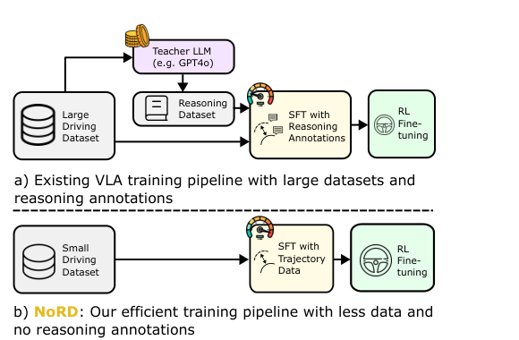
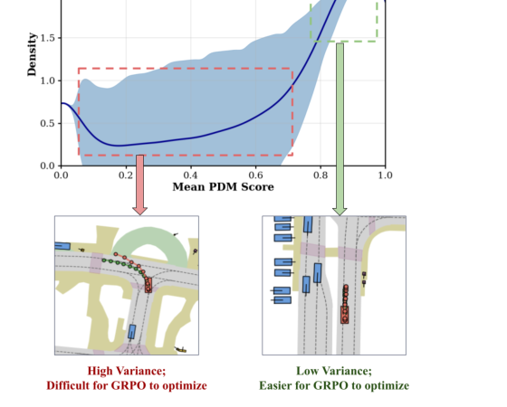
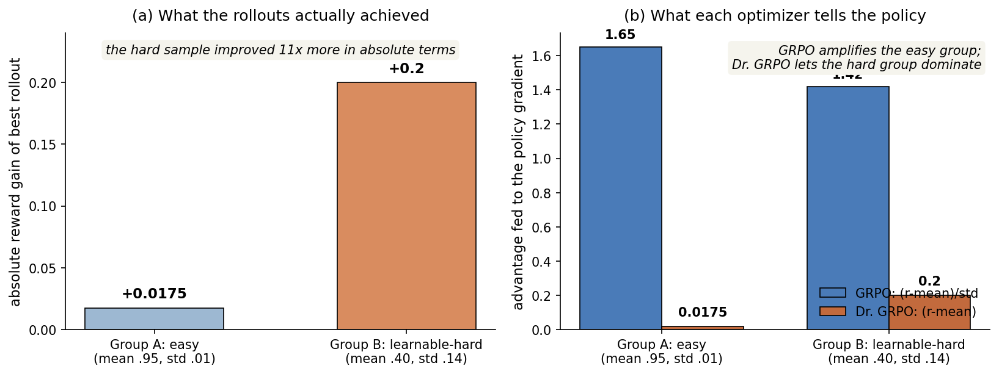
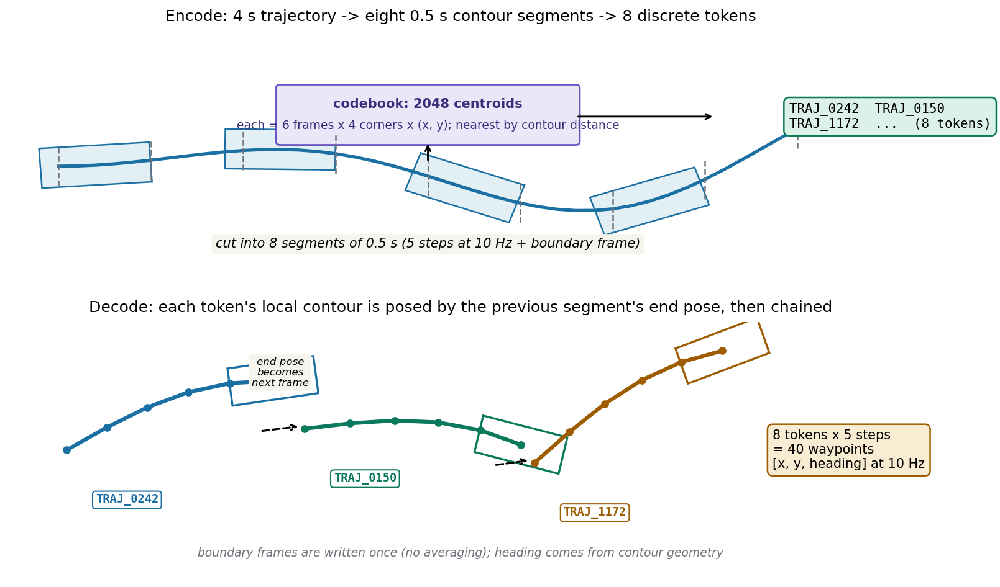

# 删掉一个除法项，让弱策略起死回生：NoRD 的无推理驾驶与 GRPO 的难度偏置

> **论文标题**：NoRD: A Data-Efficient Vision-Language-Action Model that Drives without Reasoning
> **作者**：Ishaan Rawal（1,2,*）、Shubh Gupta（1）、Yihan Hu（1）、Wei Zhan（1,3,† 通讯作者；* 表示工作完成于第一作者在 Applied Intuition 实习期间）
> **单位**：1 Applied Intuition，2 Texas A&M University，3 UC Berkeley
> **会议**：CVPR 2026（arXiv 评论栏写 "Accepted to CVPR 2026"；CVPR 2026 论文集 pp. 10965–10975 有收录；官方 GitHub README 与项目页均标注 CVPR 2026）
> **链接**：https://arxiv.org/abs/2602.21172（本文依据 v3，2026-06-05 修订，共 15 页）
> **代码**：公开，https://github.com/applied-intuition-open-source/nord（推理代码 + HuggingFace 权重 `AppliedIntuitionResearch/nord`；训练代码未公开，论文称 RL 部分基于 verl 实现）
> **一句话核心洞见**：这篇论文真正的赌注不是"无推理也能开好车"——那只是结果；真正的赌注是一个诊断：弱 SFT 策略配 GRPO 之所以训不动，不是因为模型缺推理能力，而是 GRPO 的组内标准差归一化在两极分化的奖励地貌里，系统性地把梯度拨给了最不需要学的样本；删掉这个除法项（Dr. GRPO），同一个弱策略从 +0.67% 涨到 +11.68%。

先看论文的表 1（p. 3），这是全文押注的那张赌桌。同一个 NORD-BASE（Qwen2.5-VL-3B-Instruct，只在 8 万条 NAVSIM 样本上做 SFT，没有一条推理标注），做 RL 后训练：

- + GRPO：PDMS 从 76.66 到 77.18，**+0.67%**，基本没动；
- + Dr. GRPO：PDMS 从 76.66 到 85.62，**+11.68%**。

两个优化器是同一个家族，差别只有一行：Dr. GRPO 把 advantage 公式分母里的组内标准差删了。0.67% 对 11.68%，差了 17 倍。作者的论点是：这 17 倍的差距里藏着一个此前没人点破的机制——**难度偏置（difficulty bias）在驾驶奖励地貌里的具体形状**。读懂这张表，这篇论文就读懂了一半；剩下的一半是 k-disc 轨迹分词和两套 benchmark 上的成绩单。

## 时间坐标：2025 年的 VLA 军备竞赛，和一场关于"推理有没有用"的争论

把这篇工作放回 2025–2026 年的时间线，每个选择都有来处。

2025 年初，DeepSeek-R1 把 GRPO 带进主流视野（论文引 [15] 直接引的是 Nature 2025 年版本）。同年，驾驶领域的 VLA 进入"大力出奇迹"阶段：AutoVLA（NeurIPS 2025）在 21.2 万+样本上做 SFT，样本还配了推理标注，再用 GRPO 做 RL，PDMS 做到 89.1；ORION（ICCV 2025）、SimLingo（CVPR 2025）、EMMA（TMLR 2025）各自把 VLM 的推理能力往驾驶里装。默认信念是：**难的 benchmark（NAVSIM、WaymoE2E 这种长尾场景）必须靠显式推理 + 大规模数据**，无推理的模型（EMMA、SimLingo、S4-Driver 引 [18,35,43]）只在 nuScenes 这种"正常"开环评测上好看。

但 2025 年下半年，这个默认信念开始松动。论文引了两条线：一是 [38]（Song et al.，"reasoning-planning disconnect" 假说：纯文本先验就能达到完整多模态推理模型的性能，推理可能是规划的副产品而非原因）；二是 [46]（Yue et al.：RL 并没有给 LLM 注入新的推理能力，只是在 SFT 已有的隐分布里做优化）。这两篇是 2025 年底的 arXiv 工作，说明作者动笔时（2026 年初投稿 CVPR 2026），"推理是不是必需品"正是领域里最热的争论。NoRD 站到了质疑的那一边，但它的聪明之处在于：**它没有去争论推理有没有用，而是把问题换成了"为什么弱策略的 RL 训不动"**——一个更具体、更容易证伪的问题。

另一条时间线是优化器。Dr. GRPO 出自 Liu et al. "Understanding R1-Zero-Like Training: A Critical Perspective"（COLM 2025，引 [29]），原本是 LLM 数学推理领域的工作，用来修正 GRPO 的难度偏置。NoRD 是第一个把它拿进自动驾驶的人。这是一个典型的"跨领域搬运"：偏置的数学形式和领域无关，只要奖励地貌长得像，就能搬。

论文类型判断：**新方法（诊断型）+ 实证**。它没有发明新架构（Qwen2.5-VL-3B 是现成的，k-disc 分词来自 Trajeglish [33]，Dr. GRPO 是现成的），它的新东西是一个诊断（§3）和把这个诊断变成 SOTA 竞争力的验证（§5）。这种论文的审稿风险在于"增量显得小"——改动只有一行；它的保险是诊断的证据链（Fig. 2、Fig. 3、Fig. 10、表 4）足够完整，而且最终数字（NAVSIM 85.62，WaymoE2E RFS 7.709）确实进了第一梯队。

## 作者的底牌：先给你看一次失败，再告诉你失败不是模型的错

推测作者投稿时的底气（以下为推断，依据附后）：

第一张牌是**失败实验本身**。大多数论文只给你看成功的配置，NoRD 把"NORD-BASE + GRPO 只涨 0.67%"这个难看的结果放在表 1 第一行。这不是诚实表演——它是论证的起点：如果弱策略 + GRPO 天然不行，那么"无推理路线走不通"就是定论；作者要论证的是"不行的是 GRPO，不是无推理路线"。这个失败实验是整篇论文的发动机。

第二张牌是**诊断的成本极低**。Fig. 2 的证据只是"每个训练样本做 8 次 rollout，画组内均值和标准差"——任何有 RL 管线的人一晚上就能复现。审稿人不需要相信复杂的理论，只需要看这张图：中间区域（均值 0.2–0.65）的样本方差大、占多数，GRPO 训练前后这个区域的密度几乎不动（Fig. 3a）。证据和结论之间只有一步。

第三张牌是**修复是 drop-in 的**。作者没有发明新优化器，而是直接换了现成的 Dr. GRPO。这意味着：如果诊断是对的，任何人把自己管线里的 GRPO 换成 Dr. GRPO 都应该看到类似效果——可证伪性拉满，也意味着这篇论文的影响力不止于 NoRD 这一个模型。

第四张牌是**两个 benchmark 的交叉验证**。NAVSIM（PDM 分数，乘法结构）和 WaymoE2E（RFS，人类偏好评分）是两种完全不同的奖励：一个稀疏、一个稠密。Dr. GRPO 在两个上都work，说明偏置不是某个 metric 的偶然属性。当然，这里的"都 work"要打个折：WaymoE2E 上 NORD 是第三名（7.709，落后 Poutine 的 7.986），不是第一。作者用"competitive"这个词是准确的，没有 overclaim（除了 ADE 那句话，后面细说）。
## 极化的奖励地貌：弱策略把大多数样本推到了"学不会"的中间地带

Fig. 2（p. 3）是全文最重要的一张图，值得逐像素读。横轴是组内平均 PDM 分数（每个样本 8 次 rollout 的均值），蓝色带子是对应组的标准差（组内 rollout 的波动幅度）。

三个观察，论文 §3 写得很清楚，这里把因果链补全：

**第一，两端的低方差。** 均值 ≥0.8 的样本：直道匀速这种简单行为，弱 SFT 模型次次都能开好，均值高、8 次 rollout 几乎一样，方差小。均值 ≤0.15 的样本：难到离谱的场景（分布外），模型次次都撞，均值低、方差也小。注意论文特意说"这类样本占比很小"——NORD-BASE 的表达能力是够的，它不是什么都学不会。

**第二，中间的高方差。** 均值在 [0.2, 0.65] 的样本：急转弯、变道这种复杂机动，弱模型时而成功时而失败，均值中等、方差大。**这是大多数样本**。为什么奖励会是这个形状？PDM 分数的结构是乘法：PDM = NC × DAC × (5·TTC + 2·C + 5·EP)/12。NC（无责任碰撞）和 DAC（可行驶区域遵守度）是乘在外面的——撞一次，整个分数归零。一个"差一点就撞上"的 rollout 和"撞上了"的 rollout 之间，奖励是断崖式的。这就是稀疏、两极分化的来源：**乘法 metric 天然制造双峰**。这不是弱策略独有的问题，但弱策略把它放大了：强策略（比如 AutoVLA 的 SFT 模型）大部分样本本来就在 ≥0.8 的区域，中间地带没多少样本，GRPO 自然 work。

**第三，GRPO 训练时中间地带的密度不动。** Fig. 3a 显示，随着训练步数增加，[0.2, 0.65] 区间的密度几乎不变，而接近 1 的低方差区域密度稳步上升。翻译成人话：GRPO 在做的事情是**把本来就开得好的样本打磨得更光滑**，而真正需要学的急转弯、变道，一个都没学会。这就是 +0.67% 的来源。

这里停一下，回答一个读者必然会问的问题：**为什么 GRPO 会"挑软柿子捏"？** 看 advantage 公式：

GRPO 的 advantage = (r_i − 组内均值) / 组内标准差

分母是组内标准差。直觉上，除以 std 是为了"归一化"，让每个组的梯度尺度可比。但在上面的奖励地貌里，这个归一化恰好干反了：**方差小的组（简单的、已经学会的），advantage 被放大；方差大的组（难的、正在学的），advantage 被压扁**。优化器每一步的梯度预算就这么被简单样本吃掉了。

## 一个小例子：0.0175 的进步凭什么比 0.2 的进步拿到更大的梯度

把上面的话变成数字。假设两个组，每组 8 次 rollout：

- **A 组（简单，直道）**：奖励均值 0.95，组内 std 0.01。其中最好的一次 rollout 拿到 0.97，绝对进步 +0.0175。
- **B 组（难，急转弯）**：奖励均值 0.40，组内 std 0.14。其中最好的一次 rollout 拿到 0.60，绝对进步 +0.20。

B 组的这次成功，在现实世界里意味着"学会了一个急转弯"，绝对进步是 A 组的 11 倍。但两个优化器给出的 advantage 是：

GRPO：A 组 (0.97−0.95)/0.01 = 1.65，B 组 (0.60−0.40)/0.14 ≈ 1.42。**进步小 11 倍的样本，拿到的梯度反而更大。** 这就是难度偏置（difficulty bias）在这篇论文里的具体形状：分母里的 std 把"学得会"的信号系统性地调小了。

Dr. GRPO 把分母删掉：advantage = r_i − 组内均值。A 组 advantage = 0.0175，B 组 = 0.20。梯度终于和"现实世界的进步"成正比了。

这个例子也解释了为什么偏置在**弱策略**上才致命。强策略的 B 组样本很少——它本来就会急转弯，大部分组都是 A 组那样的低方差，除不除 std 差别不大。弱策略的 B 组占多数，偏置就被放大成了训练失败。论文 §3 的标题 "Limitations of GRPO for Data-Efficient Training" 是准确的：问题不在 GRPO 本身，在 GRPO × 弱策略 × 两极化奖励这个组合。

## Dr. GRPO 到底改了什么：删分母、非对称裁剪、不要 KL

论文 §4.2 给出的 Dr. GRPO 目标函数（式 2）里，advantage 定义是：

Dr. GRPO 的 advantage = r(o_i|x) − (1/G)·Σ_j r(o_j|x)

即组内均值中心化，**没有除以标准差**，这是唯一的本质改动。目标函数保留了 1/|o_i| 的按 token 数归一化（注意：原始 Dr. GRPO 论文 [29] 里连这个也动了，NoRD 的实现保留了它，论文没有强调这一点，但式 2 里写得明白）。裁剪用的是 DAPO 式的**非对称裁剪**：上裁剪系数 ε_h = 0.1，下裁剪系数 ε_l = 0.2，即新旧策略的概率比被限制在 [0.8, 1.1]——往上只允许涨 10%，往下允许跌 20%，目的是防止 RL 训练中的熵坍缩（entropy collapse）。**没有 KL 散度正则项**，作者明确说 follow Liu et al. [29]。

实现细节（§5.2、§11.2）：RL 用 verl 框架 + FSDP + vLLM 做 rollout；组大小 G=8，rollout 采样温度 1.0，验证时温度 0.01（近似确定性）；NAVSIM 上 30 张 A100 跑 160 步、学习率 5×10⁻⁶，WaymoE2E 上 32 张 A100 跑 150 步、学习率 1×10⁻⁶；batch 分别是 128 和 256 条轨迹。

这里有一个值得记下来的工程判断：**删掉 std 之后，advantage 的尺度不再无量纲**，梯度大小直接正比于奖励的绝对尺度。这意味着学习率必须和奖励尺度一起调——NAVSIM 的 PDM 和 Waymo 的归一化 RFS 都在 [0,1]，作者用的 5×10⁻⁶ / 1×10⁻⁶ 是和这个尺度配套的。换一个奖励尺度，这组超参数要重调。论文没有明说，但这是删分母的直接代价：你拿走了一个自适应归一化，就得用学习率把它补回来。
## 轨迹是怎么变成语言的：k-disc 分词的编码与解码

NoRD 的模型本体没有新意——Qwen2.5-VL-3B-Instruct，输入是 3 张环视图像（前、左前、右前）+ 过去 1.5 秒的轨迹 + 当前速度/加速度 + 高层驾驶指令（左/直行/右），输出是未来轨迹。真正的设计在**轨迹的离散化**：模型不直接回归坐标，而是做 next-token prediction，预测 8 个离散的轨迹 token。分词方案来自 Trajeglish [33]（ICLR 2024），论文叫它 k-disc tokenization。

论文 §4 一段话讲完，代码（`nord/tokenizer.py`）把细节补全了，值得展开：

**编码。** 训练集里所有未来轨迹先插值到 10Hz，切成 0.5 秒一段（5 步 + 1 个边界帧 = 6 帧）。关键：聚类的对象不是路径点序列，而是**车辆轮廓序列**——每帧是车的 4 个角点（长 4.8m、宽 2.0m 的框），所以一个质心是 (6, 4, 2) 的张量。2048 个质心按"轮廓距离"做 k-means。为什么用轮廓而不用中心点？（这是我的推断：）中心点只描述位置，轮廓同时描述位置和朝向；两个"位置一样、朝向差 30 度"的段在中心点距离下很近，在轮廓距离下很远。朝向对驾驶决策是承重信息（比如判断前车是不是在变道），用轮廓聚类等于把朝向的变化率也编码进了码本。

**解码。** 8 个 token 还原 40 个路径点的过程不是查表拼接，而是一次**位姿链式传递**：第 k 个 token 的局部轮廓，先按第 k−1 段终点的位姿（位置 + 航向）做旋转平移，再写进全局轨迹；航向本身从轮廓几何里算出来（前保险杠两个角点连线的方向）。代码里有一个 `counts` 累加器，看起来像要对重叠帧做平均，但实际写逻辑是 `write_start = 0 if seg_idx == 0 else 1`——边界帧只写一次，没有平均。`counts` 是防御性代码，实际恒为 1。

**过去轨迹的编码**是贪心的：16 帧历史（1.5 秒 @10Hz）→ 3 个 token，每段独立取轮廓距离最近的质心（argmin），不是全局最优的 Viterbi。够用，因为历史只是条件输入，不是输出。

**新 token 的嵌入初始化。** 2048 个轨迹 token 追加到 Qwen 词表之后，嵌入按 Hewitt 2021 [16] 的方法初始化：从现有 token 嵌入的均值和协方差参数化的多元正态分布里采样。这个细节论文一句话带过，但它决定了 SFT 初期的稳定性——随机初始化的新嵌入会让前几步的梯度爆炸，均值-协方差匹配让新 token 一开始就落在"合理"的嵌入流形附近。

**码本大小的消融**（附录表 5）：2048 → PDMS 85.62，512 → 83.07。作者的解释是"小码本表达不了急转弯这种复杂机动"。这个 2.55 点的差距说明离散化本身是承重设计：码本太粗，RL 再怎么训也长不出码本里没有的动作。

## 奖励函数的三块：格式、长度、驾驶质量

RL 的奖励（附录 §9）由三部分相加：r = r_f + r_l + r_d。

**格式奖励 r_f ∈ {0, 0.25}**：输出是形如 `TRAJ_0242` 的空格分隔 token 串才给 0.25。**长度奖励 r_l ∈ {0, 0.25}**：token 数正确（NAVSIM 8 个，WaymoE2E 10 个）才给 0.25。**数据集奖励 r_d ∈ [0,1]**：NAVSIM 用 PDM 分数，WaymoE2E 用归一化 RFS。

PDM 分数（正文 §5.2 脚注处的公式）：PDM = NC × DAC × (5·TTC + 2·C + 5·EP)/12，其中 NC（无责任碰撞）、DAC（可行驶区域遵守）、EP（自车进度）、C（舒适度）、TTC（碰撞时间）都在 [0,1]。注意这个公式是**按场景先算再平均**，所以你没法用表 4 里平均后的子指标反推出 76.66——平均的乘积不等于乘积的平均。我验算过：NORD-BASE 那一行按平均值算出来是 70.1，不是 76.66，差的方向说明"各项都好的场景"在分布里是正相关的。这不是论文的错，但读者如果拿着计算器去验算会被吓一跳，这里提前说明。

WaymoE2E 的归一化 RFS：Normalized RFS = (max(max_r(s_r), 4) − 4)/6，把 [4,10] 的人类偏好评分映射到 [0,1]。附录里"averaged over t∈{3,5} seconds, and clipped to min(·,4)"这句话写得含糊（min(·,4) 字面上会把分数全压到 ≤4，和 [4,10] 的量程矛盾），但归一化公式本身是自洽的：4 映射到 0，10 映射到 1。这是一处文字小瑕疵，不影响复现。

还有一处附录与正文的小出入：§5.2 说"each weighted by 0.25, and then normalize to [0,1]"，附录 §9 的公式是 r = r_f + r_l + r_d，三项最大值加起来是 1.5，不是 1。两处对不上，大概率是实现里除以了 1.5 但附录没写。因为 Dr. GRPO 的 advantage 是均值中心化的，常数缩放会被学习率吸收，所以这个出入不承重——但它是论文里真实存在的一处未交代。
## 实验成绩单：两个 benchmark，一个第三名，一个效率前沿

**NAVSIM（表 3，navtest）。** NORD 拿下 PDMS 85.62，只用 3 帧 RGB 图像、不用 LiDAR、不用推理标注。横向对比：AutoVLA 89.1（12 帧 + 推理 + 21.2 万样本）、RecogDrive 89.6。NORD 落后第一梯队约 3.5–4 个点——"competitive"这个词用得老实。表里最有信息量的一行是 **NORD-BoN 92.4**，超过了 AutoVLA-BoN 的 92.1。BoN 是从 6 个随机种子里用 oracle（按 PDM 分数）挑最好的一个：它不能部署，但它说明 NORD 的策略分布里**本来就有**好轨迹，单次采样的 85.62 和分布上确界的 92.4 之间差的是采样效率，不是能力上限。这对"RL 有没有把分布推对地方"是一个诚实的诊断——作者明确写了 oracle 选择，没有把它包装成正式成绩。

**WaymoE2E（表 2）。** NORD 的 RFS 7.709，排第三（Poutine 7.986 第一，HMVLM 7.736 第二），ADE@3 是 1.2504。训练数据：SFT 只用 12,000 样本（官方训练集过滤后取 20%），RL 只用约 450 样本（官方验证集的 85%，因为只有验证集带了做 RFS 奖励需要的偏好标注）。附录表 6 给了细项：单车道机动 8.31 最高，spotlight（难例）6.53 最低——长尾场景依然是短板，论文没有藏。

**效率前沿（Fig. 6）。** 两张 Pareto 图是论文的"电梯演讲"：横轴数据集大小，纵轴分数，NORD 是唯一落在"高性能 + 高数据效率"象限的 VLA。Fig. 9 的 token/推理效率：直接预测 8 个轨迹 token，不生成推理链，token 数至少少 3 倍，推理快 2 倍以上（项目页数据）。这两个效率声明的方向是对的，但 Fig. 6 横轴的基线数据量是**估算**的（附录 §12 承认了估算方法），后面细说。

## 怀疑式审读：这篇论文哪里可以信，哪里要打折

**1. ADE 那句话和自家表格矛盾。** §5.3 原文："NORD surpasses all other competitive models on the ADE metric"。但表 2 里 Poutine 的 ADE@3 是 1.2055，NORD 是 1.2504——ADE 越小越好，Poutine 更好。除非把第一名开除出"competitive models"，否则这句话不成立。这是一个真实的文本–表格不一致，审稿时应该被揪出来。公平地说，NORD 的 ADE 确实是第二好，且只用了 Poutine 一小部分数据，"数据效率最高的 ADE 亚军"这个表述是站得住的，但论文写的是"超过所有"，过头了。

**2. 数据倍数的算术前后不完全自洽。** 引言说 AutoVLA 用 212,000+ 样本，NORD 用 80,000——这是 2.65 倍，"<60% 的数据"（80/212 = 37.7%）没问题。但 §5.3 又说 "AutoVLA and RecogDrive require 1.6× and 34× more training data"：1.6× 对应 128k，不是 212k；34× 对应 272 万，RecogDrive 不可能用了 272 万样本。WaymoE2E 那边 "Poutine and HMVLM require 17× and 12× larger datasets"，按附录 §12 自己的估算（Poutine ~700k，HMVLM ~500k，NORD 12k），应该是 58× 和 42×。附录 §12 承认这些是"基于各论文报告配置的估算"，所以方向（NORD 少一个数量级以上）可信，具体倍数别较真。这是论文里最 sloppy 的数字部分。

**3. RL 在验证集上训。** NAVSIM 的 RL 数据集是从 SFT 的验证划分里过滤出来的（§10.2），WaymoE2E 的 RL 用的是官方验证集的 85%（§10.1）。理由都写了：NAVSIM 要过滤掉"定速直行"这种平凡样本（终点位移误差 <0.2m 的扔掉，转弯还要求平均航向变化 ≥0.01 rad/步），WaymoE2E 只有验证集带偏好标注。测试集（navtest / WaymoE2E test）是独立的，所以不算泄漏。但"验证集拿来训练"是 unconventional 的选择：SFT 阶段的早停/选模型如果也用了同一份验证集，就存在"用验证集选 SFT 模型、再用验证集做 RL"的双重使用。论文 §11.1 说 SFT "select the best model based on minimum evaluation loss"，RL §11.2 说 "retain the checkpoint achieving the highest reward"——两份验证划分是否完全隔离，论文没有交代清楚。这是一个值得在复现时盯住的点。

**4. "数据高效"不等于"训练便宜"。** SFT 用 16 张 A100，RL 用 30–32 张 A100（NAVSIM 160 步，WaymoE2E 150 步），rollout 用 vLLM 生成、组大小 8。这套 RL 的算力开销是实打实的。论文的效率声明是关于**数据/标注/推理**的，不是关于训练 FLOPs 的——读的时候不要把"data-efficient"脑补成"compute-efficient"。当然，RL 只跑 150–160 步就能收敛（Fig. 11），步数很少，这是 Dr. GRPO 修好之后带来的真实红利。

**5. 推理时的 guided decoding 论文没提。** 开源的 `nord/agent.py` 默认开 `use_guided_decoding=True`，用 vLLM 的 `guided_regex` 把输出强制约束成 `TRAJ_XXXX` 格式。论文里只字未提。影响评估：格式奖励 r_f 在 RL 里是训练信号，推理时再加一道硬约束属于"双保险"。由于模型经过 RL 后本来就几乎只输出合法 token（否则拿不到 0.25），guided decoding 对分数的影响大概率很小——但它是一个未披露的推理细节，严谨的复现应该说明评测时开没开。

**6. Token 格式的写法出入。** 附录 §9 写 token 形如 `TRAJ 0242`（空格），代码的正则和 SYSTEM_PROMPT 里全是 `TRAJ_0242`（下划线）。语义一样，写法不一，抄实现时以代码为准。

**7. "首次"声明的分寸。** "We are the first to identify..."（难度偏置在驾驶弱策略上的表现）和"first to validate Dr. GRPO in autonomous driving"——前者是这篇论文真正的增量，后者是搬运。两个声明目前看都站得住（2026-10 之前没见过同样的诊断）。但读者要清楚：这篇论文没有发明优化器，它的贡献是**诊断 + 证据 + 验证**，不是算法。

**8. 结论里的 hedge 是诚实的。** §6 最后一句："NORD does not suggest that VLAs cannot benefit from language-based reasoning; rather, it shows that efficient, high-performing VLAs can be trained without reasoning"。作者没有宣称"推理无用"，只宣称"不用推理也能训出有竞争力的模型"。结合引言引的 [38][46]，这篇论文的立场是"把举证责任推回去"：既然无推理 + 好优化器能做到 85.62，那么主张"推理必需"的人需要拿出"推理带来了什么、是哪些样本带来的"的证据。这个站位比"推理无用论"要难反驳得多。

**9. 一个没有做的消融。** 全文没有回答：如果给**强** SFT 策略（比如 21 万样本 + 推理标注训出来的）换上 Dr. GRPO，会不会比 GRPO 更好？论文的叙事只需要"弱策略 + Dr. GRPO ≥ 强策略 + GRPO"，但从科学上讲，Dr. GRPO 是不是对所有策略都更好、还是只对弱策略更好，决定了这个改动的适用边界。论文没做，留白了。
## 代码告诉你的三件事（论文没写，但实现里有）

我把官方仓库（`code/`，2026-10-09 克隆）通读了一遍，仓库是**纯推理**的：`nord/agent.py`（vLLM 推理封装）、`nord/tokenizer.py`（k-disc 编解码）、`nord/navsim_agent.py`（NAVSIM 评测接口）、`scripts/eval_navsim.py`。SFT 和 Dr. GRPO 的训练代码没有公开（论文说基于 verl），所以下面三件事都来自推理侧：

**第一，解码是"链式位姿传递"，不是查表。** `KDiscTokenizer.decode` 里，每个 token 的局部轮廓（6 帧 × 4 角点）先按上一段的终点位姿旋转平移，再写入全局轨迹。航向从轮廓几何推导：`dxy = contour[:, 0] − contour[:, 3]`（前左角减后左角），取 `atan2`。这意味着码本里存的不是"轨迹形状"，是"车体扫过的体积序列"——解码天然保证相邻段的位姿连续，物理可行性有一部分是分词方案自带的，不是模型学出来的。

**第二，过去轨迹的编码是贪心的。** `encode` 对每段独立取 argmin（轮廓距离最近的质心），没有做全局动态规划。历史只是条件输入，贪心够用；但如果你想把这套分词拿去做别的任务（比如轨迹补全），这个贪心编码是第一个要换掉的地方。

**第三，输出格式有双保险。** 训练时靠格式奖励（0.25）学，推理时靠 `guided_regex = ^((TRAJ_\d{4} ){7}TRAJ_\d{4})$` 硬约束。`parse_token_ids` 要求恰好 8 个 token，否则 `predict` 里还有一层兜底（正则提取 + 补零到 8 个）。论文的 Fig. 12 只展示了"直接预测 token"的干净一面，工程上的三层兜底都在代码里。

## 带走的东西：什么时候该怀疑优化器，而不是模型

合上论文，值得带走的不是"NoRD"这个模型（Qwen2.5-VL + k-disc + Dr. GRPO 的组合很快会被更好的基座替代），而是两个可迁移的判断：

**第一，归一化项是有立场的。** GRPO 里除以组内 std，在数学上是无量纲化，在优化动力学上是一个**价值判断**：它认为"组内波动大"的样本不值得给大梯度。这个判断在奖励稠密、策略强的时候无害；在一旦奖励两极分化（乘法 metric、稀疏奖励、二值奖励），它就变成系统性的偏见——偏向简单的、已经学会的样本。以后看到任何带"组内归一化"的 RL 算法训不动，先画 Fig. 2 那样的"组均值–组方差"分布图，成本只是一次多 rollout 评测。这是这篇论文留下的最实用的调试动作。

**第二，"弱策略训不动"有两种完全不同的病因，别搞混。** 一种是表达能力不够（模型真的学不会），一种是优化器没把梯度给对地方（模型能学会但没机会）。NoRD 的表 1 是一个教科书级的鉴别实验：同一个 NORD-BASE，换优化器从 +0.67% 到 +11.68%——如果是表达能力问题，换什么优化器都没用。下次看到"小模型 + RL 不涨点"的结论，先问一句：你试过把 advantage 的归一化拿掉吗？

**真正值得做的后续问题**（论文 §6 和附录 §13 留的口子）：Dr. GRPO 自己也承认"remains imperfect"（引 [22]），Fig. 13 的失败案例（路口、施工区）还在。难度偏置的下一个形态可能是：**去掉 std 之后，梯度被高方差组主导，低方差但"差一点就对"的样本会不会被淹没**——也就是偏置从一边倒向另一边。VD-GRPO [39] 试图保留绝对奖励量级来平衡多目标（安全 vs 舒适），那是另一个方向。在驾驶这种"撞一次就全错"的乘法奖励下，advantage 的尺度问题还没有终极答案。
