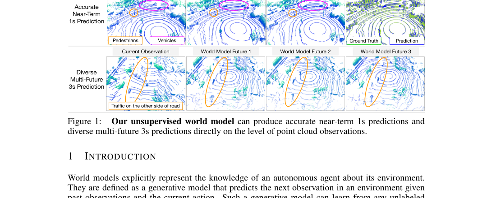
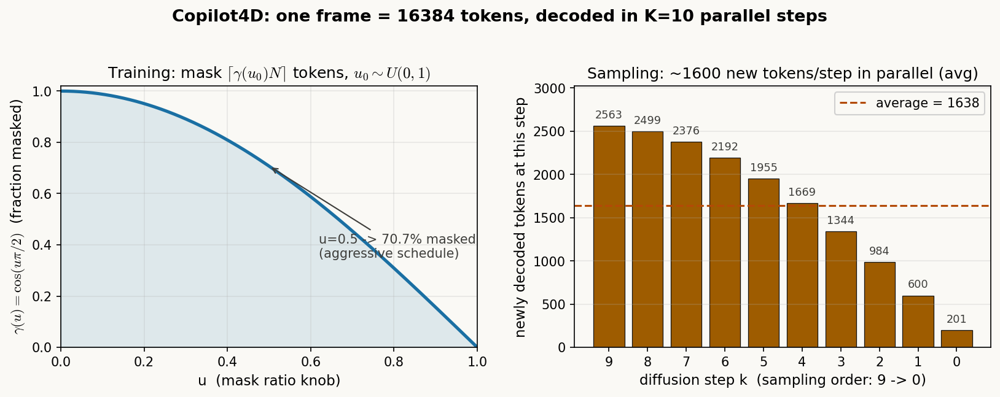
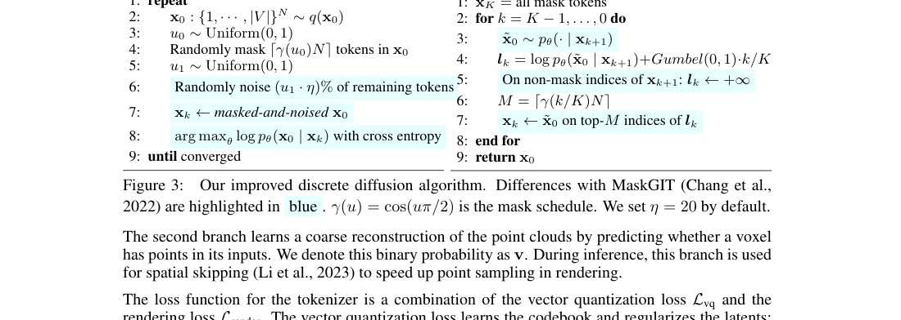
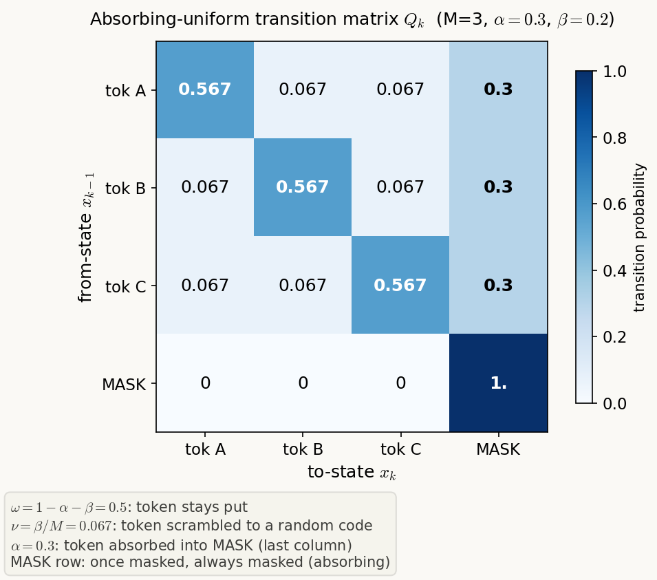
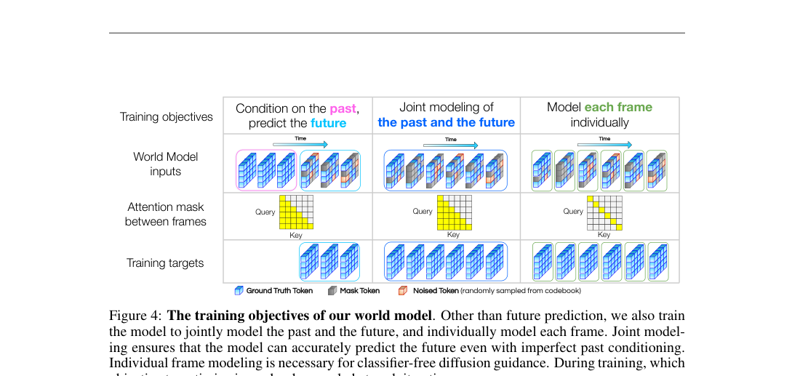
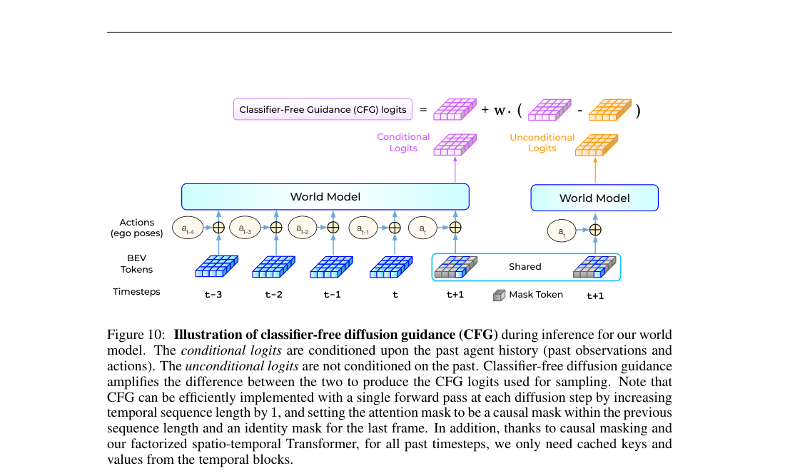

# 把点云变成 token，把 MaskGIT 变成扩散模型：让 GPT 式无监督学习在驾驶数据上跑起来

> **全局编号**：64
> **论文**：Copilot4D: Learning Unsupervised World Models for Autonomous Driving via Discrete Diffusion
> **作者**：Lunjun Zhang, Yuwen Xiong, Ze Yang, Sergio Casas, Rui Hu, Raquel Urtasun（Waabi / University of Toronto）
> **会议**：ICLR 2024
> **arXiv**：2311.01017（[摘要页](https://arxiv.org/abs/2311.01017)；下载到本地的是 v2，2023-11-24；任务备注 2024-04 另有修订，因 arXiv 访问限流未能独立核实版本历史）
> **代码**：未公开——正文与附录全文检索 "github / code is available / open source" 均为零命中；另经网页检索，多个世界模型论文清单只给出论文链接与 Waabi 项目页（waabi.ai/copilot-4d），均无官方代码仓库
> **一句话核心洞见**：GPT 式无监督学习在驾驶上跑不快，卡在两处——观测空间复杂到连 loss 都不好选、生成模型一次要吐上万个 token；Copilot4D 的解法是把点云打成离散 token（把回归变成分类），再把 MaskGIT 重写成离散扩散（10 步并行解完一帧 16384 个 token，还能逐轮修正），于是世界模型第一次在真实驾驶点云上吃到了 scale 的红利。

---

## Figure 1 想让我相信什么：1s 准、3s 多样，能同时成立吗

论文的第一张图（第 1 页，下同引文页码）上下两排，讲的是两件事。上排：当前观测 → 世界模型预测的 1s 未来，最右列把预测点云和真值点云叠在一起，紫色框出行人、橙色框出车辆，两团点云几乎重合——作者想让我相信，无监督的世界模型可以在点云观测层面做出准确的近期预测，不需要 bounding box、语义分割、实例分割任何一种监督信号。下排：同一个当前观测，模型给出三个不同的 3s 未来，对向车道上那辆被橙色椭圆框出的车，在三个未来里出现在不同位置——作者想让我相信，模型不只学会了"最可能的未来"，还学会了未来的多模态。

这张图就是作者的赌注。它回答了引言里那个问题："如果一个世界模型能把无标注的未来观测预测得很好，它一定已经理解了场景的几何和动态"——就像 GPT 把下一个 token 预测好就理解了语言一样。整篇论文的工作量，都是为了让这张图成立。

但先记一笔怀疑：3s 的"多样性"在论文里没有任何量化指标。没有 diversity 分数，没有覆盖率统计，多样性只存在于这张图和第 26 页的反事实可视化里。这是展示，不是证据。后面审读部分会回到这一点。

## 作者诊断的两个瓶颈：观测空间复杂，生成模型不可扩展

引言第 1–2 页，作者没有急着讲自己的方法，而是先回答：为什么 GPT 把"无监督序列建模"这条路在语言上跑通了，世界模型在驾驶上却慢得多？答案是两个瓶颈。

**瓶颈一：观测空间复杂且非结构化。** 在语言里，先把文本切成离散 token，再做分类式的下一个 token 预测，这条路是现成的。在点云上，连 loss 都不好选：直接对点云做 L2 重建，模型会学出一个模糊的平均点云——因为点云是无序集合，点与点之间没有固定对应关系，"重建误差"本身定义起来就别扭。更深一层：一个好的 loss 必须让模型去学几何和动态，而不是去拟合激光雷达的采样噪声。之前自动驾驶的预测系统绕开这个问题，靠的是监督信号——bounding box（Luo et al., 2018）、语义分割（Sadat et al., 2020）、实例分割（Hu et al., 2021）。但监督信号意味着标注成本，意味着 scale 不上去。

**瓶颈二：生成模型必须可扩展。** 语言模型 scale 得好（Kaplan et al., 2020），但它一次只解一个 token。一帧点云 token 化之后有 128×128 = 16384 个 token——注意这个数字，后面会反复出现。如果像 GPT 那样逐 token 自回归解码，一帧就要做 16384 次 Transformer 前向，算力上不可行（下一节算这笔账）。另一条路是一次把全部 token 并行解出来，Minecraft 上的世界模型（Hafner et al., 2023）就是这么做的。但这条路暗含一个假设：给定过去观测，一帧之内的所有 token 条件独立。这个假设是错的——一辆车在 BEV 上占几十个 token，这些 token 必须彼此一致，独立采样会拼出一辆"半边车身在这、半边在那"的怪物。

两个瓶颈合在一起，作者的判断是：token 化解决第一个（VQVAE 把任何输入变成离散 token，Xiong et al., 2023 已经证明点云也行），离散扩散解决第二个（MaskGIT 教会我们并行迭代解码，离散扩散给它一个第一性原理的框架）。这个判断就是整篇论文的承重墙，后面所有设计都挂在上面。

## 一笔算力账：16384 个 token，自回归要多少次前向

先把数字摆出来。一帧 = 128×128 = 16384 个 token。实验设置里，KITTI 和 Argoverse2 每次预测 5 帧未来，NuScenes 3s 预测要输出 6 帧。

如果走 GPT 式的逐 token 自回归：每解一个 token 做一次完整前向，一帧 16384 次前向，5 帧就是 81920 次。每次前向的 attention 还要扫过全部历史 token。这不是"慢一点"，是根本不在一个可用量级——训练时 teacher forcing 可以并行，推理时不行，而世界模型的用途（planning 时 rollout）恰恰是推理。

如果走一次全并行解码：1 次前向出一帧，快是快，但条件独立假设在点云上错得离谱。想想 BEV 上一辆 4 米长的车：1.25m×1.25m 的 token 粒度（附录 A.2.1），一辆车横跨约 3×2 个 token。独立采样时，这 6 个 token 各自从"车头/车身/背景"的分布里抽，拼出一辆车头朝左、车身朝右的车，概率不小。Minecraft 能忍，是因为游戏画面的容错率高、且那里的实验设置本身就简单（这是我的推断，论文没展开，标明）。

MaskGIT（Chang et al., 2022）是中间路线：BERT 式训练（随机 mask 一部分 token，预测被 mask 的），采样时按置信度迭代并行解码——先解有把握的，再解难的。Copilot4D 的改进让这条中间路线更进一步：10 个扩散步解完一帧，每步平均并行解码约 1600 个新 token（16384/10 = 1638，论文写"约 1600"），5 帧未来一共 50 次前向。比自回归少三个数量级，比一次全并行多一个"逐轮修正"的机会。

下面这张自绘图把"10 步解完一帧"具体化。左图是训练用的 mask schedule γ(u) = cos(uπ/2)：u 从 Uniform(0,1) 采样，mask 掉 ⌈γ(u₀)N⌉ 个 token——u=0.5 时 mask 70.7%，这是 MaskGIT 说的 "aggressive masking schedule"，训练信号比 BERT 的 15% 密得多。右图是采样时每步新解码的 token 数：前几步解得多（2500+），后几步收尾（200+），平均 1638。

## 点云怎么被压成 128×128 个 token：把 tokenizer 从头走到尾

世界模型只吃离散 token，所以第一步是把点云"翻译"成 token。tokenizer 长什么样，直接决定世界模型看到的世界长什么样。这一节把附录 A.2.1 的架构（论文第 15–18 页，图 6）从头走到尾，每个张量都给出形状。

**编码器。** 输入是自车周围 [-80m, 80m] × [-80m, 80m] × [-4.5m, 4.5m] 的点云。voxel 大小 15.625cm × 15.625cm × 14.0625cm——算一下：160m / 0.15625m = 1024，9m / 0.140625m = 64，所以初始 voxel 网格是 1024 × 1024 × 64。每个 voxel 内的点过一个 PointNet 式的编码器：注意这里作者把 VoxelNet 的 max pooling 换成了 sum + LayerNorm（同样满足置换不变性），输出 64 维特征，得到 1024 × 1024 × 64 × 64 的 3D 特征体。接着按 z 轴聚合成 BEV：每个 voxel 特征过 Linear，加一个可学习的 z 轴位置 embedding，再沿 z 做 sum + LayerNorm——BEV 化完成，高度维被压掉。

然后是一个 Swin Transformer backbone（先加 ViT 式绝对位置编码）：patch 大小 4 → 256 × 256 × 128；Patch Merging 下采样、patch 提到 8 → 128 × 128 × 256。这就是 8 倍下采样：160m / 128 = 1.25m，每个 token 管 BEV 上 1.25m × 1.25m 的一块地。最后 Linear 把 256 维升到 1024 维，过 LayerNorm，进 VQ 层——码本大小 1024，输出 128 × 128 个离散 token。

两个细节值得停一下。第一，encoder 输出先过 LayerNorm 再做向量量化，作者说"对重建很重要"，Huh et al. (2023) 也有同样观察——直觉是：不归一化的话，特征各维尺度差异大，最近邻查找会被大尺度维度主导，码本利用率塌掉。第二，码本 collapse（只有少数码被用到）是 VQVAE 的老毛病，Dhariwal et al. (2020) 的 random restart 在这里不够用，作者改用 Xiong et al. (2023) 的 K-Means 策略：维护一个 10 倍码本大小的 memory bank 存最近的 encoder 输出；一个码连续 256 个 iteration 没被用过算 dead；dead 超过 3% 就对 memory bank 做 K-Means 重初始化整个码本；每个码本两次重初始化之间至少间隔 200 个 iteration。VQ loss 是 $L_{vq} = 0.25\lVert \mathrm{sg}[E(o)] - \hat{z}\rVert_2^2 + 1.0\lVert \mathrm{sg}[\hat{z}] - E(o)\rVert_2^2$：$\lambda_1=0.25 < \lambda_2=1.0$ 的意思是码本学得比特征慢——码本是慢变量，特征是快变量，这个不对称是故意的。

**解码器：这篇 tokenizer 真正新的地方。** 对称的 Swin backbone 把 token 还原成 256 × 256 × 128 的 BEV 特征，然后分两个分支。第二个分支是粗重建：Linear(128, 42×64) 输出 1024 × 1024 × 64 的体素占位二分类 logits，训练目标就是"这个 voxel 里有没有点"。注意 bias 初始化为 -5.0——因为点云里绝大多数 voxel 是空的，不这么初始化，模型一开始会全预测非空，训练 early stage 全在纠偏。这是个小技巧，但属于"不写就会踩坑"的那种。

第一个分支是核心创新：隐式表示 + 可微深度渲染。decoder 输出一个 3D 神经特征网格（NFG）：512 × 512 × 64 × 16，每个 voxel 一个 16 维向量。对 ray 上任意连续坐标 (x, y, z)，在 NFG 上做双线性插值拿到 16 维描述子，过一个 2 层小 MLP（hidden 32，ReLU），sigmoid 输出 occupancy $\alpha \in [0,1]$。和 UltraLiDAR（Xiong et al., 2023，只做体素占位二分类，图 9 显示它重建不出精细几何）相比，隐式表示让解码器可以查询任意连续坐标的占据值，几何细节保住了。

## 公式 (4)(5)：沿着一条 ray 把深度"渲染"出来

先在脑子里放一条 ray：$r(h) = p + hd$，$p$ 是激光雷达中心，$d$ 是发射方向，$h$ 是沿 ray 的距离。沿 ray 采 $N_r$ 个点 $\{(x_i, y_i, z_i)\}$，每个点查出 occupancy $\alpha_i$。现在问：这条 ray 打到的深度是多少？

$$w_i = \alpha_i \prod_{j=1}^{i-1}(1-\alpha_j), \qquad D(r, \hat{z}) = \sum_{i=1}^{N_r} w_i h_i \tag{4}$$

$w_i$ 的意思是"前面 $i-1$ 个点都没挡住（每个以 $1-\alpha_j$ 的概率透过去），恰好在第 $i$ 个点被挡住"的概率——就是体渲染（NeRF 那套）里的透射率写法。$\sum_i w_i \le 1$，剩下那部分概率对应"ray 射出 ROI 也没打到东西"。期望深度 $D$ 就是拿这组概率对距离加权平均。几何上看，训练会把 $\alpha$ 推成在物体表面附近接近 1、其他地方接近 0，于是 $w_i$ 集中在表面，$D$ 就是表面深度。

渲染 loss 是三项的和：

$$L_{render} = \mathbb{E}_r\Big[\lVert D(r,\hat{z}) - D_{gt}\rVert_1 + \sum_i \mathbf{1}(|h_i - D_{gt}| > \epsilon)\lVert w_i\rVert_2\Big] + \mathrm{BCE}(v, v_{gt}) \tag{5}$$

逐项说。第一项：渲染深度和真值深度的 L1，这是主监督。第二项：凡是离真值表面超过 $\epsilon=0.4$m 的采样点，把它的 $w_i$ 往 0 压——让权重分布"concentrate within $\epsilon$ of the surface"，不让模型在空旷处也分配占据概率。没有这一项，模型可以用"沿 ray 撒一串小 $\alpha$"的方式凑出正确的期望深度，几何是糊的；有了它，occupancy 被逼成薄壳。第三项：粗分支的二分类交叉熵，监督体素占位。

**Spatial skipping**（图 8，第 17 页）是推理加速：粗分支先估计哪些 voxel 非空，对这个二值体做 max pooling（BEV 上 8 倍）提高 recall，然后每条 ray 只在"maxpool 后非空"的粗 voxel 里采样点去查 NFG。Table 7 的消融（NuScenes 重建）：不用 spatial skipping，ROI 内 Chamfer 0.148、L1 Mean 1.42；用了之后 0.082、0.82。作者的解释是采样点集中到了非空区域——不只是加速，重建也变好了。这个消融做得干净：另一个 tokenizer 从零训练，去掉粗分支和 spatial skipping，只留深度渲染监督。

tokenizer 一共 13M 参数——比 ResNet-34（21.8M）还小。记住这个数字，后面会和 39M 的世界模型一起看。

## 公式 (6)：把 MaskGIT 接到离散扩散上的一座桥

这是论文理论上最漂亮的一段，也是理解"几个简单改动"的钥匙。先交代背景。离散扩散（D3PM, Austin et al., 2021）的标准训练要最大化 ELBO，里面需要算后验 $q(x_{k-1}|x_k, x_0) = q(x_{k-1}|x_0)q(x_k|x_{k-1})/q(x_k|x_0)$——这要求累积转移矩阵 $\bar{Q}_k = Q_1\cdots Q_k$ 有闭式解，实现起来处处是矩阵运算，社区用得少。MaskGIT 完全是另一套做法：BERT 式训练（随机 mask + 预测被 mask 的 token），采样时按置信度迭代并行解码——简单、好用、在图像/视频/点云上都 scale 起来了，但它和扩散理论没什么关系。

作者在第 4.2 节指出，Campbell et al. (2022) 的一个命题把两者连起来了。D3PM 把 reverse 过程参数化成直接预测 $x_0$：

$$p_\theta(x_{k-1}|x_k) = \sum_{x_0} q(x_{k-1}|x_k, x_0)\, p_\theta(x_0|x_k) \tag{1}$$

在这个参数化下，ELBO 还能再往下界一步（附录 A.4 重新推了一遍，推导不经过 ELBO 中间式，直接对 $\log p_\theta(x_0)$ 做下界）：

$$\mathbb{E}_{q(x_0)}[\log p_\theta(x_0)] \ge \sum_{k=1}^K \mathbb{E}_{q(x_0)q(x_k|x_0)}[\log p_\theta(x_0|x_k)] + C \tag{6}$$

读一下这个式子在说什么：训练一个**单一**的模型 $p_\theta(x_0|x_k)$，让它在**所有**扩散步 $k$ 上都能从带噪的 $x_k$ 还原出干净的 $x_0$，对 $k$ 求和就是 $\log p_\theta(x_0)$ 的下界。这"几乎就是 MaskGIT 的 loss"——MaskGIT 也是训一个模型从"被 mask 的输入"预测原始 token。差的两处，正是改动的由来：

1. 要让 $q(x_k|x_0)$ 在 $x_k \ne x_0$ 时有定义（VQ-Diffusion, Gu et al., 2022 指出纯 absorbing 扩散在这里后验无定义，因为 $q(x_k|x_0)=0$），非 mask 位置需要 **uniform diffusion**——也就是训练时不光 mask，还要往没被 mask 的 token 里掺均匀噪声。
2. loss 要作用在**所有**位置，而不只是 mask 位置——因为 $x_k$ 里非 mask 的位置也可能是被 noise 污染过的，模型要学会 denoise 它们。

于是"几个简单改动"就有了第一性原理的出处：它们不是调参调出来的，是把 MaskGIT 的 loss 补成一个合法的离散扩散下界所**必须**的两处修改。

附录 A.4 那一长串推导（第 21–22 页），真正关键的只有一步：从 $\log \sum_{\tilde{x}_0} q(\tilde{x}_0|x_{k-1})\frac{q(x_{k-1}|x_k)}{q(\tilde{x}_0|x_k)}\tilde{p}_\theta(\tilde{x}_0|x_k)$ 用 Jensen 不等式把 $\log$ 推进求和号里，变成 $\sum_{\tilde{x}_0} q(\tilde{x}_0|x_{k-1}) \log \tilde{p}_\theta(\tilde{x}_0|x_k)$。这一步之后，后验 $q(x_{k-1}|x_k,x_0)$ 就从目标里消失了——整个推导的价值就在于**避开算后验**。其余全是记账：$C_1$、$C_2$ 两项 telescoping 相消，最后剩下 $C = \mathbb{E}[\log q(x_0) - \sum_k \log q(x_0|x_k)]$，与 $\theta$ 无关。看懂了这一步，剩下的可以当例行计算。

## Algorithm 1 vs 2：蓝字部分逐行对照

论文图 3（第 5 页）把两个算法并排放，蓝字标出与 MaskGIT 的不同。对着看：

**训练（Algorithm 1）三处蓝字。** 第 4 行：随机 mask $\lceil \gamma(u_0)N\rceil$ 个 token（和 MaskGIT 一样）；第 6 行：对**剩下**的 token 再注入 $(u_1 \cdot \eta)\%$ 的均匀噪声，$\eta=20$ 默认——$\eta$ 控制非 mask token 的最小信噪比，这是 uniform diffusion 的训练实现；第 8 行：$\arg\max_\theta \log p_\theta(x_0|x_k)$ 用 cross-entropy，作用在**全部**位置（MaskGIT 只在 mask 位置算 loss）。直觉：模型不只要"补全空缺"，还要"纠正被噪声污染的已知 token"——训练任务变难了。

**采样（Algorithm 2）两处蓝字。** 第 4 行：$l_k = \log p_\theta(\tilde{x}_0|x_{k+1}) + \mathrm{Gumbel}(0,1)\cdot k/K$——每轮对**全部**位置采样预测 $\tilde{x}_0$（MaskGIT 只在 mask 位置采样，已解码的位置固定不动）；第 5 行：$x_{k+1}$ 的非 mask 位置上 $l_k \leftarrow +\infty$——已解码的 token 永远保留在 top-M 里（不会变回 mask，符合 absorbing 逆过程的语义），但注意第 7 行 $x_k \leftarrow \tilde{x}_0$：保留的是**新一轮采样**的值，不是上一轮的值。所以已解码 token 会被逐轮 denoise、修正，只是不会被重新 mask 掉。这就是正文说的 "allow the model to iteratively denoise earlier sampled tokens"。

附录 A.6 藏了两个实现细节。第一，uniform noise 的 schedule 取 $\beta_k = 1/(K/\eta - k + 1)$，可以验证累积噪声比 $\prod_{s\le k}(1-\beta_s)$ 恰好等于 $\eta \cdot k/K$——关于 $k$ 线性。线性的好处是训练时直接均匀采样噪声比例就行，完全不用真的去乘转移矩阵（Algorithm 1 里根本没有矩阵）。第二，采样时不用 vanilla categorical，而是每位置取 top-3 logits 采样——语言模型的老经验，截掉长尾让采样更稳。

和 Lezama et al. (2022, 2023) 的关系：他们也发现 resample 能帮 MaskGIT，但需要训**两个**模型（一个生成、一个修正）；这里因为训练时就见过"被噪声污染的非 mask token"，一个模型同时会补全和修正。这是"几个简单改动"里最值钱的一处。

## 转移矩阵 $Q_k$ 到底长什么样

附录 A.5 把 absorbing-uniform 扩散的转移矩阵写成了矩阵指数 $Q_k = \exp(\lambda_k R)$ 的形式。符号多，拿一个小例子看一眼就清楚了：码本只有 3 个词（M=3），加一个 mask token，取 $\alpha=0.3$（变 mask 的概率）、$\beta=0.2$（被均匀打乱的概率）。行是 from-state $x_{k-1}$，列是 to-state $x_k$：

读这张图：token A 这一行，0.567 的概率保持为 A（$\omega + \nu = 0.5 + 0.067$），0.067 的概率被打乱成 B 或 C（$\nu = \beta/M$），0.3 的概率被吸进 mask（最后一列 $\alpha$）。mask 那一行是 [0, 0, 0, 1]——一旦被 mask 就永远是 mask（absorbing），forward 过程只进不出。论文里证明了 $Q^a_k$ 和 $Q^u_k$ 可交换（$\exp(\eta_k R_u)\exp(\gamma_k R_a) = \exp(\eta_k R_u + \gamma_k R_a)$），所以累积矩阵 $\bar{Q}_k = \bar{Q}^a_k \bar{Q}^u_k$ 也有闭式：$\omega_k = \prod_{s\le k}(1-\beta_s-\alpha_s)$ 是"k 步之后既没被打乱也没被 mask"的概率，$\chi_k = 1 - \prod_{s\le k}(1-\alpha_s)$ 是"已经变成 mask"的概率。

forward 过程的直觉就一句话：每个 token 每步以 $\alpha_k$ 概率变成 mask，以 $\beta_k$ 概率被随机打乱到码本里别的词。reverse（采样）就是反过来：把 mask 一个个解出来，同时把被打乱的 token 纠正回去。Algorithm 1 的"先 mask、再对剩余 token 加 uniform noise"正是这个 forward 过程的训练模拟。

## 世界模型的训练：为什么"只预测下一帧"不够

有了 tokenizer，世界模型的输入输出都是离散 token。训练目标是公式 (3)：$\arg\max_\theta \sum_t \log p_\theta(x^{(t)} | x^{(1)}, a^{(1)}, \dots, x^{(t-1)}, a^{(t-1)})$，其中 action $a^{(t)}$ 是自车的 SE(3) pose。公式 (7) 把它拆成两层：外层是 GPT 式的帧间自回归（给定过去预测下一帧），内层是每帧内部的离散扩散（从全 mask 的 $x^{(t)}_K$ 去噪到 $x^{(t)}_0$）。

第 4.3 节有一个关键判断，值得单独拎出来：**只训练"预测下一帧"是不够的**。理由很具体：在自动驾驶里，时间离散化通常很细（NuScenes 2Hz、KITTI/AV2 10Hz 下采样到 5 帧），相邻两帧之间世界只变化一点点。模型完全可以靠"把上一帧复制过来再微调"把 loss 做得很低，却学不到任何长程推理能力——loss 好不代表世界模型好。所以作者让模型一次预测**整段**未来，而不是只预测下一帧。

实现上，世界模型是一个时空版的 BERT：时间维因果 mask，未来预测靠"mask 掉未来帧 → 补全 → 去噪"。训练目标是三种的混合（图 4，第 6 页），每个 iteration 随机抽一种：

1. **50%：条件过去，预测未来。** 过去帧是 ground truth token（只加 mask+noise 做 denoise 训练），未来帧全 mask，模型补全未来。这是主任务。
2. **40%：联合建模过去和未来。** 过去帧也被 mask+noise，模型要同时还原过去和预测未来。这是更难的预训练任务。为什么需要它？推理时世界模型是自回归 rollout 的：第 t+1 帧的条件是模型**自己**在第 t 步生成的 token，不是 ground truth——条件本身不完美。联合建模逼模型在"过去也有噪声"的情况下工作，对自回归 rollout 的误差累积更鲁棒（这是我的推断，论文原话是 "ensures that the model can accurately predict the future even with imperfect past conditioning"，依据充分）。
3. **10%：每帧独立建模。** 时间 attention mask 退化成单位矩阵（每帧只能看到自己），学一个无条件生成模型。这是给 CFG 准备的——没有无条件分支，公式 (2) 里的 $\text{logits}(\tilde{x}_0|x_{k+1})$ 无从而来。

**架构**（附录 A.2.2，第 18–19 页，图 7）是一个 U-Net 式的时空 Transformer：三个特征层对应 1×、2×、4× 下采样，维度 (256, 384, 512)，头数 (8, 12, 16)——每头固定 32 维。空间 attention 用 Swin（window 8/8/16），时间 attention 用 GPT-2 block（对同一空间位置跨帧做 attention），交错方式是"每 2 个空间 block 跟 1 个时间 block"。输入 128×128 token，输出 128×128×1024 logits（1024 是码本大小），embedding 层和最后 softmax 层 weight tying（语言模型的老做法）。

条件怎么加进去：action（4×4 pose 展平 16 维）过 Linear→LayerNorm→Linear，加到对应帧的所有空间位置；空间绝对位置编码（所有帧共享）+ 可学习的时间位置编码。因为是 pre-norm 结构（LayerNorm 只在残差分支里），主干道是纯残差求和，条件加在网络最开头就能被所有后续模块处理。初始化和优化直接抄语言模型的作业：MT-NLG 的 fan-in 初始化（std $\sqrt{1/(3H)}$）+ GPT-2 的 residual 缩放（$\sqrt{1/L}$，L 是该层的残差连接数）；AdamW，$\beta_2$ 降到 0.95（语言模型里防 loss spike 的常用值），weight decay 0.0001（bias、embedding、LayerNorm 除外）；label smoothing 0.1；world model 训练超参：lr 0.001、warmup 2000、梯度裁剪 5.0、batch 8、cosine 衰减 0.75M iterations。**同一套超参跑三个数据集**——这句话是作者有意写的，意思是方法对超参不敏感（但没有给敏感性曲线，见审读部分）。

世界模型 39M 参数。tokenizer 13M + 世界模型 39M，两个加起来比一个 ResNet-101（44.5M）还小。这是论文里一个被低调处理的数字：SOTA 的点云预测是用 52M 参数打出来的，说明这个范式的参数效率很高，或者说，scale 的红利还没吃到头（附录 A.7 作者自己也说加数据/算力/模型量能继续涨）。

## CFG：表 3 里 60% 的 Chamfer 降幅从哪来

Classifier-free guidance（Ho & Salimans, 2022）在文本生图里是标配，Copilot4D 把它搬到世界模型上，条件就是过去的历史 $c^{(t-1)}$：

$$\text{logits}_{cfg}(\tilde{x}_0|x_{k+1}, c) = \text{logits}(\tilde{x}_0|x_{k+1}, c) + w \cdot \big(\text{logits}(\tilde{x}_0|x_{k+1}, c) - \text{logits}(\tilde{x}_0|x_{k+1})\big) \tag{2}$$

几何直觉：无条件分支输出"平均意义上的未来点云"，条件分支输出"给定这段过去的未来点云"，两者的差就是"过去这段历史告诉你的增量信息"，乘以 $w$ 放大。表 3（NuScenes 3s）：$w=0$（不用 CFG）Chamfer 1.40，$w=1.0$ 直接掉到 0.56——**60% 的降幅**，$w=2.0$ 是 0.58，基本持平。作者在表 4 的 MaskGIT 对照里用的是 $w=2.0$。

工程实现很巧（图 10，第 20 页）：把时间序列长度加 1，最后一帧的 attention mask 设成单位矩阵（只能看到自己），前面保持因果 mask——于是**一次前向**同时拿到条件 logits 和无条件 logits。而且因为因果 mask + 时空分解的 Transformer 结构，过去帧的时间 attention K/V 可以缓存，每步扩散不用重算。这是把"训一个模型、一次前向出两个分支"做到极致的例子。

但表 3 里有个作者没有解释的细节：CFG 把 Chamfer 从 1.40 砍到 0.56 的同时，L1 Med 从 0.13 到 0.13**纹丝不动**，AbsRel Mean 从 8.34 反而涨到 9.32（$w=2.0$ 时 9.90）。也就是说，CFG 改善的是点云**整体分布**的对齐（Chamfer 度量点集之间的双向最近距离），对沿 ray 的逐点深度精度没有帮助，甚至略有损害。一个合理的读法（推断，标明）：CFG 放大的是"条件带来的结构性信息"——哪有车、路怎么走——这些决定 Chamfer；而逐点深度精度受限于 1.25m 的 token 粒度和 VQ 量化误差，CFG 放大不了。这也和下一节要讲的"Chamfer 大降、L1 几乎不动"对得上。

## 怀疑式审读：每个数字的来龙去脉

**"1s 预测 Chamfer 降 65%−75%，3s 降 50% 以上"——验算一下。** 摘要和第 8 页正文都这么写。拿表 1、表 2 的 ROI 内 Chamfer（品红列）逐项算：

| 数据集 | 1s：4D-Occ → Ours | 降幅 | 3s：4D-Occ → Ours | 降幅 |
|---|---|---|---|---|
| NuScenes | 1.41 → 0.36 | 74.5% | 1.40 → 0.58 | 58.6% |
| KITTI | 0.51 → 0.18 | 64.7% | 0.96 → 0.45 | 53.1% |
| Argoverse2 | 1.42 → 0.26 | 81.7% | 1.99 → 0.55 | 72.4% |

3s 的">50%"三项都成立。1s 的"65%−75%"是约数：NuScenes 74.5% 落在区间内，KITTI 64.7% 差 0.3 个点擦边，Argoverse2 81.7% 超出上限。作者写区间时取了个大概，不必苛责，但读者要知道真实分布比区间更散——AV2 上的提升其实比摘要说的更大。

**ROI 修正：作者自曝的前人指标问题。** 第 8–9 页，作者指出之前评测的一个毛病：模型预测只在 ROI（±70m x/y，±4.5m z）内做，但 ground truth 点云**没有**按 ROI 裁剪，导致超出 ROI 的点被计成误差，指标虚高。于是论文同时报告 ROI 内指标（品红列）和原指标。这是诚实的做法——相当于作者主动把之前可能 inflated 的基线数字也按更严的标准重算了一遍（表里的基线数字是按同一 ROI 标准算的，不是抄原论文的）。但读表时要小心：表 1 里品红列和非品红列混排，摘要里"降 65%"用的是品红列（ROI 内）。

**Chamfer 大降、L1 几乎不动：两个指标在说什么。** NuScenes 1s：Chamfer 1.41→0.36（降 74%），L1 Mean 1.40→1.30（降 7%），AbsRel 10.37→8.58（降 17%）。Chamfer 度量预测点集和真值点集之间的双向最近邻距离——对"场景里有没有这辆车、这堵墙在哪"敏感；L1/AbsRel 是沿 ray 的逐点深度误差——对"每个点的精确距离"敏感。一个模型可以把场景结构恢复得很好（Chamfer 大降），同时逐点深度差一截（L1 不动）。为什么？最直接的解释是 token 粒度：1.25m×1.25m 的 BEV token + 1024 码本的量化，决定了模型输出的空间分辨率上限——结构对了，细节差一口气（这是我的推断，论文没有讨论这个落差，标明）。审稿人视角：这不是否定结果，而是给出了方法的精度边界——如果下游任务需要厘米级深度（比如近距离避障），这个 tokenizer 可能不够。

**CFG 的 60%：只发生在 Chamfer 上。** 上一节已经展开：表 3 里 $w=0\to1.0$，Chamfer 1.40→0.56，但 L1 Med 0.13→0.13、AbsRel Mean 变差。结论：CFG 是 Chamfer 指标上的大杀器，不是逐点精度的。论文第 9 页写 "CFG reduces Chamfer by as much as 60%"，措辞是准的——它没说提升一切指标。但读者如果只记住"CFG 很重要"，可能会误以为它全面提升，这是需要纠正的。

**表 4 的 MaskGIT 对照：全篇最干净的一个实验。** 两个模型都用 10 步采样、128×128 token、CFG $w=2.0$，唯一区别是蓝字那几处改动：0.82→0.58，Chamfer 降 29.3%，L1 Med 0.16→0.14、AbsRel Med 2.09→1.86 全面小胜。变量隔离得好，这个 29% 可信。它说明"训练时加 uniform noise + 全位置 loss、采样时允许修正"这套改动是实质性的，不是玄学。

**零样本 AV2→KITTI 的"4 倍以上"：可信，但有个信息缺口。** 表 5（附录第 14 页）：1s Chamfer 2.52→0.36（7.0 倍），3s 4.83→1.12（4.3 倍）。"more than 4× smaller"成立。但注意实验设置只写了 "training on Argoverse 2 (AV2) Lidar and evaluating on KITTI Odometry"——**tokenizer 是不是也只在 AV2 上训的，论文没有明确写**（标未确认）。如果 tokenizer 也是 AV2-only 然后直接搬到 KITTI 上用，这个迁移能力更强；如果 tokenizer 见过 KITTI，那"零样本"只针对世界模型。两种情况结论差很多，论文没给信息，这是附录里一个真正的缺口。另外，4D-Occ 在这个 zero-shot 设置下 Chamfer 从 1.42（AV2 上训 AV2 上测）涨到 2.52（AV2 训 KITTI 测），说明跨数据集确实有 domain gap，Copilot4D 的 0.36 是在这个 gap 下拿到的，含金量是实的。

**没做的消融、没报的东西。** $\eta=20$ 只有一个默认值，没有敏感性曲线；扩散步数 K 只给了 10，没有"K 更大效果如何"；50/40/10 的混合比例没有消融；码本 1024 的大小没有消融；全文没有报告随机种子数和误差棒。超参数"同一套跑三个数据集"是加分项，但"在最优值附近是平坦还是尖锐"没有数据。基线方面：SPFNet、S2Net、ST3DCNN、4D-Occ 全是无监督点云预测方法，对齐得当；4D-Occ（Khurana et al., 2023）是投稿时最新的。没选有监督预测方法——合理，不具可比性。

**失败案例作者自己给了（附录 A.7，第 25 页），值得肯定。** 三点：3s 时车辆行为建模还不够准（部分原因是 3s 未来本身多模态，单一 GT 评测会低估）；新进入 ROI 的车辆模型 hallucinate 不出来；作者把原因归于数据/算力/模型量不够，而非方法硬伤——这个归因是推断，但 39M 参数打出这个效果，"加量能涨"的说法至少不违和。另外图 12 的反事实动作实验（改未来 ego 轨迹，预测的未来跟着合理变化）证明模型真的在用 action 条件，而不是纯粹外推点云——这是世界模型能用于 planning 的前提，论文把它放在附录是低调了。

## 承重结构 vs 装饰：去掉哪一块会塌

按消融表的掉点幅度排，承重的是三块。**第一，VQ token 化**：把连续点云变成 1024 分类问题，这是后面一切的前提——没有它，离散扩散无从谈起，loss 都不知道选什么。**第二，并行迭代解码**：10 步解完 16384 token，相对逐 token 自回归是三个数量级的速度差，没有它这个方法在工程上不存在。**第三，CFG**：Chamfer 上 60% 的降幅（表 3），是所有单项改动里数字最大的。离散扩散相对 MaskGIT 的 29%（表 4）也是承重的，但量级上小于 CFG——有意思的排序：采样时的条件放大，比训练目标的改进贡献更大。

装饰（或更准确说，工程）的一侧：spatial skipping 主业是推理加速，重建小赚（Table 7）；K-Means 码本重启、encoder 输出先过 LayerNorm、GPT-2 式初始化、$\beta_2=0.95$——全是"让训练稳定"的技巧，论文给了做法没给消融，读者复现时要照抄，但别指望它们带来指标飞跃。U-Net 多尺度结构：直觉上它帮助大范围空间一致性（BEV 上 160m 的范围，单靠 window attention 视野不够），但论文没有"去掉多尺度"的消融，这一块标未确认。

还有一个值得单独说的判断：**39M 参数**。一个比 ResNet-101 还小的世界模型，在三个数据集上把 Chamfer 砍掉 50–80%。这说明当前的效果主要来自范式（token 化 + 离散扩散），而不是参数量堆出来的。反过来说，这个范式的 scaling 曲线还没被探过——附录 A.7 作者说"加数据、算力、模型量能继续涨"，按 GPT 的经验，这个说法大概率是对的，但论文里没有 scaling 曲线，这是留给后人的一个开放问题。

## 能带走的两个想法

**想法一：扩散的中间步本身就是"可复用的中间分布"。** Algorithm 2 的每一轮 $x_k$ 都是一个"部分确定的未来"：$k$ 大时只有高置信 token 落定（场景的大结构——哪有车、路怎么走），$k$ 往 0 走细节才填满。调度器不需要每次都跑满 10 步：先花 2–3 步拿到粗结构做先验，只有当粗结构显示风险（比如前方 token 落成了"车辆"且距离近）时，才继续精化。这正是"世界模型中间分布复用"的一个具体形状——复用的不是某个特征向量，而是"已解码 token 集合 + 剩余不确定性（还 mask 着的位置）"。更进一步：已解码 token 的位置本身就是一张"置信度地图"，规划器可以按这张地图决定把算力花在哪。

**想法二：rollout 到风险分数的转换，可以在 occupancy 层完成，不必渲染成点云。** Copilot4D 的 tokenizer decoder 有一个输出 occupancy $\alpha \in [0,1]$ 的隐式分支（公式 4 那套），它是可微的。对候选动作做反事实 rollout（图 12 已验证 action 条件可信），得到未来 T 步的 occupancy 场；在自车未来轨迹扫过的时空体素上对 occupancy 积分，就是碰撞概率的一个直接估计——量化风险分数不需要等点云渲染出来，在 token/occupancy 层就能算，比"渲染点云→点云做碰撞检测"快，且天然带不确定性（occupancy 是概率）。"危险动作拦截"于是变成：候选轨迹 occupancy 积分超过阈值 → 拦截。

## 与本课题的关联

用户的课题是"世界模型引导 + 自适应衰减情景记忆的闭环多规划器自动驾驶 Agent"：LLM 调度多个专家规划器执行开放式自然语言指令；世界模型预测未来做调度先验；情景记忆检索历史案例；世界模型对候选动作 rollout 输出量化风险分数做仲裁；另有时延优化。Copilot4D 与这条线的咬合点有四处：

1. **世界模型这一块的实现路线。** Copilot4D 回答了"驾驶世界模型怎么做才可扩展"：点云→BEV token→离散扩散。课题里的"世界模型预测未来 T 步交通状态作调度先验"，可以直接用这套：先验不需要是稠密点云，10 步扩散的前 2–3 步粗解码已经给出"哪有车、大概往哪走"，够调度器做粗决策。
2. **情景记忆的载体。** 16384 token/帧听起来多，但它是离散的、可压缩的——记忆库可以存 token 序列而非原始点云。课题里的"分层粗细检索"对应上了：粗检索比 token 直方图/下采样 token 图的相似度，细检索再比高分辨率 token 序列。自适应衰减也可以作用在 token 层：时间越久的记忆，保留越粗的 token 粒度。
3. **时延优化的对应。** "场景驱动动态模块旁路"≈扩散步数自适应：直道跟车 4–6 步足够，路口/加塞场景跑满 10 步；"异步流水线"≈逐帧自回归的结构——第 t+1 帧还在去噪时，规划器可以用第 t 帧的已解码结果先行，天然错峰。
4. **闭环 rollout 的可行性已被验证。** 课题要求"世界模型对候选动作 rollout 输出量化风险分数"，Copilot4D 的 action 是未来 ego pose，图 12 证明改 action 未来跟着变——把"候选动作"翻译成"候选未来 pose 序列"喂回去，正是论文验证过的用法。风险分数按想法二在 occupancy 层算，不经过点云渲染，时延可控。

一个提醒：Copilot4D 的评测是开环的（给定未来真值 pose 做预测），课题要的是闭环（Bench2Drive）。开环准不等于闭环稳——自回归 rollout 的误差累积在论文里没有被量化（40% 的联合建模目标是缓解手段，但没有给出"rollout 5 步后 Chamfer 涨多少"的曲线）。如果要把它搬进闭环，第一件事是补这条曲线。
