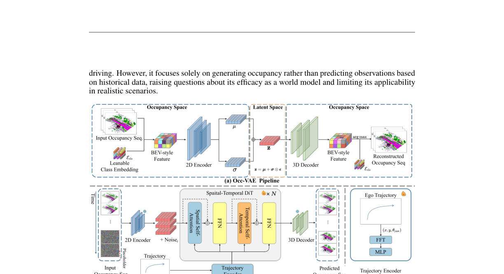
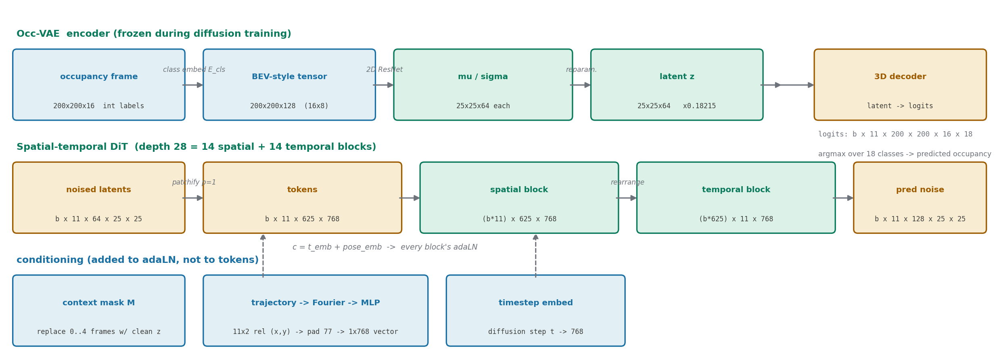
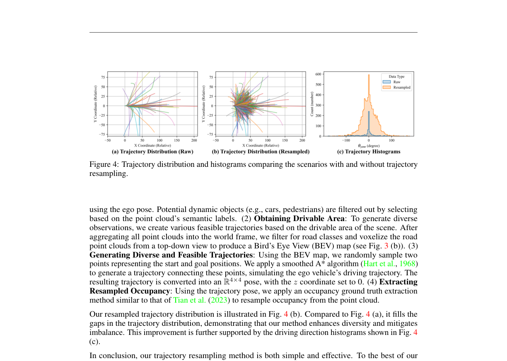
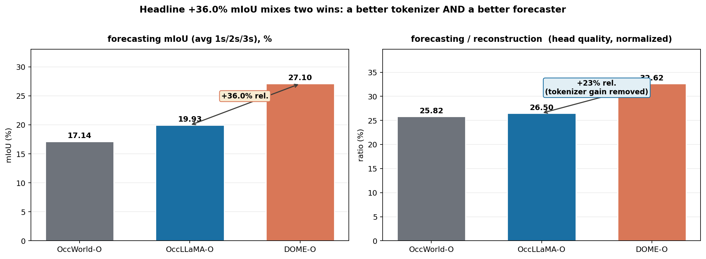

# 把视频世界模型的"可控"配方搬进三维：DOME 如何用连续潜空间驯服扩散模型

> **全局编号 62** · 论文标题：DOME: Taming Diffusion Model into High-Fidelity Controllable Occupancy World Model
>
> 作者：Songen Gu, Wei Yin, Bu Jin, Xiaoyang Guo, Junming Wang, Haodong Li, Qian Zhang, Xiaoxiao Long（第一作者单位：Horizon Robotics / 中科院软件所）
>
> venue：**未确认**（arXiv:2410.10429，仅 v1，2024-10-14 提交后从未更新；截至 2026-10，引用它的论文仍写作 arXiv preprint，包括 CVPR 2026 的论文）
>
> 链接：http://arxiv.org/abs/2410.10429 · 项目页：https://gusongen.github.io/DOME/
>
> 代码：**已公开** https://github.com/gusongen/DOME（2025-01-01 发布代码与预训练权重）
>
> **一句话核心洞见**：DOME 真正的赌注不是"扩散模型"，而是把视频世界模型 Vista 那套"相对位姿条件 + 上下文帧替换"的可控生成配方，原样搬到 occupancy 的连续潜空间上——离散 token 化（OccWorld/OccLLaMA）丢细节、展平注意力（OccSora）接不住历史条件，这两个坑恰好被"连续 VAE + 时空分离的 DiT"同时绕开；而"听指挥"的能力，一半来自轨迹编码器，一半来自用 A* 在可行驶区域里"脑补"出的多样化轨迹数据。

*论文图 2（第 4 页）：上为 Occ-VAE 管线，下为 DOME 管线。右下角轨迹编码器把 (x, y, θyaw) 经 FFT+MLP 注入——但代码里这个注入的真实形态和图上暗示的不完全一样，见"轨迹是怎么指挥生成的"一节。*

## nuScenes 里 87% 的车都在直行：一个"听不懂指挥"的世界模型

先看作者真正撞上的那堵墙。论文第 3.3 节给了一个数字：nuScenes 训练集 700 个场景里，**大约 87% 的片段是车辆直行**。再想一层：每个场景里，车只开过一次。这意味着什么？

意味着训练数据里，"同一个路口、同一组障碍物、但自车做出不同动作"这样的样本几乎不存在。世界模型的定义是给定历史观测和智能体动作，预测未来观测——动作是它的输入维度之一。可如果训练数据里动作维度几乎是个常量（直行），模型学到的就是"给定这段历史，未来大概率长这样"，而不是"给定这段历史和我的动作，未来长这样"。作者在论文里把这个现象说成"模型过拟合到特定场景"，更直白的版本是：你拿直行数据训练，它就只会预测直行的世界；你给它一个转弯指令，它要么无视，要么胡编。论文图 7 展示的就是修好之后的样子：同一帧起始画面，给不同轨迹，生成不同的未来——这是修之前做不到的事。

这是第一堵墙。第二堵墙在表示层。2024 年下半年 occupancy 世界模型有两条路线：OccWorld/OccLLaMA 走自回归 + 离散 token（VQVAE 把 occupancy 压成离散码本再用 GPT 式模型逐个预测），OccSora 走扩散 + DiT。作者对这两条路线各有一句判语，都值得展开。

对离散 token 路线，判语是"量化导致信息丢失"。具体到什么程度？论文表 1 的重建对比给了形状：OccWorld 的 tokenizer 在 16 倍压缩下重建 mIoU 只有 65.7%，OccSora 压到 512 倍时重建 mIoU 掉到 27.4%——512 倍压缩下，小物体的语义基本被抹平了。想象一个 0.4 米体素网格里的交通锥（直径约 0.2 米）：它在一个体素里只占不到一半，VQ 的最近邻量化一步，就可能把它并入"地面"。离散化的代价不是均匀的，它专挑小物体、薄结构下手——而这恰恰是规划最需要保真的东西。

对 OccSora 的判语更有意思："把空间和时间信息展平成一维 token 序列，而不是分开处理"。OccSora 的 DiT 把 4D 场景的时空维度全部打平成一个长序列做自注意力。这带来两个后果：第一，计算量随帧数平方增长，历史帧一多就扛不住；第二，更重要的是，历史条件很难"插"进去——当所有 token 在同一个序列里不分彼此时，"前 4 帧是已知条件、后 7 帧是待预测"这种结构就无处安放。结果 OccSora 只能做无条件的 occupancy 生成（从噪声里长出一段 4D 场景），不能做"给定历史预测未来"。一个不能以历史为条件的模型，作者直言它"能否算世界模型都值得怀疑"——这句话与其说是批评，不如说是划清界限：DOME 要做的是预测，不是生成。

所以到这里，问题已经收敛得很具体了：要一个能以历史 occupancy 为条件、接受轨迹指令、保住小物体细节的 occupancy 世界模型。离散 token 保不住细节，展平注意力接不住条件。剩下的路就一条：连续潜空间 + 时空分离的扩散 Transformer。这就是 DOME。

## 作者押的赌注：把 Vista 的配方搬进 occupancy 的连续潜空间

理解 DOME 最关键的一步，是认出它的"配方"从哪来。读代码时（`code/model/dome.py`、`code/diffusion/gaussian_diffusion.py`），几处痕迹很明显：扩散工具文件里写着注释 "copy from vista"；轨迹条件的注入方式（相对位姿经编码后加到 adaLN 的条件向量上）、训练时随机替换上下文帧的机制，都和 OpenDriveLab 的视频驾驶世界模型 Vista（NeurIPS 2024）如出一辙。但论文正文的参考文献里没有引用 Vista，代码 README 的致谢里才出现它。这是一个值得记下来的细节：DOME 的方法论血缘更接近 Vista，而不是它正文里重点讨论的 OccWorld/OccSora。（以上关于血缘的判断是我的推断，依据是代码注释与机制的对应；论文本身没有这样宣称。）

作者的赌注可以拆成两句。

第一句：occupancy 比视频更适合做可控世界模型。视频世界模型（GAIA-1、Vista、DriveDreamer）要操心跨视角、跨时间的一致性——六个相机拍到的同一辆车，生成时必须对得上。而 occupancy 是原生的三维表示，一致性是表示本身自带的，不需要模型去学。标注也好拿：Occ3D 证明了可以从稀疏 LiDAR 标注高效学到，而且表示与模态无关（相机、LiDAR 都能产出 occupancy）。这句话是整篇论文的立论基础，作者在引言里花了两段讲它。它的分量在于：如果这句话成立，那么把视频世界模型里验证过的"可控生成"配方搬到 occupancy 上，成功率天然更高——因为表示本身已经替你解决了一半难题。

第二句：连续 VAE + 时空分离 DiT 能同时吃掉"细节"和"条件"。连续潜空间绕开 VQ 的量化损失；时空分离的注意力让"历史帧是条件"这件事有了安放的位置（空间块里条件帧和预测帧各自做空间注意力，时间块里沿时间轴交互，掩码一盖，条件帧的损失直接跳过）。轨迹控制则靠两条腿：轨迹编码器把动作变成条件向量，轨迹重采样把"直行 87%"的数据分布掰开。

这个赌注硬不硬？证据在表 1 和表 2：重建 mIoU 83.1%（OccLLaMA 75.2%），预测 mIoU 27.10%（OccLLaMA-O 19.93%）。但先别急着信数字——"36.0% 这个数字是怎么算出来的"一节会把每个数字的来历验算一遍。先沿着"这个设计是怎么被逼出来的"路线，把两个核心部件走通。

## Occ-VAE：先把 200×200×16 的语义体素"摊平"，再压缩

Occ-VAE 要解决的问题很具体：输入是一帧 occupancy，形状 200×200×16，每个体素存一个整数语义标签（共 18 类：0–16 是 17 个语义类、含"others"，17 是 free 空间——论文正文写"17 个语义类别"稍显含糊，以代码为准：`num_classes=18`、`unique_label=[0..16]`，评测时把 17 单独拎出来算二值 IoU）。输出是一个连续潜向量。压缩率 64 倍。

第一个关口：离散的语义 ID 怎么喂给卷积网络？One-hot 是最直接的想法：18 类对应 18 通道。但作者用了一个更讨巧的办法：查表。维护一个可学习的类别嵌入矩阵 E_cls（18×8，代码里 `expansion=8`），每个体素的整数标签变成一个 8 维向量。然后把垂直的 16 个体素"摊平"：x_bev 形状 200×200×128，其中 128 = 16×8。这一步有个名字，叫 BEV-style 张量——高度维被折进了通道维，三维问题变成二维问题。

为什么这个变换是自然的？想想替代方案：直接用 3D 卷积处理 200×200×16。3D 卷积的计算量大，而且 occupancy 在垂直方向上信息密度很低（大部分体素是 free，一根柱子 16 个格子里有物体的往往只有两三个）。把高度折进通道，等于告诉网络："垂直方向的结构，我用通道来表达，你不用在空间维度上慢慢学"。代价是显式的 3D 归纳偏置少了，但省下来的算力可以堆到通道数上。这是一个局部看起来亏、整体划算的交换——而论文正文只说把 occupancy "flatten 成一致的特征维度"，没有解释为什么不直接用 3D 编码器。代码里其实留下了 Encoder3D 的注释掉的选项，说明作者至少考虑过 3D 编码器。

然后 2D ResNet 编码器（ch=64，ch_mult=(1,2,4,8)，在 50×50 分辨率处加 attention）把 200×200×128 一路压到 25×25×128。注意这里的 128 是"两倍"的：z_channels = base_channel×2 且 double_z=False，输出沿通道切成两半，前 64 是 μ，后 64 是 σ，重参数化采样 z = μ + σ⊙ε。空间压缩率：(200/25)² = 64 倍——和表 1 的 Compression Ratio 64 对上了。

解码器走回头路：3D 反卷积把 25×25×64 升采样回 200×200×16 的特征 F，reshape 成 200×200×16×8，和类别嵌入矩阵做点积得到 logits（200×200×16×18），argmax 定类别。这个"点积查表"的设计很干净：编码时查表把类别变成向量，解码时用点积把向量变回类别，编解码共用同一张表，表是联合训练的。

损失函数是论文公式 (1)：L = L_CE + β·KL + λ·L_lovasz。论文正文没有给 β 和 λ 的值。代码（`config/train_occvae.py`）里写的是：**CE 权重 10.0，Lovasz 权重 1.0，KL 权重 0.00005**（注释掉的旧值是 0.00025）。换算一下，λ = 0.1（相对 CE），β = 5×10⁻⁵。KL 权重小到这个程度，说明作者几乎不指望 KL 项做强正则——潜空间只要"大致连续、别塌"就行，真正的保真压力全在 CE + Lovasz 上。Lovasz-softmax 是直接优化 IoU 的替代损失，专门对付类别不平衡（小物体在大场景里体素占比极低，CE 会被 free 空间淹没）。三项的分工是：CE 管"每个体素别分错"，Lovasz 管"小类别的 IoU 别垮"，KL 管"潜空间别长得太离谱以至于扩散模型没法学"。

还有一处论文没写、代码里有的：潜向量要**乘 0.18215** 再交给扩散模型（`scaling_factor=0.18215`，两个训练配置里都有；推理时再除回去）。这个数字是 Stable Diffusion 的 VAE 缩放因子，作用是把潜变量的标准差拉到 1 附近，让扩散模型工作在输入单位方差的舒适区。DOME 的作者直接沿用了这个常数，没有针对 occupancy 潜空间重新标定——这是个"拿来主义"的工程选择，论文里提都没提，但复现时缺了它训练动态会不一样。

重建效果：mIoU 83.1%、IoU 77.3%。64 倍压缩下做到这个数，确实说明连续潜空间比 VQ 保真。但表 1 里藏着一个反例：第 0 类（others，杂项）的 IoU，**DOME 是 36.6%，OccLLaMA 是 65.0%**——DOME 在 17 个类别里 16 个赢了，唯独在"others"这个大杂烩类别上输了一大截。一个合理的解释是：连续 VAE + Lovasz 的组合擅长刻画"长得像"的类别（车、路、建筑），却不擅长"others"这种内部方差极大的兜底类；VQ 的离散码本反而能给杂项分几个专用的码。论文正文没有提这一格数字。

## 空间块和时间块交替：rearrange 背后的形状游戏

DOME 的扩散主干是一个 DiT（论文里叫 spatial-temporal diffusion transformer），配置是 depth=28、hidden=768、12 头、patch size=1。按我的估算约 3.4 亿参数（估算：每块约 1060 万 ×28 ≈ 2.97 亿，加上轨迹编码器的投影层约 4500 万；论文未给参数量）。28 个块两两配对：偶数位是空间块，奇数位是时间块——论文说的"14 个空间层 + 14 个时间层"就是这么来的。

先看数据是怎么流进去的。训练时一个样本是 11 帧 occupancy（nf=11，2Hz 下约 5.5 秒），经冻结的 Occ-VAE 编码成潜向量，形状 (b, 11, 64, 25, 25)，乘 0.18215。patch size=1 意味着不切分、每个空间位置就是一个 token：一帧 625 个 token，11 帧共 6875 个 token，每个 768 维。加上固定的 2D sin-cos 空间位置编码和 1D sin-cos 时间位置编码。

然后是论文附录里那段 einops 写法，它值得逐行看，因为这是整个"时空分离"的全部秘密：

- 进空间块前：`(b, nf, t, c) → (b×nf, t, c)`。把 11 帧在 batch 维上堆起来，每一帧独立做 625 个 token 的自注意力。**空间块里，第 3 帧的 token 永远看不到第 5 帧的 token**——时间被"折"进了 batch，帧间信息在此处是隔离的。
- 出空间块、进时间块前：`(b×nf, t, c) → (b×t, nf, c)`。转置一下，现在 batch 维上堆的是 625 个空间位置，每个位置独立地看 11 个时间步。**时间块里，位置 (12, 7) 的 token 只和历史上/未来同一位置 (12, 7) 的 token 交互**——空间被"折"进了 batch。
- 时间块出来再折回去，如此交替 14 轮。

为什么要这样折来折去，而不是像 OccSora 那样把 6875 个 token 全扔进一个注意力？算一笔账：全序列自注意力的复杂度是 O((6875)²) ≈ 4700 万次 token 对交互；分离之后是 11×O(625²) + 625×O(11²) ≈ 430 万 + 7.6 万。前者是后者的 10 倍以上。而且分离带来一个结构上的好处：**时间是显式的维度**，于是"前 4 帧是条件"这句话有了落点。

条件的落点就是论文公式 (2) 的掩码替换。训练时，对每个样本随机选若干帧作为上下文（0 到 4 帧，见下），把这些帧的**加噪潜向量**直接替换成**干净的** VAE 潜向量：ẑ_i = M·z_c + (1−M)·z_i。推理时也一样：前 4 帧的位置在每一步去噪迭代里都被重新填入干净的条件潜向量，雷打不动。公式 (3) 的损失则在条件帧上直接置零：(1−M_t)⊙‖εθ − ε‖²，条件帧不产生梯度——模型被明确告知"这几帧是给你的提示，不是你要猜的"。

这里代码比论文诚实。论文说"以一定比例 pinj 训练无上下文"，代码（`gaussian_diffusion.py` 的 training_losses）里是这样实现的：`cond_frames_choices = [[], [0], [0,1], [0,1,2], [0,1,2,3]]`，权重 `[1, 2, 4, 8, 16]` 做加权随机抽样。算一下：P(0 帧)=1/31≈3.2%，P(4 帧)=16/31≈52%。所以模型一半以上的训练时间都在"4 帧条件"下，只有约 3% 的时间见过"无条件"。论文的 pinj 描述把这套加权机制简化成了一句话，丢掉了"训练严重偏向 4 帧条件"这个信息——而这恰好解释了为什么推理时 nc=4 效果最好（表 5）：模型就是按这个分布训练的。

*自绘图：一个 11 帧样本穿过 Occ-VAE 和 DiT 时的形状变化。注意三点：(1) 潜向量进扩散前乘 0.18215（论文未写）；(2) 轨迹条件没有拼到 token 上，而是加到每个块的 adaLN 条件向量里；(3) 轨迹的 11 帧在编码器里被塌成单个 768 维向量——这是下一节的重点。*

## 轨迹是怎么"指挥"生成的：从 (x,y) 到一个 768 维向量

轨迹条件是 DOME 自称"fine-grained controllability"的来源，也是和本课题的 rollout 风险校验最相关的一节，所以这里要看得最细。

论文的描述是：取自车位姿，算相邻帧的相对平移 Δt 和相对旋转 ΔR，提取 (x, y) 和 yaw 角 θyaw，做位置编码，线性投影到 hidden 维，和时间嵌入相加，送进 adaLN。读起来像是"每一帧的 (x, y, θyaw) 都被编码、注入"。但代码（`model/pose_encoder.py` + `model/dome.py` 的 forward）的实际路径是：

1. 输入是 11 帧的**逐帧相对位移** (b, 11, 2)——注意是相邻帧之间的相对 (x, y)，不是相对首帧的绝对位置（`dataset.py` 的 get_meta_data：`rel_pose = inv(poses[:-1]) @ poses[1:]` 取平移 xy）。也没有 yaw：默认配置用的是 `PoseEncoder_fourier`（in_channels=2），不是 `PoseEncoder_fourier_yaw`。
2. 每个 (x, y) 做 Fourier 编码（8 个频率 → 32 维），过 2 层 MLP 到 768 维，得到 (b, 11, 768)。
3. **关键一步**：`do_proj=True` 把 11 帧 pad 到 77 帧，展平成 b×(77×768)，过一个线性层压成 **b×768——单个向量**。11 帧的时间结构在这里被塌掉了。
4. 这个 768 维向量和 timestep embedding 相加，得到每个 DiT 块的 adaLN 条件 c。空间块和时间块、所有 token、所有帧，用的都是同一个 c。

所以真实的机制是：**整条 11 帧轨迹被压缩成一个全局向量，以"风格"的方式调制每一层的归一化参数**，而不是逐帧精细注入。模型确实能学会"这个向量对应左转、那个向量对应直行"（图 7 的可控生成证明了它 work），但"fine-grained"这个词容易让人误解为逐帧对齐——代码里的粒度是"整段轨迹一个向量"。这并不否定效果，但它决定了你能指望什么：换一条形状相似但时间错位的轨迹，模型可能分不出来，因为时间结构在第 3 步已经被池化掉了。

还有两处论文与代码的出入。第一，yaw：论文正文和消融表 3 都包含 yaw（加 yaw 后 mIoU 从 27.00 微涨到 27.10），表 2 的 headline 数字 27.10 恰好等于加 yaw 那一行——**但公开发布的两个训练配置（train_dome.py / train_dome_resample.py）用的都是不带 yaw 的 PoseEncoder_fourier**。也就是说，按发布配置训练，复现出来的是 27.00 那档，不是论文 headline 的 27.10。第二，`forward_with_cfg` 里无条件/有条件前向的 eps 通道被硬编码切成 `[:, :, :4]`，而实际潜通道是 64——这段 CFG 代码是从 Vista 复制过来没改对的，好在它**从未被调用**（采样脚本里的 cfg_scale 全被注释掉了，实际采样就是 20 步 plain DDPM）。两处都是"论文故事"和"发布代码"之间的小裂缝，单独看都不致命，但放在一起看，说明发布代码是研究代码的整理版，不是逐 bit 复现论文数字的那个版本。

再看轨迹重采样本身，这是论文最有特色的一块，也是它敢写"首个 occupancy 数据增强"（to the best of our knowledge, we are the first to explore occupancy data augmentation for the task of world model prediction）的底气。四步走：

1. 把同一场景的 occupancy 序列按自车位姿拼到世界系，**按语义标签滤掉所有动态物体**（车、行人、自行车等），只剩静态世界；
2. 取路面类别体素，俯视体素化成 BEV 可行驶区域图；
3. 在 BEV 图上随机撒起点终点，**平滑 A\* 搜一条可行轨迹**（每个场景采 10 条，每条重采样出 40 帧）；
4. 把静态点云变换到新轨迹的自车系下，用类似 Occ3D 的体素化方法重新生成 occupancy。

*论文图 4（第 7 页）：(a) 原始轨迹分布——几乎全挤在"直行"方向；(b) 重采样后填满了各个方向；(c) 方向角直方图，橙色（重采样）明显摊平了蓝色（原始）的尖峰。*

效果上，图 4 的方向直方图确实从尖峰摊成了宽分布。消融表 3 也显示：加轨迹条件 mIoU 18.60→24.24，加重采样 24.24→27.00——**重采样贡献了约 2.8 个点，是除"时空分离架构"外最大的单项增益**，承重设计无疑。

但怀疑式阅读要问：重采样的数据里**没有动态物体**。A\* 轨迹是运动学理想化的（平滑、无急刹、无交互），新视角下的 occupancy 是从静态点云"脑补"体素化来的。模型从这部分数据里学到的是"自车动起来时，静态世界应该怎么相对运动"——这是有价值的（恰好补上了"直行数据里学不到的东西"），但它学不到"旁边那辆车在我变道时会怎么反应"。所以"首个 occupancy 数据增强"的说法，在"轨迹多样性增强"这个限定下站得住；如果理解成"一般意义的数据增强"，那就言过其实了——训练时原始数据与重采样数据按场景条目约 1:1 混合：重采样一侧是 700 场景×10 条轨迹 = 7000 条目（`resample_times=1`），原始一侧是 700 场景×`raw_times=10` = 7000 条目。增强数据不是点缀，而是和原始数据平起平坐的另一半训练集——这也解释了为什么重采样能贡献 2.8 个点的增益。

表 5 还有一个对本课题很有启发的数字：**1 帧上下文 + 轨迹条件（mIoU 22.24）打败了 4 帧上下文无轨迹（20.07）**。轨迹这个"动作先验"提供的信息量，超过了多给 3 帧历史。这正是世界模型该有的样子：未来主要由动作决定，历史只是辅助。

## 一次完整的穿越：11 帧 occupancy 走完全程

把上面所有部件串起来，跟一个具体样本走一遍。场景：nuScenes 验证集里一个路口，自车准备左转。训练窗口是连续 11 帧 occupancy（2Hz，5.5 秒）；推理评测时以前 4 帧为条件，生成并评测后 6 帧（3 秒）。

**第 1 步：编码。** 11 帧 occupancy，每帧是 200×200×16 的整数张量。查类别嵌入表 → 200×200×128 的 BEV 张量（16 个高度格 ×8 维嵌入）。2D ResNet 编码器：200→100→50→25（ch_mult 1,2,4,8），输出 25×25×128，切成 μ 和 σ（各 64 通道），采样得 z，形状 (11, 64, 25, 25)，乘 0.18215。注意编码器是**逐帧独立**编码的——Occ-VAE 没有时间维度，帧间关系它不管，全部留给扩散模型。

**第 2 步：加噪与掩码。** 采样扩散步 t（训练 1000 步中的一步），11 帧潜向量按噪声表加噪得 x_t。然后掩码替换：前 4 帧的位置被**干净的**条件潜向量覆盖。注意替换用的是 x_start（干净潜向量），不是加噪版——条件帧在整个去噪过程中是"钉死"的干净信号。

**第 3 步：轨迹编码。** 11 帧自车位姿 → 相邻帧相对位移 (11, 2)，比如左转场景下这 11 个 (x,y) 会从 (0.8, 0.1) 渐变成 (0.5, 0.6)（每 0.5 秒的位移，单位米，示意数字）。Fourier 编码 → MLP → (11, 768) → pad 到 77 → 线性层压成单个 768 维向量。训练时以 90% 概率使用轨迹条件（`p_use_pose_condition=0.9`），10% 的时间丢掉，让模型也学会无条件预测。

**第 4 步：DiT 去噪。** patchify（p=1）→ (11, 625, 768) token。28 个块交替：空间块里 (b×11, 625, 768) 做帧内注意力——第 0 帧里路口左上角的 token 和同一帧右下角的 token 交互，但看不到第 1 帧；时间块里 (b×625, 11, 768) 做帧间注意力——空间位置 (12,7) 的 11 个时间步互相看。每个块的 adaLN 都被 c = 时间步嵌入 + 轨迹向量调制。输出预测噪声 (11, 128, 25, 25)——128 = 64（噪声）+ 64（学到的方差，LEARNED_RANGE）。损失只在后 7 帧上算 MSE（条件帧被掩掉）。

**第 5 步：推理。** 20 步 DDPM 采样：从纯噪声 (10, 64, 25, 25) 开始（推理生成 10 帧窗口），每一步都把前 4 帧替换成条件潜向量，去噪完除以 0.18215，3D 解码器 → logits (10, 200, 200, 16, 18)，argmax → occupancy。取第 4–9 帧（6 帧 = 3 秒）和真值比 mIoU/IoU。评测用的是 EMA 权重。

**基线在这里的哪一步掉队？** OccWorld 的 VQ tokenizer 在第 1 步就把交通锥、细杆这类小物体量化没了——第 5 步的 argmax 再准也找不回来，因为信息在编码时已经死了。OccSora 在第 2 步掉队：它的展平注意力没有"条件帧"的位置，第 5 步只能从纯噪声生成，历史信息用不上。DOME 的每一处设计都正好堵着这两个窟窿。

**长时 rollout**（32 秒）则是把第 5 步循环起来：用刚预测出的最后一帧做下一轮的上下文（此时 nc=1），轨迹按偏移量切片对齐，迭代 6 次得到 64 帧。但注意：论文对这 32 秒**没有任何量化评测**，只有可视化。误差累积了多少、后面 20 秒的 mIoU 掉到多少，论文没说——"32 秒"这个数字来自推理时的窗口拼接，不是训练或评测的设置。

## 36.0% 这个数字是怎么算出来的

现在验算 headline 数字。摘要和第 4 章说：重建上超过基线 10.5% mIoU / 21.2% IoU，4D 预测上超过 36.0% / 24.6%。首先，"基线"是谁？论文没明说，但数字会说话：

- 重建：DOME mIoU 83.1 vs OccLLaMA 75.2 → (83.1−75.2)/75.2 = **10.5%**；IoU 77.3 vs 63.8 → (77.3−63.8)/63.8 = **21.2%**。对上的是 OccLLaMA（最强的重建基线），不是 OccWorld。
- 预测：DOME-O 27.10 vs OccLLaMA-O 19.93 → (27.10−19.93)/19.93 = **36.0%**；IoU 36.36 vs 29.17 → (36.36−29.17)/29.17 = **24.6%**。对上的是 OccLLaMA-O。

两个结论：第一，这些全是**相对百分比**，不是百分点——27.10% vs 19.93% 的绝对差距是 7.17 个百分点，写成 36.0% 听起来大很多。论文的措辞 "surpasses the baseline by 36.0% in mIoU" 在技术上没错，但读者很容易误读成百分点。第二，基线选的是当时最强的 OccLLaMA，这一点是厚道的；但 OccLLaMA 的数字是**从原文抄的**（论文写的是"compare with existing approaches"，没有说重跑），而 DOME 的数字是自己在验证集上选最优 checkpoint 跑的——训练脚本里 `best_val_miou` 的跟踪逻辑说明模型选择发生在验证集上。抄数字 + 验证集选优，这个组合在领域里常见，但它意味着两边的"运气成分"不对等。

更深一层：预测指标的比较里混进了 tokenizer 的增益。表 2 的 -O 设置下，每个方法用**自己的** tokenizer 编解码：DOME-O 的重建（表里 Recon 列）是 83.08，OccLLaMA-O 是 75.20，OccWorld-O 是 66.38。预测 mIoU 是拿各家解码后的 occupancy 和真值比的——所以 36.0% 里既有"预测头更准"，也有"tokenizer 本身重建更准"。把预测除以重建做归一化，得到"预测头质量"：OccWorld-O 25.8%，OccLLaMA-O 26.5%，DOME-O 32.6%。DOME 的预测头确实更强，但相对增益从 36% 缩到约 **23%**。下图把这两层分开画了出来：

*自绘图：左为论文表 2 的原始预测 mIoU（headline +36.0% 的来源）；右为预测 mIoU 除以各家自己的重建 mIoU——去掉 tokenizer 增益后，预测头本身的相对优势约为 23%。*

还有几个评测细节值得记下来：

- **种子与误差棒**：训练脚本 `set_random_seed(42)`，全文没有任何多种子、误差棒的报告。扩散模型采样本身有随机性（`seed=None`），20 步 DDPM 的方差未知。
- **超参数敏感性**：β=5e-5、λ=0.1、pinj≈3.2%、pose dropout 10%，论文正文一个没给，全在代码里；也没有任何敏感性曲线。CE:Lovasz:KL = 10:1:5e-5 这个配比换个数据集还成不成立，未知。
- **消融表 3 的第一行**（去掉时空分离，mIoU 13.08）论文没有解释这个变体具体是什么结构——按上下文推测是 OccSora 式的展平时空注意力，但正文没写，属于"读者自己猜"的部分。
- **训练代价**：论文只在 Limitations 里轻描淡写一句"需要可观的计算资源"。实际情况是：Occ-VAE 在 8×RTX 4090 上训 200 epoch；扩散模型在 **32×RTX 4090 上训 2000 epoch**，batch 8/GPU（共 256），EMA、xformers、混合精度、梯度检查点全开。墙钟时间论文没给，但这个量级显然是"数周 × 数十卡"。对比它要打败的 OccWorld（GPT 式小模型），DOME 是用大得多的算力换来的胜利——这一点论文没有正面讨论。
- **-F 设置的对齐**：DOME-F（纯视觉输入，经 FB-OCC 提 occupancy）mIoU 18.25，对 OccLLaMA-F 的 8.66 翻倍还多。但注意 DOME-F 的重建列是 75.00，OccLLaMA-F 是 37.38——两家 -F 的"重建"定义是否可比（FB-OCC 预测的 occupancy 本身带噪声），论文没有交代。这组对比的可信度低于 -O 组。

公平地说，也有做得漂亮的地方：消融是真消融（表 3 逐项加，表 5 网格扫上下文帧数×轨迹开关），没有只报最好的一组；"轨迹 > 更多历史"（表 5）这个结论反直觉但数据扎实；重采样前后分布对比（图 4）把"数据增强做了什么"可视化了出来，而不是只扔一个数字。这些都是审稿人喜欢看到的诚实实验。

## 论文没写、代码里才有的东西（以及几处对不上的地方）

通读代码后，把论文与实现之间的差异记下来。按"影响复现"的程度排序：

1. **yaw 用没用，论文和发布配置说法不一。** 论文正文描述轨迹编码输入是 (x, y, θyaw)，消融表 3 最后一行（+yaw）mIoU 27.10 恰好等于表 2 的 headline 数字。但 `train_dome.py` 和 `train_dome_resample.py` 用的都是 `PoseEncoder_fourier`（in_channels=2，无 yaw）。按发布配置训，拿到的是 27.00 那档。`PoseEncoder_fourier_yaw` 在代码里存在但无配置引用。
2. **潜向量缩放 0.18215。** 论文全文未提，代码里编码后乘、解码前除。这是 Stable Diffusion 的常数，直接沿用，未针对 occupancy 潜空间重新标定。
3. **损失权重。** 论文公式 (1) 只给符号，代码里 CE:Lovasz:KL = 10.0:1.0:0.00005。另外代码里注释掉了 VQVAE 的嵌入损失和整套 vqvae_cfg——项目早期可能走过 VQ 路线，后来弃了。
4. **上下文帧的加权随机机制。** 论文说"以比例 pinj 无上下文训练"，代码是权重 [1,2,4,8,16] 的加权抽样（P(0帧)≈3.2%，P(4帧)≈52%）。训练严重偏向 4 帧条件，这是表 5 里 nc=4 最优的直接原因。
5. **VAE 的 batch size。** 论文说 8 卡、每卡 batch 10；发布的 `train_occvae.py` 里 `train_loader.batch_size=1`。扩散模型的 batch 8/GPU 与论文一致。VAE 这一处对不上（可能是发布配置被简化过）。
6. **CFG 相关代码是死的。** `forward_with_cfg` 里 eps 通道硬编码切前 4 通道（实际 64 通道），且从未被调用；采样配置里的 `guidance_scale=7.5` 实际未使用。真实采样是 20 步 plain DDPM，无分类器-free 引导。论文没声称用了 CFG，所以不算论文撒谎，但看代码时别被误导。
7. **"相同的空间压缩率（16 倍）"笔误。** 第 4.2 节说与 OccSora 采用相同的空间压缩率 16 倍、只是没做后者的 8 倍时间压缩。但按表 1，DOME=64、OccSora=512=64×8——空间压缩率应该是 64 倍，"16 倍"是个笔误（也可能是把 OccWorld 的 16 倍写串了）。
8. **Vista 未被引用。** 方法层面的关键机制（相对位姿条件注入 adaLN、上下文帧替换、加权随机条件帧）与 Vista 一致，代码里有 "copy from vista" 注释和 README 致谢，但论文参考文献没有 Vista。这是审稿人视角下的一处引用缺失。
9. **模型选择在验证集上。** 训练脚本跟踪 `best_val_miou`/`best_val_iou`，论文数字来自最优 checkpoint；基线数字引自原文。两边不在完全相同的选择协议下。

## 能带走的两个想法

**想法一：把"动作"变成数据的分布，而不是模型的输入。** DOME 的轨迹重采样最妙的地方不是 A\* 本身，而是它回答了一个通用问题：当你的条件（动作、指令、轨迹）在训练数据里极度偏斜时，与其指望模型从 13% 的少数样本里学会条件依赖，不如**用先验知识（可行驶区域 + 寻路算法）把条件分布人工掰平**。这个思路可以迁移到任何"条件稀缺"的问题：指令跟随里罕见的指令类型、规划里罕见的机动动作。代价是脑补数据的保真度（这里是静态世界、无交互），所以原始数据和脑补数据的配比（这里按场景条目约 1:1）本身就成了一个超参数——论文没调它，留了一个口子。

**想法二：条件注入的位置决定了你能指望的控制粒度。** DOME 把整条轨迹塌成一个向量去调制 adaLN，控制粒度就是"整段轨迹级"。如果想要"第 t 帧的动作影响第 t 帧的预测"这种逐帧对齐，就得把条件做到 token 级别（比如拼到时间块的输入上，或做交叉注意力）。反过来，如果你的下游任务只需要"候选轨迹 A vs 候选轨迹 B 哪个更安全"这种整段判断，DOME 的做法更便宜——adaLN 调制的计算量几乎可以忽略。**先想清楚你要的控制粒度，再决定条件从哪扇门进去**，而不是默认"条件越细越好"。

## 与本课题的关联

本课题是"世界模型引导 + 自适应衰减情景记忆的闭环多规划器 Agent"：LLM 调度多个专家规划器，世界模型预测未来 T 步交通状态作调度先验，并对候选动作做 rollout 输出量化风险分数。DOME 与其中两块直接咬合：

**① 世界模型中间分布复用。** DOME 的整条管线都活在分布里：Occ-VAE 的潜变量 z（25×25×64×11 帧）、扩散过程中间步的 x_t、adaLN 的条件向量 c。对课题的"中间分布复用"有三处可借鉴：第一，**VAE 潜空间就是现成的复用点**——DOME 证明了 64 倍压缩下 mIoU 还能到 83.1%，说明 occupancy 的语义在潜空间里几乎无损；课题里做"分层粗细检索"时，粗检索完全可以在这种潜向量上做，而不必解码回体素。第二，**条件帧替换机制**（公式 2）本质上是一种"潜空间手术"：把干净的条件潜向量钉在时间轴的指定位置。课题的异步流水线里，新观测到来时可以用同样的手法把"已知的最新帧"钉进正在去噪的窗口，而不必重启整个 rollout。第三，**一次前向、多次复用**：DOME 推理时 20 步去噪的中间 x_t 本身就是"不同噪声水平下的未来假设"，风险校验不一定非要等到完全去噪——高噪声步的样本对应高不确定性，低噪声步对应确定性预测，这正好可以映射成风险分数的置信度。

**② rollout 风险校验：DOME 的轨迹条件生成就是"候选动作 rollout"的 occupancy 版本。** 课题设想的是：对 LLM 选出的候选动作，用世界模型 rollout 未来 T 步，输出量化风险分数做仲裁。DOME 的图 7 演示的正是这个循环的"生成"一半：**给定候选轨迹 → 生成未来 occupancy**。缺的另一半是"风险分数"——DOME 只生成不打分。但它的部件可以直接拼：rollout 出的未来 occupancy 里，自车轨迹扫过的体素如果在未来帧被标记为 occupied（车、行人、路障类），就是一次可量化的碰撞风险；被标记为 free 的比例可以转成通行置信度。表 5 的结论（"1 帧历史 + 轨迹" 胜过 "4 帧历史无轨迹"）对课题是个好消息：风险校验时，给足候选轨迹这个强先验，比堆历史帧更划算——这直接支持"场景驱动动态模块旁路"的设计（简单场景下少给历史、多给动作先验）。

两个提醒。第一，DOME 的轨迹条件是**开环**的：它假设自车严格执行给定轨迹、不考虑他车对自车动作的反应（重采样数据里动态物体还被滤掉了）。课题的闭环风险校验如果直接套用，会低估交互式风险（比如你变道、旁车也变道）。真要做闭环，需要把"他车行为模型"也放进条件里，这是 DOME 没做的。第二，DOME 的 32 秒 rollout 没有量化评测，误差累积未知；课题若在 Bench2Drive 上做闭环验证，rollout 长度和风险分数的校准（calibration）需要自己补实验，不能直接引用 DOME 的数字。

*未确认事项：venue（arXiv v1 后无更新，多方引用仍为 preprint，判为未确认）；DOME-F 与基线 -F 的重建口径是否对齐（论文未交代）；消融表 3 首行的无时空分离变体具体结构（论文未描述）；训练墙钟时间（未给）；多种子/误差棒（未报告）；β、λ 等超参数的敏感性（未给）。*
