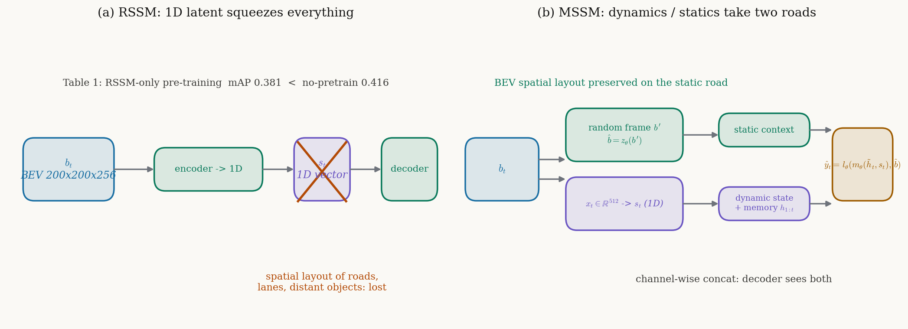

# 把未来预测变成预训练：DriveWorld 用世界模型学 4D 驾驶表示

> **全局编号**：63
> **论文**：DriveWorld: 4D Pre-trained Scene Understanding via World Models for Autonomous Driving
> **作者**：Chen Min, Dawei Zhao, Liang Xiao, Jian Zhao, Xinli Xu, Zheng Zhu, Lei Jin, Jianshu Li, Yulan Guo, Junliang Xing, Liping Jing, Yiming Nie, Bin Dai（13 人）
> **会议 / 年份**：CVPR 2024（论文页码 15522–15533）
> **链接**：摘要页 https://arxiv.org/abs/2405.04390v1 ；CVPR 开放获取页 https://openaccess.thecvf.com/content/CVPR2024/html/Min_DriveWorld_4D_Pre-trained_Scene_Understanding_via_World_Models_for_Autonomous_CVPR_2024_paper.html
> **代码**：未公开。论文写 "Code will be made publicly available"，但 arXiv 与 CVPR 页面均无代码链接，多个 world-model 论文合集里 DriveWorld 条目均无 [Code] 标注（同表相邻条目均有），全网检索未发现官方仓库。以下所有判断只依据论文正文与附录，关键实现细节以论文为准、代码无法对照。
> **一句话核心洞见**：DriveWorld 的赌注是——让网络为了预测未来 L 步的 3D occupancy 不得不学会场景的时间演化，4D 预训练的本质是把世界模型的未来预测当作预训练任务；而 Memory State-Space Model 里动态 / 静态两条路的解耦，解决的是直接套用 RSSM 时 1D 隐变量装不下 BEV 空间上下文这个具体矛盾。

## 「自动驾驶是 4D 任务」：2D / 3D 预训练在哪一个具体场景撞墙

2024 年初，视觉中心自动驾驶预训练的主流是两条路。单目 2D 路：DD3D 用深度估计做预训练，在单目 3D 检测上证明了几何监督有用。多相机 3D 路：OccNet、UniScene、UniPAD 用 3D 场景重建（occupancy reconstruction）做预训练；BEVDistill、DistillBEV、GeoMIM 用 LiDAR 检测模型做知识蒸馏，把几何知识灌进视觉模型。这两条路有一个共同的默认假设：**把当前这一帧的空间结构理解好，预训练就到位了**。时间维度被当成下游任务自己的事。

DriveWorld 要推翻的就是这个假设。论文开篇点名自动驾驶是 4D 场景理解任务——三维空间加一维时间——而 2D / 3D 预训练任务里根本没有时间。图 1 把三条路画成三格漫画：(a) 单目 2D 预训练，(b) 多相机 3D 预训练，(c) 基于世界模型的 4D 预训练。第一张图就是作者押的赌注，后面会反复回到它。

这个判断不是空话，论文用数字把它钉死了。看表 5 跟踪和表 6 预测：3D occupancy 预训练（OccNet、UniScene）和蒸馏（BEVDistill）相对 UniAD 基线，在 AMOTA 上只涨了约 1.0 个点（0.359 → 0.373～0.376），在 minADE 上几乎没动（0.71 → 0.69～0.70）。而同样这批 3D 预训练方法，在检测上能涨 6 个点（表 3：0.377 → 0.436～0.439）。同一个预训练，表示里装的东西一样，检测任务吃得很饱，跟踪和预测任务几乎吃不到——这说明缺的不是数据量也不是模型容量，缺的是**表示里的时间演化知识**。单帧重建的预训练任务，学不到"这辆车下一秒会去哪"。这是一个结构性失败，调参救不回来，因为预训练目标函数里就没有时间项。

所以 DriveWorld 的起点可以一句话概括：预训练任务必须包含未来。

## 作者的赌注：让网络为了预测未来而被迫学会时间

赌注的具体形式是 Memory State-Space Model（MSSM）。输入是连续 T = 4 帧多相机图像 o_1:T 和专家动作 a_1:T，模型要输出当前和未来 L = 4 步的 3D occupancy ŷ（含未来 y_{T+1}…y_{T+L}）以及动作 â。注意这个设计的双重性：occupancy 重建逼模型学几何结构，未来预测逼模型学动力学。两个监督信号各管一摊，合起来就是 4D。

论文在引言末尾借了一套不确定性的语言：自动驾驶场景有两类不确定性，aleatoric（世界本身的随机性）用 Dynamic Memory Bank 对付——学时间感知的隐动态、预测未来状态；epistemic（知识不完备）用 Static Scene Propagation 对付——学空间感知的隐静态、提供完整场景上下文。这套哲学包装好不好听另说，它至少把"为什么拆成两条路"讲成了一个对称的故事，后面讲消融时会看到，拆成两条路确实有实证支撑。

作者的底气从哪里来？三张牌。第一张，MILE 已经证明 RSSM + BEV 语义预测这条路在 CARLA 上走得通，世界模型学驾驶表示不是空想。第二张，OccNet / UniScene 已经证明 3D occupancy 重建是 vision-centric 预训练的好监督信号，几何先验管用。第三张，2024 年初 GAIA-1、DriveDreamer 把"世界模型 + 驾驶"炒热了，投 CVPR 的审稿人对这个方向有胃口。三张里最硬的是前两张的乘积：occupancy 重建解决"学什么"，未来预测解决"还缺什么"。论文自称 "the first 4D pre-training method based on world models for real-world vision-centric autonomous driving"，这个 "first" 的定语很长——基于世界模型、真实世界、视觉中心——但在这个定语范围内，确实没人先做。

## 为什么 RSSM 的 1D 隐变量装不下 BEV：Memory Bank 是被逼出来的

最直接的尝试是什么？MILE 已经给了模板：拿 Dreamer 那套 RSSM（Recurrent State-Space Model），把观测压成 1D 隐向量 s_t，用 RNN 递推历史 h_t，解码未来。作者照抄这套来做预训练，结果撞墙了。表 1 第二行是全文最诚实的一行数据：只用 RSSM 做预训练，3D 检测 mAP 是 0.381，**比不做预训练的基线 0.416 还低了 3.5 个点**。预训练把模型搞坏了。

坏在哪？论文的解释是：RSSM 把特征压成 1D tensor，留不住上下文信息（"cannot effectively retain context information"）。把这句话翻译成具体的形状：BEV 特征 b_t 是 200×200 空间网格（带通道），上面趴着车道线、路沿、远处车辆的空间布局；RSSM 的编码器把它拍平成一个 1D 向量 x_t ∈ R^512，再采样出 s_t。拍平这一步，空间邻接关系就没了。解码器要从 1D 向量重建 16×200×200 的 voxel occupancy，相当于让一个人看一眼把房间布局背下来再默画——远处的、小目标的位置信息在瓶颈处被挤掉了。检测任务恰恰最吃精确定位，所以检测先崩。

*图：(a) RSSM 把 BEV 特征压成 1D 隐向量，空间布局在瓶颈处丢失，表 1 显示纯 RSSM 预训练 mAP 0.381 反而不如不预训练的 0.416；(b) MSSM 让动态走 1D + 记忆库（运动只需要轨迹），静态走 BEV 直通（道路、车道线需要空间布局），解码器把两路按通道拼起来一起看。*

修正的思路是分工：**需要空间布局的东西，别走 1D 瓶颈**。Static Scene Propagation（SSP）从 1..T 帧里随机抽一帧 o'，拿它的 BEV 特征 b' 直接算一个隐静态表示 b̂ = z_θ(b')，原样送进解码器，不经过任何拍平。Dynamic Memory Bank（DMB）管另一半：运动信息本来就是时间序列，1D 表示够用，但 RSSM 的 RNN 递推记不住长期依赖，于是把历史 h_1:t 摆成一个动态记忆库，当前 h_t 用 cross-attention 去库里取精炼后的 h̃_t，再按 h_{t+1} = f_θ(h̃_t, s̃_t) 递推。

表 1 第三行验证了这个分工：RSSM + SSP，检测从 0.381 拉回 0.429（相对无预训练基线 +1.3 个点），作者说这是 "direct reconstruction using BEV features leads to an approximately 1% improvement"。**承重的是 SSP 这条 BEV 直通**，不是花哨的记忆库。

## 一个十字路口，四帧：把符号和公式走一遍

先把符号表立好，后面不再回头查。时间步 t = 1…T（T = 4 观测帧），未来 k = 1…L（L = 4 预测步）。

| 符号 | 形状 | 含义 |
|---|---|---|
| o_t | 6 相机图像 | t 时刻多相机观测 |
| a_t | R^2（速度， 转向角） | 专家动作，MLP 从 (h_t, s_t) 预测 â_t，L1 监督 |
| y_t | 16×200×200 voxels | 3D occupancy 真值，多帧 LiDAR 融合的稠密标注 |
| b_t | 200×200×C BEV 网格 | 图像经 2D→3D 视图变换得到的 BEV 特征 |
| x_t | R^512 | b_t 拍平后的 1D 向量，只走动态路 |
| s_t | R^d（1D 隐向量） | 随机状态，管"这一刻在动的东西" |
| h_t | R^d（1D 隐向量） | 确定性历史，管"过去发生了什么" |
| h̃_t | R^d | h_t 对记忆库 h_1:t 做 cross-attention 后的精炼版 |
| s̃_t | R^d | 经运动感知归一化（MLN）后的 s_t |
| b̂ | BEV 网格 | 隐静态表示，b̂ = z_θ(b')，b' 是随机抽一帧的 BEV 特征 |
| p_text | 文本 | 任务描述句，如 "The task is to predict the 3D occupancy of the current scene" |

场景：十字路口，自车直行，一辆对向车准备左转。T = 4 帧观测。

**后验**（看见图像时，式 1）：q(s_t|o_≤t, a_<t) ~ N(μ_φ(h_t, a_{t-1}, x_t), σ_φ(h_t, a_{t-1}, x_t) I)。意思是：把 BEV 拍平的 x_t、历史 h_t、上一步动作 a_{t-1} 拼起来，过两个 MLP 得到高斯分布的均值和方差，从中采样 s_t。s_1 的初始分布设为 N(0, I)。这是"看见了"的分支，有图像证据，分布可以尖。

**先验**（预测未来、没图像时，式 2）：p(s_t|h_{t-1}, s_{t-1}) ~ N(μ_θ(h_t, â_{t-1}), σ_θ(h_t, â_{t-1}) I)。注意正文这里有个记号上的小别扭：左端条件写的是 (h_{t-1}, s_{t-1})，右端函数吃的却是 (h_t, â_{t-1})。附录把这层窗户纸捅破了：h_t 本身是确定性递推 h_t = f_θ(h̃_{t-1}, s̃_{t-1}) 的结果（附录写成狄拉克 δ(h_t − f_θ(…))），所以给定 (h_{t-1}, s_{t-1}) 就唯一确定 h_t，两种写法一致。â_{t-1} 是策略网络 π_θ 从 (h_{t-1}, s_{t-1}) 预测的动作。预训练目标就是让先验（没看见、靠历史猜）去贴近后验（看见了），KL 项干的就是这件事。

**运动感知归一化 MLN**：论文说"定义 K 个运动物体并估计它们的速度"——K 的具体数值正文和附录都没给，记为未确认。每个物体的运动属性是速度 v 和相对时间间隔 Δt，拼平后过两个线性层：γ = ξ_1(v, Δt)，β = ξ_2(v, Δt)，然后 s̃_t = γ · LN(s_t) + β。这是一个按物体速度调制的仿射变换，几何意义是在隐空间里做运动补偿：跑得快的物体对应的隐状态被 γ 放大 / β 平移，相当于告诉模型"这个状态下一刻会挪到哪"。StreamPETR 用过类似的手法，作者直接搬过来。

**解码器的形状之旅**：(h̃_t, s_t) 是两个 1D 向量，m_θ（一个上采样网络）先把它们吹回 BEV 网格尺寸（200×200 空间），再和 b̂ 按通道拼起来，l_θ（3D 卷积网络）最后输出 16×200×200 的 voxel occupancy。注意这个顺序：动态信息先被"铺平"到空间网格上，再和静态上下文拼接——解码器在每个空间位置上同时看到"这里有什么"和"这里在动什么"。这也是 SSP 为什么承重：没有 b̂ 这条 BEV 直通，解码器手里只有被吹大的 1D 向量，空间细节全靠猜。作者特意说不用 warping 做帧间对齐，让模型自己学全局表示、让 s_t 专心抓运动信息——少一个手工对齐步骤，多一分让数据说话。

**训练时 KL 在干什么：先验如何学会"没看见也能猜"**。回到十字路口。t = 1…4，每帧都有图像，后验 q 看见图像给出分布，先验 p 只靠历史猜，KL 项把 p 往 q 上拉。t = 5 开始，没有图像了，模型只能靠先验链式 roll：从 (h_4, s_4) 采样 s_5，解码 ŷ_5；再用 (h_5, s_5)  roll s_6……一直到 t = 8。未来 occupancy 的交叉熵监督（ŷ_5…ŷ_8 对 y_5…y_8）逼着这条开环链不能跑偏。所以 KL 项的真正作用是**把"有图像时的编码能力"蒸馏给"无图像时的预测能力"**：训练时先验每一步都被后验纠正，推理时先验才能自己走 L 步。这就是"世界模型即预训练"落到优化上的样子——表示不是被直接监督出来的，是为了让未来预测的误差下降而被迫长出来的。

未来 L 步怎么预测？观测 T 步之后，没有图像了，模型只用 (h_T, s_T) 按先验链式 roll 出去，解码 y_{T+1}…y_{T+L} 和 a_{T+1}…a_{T+L}。图 7 定性展示了未来 2 秒（t, t+0.5s, t+1s, t+1.5s, t+2s）的 occupancy 预测，车确实在动，场景结构保持稳定。

## 总损失把四个量级不同的项直接相加，权重去哪了

预训练总损失（式 3）：

$$loss = \sum_{t=1}^{T}\big[KL(q(s_t|o_{\le t},a_{<t})\parallel p(s_t|h_{t-1},s_{t-1})) + CE(\hat y_t, y_t) + L1(\hat a_t, a_t)\big] + \sum_{k=1}^{L}\big[CE(\hat y_k, y_k) + L1(\hat a_k, a_k)\big]$$

外加 OpenScene 数据集上 occupancy flow 的 L2 损失。附录第 6、7 节给了完整的变分下界推导：把动作建模成 Laplace 分布导出 L1，把 occupancy 建模成 categorical 分布导出交叉熵，高斯隐变量导出 KL 闭式解。这套推导本身是标准的、干净的，Dreamer / MILE 一脉的写法。

但有一个细节论文从头到尾没交代：**四个项之间没有任何权重系数**。KL 项、16×200×200 voxel 上的交叉熵、动作的 L1，这三者的数值尺度差一两个数量级是常事。变分推导天然给出系数 1，但实践中谁主导梯度完全看量级。β-VAE 那套 KL 权重、KL balancing、free bits——一个都没提。附录的推导也没有出现任何可调系数。是作者真用了全 1 权重跑通了，还是写论文时省略了？正文和附录都没有证据，记为未确认。这是复现时第一个要踩的坑：照式 (3) 原样实现，大概率某一项会压住其他项。

训练配置本身倒是给全了：ResNet101-DCN 主干，voxel 16×200×200，学习率 2×10^{-4}，预训练 24 epoch，T = 4、L = 4，8 卡 A100。微调时检测用 BEVFormer 框架训 24 epoch（编码器不冻结），其余任务用 UniAD（stage 1 训 6 epoch + stage 2 训 20 epoch）。消融为了省时间只跑 UniAD stage 1 且队列长度设为 3，论文明说了。没给的是：训练用了多少天、几个随机种子、有没有误差棒——一律未确认。

## Task Prompt：语义提示，还是多任务学习的老包装

不同下游任务要的东西确实不一样：检测要当前帧的精确定位，预测要未来信息。论文的论点是，4D 预训练学到的表示是"当前 + 未来"混在一起的（图 5a），对某些任务是冗余甚至有害的（"Excessive focus on future information…could be detrimental to 3D object detection"）。Task Prompt 的做法：拿预训练文本编码器 g_φ（BERT 或 CLIP）把任务描述句编码成向量，经 AdaptiveInstanceNorm 和 CNN 扩到 BEV 尺寸，加到每个任务解码器之前的 BEV 图上。附录给了原文两句 prompt：检测是 "The task is for 3D object detection of the current scene."，规划是 "The task involves planning with consideration for both the current and future scenes."。微调时 prompt 编码器跟着一起训。

图 5 的可视化是支持证据：加了 mapping prompt 的 BEV 图，特征聚焦在当前空间位置上，目标定位更准；加了 forecasting prompt 的，时空信息都保留，目标覆盖区域更广。表 1 最后一行：加上 Task Prompt 后，检测 0.432→0.436，跟踪 AMOTA 0.373→0.379，建图 lane IoU 0.326→0.329——全面涨，但幅度都在 0.3～0.6 个点之间。

怀疑的地方在这里：**prompt 里的文本语义到底起了多少作用？** 论文没有做"随机初始化的可学习任务向量"或"one-hot 任务 ID"对照。涨的那 0.4 个点，可能来自文本语义，也可能只是因为"每个任务多了一个可学习的条件向量"——后者就是多任务学习里 conditioned head 的老做法。附录自己也承认 "the current Task Prompt design is relatively simple, and the task number for autonomous driving is limited"。我的判断（推断，依据是缺对照实验）：Task Prompt 更像一个带语义先验的任务条件化模块，文本编码器提供了一个不错的初始化，但"语义解耦"这个说法的证据不足。要验证很简单：把 BERT 换成随机向量做同样流程，看 0.4 个点的涨幅还剩多少——论文没做，记为缺失的消融。

## 六个数字逐个过堂：摘要的涨幅里有多少是 4D 的功劳

先把记号说清：表 3～8 里 "+X" 表示用 X 预训练过的编码器去微调 UniAD；† = 在 nuScenes 训练集上预训练，‡ = 在 OpenScene 训练集上预训练。摘要的六个数字全部是 **DriveWorld‡ 相对"2D ImageNet 预训练 / 无预训练"基线** 的绝对百分点（或米），不是相对增幅。下面逐个任务过堂，每个都算两笔账：相对弱基线的涨幅（摘要口径），和相对同期最强 3D 预训练的边际增量（4D 真正的功劳）。

**检测（表 3）**：BEVFormer*（作者重训的 2D ImageNet 预训练版）mAP 0.377 → DriveWorld‡ 0.452，+7.5 个百分点，摘要的 7.5% 就是这么来的，NDS 0.477→0.545（+6.8）。但单看 4D 的边际：最强的 3D 预训练 BEVDistill 是 0.439，DriveWorld‡ 只比它高 1.3 个点。FCOS3D（单目 3D 检测预训练）单枪匹马就从 0.377 干到 0.416，说明"几何监督"这碗饭 3D 预训练已经吃了大半。

**建图（表 4）**：lanes 31.3→34.2（+2.9，摘要四舍五入写 3.0%），drivable 69.1→73.7（+4.6），divider 25.7→29.5（+3.8），crossing 13.8→17.2（+3.4）。相对 BEVDistill（32.7）的边际是 +1.5。

**跟踪（表 5）**：AMOTA 0.359→0.412。这里有个小出入：**摘要写的是 +5.0%，表 5 印的是 +5.3%**（0.412−0.359 = 0.053），摘要和正文数字对不上，记下来。AMOTP 1.320→1.266，IDS 906→701（−205）。相对 BEVDistill（0.376）的边际是 +3.6 个点——这是检测的两倍多，时间任务开始显出 4D 的优势。

**预测（表 6）**：minADE 0.71→0.61（−0.10m，摘要数字准确），minFDE 1.02→0.91，EPA 0.456→0.503。**这是全文最能证明"4D 必要"的一组数字**：三个 3D 预训练基线（OccNet 0.70、UniScene 0.69、BEVDistill 0.70）相对 UniAD 的 0.71 几乎纹丝不动，而 DriveWorld‡ 一步降到 0.61。单帧重建学不到运动，这个对比把它钉死了。边际 −0.09m 几乎全部来自 4D。

**occupancy（表 7）**：IoU-n 63.4→66.2（+2.8，摘要写 3.0%），IoU-f 40.2→45.2（+5.0），VPQ-n/f 各 +3.4。远场（-f）涨得比近场多——未来预测帮的主要是远处、难建模的区域。相对 UniScene（64.3/41.2）的边际是 +1.9/+4.0。

**规划（表 8）**：平均 L2 1.03→0.69（−0.34m，摘要准确：1s 0.48→0.34，2s 0.96→0.67，3s 1.65→1.07），平均碰撞率 0.31→0.19（−0.12）。相对 UniScene（0.98/0.28）的边际是 −0.30m/−0.09。

诚实总结：摘要的六个数字都是"相对弱基线"的口径；把 3D 预训练这个真正的竞争者放进来，4D 的边际大约是检测 +1.3、建图 +1.5、跟踪 +3.6、预测 −0.09m、occupancy 远场 +4.0、规划 −0.30m。**时间属性越强的任务，边际越大**——这个单调性恰好自证了论文的论点，也是这组实验最漂亮的地方。反过来，检测这类静态任务上 4D 相对 3D 只多 1.3 个点，说明论文标题里的 "4D" 主要红利不在感知，在预测和规划。

## OpenScene 的规模账："省 25% 标注"是怎么算出来的

‡ 相对 †（nuScenes 预训练）的提升全部来自数据：检测 0.442→0.452，跟踪 0.385→0.412，预测 0.67→0.61。OpenScene 是当时最大的 3D occupancy 数据集：120+ 小时 occupancy 标注，覆盖 Boston、Pittsburgh、Las Vegas、Singapore 四个城市，每个前景格子有语义标签，还带 occupancy flow（运动信息）；稠密真值靠多帧 LiDAR 点云融合得到，连被遮挡的区域都有标注。DriveWorld 在 OpenScene 上还多用了一个 flow 的 L2 损失做监督——时间任务涨得最多（预测 −0.06m、跟踪 +2.7 个点）很可能一半功劳归 flow 监督，而不是 4D 架构本身。论文正文也承认 "partly attributed to the larger data scale of OpenScene and the presence of valuable flow information"，这句是诚实的。

表 2 的"省 25% 标注"：100% 预训练 + 75% 微调得到 mAP 0.418，≈ 无预训练 + 100% 微调的 0.416，所以作者说省了 25% 标注量。账本身没算错，但比较对象要看清：0.418 是和**无预训练的基线**比持平，和**全量微调的自己**（0.436）比还差 1.8 个点。论文的措辞是 "reducing the data requirements by 25%"，没说"性能无损"，不算说谎，但读者容易误读。论文的措辞是 "reducing the data requirements by 25%"，没说"性能无损"，不算说谎，但读者容易误读。50% 预训练 + 100% 微调是 0.425，说明预训练数据量减半只掉 1.1 个点，规模效应存在但边际递减已经出现。

## 作者的底牌、诚实之处，和没说的话

底牌是"1D 瓶颈是主要矛盾"这个判断，证据是表 1 里 RSSM 单独预训练把检测干崩的那一行。一个敢把"我们的方法去掉核心部件会比基线还差"印出来的消融，比十句贡献声明更有说服力——它说明作者真知道墙在哪，而不是把几个模块堆在一起撞大运。

诚实之处有三。第一，DMB 单独加入时检测 0.429→0.425、建图 lane 0.319→0.312，反而掉了，作者直说宽感受野给精确定位引入噪声，然后是 MLN 把它拉回来的（0.432/0.326）。这个"先掉后涨"的曲线一般论文会藏起来。第二，Limitations 明说标注还依赖 LiDAR、只试了 ResNet101 没试大主干、希望未来做自监督。第三，附录承认 Task Prompt 设计简单。

没说的话：损失四项的权重（上一节已讲）；MLN 的 K 值；8 卡 A100 跑 24 epoch 的墙钟时间；随机种子数和误差棒——表 1 里 0.429→0.425 这种 0.4 个点的涨落，有没有超出种子噪声，论文没给任何信息，记为未确认。图 4 的定性对比（UniAD 误检远处目标、转弯车辆预测错，DriveWorld 修好）是挑出来的好 case，没有失败 case 展示。

## 承重结构 vs 装饰：一句话分家

承重的是两样：**未来 occupancy 预测这个预训练任务本身**（预测任务 −0.10m 里 3D 基线颗粒无收，4D 全拿走），和 **SSP 的 BEV 直通**（表 1 里 +1% 检测，是 MSSM 相对 RSSM 的全部修复量）。次承重的是 DMB + MLN，跟踪和预测的涨幅主要靠它们。

装饰嫌疑也有两处。Task Prompt 涨点小、机制没被对照实验隔离，更像多任务条件化的旧做法穿了件语义外衣。aleatoric / epistemic 那套不确定性哲学，好听，但论文里没有任何度量把两类不确定性的降低分开算过——DMB 对应 aleatoric、SSP 对应 epistemic 只是叙事上的对称，消融表支撑的是"动态路"和"静态路"，不是"两类不确定性"。叙事和证据之间差了一层，读者自己补。

## 两个可以带走的想法

**想法一：一次推理、多处复用，是动静解耦表示的天然属性。** MSSM 一次前向产出两样东西：(h̃_t, s_t) 动态表示和 b̂ 静态表示，解码器只是读它们。预训练表示的价值恰恰在于"算一次、多头用"——六个下游任务共享同一套编码器，Task Prompt 只做轻量调制。把这个结构翻译成部署语言：静态表示 b̂ 低频更新（论文里甚至随机抽一帧就够），动态表示 (h_t, s_t) 每步展开。动静天然就是两种更新频率，解耦表示直接对应解耦的计算调度。

**想法二：Occupancy 预测是免费的风险信号，不需要单独训练风险头。** DriveWorld 的解码器输出未来 L 步 3D occupancy，而且真值是多帧 LiDAR 融合的稠密标注——被遮挡区域也有值。候选轨迹往未来 occupancy 里一投影，相交即碰撞风险，天然就是量化分数。风险校验不需要另起炉灶，世界模型的预测头本身就是风险传感器。代价是 occupancy 的 voxel 粒度（16×200×200）和预测步长（L=4）决定了风险分数的分辨率和前瞻距离，这两个是调参点。

## 与本课题的关联

课题是"世界模型引导 + 自适应衰减情景记忆的多规划器 Agent"：LLM 调度专家规划器执行自然语言指令，世界模型预测未来 T 步作调度先验，情景记忆检索历史案例，世界模型对候选动作 rollout 输出量化风险分数做仲裁，还有时延优化（中间分布复用、分层检索、动态旁路、异步流水线）。DriveWorld 与课题咬合最紧的是两处，正好对应课题最关心的两个问题。

**关于"世界模型中间分布复用"。** DriveWorld 给了一个肯定答案：动态 / 静态解耦表示能一次推理多用。b̂ 这条静态路的思想可以直接抄——静态场景上下文不需要每步重算，随机抽一帧的 BEV 就够解码器用；课题里"静态场景缓存低频更新、动态隐状态每步展开"的分工，和 MSSM 的结构是同构的。更进一步，s_t 的后验 / 先验分布、h_t 的记忆库，都是"中间分布"，调度器要的风险先验、记忆检索要的 key，都可以从这一次前向里取，不必另算。但要注意 DriveWorld 的边界：它的表示是为**离线预训练**设计的，一次前向 T=4 帧的代价不小；在课题的实时链路上，"一次推理"的时间预算需要重新量，b̂ 低频更新能省多少、s_t 展开的延迟有多少，论文没给数（只有 8 卡 A100 训练配置），需要自己实测。

**关于"rollout 风险校验"。** DriveWorld 只走到了"预测未来 occupancy"，没有风险打分、没有仲裁——它的动作预测是开环模仿（MLP 输出速度 + 转向角，L1 拟合专家动作），不是"以候选动作为条件"的反事实 rollout。这是课题需要补的一块：让世界模型吃进候选动作，条件预测未来 occupancy，再把候选轨迹投影进去算碰撞分数。但 DriveWorld 留下了一个关键资产：它的未来 occupancy 解码器（含遮挡区域的稠密预测）正是风险校验需要的环境模型形态。课题的 rollout 校验可以站在它肩上：复用"未来 occupancy 预测"这个预训练目标，把动作从"专家动作模仿"换成"候选动作条件"，风险分数就是水到渠成的事。

另外，Task Prompt 的思路可以迁移为课题的"指令条件化"接口：自然语言驾驶指令经文本编码器变成条件向量，调制 BEV 特征——这正是 LLM 调度器与感知表示之间的那座桥。DriveWorld 用的是写死的任务描述句，课题里换成开放式的自然语言指令，机制是同一套：文本编码 + AdaIN/CNN 调制。论文没验证语义到底起了多少作用（缺对照），课题如果要用这一招，记得补上"随机向量 vs 真实指令文本"的对照，别把涨点归因搞错。

还有一处差距必须点名：DriveWorld 的六个任务评测全部是开环的（nuScenes 离线指标），没有闭环验证。它的世界模型只在"预测"意义上成立——开环 roll 出未来 occupancy 和专家动作，但没有"动作影响环境、环境反馈回来"的闭环回路。课题要在 Bench2Drive 上做闭环验证，DriveWorld 的表示可以拿来当初始化，但"预测准"到"开得稳"之间，还差一层带反馈的微调或在线校准，这是论文没覆盖、课题必须自己走的路。

---

**未确认事项汇总**：① 官方代码未发布，"Code will be made publicly available" 至今无仓库，所有实现细节以论文为准；② 总损失四项无权重系数，正文附录均未说明；③ MLN 的运动物体数 K 未给出；④ 训练墙钟时间、随机种子数、误差棒未报告，0.4 个点级别的涨落是否超种子噪声无法判断；⑤ 摘要 AMOTA "+5.0%" 与表 5 "+5.3%" 不一致；⑥ Task Prompt 缺"文本语义 vs 随机向量"的对照消融；⑦ 式 (2) 记号小别扭（左端条件 h_{t-1}, s_{t-1}、右端函数输入 h_t, â_{t-1}），附录的确定性递推可解释为一致，但正文未点破。
