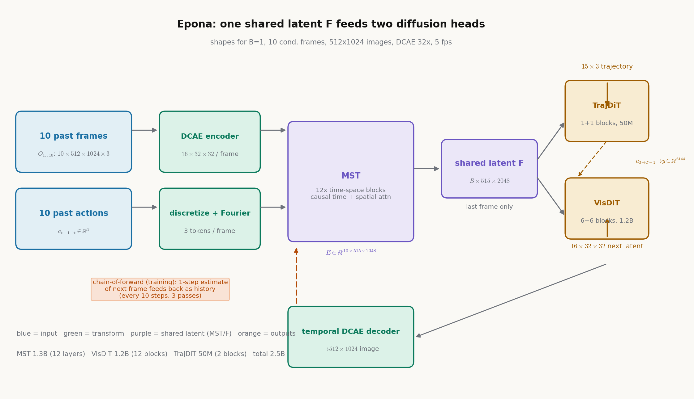

# 时间归因果，画面归扩散：Epona 用一个共享潜变量同时做长视频生成与实时轨迹规划

> **全局编号**：69
> **论文标题**：Epona: Autoregressive Diffusion World Model for Autonomous Driving
> **作者**：Kaiwen Zhang*, Zhenyu Tang*, Xiaotao Hu, Xingang Pan, Xiaoyang Guo, Yuan Liu, Jingwei Huang, Li Yuan, Qian Zhang, Xiao-Xiao Long†, Xun Cao, Wei Yin§（*共同一作；†项目顾问；§项目负责人/通讯作者）
> **会议/年份**：ICCV 2025
> **arXiv**：2506.24113（v1，2025-06-30 提交）
> **链接**：https://arxiv.org/abs/2506.24113v1
> **代码**：已公开，https://github.com/Kevin-thu/Epona（另有 HuggingFace 权重 huggingface.co/Kevin-thu/Epona）
> **一句话核心洞见**：把"时间如何推进"和"每一帧长什么样"拆成两件事——因果 Transformer 只在压缩潜空间里提炼历史，得到紧凑潜变量 F；轨迹与图像两个扩散头并行地消费同一个 F，前者输出连续多步轨迹做规划，后者逐帧渲染做生成；训练时用一步速度估计把模型自己的预测误差喂回历史，压住自回归漂移。

## 视频扩散和 GPT 自回归，各自在哪一个具体场景下撞墙

2025 年中，驾驶世界模型分两条路线。第一条是视频扩散，以 Vista 为代表：把过去 10 帧和未来 15 帧拼在一起，一次去噪生成整段视频，公式写作对过去与未来做联合分布建模 $p(\{O_{T+i}\}_{i=1}^{n}, \{O_t, a_t\}_{t=1}^{T})$。画面漂亮，NuScenes 上 FVD 89.4，是当时最好的。但这条路有两个结构性毛病。

第一个毛病：长度是死的。视频扩散模型一次生成固定 n 帧，想续到第 16 秒，只能把已生成的尾部当作新的头部再跑一遍（rollout），窗口之间没有因果约束，接缝处的内容会漂。第二个毛病更致命：它没有"动作"的位置。联合分布里过去和未来是同时被建模的，时间箭头被打碎了——给定历史，我想问"如果这一刻我往左打 5 度，下一帧会看到什么"，模型没有一个按步输入动作、按步输出下一帧的接口。规划需要的恰恰是这种单步可控的反事实推理。所以 Vista 这类模型只能做仿真，不能做规划：它的世界模型里没有留给驾驶员的位置。

第二条是 GPT 式自回归，以 GAIA-1、DrivingWorld、DrivingGPT 为代表：把每帧图像量化成离散 token，做 next-token 预测。时间结构是对的——天然支持变长续写。但它交了两笔税。第一笔是量化税：连续图像压成离散 token，高频细节（远处车辆的轮廓、车牌、路面标线）在量化这一步就被抹掉了，生成质量先天低于扩散模型。第二笔是动作税：自回归 Transformer 的因果结构决定了它一次只能预测"下一个动作 token"，做不出多步轨迹规划——规划需要一次输出未来 3 秒的连续轨迹，而不是一个个往外蹦离散的动作符号。DrivingGPT 在 NAVSIM 上的 PDMS 是 82.4（附录表 8），比 Epona 低 3.8 分，差距就来自这里。

两条路的毛病是互补的：扩散缺时间分解，自回归缺连续精度。Epona 的起点就是把这个互补结构写出来（正文图 3 把三条路线并排画了出来，这张图值得单独看：上面是离散 token 的自回归，中间是定长联合去噪，下面是 Epona——连续潜变量上的逐帧自回归）。作者的判断是：这两条路不是非此即彼，缺的那块可以从对方那里拿。

## 作者押的赌注：时间只管因果，空间只管渲染，中间用一个 F 隔开

面对上面的僵局，最直接的想法是"把扩散模型做成自回归的"——这也是当时 Diffusion Forcing、FIFO-Diffusion 在做的事：给每一帧不同的噪声水平，用因果网络去噪。但 Epona 走得更彻底：它不让扩散模型管时间，时间完全交给一个 GPT 式的因果 Transformer（MST），扩散模型只负责一件事——在给定历史摘要的条件下，把"下一帧长什么样"和"未来轨迹是什么"这两个空间/动作上的精细分布画出来。

这个分解为什么自然？想清楚两个子问题各自需要什么。时间推进需要的是因果性：未来只依赖过去，顺序不可颠倒，长度可以任意。它不需要高保真——历史摘要可以是有损的，只要保留了"红灯、行人位置、自车速度"这些动力学要素。单帧渲染需要的恰恰相反：它需要并行地看到整帧的空间相关性（天空和路面要同时合理），对因果没有要求，但对保真度要求极高。这两个需求正好对应两种架构各自的长处：因果 Transformer 管时间，扩散模型管空间。硬把两者塞进同一个网络（比如让视频扩散模型同时学因果），就是 Vista 撞墙的原因。

分解的代价是必须有一个瓶颈：全部历史信息要被压缩进一个紧凑表示 F，两个扩散头都只能看到 F，看不到原始历史。如果 F 丢掉了关键信息，两个头一起完蛋。这是整个设计里真正的赌注——作者赌的是：一个 515×2048 的潜变量（后面会算这个数是怎么来的）足够承载"接下来 3 秒会发生什么"的全部必要信息。而回报是：两个头解耦之后可以独立优化、独立开关。做规划时关掉图像头（VisDiT），只跑 MST + TrajDiT，推理量直接砍掉大头——这是"实时规划"这个说法的工程基础。

*图：Epona 数据流与关键张量形状（B=1，10 帧条件，512×1024 输入）。紫色是共享潜变量 F 及其生产者 MST，橙色是两个扩散头。虚线是训练时的 chain-of-forward 回路。*

## MST 到底在算什么：把 10 帧历史压成一个 515×2048 的 F

先把符号和形状一次摆清楚（论文 3.3 节的符号在这里第一次出现，后面不再解释）：

| 符号 | 形状（B=1 时） | 含义 |
|---|---|---|
| $O_t$ | $512\times1024\times3$ | 第 $t$ 帧前视图像 |
| $a_{t-1\to t}$ | $\mathbb{R}^3$ | 自车从 $t-1$ 到 $t$ 的位姿增量。论文写作顺序是 $(\Delta\theta,\Delta x,\Delta y)$，代码里实际是 $[\Delta x,\Delta y,\Delta\theta]$（见后文"论文与代码不一致"一节） |
| $Z_t$ | $16\times32\times32$ | DCAE 编码后的单帧潜变量（$512\times1024$ 下采样 32 倍） |
| $L$ | $512=16\times32$ | 单帧潜变量展平后的 token 数 |
| $E$ | $B\times T\times(L+3)\times D$，$T=10$，$D=2048$ | MST 的输入嵌入序列 |
| $F$ | $B\times(L+3)\times D=B\times515\times2048$ | 取 $E$ 经 MST 后的最后一帧，两个扩散头的共享条件 |

输入是这样拼出来的。10 帧图像先过 DCAE 编码器，每帧变成 $16\times32\times32$ 的连续潜变量，展平为 512 个 token，每个 token 是 32 通道向量，再经一个两层 MLP 投影到 2048 维。10 步历史动作走另一条路：每个动作 $(\Delta x,\Delta y,\Delta\theta)$ 先离散化成 3 个索引（$\Delta x$ 用 128 词表，$\Delta y$ 用 128 词表，$\Delta\theta$ 用 512 词表），索引除以词表大小归一化到 $[0,1]$ 后做 Fourier 位置编码（512 维），再分别过三个投影器升到 2048 维——每帧得到 3 个动作 token。**注意这里论文和代码说法不一**：正文 3.3 节写的是"把动作序列 $a\in\mathbb{R}^{B\times T\times3}$ 投影到嵌入空间"，读起来像连续值直接投影；代码里（`models/stt.py` 的 `get_yaw_pose_emb`，继承自 DrivingWorld）实际是先离散成索引再做 Fourier 编码。这个离散化在论文里只字未提，是从 DrivingWorld 继承来的遗产，精度损失有多大论文没有讨论。

拼好之后每帧是 $512+3=515$ 个 token，10 帧共 5150 个 token，再加上一个可学习的时间位置嵌入（`nn.Parameter(torch.zeros(50, 2048))`，取前 10 行，直接相加，不是 RoPE），得到 $E$。

MST 本体是 12 个 `CausalTimeSpaceBlock` 的堆叠，每个块做两件事。第一步是因果时间注意力：把张量从 $(b,f,l,c)$ 重排成 $(b\cdot l, f, c)$，即 515 条相互独立的时间序列（每条序列是同一个 token 位置跨 10 帧的变化），每条序列内部做带下三角 mask 的自注意力。直观理解：时间注意力不看"一帧里有什么"，只看"同一个位置的东西随时间怎么变"——这是车辆运动、红绿灯切换这类动力学信息待的地方。第二步是空间注意力：重排成 $(b\cdot f, l, c)$，即 10 个独立的帧内全注意力，每个 token 看到本帧全部 515 个 token（含 3 个动作 token），图像 token 之间再加 2D RoPE 编码相对位置。动作 token 不加 RoPE——它们本来就没有空间位置。

算一下量级：时间注意力是 515 条长度为 10 的序列，注意力矩阵 $10\times10$，可忽略；空间注意力是 10 个 $515\times515$ 的矩阵，约 265 万个元素，16 个头，12 层——这就是 MST 1.3B 参数的主要去向（每个块含两个完整 Transformer block：时间块和空间块各一套 QKV+MLP，论文说的"12 层"实际是 12 个双块结构）。

最后取第 10 帧（最后一帧）的输出作为 $F\in\mathbb{R}^{B\times515\times2048}$。为什么只取最后一帧？因为因果 mask 保证了第 10 帧的表示已经看过前 9 帧，它是"到当前为止全部历史"的摘要。推理时每生成一帧，窗口滑动一格，重新算 $F$——这是自回归的含义：不是 token 级自回归，是帧级自回归。

## 两个扩散头：为什么规划头只要 50M，渲染头要 1.2B

$F$ 准备好之后，两个扩散 transformer 并行地消费它。两者都用 rectified flow 目标（论文 3.1 节），先把这个目标讲透，因为它是理解后文 chain-of-forward 的钥匙。

Rectified flow 假设数据和噪声之间走直线。记干净样本为 $x_{(0)}$，噪声为 $\epsilon\sim\mathcal{N}(0,I)$，定义中间点：

$$x_{(t)} = (1-t)\,x_{(0)} + t\,\epsilon,\qquad t\in[0,1]$$

$t=0$ 是数据，$t=1$ 是纯噪声。沿这条直线的速度是常数：$dx/dt = \epsilon - x_{(0)}$，或者按论文的符号，网络要预测的速度场目标是 $x_{(0)}-\epsilon$（差一个符号，方向相反，效果一样）。损失就是：

$$\mathcal{L}_{RF} = \mathbb{E}_{x_{(0)},\epsilon,t}\left\lVert v_\Theta(x_{(t)},t) - (x_{(0)}-\epsilon)\right\rVert^2$$

几何图像：噪声分布是一个高斯球，数据分布是某个流形，rectified flow 在两者之间拉了一束直线，网络学的是每条直线上恒定的速度向量。采样时从噪声出发，沿学到的速度场做 Euler 积分走回数据。直线路径的好处是曲率小，少步数也能走得准——这直接决定了后文"10 步采样能不能用"。

**TrajDiT**（轨迹规划头）是最小的那个：2 个 block（1 个双流 + 1 个单流），50M 参数。输入是加噪的未来轨迹 $a\in\mathbb{R}^{B\times N\times3}$，$N=15$（5fps 下 3 秒），每步是 $(\Delta x,\Delta y,\Delta\theta)$ 的连续值——**这里没有离散化**，扩散直接在连续动作空间里去噪。训练时轨迹要先归一化（代码 `normalize_traj`）：$\Delta x$ 除以 50 米映射到 $[-1,1]$，$\Delta y$ 除以 10，$\Delta\theta$ 除以 12——三个分量的物理量级不一样，不归一化的话损失会被纵向位移主导。条件是 $F$，损失是上面的 flow matching 损失（论文 Eq.4）。推理时从 $15\times3$ 的高斯噪声出发去噪 100 步，得到 3 秒连续轨迹。

**VisDiT**（下一帧预测头）是最大的：12 个 block（6 双流 + 6 单流），1.2B 参数，结构照搬 Flux/HunyuanVideo 的 DiT。输入是加噪的下一帧潜变量 $Z_{T+1}\in\mathbb{R}^{B\times512\times32}$，条件除了 $F$ 之外，还有一条动作控制分支：把 TrajDiT 输出的轨迹第一步 $a_{T\to T+1}$ 转成 6144 维向量 $y$（$3\times2048$ 拼接），经 adaptive modulation（scale & shift）注入每个 block——这就是"轨迹可控视频生成"的接口：外部给一条轨迹，VisDiT 就按这条轨迹渲染下一帧（论文图 6，代码 `test_ctrl.py`）。损失是 Eq.5，总损失 $\mathcal{L}=\mathcal{L}_{traj}+\mathcal{L}_{vis}$，权重 1:1（代码 `lambda_yaw_pose=1.0`，论文没有讨论过这个权重，这是个缺口：两个损失的量级是否相当？权重是否敏感？都没有数据）。

参数分配 1.3B : 1.2B : 50M 本身就在说话：渲染一帧 512×1024 图像的精细纹理需要 1.2B，而规划未来 3 秒轨迹只需要 50M。规划头小的底气是它站在 $F$ 的肩膀上——场景理解、动力学建模这些重活 MST 已经干完了，TrajDiT 只需要从 $F$ 里读出"往哪开"。这个观察后面会再回来，它是"共享潜变量同时服务规划与生成"的核心证据。

推理时三个模块的耗时（单张 4090，论文表 2）：MST 0.02 秒基本不随采样步数变化；TrajDiT 100 步 0.3 秒、10 步 0.03 秒；VisDiT 100 步 2 秒、10 步 0.3 秒。纯规划（关掉 VisDiT）一帧的开销是 MST + TrajDiT。

## chain-of-forward：训练时见过自己的错误，推理时才不慌

自回归生成有一个老毛病：训练时每一步看到的都是干净的真实历史（teacher forcing），推理时看到的却是自己上一步的预测——预测里有误差，误差被喂回输入，下一帧的误差更大，几十帧之后画面就漂了（论文图 7 左半：不用 chain-of-forward，10–20 秒后画质肉眼可见地垮掉）。

标准解法是 scheduled sampling：训练时以一定概率把真实历史换成自己的预测。但对扩散模型来说，"自己的预测"意味着完整跑一遍 100 步采样，贵到不可行。GameNGen、DrivingWorld 的折中办法是加噪声增强——训练时往历史里掺高斯噪声，模拟推理时的误差。这招有两个问题：第一，噪声是各向同性的，而模型真实的推理误差是有结构的（模糊、伪影、物体漂移）；第二，噪声强度要手调。

Epona 的 chain-of-forward 换了个思路：rectified flow 的直线路径让"一步估计"在数学上是精确的。从 $x_{(t)}=(1-t)x_{(0)}+t\epsilon$ 出发，假设网络预测的速度 $v_\Theta$ 完全正确（$v=x_{(0)}-\epsilon$），那么

$$\hat{x}_{(0)} = x_{(t)} + t\cdot v_\Theta(x_{(t)},t) = (1-t)x_{(0)} + t\epsilon + t(x_{(0)}-\epsilon) = x_{(0)}$$

一次前向就精确回到干净样本（论文 Eq.7）。而当网络不完美时，一步估计的误差**恰好就是这个模型在推理时会犯的那种误差**——带着它自己的模糊模式和伪影特征。于是训练流程变成：每 10 个 step（代码 `multifw_perstep=10`），做 3 次前向（`forward_iter=3`）；每次用上一步的一步估计替换整个 10 帧历史窗口（注意不是追加，是整个窗口滑一格、全部换成自预测），再去预测下一帧真值，照常算损失、反传、更新。模型在训练中反复看到"带着我自己误差特征的历史"，被迫学会在这种历史下依然输出正确的下一帧。

代码实现里有两个论文没写的细节。第一，`training_losses` 里的一步估计用的是**每帧独立随机采的 $t$**（`t=torch.rand(...)`）：`predict = x_t + pred*(1-t)`（代码的时间约定是反的，$t=1$ 为数据，数学上等价）。随机 $t$ 意味着历史里每一帧的"误差程度"都不一样——有的帧几乎干净（$t$ 接近数据端），有的帧几乎是一步生成的粗糙样本。这比固定噪声强度更强的增强：它给了模型一个误差程度的光谱，而不是一个点。第二，每次 chain 不是只做前向——`model.backward(loss_value); model.step()` 写在 `for j in range(fw_iter)` 循环**里面**，3 次前向每次都带一次完整的反传和参数更新。论文写的是"performing three forward passes"，实际是 3 次"前向+反传+更新"。每 10 个 step 的窗口里共做 12 次更新，其中 3 次是 chain 更新（占 25%）——这个比例不小，但论文没有做过敏感性分析。

效果上，消融很干净（论文图 8）：在 NuPlan 测试集上随自回归帧数增加，不用 chain-of-forward 的 FID 从 ~10一路恶化到 ~25（40 帧处），用的那条线基本平在 10–16。图 7 的定性对比也一样：左半 20 秒后建筑和车辆开始融化，右半 1 分钟依然稳定。这是全篇最有说服力的一组消融——因为它直接对应论文标题里的"autoregressive"这个词的可信度。

多说一句：这一招的适用面比论文写的宽。任何自回归系统——包括后面要谈的"对候选动作做多步 rollout 打分"——都可以周期性地把自己的一步估计喂回历史，代价是一次前向而不是完整采样。它成立的前提是生成器的一步估计足够便宜且误差有代表性，rectified flow 的直线路径恰好同时满足这两点。

## DCAE 的 32 倍压缩与解码器前的时序补丁

还有一个容易被忽略但实际承重的设计：图像编码器。Epona 用 DCAE（Deep Compression Autoencoder）把 $512\times1024$ 的图像压 32 倍，得到 $16\times32\times32$ 的潜变量，每帧 512 个 token。对比常规的 8 倍下采样 VAE（$64\times128\times4$，每帧 8192 个 token），token 数直接少 16 倍。没有这 16 倍，MST 不可能在显存里同时 conditioning 10 帧（5150 个 token 的空间注意力已经是 12 层 1.3B 的主要开销，再乘 16 就不用训练了）。32 倍压缩是"10 帧历史"这个设定的前提。

代价是 DCAE 是逐帧独立编码的图像自编码器，没有时间概念。连续两帧的潜变量解码出来，颜色、纹理会有细微抖动——逐帧解码视频时的 flickering。Epona 的补丁是在 DCAE **解码器之前**加时空自注意力层（5 层时间 Transformer + 5 层空间 Transformer，dim=32，8 头，参数量很小），编码器冻结只微调这部分，让解码时能跨帧借信息。消融（论文表 6，NuPlan）：不加时序模块 $FVD_{40}=100.11$，加上后 74.88。注意这个模块只在解码（生成）侧起作用，不影响 MST 和规划——它是个纯粹的画质补丁，但补得很准：flickering 是逐帧自回归视频生成里最显眼的瑕疵，修好了它，长视频的"一致性"观感提升最大。

附录里作者很诚实地承认了这个选择的代价：同期工作 InfinityDrive 用专门的 3D-VAE，在 nuScenes 上的 FVD 是 70.06，比 Epona 的 82.8 好；作者把差距归因于 DCAE 的激进压缩可能引入额外伪影，并说未来会改进 DCAE。这段值得留意——它说明作者清楚 32 倍压缩是拿画质换效率的交易，而且交易的天平另一端（MagicDriveDiT 的 94.84 vs Epona 的 82.8）Epona 还是赢的。

## 怀疑式审读一：7.4% 的 FVD 提升，FID 却输给了 Vista

摘要的 headline 数字是"FVD 提升 7.4%"。先验算：表 1 里 Vista 的 FVD 是 89.4，Epona 是 82.8，$(89.4-82.8)/89.4=7.38\%$，四舍五入 7.4%，算得没错。但三个限定条件要摆出来。

第一，同一张表里 Epona 的 **FID 是 7.5，Vista 是 6.9**——单帧画质 Epona 反而差一截。FVD 衡量的是视频的时序一致性+画质，FID 只衡量单帧。Epona 赢在"动起来更顺"，输在"每一帧的绝对画质"。摘要只提 FVD 不提 FID，是选择性的诚实：数字都对，但故事只讲了一半。结合上一节 DCAE 的讨论，FID 的差距很可能就来自 32 倍压缩的信息损失。

第二，表 1 的基线数字全部来自"各自论文报告的结果"（正文 4.2 节原话："Since most methods are not publicly available, we compare with the reported results from their respective papers"）。各方法的评测 clip 划分、采样帧数、是否用真值轨迹做条件，这些协议细节没有对齐过。Vista 是开源的，作者倒是做了定性 rollout 对比（图 5），但定量的 FVD 对比里 Vista 的 89.4 是抄的。抄数字本身在领域里常见，但读者要知道这 7.4% 的分母不是在同一套代码、同一批 clip 上跑出来的。

第三，"Max Duration"那一列带星号，脚注说"the max duration number indicates the horizon that produces plausible results, following existing methods"——"能产生合理结果的最长跨度"，这是个主观判断，不是 metric。Epona 填的是 120s/600 帧，Vista 15s/150 帧。图 5 和附录图 10 的定性图确实显示 Epona 在 2 分钟处还没崩，但"plausible"的线划在哪，作者有最终解释权。

## 怀疑式审读二：120 秒是在 5fps 下的 120 秒，生成它要 20 多分钟

"分钟级预测时长"这个说法需要换算一下单位。训练和评测的视频都是按 5fps 下采样的（config `downsample_fps=5`），600 帧 = 120 秒没错，但这是 5fps 的 120 秒，不是 30fps 车载摄像头的 120 秒。按 30fps 折算，相当于 20 秒的实时视频。这个下采样在世界模型论文里是常规操作，但"minutes-long"给人的第一印象是实时帧率下的分钟级，要打个折。

再算一笔墙钟账。表 2 给的是单模块在 4090 上的耗时（100 步采样）：MST 0.02s + TrajDiT 0.3s + VisDiT 2s = **每帧约 2.3 秒**。生成 600 帧就是约 23 分钟。用 10 步采样能压到每帧约 0.35 秒（0.02+0.03+0.3），600 帧约 3.5 分钟——但论文没有报告 10 步采样下的视频质量（FVD 是在 100 步下测的）。所以"2 分钟视频"作为 demo 是成立的，作为实时仿真器还差得远。论文没有声称视频生成是实时的，这点它没夸大；但读者如果把"autoregressive"和"real-time"连起来想，容易产生误解——实时的是**轨迹规划**（关掉 VisDiT 的那条路），不是视频生成。

## 怀疑式审读三：20Hz 和 100 步采样不能同时成立

正文 4.1 节说："with MST and TrajDiT, our world model can seamlessly serve as a real-time motion planner…achieving rates of up to 20 Hz"，同一段又说："In all our experiments, we set our DiT sampling step to 100."

按表 2 换算：100 步时规划一帧 = 0.02（MST）+ 0.3（TrajDiT）= 0.32 秒，约 3Hz；10 步时 = 0.02 + 0.03 = 0.05 秒，正好 20Hz。所以"20Hz"成立的条件是 10 步采样，而所有报告过的规划分数（NAVSIM PDMS 86.2、NuScenes 表 3）都是在 100 步下拿的。**10 步采样下的规划分数论文里没有**。rectified flow 的直线路径确实让少步采样成为可能，但 10 步的轨迹质量是否还保持 86.2 的水平，是未验证的。摘要把"state-of-the-art FVD""minutes longer prediction""real-time motion planner""outperforming strong end-to-end planners"排在一起，读者很自然会把 SOTA 规划分数和 20Hz 理解成同一个配置下的结论——它们不是。表 2 本人倒是把 10 步和 100 步两档都摆出来了，信息是全的，只是需要读者自己做这道除法。

## 怀疑式审读四：NAVSIM 上 0.7 分的领先，误差棒在哪里

表 4：Epona PDMS 86.2，第二名 DRAMA 85.5（Camera & Lidar），LAW 和 PARA-Drive 都是 84.6。领先 0.7 个点。论文没有报告随机种子数、多次运行的方差——扩散模型的采样本身是随机的（每次从不同噪声出发），PDMS 对采样噪声有多敏感未知。0.7 分在没有误差棒的情况下，很难说是架构优势还是运气。另外注意输入设定的不对等：Epona 只用前视单目相机，而 DRAMA、TransFuser 用了 Camera+Lidar，UniAD、PARA-Drive 用多视角。输入少、分数高，听起来是 Epona 更强；但反过来说，NAVSIM 的 PDMS 里 NC（无碰撞）、DAC（可行驶区域）这些子项对输入模态的敏感度不同，单目能拿高分恰恰说明 NAVSIM 的场景对几何精度的要求没有高到非 lidar 不可——这是 benchmark 的性质，不是 Epona 独有的胜利。唯一设定对等的基线是 LAW（同为 perception-free），Epona 86.2 vs LAW 84.6，领先 1.6 分，这个对比更干净。

还有一个更实际的缺口：**开源代码里没有 NAVSIM 的评测管线**。`scripts/test/` 下只有 NuPlan 和 NuScenes 的脚本，`configs/` 下只有 nuplan 和 nuscenes 两个配置，`dataset/` 里没有任何 navsim 字样。NAVSIM 要求"conditioned on the past 2 seconds to predict 4-second future trajectories"，而开源配置的 `traj_len=15` 对应 3 秒——评测 NAVSIM 用的配置没有公开。所以表 4 的 86.2 目前无法从公开仓库复现。NuScenes 的规划结果（表 3）倒是可以复现（`test_nuscenes.py` 存在）。

## 怀疑式审读五：训练超参论文与脚本对不上，λ=1.0 没做过敏感性分析

论文 4.1 节：AdamW，lr $1\times10^{-4}$，weight decay $5\times10^{-2}$，batch size 96，48×A100 近两周，600k iterations。开源的 `train_deepspeed.py` 默认：`--blr 1e-4`，但实际 lr 按 `blr * eff_batch_size / 256` 缩放，其中 `eff_batch_size = batch_size(2) × condition_frames(10) / block_size × world_size(48) = 960`，算出来实际 lr 约 $3.75\times10^{-4}$，不是 $1\times10^{-4}$；`--weight_decay` 默认 0.01，不是 0.05。README 里给的 finetune 示例用的是 `--lr 2e-5`。这三组数字互相打架，论文的训练配置无法从开源脚本直接还原——复现者需要自己猜。

损失权重 $\mathcal{L}=\mathcal{L}_{traj}+\mathcal{L}_{vis}$ 里两个 1:1 相加（代码 `lambda_yaw_pose=1.0`）。轨迹损失作用在 $15\times3=45$ 个标量上，图像损失作用在 $512\times32=16384$ 个标量上（mean 后量级未必差很多，但没人验证过）。论文没有任何关于这个权重的消融：权重偏向轨迹会怎样？偏向图像会怎样？考虑到"共享潜变量同时服务两个头"是全文的核心主张，两个头的损失权重恰恰是决定 F 里"规划信息 vs 纹理信息"比例的旋钮，这个旋钮没拧过，是实验部分最大的缺口。不过消融表 5 本身很强：关掉视频预测、只训轨迹，PDMS 从 86.2 掉到 78.1——8.1 分的差距说明视觉监督确实往 F 里压进了对规划有用的信息，这是"共享潜变量"这个赌注最硬的证据。

## 论文与代码不一致清单（逐条，都有出处）

1. **MST 的动作输入**：论文 3.3 节写 $a\in\mathbb{R}^{B\times T\times3}$ 投影到嵌入空间；代码 `stt.py::get_yaw_pose_emb` 实际是先离散成索引（$\Delta x$ 128 词表、$\Delta y$ 128 词表、$\Delta\theta$ 512 词表）再做 Fourier 编码。离散化是 DrivingWorld 继承来的，论文未提及、未讨论精度影响。
2. **动作元组顺序**：论文 3.2 节定义 $a_{t_1\to t_2}:=(\Delta\theta,\Delta x,\Delta y)$；代码 `model.py::model_forward` 里是 `torch.cat([traj_poses, traj_yaws])` 即 $[\Delta x,\Delta y,\Delta\theta]$。纯记号问题，不影响结果，但照着论文公式写代码会错。
3. **时间约定翻转**：论文 Eq.2 $x_{(t)}=(1-t)x_{(0)}+t\epsilon$（$t=0$ 是数据）；代码 `training_losses` 里 `x_t = t*img + (1-t)*noise`（$t=1$ 是数据）。数学等价，但 Eq.7 的 $\hat{x}_{(0)}=x_{(t)}+t\cdot v$ 在代码里对应的是 `predict = x_t + pred*(1-t)`。推导时要注意别直接套公式。
4. **chain-of-forward 的实现细节**：论文说"用预测速度一步估计"；代码里每帧的 $t$ 是独立随机采的（`torch.rand`），且每次 chain 做的是完整的"前向+反传+更新"（`model.step()` 在循环内），不是论文字面的"three forward passes"。随机 $t$ 和 3 次更新这两个设计选择论文都没讨论。
5. **训练超参**：见上一节，lr 和 weight decay 论文与脚本默认值不一致。
6. **NAVSIM 不可复现**：见上一节，仓库无 NAVSIM 数据管线与配置。
7. **死代码**：`step_train` 里的频率混合噪声增强分支被 `mask_data=0` 恒关闭；`pkeep=0.7`、`drop_feature=0`、`no_pose` 等参数在 config 里出现但从未生效；`stt.py` 里 `mask_space`、`auto_regressive_num` 建了但没用——都是 DrivingWorld 遗产。
8. **"代码将公开"已兑现**：论文写 "Code will be publicly available"，现在仓库、训练脚本、6 个评测脚本、HF 权重（`Kevin-thu/Epona`，含微调好的时序 DCAE）都已公开，这点要给 credit。

## 公平地说，哪里做得漂亮

怀疑归怀疑，有三处是真漂亮。第一，附录 B 主动承认 InfinityDrive 的 FVD（70.06）比自己（82.8）好，并给出归因（3D-VAE vs DCAE），还承认 MagicDriveDiT 画质略优——在世界模型论文里，这种"我知道谁比我好、为什么"的坦率不多见。第二，NuScenes 规划表 3 的正文原话是 "Although our model does not achieve the best results"，L2 输给 GenAD（1.25 vs 0.91）就直说，只强调自己在 1 秒碰撞率上最低（0.01%）——没有把"competitive"包装成"全面超越"。第三，chain-of-forward 的消融（图 7/图 8）和 shared-latent 的消融（表 5，78.1→86.2）都是"去掉就掉很多"的承重型消融，不是装饰性的。这三处加起来，说明作者对自己工作的边界心里有数。

## 带走的两个想法

**第一个：一个表征，多个消费者；消费者可以很小。** Epona 把"理解世界"（MST，1.3B）和"使用世界"（TrajDiT 50M、VisDiT 1.2B）彻底分开，两个消费者只通过 $F$ 通信。最反直觉的是参数分配：承担规划的 TrajDiT 只占全模型的 2%，却能在 NAVSIM 上超过一众端到端规划器——因为它不需要重复做感知，它读的是已经算好的世界摘要。更关键的是联合训练的方向：只训轨迹时 PDMS 78.1，加上视频预测涨到 86.2，说明"渲染"这个看似与规划无关的任务，逼着 $F$ 保留了纯轨迹损失不会要求的场景细节（远处车辆的朝向、路面纹理暗示的可行驶区域），而这些细节恰好对规划有用。这个模式可以迁移到任何"世界模型 + 下游决策"的系统：先想清楚下游任务到底需要世界模型的哪一层输出，然后让最重的表征只算一次，所有下游头都来读它；给表征加一个"看起来无关"的辅助监督，往往比给下游头加参数更划算。

**第二个：用一步估计做自回归训练的抗漂移，代价是一次前向。** chain-of-forward 成立需要两个条件：生成器支持廉价的一步近似（rectified flow 的直线路径让一步估计在完美模型下精确成立），且一步估计的误差分布接近真实推理误差（因为它就是模型自己的误差）。满足这两个条件时，训练中每 10 步花 3 次前向，就能让模型见过自己 future 的错误，而不用付完整采样的代价。这个技巧不绑定自动驾驶：任何"自回归地消费自己输出"的系统——视频生成、长轨迹 rollout、甚至多轮 agent 交互——只要底层的单步生成器有类似的直线/可逆结构，都可以照搬。注意它的反面：扩散步数本身也是误差来源，10 步采样下的一步估计和 100 步下的不是同一种误差，chain-of-forward 训练用的步数要和推理用的步数匹配，论文没有讨论这一点，复用时要自己验证。

## 与本课题的关联

课题是"世界模型引导 + 自适应衰减情景记忆的闭环多规划器自动驾驶 Agent"：LLM 调度多个专家规划器执行开放式自然语言指令；世界模型预测未来 T 步交通状态作调度先验；情景记忆检索相似历史案例；世界模型对候选动作做 rollout、输出量化风险分数，做冲突仲裁和危险动作拦截；计划在 Bench2Drive 闭环基准上验证。Epona 与这个课题至少有四个咬合点。

**第一，共享潜变量 $F$ 就是"世界模型中间分布复用"的一个已验证实例。** 课题的时延优化里有一条"世界模型中间分布复用"——调度先验、风险校验、记忆检索如果各跑一遍世界模型，延迟不可接受。Epona 证明了另一条路是走得通的：MST 只跑一次得到 $F$，TrajDiT（规划）、VisDiT（渲染/仿真）并行消费同一个 $F$，且联合训练互相增益。对应到课题：世界模型对未来 T 步的预测（无论是潜变量形式还是显式的未来帧/占用），应该只算一次，然后同时喂给 LLM 调度器（作先验）、风险仲裁器（作 rollout 起点）、记忆模块（作检索键）。Epona 的消融（78.1→86.2）还提示：让世界模型的训练目标同时包含"动作"和"未来状态"，表征质量对下游任务更好——课题里世界模型如果只训未来帧预测，可以考虑加一个轻量的轨迹/动作预测辅助头，大概率能提升风险打分的准确性。

**第二，TrajDiT 和"rollout 风险校验"的分工要分清，Epona 两条分支各对应一半。** 注意 Epona 的 TrajDiT 是"生成动作"的规划器，不是"评估动作"的校验器——它回答"往哪开"，不回答"这个动作危不危险"。课题要的"对候选动作 rollout 输出量化风险分数"，对应的是 Epona 的另一条分支：VisDiT 的条件生成 $p(O_{T+1}\mid \text{history}, a_{T\to T+1})$。`test_ctrl.py` 已经演示了这个用法：外部给定一条轨迹，VisDiT 按它渲染未来。把 LLM 选出的候选动作（或多个专家规划器的候选轨迹）逐条喂给 VisDiT 做条件 rollout，在生成的未来里检测碰撞、压线、急减速，就能量化出风险分数——这就是 Epona 架构下的"冲突仲裁和危险动作拦截"。而 TrajDiT 本人可以作为课题里的一个"专家规划器"被 LLM 调度：它输出的是连续多步轨迹（15 步、3 秒），扩散采样的多模态特性天然给出多个候选（换噪声种子重采），正好对应"多个专家规划器"的输入。但要注意 Epona 的动作空间是自车位姿增量 $(\Delta x,\Delta y,\Delta\theta)$，不是方向盘/油门，搬到 Bench2Drive 上需要在外层加一个轨迹跟踪控制器，或者把 TrajDiT 的输出映射到 Bench2Drive 的控制接口。

**第三，时延优化的思路 Epona 已经替你验证了一半。** "规划时关掉 VisDiT"就是"场景驱动动态模块旁路"的实例：不需要渲染未来画面时，2 秒/帧的 VisDiT 直接不跑，规划路径只剩 MST（0.02s）+ TrajDiT（0.03s@10 步）。课题的异步流水线可以照此设计：MST 算 $F$ 的同时，上一个 $F$ 的 TrajDiT 采样并行跑；风险校验需要的 VisDiT rollout 只在仲裁触发时启动。瓶颈分析也直接可用：Epona 的耗时几乎全在扩散采样步数上，MST 本体只占 0.02s——所以"中间分布复用"（$F$ 只算一次）比优化 MST 本身重要一个量级；采样步数 100→10 是 10 倍延迟差，代价是质量未知——课题做 Bench2Drive 闭环时，第一批实验就应该是"采样步数 vs 规划分数 vs 风险误报率"的三维权衡曲线，Epona 论文缺的这张表，课题里要补上。

**第四，评测策略的参考与警示。** Epona 在 NAVSIM 上只用前视单目、2 秒历史预测 4 秒轨迹就拿到 86.2，说明"无感知标注输入的世界模型规划器"在数据驱动的基准上是走得通的，这对课题是利好——Bench2Drive 同样不需要 3D 框标注做输入。但警示有两条：其一，NAVSIM 是非反应式的（log 回放），Bench2Drive 是反应式闭环仿真，推理误差会进入仿真、改变未来观测——这恰恰是 chain-of-forward 要解决的那类漂移在闭环评测里的放大版，课题的 rollout 风险校验在 Bench2Drive 上线前，先在开环数据上验证"自预测历史"下的稳定性；其二，Epona 的"2 分钟视频"是在 5fps 下采样的，Bench2Drive 以 10Hz 左右的频率做控制决策，世界模型 rollout 的时间分辨率要和控制频率对齐，否则风险分数的时间粒度不够细。

一句话：Epona 最值得课题拿走的不是它的网络结构，而是一个被验证过的分工——**世界模型只负责把未来算准、算一次；规划、仿真、校验都是读它的消费者，消费者按需开关**。课题的 LLM 调度器、情景记忆、风险仲裁，都应该设计成 $F$（或未来 T 步预测）的只读消费者，而不是各自为战的世界模型调用方。
