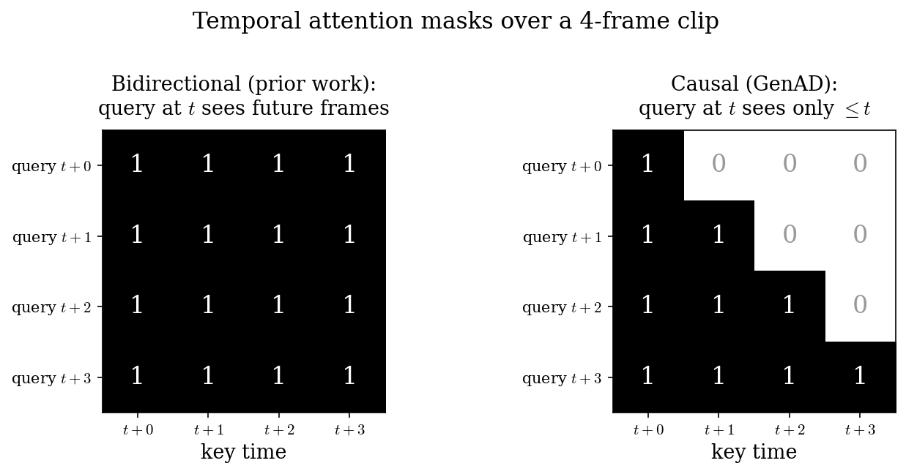
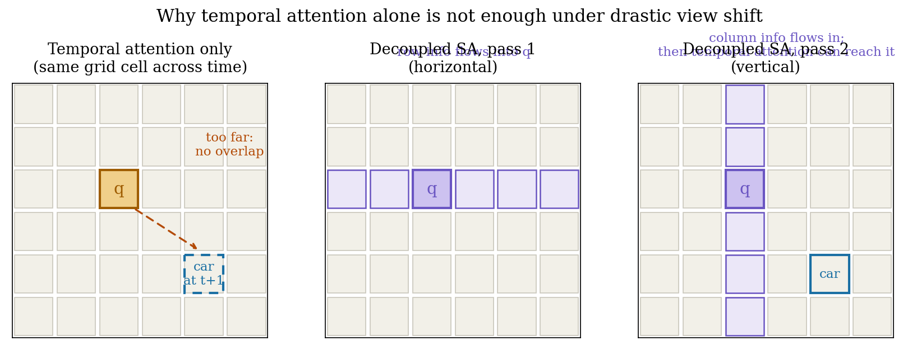

# 用 YouTube 换泛化：GenAD 把 SDXL 教成驾驶员的预测赌注

> **信息块**
>
> - 全局编号：67
> - 论文标题：GenAD: Generalized Predictive Model for Autonomous Driving
> - 作者：Jiazhi Yang*, Shenyuan Gao*, Yihang Qiu*（*共同一作，顺序掷硬币决定）, Li Chen, Tianyu Li, Bo Dai, Kashyap Chitta, Penghao Wu, Jia Zeng, Ping Luo, Jun Zhang, Andreas Geiger, Yu Qiao, Hongyang Li（OpenDriveLab / 上海人工智能实验室等）
> - 会议/年份：CVPR 2024 Highlight
> - 链接：https://arxiv.org/abs/2403.09630v1（本文按 v2，2024-08-08 修订版细读；v1 提交于 2024-03-14）
> - 代码：部分公开——https://github.com/OpenDriveLab/DriveAGI 只有 OpenDV 数据集工具链（下载/抽帧/标注脚本），**模型代码（时序推理块、训练脚本）并未公开**，附录 Q5 承诺的 "model will be made publicly available" 尚未兑现
> - **一句话核心洞见**：驾驶视频预测的瓶颈从来不是模型结构，而是采集成本锁死了数据的多样性；作者把 SDXL 的图像先验整个搬过来只学"驾驶长什么样"，再用 2000+ 小时未标定的 YouTube 视频教它"世界怎么动"，赌的是规模换泛化——而真正承重的只有两个设计：因果时序注意力和解耦空间注意力，其余都是让训练别塌的脚手架。

---

先从一个具体数字看这篇论文要解决什么。nuScenes 是自动驾驶里用得最多的公开数据集之一：5.5 小时，24.1 万帧，采集自 2 个国家、2 座城市，相机固定标定。2023 年 9 月 Wayve 的 GAIA-1 拿自家 4700 小时伦敦驾驶视频训了个 100 亿参数的世界模型，效果很好，但数据和模型都不公开，相机还是同一套。在这种背景下，OpenDriveLab 团队问了一个问题：能不能不做采集车、不做标定，直接去 YouTube 上"捡"驾驶视频，攒出一份公开的、多样的、足够大的数据，然后训一个能泛化到没见过的数据集的视频预测模型？

答案就是 GenAD：数据集 OpenDV-2K（2059 小时，6510 万帧，≥40 国家、≥244 城市），模型基于 SDXL（27 亿参数 UNet），两阶段训练，先把图像域从通用视觉搬到驾驶域，再插进 25 亿参数的时序推理块学未来。最后它还被改装成两样东西：给定未来轨迹条件去"想象"对应未来的动作条件预测器，以及只训一个 80 万参数 MLP 就能在 nuScenes 上开环规划的规划头。

这篇文档按下面的顺序展开：先讲作者看到的具体困境（采集成本锁死多样性，之前的模型被困在自己的小世界里）；再讲作者押的赌注和怎么执行这场赌（OpenDV-2K 的采集与标注流水线）；然后进到模型内部，把因果时序注意力讲透——这是全文承重的一块；接着看从纯预测转到动作条件预测和规划的那两步；最后是数字的细读和怀疑式审读。

## 采集成本锁死了什么样的多样性

自动驾驶数据集和通用视觉数据集有个本质区别：后者可以从网上爬，前者长期以来只能自己开车去采。自己开车去采意味着三件事同时被锁死：第一，地理范围被锁死——nuScenes 是波士顿和新加坡，Waymo 是美国 3 个城市，Argoverse 2 是美国 6 个城市；第二，相机配置被锁死——同一套内参外参，换一套传感器模型就可能水土不服；第三，场景分布被锁死——采集车按固定路线跑，长尾场景（暴雨夜晚、森林土路、双层巴士视角）天然稀少。

之前的驾驶视频预测工作就被这三把锁困住。论文引言里点名的几个：DriveGAN、DriveDreamer、WoVoGen 等，基本都在 nuScenes 或 Cityscapes 上训。结果就是一个在 nuScenes 上 FVD 很好看的模型，放到 Waymo 的视频上就露馅——论文第 7 页的 Table 2 后面那段话写得很直白：只在 nuScenes 上训的 GenAD-nus，"struggles to generalize to unseen datasets like Waymo, where the generation degrades to the nuScenes visual pattern"（退化成 nuScenes 的视觉风格）。模型没有学会"世界"，它学会的是"nuScenes 数据集长什么样"。

这里有个值得停下来想的点。作者在附录 A 的 Q1 里回答了"为什么预测目标选视频"：视频是 pose-agnostic 的，不像 BEV 表达需要相机外参，不像点云被 LiDAR 配置卡住。这个回答其实暴露了作者的真实动机——他要的不是"预测"这个任务本身，而是**一个能吃下未标定、未标定、未标定（重要说三遍）网络视频的自监督目标**。未来预测在这里的角色，相当于 NLP 里的下一词预测：一个不需要人工标注、可以无限加数据的训练信号。作者赌的是：只要数据够多够杂，预测未来这个目标本身就会逼模型学出交通规则、车辆意图、相机运动这些东西。

这个赌注的底气有三张牌。第一张是 SDXL：2023 年 7 月发布的开源大模型，图像生成质量在当时是最好的，拿来当起点等于白捡了一个"世界长什么样"的先验，不需要从零学。第二张是 YouTube 上取之不尽的驾驶视频：行车记录仪爱好者（YouTuber）常年上传高清驾驶 tour，这是自动驾驶领域独有的"免费午餐"——天然的第一人称、连续、多样。第三张是 BLIP-2 和 GPT 这类现成的视觉语言模型，可以零人工成本给视频打文本标签。三张牌凑齐，"不花钱攒 2000 小时"这件事才从空想变成工程。

但赌注也有代价，后面怀疑式审读会细说：BLIP-2 的 caption 质量作者自己都承认不行（附录 Q6），YouTube 视频里 81.39% 的动作是"直行"（附录 Table 11），地理多样性是用 GPT-3.5 从视频标题里猜的。这些都是"用规模换泛化"这个赌注的隐性成本。

## OpenDV-2K 是怎么攒出来的：43 个 YouTuber 和一条标注流水线

OpenDV-2K 的总量是 2059 小时，由两部分拼成：1747 小时的 OpenDV-YouTube（60.2M 帧）和 312 小时的 7 个公开数据集（nuScenes、nuPlan、Talk2Car、ONCE、Honda-HAD、Honda-HDD-Action、Honda-HDD-Cause）。Table 1 里那句 "374 times larger than nuScenes" 是 2059/5.5 ≈ 374.4，四舍五入来的，算得没错。

YouTube 部分的做法值得细看，因为它决定了数据的上限。具体步骤（附录 C.1）：

1. **选上传者而不是选视频。** 先找到全球 43 个长期发高质量驾驶视频的 YouTuber，拿到 2139 个视频。这个选择很聪明：靠谱的上传者等于免费的质量过滤器，省掉了对海量视频逐个筛选的成本。但代价是分布被这 43 个人的驾驶习惯和常跑路线锚定了——后面 Table 11 里"直行"占 81.39%，跟这个选择方式直接相关。
2. **切头去尾。** 每个视频掐掉开头 90 秒（频道介绍）和结尾 30 秒（求订阅），介绍特别长的掐 180 或 300 秒。这是个脏活，但不做不行，否则模型会学会生成"YouTube 频道片头"。
3. **逐帧打 context。** 用 BLIP-2 给每一帧生成一句话描述，prompt 是 "Question: Describe the image of a driving scenario concisely. Answer: "。然后用关键词（words、watermark、dark、blurry 等）在这些描述里搜黑帧和转场帧，人工复核后删掉。这里有个循环依赖的味道：用 BLIP-2 的输出质量来决定数据质量，而 BLIP-2 的输出质量后面被作者自己吐槽。这是个诚实的工程 trade-off，但要记住这个环。
4. **给 4 秒片段打 command。** 训一个视频分类器：输入是 GMFlow 提的光流 + 距离图，用 ResNet-18 在 Honda-HDD-Action 和 Honda-HDD-Cause 的人工标注上训，输出 13 类动作（正文 3.2 节写的是"14 types"，附录 C.1.2 写的是"13 categories"但 Table 8 的字典索引 0–13 共 14 项——论文自己前后不一致，见后文），再映射成自然语言（"Turn left." / "Make a left turn." / "Steer left." 等多种说法，随机抽一个，见附录 Table 8）。
5. **训练/验证按上传者划分。** 3 个 YouTuber（Pete Drives USA、KenoVelicanstveni、Driving Experience）的全部视频划为验证集，其余训练。这样验证集在地理上是严格未见的：附录说验证集里有 3 个训练集没出现过的国家（波黑、丹麦、匈牙利）和美国 1 个没出现过的州（缅因州）。这是 zero-shot 评测里做得最干净的一处。

公开数据集那 312 小时也不是直接拼进去的：nuScenes/nuPlan 的场景描述直接继承，轨迹换算成 command；ONCE 的天气和时段元数据继承；Talk2Car 的人类意图文本用 GPT-3.5-turbo 修语法；Honda-HAD 的驾驶建议用 GPT 改写扩写。目的是让文本表达更多样，不全是 BLIP-2 那种"a car driving down a road"的固定句式。

多说一句地理多样性的数字是怎么来的：用 GPT-3.5-turbo 从视频标题推断国家/城市（附录 Table 9 的 prompt），再人工后处理别名。论文 Table 1 标注了 † "Estimated by GPT"，≥40 国家、≥244 城市。美国 3640 万个 clip 覆盖 40/50 个州，中国 1290 万个 clip 覆盖 26/34 个省。这个数字是估计值，标题里没写地点的视频就猜不出来，所以作者说"still underestimated"。怀疑式审读时会回到这一点：用标题猜地理，本身就有系统性偏差（旅游博主爱写地点，日常通勤博主不写）。

## 两阶段训练：为什么先学"长什么样"，再学"怎么动"

GenAD 的训练分成两个阶段，这个顺序不是随便定的，背后是一个具体的工程困境。

困境是这样的：SDXL 是个 text-to-image 模型，一次只生成一张图。它见过无数人像、风景、艺术画，但没怎么见过"从驾驶位看出去的连续画面"。如果直接在它上面加时序模块、喂视频训，会发生两件事互相打架——模型既要学"驾驶场景的像素长什么样"，又要学"帧和帧之间怎么动"，25 亿新参数和 27 亿老参数一起动，训练很容易崩，或者老知识被洗掉。

作者的解法是拆成两步。**第一阶段：图像域迁移。** 拿 OpenDV-2K 的 6510 万图文对（附录 D.2），把 SDXL 的 UNet（27 亿参数）全量微调 30 万步，32 张 A100，batch 256，学习率 1.25e-6（先 warmup 1 万步）。CLIP 文本编码器（两个加起来 8.17 亿参数：CLIP ViT-L 和 OpenCLIP ViT-bigG）和自编码器（8370 万参数）全程冻结。文本条件是 "command, context" 拼在一起。这个阶段只做一件事：让模型学会画驾驶场景，画得越真越好。附录 F.1 的 Figure 12 展示了这个阶段的输出——"A city street at night with a ferris wheel"这种 prompt 能画出像样的夜景街道。

**第二阶段：视频预测预训练。** 把第一阶段训好的 UNet 全部冻结，只训练新插进去的时序推理块（25 亿参数）。输入是 4 秒、2Hz、共 8 帧的视频片段：前 m 帧（m 以 0.1 概率取 1、0.9 概率取 2）是干净的条件帧，后面 n = 8-m 帧加噪，模型学去噪。损失函数是论文里的式 (2)：

$$L_{vid} := \mathbb{E}_{v,\epsilon\sim\mathcal{N}(0,1),c,t} \left\|\epsilon - f_{\theta,\phi}(v_t^n; v^m, c, t)\right\|_2^2$$

每个符号的形状在这里：$v = \{v^m, v^n\}$ 是 8 帧视频在自编码器潜空间里的表示，$v^m$ 是前 m 帧干净潜变量（条件，不计 loss），$v_t^n$ 是后 n 帧加了 t 时刻噪声的潜变量（只在这 n 帧的输出上算 loss）；$c$ 是文本条件（command + context 拼接）；$t$ 是扩散噪声步；$f_{\theta,\phi}$ 是 UNet，$\theta$ 是冻结的第一阶段参数，$\phi$ 是新加的时序块参数。训练 11.25 万步，64 张 A100，batch 64，学习率 1.25e-5。输入帧 resize 到 256×448，文本条件以 0.1 概率丢弃（为 classifier-free guidance 采样做准备）。

冻结 $\theta$ 只训 $\phi$ 这个决定很关键。它把"学时间"和"学长相"彻底解耦：老参数负责每一帧画得真，新参数只负责帧与帧之间对得上。这也是为什么第二阶段只需要 11.25 万步（第一阶段 30 万步的零头）就能收敛——新参数不用从零学像素，只学运动。

还有一个细节：推理时模型是"联合去噪"——6 个未来帧一起从噪声里 denoise 出来，而不是一帧一帧自回归。附录 Q2 专门回答了为什么不用自回归：第一，扩散模型采样本来就贵（100 步 DDIM，自回归要乘以帧数）；第二，自回归有个结构性问题——转弯这种动作要持续好几秒，如果一次只预测一帧，模型会顺着上一帧的惯性往前滑，根本不理会"turn left"这个文本指令。联合预测让文本条件有机会对整个未来施加影响。

## 时序推理块到底解决了什么：因果，和视野剧烈漂移

这是全文承重的一块，值得慢下来。作者在 3.2 节开头摆了两个"fundamental barriers"（根本障碍）：**因果推理**和**剧烈视角漂移**。先看这两个障碍为什么是真的，再看时序推理块（temporal reasoning block）是怎么一个一个拆掉的。

### 障碍一：双向时序注意力在"偷看未来"

2023 年之前的视频扩散模型（Align your latents [8]、Video Diffusion Models [42] 等）用的时序注意力是双向的：一个 8 帧片段里，第 t 帧的特征可以 attend 到全部 8 帧，包括 t 之后的帧。训练时这很舒服——重建第 t 帧时能参考第 t+1 帧长什么样，loss 降得快。但做**预测**时这是作弊：推理阶段你只有过去帧，模型在训练时却一直靠"偷看未来"来补全当前帧，它学到的不是"从过去推出未来"，而是"前后帧互相 smoothing"。

作者把这个问题叫 causal confusion（因果混淆）。解法简单到像一句废话：加一个因果 mask，第 t 个 query 只能 attend 到 ≤t 的 key。图 1 把两种 mask 并排放出来：

*图：4 帧片段上的时序注意力 mask。左图是之前工作用的双向注意力，每个 query 都能看到未来帧；右图是 GenAD 的因果注意力，下三角 mask 保证第 t 帧只依赖过去。自绘图。*

但"加 mask"这个动作本身不新鲜，语言模型天天在做。真正需要想的是：为什么在视频扩散里加因果 mask 是个需要勇气的决定？因为扩散训练的目标是去噪——每一帧的噪声是独立采样的，模型在 denoise 第 t 帧时，如果能看到第 t+1 帧（哪怕也是带噪的），相当于多了一个强相关的参考信号，loss 会好做很多。砍掉这个信号，训练难度上升，作者是在用训练难度换推理时的因果正确性。消融表（Table 3）显示，加上 temporal causality 之后 CLIPSIM 从 0.8409 涨到 0.8550——CLIPSIM 量的是生成帧和第一帧条件帧的语义一致性，也就是"未来有没有跟着过去走"。这个涨幅说明 mask 确实在修它声称要修的东西。

还有一个配套设计：时序轴上的相对位置编码（relative position embeddings on the time axis，引用 Shaw et al. [94]）。没有它，注意力分不清"3 帧前"和"1 帧前"，在因果 mask 下尤其重要——因为 query 能看到的 key 集合随 t 变化，模型需要知道每个 key 距今多远，才能学会"越近的帧越可信"这种时间衰减直觉。

### 障碍二：同样一个格子，下一帧已经面目全非

第二个障碍更驾驶特有。通用视频生成（比如跳舞的人、转动的物体）背景基本静止，物体运动慢；驾驶视频里自车 30m/s 往前冲，每一帧的视角都在剧烈平移旋转。时序注意力的做法是"按格子对齐"：第 (h, w) 个格子在 t 时刻的特征，只和同一 (h, w) 格子在其他时刻的特征做注意力。但自车一动，t 时刻在 (h, w) 的那辆车，t+1 时刻可能已经跑到 (h+2, w+3) 去了——同一个格子前后两帧装的根本不是同一个东西，注意力在对空气做加权平均。

作者的解法是**解耦空间注意力**（decoupled spatial attention）：在做时序注意力之前，先让每个格子的特征沿着"行"和"列"两个方向分别传播一次，把远处的信息"搬运"到当前格子附近。图 2 画的是这个直觉：

*图：左图，纯时序注意力按格子对齐，视角剧烈漂移时同一格子前后帧内容对不上；中、右图，解耦空间注意力先沿行、再沿列传播特征，远处物体的信息被搬运到 query 格子附近，时序注意力才够得着。自绘图。*

为什么是"解耦"（先行后列）而不是全图自注意力？算一笔账就明白了。设特征图是 H×W，全自注意力的复杂度是 O((HW)²)；解耦之后，每行内部做注意力是 O(H·W²)，每列是 O(W·H²)，总共 O(HW(H+W))。训练分辨率 256×448，潜空间下采样 8 倍后是 32×56=1792 个 token：全注意力是 1792² ≈ 321 万次 pairwise，解耦后是 1792×88 ≈ 15.8 万次，相差 20 倍。论文里写的"linear computational complexity"严格说是 O(HW(H+W))，不是对 token 数的线性，但比平方小一个量级，在工程上就是"能训"和"训不动"的区别。作者没展开算这笔账，这里补上。

一个时序推理块 = 因果时序注意力（1 层）+ 解耦空间注意力（2 层，先行后列）+ 残差。注意顺序：**空间先搬运，时间再对齐**——这个顺序是设计承重的部分，顺序反了（先时序后空间）就没有意义，因为时序注意力已经对着错位的内容做了加权。

### 让 25 亿新参数不把老模型搞塌的三个脚手架

时序块本身之外，还有三处"让训练别塌"的工程设计，论文把它们和核心设计混在一起讲，这里分开：

1. **Zero init（零初始化）。** 每个新插入块的最后一层参数全初始化为 0。效果是训练第一步时，新块的输出恒为 0，残差连接让它等价于恒等映射——整个网络的行为和第一阶段训好的图像模型一模一样。然后新参数从 0 开始慢慢长出来，只在"确实能降低 loss 的方向"上长。这是从 ControlNet [126] 那里借来的技巧（论文引用了 [2, 126]），属于"不增加任何超参数、零成本稳定训练"的类型。底牌硬度：高，这是能让 5.9B 模型第二阶段只用 11.25 万步收敛的关键之一。

2. **Deep interaction（深层交错）。** 时序块不是只在 UNet 的某一层插一个，而是"interleave"——在 SDXL 原有的每个 Transformer 块（spatial attention、cross attention、FFN）之前都插一个时序推理块（论文 Figure 4b）。直觉是：浅层的时序块对齐低级纹理运动，深层的时序块对齐语义级运动（比如"这辆车在让行"）。消融显示这一项对 FVD 提升最大（244.44 → 201.69，-17.5%），是四个消融项里单项贡献最大的。

3. **冻结老参数。** 第二阶段 $\theta$ 全冻结，只训 $\phi$。这既是显存和速度的考虑（2.5B 可训练参数 vs 5.9B 全量），也是防止灾难性遗忘。不这么做的话，视频数据的多样性（1747 小时 YouTube，什么画质都有）会把第一阶段好不容易学到的精细画质洗掉。

Table 3 的消融是逐项累加的（baseline → +deep interaction → +temporal causality → +decoupled spatial attn），不是独立消融，所以每个数字的增量是"在前一项基础上的边际贡献"，不能理解为各设计的独立效果。论文没有明说这点，但读表时要心里有数。另外注意第四行 FID 从 16.54 回升到 17.67、第三行 FVD 从 201.69 回升到 207.45——论文用一句"does not faithfully reflect a decline in generation quality as discussed in [8, 10, 79]"带过了。这句话翻译过来是：FID/FVD 这些分布距离指标对微小变化敏感，不一定反映人眼观感。结合 Figure 7 的定性对比看，作者的辩护有一定道理，但严格来说，一个上升了的指标被一句话豁免，审稿人当时应该是皱过眉的——只不过图 7 的视觉对比确实支持作者，才放行了。

## 从"预测未来"到"按指令开车"：两次改装是怎么转的

预训练做完，GenAD 会干一件事：给定过去几帧和一句话，想象未来 6 帧。这离"开车"还差两步：第一，想象的未来要**跟着我的动作走**（action-conditioned prediction，论文定位为 simulator）；第二，模型要能**直接输出轨迹**（planning）。作者用两种不同的改装分别走了这两步，转法很值得细看，因为它展示了一个视频预测模型通往"世界模型"的标准接口长什么样。

### 改装一：把未来轨迹"翻译"成 cross-attention 能听懂的语言

Action-conditioned 的做法（3.3 节 + 附录 D.1.2）：把自车的未来轨迹 w（6 个路点，2Hz，3 秒）先过 Fourier embedding [100] 变成高维连续特征，再过一个**零初始化的线性层**，投到和文本条件 c 一样的维度，然后"加"到 c 上，一起进条件 cross-attention。

这里有三处细节值得停下来：

第一，为什么用 Fourier embedding 而不是直接把 12 个数（6 路点 × xy）拼进条件？因为 12 个数的动态范围和文本 embedding 的分布差得太远，直接加进去等于往 cross-attention 里扔噪声。Fourier embedding 把低维坐标映射到高维正弦特征，这是 NeRF 时代验证过的"让 MLP 对高频变化敏感"的标准手法，用在这里是让轨迹的微小差异（比如左转 5 度 vs 10 度）在特征空间里分得开。

第二，为什么是"加到 c 上"而不是新增一个 cross-attention 分支？因为新增分支要改 UNet 结构，老权重对不上；加到 c 上是零结构改动，老模型开箱即用。这和第二阶段"冻结+插块"的哲学是一脉相承的：**能不动结构就不动结构**。

第三，线性层为什么零初始化？和时序块的 zero init 同一个道理：训练第一步，轨迹条件乘出来是 0，模型行为和纯文本条件一模一样，然后慢慢学会"轨迹信号来了要听"。如果不这样，随机初始化的投影一上来就往条件里掺噪声，会把预训练好的文本控制能力冲乱。

评测方式也有讲究。怎么证明"想象的未来真的跟着轨迹走了"？作者训了一个**逆动力学模型**（inverse dynamics model, IDM）：输入一段视频，输出自车轨迹，在 nuScenes 上训。然后用 IDM 把 GenAD-act 生成的未来视频"翻译"回轨迹 $\hat{w}$，算 $\|w - \hat{w}\|_2$ 的均值，叫 Action Prediction Error。Table 4：纯文本条件的 GenAD 是 2.54，加上轨迹条件的 GenAD-act 是 2.02，降了 20.4%；而 IDM 直接在真值视频上跑是 0.90——这 0.90 是 IDM 自身的误差下限，说明 2.02 里有约 0.9 是评测工具自带的噪声，真实现实的差距比数字看起来小。这个 0.90 的 ground truth 行是论文里少有的"诚实锚点"，值得表扬：它告诉你这个指标最好能做到多少。

### 改装二：冻结编码器，只训一个 80 万参数的 MLP 去规划

Planning 的改装更激进（附录 D.1.3）：把 GenAD 的 UNet **编码器**（约一半参数）冻住，输入过去 2 帧 + 一条 high-level command（和 ST-P3/UniAD 同一套生成方式），编码器提时空特征，接一个随机初始化的 MLP（6 层线性 + 5 层 ReLU，共 0.8M 参数）直接回归未来 6 个路点（2Hz，3 秒）。MLP 的结构：前两层在通道维降采样 → 两帧特征在通道维拼接 → 第三层再降采样 → 空间维度平均池化 → 最后两层投到轨迹。

Table 5 的数字：GenAD 的 ADE 1.23 / FDE 2.31，可训练参数 0.8M；UniAD 是 1.03 / 1.65，可训练参数 58.8M。作者强调两件事：参数少 73 倍（58.8/0.8=73.5），训练快 3400 倍（单张 V100 上 10 分钟收敛 vs UniAD 的完整训练）。

这里要冷静地拆一下"3400 倍"这个数字。它比较的是"训一个 MLP 头"和"从零训一个端到端规划模型"的总时间——分母里包含了 UniAD 训练它那一整套感知+预测+规划 backbone 的时间，而分子的 GenAD 编码器是已经花 32+64 张 A100 训了 41.25 万步预训练好的。这个比较不是不公平（预训练本来就是为了摊薄成本），但它衡量的不是"方法效率"而是"范式效率"：**预训练一次，到处复用**。对读者来说，真正的信息是：视频预测预训练学到的表示，确实编码了足够做规划的几何和动态信息——一个 0.8M 的 MLP 就能从里面解码出 1.23m ADE 的轨迹。这是对"预测即表示学习"最有力的证据。

但也要看到天花板：ADE 1.23 vs UniAD 1.03，FDE 2.31 vs 1.65，冻编码器+小 MLP 还是输给了端到端精调的大模型。而且这是**开环**评测（open-loop，nuScenes log 回放），没有闭环交互。论文没有做闭环，这是一个明确的缺席——对于"世界模型"的宣称来说，闭环才是真正的考场。

## 数字细读：每张表到底在说什么

**Table 2（nuScenes 上的生成质量）。** GenAD（OpenDV-2K 训练）FID 15.4 / FVD 184；DrivingDiffusion（需要 3D layout 输入）15.8 / 332。论文说 FVD 降了 44.5%：(332-184)/332=44.6%，对得上。但注意两个不对齐：第一，DrivingDiffusion 那一行"Pred."列是 ✗（它不是做未来预测的，是做 layout 条件生成的），任务设置本来就不一样；第二，GenAD-nus（只在 nuScenes 上训）FID 15.4 / FVD 244——FID 和 GenAD 持平，FVD 差一截。这说明**数据规模主要改善的是时间连贯性（FVD），而不是单帧画质（FID）**——一个合理的解释：单帧画质靠第一阶段的 SDXL 先验就够了，nuScenes 那点数据也够把画质学好；但"各种场景下未来怎么动"这种知识，确实需要 2000 小时的多样性来喂。

**Table 3（消融）。** 前面已经拆过。补充一点：baseline 用的是"plain temporal attentions [8, 42]"（双向、无解耦），在 OpenDV-2K 子集上训 7.5 万步。消融只训了 7.5 万步（正式的 11.25 万步的三分之二），是在子集上做的——论文正文第一句就说明了，算诚实。但这也意味着消融数字和正式数字不能直接比。

**Table 4（动作条件预测）。** 上面已拆。补充：评测用的 IDM 是"following the design in [56]"（XVO， generalized visual odometry），在 nuScenes 上训的。IDM 本身在分布外视频上的表现没有报告——如果 GenAD-act 生成的视频风格偏离 nuScenes 真值，IDM 的误差会变大，这个指标就混入了"生成风格偏移"的惩罚。论文没讨论这层，但 0.90 的 ground truth 行部分对冲了这个担忧。

**Table 5（开环规划）。** 上面已拆。补充：ST-P3（10.9M 参数，2.65/3.73）是个 2022 年的老基线，UniAD（58.8M，1.03/1.65）是 2023 年的 SOTA。GenAD 只用前视单目（footnote：* 表示多视角输入，GenAD 没有 *）做到 1.23/2.31，确实不错。但"Evaluation protocols are aligned with UniAD"这句要打个折：UniAD 的输入是多视角 + 高精度 command，GenAD 是单目 + 同款 command，输入信息量本来就不对等——单目能做到这个数，反而更说明表示的质量。

**训练成本（附录 D.2）。** 第一阶段 32×A100 × 30 万步（batch 256），第二阶段 64×A100 × 11.25 万步（batch 64）。按 A100 40GB 算，这大约是几千 GPU 天的量级。论文没有给墙钟时间，这是"代价"部分的一个缺席。采样速度给了：DDIM 100 步，CFG 7.5，539.41 ms/step——生成 6 帧未来要约 54 秒。这意味着 GenAD 作为"模拟器"目前只能离线用，实时闭环想都别想。论文在局限里承认了"computationally expensive"，但把"focus on generalization instead of computation overhead"当作挡箭牌——这是实话，但也意味着这篇工作的工程化还有一代的距离。

## 怀疑式审读

**1. "首个大规模驾驶视频预测模型"站得住吗？** 摘要第一句就是 "the first large-scale video prediction model in the autonomous driving discipline"。但论文自己在附录 B.1 里写了：GAIA-1（2023 年 9 月 arXiv）用了约 100 亿参数、4700 小时自有视频——数据规模是 GenAD 的两倍多，发布时间早半年。作者的辩护是 GAIA-1 的数据只覆盖伦敦、相机固定，多样性受限，所以 GenAD 是"第一个**公开的、泛化的**大规模模型"。严格来说，"first large-scale"这个定语需要加上"publicly available and generalizable"才成立。摘要里没加，附录 B.1 里用"we explore the first practice of building a generalized prediction model"悄悄收窄了口径。这是一个典型的摘要口径大于正文证据的例子——作为读者，把它的真实 claim 理解为"首个公开的大规模可泛化驾驶视频预测模型"是公允的，再往大理解就是被摘要带偏了。

**2. zero-shot 评测有多"zero-shot"？** 评测集：OpenDV-YouTube 验证集（3 个未见过的 YouTuber，地理严格未见）、Waymo、KITTI、Cityscapes。模型确实没在这些数据上训过。但注意 E.1 的一句话："For zero-shot datasets, the command and context are generated by the BLIP-2 model and video classifier respectively, following the preparation of training data."——评测时的文本条件是**用同一套标注流水线现场生成的**，不是数据集自带的。这意味着评测输入的分布和训练输入的分布是同源的（同一个 BLIP-2、同一个分类器），zero-shot 的是"视觉"部分，文本条件部分不算严格未见。这不算作弊（不这么做就没有文本条件可用），但"zero-shot"的成色要打个折：它测的是视觉泛化，不是全 pipeline 泛化。

**3. 2000 小时 vs 1700 小时：对上了，但口径不同。** 论文摘要和 Table 1 说 OpenDV-2K 共 2059 小时（1747 YouTube + 312 公开数据集），是 nuScenes 的 374 倍（2059/5.5≈374.4 ✓）。项目页（GitHub README）写的是"more than 1700 hours"、"300 times larger than nuScenes"——1747/5.5≈317.6，取整约 300 ✓。所以 1700 指的是 OpenDV-YouTube 子集，2000 指的是 OpenDV-2K 全集，两个数字各自都算得对，只是项目页没写清楚它说的是子集。论文摘要里的"over 2000 hours"同样没说明这 2000 里有 312 小时是拼进来的公开数据集。结论：数字都对得上，但两处都没把口径写全，第一次读的人会困惑。

**4. 文本描述的质量控制：作者自己投了不信任票。** 附录 Q6 用整整一段承认 BLIP-2 caption 的两个毛病：短而平、区分度低；只盯单个物体，漏掉场景大半内容；而且 BLIP-2 不知道"拍摄者（自车）"的状态，推断不出自车意图，可能和 command 冲突。这是全文最诚实的一段，也反过来说明了 Table 2 里 FID 的一部分功劳可能来自"文本条件弱 → 模型主要靠视觉先验生成"。一个 caption 质量更好的复现（比如用 GPT-4V 重标）可能会让数字更好，但也可能暴露模型对文本的真实依赖度。做复现的人应该先升级这一环。

**5. 动作分布的严重偏斜。** 附录 Table 11：直行 81.39%，停车/减速 8.85%，过路口 5.49%，左右转弯各约 1.8%，变道各约 0.3%。这意味着 command 条件里 8 成是"往前开"，模型在"左转""变道"这些真正需要决策的场景上见得少。Figure 6 展示的语言条件预测（"Turn right""Change to the left lane"）在这种偏斜下还能work，恰恰说明文本条件的控制力是有的——但也让人怀疑：如果评测集里转弯场景多一点，数字会不会掉？论文没有按动作类别拆分评测，这是一个缺席的分析。

**6. 代码现状：模型代码并未公开。** 附录 Q5 承诺 "our model will be made publicly available"。实际 clone 下来的 DriveAGI 仓库里**只有** `opendv/` 数据工具链（YouTube 下载、抽帧、预处理、cmd2caption 字典），没有任何模型定义、训练脚本或 temporal reasoning block 的实现。也就是说，论文里最核心的模型部分目前无法从代码核实，只能以论文附录 D 的文字为准。这对复现者是个实质影响：消融、超参数、mask 的具体实现细节（比如因果 mask 是加在 softmax 前还是后、相对位置编码的具体形式）都只能靠猜。一个附带的好消息：`opendv/utils/cmd2caption.py` 里证实了动作类别确实是 14 类（索引 0–13），与附录 Table 8 一致——正文 3.2 节的"14 types"是对的，附录 C.1.2 正文里的"13 categories"是笔误。

**7. 指标的自我批评是诚实的，但问题没解决。** 附录 Q4 用很长一段承认：SSIM/LPIPS 会奖励"抄作业"（精确复现记录的未来），不适合多未来场景；FVD 对"不真实的重复"不敏感、偏爱小幅度运动；CLIPSIM 也不是为预测设计的。作者最后说"it is hard to quantitatively evaluate... there still needs to be effort made to design an appropriate metric"。这段写得好——它把"我们也不知道怎么量才对"摆上了台面。但反过来，Table 2/3 里所有"显著超越"的结论都建立在这些作者自己都不完全信任的指标上。读的时候要记住：FVD 184 vs 332 的差距是真的，但它量的"分布距离"和"开车需要的好"之间，还隔着一层。

**8. 没选的基线。** Table 2 里没有 GAIA-1（不公开，选不了，情有可原），但也没有 ADriver-I [48]（同期 arXiv 的世界模型工作，论文引用了）。Zero-shot 对比里选了 I2VGen-XL、VideoCrafter1（通用 image-to-video 模型）和 DMVFN（在 Cityscapes 上训的预测模型）——这三个在驾驶视频预测上本来就不是强对手，DMVFN 还是 2023 年 CVPR 的老方法。真正的硬仗（和 DriveDreamer 在 Waymo 上的 zero-shot 对比）没有打。Figure 5 的定性对比很漂亮，但定量上只在 nuScenes 上和 DriveDreamer/DrivingDiffusion 比了 FID/FVD。公允地说：在"未见过的数据集"上的定量对比是缺席的。

## 能带走的一两个想法

**想法一：预测作为"免费"的表示学习目标，是可以跨数据集迁移的。** GenAD 最有迁移价值的结论不是某个结构，而是 Table 5 那一行：冻住视频预测模型的编码器，只训 0.8M 参数的 MLP，就能在 nuScenes 上做出 1.23m ADE 的开环规划。这说明"预测未来"这个自监督目标学出的表示里，确实装着规划需要的几何和动态信息，而且这些信息不绑定在某个数据集的相机标定上。对于任何想"先预训练、再下游任务"的工作，这是一个可复用的范式证据：视频预测预训练 → 冻结 → 轻量 head，是一条走得通的路。

**想法二：动作条件化的"加法接口"值得抄。** GenAD-act 把未来轨迹做 Fourier embedding + 零初始化线性层，直接加到文本条件上喂给 cross-attention——零结构改动、零初始干扰。这个模式可以推广：任何你想往预训练生成模型里塞的新条件信号（风险分数、记忆检索结果、高层指令），都可以走"embedding → 零初始化投影 → 加到已有条件上"这条路。它把"加条件"从结构问题变成了表示问题，试错成本极低。

## 与本课题的关联

本课题是"世界模型引导 + 自适应衰减情景记忆的闭环多规划器 Agent"：LLM 调度多个专家规划器，世界模型预测未来 T 步交通状态作调度先验，对候选动作 rollout 输出量化风险分数做冲突仲裁和危险拦截，计划在 Bench2Drive 上闭环验证。GenAD 与课题的咬合点有三处：

第一，**大规模预训练世界模型作调度先验是可行的，但 GenAD 的形态需要改造**。GenAD 证明了"用 2000 小时视频预训练一个能泛化的未来预测器"这条路走得通，它的表示确实能被下游规划复用（Table 5）。但 GenAD 的世界模型是"像素级视频世界模型"：输出是 6 帧 256×448 的图像，采样要 54 秒。课题需要的调度先验是"未来 T 步交通状态"——更可能是 BEV 级的语义状态（车辆位置、速度、红绿灯），而不是像素。直接拿 GenAD 当先验，接口对不上、速度也跟不上。可行的路线是学它的范式而不是它的权重：在 Bench2Drive/CARLA 数据上，用同样的两阶段+因果时序思想，训一个 BEV/语义级的小世界模型；或者把 GenAD 当离线"数据引擎/评估器"用（生成 corner case 视频、做开环评估），不进实时链路。

第二，**action-conditioned 预测正是课题"rollout 风险校验"需要的接口**。GenAD-act 展示了标准做法：候选动作（未来轨迹）→ 条件信号 → 模型想象出对应的未来 → 用某种方式打分。课题的"世界模型对候选动作 rollout 输出量化风险分数"比 GenAD-act 多了一步：GenAD-act 只管"想象得像不像"，不管"这个未来危不危险"。缺的那块——从想象的未来里算风险分数——GenAD 没有给，需要自己补（比如在想象的 BEV 未来上算碰撞时间 TTC、或者训一个风险判别头）。但 GenAD-act 的"加法接口"（Fourier embedding + 零初始化投影进 cross-attention）可以直接抄，用来把"候选动作"喂进世界模型；它的 IDM 评测思路（用逆模型把生成结果翻译回可度量的空间再打分）也可以借鉴：rollout 的风险分数不一定要在像素空间算，翻译回轨迹/状态空间再算更可靠。

第三，**时延优化的反面教材**。课题有专门的时延优化设计（中间分布复用、异步流水线等），而 GenAD 的 54 秒/样本采样速度恰恰说明了"像素级扩散世界模型"在实时链路里的根本困难。附录 Q6 里作者把"computation overhead"列为未来工作、把希望寄托在蒸馏和更快采样上——这正好是课题做时延优化的立足点：世界模型如果要进闭环，必须在表示层做减法（BEV/语义而非像素、少步采样或单步预测、中间特征复用），GenAD 的数字（5.9B 参数、5.27 TFLOPs、54 秒采样）可以作为"不做优化会怎样"的基准参照。

一句话：GenAD 是"规模换泛化"在驾驶视频预测上最完整的公开验证，它的方法论（两阶段、因果时序、加法条件接口）值得课题借鉴，但它的像素级形态和 54 秒采样决定了它进不了实时闭环——课题的世界模型应该在语义层重做一遍 GenAD 走过的路。

