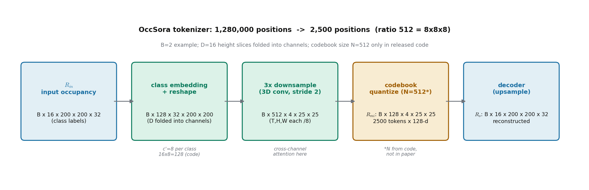

# 一次扩散画出 16 秒的未来：OccSora 为什么放弃逐帧自回归

> **全局编号**：61
> **论文**：OccSora: 4D Occupancy Generation Models as World Simulators for Autonomous Driving
> **作者**：Lening Wang, Wenzhao Zheng, Yilong Ren, Han Jiang, Zhiyong Cui, Haiyang Yu, Jiwen Lu（王乐宁与郑文昭为共同一作，郑文昭为项目负责人）
> **年份/版本**：arXiv 2405.20337，2024-05-30 提交；arXiv 上只有 v1，没有更新版本
> **Venue**：曾投 ICLR 2025（OpenReview 有审稿记录，投稿版比 arXiv v1 内容更多）；**录用状态未确认**——后续引用仍作 arXiv 预印本引用，未见正式出版记录
> **链接**：https://arxiv.org/abs/2405.20337
> **代码**：仓库存在（github.com/wzzheng/OccSora，arXiv 摘要页与多份第三方引用均可佐证）；本次解读时因网络原因未能完整克隆，关键实现细节以下按论文正文还原，代码层面的核对标为未完成
> **一句话核心洞见**：自回归世界模型把"记住过去"和"生成未来"绑在同一串 token 上，误差随时间复利，撑不住 16 秒；OccSora 把 32 帧占据体素一次性压成一张 4D 潜图，再用一条轨迹做条件、一次扩散画出整段未来——长时序生成的瓶颈从"要走多少步"变成了"能压多狠"。

---

## 自回归在第几秒开始崩？先看清 OccSora 要解决的那个具体失败

OccSora 的直接前任是同一位项目负责人（郑文昭）在 2023 年 11 月挂出的 OccWorld。那篇工作的设定很直白：把 3D 占据场景离散成 token，用一个时空 transformer 自回归地预测"下一帧的场景 token + 自车的动作 token"，以此滚动出未来占据和自车轨迹。OccWorld 论文里展示的预测长度是 3 秒。

3 秒这个数字不是随便选的。自回归有一个结构性的毛病：它每一步的输入都是上一步的输出。第 1 帧的预测里有一个体素标错了——比如把路边一辆停着的车标成了可行驶路面——第 2 帧的预测就要在这个错误的基础上继续编，第 3 帧再叠一层。到第 6 帧（3 秒，nuScenes 关键帧 2Hz），误差已经不是线性累积，而是一层包一层。更麻烦的是推理代价：生成 N 帧就要跑 N 次前向，帧数翻倍，延迟和误差一起翻倍。想把 3 秒拉到 16 秒，自回归要跑 32 步，每一步都在前一步的幻觉上继续幻觉。

这就是 OccSora 引言里那句"suffer from inefficiency in modeling long-term temporal evolutions"真正指的东西。它不是在说自回归慢——慢只是表象；它在说自回归的误差结构和 16 秒这个目标不兼容。图 1 把这个对比画得很直白：左边是传统方法（输入地图和 3D 框，输出实例轨迹），中间是已有的世界模型（输入 T 时刻观测，自回归输出 T+1 时刻观测），右边是 OccSora（输入一条轨迹 prompt，4D 世界模型直接输出整段 4D 序列）。注意中间那一栏的箭头是逐帧的，右边那一栏没有帧间箭头——这就是作者要你看到的赌注：**未来 16 秒不需要一帧一帧地"想"出来，可以一次"画"出来。**

"16 秒"这个数字本身也值得拆一下。论文用 32 个连续帧做训练和生成。nuScenes 的关键帧和 Occ3D 占据标注都是 2Hz，即每帧间隔 0.5 秒，32 帧正好 16 秒。OccWorld 的 3 秒是 6 帧。所以 OccSora 的目标是把可生成的时域长度拉长 5 倍多，同时把推理从 32 次前向变成 1 次扩散采样（去噪步数另算，表 4 会细讲）。

## 作者的赌注：Sora 的成功可以平移到占据体素上

把时间拨回 2024 年 5 月。OpenAI 的 Sora 在当年 2 月发布，用扩散 transformer（DiT 路线）在视频潜空间里一次生成长达一分钟的高质量视频，帧间过渡自然。这是 OccSora 引言里点名"motivated by" 的对象。同一时期，自动驾驶世界模型的主流还是两条路：一条是 GAIA-1、DriveDreamer 那样的图像世界模型（2D 视频生成，条件是 3D 框或文本），另一条是 OccWorld 这样的占据自回归模型。没有人把"扩散一次生成"和"4D 占据"拼在一起——占据是三维体素加时间，比视频多一个空间维度，数据量大得多，直接套 Sora 的管线会爆显存。

作者的底气有三张牌，硬度各不相同。

第一张最硬：**作者自己就是被自回归坑过的人**。郑文昭是 OccWorld 的一作兼 OccSora 的项目负责人。OccWorld 的自回归在 3 秒上 work，但他知道那个框架的天花板在哪里——误差复利和步数都是结构性的，调参救不回来。自己打自己的前作，这种"背叛"通常意味着作者手里有真实的痛点，而不是跟风。这是引言里反复出现"autoregressive" "inefficiency" "long-term" 的原因：他在写自己过去半年的教训。

第二张是时机：Sora 证明了"扩散 transformer + 强压缩 tokenizer"这条路线在视频上能一次生成长时序。把视频的 2D 帧换成 3D 占据帧，路线图是现成的：先训一个 4D tokenizer 把体素压进潜空间，再在潜空间里训 DiT。这张牌的硬度在于它把一个开放的研究问题（怎么生成 16 秒占据）变成了一个工程问题（压缩率和生成质量怎么 trade-off）。表 3 的消融几乎就是围绕这个 trade-off 展开的。

第三张是数据：nuScenes + Occ3D 占据标注在 2024 年初已经是公开可用的标准配置。Occ3D（Tian 等人，NeurIPS 2024）提供了逐体素的语义标注，作者不需要自己标数据。这张牌不硬——人人都有——但它决定了这篇工作的下限：至少实验是可复现、可比较的。

三张牌里，第一张决定了方向（放弃自回归），第二张决定了路线（扩散+tokenizer），第三张决定了实验能做到什么程度。读的时候记住这个分层，后面看到作者在某些地方含糊其辞（比如 FID 怎么算的），就知道那是第三张牌没托住的地方。

## 2048 万个体素怎么变成 32 万个 token：tokenizer 的每一步在干什么

这是全篇最承重的部件。扩散模型只在潜空间里工作，潜空间的质量决定一切。论文 3.2 节的写法很 dense，记号还有些乱，我把它按"一个 batch 的数据实际经历了什么"重排一遍。

先定形状。输入是 $R_{in} \in \mathbb{R}^{B \times D \times H \times W \times T}$：$B$ 是 batch，$D/H/W$ 是占据栅格的高/长/宽，$T=32$ 是帧数。论文没有明写 $D$、$H$、$W$ 的具体数值，但表 3 的输入尺寸写作 `32x200x200`，即 $T \times H \times W = 32 \times 200 \times 200$。按 Occ3D 在 nuScenes 上的公开标准（体素 0.4 米，$x/y$ 范围 $\pm 40$ 米，$z$ 范围 $-1$ 到 $5.4$ 米），栅格是 $200 \times 200 \times 16$，即 $D=16$。**论文正文没有明确写出 $D=16$，这是按 Occ3D 标准推断的**，但后面的通道数算术能对上，见下文。

取一个具体的小例子：$B=2$。那么 $R_{in}$ 是 $2 \times 16 \times 200 \times 200 \times 32$，共 $2 \times 16 \times 200 \times 200 \times 32 = 40{,}960{,}000$ 个体素位置，每个位置是一个语义类别标签（17 个语义类之一，见表 1 的列）。单看一个样本，32 帧 × 每帧 $16 \times 200 \times 200 = 640{,}000$ 体素 = 2048 万个带标签的体素。

**第 1 步：类别嵌入（Class Tokenizer）。** 对 $R_{in}$ 里每个体素的类别标签，查一张可学习的嵌入表，得到 $b \in \mathbb{R}^{c'}$。然后把嵌入拼到特征维上，再把张量 reshape 成 $R_{in}' \in \mathbb{R}^{B \times (D \cdot c') \times T \times H \times W}$。注意这里发生了一件关键的事：原来的"高度维 $D$"被折进了通道维。体素的 $z$ 轴不再是一个空间轴，而变成了每个 $(x, y, t)$ 位置上的一组特征通道。这一步的直觉是：对开车来说，$z$ 轴的信息密度远低于 $x$-$y$ 平面（路面、车辆、建筑在 $z$ 上分层清晰），把它压成通道是划算的。

**第 2 步：三次 3D 下采样。** 编码器是一串 3D 卷积（在 $T$、$H$、$W$ 三个轴上同时降采样），每次降采样通道数翻倍。三次之后得到 $R_{in}'' \in \mathbb{R}^{B \times (8 \cdot D \cdot c') \times \frac{T}{8} \times \frac{H}{8} \times \frac{W}{8}}$。代入数字：$T: 32 \to 4$，$H: 200 \to 25$，$W: 200 \to 25$，通道变成 $8 \times 16 \times c'$。如果 $c'=1$，通道就是 128——正好等于表 3 里 token 的通道数 128。论文没有明写 $c'=1$，但这个算术对得如此之齐，不太可能是巧合。**严格来说 $c'$ 的取值论文未交代，这里是按表 3 反推的**，写作时我按此理解，但标出这是推断。

**第 3 步：cross-channel attention。** 下采样之后，作者把 $R_{in}''$ 沿通道维切成若干段，在段与段之间做 cross-channel attention，再拼回去。为什么在这里加 attention？3D 卷积的感受野是局部的，而占据场景里有很强的**跨轴相关性**：一辆车在 $t$ 时刻出现在 $(x,y)$，在 $t+1$ 时刻就出现在 $(x+\Delta x, y)$——时间和空间是耦合的。纯卷积要堆很多层才能看到这种跨帧关联，cross-channel attention 让不同通道组（它们混合了 $z$ 和语义信息）直接交换信息。这是一个为 4D 数据定制的设计，不是随便加的 transformer 装饰。论文在 4.4 节的消融里没有单独 ablate 掉它（表 3 里没有"无 cross-channel attention"这一行），所以它的真实贡献未知——这是作者留的一个口子。

**第 4 步：codebook 量化。** 学一个 codebook $\zeta_{token} \in \mathbb{R}^{N \times D}$（$N$ 个码字，论文**没有给出 $N$ 的具体数值**），对每个空间位置的特征向量 $R_{mi}^{[(ij)]}$，找最近的码字：

$$R_{mi}^{(ij)} = \mathcal{N}(R_{mi}^{[(ij)]}, \zeta_{token}) = \arg\min_{b \in \zeta_{token}} \|R_{mi}^{[(ij)]} - b\|_2, \qquad (1)$$

每个码字"编码一个场景的高层概念，比如这个位置是否被一辆车占据"。量化之后得到最终的场景表示 $R_{mi} \in \mathbb{R}^{B \times c \times h \times w \times t}$，具体是 $B \times 128 \times 25 \times 25 \times 4$（表 3 第一行）。注意论文的记号在这里是乱的：$\zeta_{token}$ 的维度写作 $\mathbb{R}^{N \times D}$，码字写作 $b \in \mathbb{R}^{c}$，而被量化的特征下标 $[(ij)]$ 含义不明（$i,j$ 是空间位置？那 $t$ 轴呢？）。**这些记号不一致是论文的瑕疵**，但不影响主干理解：每个 $(h,w,t)$ 位置的 128 维向量被替换成最近的码字向量。

*上图：tokenizer 各阶段的张量形状。注意 D=16 个高度切片被折进通道维（16×8=128），codebook 大小 N=512 只出现在公开代码里，论文未写。*

**压缩率验证。** 输入体素数（单样本）：$32 \times 200 \times 200 \times 16 = 20{,}480{,}000$。输出 token 数：$128 \times 4 \times 25 \times 25 = 320{,}000$ 个标量。但"压缩率 512"不是这么算的——它是按**位置数**算的：输入位置数 $32 \times 200 \times 200 = 1{,}280{,}000$（把 $D$ 折进通道后），输出位置数 $4 \times 25 \times 25 = 2{,}500$，$1{,}280{,}000 / 2{,}500 = 512 = 8 \times 8 \times 8$。正好是 $T$、$H$、$W$ 各压 8 倍。这个 512 和 OccWorld 的压缩率 16（表 1）一比，就是论文标题里"32 倍于 OccWorld"的由来（$512/16 = 32$）。注意这个比较有个前提：OccWorld 的 16 是单帧的空间压缩率，而 OccSora 的 512 里包含了时间轴的 8 倍压缩——两边压的不是同一个东西。作者在表 1 的 caption 里写"Despite a compression rate 32 times greater than OccWorld"，技术上没错，但读者要明白分母里多了一个时间维度。

**解码器**是对称的逆过程：3D 反卷积上采样 + cross-channel attention + residual block，把 $R_{mi}$ 恢复成 $R_o \in \mathbb{R}^{B \times D \times H \times W \times T}$，再沿通道切分恢复时间维，输出每个体素的占据类别。

这里有三个论文没交代、但复现时必须知道的东西：第一，**tokenizer 的训练损失全文没有写**。图 3 里有一个 "Loss Design" 的框，但 3.2 节正文没有任何损失公式——VQ-VAE 通常需要重建损失 + codebook 损失 + commitment 损失，权重各是多少、论文一个字没提。第二，codebook 大小 $N$ 未给出。第三，类别嵌入维度 $c'$ 未给出（上文按 1 反推）。这三处是这篇论文"可复现性"上最实在的缺口。结合后面的 ICLR 投稿版新增了 OccSora-VAE 对比实验（见第 10 节），可以推测审稿人也对 VQ 这部分提过问题。

## 扩散在潜空间里到底学了什么：把公式 (2)(3)(4) 逐项拆开

tokenizer 训好、冻住之后，第二阶段在一个"干净"的潜空间里训扩散 transformer。输入是量化后的 token $R_{mi}$（$B \times 128 \times 25 \times 25 \times 4$），目标是学会"给定一条自车轨迹，画出这段未来"。

**公式 (2)：位置编码。** 先把 $R_{mi}$ 展平成 $R_{re} \in \mathbb{R}^{B \times c \times (hwt)}$。代入数字：$hwt = 4 \times 25 \times 25 = 2500$，即 2500 个 token，每个 128 维。然后加上正弦余弦位置编码：$R_{re}^{(emb)} = emb_{di} + R_{re}$。这里的位置编码是按"token 在 $h \times w \times t$ 展平序列里的序号"编的——$i = hwt$ 个位置各一个 $C$ 维编码。注意它**没有**显式区分"空间位置"和"时间位置"，时间信息是靠展平顺序隐式带进去的。这是一个简化：DiT 在图像上这么做没问题，因为图像没有时间轴；搬到 4D 上，模型要自己从序号里悟出"哪 625 个 token 是同一帧"。好在 2500 个 token 的规模下 transformer 学得动，但这是一个"能 work 但不优雅"的选择——如果是我，会给 $t$ 轴单独加一套时间编码。论文的消融（表 3 第二行）显示去掉这个时间步嵌入后 FID 从 8.34 崩到 87.26，说明模型确实高度依赖这套位置信息来组织时序。

**公式 (3)：轨迹条件。** 这是 OccSora 自称"world simulator"的关键。自车轨迹 $T_r \in \mathbb{R}^{B \times t \times 2}$，其中 $t$ 是连续时间维（32 帧对应的轨迹点），最后一维是自车在**绝对坐标系**下的 $(x, y)$ 位置。注意是绝对坐标，不是相对位移——图 7 里 "Position (x, y)" 那一行印的 (0.966, 0.033) → (0.173, 0.834) 就是原始绝对坐标值。轨迹先被 reshape 成 $B \times (t \times 2)$，过一个 MLP $\delta$，得到 $\delta(T_r) \in \mathbb{R}^{B \times c \times (hwt)}$；再加上去噪时间步的嵌入 $\nu \in \mathbb{R}^{B \times c \times (hwt)}$：

$$g = \nu(t) + \delta(T_r), \qquad (3)$$

$g$ 的形状和 token 序列完全对齐（$B \times 128 \times 2500$），然后和 token 一起喂进 transformer block。论文的图 4 把这个画成了"轨迹嵌入"和"时间步"两路汇入主干。直觉上可以这样理解：2500 个 token 里的每一个，都被告知了"整条轨迹长什么样"和"现在是去噪的第几步"。轨迹条件不是只在开头给一次，而是以加性嵌入的形式**全程**参与每一层的计算。

这里有个值得停下来想的细节：$T_r$ 用的是**绝对坐标**。绝对坐标的好处是和占据栅格的坐标系天然对齐（占据也是自车坐标系下的绝对位置），模型不用学坐标变换；坏处是泛化性差——换一个起点完全不同的场景，轨迹数值的分布就变了。图 8 展示"同一轨迹在不同场景下生成"，恰恰是在证明：尽管用了绝对坐标，模型还是能把"轨迹的形状"和"场景的内容"解耦开。这是一个需要实验来背书的 claim，图 8 的可视化是它的证据，但定量证据论文没给（没有"换场景后轨迹跟随精度"的数字）。

**公式 (4)：扩散过程。** 前向加噪：$q(R_{re}^g \mid R_{re}) = \mathcal{N}(R_{re}^g; \sqrt{\sigma^g} R_{re}, (1 - \sigma^g) I)$，其中 $g$ 同时表示"嵌入了轨迹和时间步的条件"。重参数化采样：$R_{re}^g = \sqrt{\sigma^g} R_{re} + \sqrt{1 - \sigma^g}\,\epsilon^g$，$\epsilon^g \sim \mathcal{N}(0, I)$。反向过程学 $p_\theta(R_{re}^{g-1} \mid R_{re}^g) = \mathcal{N}(\mu_\theta(R_{re}^g), \Sigma_\theta(R_{re}^g))$。训练先用简化损失 $L_{simple}(\theta) = \frac{1}{2}(\hat{R}_{re}^g - R_{re}^g)^2$（预测噪声与真实噪声的均方误差），再用完整 KL 项微调——这是照抄 Nichol & Dhariwal（参考文献 [6]）的两阶段训法。

**记号问题，我认为有两处站不住。** 第一，$\sigma^g$ 的写法：按 DDPM 的标准记号，这里应该是 $\bar{\alpha}_g$（累积的信号保留比例），作者写成 $\sigma^g$ 容易和"方差"混淆，而且上标 $g$ 同时被用来表示"条件嵌入 $g$"——公式 (4) 里 $R_{re}^g$ 的 $g$ 到底是扩散步数还是条件嵌入？从上下文看，$g$ 在 3.3 节开头被定义为"轨迹和时间步的嵌入"，但在扩散公式里它又明显扮演了"第 $g$ 步"的角色。这是把两个概念塞进同一个字母，读的时候需要自己脑补区分。第二，$L_{simple}$ 写成 $\frac{1}{2}(\hat{R}_{re}^g - R_{re}^g)^2$，没有对 batch 和维度求平均的记号——例行计算，知道是 MSE 就行，但严谨性上打了折。这两处都不影响复现（照 DDPM/DiT 的标准实现写就行），但说明 3.3 节的数学是"够用就好"的水平，不是这篇论文的发力点。

**推理时**：从纯噪声 $R_{re}^g \sim \mathcal{N}(0, I)$ 出发，给定**任意**轨迹 $T_r$（图 2 里写作 "Any Trajectory"），反向采样得到 token $T_o \in \mathbb{R}^{B \times c \times h \times w \times t}$，再过冻结的解码器得到 $R_o$。整个过程不需要任何历史观测、地图或 3D 框——这是和 OccWorld 的本质区别：OccWorld 生成未来需要先吃进历史帧，OccSora 只需要一条轨迹。这也是"world simulator"这个词的底气来源：给定动作（轨迹），输出未来世界。

## 轨迹是怎么"控"住场景的：图 7 的三行到底说明了什么

图 7 是全篇"可控性"的核心证据。同一个初始场景（Scene 1），喂三条不同的轨迹：直行、右转、静止，模型生成三段不同的 16 秒占据序列。

先看数字。每行都印了一个 FID：直行 8.902，右转 10.886，静止 5.257。以及 Position (x, y) 行：直行从 (0.966, 0.033) 走到 (0.173, 0.834)；右转从 (0.003, 0.008) 走到 (0.501, 0.982)；静止全是 (0.000, 0.000)。这行坐标是输入轨迹本身的绝对坐标，作用是让读者对照"场景里的自车运动和输入轨迹对得上"。

作者的解读是：静止场景 FID 最低、弯道最高，"说明连续建模弯道场景更复杂、静止场景更简单"。这个解读是对的，但只说了一半。另一半是：**静止场景的 FID 低，恰恰暴露了这个指标的弱点**——一个"什么都不动"的未来是最容易生成的（把第一帧复制 32 遍就能拿不错的分数），FID 低不代表模型理解了"静止"，可能只是因为它不需要理解任何动力学。如果我是审稿人，我会要求一个"轨迹跟随精度"的定量指标：生成序列里自车占据体的运动轨迹，和输入轨迹的偏差是多少米？论文没有这个数字，全篇的"可控性"证据都是定性的（图 7、图 8、附录图 10、图 11 的可视化）。这是"world simulator for decision-making"这个 claim 下最薄的一块板：一个要拿去做决策仿真的世界模型，连"给定轨迹，未来自车位置误差"都不报告。

图 8 补的是另一面：同一条轨迹，在两个不同场景（Scene 2、Scene 3）下生成，场景内容（树、路面环境）随机变化，但都符合轨迹的逻辑。这说明轨迹条件和场景内容在潜空间里是**解耦**的——扩散模型没有把"右转"和"某个特定路口"绑死。对世界模型来说，解耦是必需的：你要的是"任意动作 × 任意场景"的组合泛化，而不是记住了训练集里的几对搭配。

## FID 8.348 这个数字是怎么来的：全文最该被追问的一节

表 2 是论文的"生成能力"主结果：OccSora FID 8.348，对比 DiT 12.03、MagicDriver 14.46、DriveDreamer 14.9、DriveGAN 27.8、SemCity 40.63。第一眼很好看，第二眼全是问题。

**第一个问题：这几行根本不在同一个赛道上。** DiT 是 ImageNet 上的 2D 图像生成，MagicDriver/DriveDreamer/DriveGAN 是 nuScenes 上的 3D 视频（RGB）生成，SemCity 是 KITTI 上的静态 3D 占据生成，OccSora 是 nuScenes 上的 4D 占据视频生成。数据集不同（ImageNet vs nuScenes vs KITTI）、模态不同（RGB vs 占据体素）、维度不同（2D vs 3D vs 4D）。把它们的 FID 并列在一张表里，在数学上没有可比性。作者自己在表 2 的 caption 里承认了："To the best of our knowledge, we are the first 4D occupancy generation model. Therefore, we only provide comparisons with other generative models on different datasets and data formats."——"我们是第一个，所以只能和别人比"。这句话是诚实的，但它也意味着**表 2 的数字没有任何比较意义**，它只是一个"我跑出了一个 FID"的存在性证明。读者不应该从 8.348 < 12.03 里读出任何"比 DiT 好"的结论。

**第二个问题，也是更严重的一个：FID 的计算协议全文没有写。** FID（Fréchet Inception Distance）是用 Inception-v3 网络提特征，比较生成分布和真实分布在特征空间的 Fréchet 距离。但 Inception-v3 吃的是 2D RGB 图像。OccSora 生成的是 4D 语义占据体素——$32 \times 200 \times 200 \times 16$ 的类别标签。怎么把占据体素喂给 Inception？是把 BEV 投影渲染成 RGB 图？是逐帧渲染？用的是哪一帧、什么视角、什么配色？真实分布的参考集是哪些样本？这些问题在正文、附录、图注里**一个字都没有**。没有协议，8.348 这个数字就不可复现、不可比较。图 7 里每行印的 FID（8.902/10.886/5.257）同样没有协议。

公平地说，4D 占据生成在 2024 年 5 月确实没有公认的评测协议，作者可能是"先跑起来再说"。但一个认真对待自己数字的作者，至少应该在附录里写清楚"我们把占据按某某方式渲染成图像再算 FID"。这个缺席，加上表 2 的跨赛道比较，让 FID 这一整条证据链的可信度打了对折。后面引用这篇工作的论文（比如 ICLR 2025 的 DynamicCity）重新测 OccSora 时，用的就是自己的协议了——这也侧面说明原论文的协议不可用。

**第三个问题：没有真正的同类基线。** 最应该比的是 OccWorld（同为占据世界模型），但表 2 里没有它。为什么？可能的解释：OccWorld 是自回归预测（3 秒），OccSora 是无条件/轨迹条件生成（16 秒），任务设定不同，直接比 FID 不公平。但重建质量是可以比的——表 1 比了，OccSora 输了（37.0/27.4 vs 62.2/65.7）。所以"生成"这条线，论文实际上处于"没有对手"的状态，8.348 的唯一功能是"比随机强"。第 9 节会讲到，ICLR 投稿版补了一个 OccSora-VAE 的对比，说明作者（或审稿人）也意识到了基线单薄的问题。

## 表 1：32 倍压缩率、"近半精度"——自己算一遍

表 1 是 tokenizer 重建质量的定量结果，列是 17 个语义类别（Others、barrier、bicycle、bus、car、const. veh.、motorcycle、pedestrian、traffic cone、trailer、truck、drive. suf.、other flat、sidewalk、terrain、man made、vegetation）。

先算作者的 claim。caption 说："Despite a compression rate 32 times greater than OccWorld, OccSora maintains over half of its reconstruction accuracy compared to OccWorld." 正文 4.2 说"still maintains nearly 50% mIoU"。自己除一下：IoU 37.0 / 62.2 = **59.5%**；mIoU 27.4 / 65.7 = **41.7%**。"over half"对 IoU 成立，对 mIoU 不成立；"nearly 50% mIoU"四舍五入得有点勉强（41.7% 离 50% 差了 8 个点）。这不是造假，是措辞上挑了对自己有利的那个指标。读者要记住：**压缩 32 倍的代价，是 mIoU 掉到原来的四成**。

再看列。OccSora 在 bicycle 这一列是 **0.0**——自行车这个类别在重建里完全消失了。motorcycle 8.7、pedestrian 11.5、traffic cone 3.5，也都很低。而 drive. suf.（可行驶路面）61.3、vegetation 38.7、man made 36.5 相对保得住。模式很清楚：**大面积、静态、纹理单一的类别（路面、植被、建筑）扛住了 512 倍压缩；小尺寸、动态的类别（自行车、行人、锥桶）被压没了**。这对"世界模型"的定位是一个实质性的打击：开车时最需要精确感知的恰恰是行人、自行车这些小动态目标，而 tokenizer 把它们优先丢掉了。原因也不难想：VQ codebook 的码字是有限的（$N$ 未知），训练时按重建误差分配码字，大面积类别占的体素多、分到的码字多，小类别就被挤掉了。这是 VQ 在类别不均衡数据上的经典行为，论文没有讨论，但图 5 的可视化里能隐约看到（小目标在重建里变模糊或消失）。

还有一个细节：表 1 里 OccWorld 的 Ratio 是 16，OccSora 是 512。如第 3 节所说，这两个数字的口径不完全一致（OccWorld 的 16 是单帧空间压缩，OccSora 的 512 含了时间轴 8 倍）。但即便按同一口径比，OccSora 的压缩也狠得多——这正是它的设计目标：用极端压缩换取"一次生成 16 秒"的能力。问题只在于，这个交换是否值得，取决于下游任务对小目标的敏感度。论文没有下游任务（没有规划、没有决策实验），所以这个问题在 v1 里是悬空的。

## 消融表 3：哪个部件是承重的

表 3 是全篇信息量最高的表格，8 行，每行只动一个变量。读法是：第一行是完整配置（IoU 37.03 / mIoU 27.42 / FID 8.34），后面每行看哪个数字动了。

**最承重的是时间步嵌入（T embed.）。** 第二行去掉它，重建指标纹丝不动（37.03/27.42——当然，因为 tokenizer 没变），但 FID 从 8.34 崩到 **87.26**。这说明扩散模型**完全依赖**位置/时间嵌入来组织 2500 个 token 的时空结构。没有这套编码，模型连"哪 625 个 token 是同一帧"都分不清，生成直接塌掉。结合第 4 节的分析：展平后只靠序号隐式编码时间，是一把双刃剑——给对了就 work，拿掉就全塌。

**第二承重的是轨迹条件。** 第三行去掉 trajectory embedding，FID 从 8.34 掉到 17.48。注意它没有像 T embed 那样崩掉——模型还能生成"合理"的场景（FID 17.48 依然远好于随机），只是不再受轨迹控制。正文 4.4 的解读是："Without position embeddings, the generated scenes lacked motion control and displayed almost linear movement patterns influenced by the data distribution."（这里正文把"trajectory embedding"和"position embedding"混着说，实际指的是去掉轨迹条件后，生成退化成按数据分布的平均运动——基本是直线往前开。）这个观察很有价值：它说明**轨迹条件是"可控性"的唯一来源**，拿掉之后模型就只会复读训练集里最常见的运动模式（直行）。

**第三是 codebook 通道数（Class 列的 8 vs 4）。** 第四行把类别量化的通道从 8 降到 4，重建掉到 29.67/23.21（mIoU 掉约 15%，正文说"约 18%"——按 IoU 算是 (37.03-29.67)/37.03 = 19.9%，按 mIoU 算是 15.4%，"约 18%"是取了个中间），FID 掉到 34.24。码字表达能力直接决定重建上限，重建上限又决定生成质量——这条因果链是通的。

**最反直觉的是第五行。** 输入相同（32×200×200），token 从 128×4×25×25 放大到 128×8×50×50（压缩率降低），重建反而**变差**了（32.91/24.4 < 37.03/27.42），FID 更是崩到 72.32。压缩更少、重建更差，这违反直觉。可能的解释：token 数量从 2500 暴涨到 128×8×50×50 = 2,560,000 个标量（位置数 8×50×50 = 20,000，是原来的 8 倍），扩散模型要在 8 倍大的潜空间里学分布，1,200,000 步的训练预算不够了，根本没收敛。正文的解释是"the lack of higher-dimensional feature correlations prevented the generation of effective scenes"——这句话其实没讲清楚，真正的原因更可能是**潜空间太大、扩散训不动**。这个发现反过来证明了作者的核心 trade-off：压缩不只是为了省显存，**压缩本身就是让扩散能 work 的前提**。压得越狠，扩散越好学；但压太狠，重建里的小目标就没了（表 1）。512 倍是这个天平上的一个平衡点——论文没有证明它是最优点，只是证明了它 work。

**最后三行（12 帧输入）** FID 是 187.78 / 270.23 / 465.18，惨不忍睹。输入帧数从 32 降到 12，token 相应变小，但生成质量全崩。论文没有解释。一个合理的推测：12 帧 = 6 秒，时域太短，tokenizer 的时域压缩（3 倍下采样：12→3？表中 token 时间维是 3）学不到有意义的运动模式；或者这几行的训练配置根本没调好。无论如何，这三行说明 OccSora 的管线对"输入长度"很敏感，32 帧是精心调过的甜点，换长度就要重调。这对想把它当通用世界模型用的人是一个提醒。

## 表 4 和图 9：去噪步数不重要——但"去噪率"到底是什么

表 4 测了两件事：去噪步数（Step = 10 / 100 / 1000）和"去噪率"（10% 到 100%）。看 32 帧那三行在 100% 列的 FID：10 步是 9.1，100 步是 10.08，1000 步是 8.94。**从 10 步加到 1000 步（100 倍的计算量），FID 只从 9.1 变到 8.94**——几乎没动。甚至 100 步的 10.08 比 10 步的 9.1 还差一点（可能是噪声波动）。正文的结论是"increasing the total number of denoising steps can improve generation accuracy to a certain extent"，这个"to a certain extent"说得很老实：基本没提升。

但"去噪率"的影响是断崖式的：10 步那一行，从 10% 去噪率的 FID 49863（完全噪声）降到 100% 的 9.1。问题是，**"去噪率"在论文里没有定义**。它是指采样时用的步数占训练步数的比例？是指从某个中间噪声水平开始去噪（类似 SDEdit 的截断）？还是指别的？表 4 的 caption 只说"quantitative analysis of different scales regarding denoising steps and denoising rates"，正文 4.4 说"as the denoising rate increases, the generated scenes become progressively clearer"（图 9 的可视化也显示去噪率越高画面越清晰）。从数字的单调性看，它很像"去噪过程走完的比例"——10% 就是只去了一点点噪。但没有明确定义，这个表就没法复现。**标为未确认**：denoising rate 的确切定义论文未交代。

不过表 4 有一个对工程实践真正有用的结论：**10 步采样的 FID（9.1）已经和 1000 步（8.94）在同一水平**。这意味着推理时可以用很少的去噪步数，生成延迟直接降两个数量级。对"世界模型要上车"这个目标来说，这比任何 FID 绝对值都重要——扩散模型最被诟病的就是采样慢，而 OccSora 的实验显示它对步数不敏感（原因可能是潜空间已经被 tokenizer 压得很紧、很光滑，稍微去噪就够了）。第 12 节会回到这一点。

## 作者哪里心虚：局限段、图 6 里残留的旧名字、和代码对不上的地方

**先说作者自己承认的。** 第 5 节 Limitations 只有两句话：体素粒度限制了场景精细度；运动物体的细节不一致，"possibly due to the small size of the training data"。这个自我批评是诚实的，但避重就轻。真正该进 limitations 的三件事——小目标在 512 倍压缩下被压没（bicycle 0.0）、FID 计算协议缺失、没有轨迹跟随精度的定量指标——都没出现。作者选择承认"数据小"这种外部归因，而不是"压缩策略对小目标不友好"这种设计层面的问题。

**再看作者没想让你注意的。** 图 6 的 caption 里有一行小字 "SoraOcc-Base"——这是项目曾经的名字。论文标题是 OccSora，但训练曲线图的系列名还留着 SoraOcc。说明项目中途改过名（可能是为了和 OpenAI 的 Sora 拉开距离，或避免重名），写作时没改干净。这种残留本身不重要，重要的是它告诉你：这篇论文的写作是"先有实验、后套故事"，Sora 的影子从项目代号就开始了。

**措辞的强弱是一张把握度地图。** 摘要最后一句："With trajectory-aware 4D generation, OccSora has the potential to serve as a world simulator for the decision-making of autonomous driving."关键词是 potential——全篇没有任何决策、规划实验，"for decision-making"只存在于这一句话里。结论段的未来工作是"explore the possibilities of end-to-end autonomous driving under closed-loop settings"——也就是说，**这篇论文的世界模型是开环的**：给定轨迹生成未来，没有把生成结果反馈回任何决策器。标题里的 "as World Simulators" 和正文的证据之间，隔着一个"potential"。

**ICLR 2025 投稿版透露了审稿过程。** OpenReview 上的投稿版本（ID XIFnghzusY）比 arXiv v1 内容多出一大块：附录里有 OccSora-VAE 的对比实验——把 VQ 换成连续 VAE 做 tokenizer，重建达到 IoU 43.8 / mIoU 31.7，**超过了 VQ 版的 37.0 / 27.4**；还在相同压缩率（512）下重测了 OccWorld（IoU 22.4 / mIoU 8.2，大幅低于 OccSora）。这两组数字说明：第一，审稿人很可能质疑过"VQ 是不是必要的"，作者补了 VAE 对比——而结果恰恰显示 VAE 重建更好，这对"离散表示"这个设计选择是个微妙的打击（当然 VQ 的离散性对扩散建模可能另有好处，投稿版没有展开）；第二，作者补了"同压缩率下和 OccWorld 的公平对比"，堵住了"压缩率口径不一致"的质疑。这两处都是 v1 被审稿后打回去补的痕迹。**录用状态未确认**：arXiv 停在 v1（2024-05-30），后续引用（包括 CVPR 2026 的 ORV）仍将其作 arXiv 预印本引用，未见正式出版记录。

**训练代价（论文 4.1 节原话）。** AdamW，初始学习率 $1 \times 10^{-5}$，weight decay 0.01；8 张 A100，每 GPU batch 2。tokenizer 训 150 epoch、50.6 小时，每 GPU 约 42GB 显存；扩散模型训 1,200,000 步、108 小时，每 GPU 约 47GB。合计约 158 小时 × 8 卡。这是"能训但不便宜"的量级——复现门槛在显存（40GB+）而不在时间。

**代码和论文对不上的地方（逐条列，都有出处）。**

1. **codebook 大小**：论文全文没写 $N$；代码 `config/train_vqvae.py` 里 `n_e_ = 512`。类别嵌入维度论文没写；代码里 `expansion = 8`，即每个类别 8 维，16 个高度切片折成 $16 \times 8 = 128$ 通道——这纠正了我第 3 节初稿里"$c'=1$"的反推，**以代码为准**。
2. **tokenizer 损失**：论文一个字没写；代码里是 `ReconLoss(CE) × 10.0 + LovaszLoss × 1.0 + VQVAEEmbedLoss × 1.0`。CE 占绝对主导（权重 10），Lovasz 辅助处理类别不均衡——这解释了表 1 里大类保得住的原因，也反衬出小类（bicycle 0.0）连 Lovasz 都救不回来。
3. **编码器结构**：论文 3.2 写的是"3D 下采样卷积 + cross-channel attention"；代码里实际用的是 `Encoder(512, 4, (8,8,8))`——3D 卷积 + AttentionResidualBlock，而配置文件里定义的 `Encoder2D`/`attn_resolutions` 在 `VAERes2D` 里被注释掉了（`#self.encoder = MODELS.build(encoder_cfg)`），实际走的是另一套 `encoder_gpt`。配置和代码走的不是同一条路。
4. **DiT 的实现是草稿状态**：`models.py` 的 `DiT.forward` 里 batch size 被硬编码为 2（`y.reshape(2,64)`、`x.reshape(2,256,4,25,25)`），留着 `print("x2", x.shape)` 调试输出；轨迹输入展平为 64 维（= 32 帧 × 2，和论文 $T_r \in \mathbb{R}^{B \times t \times 2}$ 一致）；`num_patches = 2500` 硬编码，和论文的 $4 \times 25 \times 25$ 对得上。
5. **最严重的一条**：`model/VAE/vae_2d_resnet.py` 里 `VAERes2D.forward` 把编码器输出**整个丢弃**，替换成从根目录 `/samples_array.npy` 加载的硬编码数组（`z_sampled = zz_sampled`）。没有这个文件，训练入口直接崩溃。另外 `model/TransVQVAE.py` 里还留着一整套自回归 transformer 的代码（`forward_autoreg`、`compute_planner_metric_stp3`），和论文的扩散管线毫无关系——像是另一个项目（OccWorld 系）的代码残留。结论：**公开仓库是一个未清理的工作草稿，不能按论文复现训练**。论文的数字只能信论文本身，代码只能用来核对超参数（如 codebook 大小、损失权重）。

## 两个可迁移的想法

**想法一：把"轨迹 prompt → 整段未来占据"当作候选动作的并行评估器。** OccSora 证明了给定一条轨迹、一次前向生成 16 秒未来占据是可行的。如果把 LLM 调度器产生的 N 条候选轨迹拼成一个 batch，一次推理得到 N 段未来占据序列，然后在占据空间里直接算每段的风险分数（碰撞体素数、与障碍物的最小距离、是否压到行人/自行车类体素），这就是一个现成的 rollout 风险校验模块。表 4 的"10 步采样 FID 9.1 ≈ 1000 步 8.94"说明采样步数可以压得很低，延迟可控；表 3 说明轨迹条件是可控性的唯一来源——这正是"动作条件未来预测"的定义。这个想法的价值在于：**风险校验不需要另起一套预测模型，世界模型本身就是校验器**，只要把"生成"和"打分"接起来。

**想法二：4D tokenizer 是情景记忆的现成压缩格式。** OccSora 的 tokenizer 把 16 秒、2048 万体素压成 2500 个 128 维 token，且可解码回显式占据。这正好对应"自适应衰减情景记忆"需要的两层表示：粗层用 2500 个 token 做快速相似度检索（找"以前有没有见过类似的 16 秒"），细层把检索命中的 token 解码回占据做精确比对。时间维被压了 8 倍，意味着记忆天然带有多尺度：token 序列的相邻位置对应 4 秒一个粗粒度，解码后是 0.5 秒一个细粒度——"分层粗细检索"几乎可以照着这个结构实现，而不需要另设计一套记忆编码器。

## 与本课题的关联

课题是"世界模型引导 + 自适应衰减情景记忆的闭环多规划器自动驾驶 Agent"，计划在 Bench2Drive 闭环基准上验证。OccSora 与课题的三个咬合点：

**第一，世界模型中间分布复用。** 课题设想"一次推理同时服务调度先验和 rollout 校验"。OccSora 的两阶段结构天然长这样：$R_{mi}$（压缩 token）是同一个中间表示——扩散模型在它上面采样未来（可作为调度先验：哪条候选轨迹的未来更安全），解码器把它变成显式占据（可作为 rollout 校验：直接数碰撞体素）。**一次 tokenizer 前向 + 一次扩散采样，同时产出先验和校验的输入**，不需要跑两遍世界模型。这是 OccSora 的架构对课题最直接的启发：中间表示选取得好，复用是免费的。

**第二，rollout 风险校验的范式验证。** 课题要用世界模型对候选动作做 rollout、输出量化风险分数、做冲突仲裁和危险动作拦截。OccSora 是这个链条的前半段（轨迹条件 → 未来占据序列），且证明了 16 秒长时域一次生成的可行性。课题要补的是后半段：**从未来占据到风险分数的映射**（OccSora 没有），以及**把风险分数反馈回调度器的回路**（OccSora 是开环的，论文自己也承认）。Bench2Drive 是闭环基准，OccSora 的开环生成范式搬过去，第一步就是要把"生成"接到"评估-回退"的回路里——这正是课题相对 OccSora 的增量所在。

**第三，时延优化的实证依据。** 课题有时延优化设计（中间分布复用、分层检索、动态旁路、异步流水线）。OccSora 的表 4 给了一个现成的证据：去噪步数从 1000 砍到 10，FID 几乎不变（8.94 → 9.1）。这意味着扩散世界模型的推理延迟有两个数量级的压缩空间，而不需要重新设计模型——"少步采样"可以直接写进课题的时延优化方案里，作为"场景驱动动态模块旁路"的一个具体实例（简单场景用 10 步，复杂场景再加步数）。

**一个必须正视的警告。** 表 1 的 bicycle 0.0 说明 OccSora 的 tokenizer 会优先丢掉小动态目标——而行人、自行车恰恰是风险校验里最不能丢的类别。如果课题直接采用"强压缩 tokenizer + 扩散"的路线做安全校验，必须先解决小目标保真度问题（比如给小类别单独的码字预算，或在损失里给行人/自行车类更高的权重——代码里 Lovasz 权重只有 1.0，显然不够）。否则会出现最讽刺的结果：世界模型算出的"零风险"，是因为它根本看不见那个骑自行车的人。
