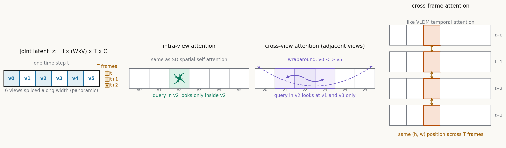

# 19 个通道驯服 6 个视角：Panacea 怎样把 BEV 标注变成可控驾驶视频

> **信息块**
>
> - 全局编号：70
> - 标题：Panacea: Panoramic and Controllable Video Generation for Autonomous Driving
> - 作者：Yuqing Wen, Yucheng Zhao, Yingfei Liu, Fan Jia, Yanhui Wang, Chong Luo, Chi Zhang, Tiancai Wang, Xiaoyan Sun, Xiangyu Zhang（Wen、Zhao、Liu 为共同一作）
> - 会议/年份：CVPR 2024，pp. 6902–6912
> - 链接：论文 https://arxiv.org/abs/2311.16813（读的是 2023-11-28 的 v1 原版，不是 2408.07605 的 Panacea+ 扩展版）；项目页 https://panacea-ad.github.io/
> - 代码：公开，https://github.com/KONGYOUYL/panacea。但仓库是 Panacea 和 Panacea+ 的混合体：放出的 checkpoint 是 Panacea+ 第二阶段权重，原版两阶段训练配置与权重均未公开
> - 一句话核心洞见：把 BEV 标注序列"画"成 19 通道的控制图喂给 ControlNet，用"只看相邻视角、只看空间对齐时刻"的分解注意力在可接受的显存里生成六视角一致的视频——视频好不好看是次要的，真正的验收标准是拿生成的视频去训 BEV 感知模型，看检测分数涨不涨

## 自动驾驶缺的不是视频，是"带标注的"视频

2023 年底，BEV 感知已经是自动驾驶感知的主流写法。BEVFormer、StreamPETR 这些方法吃的是多视角视频加 BEV 标注：一帧里 6 个相机的图像，配上同一时刻的 3D 框和道路图。数据从哪里来？nuScenes 只有 700 个训练场景，每个 20 秒。想覆盖雨天、雪夜、逆光这些长尾条件，靠车队实采既贵又慢，还可能有安全风险。

论文的起点是一个很具体的困境：视频好采，标注难做。给一段 6 视角视频逐帧标 3D 框和地图，成本按小时算。而 BEV layout 序列（3D 框加道路图随时间变化）相对便宜——它可以从已有标注数据里直接拿，也可以从仿真器里合成。于是作者把问题转了一下：输入 BEV layout 序列加一段文字描述，输出与之严格吻合的多视角视频。这样一来，标注是输入，视频是输出，生成多少就有多少带标注的训练数据。这就是 "Gen-nuScenes" 这个名字的来历。

但这个转化里藏着一对矛盾，作者在摘要里直接点了名：Consistency 和 Controllability。

## "一致"和"可控"为什么在这篇论文里打架

先把这两个词翻译成具体的要求。

一致（Consistency）有两层。第一层是时间一致：同一辆车在第 3 帧是红色轿车，到第 5 帧不能变成白色 SUV，位置要沿着运动轨迹连续变化。第二层是跨视角一致：nuScenes 的 6 个相机视场有重叠，同一辆车会同时出现在前视和前右视的边缘。它在两个视角里的颜色、形状、朝向必须能对上，否则感知模型学到的就是"同一个物体有两个长相"。

可控（Controllability）是另一回事：生成的内容必须和输入的 BEV 标注吻合。BEV 里第 2 秒那个位置有一辆卡车，生成的视频里那个位置、那个时刻就得有一辆卡车，朝向、大小都不能差太多。差太多的话，标注就成了错标，拿去训感知模型等于投毒。

这对矛盾具体怎么打架？扩散模型的天性是"多样性"：同样的 BEV 框，模型可以画出红色车也可以画出蓝色车，可以是晴天也可以是阴天——多样性正是我们想要的，因为它带来数据增广的价值。但多样性走远一步就是失控：模型为了画面好看，可能把 BEV 里没有的车画出来，或者把框里的车画到框外面。反过来，如果把控制卡得太死（比如直接把渲染好的框图贴到图像上），多样性就没了，生成的全是标注的"描红"，感知模型学不到新东西。

更麻烦的是，一致性和可控性会互相拖后腿。跨视角一致要求 6 个视角"商量着画"，信息要在视角之间流动；可控性要求每个视角"听标注的话"，信息要从 BEV 流向每个视角。两股信息流在同一个 UNet 里走，很容易出现这种情况：为了视角一致，模型把 A 视角里画好的车"借"给 B 视角，结果 B 视角的车偏离了自己的 BEV 框。可控性掉了。

作者押的赌注是：这两股信息流可以分开管。一致性用注意力结构管（decomposed 4D attention），可控性用 ControlNet 管。结构管结构，条件管条件，互不抢方向盘。

## 作者的底牌：2023 年 11 月，站在谁的肩膀上

判断一篇工作的分量要看时间坐标。2023 年 11 月，工具箱里已经有了：Stable Diffusion 2.1（2022 年底，latent diffusion，省显存）、ControlNet（2023 年 2 月，给 SD 加条件的标准做法）、Video Latent Diffusion Model / Align Your Latents（CVPR 2023，把时序层插进 2D 扩散模型做视频）。自动驾驶这边：BEVGen 和 BEVControl 刚做了"BEV layout 生成多视角图像"，DriveDreamer（2023 年 9 月）做了单视角驾驶视频生成。StreamPETR（2023 年 3 月）是当时 video-based BEV 感知的代表。

所以作者手里的牌是：多视角图像生成已经有人做通了，单视角视频生成也有人做通了，缺的是"多视角加视频"同时成立，再配上 BEV 控制。这张牌的硬度在于，每一块都有现成实现，风险集中在一处：多视角和多帧同时建模，显存会不会爆。这也是论文真正的技术赌注所在。作者没有发明新的扩散建模路子，而是做了一次"集成创新"——但这个词容易让人低估它：把几块拼起来时，接口处的每一个决定（视角怎么拼、注意力怎么切、控制信号长什么样）都是新的，都需要实验验证。

我认为（推测，依据是论文 5.2 节的写法）作者的底气还有一层：验收标准选得聪明。他们没有只报 FID/FVD，而是把"生成的视频能不能训出更好的 StreamPETR"当主指标。这个指标把审稿人最可能问的问题——"生成这么多视频到底有什么用"——直接变成了实验设计。

## 4D 全注意力在 A100 上会爆：先算一笔显存账

论文 3.2.1 节说得很直白：naive 的 4D（H×W×V×T）注意力"连最先进的 A100 都放不下"。这句话可以验算。

论文的输入组织是：把 6 个视角的 latent 沿宽度拼成一条全景带，联合输入的形状是 $H \times (W \times V) \times T \times C$。实验里图像分辨率 $256 \times 512$，VAE 下采样 8 倍，单视角 latent 是 $32 \times 64$。6 个视角拼起来是 $32 \times 384$，一帧 12288 个 token。8 帧一共 98304 个 token。

全注意力的 attention 矩阵是 $98304 \times 98304$，约 $9.7 \times 10^9$ 个元素。fp32 下光这一个矩阵就是 38.7 GB，fp16 也要 19 GB——这还只是一个头、一个 batch、一个注意力层，还没算 QKV 和梯度。A100 80GB 确实放不下。论文这句话不是修辞，是算过账的。

分解的思路来自视频表征学习的老传统（论文引了 ViViT、TimeSformer、T2D）：全注意力拆成几个稀疏注意力的和。作者保留了"最关键"的两组相关性：相邻视角之间、空间对齐的时刻之间。加上原本就有的视角内空间注意力，一共三块。这就是 decomposed 4D attention。

## 分解后的三块注意力，各自在看什么

下面这张图是按代码实现画的，论文图 2(b) 的示意图没有画出 wraparound 这些细节：



*图：decomposed 4D attention。左起第一块是联合输入的组织方式：6 个视角沿宽度拼成全景带，再堆 T 帧。第二块 intra-view：每个视角块内部做标准空间自注意力。第三块 cross-view：每个视角块的 query 只看左右相邻两个视角块，首尾视角环绕相连（v0 的邻居是 v5 和 v1）。第四块 cross-frame：同一空间位置跨 T 帧做时序注意力。*

代码（`sgm/modules/attention.py`）里的实现比论文公式更具体，值得逐个看。

**Intra-view**（`MemoryEfficientIntraViewAttention`）：把全景带沿宽度切成 6 块，每块内部独立做自注意力。注意它算 H 的方式：`H = int(sqrt(x.shape[1] // 12))`。12288 个 token 除以 12 得 1024，开方得 32，正好是 latent 高度。这里的 12 写死了"6 视角且宽高比 2:1"这个假设——换数据集、换视角数，这行代码要改。这是一个工程上的硬编码，论文没提。

**Cross-view**（`MemoryEfficientInterViewAttentionTwo`）：对第 $i$ 块，query 是本块的 2048 个 token，key 和 value 是第 $i-1$ 块和第 $i+1$ 块拼起来的 4096 个 token。首尾做环绕：v0 的邻居是 v5 和 v1。类名里的 "Two" 暗示作者试过别的版本（推测是看全部 6 个视角的 "One"），最终留下了只看相邻两个的版本。环绕不是随便加的：全景带的拼接顺序是前视→前右→后右→后视→后左→前左，物理上就是绕车一圈，相邻块在真实世界里视场重叠。v0（前视）的物理邻居正是 v5（前左）和 v1（前右），环绕恰好把这个物理事实编码进了注意力结构。

**Cross-frame**：在 `SpatialTemporalTransformer` 里实现。先把 $(b \cdot t, h, w, c)$ 重排成 $(b \cdot h \cdot w, t, c)$，对每个空间位置独立做 T=8 的时序注意力，再加一个 sin-cos 时序位置编码。论文说这是"照搬 VLDM 的设计"。代码里还有一句注释 "To do, how to merge context??"——时序块里的文本条件直接取了第 0 帧的文本 embedding 广播，说明文本和时序的融合作者自己也没想得很清楚，先跑通再说。

三块的执行顺序是：intra-view → cross-view → cross-frame，残差连接串起来。消融表（表 5）显示，去掉 cross-view，FVD 涨 108、FID 涨 5.11；去掉 cross-frame，FVD 涨 75、FID 涨 3.47。两个都承重，但 cross-view 更承重——这符合直觉：6 视角拼全景带之后，如果没有跨视角信息流，每个视角各画各的，接缝处必然穿帮。

## 公式 4 和公式 5：把每个符号的形状写出来

论文 3.2.1 节只有两个公式，但符号密度不低。先列一张形状表，取论文的实验设置：batch $B=1$，帧数 $T=8$，视角数 $V=6$，单视角 latent $h=32, w=64$，通道 $c$（注意力内维度，比如 512）。

| 符号 | 形状 | 含义 |
|---|---|---|
| $Q^t_v, K^t_v, V^t_v$ | $(B, h{\cdot}w, c) = (1, 2048, c)$ | 第 $t$ 帧第 $v$ 个视角块的 query/key/value |
| $[K^{v-1}_t, K^{v+1}_t]$ | $(1, 4096, c)$ | 左右相邻两视角块的 key 沿 token 维拼接 |
| $\text{Att}_{iv}$ 的 attention 矩阵 | $(2048, 2048)$ | intra-view：块内全连接 |
| $\text{Att}_{cv}$ 的 attention 矩阵 | $(2048, 4096)$ | cross-view：本块 query 看两邻块 |

公式 4 是普通的块内自注意力：
$$\text{Att}_{iv}(Q,K,V) = \text{softmax}\left(\frac{Q^t_v (K^t_v)^\top}{\sqrt{c}}\right) V^t_v$$
就是 SD 原来的空间自注意力，限制在单个视角块内部。公式 5 把 key/value 换成相邻两块的拼接：
$$\text{Att}_{cv}(Q,K,V) = \text{softmax}\left(\frac{Q^t_v [K^{v-1}_t, K^{v+1}_t]^\top}{\sqrt{c}}\right) \cdot [V^{v-1}_t, V^{v+1}_t]$$
注意 query 仍然只来自本块——每个位置先听自己视角的，再去邻居视角"对答案"。这个不对称是关键：如果 query 也混入邻居，块的身份就模糊了，控制信号（BEV 框是按视角画的）会错位。

复杂度对比：全注意力 $98304^2 \approx 9.7 \times 10^9$；分解后 intra-view 是 $6 \times 2048^2 \approx 2.5 \times 10^7$，cross-view 是 $6 \times 2048 \times 4096 \approx 5.0 \times 10^7$，cross-frame 是 $12288 \times 8^2 \approx 7.9 \times 10^5$。总量级从 $10^{10}$ 降到 $10^7$，差了三个数量级。这就是分解真正的价值：不是"效果更好"，是"能跑起来"。

## 为什么非要两阶段：先造图再造视频，误差怎么传下去

两阶段管线是论文里消融掉得最惨的设计：去掉它，FVD 从 139 涨到 305（+166），FID 从 16.96 涨到 36.61（+19.65）。比去掉 cross-view 还惨。为什么？

第一阶段只生成多视角图像（绕过时序模块），第二阶段以第一阶段生成的图像为条件，生成后续帧。论文 3.2.2 节的训练技巧值得细看：第二阶段训练时，条件图像用的是**真值图像**而不是第一阶段生成的图像。这是一个 teacher forcing 式的选择：训练时条件分布是干净的，推理时条件分布是带噪声的（第一阶段的生成结果）。好处是训练效率和单阶段相当（不用等第一阶段推理完），坏处是训练-推理的条件分布不一致—— exposure bias 的一个变体。

这个设计暴露了一个传播链条：最终视频的质量上限被第一阶段锁死。表 2 的数字正好印证了这一点：第一阶段单帧图像的相对性能是 72%（NDS 24.7 vs 真实 34.3），第二阶段视频掉到 68%（NDS 32.1 vs 真实 46.9）。第二阶段没有把质量"救回来"，反而丢了 4 个点。我的解读是：时序模块在学"让帧与帧连贯"，但它没有能力修正第一阶段已经画错的内容（比如把车画到了框外面），只能让错误连贯地延续下去。

代码里两阶段的切换机制是 `freeze_type`：`diffusion.py` 里 `freeze_type == "spatial"` 时，冻结所有名字里不带 "temporal"/"alpha" 的参数——也就是只训练时序相关的残差分支（ResBlock 里的 1D 时序卷积、时序 transformer 块）。时序卷积用 `zero_module` 初始化，训练开始时是恒等映射，网络行为和第一阶段完全一致，然后慢慢学出时序修正量。这个"零初始化残差分支"是让两阶段共用一套权重的关键技巧，论文正文只用一句话带过（"bypassing the temporal-aware modules"），代码才说清楚。

但这里有个未确认的缺口：仓库只放出了推理配置（`configs/inference_nuscenes.yaml`，`freeze_type: none`），训练配置没有公开。第一阶段具体怎么"绕过"时序模块（是 `num_frames=1` 还是直接跳过时序块），只能从论文文字推测，代码里没有对应的训练脚本。这意味着两阶段训练的完整配方无法从公开材料复现。

## 19 个通道是怎么从 BEV 标注"画"出来的

这是我认为论文里最值得细读的工程设计，也是和本课题关系最直接的部分。BEV layout 是鸟瞰视角的 3D 框加地图，扩散模型要的是透视视角的 2D 控制图。作者的做法是：把 BEV 里的每个元素投影到 6 个相机视角，画成 4 组图，拼成 19 个通道。

**10 个通道：按类别分的深度图。** `draw_bboxes` 对 10 个检测类别各开一个通道。每个通道初始化为全 255（白色背景），把该类别的 2D 框按深度值填充：`fill = min(255, depth × 3)`，近的物体值小（深），远的值大。10 米处的车填 30，50 米外的填 150。注意这里的"深度"和"3D 框"是两回事：这 10 个通道画的是 2D 框的填充，深度只用来决定灰度。

**3 个通道：3D 框角点线框。** `draw_corners` 把 3D 框的 8 个角点投影到图像上，按类别颜色画线框。远近遮挡按深度排序，先画远的再画近的。

**3 个通道：道路图。** 把矢量地图（车道线、斑马线、可行驶区域）投影到各视角，用固定颜色画出来。

**3 个通道：相机姿态伪彩色图。** 对每个像素算一条相机射线的方向向量，画成 RGB 伪彩色。这是给模型"每个视角朝哪看"的先验。

19 通道拼好后，ControlNet 的 `input_hint_block`（一串 stride 卷积：19→16→16→32→32→96→96→256→320）把它压成和 UNet 特征对齐的维度，再按 ControlNet 的标准做法（zero_conv 加到各层）注入。附录表 7 证明了这个选择不是装饰：把 ControlNet 换成"直接把 19 通道拼到 latent 通道上"，FVD 涨 87、FID 涨 3.19。为什么 ControlNet 更好？我的理解是：19 通道控制图和噪声 latent 的统计特性差太多，直接拼接等于让 UNet 的第一层同时处理两种分布；而 ControlNet 的 zero_conv 初始化为零，训练初期控制信号不干扰主干，慢慢再加进来——对"强条件"更友好。

一个具体例子：某一帧有 3 辆车，类别都是 car（类别 id 0），深度分别是 8 米、15 米、40 米。`draw_bboxes` 在第 0 个通道上，三个 2D 框区域分别填 24、45、120，其余 9 个通道保持全白。`draw_corners` 在 3 通道图上用 car 的颜色画三个 3D 线框。模型看到的就是："第 0 类、第 24 灰度那个框里应该有一辆很近的车"。这种"类别×深度×位置"全部光栅化成图像通道的做法，精髓在于**控制信号和生成目标在空间上严格对齐**——ControlNet 的卷积能直接利用这种对齐，不需要学一个从 BEV 坐标到图像坐标的变换。

## 相机姿态那张伪彩色图：论文公式和代码对不上

论文附录 A 给了相机姿态的构造公式：对视锥里一点 $p_c = (u, v, d, 1)$，用内参 $K$ 和外参 $E$ 投到 3D 空间 $p_{3d} = E K^{-1} p_c$，取 $d_1 = 1, d_2 = 2$ 两点相减得到方向向量 $DV(u,v)$，归一化后乘 255 转成 RGB 伪彩色。

但代码（`render_directions`）实际做的是 min-max 归一化：
```python
directions = coords3d[:, :, :, 1, :] - coords3d[:, :, :, 0, :]
coords3d = (directions - directions.min()) / (directions.max() - directions.min()) * 255
```
论文说的是"除以向量模长"的单位化，代码做的是"减最小除极差"的拉伸。两者都是把方向向量映射到 0–255，但几何含义不同：单位化保留的是纯方向，min-max 保留的是方向在包围盒里的相对位置。对 ControlNet 来说，两种都是"每个视角一张长得不一样的彩色图"，模型照样能学出"这张图对应这个视角"的关联，所以效果上可能没差别。但论文和代码写的是两回事，复现时以代码为准。

另外 `controlmodel.py` 里有一段 `if self.hint_channels > 19` 的分支，Panacea 的配置里 `hint_channels` 恒等于 19，这个分支永远走不到——是 Panacea+ 时代的遗留代码。读仓库代码时可以忽略。

## 表 1 到表 5：数字一个一个过

**表 1（生成质量）**：Panacea FVD 139、FID 16.96。BEVGen（FID 25.54）和 BEVControl（FID 24.85）是单帧方法，没有 FVD 可比；DriveDreamer（FVD 452、FID 52.6）是单视角视频。严格说，表里 Panacea 是唯一的"多视角+视频"方法，指标领先部分来自任务设定本身——没有第二个同任务的方法可以比。这个表的真实信息是"我们的方法在自己的任务上能跑出这样的数字"，而不是"打败了谁"。

**表 2（可控性：生成数据 vs 真实数据）**：用真实数据训练好的 StreamPETR，分别在真实验证集和生成的验证集上测。视频：NDS 32.1 vs 46.9，相对 68%；第一阶段单帧：24.7 vs 34.3，相对 72%。68% 这个数字的含义是：感知模型在生成数据上的表现达到真实数据的 68%——生成内容和 BEV 标注的吻合度大致就是这个水平。注意分母 46.9 本身也不高（256×512 低分辨率、ResNet50 backbone），相对值好看，绝对值要打折扣。

**表 3（数据增强：拿生成数据训感知模型）**：只用 Gen-nuScenes（139440 个视频×8 帧=约 111 万帧）训练，NDS 36.1，达到真实数据训练（46.9）的 77%；合成+真实一起训，NDS 49.2，比只用真实高 2.3，mAP 从 34.5 涨到 37.1（+2.6）。这是论文最有分量的实验：生成数据真的能当训练数据用。

**表 4（把纯图像数据集抬升成视频数据集）**：用真实图像做条件生成视频，再训 video-based 模型。NDS 从 34.3 涨到 40.1（+5.8），但 mAP 从 28.6 掉到 26.3（-2.3）。作者的解释是生成质量不如真实图像加域差异。这个数字组合很诚实，也很有信息量：NDS 的涨幅主要来自 mAVE（速度误差从 101.6 降到 42.9）——视频的时序信息让速度估计变准了；而 mAP 掉了，说明单帧的检测质量并没有变好，甚至变差了。合成数据的价值在这里是"补时序"，不是"补检测"。

**表 5（消融）**：前面已经引用过去掉 cross-view（FVD +108）、cross-frame（FVD +75）、两阶段（FVD +166、FID +19.65）的数字。两阶段最承重，其次是 cross-view。VMS（跨视角一致性分数）只给了"+0.8"的增量，绝对值未报告；而且 VMS 是作者自实现的（原 BEVGen 的 VCS 评估不可用），基于 LoFTR 特征匹配，细节未公开——这个 +0.8 有多少含金量，我持保留态度。

## 那个掉了 2.3 的自行车类别：合成数据不是免费的

附录表 6 的 per-class 结果值得单独拿出来。合成+真实训练后，几乎所有类别的 AP 都涨了：trailer 从 8.4 涨到 14.6（+6.2），涨幅最大的是原本样本最少的类别——这正是数据增强应该发生作用的地方。但 bicycle 从 52.7 掉到 50.4（-2.3），是唯一掉的类别。

为什么是自行车？一个合理的推测：自行车在 nuScenes 里是小目标、姿态多变（骑行/推行/停放），扩散模型对这类小目标的生成质量最不稳定——框画对了地方，但里面画出来的东西不像自行车，或者把骑车的人和车画散了。感知模型在这种"框对内容错"的样本上训练，反而学坏了。这说明合成数据的噪声不是均匀分布的：**大目标、标准姿态的类别受益，小目标、非刚体类别可能受损**。论文正文没有讨论这一点，但做数据增强的人应该记住这个不对称。

## 怀疑式审读：四个没被回答的问题

**第一，+2.3 的 NDS 里，多少来自多样性，多少来自数据量？** Gen-nuScenes 有 139440 个视频、约 111 万帧（6 视角就是 670 万张图）；nuScenes 训练集是 700 个场景、约 2.8 万个样本。合成数据把训练集撑大了约 40 倍。论文没有做"合成数据量"的消融：只加 1 倍合成数据还涨不涨？只复制 40 倍真实数据（简单过采样）涨多少？没有这两个对照，就分不清提升来自"看到了更多样的场景"，还是来自"每个 batch 多看了 40 遍"。图 4 显示在不同真实数据比例下合成数据都有帮助，但同样没控制总量。这是我对这篇论文最主要的保留。

**第二，文本属性控制的可复现性。** 论文图 1(c) 和附录图 11 展示了用文字控制天气、时间、场景（雨天、雪天、夜晚）。但代码里的 `generate_prompts` 生成的是对象计数模板（"这张全景图包含 N 个目标，包括……"），nuScenes 本身没有天气/时间的结构化标注。那些"雨天 prompt"里的天气词从哪里来？论文没交代。推测是推理时人工改 prompt（SD 的文本条件天然支持），但"晴天"和"雨天"的 prompt 对应的生成效果是否稳定、有没有 cherry-pick，无从验证。

**第三，训练成本数字缺失。** 论文给了 56k + 40k steps，但没给 GPU 型号、数量和墙钟时间。8 张卡和 64 张卡是完全不同的故事。推理成本在附录 F 里承认"相对较高"，但没有量化。这对想复现的人是个实际障碍。

**第四，评估分辨率。** 所有生成和感知评估都在 256×512 下做。低分辨率掩盖了很多细节问题（小目标、远处纹理），FID 16.96 这个数字放在 256×512 的尺度下看，和高分辨率工作的 FID 没有可比性。附录 F 也承认分辨率是受资源限制妥协的结果。

说句公道话：论文也有做得漂亮的地方。表 4 那个 mAP -2.3 的负面结果如实报告了，没有藏；附录表 7 老实做了 ControlNet vs 拼接的对照；表 6 的 per-class 明细把 bicycle 的下降也摆出来了。这些"不好看的数字"都留着，是这篇论文可信度的重要来源。

## 代码里看到的、论文没写的几件事

核对官方仓库（KONGYOUYL/panacea）后，记下几处论文与代码的出入：

1. **采样器**：论文 4.2 节写的是 DDIM 25 步；仓库放出的推理配置用的是 EulerEDMSampler 25 步。不过仓库的 checkpoint 是 Panacea+ 的权重，配置也是 Panacea+ 的，原版 Panacea 推理用的到底是哪个采样器，未确认。
2. **相机姿态归一化**：论文附录说是单位化方向向量，代码是 min-max 拉伸（上一节已讲）。
3. **初始噪声的小技巧**：`diffusion.py` 的 `sample` 里，`share_noise_level=0.07`，初始噪声会混入 0.07 倍的条件图像 latent（最后一帧重复 T 次）。这是一个让初始噪声和条件图像相关的技巧，论文全文没提。
4. **文本条件的 uc 处理**：`log_images` 里对 SD 2.1 把 unconditional 的 txt 设为空字符串，注释写着 "only for sd 2.1, not for sd-xl!"——说明作者试过 SD-XL，和附录 F 的未来工作对上了。
5. **视角顺序**：全景带的拼接顺序是前视→前右→后右→后视→后左→前左（`inference.py` 的 `camera_views` 和 dataset 的 `viewid` 共同决定），物理上绕车一圈，cross-view 的环绕正好利用了这个顺序。论文没写拼接顺序，复现时顺序错了，跨视角一致性会掉。
6. **训练配方缺失**：两阶段训练的完整配置（学习率、batch size、`freeze_type="spatial"` 的具体用法、第一阶段如何 bypass 时序模块）没有随代码放出。仓库能跑的是 Panacea+ 第二阶段的推理。

## 承重的是哪块设计：消融表说了算

按消融掉点的幅度排序，承重结构是：

1. **两阶段管线**（FVD +166）：把"画好一张图"和"让图动起来"解耦。这是整篇论文掉点最多的设计，也是作者最核心的判断——视频生成的难度主要来自"同时学空间和时序"，分开学能赢。
2. **Cross-view 注意力**（FVD +108，FID +5.11，VMS +0.8）：多视角一致性的主要来源。没有它，6 个视角各画各的。
3. **ControlNet 吃 19 通道 BEV 控制**（vs 拼接：FVD +87）：可控性的主要来源。证明"怎么喂条件"和"喂什么条件"一样重要。
4. **Cross-frame 时序注意力**（FVD +75）：时序一致性的来源，照搬 VLDM。

装饰性（或至少不是决定性的）设计：文本属性控制（演示效果好，但对感知指标没有可量化的贡献，论文也没报）；相机姿态伪彩色图（19 通道里的 3 个，合理但没单独消融）；share_noise_level 这类小技巧。

## 能带走的两个想法

**想法一：把结构化标注"光栅化"成多通道控制图，是一种通用的条件接口。** Panacea 最值得偷的不是 4D attention，而是"19 个通道"这个做法。3D 框、地图矢量、相机姿态——三种完全不同模态的标注，被统一成"和图像空间对齐的多通道图"，然后丢给一个现成的条件机制（ControlNet）。这个接口的好处是：新增一种标注（比如红绿灯状态、车道拓扑），只需要多画几个通道，不用改模型结构。任何"结构化先验 → 图像生成"的任务都可以套用：先想好怎么"画"，再想怎么"控"。

**想法二：一致性的计算预算应该花在"相邻"关系上。** 全注意力的二次复杂度是纸老虎，真正的信息大多在局部：视角看邻居、时刻看前后。Panacea 的分解把 $10^{10}$ 量级的计算砍到 $10^7$，靠的不是近似算法，而是一个领域先验——"有视场重叠的视角才需要对答案"。做多传感器、多智能体系统时，同样的思路适用：先画出信息真正需要流动的边，再决定注意力的稀疏模式，而不是先上全注意力再剪枝。

## 与本课题的关联

课题是"世界模型引导 + 自适应衰减情景记忆的多规划器自动驾驶 Agent"，Panacea 在两个点上和它直接咬合。

**第一，BEV layout 条件控制对"世界模型中间分布复用"的启发。** 课题设计里，世界模型预测未来 T 步交通状态作为调度先验，并想复用 BEV/occupancy 这类中间表示。Panacea 的 19 通道控制图恰好证明了：BEV/occupancy 中间表示和图像空间之间，存在一种廉价而有效的"翻译"——光栅化。世界模型的中间分布（比如预测的未来 occupancy 栅格）不需要再训一个解码器，可以直接画成多通道图，作为下游模块（风险校验、规划器）的条件输入。更进一步，Panacea 的管线是"标注 → 视频"，反过来就是"视频 → 标注"的感知；世界模型如果维护一个 BEV occupancy 的隐状态，它既可以被"画出来"给人看（可解释性），也可以被"画出来"给 ControlNet 式的条件模块吃（可控性）。中间表示的价值不只在于它是什么，还在于它能被多少种下游机制直接消费——光栅化让 BEV 表达同时服务于生成、感知和控制。

**第二，生成式数据增强对情景记忆冷启动的意义。** 情景记忆库最难的是冷启动：刚上线的 Agent 没有历史案例可检索，长尾场景尤其空。Panacea 展示了一条"无中生有"的路：BEV layout 序列可以从仿真器合成（论文引言明确提了 Neuralsim、Mars、Unisim 这类神经仿真器 [11, 49, 52]），不需要真实图像；拿合成的 BEV layout 驱动 Panacea 生成视频，就得到带标注的长尾场景样本。这些样本可以直接进情景记忆库当"人工经历"——Agent 没见过雪夜掉头，但记忆库里可以有一条"雪夜掉头"的生成案例，检索时按 BEV 相似度匹配。当然，表 4 的 mAP -2.3 和自行车类别的下降是警示：生成案例进记忆库之前，要过一道质量门（比如用感知模型在生成样本上的表现做筛选），否则记忆库会被"框对内容错"的样本污染。

一句话收束：Panacea 回答的是"怎么低成本造出带标注的驾驶视频"，它的答案里藏着两件对本课题有用的东西——BEV 中间表示的光栅化条件接口，和用合成标注冷启动记忆库的管线。
