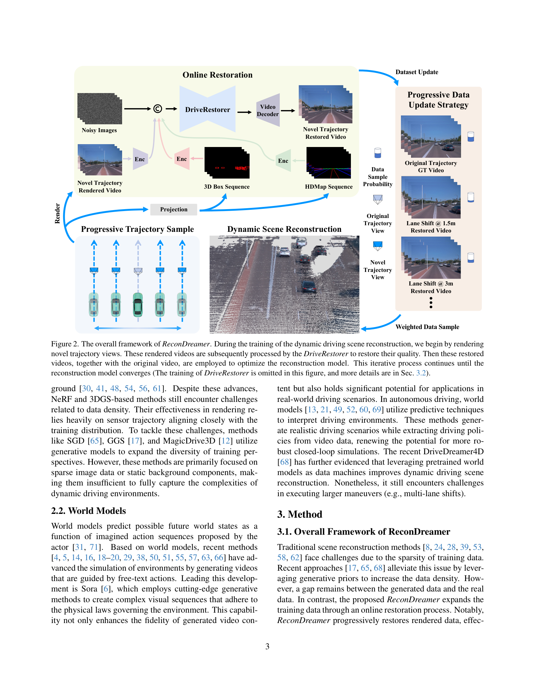
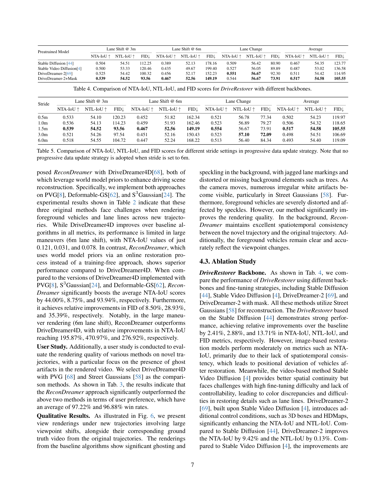
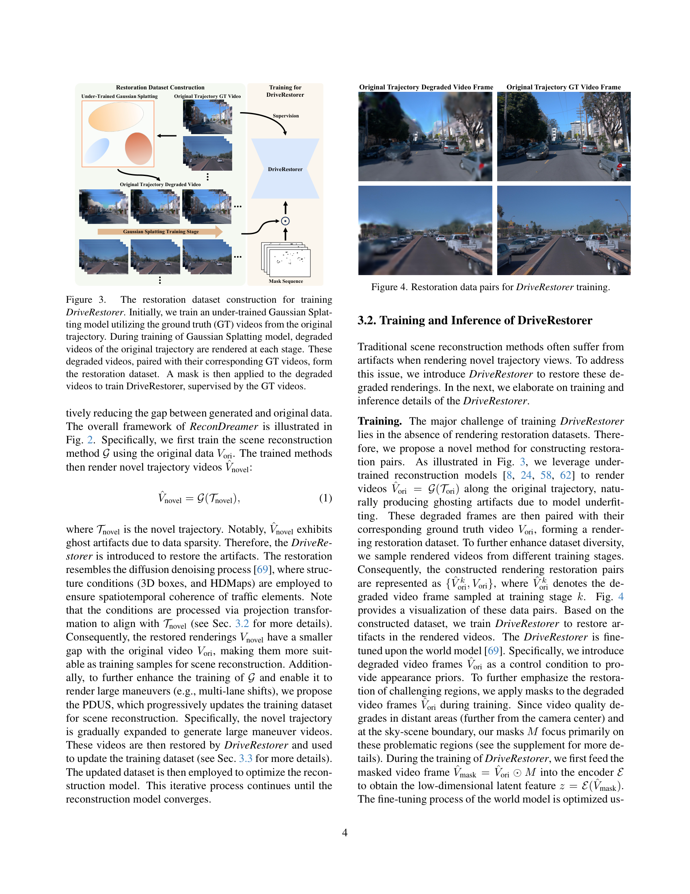
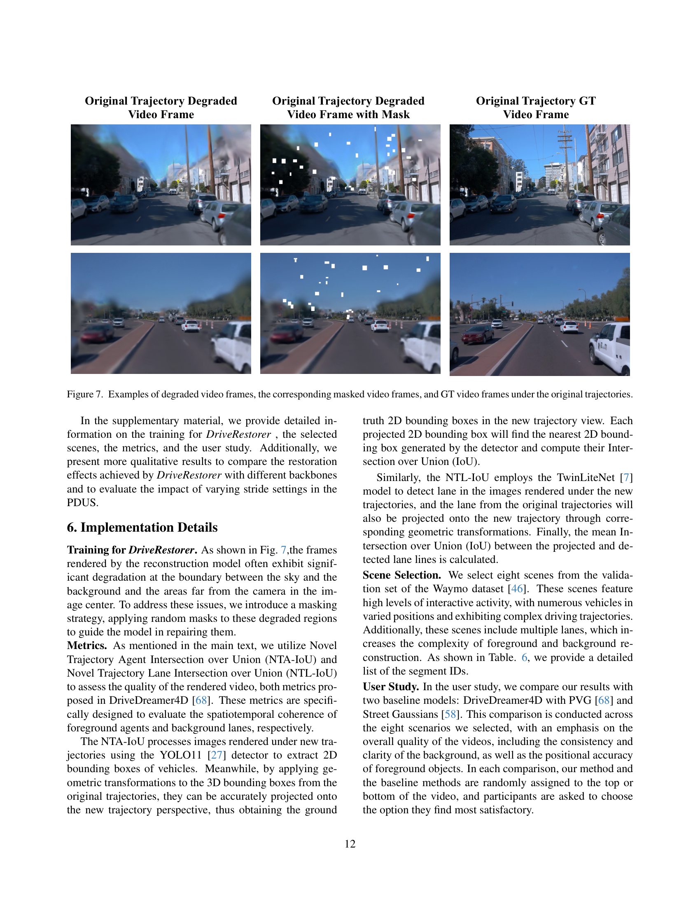
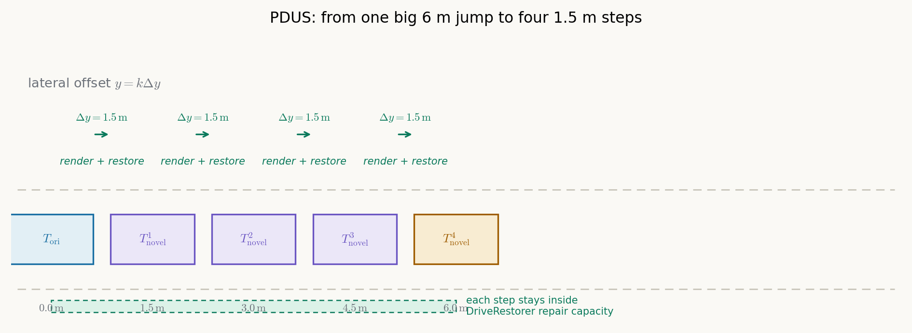
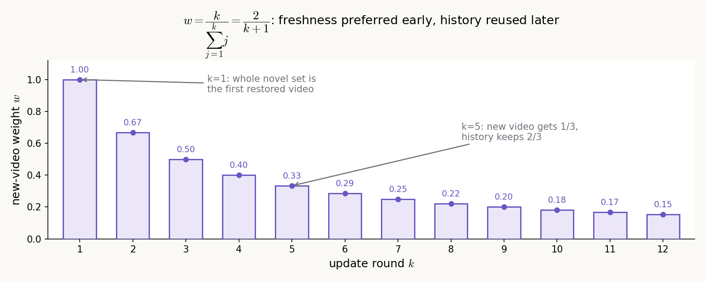
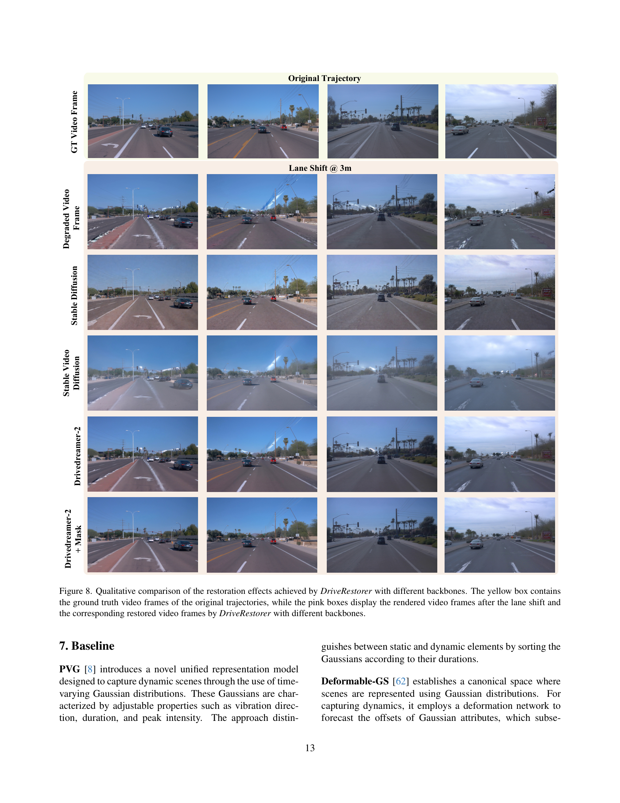
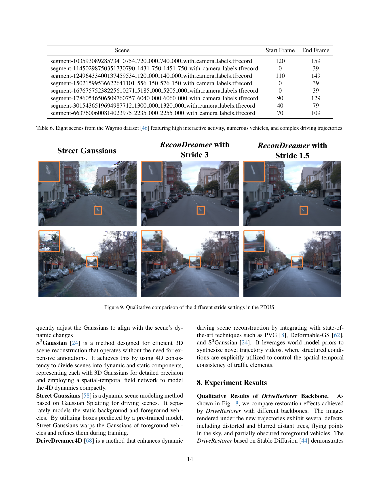

# 把 6 米拆成四次 1.5 米：ReconDreamer 用"在线修复 + 渐进外推"把世界模型揉进驾驶重建

## 信息块

- **全局编号**：68
- **论文标题**：ReconDreamer: Crafting World Models for Driving Scene Reconstruction via Online Restoration
- **作者**：Chaojun Ni*、Guosheng Zhao*、Xiaofeng Wang*、Zheng Zhu（共同一作、通讯）、Wenkang Qin、Guan Huang（GigaAI）；Chen Liu、Yuyin Chen、Yida Wang、Xueyang Zhang、Yifei Zhan、Kun Zhan、Peng Jia、Xianpeng Lang（Li Auto Inc.）；Xingang Wang（CASIA）；Wenjun Mei（Peking University，通讯）。共 16 人。
- **会议/年份**：CVPR 2025（pp. 1559–1569）
- **链接**：arXiv https://arxiv.org/abs/2411.19548（v1，2024-11-29 提交）｜项目页 https://recondreamer.github.io
- **代码是否公开**：官方代码已公开，https://github.com/gigaai-research/recondreamer（227 stars，26 commits）。但公开范围有限：只有渲染推理（render.py）、NTA-IoU 评测脚本、预训练权重下载链接；**DriveRestorer 的训练代码和 PDUS 训练管线代码没有公开**。论文 3.2 节写的训练方法无法从代码核对，本文涉及训练细节的判断全部以论文文字为准。
- **一句话核心洞见**：别把世界模型当一次性"数据机"去凭空生成大偏移视角的视频，而把它微调成一个专修重建鬼影的"在线修复工"，再把 6 米的大机动拆成 1.5 米一步的小步渐进外推——每一步的修复任务都落在修复器的能力范围内，增量式地把世界模型知识揉进 3D 高斯重建。

---

## 新轨迹上那团"鬼影"到底是什么

先看论文图 1 和图 6（出自论文第 1、8 页）。同一段 Waymo 街景：原轨迹视角下 Street Gaussians 渲染得干净利落；把相机横向平移 6 米（Lane Shift @ 6m）再渲染，画面里出现的东西作者称之为 ghosting artifacts——背景里树的边缘拖出半透明重影，天空和远处飘着不规则的白色斑点，车道线变成锯齿，前景车辆被拉扯变形、表面布满噪点。

这团鬼影不是随机噪声，它有一个具体的成因。先看两张原图（论文第 1 页图 1、第 8 页图 6）：

3D 高斯重建的训练数据是自车实际开过的那条轨迹：一组相机位姿加对应的图像。高斯点的参数（位置、形状、颜色、透明度）只在"被这些位姿看见过"的约束下被优化。当你把相机横移 6 米，很多像素对应的 3D 位置在训练时要么从没被任何相机以这个角度看过，要么只被掠射角很小的视角看过。优化在这些区域是欠约束的：高斯点可以长成任何"在原视角下投影正确"的形状——比如沿着原视线方向拉长的细长椭球。原视角下它们投影成正确的像素，新视角下一转，细长椭球的侧面露出来，就成了半透明的重影。离相机越远、视角变化越大，欠约束越严重，所以鬼影集中在远处和天空交界处。论文附录图 7（第 12 页）把这一点拍得很直白：退化最重的就是天空-背景边界和图像中心远处。

理解了这个成因，就理解了为什么"多加数据"这条路天然难走：你缺的不是更多原轨迹数据，而是新轨迹视角的监督。而新轨迹视角的真值，你永远拿不到——车只开过一次。这是整篇论文的问题起点：**如何在没有真值的新视角上，给重建模型提供靠谱的监督信号**。

## DriveDreamer4D 的"数据机"思路为什么在大机动上不够

在 ReconDreamer 之前，同一个团队的 DriveDreamer4D（arXiv:2410.13571，本文参考文献 [68]）已经给出了一个答案：用预训练好的驾驶世界模型当"数据机"（data machine）。做法是 training-free 的：拿世界模型直接生成新轨迹视角的视频，结构条件（3D 框、HDMap）投影到新视角上保证交通元素的时空一致，然后把这些生成视频当作伪真值去监督重建模型训练。一次生成、一次使用，不微调世界模型，不迭代。

这个思路在 3 米以内的偏移上是有效的。但论文表 2 给了它在 6 米上的成绩单：DriveDreamer4D 接 PVG，Lane Shift @ 6m 的 NTA-IoU 是 0.121；接 S3Gaussian 是 0.031；接 Deformable-GS 是 0.078。作为对比，ReconDreamer 在这三组上分别是 0.358、0.177、0.294。注意 0.031 这个数字——它几乎意味着前景车辆的渲染在新视角下完全不可用。

为什么一次生成走不通？想一个具体的画面：你要世界模型生成"相机横移 6 米后的视频"。6 米是两条车道的宽度。原视角下被前景车辆挡住的背景，在新视角下要凭空出现；原视角下在画面边缘的车道线，在新视角下要移到画面中央且几何精确。世界模型确实有驾驶先验，能画出"看起来像街景"的视频，但它没有这条街的真实几何记忆。3D 框和 HDMap 的结构条件能约束"车在哪、线在哪"的大体位置，却约束不了像素级的纹理和遮挡关系。偏移越大，需要"凭空补"的内容越多，生成视频与真实场景几何的偏差越大。拿偏差大的伪真值去监督重建，等于用错的答案教模型——这就是 training-free 融合在大机动上的结构性上限：**世界模型的单次生成质量，撑不起大偏移视角所需的几何精度**。

作者在这里的判断很关键，而且我认为是对的：问题不在"用不用世界模型"，而在"怎么用"。DriveDreamer4D 把世界模型当作一次性外挂；ReconDreamer 赌的是另一条路——**让世界模型学会"修复"而不是"生成"，并且每次只修一小步**。

## 作者真正的赌注：欠拟合是最好的数据机

DriveRestorer 训练最大的障碍，按常理是一个死结：你要训练一个"修复重建鬼影"的模型，就需要大量"（鬼影图，真值图）"的配对数据。但鬼影只出现在没有真值的新轨迹视角上——有真值的地方（原轨迹）重建得好好的，没有鬼影可修。这是一个先有鸡还是先有蛋的问题。

作者的解法是整篇论文最漂亮的一步，我把它称为"用欠拟合造数据"：

1. 拿原轨迹的真值视频 $V_{\text{ori}}$ 训练一个高斯重建模型 $\mathcal{G}$，但**故意不让它训完**（under-trained）。
2. 在训练过程中的各个阶段 $k$，用这个半成品模型渲染原轨迹视角：$\hat{V}^k_{\text{ori}} = \mathcal{G}_k(\mathcal{T}_{\text{ori}})$。因为欠拟合，这些渲染天然带着鬼影——注意，这里的鬼影和新轨迹上的鬼影成因是同一个：欠约束的高斯点。
3. 配对 $(\hat{V}^k_{\text{ori}}, V_{\text{ori}})$ 就是现成的修复数据对：输入是带鬼影的渲染，监督是同一视角的真值。论文第 4 页图 3/图 4 展示了这个构造管线和数据对示例：

这个构造的妙处在于三点。第一，数据无限：训练过程中的每个 checkpoint 都能渲染出一批退化视频，退化程度还各不相同（早期 checkpoint 鬼影重、晚期轻），天然覆盖了"修复难度"的谱系，相当于免费的课程学习（curriculum）。第二，配对是像素对齐的：输入和监督是同一视角，不存在生成式数据机的几何偏差问题。第三，它绕开了人工标注——Waymo 的 8 个场景、每个 40 帧，全部自动构造。

当然这里有一个作者没有明说的假设，也是这篇论文最大的方法论赌注：**原轨迹上"欠拟合造成的鬼影"和新轨迹上"视角偏移造成的鬼影"，在分布上足够接近，修好前者就能修好后者**。论文没有任何实验直接验证这个分布差距——比如拿修复器去修新轨迹渲染、对比修原轨迹欠拟合渲染的效果差异。图 5（第 5 页）展示了修复器在新轨迹上的修复例子，视觉上鬼影确实少了，但这只是定性证据。从机制上看，两种鬼影都是"欠约束高斯点在错误视角下的投影"，纹理形态相似，这个假设是合理的；但"合理"不等于"被验证"。如果你要复现或改进，这是第一个值得做对照实验的地方：构造两类退化输入，测修复器在两类上的 PSNR/SSIM 差距。

## DriveRestorer 到底在学什么：把公式翻译成动作

DriveRestorer 本体是微调后的 DriveDreamer-2（参考文献 [69]，一个带 3D 框和 HDMap 结构条件的驾驶视频扩散世界模型）。训练流程按论文 3.2 节，拆成四步：

**第一步，掩码。** 对退化帧 $\hat{V}_{\text{ori}}$ 施加掩码 $M$，得到 $\hat{V}_{\text{mask}} = \hat{V}_{\text{ori}} \odot M$。掩码的重点是论文反复强调的难修区域：天空与场景的交界、远离相机中心的远处。附录第 12 页图 7 展示了退化帧、掩码帧、真值帧三者的样子：

附录第 12 页说得很实在：渲染模型在这些区域退化最严重，所以用随机掩码盖住它们，逼模型去修。注意这里的逻辑和 MAE 那类"随机遮挡学表示"不一样：掩码不是为了学通用表示，而是**把训练的火力集中到最难的区域**——因为简单区域（近处路面、清晰车辆）欠拟合模型本来就渲染得不错，不值得花容量。

掩码的具体生成方式论文没有给出算法细节（形状是矩形块还是按深度/语义分割的区域？随机比例是多少？），附录图 7 只给了示例。这是未确认项之一。

**第二步，编码。** $\hat{V}_{\text{mask}}$ 进编码器 $\mathcal{E}$ 得到低维 latent $z = \mathcal{E}(\hat{V}_{\text{mask}})$。$z$ 的形状论文没写，按 DriveDreamer-2/Stable Video Diffusion 的惯例，是视频 latent：$(\text{batch}, \text{channels}, \text{frames}, h, w)$，空间下采样 8 倍。掩码后的退化帧在这里扮演"外观先验"（appearance prior）的控制条件——告诉扩散模型"这条街大概长这样，你负责把鬼影擦掉、把纹理补实"。

**第三步，结构条件投影。** 3D 框序列和 HDMap 序列经编码器编码后，通过投影变换 $\mathcal{P}(s, \mathcal{T}^k_{\text{novel}})$ 对齐到目标轨迹视角。这里的 $s$ 是结构条件。投影变换的本质是刚体几何：3D 框的 8 个角点按新相机外参重新投影，HDMap 的车道线点集做同样的变换。它的作用是给修复过程一个"几何锚点"：车应该在像素的哪个位置、车道线应该往哪个方向走，不由扩散模型自由发挥。这就是为什么表 4 里 DriveDreamer-2 骨干比 Stable Video Diffusion 的 NTA-IoU 高 4.93%、NTL-IoU 高 2.64%——图像/无条件视频模型修完之后车的位置会飘（附录第 15 页的原话：修好的前景车辆出现在错误的位置，甚至颜色都变了，红色变灰色），而结构条件把位置钉住了。

**第四步，扩散去噪损失。** 公式 (2)：

$$\mathcal{L}_{\mathcal{R}} = \mathbb{E}_{z, \epsilon \sim \mathcal{N}(0,1), t}\left[\|\epsilon_t - \epsilon_\theta(z_t, t, \mathbf{c})\|_2^2\right]$$

这就是标准的扩散模型去噪目标，没有新东西：$z_t$ 是第 $t$ 步加噪后的 latent，$\epsilon_\theta$ 是去噪网络，$\mathbf{c}$ 是控制条件（三元组：掩码退化视频 $\hat{V}_{\text{mask}}$、3D 框、HDMap）。训练时网络看带噪 latent $z_t$，目标是预测加进去的噪声 $\epsilon_t$。推理时反向跑这个去噪过程，从噪声出发、在 $\mathbf{c}$ 的约束下生成修复后的视频。论文 3.2 节的推理公式 (3)：

$$V_{\text{novel}} = \mathcal{R}(\hat{V}_{\text{novel}}, \mathcal{P}(s, \mathcal{T}^k_{\text{novel}}))$$

输入是重建模型在新轨迹上的带鬼影渲染 $\hat{V}_{\text{novel}}$ 加对齐到新轨迹的结构条件，输出是修复后的视频 $V_{\text{novel}}$。

这里有一个值得停下来想的问题：**为什么是"修复"而不是"直接生成"？** 从扩散模型的视角看，两者的区别在于条件的强度。直接生成时，条件只有 3D 框+HDMap+文本，模型要在巨大的外观空间里采样，结果多样但几何不准。修复时，条件里多了一个 $\hat{V}_{\text{novel}}$——重建模型的渲染虽然有鬼影，但它的底层几何（哪栋楼在哪、路怎么走）是对的，因为高斯点的 3D 位置是从真值优化来的。修复任务的本质是"保几何、换纹理"：扩散模型不需要发明场景，只需要把鬼影纹理替换成合理的街景纹理。这是一个容易得多的任务，所以它在大偏移下依然 work。这就是"在线修复"这个名字的实质：**用重建模型的几何保真度，换世界模型的外观合理性，各取所长**。

## 6 米走不通，就走四次 1.5 米：PDUS 的真实机制

就算有了 DriveRestorer，直接让它修 6 米偏移的渲染依然会失败。论文 4.3 节的原话是：过大的步长导致新轨迹渲染的噪声和鬼影"超出 DriveRestorer 的修复能力"（exceeding the restoration capacity）。修复器不是万能的——它的训练数据是原轨迹上的欠拟合鬼影，当输入的退化程度远超训练分布，扩散模型会开始"自由发挥"，修出几何错误的内容。

Progressive Data Update Strategy（PDUS，算法 1）是作者给这个能力边界配的"脚手架"。它的逻辑用一句话说：**不要一次跳 6 米，每次只跳 1.5 米，跳完用修复好的视频更新训练集，再跳下一步**。下图把这个过程画了出来：

具体流程（对照论文算法 1）：

1. 混合数据集初始化为 $\mathcal{D} = 0.5\,\mathcal{D}_{\text{ori}} \cup 0.5\,\mathcal{D}_{\text{novel}}$，一半原轨迹真值，一半新轨迹修复视频。
2. 第 $k$ 轮更新：新轨迹横向偏移设为 $y = k\Delta y$，即 $\mathcal{T}^k_{\text{novel}}.y = \mathcal{T}_{\text{ori}}.y + k\Delta y$。$\Delta y$ 是步长（stride）。
3. 重建模型 $\mathcal{G}$ 渲染 $\hat{V}_{\text{novel}} = \mathcal{G}(\mathcal{T}^k_{\text{novel}})$，DriveRestorer 修复得 $V_{\text{novel}} = \mathcal{R}(\hat{V}_{\text{novel}})$。
4. 按权重更新新轨迹数据集：$\mathcal{D}_{\text{novel}} \leftarrow (1-w)\cdot\mathcal{D}_{\text{novel}} \cup w\cdot V_{\text{novel}}$，其中 $w = k / \sum_{j=1}^{k} j$。
5. 用更新后的混合数据继续优化重建模型，直到收敛。

这里有两个细节值得展开。

**第一个细节：权重 $w$ 的真实形状。** 论文公式 (4) 写 $w = k/\sum_{j=1}^{k}j$。分母是等差数列求和，$\sum_{j=1}^{k}j = k(k+1)/2$，所以 $w = 2/(k+1)$。代入几个值：$k=1$ 时 $w=1$，$k=2$ 时 $w=2/3$，$k=3$ 时 $w=0.5$，$k=5$ 时 $w=1/3$（见本文自绘 `fig-weight.png`）。这个设计的含义是：**早期的更新轮次，新修复的视频几乎完全替换数据集；越往后，历史积累的数据占比越高**。为什么这样设计是合理的？第 1 轮时 $\mathcal{D}_{\text{novel}}$ 里还没有任何修复视频，$w=1$ 是唯一有意义的选择。越往后，重建模型本身已经被之前几轮的修复视频"喂"得越来越好，渲染质量在提升，单轮新视频的边际价值在下降，所以权重衰减。这是一个"新鲜度优先、后期求稳"的调度，和课程学习的精神一致。

但这里论文的记号有一个小坑：公式里的 $\cup$ 不是集合并，而是**按概率混合采样**——训练时以 $1-w$ 的概率从旧 $\mathcal{D}_{\text{novel}}$ 采样、以 $w$ 的概率从新 $V_{\text{novel}}$ 采样。把它读成集合的并会误解为数据集无限膨胀。$w(k)$ 的形状如下：

**第二个细节：步长 1.5 米是搜出来的甜点，不是拍脑袋的。** 表 5 试了 $\Delta y \in \{0.5, 1.0, 1.5, 3.0, 6.0\}$ 米。注意 $\Delta y = 6.0$ 米等价于禁用 PDUS（一步到位）。结果：1.5 米最优（平均 NTA-IoU 0.517）；0.5 米和 1.0 米反而让 NTA-IoU 下降 2.90% 和 2.13%、FID 变差 13.66% 和 12.41%；3.0 米和 6.0 米更差。为什么步长太小也不好？一个合理的解释：步长太小意味着更新轮次多、每轮引入的新视角增量信息少，而每一轮的修复-重训练循环都会引入一点扩散模型的幻觉噪声；轮次多了，噪声累积超过了增量信息的价值。这是一个典型的"步长太大修不动、步长太小噪声攒得多"的权衡，1.5 米是这个数据集和这个修复器能力下的平衡点。换一个修复器、换一个场景复杂度，最优点会挪——论文没有给敏感性曲线，这是未确认项。

还有一个论文没有明说的点：PDUS 的更新间隔 $S$（算法 1 里 `for t in Range(0, T, S)`）和总训练步数 $T$ 的具体数值，正文和附录都没有给。基线统一训 50000 iteration，但 ReconDreamer 的重建模型在 PDUS 循环里实际跑了多少步、每 $S$ 步才做一次"渲染-修复-更新"？如果 ReconDreamer 的总训练量显著大于基线的 50000 步，那么表 1 里对 Street Gaussians 的提升就有一部分来自"训得更久"。论文没有交代，审稿人视角下这是一个缺口。

## 损失函数里藏着的一句实话：新轨迹数据为什么不用深度

重建模型的混合训练损失是公式 (5)–(7)：

$$\mathcal{L}_{\text{ori}}(\phi) = \lambda_1\mathcal{L}_{\text{ori}}^{\text{RGB}} + \lambda_2\mathcal{L}_{\text{ori}}^{\text{Depth}} + \lambda_3\mathcal{L}_{\text{ori}}^{\text{SSIM}}$$

$$\mathcal{L}_{\text{novel}}(\phi) = \lambda_1\mathcal{L}_{\text{novel}}^{\text{RGB}} + \lambda_3\mathcal{L}_{\text{novel}}^{\text{SSIM}}$$

$$\mathcal{L}(\phi) = \mathcal{L}_{\text{ori}} + \mathcal{L}_{\text{novel}}$$

$\phi$ 是高斯参数。注意 $\mathcal{L}_{\text{novel}}$ 里**没有深度项**——论文说这是沿用 DriveDreamer4D 的 depth-free 训练策略。原因很直白：新轨迹视角没有真值深度。原轨迹的深度监督来自激光雷达点云投影；新轨迹是虚拟相机位姿，没有对应的雷达帧。如果硬要用深度，只能拿重建模型自己渲染的深度当伪真值，那等于用自己的输出监督自己，深度误差会被放大。所以干脆去掉，让 RGB 和 SSIM 去约束外观，几何靠原轨迹数据的深度项和结构先验兜底。

这是一个诚实且正确的工程判断，但它也划出了方法的能力边界：新轨迹数据只提供**外观监督**，不提供几何监督。前景车辆在新视角下的 3D 位置精度，完全依赖 DriveRestorer 修复时结构条件的投影精度。这也解释了为什么 NTA-IoU（前景车辆指标）是大机动下最难提的指标——表 2 里 6 米偏移上最好的绝对值也只有 0.358。

$\lambda_1, \lambda_2, \lambda_3$ 的具体数值论文没有给出（Street Gaussians 原论文有默认值，但本文混合训练是否沿用、是否调过，未说明）。未确认。

## 195.87% 是怎么算出来的：把评测设定拆开看

摘要里最抓眼球的数字是"相对 DriveDreamer4D with PVG，在大机动渲染上 NTA-IoU 相对提升 195.87%"。先验算：表 2，Lane Shift @ 6m，DriveDreamer4D with PVG 的 NTA-IoU = 0.121，ReconDreamer with PVG = 0.358，$(0.358-0.121)/0.121 = 195.87\%$。数字本身是对的。但一个认真的读者要问三个问题。

**第一，相对提升的分母有多小？** 0.121 是一个很低的基线——它意味着 DriveDreamer4D 在 6 米偏移上前景车辆基本不可用。同一个表里，S3Gaussian 那一组是 0.031 → 0.177，相对提升 470.97%；Deformable-GS 那组是 0.078 → 0.294，相对提升 276.92%。相对数字越大，越说明基线崩得越彻底，而不是方法越强。真正的信息在绝对值里：ReconDreamer 在 6 米上最好的 NTA-IoU 是 0.358（PVG 骨干）到 0.467（Street Gaussians 骨干）。0.467 意味着什么？NTA-IoU 的定义（附录第 12 页）是：在新轨迹渲染图上用 YOLO11 检测车辆 2D 框，把原轨迹的 3D 框经几何变换投影到新视角得到 GT 框，每个 GT 框找最近的检测框算 IoU。0.467 的平均 IoU，作为"渲染质量"的代理指标，说明车辆位置大体对、但框的精度远谈不上好。这个水位离"可用于闭环仿真训练规划器"还有距离——规划器要的是像素级可信的传感器流，0.467 的检测 IoU 只是"比崩了强"的水平。

**第二，NTA-IoU/NTL-IoU 的评测链条里混进了检测器的误差。** 这个指标 = 渲染质量 × 检测器性能 × 投影精度。三者是乘积关系：YOLO11 在合成渲染图上的检测性能本身就低于真实图（域差距），TwinLiteNet 的车道线检测在鬼影图上也会失效。所以指标的下降里，有一部分是"检测器在烂图上测不准"，而不是"渲染真的差到那个程度"；反过来，指标的提升里也有一部分是"图变干净了检测器好测了"。论文没有做"在真值图上跑检测器"的对照来标定检测器本身的上限，指标的绝对值解读要打折扣。公平地说，这是 DriveDreamer4D 定下的评测协议（论文明确说 follow [68]），在这个协议下横向对比是可比的；但跨论文引用这些绝对值时要小心。

**第三，user study 的设计信息不足。** 表 3：ReconDreamer 对 Street Gaussians 平均胜率 97.22%，对 DriveDreamer4D with PVG 平均胜率 96.88%，6 米偏移上两组都是 100%。附录第 12 页描述了流程：8 个场景、两种基线、两种方法视频随机上下排布、参与者选更满意的（看背景一致性、清晰度、前景位置精度）。但缺了关键信息：参与者人数、每人评多少对、是否去重、显著性检验。在没有这些信息之前，user study 只能当定性佐证，不能当定量证据。未确认。

还有一个评测范围的边界需要明确：**"首个有效渲染大机动"这个说法，只在论文自己的实验设定里成立**。验证范围是：Waymo 验证集 8 个高交互场景、每个 40 帧、只用前视相机、三种新轨迹（横移 3 米、横移 6 米、一次变道）。没有纵向大位移、没有急转弯/掉头、没有雨夜逆光、没有多相机一致性验证。"大机动"在本文语境下 = 横向 6 米。把这个结论外推到"任意大机动"是不成立的。

## 承重结构 vs 装饰：消融表告诉我们什么

表 4（DriveRestorer 骨干消融，基线 Street Gaussians，平均指标）：

| 骨干 | NTA-IoU | NTL-IoU | FID |
|---|---|---|---|
| Stable Diffusion（图像修复） | 0.467 | 54.35 | 123.77 |
| Stable Video Diffusion（视频，无结构条件） | 0.487 | 53.02 | 136.58 |
| DriveDreamer-2（视频+3D框/HDMap） | 0.511 | 54.42 | 114.95 |
| DriveDreamer-2 + Mask | 0.517 | 54.58 | 105.55 |

从 Stable Diffusion 到 DriveDreamer-2+Mask，NTA-IoU 从 0.467 到 0.517。增量拆解：视频建模（SD→SVD）+0.020，结构条件（SVD→DriveDreamer-2）+0.024，mask +0.006。**结构条件是承重的那一块**：它贡献了和视频建模相当的增量，而且从机制上它是唯一解决"修复后车辆位置飘移"的部件（附录第 15 页的定性对比：无结构条件的修复会把红车修成灰车、把车修到错误位置）。附录图 8（论文第 13 页）并排展示了四种骨干的修复效果，位置飘移和颜色偏差在图上直接可见：

Mask 的 +0.006 是锦上添花——它只在天空/远处这些特定区域起作用，全局平均指标上自然不显眼，但定性图（附录图 8）显示它确实修掉了天空的飞点。

表 5（步长消融）前面已经分析过：1.5 米最优，且 6.0 米（=禁用 PDUS）是最差的。**PDUS 本身是第二个承重结构**：去掉它（stride=6），平均 NTA-IoU 从 0.517 掉到 0.493，NTL-IoU 从 54.58 掉到 54.40。掉得不多，但方向明确。论文第 14 页图 9 展示了 stride=1.5 与 stride=3 在车道线和远景重建上的定性差异：

那么什么是装饰？公式 (2) 的扩散损失是标准去噪目标，没有方法论增量；公式 (5)–(7) 的混合损失是 Street Gaussians 原损失 + DriveDreamer4D 的 depth-free 策略的拼接；掩码策略的"随机掩码盖难区"是一个直觉正确但细节未交代的技巧。整篇论文真正的增量就是两件：**欠拟合造数据的 DriveRestorer + 渐进外推的 PDUS**。其余都是为了让这两件 work 而配的脚手架。作者把贡献列表写成三条是写给审稿人看的；读者应该知道，拿掉 DriveRestorer 或 PDUS 任一件，这篇论文就站不住，拿掉其余任何一件，它都还成立。

## 论文没有说清楚的地方（诚实清单）

1. **DriveRestorer 训练超参数**：微调的学习率、步数、batch size、掩码比例与生成算法，正文和附录都没有。官方代码又没有公开训练部分，所以**这部分完全不可复现**，只能按论文文字理解意图。这是本文最大的信息缺口。
2. **PDUS 的 $T$ 和 $S$**：总训练步数和更新间隔未给出；ReconDreamer 重建模型的实际总训练量是否与基线的 50000 iteration 对齐，未说明。表 1 的提升里有多少来自"训得更久"，无法排除。
3. **$\lambda_1, \lambda_2, \lambda_3$**：混合损失权重未给出。
4. **User study 样本量**：参与者人数、每对比较的票数、显著性，未给出。100% 胜率无法评估含金量。
5. **两类鬼影的分布差距**：DriveRestorer 训练于原轨迹欠拟合退化，推理于新轨迹视角偏移退化，论文没有量化这两类输入的分布距离。这是方法成立的核心假设，却没有任何直接证据。
6. **结构条件投影 $\mathcal{P}$ 的细节**：论文说"与 [69] 类似，详见附录"，但附录里并没有展开投影变换的具体实现。未确认。
7. **只用前视相机**：多相机（Waymo 有 5 个）的跨相机一致性没有验证；40 帧短段上的结论外推到长序列，需要打折扣。

公平地说，第 5、7 条是领域内大家都这么做的标准做法（单前视、短段评测），不算这篇论文独有的问题。但第 1、2 条——训练代码不公开 + 关键超参数不写——意味着这篇论文的**复现门槛实际上很高**，第三方复现只能复现渲染评测部分，复现不了训练。这是读者在引用这篇工作时应该知道的真实水位。

## 能带走的两个想法

**想法一：用"欠拟合"当免费的数据增强器。** 训练修复/去噪模型最缺的是"（退化，真值）"配对。ReconDreamer 的思路是：任何一个没训好的生成/重建模型，它的中间 checkpoint 输出天然就是"退化版本"，而真值你手里本来就有。这个技巧不局限于驾驶重建——任何"推理时输入分布会漂、但漂移形态和欠拟合形态相似"的任务都能用。比如你的 rollout 风险校验里，如果用一个渲染器/预测器生成未来帧，它的早期 checkpoint 输出可以批量构造"退化-真值"对，用来训练一个轻量的在线质量修复器或质量判别器。关键判断只有一条：推理时的退化形态和欠拟合的退化形态是否同构。

**想法二：把"一步到位"拆成"多步小修"，每步都落在模型的能力半径内。** PDUS 的本质是任务分级：6 米一次跳修复器修不动，1.5 米四次跳每步都修得动。这个模式可以迁移到任何"生成/修复难度随偏移量单调增长"的场景。形式化一点：设修复器的能力半径是 $\rho$（能修好的最大退化程度），目标偏移是 $D$，朴素做法要求 $\rho \ge D$；PDUS 把它变成 $\lceil D/\Delta y \rceil$ 步、每步要求 $\rho \ge \delta(\Delta y)$，其中 $\delta$ 是单步引入的新退化。只要 $\delta(1.5\text{m}) \le \rho < \delta(6\text{m})$，分级就严格优于一步到位。表 5 的步长消融就是这条不等式的实证。

## 与本课题的关联

你的课题是"世界模型引导 + 自适应衰减情景记忆的闭环多规划器 Agent"：世界模型预测未来 T 步交通状态作调度先验，对候选动作 rollout 输出量化风险分数做仲裁和拦截。ReconDreamer 与你课题的咬合点在两个地方。

**第一，rollout 风险校验的渲染质量问题。** 你的仲裁器要对"候选动作"做 rollout——候选动作里必然包含偏离当前轨迹的大机动（变道、避让）。如果你用重建/渲染的方式生成这些候选动作的未来观测，恰好会撞上 ReconDreamer 解决的同一个问题：新轨迹视角的渲染鬼影。鬼影会污染风险分数——一个被鬼影遮挡的行人、一条被锯齿化的车道线，都可能让风险判别器误报或漏报。ReconDreamer 给你的启发不是"照搬 DriveRestorer"（它太重：视频扩散微调 + 迭代重训练，不符合你的时延优化目标），而是它的**问题分解方式**：把"几何保真"（重建模型负责）和"外观合理"（世界模型负责）解耦。你的风险校验可以走更轻的路线——不需要像素级修复，只需要在**风险分数层面**对渲染不可靠的区域降权：比如用重建时的视角偏移量、深度不确定性，估计每个像素/每个检测框的可信度，让风险仲裁器对低可信度区域的"危险信号"打折扣、对"安全信号"不轻信。这比修图便宜一个数量级，且直接服务于仲裁。

**第二，ReconDreamer-RL 这条后续路线值得你跟踪。** 同一团队 2025 年 8 月放出了 ReconDreamer-RL（arXiv:2508.08170，目前 ICLR 2026 在审，官方代码 https://github.com/gigaai-research/recondreamer-rl 已公开）：ReconSimulator（视频扩散先验管外观 + 运动学模型管物理）+ Dynamic Adversary Agent（自动调整周围车辆轨迹生成 cut-in 等 corner case）+ Cousin Trajectory Generator（解决训练数据直行偏差）。相对模仿学习方法，碰撞率降低 5 倍。这条路线的核心判断和你的课题是一致的：**闭环训练/验证需要能渲染"策略自己开出来的轨迹"的仿真器，而开环数据永远给不了这个**。你的 Bench2Drive 闭环验证如果要引入世界模型做调度先验，ReconDreamer-RL 的 DAA（对抗车辆生成长尾场景）是一个可以直接借鉴的设计——你的情景记忆检索的是历史相似案例，DAA 是主动生成历史里没有的 corner case，两者互补：记忆管"见过"的，DAA 管"没见过但危险"的。建议把 ReconDreamer-RL 列入你的精读清单（它是本系列的第 69 篇候选）。

一句话收束：ReconDreamer 的真正贡献不是"又一个渲染指标的提升"，而是示范了一种**把世界模型从"离线数据机"改造成"在线修复工"**的用法——当你发现世界模型一次性生成的东西不够准时，别急着换更大的模型，先问能不能把它放在一个迭代循环里、每次只让它干能力半径内的活。这个判断，在你的 rollout 风险校验和调度器设计里同样适用。
