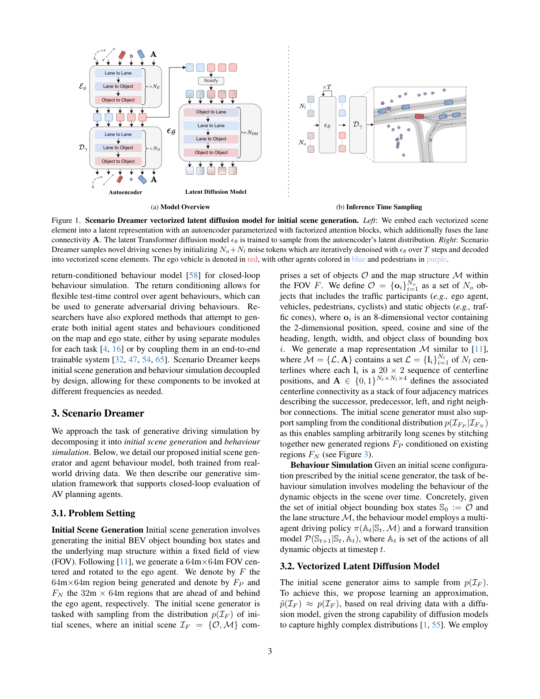
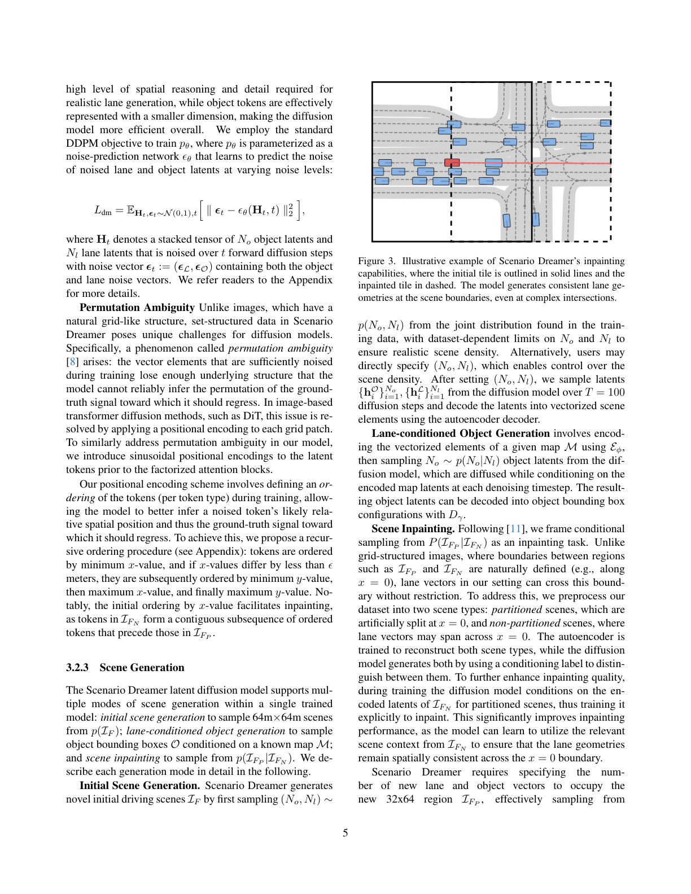
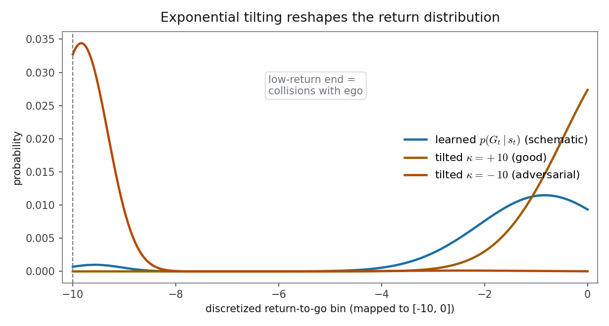

# 场景不是一张图，而是一组向量：在图元潜空间里做扩散的驾驶仿真器

> **全局编号 65** ｜ Scenario Dreamer: Vectorized Latent Diffusion for Generating Driving Simulation Environments
>
> **作者**：Luke Rowe, Roger Girgis, Anthony Gosselin, Liam Paull, Christopher Pal, Felix Heide（Mila / Université de Montréal / Polytechnique Montréal / Princeton / CIFAR / Torc Robotics）
>
> **会议**：CVPR 2025 ｜ **arXiv**：2503.22496（2025-03-28 提交，v1）
>
> **链接**：[摘要页](https://arxiv.org/abs/2503.22496) ｜ [PDF](https://arxiv.org/pdf/2503.22496) ｜ [项目页](https://princeton-computational-imaging.github.io/scenario-dreamer)
>
> **代码**：公开，官方仓库 https://github.com/princeton-computational-imaging/scenario-dreamer（含模型、训练、仿真、数据处理脚本与预训练模型下载链接；本文核对过代码，差异见第 13 节）
>
> **一句话核心洞见**：驾驶场景的自然表示是一组向量图元（车道中心线、物体框）而不是一张栅格图像——直接在图元的潜空间里做扩散，参数和算力只花在"有东西"的地方；车道连通性显式学出来，行为则交给一个 return-conditioned 的自回归 Transformer，测试时用指数倾斜把行为拧向对抗。

## 栅格化编码到底浪费在哪：先算一笔像素的账

在 Scenario Dreamer 之前，SLEDGE（ECCV 2024）和 DriveSceneGen（RA-L 2024）的做法是：把 64m×64m 的驾驶场景"画"成一张俯视栅格图，在这张图上训 latent diffusion，生成后再用后处理把栅格向量化回车道图和物体框。

浪费是具体的。一张这样的栅格图里，真正有信息的只有几条细细的车道中心线像素带和几个小矩形物体框，其余大片是空像素。但 SLEDGE 最大的 DiT-XL 有 769M 参数、28 层 Transformer，对每个 patch 做注意力时，空像素的 token 照样参与 QK 点积、照样分走参数和 FLOPs。论文摘要把这句话放在了最显眼的位置：栅格编码需要参数臃肿的网络，在大量空像素上做无用功。

还有一层更隐蔽的代价：栅格→向量的后处理本身就会引入误差。作者在 Waymo 上没能把 DriveSceneGen 的扩散模型训收敛，于是做了一个"特权版"基线——直接拿真值场景栅格化、再走一遍 DriveSceneGen 的向量化后处理，这相当于给后处理开了作弊器。结果这个特权版的 FD（perceptual Frechet 距离）是 40.59，而 Scenario Dreamer (L) 是 1.38。注意 40.59 对应的是真值数据：即使输入是完美的，光是"从栅格里把车道图抠回来"这一步，就足以把场景搞得面目全非。附录的图 6、图 7 并排展示了这种向量化误差造成的怪异车道构型。

作者的替代方案一句话：别画图了，场景里的每个元素本来就是一个向量。论文第 4 节有一个关键表述：向量化处理下，"each latent corresponds to a scene element"——每个潜变量对应一个场景元素。参数于是直接花在元素之间的关系上，而不是花在"这片空地也是空的"这种无用功上。这是全文的赌注，图 1 就是它的可视化。

## 规则式行为仿真的病：不是不真实，是没有"意外"

SLEDGE 的行为仿真用的是 IDM（智能驾驶员模型）加换道规则。IDM 的毛病不在"不像人"，而在于它是确定性的、参数固定的：同一个场景跑一百次，车流几乎一模一样。你想用它造长尾场景、危险场景，它给不出来——规则模型没有"意外"这个维度。

附录表 5 的数字把这一点说得很实在。在 1000 个 Waymo 测试场景上，IDM 的 planner 碰撞率是 5.8%，而 CtRL-Sim 正倾斜版本是 4.9%。规则式 agent 反而撞得更多：因为 IDM 只按自己的规则跟车道走，根本不看 planner 在干什么，不会配合避让。数据驱动的行为模型至少学会了"别撞上去"这个统计规律。

所以作者要的行为模型有三个要求：数据驱动（从真实驾驶数据学）、多样（同一场景能跑出不同车流）、可控（测试时能拧出对抗行为去为难 planner）。CtRL-Sim（作者自己在 CoRL 2024 的工作）恰好满足这三条，第 9 节会拆开讲它的 return-conditioning 是怎么拧出对抗的。

## 作者押的赌注：车道图本来就是一组 token

先把场景的数学形状写清楚，因为后面所有公式都长在这上面。初始场景 $I_\mathcal{F} = \{\mathcal{O}, \mathcal{M}\}$，$\mathcal{F}$ 是以 ego 为中心旋转对齐的 64m×64m 区域：

- 物体集合 $\mathcal{O} = \{o_i\}_{i=1}^{N_o}$，每个 $o_i \in \mathbb{R}^8$：2 维位置、速度、heading 的 cos 和 sin、长、宽、类别。
- 地图 $\mathcal{M} = \{\mathcal{L}, A\}$，$\mathcal{L} = \{l_i\}_{i=1}^{N_l}$ 是 $N_l$ 条中心线，每条 $l_i \in \mathbb{R}^{20 \times 2}$（20 个点的点列）；$A \in \{0,1\}^{N_l \times N_l \times 4}$ 是四个邻接矩阵，分别表示 successor、predecessor、左邻、右邻四种有向连接。

生成分两阶段。第一阶段训一个低 $\beta$ 的 VAE：编码器 $E_\phi$ 把 $N_o$ 个物体、$N_l$ 条车道分别压成潜变量 $h^\mathcal{O}_i \in \mathbb{R}^8$、$h^\mathcal{L}_i \in \mathbb{R}^{24}$；第二阶段在潜空间里训扩散模型，学分布

$$p(H) = \sum_{N_o, N_l} p(\{h^\mathcal{O}_i\}_{i=1}^{N_o}, \{h^\mathcal{L}_i\}_{i=1}^{N_l} \mid N_o, N_l)\, p(N_o, N_l)$$

$p(N_o, N_l)$ 用训练集统计近似，推理时用户也可以直接指定——"指定视野内的车道数和物体数来控制场景密度"这个功能，就是这么来的。

我推测作者敢押这个注有三张底牌（推断，依据在括号里）：第一，2024 年 SLEDGE 已经证明了"扩散能生成驾驶场景"这条路走得通，剩下的工作是把表示从栅格换成向量——方向明确，工程量大但风险低；第二，作者团队的前作 FJMP、CtRL-Sim 本来就是"向量化场景 + Transformer"的路线，工具箱是现成的（Rowe 是一作的连续工作）；第三，图 1 的组织方式暴露了信心所在——整张图没有任何像素、没有卷积，全是 token 和注意力，作者从第一张图就告诉你：这篇论文的世界里没有图像。三张里最硬的是第一张：站在一个已被验证的范式上，只换表示，不换问题。

## 同一个模型，三种玩法：初始场景、车道条件物体、修复式外推

Scenario Dreamer 的扩散模型只训了一个，却支持三种生成模式。理解它们是同一个机制的三种调用方式，比分别记住三种模式更重要。

**初始场景生成**：采样 $(N_o, N_l)$，初始化 $N_o + N_l$ 个噪声 token，$T=100$ 步去噪，解码成向量元素。这是最直接的用法。

**车道条件物体生成**：给定一张地图 $\mathcal{M}$，只生成物体框。做法是把地图的向量元素用编码器 $E_\phi$ 编成潜变量，扩散时车道 token 直接固定为这些编码值（代码里 `mode='lane_conditioned'` 分支：`x_lane` 每步都被重置为编码潜变量），只对物体 token 去噪。这能成立有一个前提：编码器里**没有** object-to-lane 注意力，车道潜变量不依赖物体特征。正文 3.2.1 明确写了这个设计意图——一个看似"少了点什么"的结构选择，其实是给第二种玩法留的门。

**场景修复式外推（inpainting）**：从 $p(I_{\mathcal{F}_P} \mid I_{\mathcal{F}_N})$ 采样，用已知区域 $\mathcal{F}_N$（32m×64m）向外拼接新区 $\mathcal{F}_P$（32m×64m），从而拼出无界场景。难点在于：栅格图像的边界是天然的（沿 $x=0$ 一刀切），但车道向量可以横跨 $x=0$，没有天然边界。作者的解法是准备两种训练数据：partitioned 场景（人工在 $x=0$ 处切开车道，并在切口处补上 successor/predecessor 连接）和 non-partitioned 场景（车道可自由跨过 $x=0$），用一个 conditioning label 区分两者；对 partitioned 场景，训练时把 $\mathcal{F}_N$ 的 token 固定为无噪声编码潜变量，逼模型学会用上下文保证切口两侧车道几何连续。推理时标准 diffusion inpainting：每步去噪后把 $\mathcal{F}_N$ 的 token 重置为编码值（代码 `p_sample_loop` 的 inpainting 分支就是这么写的）。

把三块拼成无界仿真：生成初始块 → 在车道图上做深度优先遍历选一条路线 → 把场景做 SE(2) 变换平移到路线末端 → inpaint 下一块 → 重复。附录 B.1 说这样能拼出 500 米的路线。注意 500 米是框架能力的上限，论文的 RL 实验只做到 100 米（第 11 节）。

排序 scheme 是 inpainting 能工作的暗线。训练时 token 按"min x 优先，x 差小于 0.5 米再按 min y、max x、max y"的递归规则排序。为什么先按 x？因为 partitioned 场景里，所有 $\mathcal{F}_N$ 的 token 按这个顺序天然排在 $\mathcal{F}_P$ 前面，形成一个连续前缀——inpainting 时"哪些 token 是已知条件"就变成"前缀"，实现起来干净。图 11（论文第 24 页）画了这个排序的例子。

*图 1（论文第 3 页）：左边是 autoencoder——向量元素经 factorized attention 编成潜变量，车道连通性 A 融进注意力；右边是推理采样——$N_o+N_l$ 个噪声 token 经 $T$ 步去噪、解码成向量场景。注意这张图里没有任何卷积和像素。*

## 置换歧义：噪声一大，模型就分不清 token 该回到哪

集合数据没有天然顺序，这是向量化扩散真正的麻烦。训练时前向过程给 token 加噪：$H_t = \sqrt{\bar\alpha_t} H_0 + \sqrt{1-\bar\alpha_t}\,\epsilon_t$。当 $t$ 很大、噪声淹没信号时，token $i$ 的噪声版本和 token $j$ 的噪声版本看起来差不多，模型不知道该往哪个真值回归——这就是从 PolyDiffuse [8] 借来的"permutation ambiguity"（置换歧义）。图像扩散没有这个问题，因为 patch 有网格位置编码顶着。

作者的解法分两步。第一步，训练时给 token 一个**固定**的排序（上一节的递归排序），让"第 $k$ 个 token"在统计上有稳定的空间含义（比如靠前的 token 集中在场景后方）。第二步，给嵌入后的 token 加 sinusoidal 位置编码。噪声再大，位置编码还在：模型看到"第 $k$ 个位置"的噪声 token，大致知道它该对应场景里哪个 x 区间的真值，回归目标就唯一了。

代码里有一个论文没写的细节：物体 token 的位置编码序号从 `max_num_lanes` 开始往后排（`pos_emb_agent` 用 `max_num_lanes + arange(max_num_agents)` 初始化），避免和车道 token 的位置编码撞车。两类 token 共享同一套正弦编码表，序号错开是最省事的隔离办法。

消融表（表 3）证明这不是装饰：去掉排序（No lane ordering），FD 从 1.05 升到 1.36，Convenience 从 0.14 升到 0.71，生成质量实质下滑。

## 车道连通性为什么必须显式学：四个邻接矩阵与消融表

车道图不只是"一堆中心线"，它的灵魂是连通性：哪条车道的终点连着哪条的起点，哪里能左右换道。SLEDGE 的做法是生成几何、再用启发式后处理猜连通性。Scenario Dreamer 把连通性当成一等公民来学。

具体做法：编码器里，连通性类型 $c_{ij}$（$A[i,j]$ 的 one-hot）经 MLP 编成边 embedding $a^0_{ij}$，融进 lane-to-lane 注意力的 key 和 value；每个 factorized block 后还有 EdgeUpdate，用更新后的车道 embedding 刷新边 embedding。解码器里，每对车道 embedding 拼起来过一个 MLP，输出连通性类别的分类分布，用交叉熵训练。损失函数里这一项的权重 $\lambda_{\text{conn}} = 10$，和车道回归项同级（$\lambda_{\text{lane}} = 10$，$\beta = 0.01$，$\lambda_{\text{num}} = 0.1$）。

消融 "Heuristic topology" 把学出来的连通性换成启发式标签（端点距离 + 相对朝向）：Connectivity 指标从 0.28 变成 0.28（没动），但 Reach 从 0.07 升到 0.12，Convenience 从 0.14 升到 0.60。Reach（关键点之间可达路径数）和 Convenience（关键点间 Dijkstra 路径长度）恰恰是最能反映"连通性像不像真路网"的两个指标——学出来的连通性明显更好。注意 Connectivity（关键点度数分布）没变：启发式规则能猜对"每个路口连几条路"，但猜不对"路和路之间怎么走通"，这正是显式学习的价值所在。

## 因式分解注意力里，哪一组是承重的

Autoencoder 的 factorized attention block（FAB）是三组注意力串起来：

$$\mathbb{L}^{k+1} = \text{L2L}_k(\mathbb{L}^k, \mathbb{A}^k), \quad \mathbb{O}^{k+1} = \text{L2O}_k(\text{proj}^k(\mathbb{L}^{k+1}), \mathbb{O}^k), \quad \mathbb{O}^{k+1} = \text{O2O}_k(\mathbb{O}^{k+1})$$

L2L 管车道之间的空间关系（边特征融进 K/V，做法引自 Query-centric [91]），L2O 把地图上下文写进物体 embedding（车道先投影到物体维度），O2O 管物体之间的空间关系。扩散模型的 FAB 是四组：O2L → L2L → L2O → O2O，每个都是带 AdaLN-Zero 条件的 DiT block。注意扩散模型里**有** O2L（物体→车道），而 autoencoder 编码器里**没有**——因为编码器要保证车道潜变量不依赖物体（给车道条件生成留门），扩散模型没有这个约束，多一组交互只赚不亏。

维度分配是关键：扩散模型里车道 hidden 维 2048，物体只有 512。论文的解释是车道生成需要更强的空间推理能力。消融 "Non-factorized"（同样参数量，不做因式分解、所有 token 同维度）说明了这个设计的分量：FD 从 1.05 升到 1.21，更重要的是单场景生成时间从 0.09 秒涨到 0.20 秒——因式分解让延迟直接减半。直觉：车道 token 需要大维度，物体 token 小维度就够；不做分解，所有 token 都得用大维度，大量计算空转。

## 跟一个 64m×64m 的场景走完全程：从噪声到车道图

拿一个 Waymo 场景做具体例子：设 $N_o = 12$（含 ego）、$N_l = 48$。输入是 48 条中心线（每条 $\mathbb{R}^{20 \times 2}$）和 12 个 8 维物体向量，外加连通性 $A \in \{0,1\}^{48 \times 48 \times 4}$。

编码阶段：每个元素先过一个 2 层 MLP（车道和物体各一个，连通性 one-hot 另有一个），然后过 $N_E = 2$ 个 FAB，输出每条车道的 $\mu^\mathcal{L}_i, \sigma^\mathcal{L}_i \in \mathbb{R}^{24}$ 和每个物体的 $\mu^\mathcal{O}_i, \sigma^\mathcal{O}_i \in \mathbb{R}^8$。hidden 维：车道 1024、物体 512、连通性边 64。

扩散阶段：48 个 24 维车道潜变量和 12 个 8 维物体潜变量分别嵌到 2048 维和 512 维（B 模型），加上按递归排序的位置编码，拼成 60 个 token。$T = 100$ 步，cosine $\beta_t$ schedule。噪声预测网络 $\epsilon_\theta$ 是 $N_{DM} = 2$ 个 FAB，每个 FAB 里 B 模型放 1 个 L2L DiT block（L 模型放 3 个——多出来的容量几乎全给了车道）。conditioning 向量 $C$ 是时间嵌入、场景类型嵌入（partitioned/non-partitioned）、城市嵌入（nuPlan 四城 / Waymo 兼容与否）、物体数与车道数嵌入的和，经 AdaLN-Zero 调制每一层。训练目标是标准 DDPM：

$$L_{\text{dm}} = \mathbb{E}_{H_t, \epsilon_t, t}\big[\|\epsilon_t - \epsilon_\theta(H_t, t)\|_2^2\big], \quad H_t = \sqrt{\bar\alpha_t}H_0 + \sqrt{1-\bar\alpha_t}\,\epsilon_t$$

采样有几个论文写明、值得记住的工程选择：车道潜变量用低温采样（初始噪声和反向链每步加入的噪声都乘 $\alpha = 0.75$）；每步去噪后把潜变量 clip 到 $(-5, 5)$；classifier-free guidance scale $s = 4.0$（训练时以 0.1 概率 drop 条件）；车道噪声预测损失乘 10（$\text{lane\_weight}=10$）。潜变量在训练前按训练集的均值方差归一化——论文说这比 SLEDGE"直接回归均值潜变量"多了一个正则化效果。

解码阶段：60 个潜变量过 $N_D = 2$ 个 FAB，4 层 MLP 输出每条车道的 $20 \times 2$ 点列、车道类型（nuPlan 还有红绿灯类型），3 层 MLP 输出每个物体的 8 维向量和类别，每对 $(i,j)$ 的边 embedding 过 MLP 输出连通性类别。

*图 3（论文第 5 页）：inpainting 示意。实线框是初始块，虚线框是新生成的块——即使在复杂交叉口，拼接处车道几何也保持连续。这是上一节排序 + partitioned 训练的直接 payoff。*

## 用 return 拧出对抗行为：指数倾斜 κ 到底在干什么

行为模型 CtRL-Sim 把"开车"写成一个 return-conditioned 的联合分布：

$$p_\theta(A_t, G_t \mid S_t) = \pi_\theta(A_t \mid S_t, G_t)\, p_\theta(G_t \mid S_t)$$

$\pi_\theta$ 是策略（给定状态和期望回报，输出动作），$p_\theta(G_t \mid S_t)$ 是 return 模型（给定状态，预测未来回报的分布）。训练时两个一起学；测试时，**不再从学到的 return 分布采样**，而是从指数倾斜后的分布采样：

$$G'_t \sim p_\theta(G_t \mid s_t)\, \exp(\kappa G_t)$$

$\kappa$ 是逆温度。$\kappa > 0$ 把概率质量压向高回报端（好好开车），$\kappa < 0$ 压向低回报端（搞破坏）。注意这不需要重训——倾斜只发生在采样时，给 logits 加一个线性 ramp。

代码把这个动作写得非常具体（`simulator.py` 的 `get_tilt_logits` / `process_predicted_rtg`）：return 先离散成 350 个 bin（实际值域 $[-10, 0]$，`min_rtg_veh=-10, max_rtg_veh=0`），倾斜就是给第 $b$ 个 bin 的 logit 加上 $\kappa \cdot b/349$，再 softmax。多智能体 roll out 时，每个 agent、每个 timestep 都走一遍"s → 采样 return → 采样动作"的循环，动作空间是 $\Delta x, \Delta y, \Delta\theta$ 的 k-disks 离散词表（384 个词，图 12 可视化）。

回报函数的设计是"为难 planner"服务的。论文附录 C.2.1 给出：

$$r_t(s_i^t, s_{\text{ego}}^t) = -10 \times \mathbb{1}_{\text{veh-ego coll}}(s_i^t) + \frac{\min(\|s_i^t - s_{\text{ego}}^t\|_2,\, 10)}{10}$$

（原文排版有个小错：分式里多了个逗号和括号，应为 $\min(\|\cdot\|_2, 10)/10$。）第一项撞上 ego 扣 10 分，第二项是距离项。return 取未来 $H = 2$ 秒（10Hz 下 20 步）的截断和 $G_t = \sum_{i=t}^{t+H} r_i$——注意论文说"discounted return"，但公式和代码里都没有折扣因子 $\gamma$，实际是截断 undiscounted return，用词不准。选 2 秒短视界的理由论文写了：比全程 return 更可控。

效果见附录表 5（1000 个 Waymo 测试场景，ego 用 IDM planner）：正倾斜（$\kappa=+10$）时 planner 碰撞率 4.9%，比 IDM 基线的 5.8% 还低——数据驱动的 agent 学会了配合 planner 避让；负倾斜时 planner 碰撞率 11.9%，涨了 7 个百分点，而四个 JSD 真实感指标只小幅上升。也就是说，行为变坏了，但还没坏到不像人开的——这正是"对抗且合理"的甜点。

*自绘图：指数倾斜的机制示意。学到的 return 分布（蓝色，示意形状——论文未公布真实分布）质量集中在高回报端；$\kappa=+10$ 把质量进一步压向"好好开车"端，$\kappa=-10$ 把质量拖向 return $=-10$ 的碰撞端。倾斜的算术是精确的：给第 $b$ 个 bin 的 logit 加 $\kappa \cdot b/349$。*

一个未确认的疑点：附录表 5 说负倾斜用 $\kappa = -50$，但仓库里对抗仿真配置 `scenario_dreamer_100m_adv.yaml` 写的是 `tilt: -10`。第 11 节表 4 的 "Neg. Tilt" 行用的是哪个值，论文没有交代。

## "2×、7×、10×"是跟谁比的：把摘要的数字拆开看

摘要说"2× 更少参数、6× 更低延迟、10× 更少训练 GPU 小时"，正文第 4 节说的是"2×、7×、10×"。先把分母找出来：nuPlan 上最强的基线是作者按开源代码重训的 SLEDGE DiT-XL。

- 参数：769M / 377M ≈ 2.04×。对得上。
- 延迟：0.67s / 0.09s ≈ 7.4×。正文写 7× 是对的，**摘要的 6× 和表值对不上**——两处不一致，摘要疑似用了旧数字。
- GPU 小时：960 / 96 = 10×。对得上（DiT-XL 训了 960 GPU 小时，SD(B) 只用了 96）。

质量方面，SD(B) 在 nuPlan 全部 lane graph 指标上超过 DiT-XL（FD 1.05 对 1.44，Reach 0.07 对 0.51）。这里要给作者记一笔诚实：他们承认自己重训的 DiT-XL 没跑到 SLEDGE 原论文的数字，但同时指出 SD(L) 的指标也超过了 Chitta et al. 原论文发表的数字——等于说，无论分母用"我们复现的"还是"原文发表的"，结论都成立。

Waymo 上的对比要打折扣读：DriveSceneGen 的扩散模型没训收敛，作者用的是"特权版"（真值栅格化 → 向量化后处理，作为性能上限）。SD(L) 的 FD 1.38 对特权版 40.59——这个差距主要证明的是"栅格→向量后处理"这一步误差巨大，而不是打败了一个训练好的对手。读表时心里要有这杆秤。

另外两个数字：因式分解的消融里，非因式分解版延迟 0.20s 对 0.09s——"减半"属实；行为模型 7.6M 参数，"至少比 Waymo 上的几个 SOTA 行为模型小 5×"（和 [27,53,71] 比）——这是和别家论文报道的参数量比的，量级可信。

## 表 4 的实验是怎么设计的："更受挑战"到底测了什么

这是论文"practical utility"的证据，设计得比一般的"我们的方法更好"要讲究，值得逐行读。

设置：PPO planner 在 GPUDrive 里 100 个 Waymo 场景上训 1 亿步（约 24 小时，单张 A100-L），然后在 250 个场景上评估，5 个种子取均值±标准差。为了让 GPUDrive 和 Scenario Dreamer 兼容，作者改了四处：goal-conditioning 换成 route-conditioning（SD 给 planner 的是路线不是终点）、地图只留车道中心线（删掉路缘和斑马线）、偏离车道中心线超过 $2.5 + \text{宽} = 4.83$m 罚分、9 秒超时结束。指标三个：碰撞率、offroad 率（偏离路线超过 2.5m）、成功率（走完路线）。

逐行读表 4：

- **Row1 vs Row2**（Waymo 真实场景，agent 行为从 log replay 换成 CtRL-Sim 正倾斜）：碰撞 29.3%→35.7%，成功率 63.8%→59.4%。差距不大——作者的解读是 CtRL-Sim 足够真实，换掉回放没有让 planner 的表现崩掉。
- **Row2 vs Row3**（同样 CtRL-Sim，真场景换成 SD 生成的 55m 场景）：碰撞 35.7%→33.8%，成功率 59.4%→59.8%。基本持平——这是"生成场景保真度"的证据，也是整个实验的对照组。
- **Row3 vs Row4**（路线从 55m 拉长到 100m）：碰撞 33.8%→52.8%，成功率 59.8%→38.2%。长场景明显更难——注意 100m 路线是靠 inpainting 一块块拼出来的，能跑通且更难，说明外推没有崩。
- **Row4 vs Row5**（正倾斜换负倾斜）：碰撞 52.8%→59.0%，成功率 38.2%→32.1%。对抗行为进一步加难。

怀疑的地方有三处。第一，planner 是在 GPUDrive/Waymo 日志上训的，在 SD 生成场景上测有分布偏移——Row2 vs Row3 的持平部分抵消了这个担忧，但只用了 250 个场景，误差棒 ±1~2%，Row4→Row5 的 6 个百分点差距刚过误差棒，显著性不算强。第二，"更受挑战"的来源是路线变长和对抗倾斜——这证明的是生成器"能造出难的"，而不是"难的那些是真实的"，"难"和"真"没有被分开度量。第三，负倾斜的 $\kappa$ 值未确认（上一节的 −50 vs −10 问题）。

## 闭环 realism 到底被度量了吗

把三个部分的度量并排放，就能看到证据链的缺口。

初始场景：Urban Planning 四个指标（Connectivity/Density/Reach/Convenience）是对一维特征算 Frechet 距离——一维 FD 本质是在比均值和方差，刻画能力有限；perceptual 的 FD 用的是"另一个训好的 Scenario Dreamer autoencoder 倒数第二层 embedding"——用自家模型的特征评价自家模型的生成，有循环论证的味道（不过这是和 SLEDGE 对齐的做法，算领域惯例）。物体生成：JSD 直方图 + 初始框碰撞率。行为：附录表 5 的 JSD（线速度、角速度、加速度、最近距离）+ agent 间碰撞率 + 与 IDM planner 的碰撞率——但这些全是在 Waymo **真实**场景上跑的，不是 SD 生成的场景；而且 JSD 是逐时刻统计量的开环分布比较，不是闭环交互指标。

所以"fully data-driven closed-loop simulator"这个定位，论文实际的证据链是三段式的：初始场景分布真实（表 1、表 2）+ 行为模型在真场景上合理（表 5）+ RL planner 在生成场景里能跑、且能被加难（表 4）。真正缺的那一块是：**在 SD 生成的场景里**，长时闭环 roll out 的交互 realism 没有直接度量。作者没有声称自己测了这个，但读者要清楚链条断在哪里。

另外两个诚实的 limitation（结论第 5 节作者自己写的）：nuPlan 上红绿灯信号灯逻辑"qualitatively 观察到不总是有效"；目前只生成中心线，不生成路缘、斑马线等其他道路元素。

## 代码里有、论文里没说的五件事

官方仓库公开可下，我把论文声称的关键实现都对了一遍。大部分对得上，下面五处对不上或论文没提：

1. **DiT 的 conditioning 比论文说的多**。附录 C.1.2 说 $C$ 是"时间嵌入 + 场景类型嵌入 + 城市嵌入"的和，但代码 `dit.py` 里还加了物体数和车道数的 embedding（`num_agents_embedder` / `num_lanes_embedder`）。数学记号 $p_\theta(\cdot \mid N_o, N_l)$ 本来就包含了 $(N_o, N_l)$ 条件，附录的文字描述漏了它。
2. **训练 reward 没有论文公式里的距离项**。论文附录 C.2.1 的 $r_t$ 有 $-10\times\text{碰撞} + \min(\text{距离},10)/10$ 两项；代码 `dataset_ctrl_sim.py` 里 `rewards = -1 * veh_ego_collision_reward * 10`，只有碰撞项，`num_reward_components: 1`。距离项只活在论文公式里。
3. **位置编码序号错开**。论文只说"加 sinusoidal 位置编码"，代码里物体 token 的序号从 `max_num_lanes` 开始（`max_num_lanes + arange(max_num_agents)`），避免和车道 token 撞车——两类 token 共享一张正弦表，错开是最省事的隔离。
4. **低温采样的范围**。论文说"反向链里对车道潜变量用 $\alpha=0.75$ 低温采样"，代码里初始噪声 `x_lane` 也乘了 0.75——论文没提这一半。
5. **负倾斜的 κ 到底是多少**。附录表 5 写 $\kappa=-50$，仿真配置 `scenario_dreamer_100m_adv.yaml` 写 `tilt: -10`，表 4 的 "Neg. Tilt" 行没交代用的是哪个——未确认。

附赠一个注释笔误：`value_fn_horizon: 20` 的注释写 "in seconds"，实际是 20 个 timestep（10Hz 数据下正好 2 秒），和论文的 $H=2$s 对得上，是注释写错了。

## 能带走的两个想法

**第一，"表示即效率"，但配套工作要做全。** 把场景写成"元素的集合"而不是"像素的网格"，扩散的每一步计算都落在有信息的地方——这个思想不限于驾驶，任何稀疏结构化数据（分子、版图、电路网表）都适用。但换表示不是免费的：置换歧义（排序 + 位置编码）、变长（按 $(N_o, N_l)$ 条件化）、边界（partitioned/non-partitioned 双轨训练）是三件必须配套解决的事，论文的附录 C 和代码是很好的施工图。

**第二，把"多样性"和"可控性"解耦。** CtRL-Sim 学一个 return 分布 $p_\theta(G_t \mid S_t)$，测试时用指数倾斜 $\exp(\kappa G_t)$ 拧——想要多坏拧多坏，不用重训。这比"专门训一个对抗模型"便宜一个数量级。更一般的教训：凡是"采样时能加一个可微/可调的偏置"的地方（logits 加 ramp、guidance scale、温度），都是零成本的可控性旋钮；凡是"要重训才调得了"的，都是贵的可控性。

## 与本课题的关联

**向量化场景生成对"世界模型中间分布复用"的启发。** Scenario Dreamer 的 autoencoder 把场景压成"每个元素一个潜变量"的紧凑表示——同一组潜变量被扩散模型采样、被行为模型当条件、被 inpainting 复用，一次编码多处使用。这正是"紧凑表示一次推理多用"的样子。本课题的世界模型若也输出这种元素级、结构化的潜表示（而不是一团黑盒特征），调度器、风险校验、记忆检索就能复用同一表示，不用每个模块各做一次编码——这正是"中间分布复用"最省算力的形态。SD 的经验还提示：表示定下来之后，排序、变长条件化这些配套机制要第一天就设计好，否则后面每个消费者都要打补丁。

**return-conditioned 与 rollout 风险校验的关系。** CtRL-Sim 的 return 分布 $p_\theta(G_t \mid S_t)$ 本质上就是"未来好坏的量化预测"——和本课题"世界模型对候选动作 rollout 输出量化风险分数"的想法是同构的。区别在于：CtRL-Sim 的 return 是学出来的、针对行为体的；本课题的风险分数是针对候选动作的。可以直接借鉴的是"倾斜"这套机制：风险校验不只输出一个分数，还可以用温度/倾斜参数连续调节行为的保守—激进程度——这对"冲突仲裁"是个现成的旋钮：仲裁时不是二选一（拦截/放行），而是按风险分数连续拧保守度。另外，SD 把"初始场景生成"和"行为仿真"解耦、按需调用的设计，也对应本课题"场景驱动动态模块旁路"的思想：不是所有模块每一步都跑，简单场景可以直接旁路掉重型校验。

*（全文数字均出自论文正文、附录或官方代码；"未确认"处已标注。渲染原图：paper-fig1.png 为论文第 3 页图 1，paper-fig3.png 为第 5 页图 3；fig-tilt.png 为自绘示意图，脚本见 fig-tilt.py。）*
