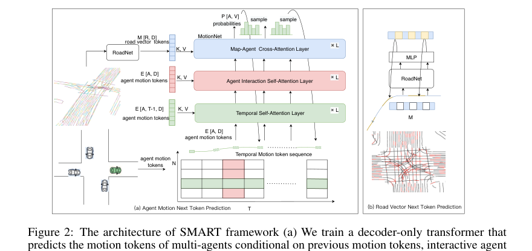
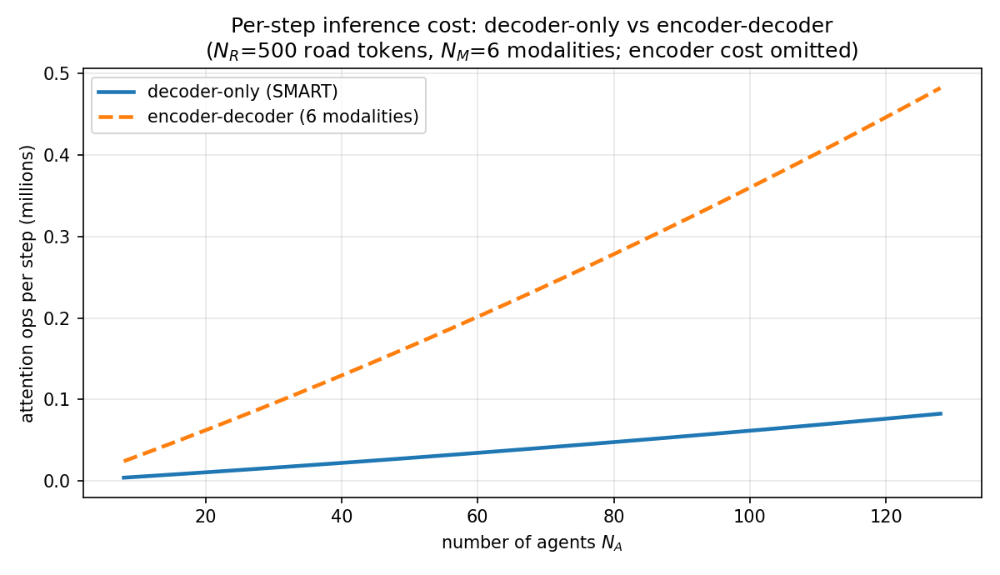
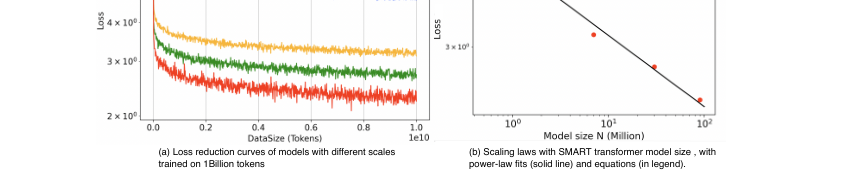

# 把驾驶翻译成一种语言：SMART 如何用 next-token 预测做出可扩展的实时交通仿真

> **全局编号**：66
> **论文标题**：SMART: Scalable Multi-agent Real-time Motion Generation via Next-token Prediction
> **作者**：Wei Wu\*、Xiaoxin Feng\*、Ziyan Gao\*（共同一作）、Yuheng Kan（SenseTime Research；Wu 另属清华大学）
> **会议/年份**：NeurIPS 2024（38th；arXiv v3 修订于 2024-11-01，初版 2024-05-24）
> **链接**：https://arxiv.org/abs/2405.15677
> **代码**：已公开，https://github.com/rainmaker22/SMART（本文审读了该仓库的全部核心代码）
> **一句话核心洞见**：把向量化地图和连续轨迹全部离散成 token，把多智能体运动生成变成 GPT 式的 next-token 分类问题——用"离散分类"替换"连续分布回归"，是这篇论文所有性质（可扩展、跨数据集泛化、实时推理）的共同来源。

## 一个只在 NuPlan 上训练的模型，为什么能在 Waymo 的地图上开车？

2024 年的 Waymo Open Sim Agents 榜单上出现了一个让人停下来的数字：0.7210。一个模型，只在 NuPlan 数据集上训练过，从没见过 Waymo 的任何一条路，直接在 Waymo 的测试场景上生成 8 秒的多智能体交通流，拿到了 0.7210 的 Realism Meta metric——离当年用 Waymo 数据从头训练的 MVTE（0.7302）只差 0.009。

在 SMART 之前，这件事几乎没人敢想。自动驾驶运动生成模型的默认配置是：换一个城市、换一套地图标注，就得重新采集数据、重新训练。Waymo 的车道线画法和 NuPlan 的车道线画法不一样，坐标系原点不一样，连"地面真值"的标定精度都不一样（论文 4.2 节自己承认，两套数据在位置和朝向标定精度上有明显差异）。一个在 NuPlan 上训好的连续轨迹回归模型，搬到 Waymo 上，输出的轨迹会系统性地偏——不是偏一点，是整个分布都对不上。

SMART 的回答是：不要回归连续轨迹。把"未来 0.5 秒怎么开"变成一道选择题：从 2048 个预先聚好的"驾驶片段"里选一个。这道选择题的题面（当前 token 序列）和选项（2048 个片段的形状）都是离散的，模型学的是"在给定离散上下文时，下一个离散片段的概率分布"。数据集之间的标定差异、坐标系差异，被 token 化这一步吸收掉了——只要两个数据集里的"直行 0.5 秒"长得差不多，它们就会映射到同一个 token id。跨数据集的鸿沟，变成了一次查表。

这就是整篇论文的赌注，也是它第一张图（Figure 1）真正想让你相信的东西：驾驶行为可以像语言一样被 token 化，而一旦 token 化完成，GPT 那套"规模换性能、数据换泛化"的剧本，就可以在驾驶领域重演一遍。

## 在 SMART 之前，运动生成在三个具体的地方撞墙

论文引言列了 encoder-decoder 范式的三条罪状，值得一条一条看，因为每一条都对应 SMART 的一个具体设计。

**第一条：场景级不一致。** 经典做法是 encoder 把场景编码成特征，decoder 为每个智能体独立回归一条（或几条）未来轨迹，用高斯或拉普拉斯混合分布做损失。问题出在"独立"两个字上：A 车的未来轨迹和 B 车的未来轨迹是各管各生成的，生成完拼在一起，可能出现两辆车在下一个路口互相穿过对方车身的情况。论文的原话是"does not represent future interactions between the motions of different agents, leading to inconsistent scene-level forecasting"。这不是调参能修的，是结构性的：decoder 的每个输出头在生成时看不到别的头正在生成什么。

**第二条：模态数量被 GPU 显存锁死。** 多模态（"这辆车可能直行、可能左转、可能掉头"）是靠 decoder 里预设的 K 个 intention query 实现的，K 一般取 6。K 再大，显存和计算都扛不住。于是出现了一个没人能回答的问题：6 个模态，真的够覆盖未来行为的多样性吗？在一个复杂的无保护左转路口，真实的未来可能有十几种走法，6 个 query 只能赌其中最常见的 6 种。

**第三条：换数据集就得重训。** 这是工业界最痛的一条。开原数据集通常只覆盖几百小时、几个特定城市，感知标注方式和地域差异带来很大的 domain gap。连续回归模型会把训练集的标定偏置（比如 Waymo 的朝向标注比 NuPlan 准）也学进去，换个数据集，这些偏置就变成了系统误差。

MotionLM 和 Trajeglish 已经走出了第一步：把轨迹离散成 token，做自回归 next-token 预测，解决了前两条（逐步生成天然建模智能体间交互，采样次数不限所以模态数不限）。但它们还留着 encoder：连续的向量化地图和历史轨迹先过 encoder 编码，只有 decoder 在做离散预测。SMART 的判断是：encoder 是泛化性的漏水点——只要还有一块连续特征，就还有数据集偏置可以附着。于是它把地图也 token 化了，并且把 encoder 整个拿掉，做成纯 decoder-only。这一步在当时并不显然：地图是一个图，不是序列，对图做"next-token 预测"在概念上就很别扭（论文 3.3 节花了一整段解释怎么把图的拓扑关系拉成序列）。

## 作者押的赌注：驾驶场景是一种语言，token 是 0.5 秒

SMART 的 token 化分两路，都值得细看，因为细节里藏着这篇论文真正的工程判断。

**运动 token：0.5 秒的驾驶片段。** 做法是：把数据集中所有智能体的连续轨迹按 0.5 秒切成片段，用 k-disks 算法聚类，聚类中心就是词表。词表大小按模型规模取 512 / 1024 / 1024 / 2048（1M / 7M / 26M / 101M 模型，开源代码里实际带的是 2048 的版本，`smart/tokens/cluster_frame_5_2048.pkl`）。

这里有一个论文一笔带过、代码里才暴露的细节：聚类用的不是轨迹本身，而是**片段终点处的车辆轮廓**——四个角点的坐标（8 个数）。`scripts/traj_clstering.py` 里写得很清楚：`contour = cal_polygon_contour(a_pos[:, shift, ...])`，取的是第 5 帧（0.5 秒末）的位置和朝向，画出车身矩形的四个角，然后在轮廓空间里做 k-disks 聚类。每个 token 存三样东西（以开源词表为例，形状都是实测的）：`token` (2048, 4, 2) 是聚类中心的终点轮廓，`traj` (2048, 6, 3) 是该簇内片段的平均轨迹（6 帧 × xy+朝向），`token_all` (2048, 6, 4, 2) 是 6 帧每一帧的完整轮廓。

拿一个具体例子走一遍。一辆车以 10 m/s 直行，0.5 秒走 5 米。相对坐标下 6 帧的位置是 (0,0), (1,0), …, (5,0)，朝向全是 0。终点轮廓是以 (5,0) 为中心、长 4.8 米宽 2.0 米的矩形四个角。k-disks 会在数据集中找到所有"终点轮廓长这样"的片段——直行 5 米的、直行 4.8 米的、轻微右偏的——把它们归到同一个簇，假设簇编号是 137。那么"直行 0.5 秒"这个连续动作，就变成了 token id 137。匹配时用的距离是四个角点欧氏距离的平均（代码：`np.mean(np.sqrt(np.sum((cur_contour - token_contour)**2, axis=-1)), axis=2`），不是轨迹点的距离——这意味着 token 化对"车身最终占了哪块地方"敏感，对中间怎么晃过去相对不敏感。这是一个有后果的选择：它让词表天然地按"结果"聚类，而不是按"过程"聚类。

**地图 token：不超过 5 米的路段。** 向量化地图先被切成小段：代码 `interplating_polyline` 把每条 polyline 按 0.5 米重采样，遇到大转角（>π/4 且间距 >3 米等）就断开，最后每段不超过 5 米。然后用和运动 token 类似的方式匹配到 1024 个预聚类的路段形状上（`map_traj_token5.pkl`：`traj_src` (1024, 11, 2) 是 11 个点的路段形状，`sample_pt` (1024, 3, 2) 是匹配用的 3 个采样点）。每个路段 token 的特征是三类信息：位置、方向、类型（车道线类型、左右边界等 17 种点类型）。

为什么地图 token 化是关键的一步？看消融表（Table 4）的 M1→M2：在 WOMD 上训练时，加上地图 token 化反而让指标**下降**了一点（kinematics 0.459→0.434）；但在 NuPlan 上训练、WOMD 上验证时，interactive 从 0.593 跳到 0.696，map-based 从 0.603 跳到 0.724。论文自己的解释是：离散地图 token 丢了一些精细几何信息，所以单数据集性能微降；但它把地图的连续坐标变成了离散 id，消掉了数据集之间的标定差异，所以跨数据集泛化大涨。这是一个诚实且重要的观察：**泛化性和单点精度在这里是互斥的**，SMART 选择了前者。Table 7 的 VQ-VAE 对比把这一点钉得更死：VQ-VAE 在单数据集上 kinematics 更好（0.461 vs 0.453），因为它重建轨迹更准；但 zero-shot 时被 k-disks 明显压过一头（interactive 0.687 vs 0.785，map 0.703 vs 0.797）。论文推测 VQ-VAE 的 tokenizer 在训练时就把训练集"背下来"了——一个学过的 tokenizer 本身就是过拟合的载体。这个推测是合理的：k-disks 是无参的几何聚类，没有可学习的参数，也就没有什么可过拟合的。

## 滚动匹配与噪声：训练时没见过的"走偏"，推理时一次就够致命

自回归模型都有一个老毛病：训练时每一步都喂 ground truth（teacher forcing），推理时每一步都只能吃自己上一步的输出。一旦某一步采样的 token 和真值差了一点，下一步的输入就进入了训练时从没见过的状态，误差像滚雪球一样放大。在驾驶里，这个雪球滚两圈就会撞墙：0.5 秒偏 0.3 米，1 秒后偏 1 米，第 3 秒已经在对向车道上了——论文引用 [32][51] 把这叫 compounding error 导致的碰撞和出界。

SMART 的修法分两层。第一层是**滚动匹配**（rolling matching）：token 化训练标签时，第 t+1 个 token 不是拿真值位置去词表里找最近的，而是拿**第 t 步实际匹配到的 token 的终点**当参考系，再去找第 t+1 步的最近 token。也就是说，训练标签本身就是"带着上一步误差"生成的，模型从一开始就知道"上一步没走准时，下一步该怎么找回来"。

第二层是**噪声 token 化**：匹配到最近 token 之后，不直接用它，而是从离真值最近的 top-k 个 token 里随机挑一个当训练输入（论文说 top-k，运动 token 的代码实现里取的是 top-5：`topk_indices[..., :5]`，地图 token 的代码里取的是 top-8）。这相当于在训练时主动把模型推到"走偏了"的状态里，让它学会从偏离中恢复。

消融表里，M3（+噪声运动 token）相对 M2，在 NuPlan→WOMD 的 interactive 上从 0.750 涨到 0.747……等等，仔细看：M3 的 NuPlan→WOMD 三项是 0.413 / 0.750 / 0.743，M4（+噪声地图 token）是 0.411 / 0.747 / 0.741——M4 反而比 M3 微降。论文正文说"M4 … leads to enhancements in both the interaction metric and the map-based metric"，但表里的数字（0.750→0.747，0.743→0.741）并不支持这个说法，至少在 NuPlan→WOMD 这组上是下降的。在 WOMD→WOMD 组，M3→M4 是 0.448→0.437（降）、0.809→0.801（降）、0.848→0.837（降），三项全降。M5（再加 RVNTP）才涨回来（0.453/0.813/0.853）。所以严格按表读：**噪声 token 化的收益在消融表里并不稳定**，M4 相对 M3 是全面微降的，论文正文的表述和表对不上。这是一个审稿人应该圈出来的地方。

还有一个更硬的发现：开源代码里，运动 token 的噪声开关**默认是关的**（`smart/datasets/preprocess.py` 第 133 行：`self.noise = False`），而地图 token 的噪声开关是开的（`smart.py` 第 71 行：`self.noise = True`，在 `match_token_map` 里从 top-8 随机采样）。论文的消融实验用的是哪个配置，代码里看不出来。记录在案：论文与代码在这里不一致。

## RoadNet 与 MotionNet：把地图也变成句子

SMART 的网络分成两块（Figure 2，论文第 5 页，原图 2 倍渲染）：

*图注：Figure 2(a) 是 MotionNet 的 decoder-only 结构：底部是时间-智能体排布的运动 token 序列，往上依次过 Temporal Self-Attention、Agent Interaction Self-Attention、Map-Agent Cross-Attention，每块重复 L 次，顶端输出 P[A, V]（每个智能体在词表上的概率分布）再采样。Figure 2(b) 是 RoadNet 的路段 next-token 任务示意。看这张图时注意箭头的方向：所有的 K、V 都来自历史或邻居，query 永远来自"当前要预测的那个位置"——这就是 decoder-only 的因果结构。*

**RoadNet**（地图编码器）只做一件事：让每个路段 token 看懂自己周围的路。公式 (1)：

$$r_i' = \mathrm{MHSA}\big(q(r_i),\, k(r_j, \mathrm{RPE}_{ij}),\, v(r_j, \mathrm{RPE}_{ij})\big), \quad j \in \mathcal{R}_i$$

$r_i \in \mathbb{R}^D$ 是第 $i$ 个路段 token 的 embedding（$D$ 是 hidden dim，7M 模型取 128）。$\mathcal{R}_i$ 是它的邻居集合，代码里用半径 10 米的 `radius_graph` 圈定（和 Table 5 的 "Road token attention radius 10" 一致）。$\mathrm{RPE}_{ij}$ 是相对位置编码（借自 GoRela [8] 的做法），拼在 key 和 value 上，让注意力知道"邻居在我前面 3 米"和"邻居在我后面 3 米"是两回事。几何意义上，这一步是在做**有向的局部地图平滑**：每个路段的表示变成它周围 10 米内路段的加权平均，权重由相对几何关系决定。

**MotionNet**（运动解码器）是论文真正的计算主体，一个 factorized transformer：每一层按固定顺序做三次注意力（公式 2a/2b/2c）：

$$e_i^{t'} = \mathrm{MHSA}\big(q(e_i^t),\, k(e_i^{t-\tau}, \mathrm{RPE}_i^{t,t-\tau}),\, v(e_i^{t-\tau}, \mathrm{RPE}_i^{t,t-\tau})\big), \quad 0 < \tau < t \tag{2a}$$

$$e_i^{t'} = \mathrm{MHCA}\big(q(e_i^t),\, k(r_j, \mathrm{RPE}_{ij}),\, v(r_j, \mathrm{RPE}_{ij})\big), \quad j \in \mathcal{N}_i \tag{2b}$$

$$e_i^{t'} = \mathrm{MHSA}\big(q(e_i^t),\, k(e_j^t, \mathrm{RPE}_{ij}^t),\, v(e_j^t, \mathrm{RPE}_{ij}^t)\big), \quad j \in \mathcal{N}_i \tag{2c}$$

$e_i^t \in \mathbb{R}^D$ 是第 $i$ 个智能体在第 $t$ 个 token 时刻（每 0.5 秒一个）的表示。三个公式的分工：

- (2a) **时间自注意力**：query 是"我现在"，key/value 是"我过去的 token"。注意下标 $0 < \tau < t$，只能看过去不能看未来——因果掩码就长在这里。代码里时间窗口是 `time_span/shift = 30/5 = 6` 个 token，也就是往回看 3 秒。
- (2b) **地图交叉注意力**：query 是智能体，key/value 是 RoadNet 编码好的路段 token，邻居集 $\mathcal{N}_i$ 按距离圈定（论文写 50 米；开源配置里 `pl2a_radius=30`，此处论文与代码默认值不一致）。
- (2c) **智能体间自注意力**：同一个时刻 $t$，query 是智能体 $i$，key/value 是周围的智能体 $j$。**这就是解决"场景级不一致"的那个设计**：在生成第 $t$ 步时，每个智能体的表示都已经看到了同一时刻其他智能体的表示（论文写邻居半径 50 米；代码 `a2a_radius=60`，同样与论文文字不一致）。

三块按"时间 → 地图 → 智能体"的顺序堆 $K$ 次（7M 模型每种 6 层，Table 5）。顺序不是随意的：先让每个智能体搞清自己的运动历史，再看路，最后看别的车——这和人类驾驶员处理信息的顺序一样，也和 Scene Transformer [28] 的 factorized attention 一脉相承。

核心张量形状（一张表说清，$D=128$ 以 7M 模型为例）：

| 符号 | 形状 | 含义 |
|---|---|---|
| $A$（运动 token 输入） | $[N_A, N_T, F_A]$ | $N_A$ 个智能体 × $N_T$ 个 0.5 秒 token；$F_A$ 含坐标、朝向、形状 |
| $R$（路段 token 输入） | $[N_R, F_R]$ | $N_R$ 个 ≤5 米路段；$F_R$ 含位置、方向、类型 |
| $e_i^t$ | $[D]$ | 智能体 $i$ 在时刻 $t$ 的隐表示 |
| $r_i$ | $[D]$ | 路段 $i$ 的隐表示 |
| $P$（输出） | $[N_A, V]$ | 每个智能体在大小为 $V$ 的词表上的概率分布，$V=2048$ |

Embedding 的细节在代码里比论文实在：运动 token 的 embedding 不是简单的查表，而是把 token 的终点轮廓（8 维）过一个 MLP（`token_emb_veh/ped/cyc`，三种智能体各一个），再和运动学特征（速度大小、运动方向与朝向的夹角）过 FourierEmbedding 的结果拼接起来融合。也就是说，token id 只决定"选哪个形状"，具体的速度、朝向信息是另一条通路补进去的。

## 两个 next-token 任务：时间上预测车，空间上预测路

训练目标是两个交叉熵的和（论文 3.3 节的原话是 "the model is optimized with the summation of the two tasks' objectives"）：

**路段 next-token 预测**（公式 3，给 RoadNet 的）：

$$\mathrm{loss}(\gamma) = -\sum_{j=1}^{J}\sum_{i=1}^{V_r} \mathbb{1}\big[r_{j+1}^i = r_{j+1}^{i,\mathrm{gt}}\big]\, \log p_\gamma\big(r_{j+1}^i \mid r_{1:j}\big)$$

地图是一个图，直接做 next-token 预测没有"下一个"的概念。论文的绕法是：利用路网原始的拓扑（前驱-后继关系），把一条没切分的完整 polyline 按拓扑顺序拉成序列，让模型根据前 $j$ 个路段 token 预测第 $j+1$ 个。这是在逼 RoadNet 学会"路是连着的"——给定一段路，能猜出顺着它开下去下一段长什么样。代码里的实现更具体：`sample_pt_pred` 把每条 polyline 的 token 随机 mask 掉一部分（保留约 1/3 作为预测目标），`map_decoder` 对被 mask 的位置预测 token id。这和 BERT 的 masked modeling 更像，和 GPT 的因果预测不太一样——论文正文写的是"用前面的预测后面"，代码做的是"随机 mask 预测被 mask 的"。措辞和实现之间有一点缝隙。

**运动 next-token 预测**（公式 4，给 MotionNet 的）：

$$\mathrm{loss}(\theta) = -\sum_{t=1}^{T}\sum_{i=1}^{V_a} \mathbb{1}\big[a_{t+1}^i = a_{t+1}^{i,\mathrm{gt}}\big]\, \log p_\theta\big(a_{t+1}^i \mid a_{1:t},\, \text{交互},\, \text{地图}\big)$$

标准的 token 分类交叉熵：给定历史 token、同时刻其他智能体的 token、地图 token，预测下一个 0.5 秒的 token id。这里论文没写但代码里有的一处：`CrossEntropyLoss(label_smoothing=0.1)`——用了 0.1 的标签平滑。标签平滑在这里的作用是防止模型对某个 token 过度自信，对多模态生成是好事（避免分布塌到单一未来），但论文正文完全没提。

**必须记录的一处论文-代码不一致**：论文说两个任务的损失相加优化，但开源代码的 `training_step` 里只有运动 token 的 `cls_loss`，`loss = cls_loss`，`map_cls_loss` 定义了却从没被用过，`map_decoder` 算出的 `map_next_token_prob` 没有任何地方消费它。也就是说，**开源版本里路段 NTP 的损失根本没有进反向传播**。这和消融表 M5→M6（+RVNTP）的微弱提升（WOMD 组 0.437→0.453 / 0.801→0.813 / 0.837→0.853，NuPlan→WOMD 组 0.411→0.413 / 0.747→0.780 / 0.741→0.785）放在一起看是自洽的：RVNTP 的贡献本来就不大，大到"有没有它都不太影响"的程度。论文实验用的大概是内部版本，开源的是简化版——读者如果想复现消融表，需要自己把地图损失加回去。

## Decoder-only 的实时性到底从哪来：只算当前帧，不重编码历史

这是论文里最实在的一个工程判断，值得用一个具体场景走一遍。

场景：Waymo 的一个路口，32 个智能体，要生成未来 8 秒。8 秒 / 0.5 秒 = 16 个 rollout 步，每步要为 32 个智能体各选一个 token。

**Encoder-decoder 做法**（MotionLM 那一路）：每一步，先把"历史 + 上一步刚生成的 token"整个重新过一遍 encoder（因为新 token 进来了，历史变了），再用 decoder 的 6 个 intention query 去解码 6 种未来。设 $N_M = 6$ 是模态数，$N_R = 500$ 是路段 token 数，论文给出的复杂度是 $O(N_A^2 N_M) + O(N_A N_M N_R)$——注意每一项都乘了 $N_M$。$N_A=32$ 时，光地图交叉那一项就是 $32 \times 6 \times 500 = 96{,}000$ 次注意力操作，**每一步**。

**SMART 的 decoder-only 做法**：历史 token 的特征算过一次就缓存起来（代码 `inference` 里用 `feat_a_t_dict` 按层缓存每一时刻的特征，只更新最新一个时间片——就是 LLM 推理里的 KV-cache 思想，只是这里缓存的是 factorized 注意力三层的输出）。新的一步到来时，只需要：为当前 32 个 token 算 query，去查缓存的 key/value（时间注意力 $O(N_A N_T)$），查一遍地图（$O(N_A N_R)$），智能体之间互相看一眼（$O(N_A^2)$）。复杂度 $O(N_A N_T) + O(N_A N_R) + O(N_A^2)$，**没有 $N_M$ 这一项**——因为多模态不是靠 6 个 query 并行解码，而是靠"采样 16 次、每次走一条路"自然产生的。想多要几种未来，多 rollout 几次就行，不用改网络。

下面这张图把两者的差距画了出来（$N_R=500$，$N_M=6$，encoder 本体的开销还没算进去，实际差距更大）：

*图注：横轴是场景中的智能体数，纵轴是每 rollout 步的注意力操作量（百万次）。encoder-decoder 的曲线里，模态数 $N_M=6$ 是一个乘子——智能体一多，$N_A \times N_M \times N_R$ 这一项先爆炸。decoder-only 把 $N_M$ 从复杂度里拿掉了，这是它敢谈"实时"的本钱。绘图脚本见 `fig-inference-cost.py`。*

再看代码里推理循环具体在干什么（`agent_decoder.inference`），以第 $t$ 步、某个车辆智能体为例：

1. 取该智能体在 $t-1$ 时刻的隐特征 $e^{t-1}$（已缓存），过三层注意力得到 $e^t$，只算当前时间片，历史不动。
2. `token_predict_head` 输出 2048 维 logits → softmax → 取 top-5（`beam_size=5`，和论文附录"每步 top-5 采样"一致）。
3. 从 top-5 里按概率多项式采样一个 token id，比如 137。查表拿它的 6 帧轮廓 `token_all[137]`，旋转平移到当前车身坐标系下，得到未来 0.5 秒的 6 个位置 + 朝向。
4. 把这 6 帧写进 `pos_a` / `head_a`，更新该位置的 token embedding，缓存进 `feat_a_t_dict`，进入第 $t+1$ 步。

论文报的数字：单步推理 5~20ms 波动，平均 10ms 以内（4.1 节）；引言说"within 15ms"。但附录 Table 9 写的是 7M 模型平均 17.21ms、101M 模型 46.58ms（32 块 V100 上测的）。**17.21ms 同时超过了"10ms 以内"和"within 15ms"**。可能的解释是两处数字测的硬件不同（正文没写 5~20ms 是在哪块卡上测的），但论文没有说明。这处不一致记下来：实时性结论成立的方向是对的（decoder-only 确实比 encoder-decoder 快一个量级），但"10ms"这个具体数字和附录的表对不上，引用时以 Table 9 的 17.21ms（7M / V100）为准更稳妥。

## 十亿 token 与那条只有四个点的 scaling law

论文的第二个大主张是可扩展性：像 LLM 一样，数据和参数加上去，性能按幂律涨。证据是 Figure 4（论文第 9 页）：

*图注：Figure 4(a) 是 1M / 7M / 26M / 101M 四个规模的模型在 10 亿 token 上的训练 loss 曲线：模型越大，loss 越低，且大模型的曲线到 10 亿 token 时还在往下走（没饱和）。(b) 是测试 loss 随模型规模的幂律拟合：$\log(L) = -0.157\log(N) + 1.52$。看 (b) 时注意：拟合只用了 4 个红点。*

数据规模是实的：Waymo 48 万场景（0.18B token）+ NuPlan 30 万场景（0.13B）+ 私有数据 150 万场景（0.68B），共 228 万场景、10 亿 motion token（Table 8）。训练开销也是实的：101M 模型在 32 块 V100 上训了 1 周（Table 9）。$\beta = -0.157$ 的指数意味着模型规模翻 10 倍，测试 loss 降到原来的 $10^{-0.157} \approx 0.70$ 倍——下降是平滑的，没有平台期，这是 scaling law 想要的样子。

但怀疑式读法要指出三点。第一，**(b) 的拟合只有 4 个点**。4 个点拟一条直线，$R^2$ 再高也不能说明太多——任何 4 个单调的点在双对数坐标下都"像"一条直线。LLM 的 scaling law 论文通常用几十个点。第二，**只验证了模型规模 $N$ 的维度**，没有验证数据规模 $T$ 的维度（公式 5 里 $X$ 可以是 $N$ 也可以是 $T$，论文只画了 $N$）。第三，Table 9 显示规模上去之后，**kinematic 指标几乎不动**（0.423 → 0.457），涨的主要是 interactive（0.782 → 0.819）和 map-based（0.835 → 0.872）。这说明"规模换来的是交互合理性和地图遵守，不是运动学精度"——离散化本身设了一道精度上限（0.5 秒一个 token、2048 个形状），模型再大也突破不了这道上限。这对想用它做精确轨迹预测的人是一个提醒：SMART 是生成模型，不是预测模型，minADE 从来不是它的强项（Table 2 里 101M 的 minADE 是 1.3728，比一些回归模型差）。

还有一处值得玩味的细节：附录 A.3 的 Figure 5 拿 MVTE（连续分布回归）做了对比实验——给 MVTE 加别的数据集的数据一起训，效果反而比只用 Waymo 训更差；私有数据集比 NuPlan 大得多，MVTE 在上面训的效果却不如在 NuPlan 上训。论文的结论是：连续回归范式会过拟合到单个数据集的分布上，加数据反而有害；而 SMART（去掉地图 token 化和噪声的版本）加数据是有提升的。这个实验设计得漂亮，因为它直接攻击了"大模型 = 大数据"这个直觉：**数据能不能加进去，取决于范式吃不吃得下跨分布的数据**。离散 token 化在这里扮演的角色是"分布对齐器"——先把各数据集的运动翻译成同一种语言，再谈规模。

## 怀疑式审读：0.76、0.72、15ms 和 SMART-Planner 的含金量

**0.7614（2024 榜单第一）**。Table 2：SMART 101M 的 Realism Meta metric 是 0.7614，第二名 BehaviorGPT 0.7473，第三 GUMP 0.7431。领先 1.4 个点，在 Sim Agents 这种 composite metric 上是不小的差距。开源仓库 README 确认了"Waymo Open Sim Agents Challenge 2024 第一名、CVPR 2024 WAD workshop 冠军"，和论文的说法互相印证。但要注意三点：第一，榜单成绩用的是 101M 模型（46.58ms/步），不是主打实时的 7M；第二，minADE（1.3728）并不是最好的——这个榜单的 meta metric 本来就不奖励轨迹精度，奖励的是"像人"（kinematic 分布、交互、地图遵守），SMART 的离散生成范式恰好对这个 metric 的胃口，这是"选对了战场"，不是每项指标都赢；第三，2023 榜单（Table 1）上 SMART 7M 是 0.6587，领先 Trajeglish（0.6451）同样约 1.4 个点，两年结果互相印证，不是单次运气。

**0.7210（zero-shot）**。这是论文最抓眼球的数字，审读时要拆成三问。第一问：测试集是什么？正文 4.1 节写的是"trained solely on the NuPlan dataset and directly inferred on the Waymo test set"，Table 2 的 0.7210 应该是在测试集上；但摘要写的是"Using only the NuPlan dataset for training and WOMD for validation"，摘要和正文的表述不一致（validation vs test）。Table 3 另有一组验证集上的数字（SMART*：kinematic 0.4161 / interactive 0.7853 / map 0.7970），和 Table 2 的 0.7210 不是同一组评估。第二问：zero-shot 公不公平？有一个论文**没有交代**的关键信息：运动 token 词表（k-disks 聚类）是在哪个数据上做的。如果词表是在 Waymo+NuPlan+私有数据的混合集上聚的，那么"只在 NuPlan 上训练"的模型其实通过词表见过 Waymo 的运动统计量——这不叫严格 zero-shot，叫"词表泄漏"。论文正文、附录、代码里都没有说明聚类用的数据来源（`traj_clstering.py` 的 `__main__` 甚至用的是 `np.random.rand` 的演示数据，真正的聚类流程没有开源）。在得到澄清之前，这个 zero-shot 成绩要打一个折扣看。第三问：0.72 的构成。zero-shot 的 interactive（0.7806）和 map-based（0.8099）确实接近 MVTE（0.7706/0.8381），但 kinematic（0.4311 vs 0.4503）和 minADE（2.5703 vs 1.6770）差得很多。论文把 kinematic 的差距归因于"两套数据地面真值标定精度的差异"，这个解释是可能的，但也正好是 domain gap 最该出现的地方——把不利的数字归因于数据、把有利的数字归因于方法，读的时候要意识到这种不对称。

**推理速度**。正文 4.1 节"5~20ms 波动、平均 10ms 以内"，引言"within 15ms"，附录 Table 9"7M 平均 17.21ms（V100）"。三处数字互相打架。最可能的情况是正文的数字在更好的卡（A100/H100）上测的，但论文没有注明硬件。严谨的引用方式：7M 模型在 V100 上单步 17.21ms；101M 46.58ms。结论的方向（decoder-only 比 encoder-decoder 快、满足 10Hz 仿真步长）不受影响，但"10ms"这个数字不要直接引用。

**SMART-Planner 的 nuPlan SOTA**。这是任务方特别问到的一点，结论是：**这个说法不在论文里**。论文的 Limitations 明确写 "the ability of SMART to migrate to planning and prediction tasks still needs to be verified, and this is our top priority for future work"——规划是未来工作。SOTA 的说法只存在于开源仓库 README（2024-12-31 的 news 条目）和一张结果图 `assets/result1.png`：nuPlan val14 上 Planner Score 91.11，超过 PLUTO（w/o post.）89.04、BeTopNet 88.30、PlanTF 85.30，Collisions 97.29 和 Progress 92.25 也是表中最高。怀疑式读法指出四点：(1) 没有论文、没有 planner 代码开源，实现细节完全不可核实；(2) 表里没有 PDM-Closed（规则方法在 nuPlan 上通常是最强的），"among learning-based algorithms"是一个限定后的第一；(3) 评的是 val14，不是官方 test14；(4) 对比的 PLUTO 和 BeTopNet 都标了 (w/o post.)，后处理这个变量没有对齐说明。所以"SMART-Planner 是 nuPlan 规划 SOTA"这句话，准确的版本是：**仓库 README 上的一张结果图显示，在 nuPlan val14 上、学习类方法中、不加后处理 的条件下，SMART-Planner 的 Planner Score 最高；无论文、无代码、无 test14 结果**。引用时建议按这个限定版引用。

## 论文与开源代码对不上的五处地方

通读代码后，把不一致的地方集中记下来（按重要性排序）：

1. **路段 NTP 损失没有进训练**。论文 3.3 节说两个任务损失相加；代码 `training_step` 里 `loss = cls_loss`，只有运动 token 的交叉熵，`map_cls_loss` 定义了但从未使用。这是最大的一处。
2. **运动 token 的噪声开关默认关闭**。论文 3.1 节和消融表 M4 都在讲 noised agent tokenization；代码 `smart/datasets/preprocess.py:133` 是 `self.noise = False`。地图 token 的噪声是开的（`smart.py:71`，top-8 随机采样）。
3. **预测头不是每层一个**。论文附录 A.1 说"每个 decoder 层一个三层 MLP 预测头，层间不共享权重"；代码里只有一个 `token_predict_head`，在所有层跑完之后用一次。
4. **邻居半径数字对不上**。论文 3.2 节说智能体邻居集按 50 米圈定；开源配置里 `a2a_radius=60`、`pl2a_radius=30`。Table 5 的 road attention radius 10 倒是和代码 `pl2pl_radius=10` 一致。
5. **推理速度数字对不上**。见上一节：正文"平均 10ms 以内"/引言"15ms 以内" vs 附录 Table 9 的 17.21ms（7M，V100）。

另外两处代码卫生问题（不影响结论，但复现的人会踩坑）：`agent_decoder.py` 里的 `agent_predict_next` / `agent_predict_next_inf` 引用了不存在的 `self.token_predict_cyc_head` / `self.token_predict_walker_head`（调了会直接崩，实际走的是 `forward` 里的统一 head，属于 QCNet 遗留的死代码）；`match_token_map` 里 `token_src_world.view(-1, 1024, 11, 2)` 把词表大小 1024 和形状长度 11 写死了，换词表要改代码。

## 承重结构与装饰：拿掉哪个会塌

按"去掉之后掉多少"排序，SMART 的设计里真正的承重件有三件：

**第一承重：离散 token 化本身（尤其是地图 token 化）。** 消融表 M1→M2 是分水岭：不加地图 token 化，NuPlan→WOMD 的 interactive 只有 0.593、map 只有 0.603；加上之后是 0.696、0.724。这是所有消融里跨数据集泛化涨幅最大的一处。没有这一步，后面的一切（scaling、zero-shot）都不成立。

**第二承重：decoder-only + 增量推理。** 它不直接涨分，但它决定了这个方法能不能用。没有它，每步 $O(N_A N_M N_R)$ 的重编码在 128 个智能体的 WOSAC 场景下根本跑不动实时仿真，Sim Agents 这个任务就做不了。

**第三承重：多智能体联合的逐步生成（公式 2c 的同伴注意力）。** 这是相对 encoder-decoder 的结构性优势，interactive 指标（0.8014→0.8066）和 collision（Table 6 里 0.963 全场最高）主要靠它。

装饰（有用但非决定性）：路段 NTP 任务（M5→M6 提升微弱，且开源代码里根本没训练它）；噪声 token 化（消融表里 M4 相对 M3 甚至微降，正文的表述和表对不上）；label smoothing 0.1（论文没提的常规技巧）；FourierEmbedding 相对位置编码（从 QCNet/GoRela 继承的成熟部件）。

还有一个"看起来是创新、实际是继承"的地方要说明：整个代码库是从 QCNet 改过来的（`score_trained_vehicle`、`radius_graph`、factorized attention 结构都是 QCNet 的形状），SMART 的增量是"把回归头换成 token 分类头 + 地图 token 化 + decoder-only 推理"。这个增量说大不大，但它恰好打在了 Sim Agents 这个任务的七寸上（任务要的是合理多样的行为分布，不是毫米级精度），所以拿了第一。评价增量大小时要把"任务选型"的眼光也算进去。

## 可以带走的两个想法

**想法一：把"回归"换成"分类"，是跨分布泛化的通用手法。** SMART 之前，运动生成领域默认"轨迹是连续的，所以必须回归连续分布"。SMART 证明了：只要离散化的粒度选得对（0.5 秒、2048 个形状），分类损失（交叉熵）比回归损失（高斯混合）更能抵抗数据集之间的分布差异。原因不神秘：回归损失对标定偏置是敏感的（偏 0.1 米就是 0.1 米的 loss），而分类损失只关心"选对了哪个桶"，桶内的偏置被量化这一步吃掉了。这个手法可以迁移到任何"连续输出 + 跨分布"的场景：先按任务容忍的精度把输出空间切成桶，学"选桶"而不是"拟数值"。代价是精度上限被量化粒度锁死——Table 9 里 kinematic 指标不随规模涨，就是这笔账。

**想法二：KV-cache 思想不只属于 LLM。** Decoder-only 的实时性本质上是"历史算过就别重算"。任何时序生成系统（世界模型 rollout、规划器的多步预测）都可以问自己一个问题：我的第 $t$ 步，有多少计算是在重复第 $t-1$ 步已经算过的东西？SMART 的答案是把 factorized 注意力的三层输出按时间片缓存。如果你的世界模型每步都重新编码整个场景，那里就藏着一个数量级的加速空间。

## 与本课题的关联

课题是"世界模型引导 + 自适应衰减情景记忆的多规划器 Agent"，SMART 与其中两块直接咬合：

**① 他车未来预测分支的轻量替代方案。** 课题的世界模型需要预测"他车未来 T 步行为"作为 LLM 调度的先验。SMART 提供了一个经过验证的轻量选项：0.5 秒 token + 7M 参数的 decoder-only transformer，在 V100 上单步 17ms，可以为场景中所有智能体联合生成未来多步的 token 分布。相比连续轨迹回归（如 GMM），它的输出天然是**多模态的分类分布**——每个 token id 对应一个具体的 0.5 秒形状，分布的熵就是不确定性，碰撞风险可以直接从"未来 token 序列与自车候选轨迹的几何重叠"算出来，不需要再拟合一个风险头。但有两个缺口要补：第一，SMART 是**无条件生成**（仿真所有智能体），而你的分支需要**条件预测**（给定自车候选动作，预测他车反应）——需要在 token 序列里加入自车未来意图作为条件，论文没有做这部分；第二，0.5 秒的粒度和 2048 的词表对"风险量化"可能太粗，碰撞前 1 秒的精细避让动作可能落在同一个 token 里，风险分数的分辨率会被量化吃掉。建议的用法是：用 SMART 式 token 模型做**粗粒度的多模态先验**（他车大概往哪走、几种可能），精细的风险计算还是交给连续 rollout——正好对应你设计里的"分层"思想。

**② 时延优化的直接启发。** SMART 的实时性来自三处，每处都能抄：(a) **增量推理**：历史 token 的特征缓存复用，不每步重编码——你的世界模型做 T 步 rollout 时，场景编码也可以只做一次、每步只更新增量；(b) **把模态数从复杂度里拿掉**：多候选动作的评估不要每个候选都全量重算一次场景，SMART 用"采样多次"代替"并行解码多个 query"，你的冲突仲裁面对多个候选动作时，可以考虑"一次场景编码 + 轻量 head  per 候选"的结构；(c) **token 化本身是加速**：离散 token 的 embedding 查表比连续特征的编码便宜，且天然支持缓存。反过来，SMART 的教训也要吸取：它的 17ms 是在"只做行为生成"的前提下测的，你的链路里还有 LLM 调度、记忆检索、风险校验，时延预算要按整条链路重新分配，不能直接抄 17ms 这个数字。

一个诚实的提醒：SMART 的成功很大程度上是因为**任务选得好**——Sim Agents 奖励行为合理性，不奖励轨迹精度。你的 Bench2Drive 评测既看安全性（撞不撞）也看规划质量（像不像人开、舒适不舒服），token 化带来的精度损失（kinematic 上不去）在 Bench2Drive 的驾驶分数里会不会被扣分，是一个需要实验回答的问题，不是能从这篇论文推导出来的。建议在接入时先做一个小规模对照：同一场景下，token 预测分支 vs 连续回归分支的下游规划分数，看看量化粒度到底吃掉了多少。
