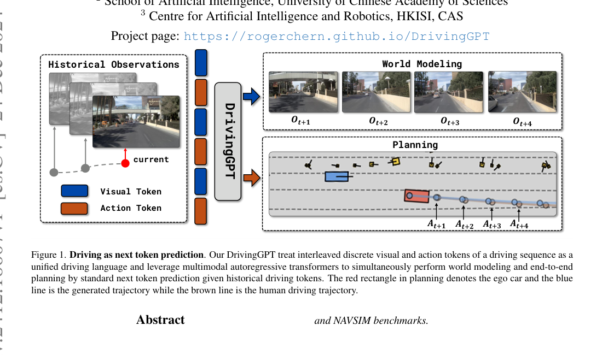
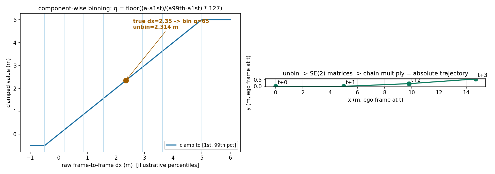
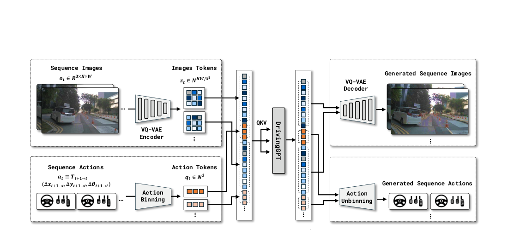
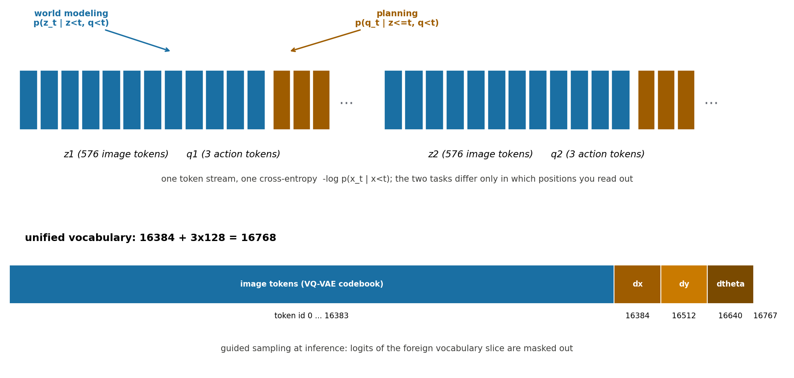

# 一个 token 流，两种读法：DrivingGPT 把世界模型和规划器写成同一个自回归分布

> **全局编号**：041-WM-drivinggpt
> **论文标题**：DrivingGPT: Unifying Driving World Modeling and Planning with Multi-modal Autoregressive Transformers
> **作者**：Yuntao Chen、Yuqi Wang、Zhaoxiang Zhang（中科院自动化所模式识别国家重点实验室 NLPR、中国科学院大学人工智能学院、中科院香港创新研究院 AI 与机器人中心 HKISI, CAS）
> **会议**：ICCV 2025
> **arXiv**：2412.18607（[摘要页](https://arxiv.org/abs/2412.18607)；该号只有 v1，2024-12-24 提交，下载的即最新版）
> **代码**：未找到官方代码。论文首页给出项目页 https://rogerchern.github.io/DrivingGPT，项目页上指向的仓库 github.com/RogerChern/DrivingGPT 返回 404。以下所有技术细节只来自论文正文、附录和图注，没有代码可以对。
> **一句话核心洞见**：把图像 token 和动作 token 交错排进同一个序列做 next-token prediction，世界模型和规划器就不再是两个模块——它们是同一个自回归分布在不同位置上的两个读出，"plan head" 不存在，规划就是读出动作位置上的 token。

## 开车为什么要先变成一种语言

2024 年底的自动驾驶世界模型几乎清一色是视频扩散模型：拿一个 Stable Video Diffusion 之类的底座，在 nuPlan 数据上微调，用 cross-attention 或 AdaLN 把"动作"作为条件信号塞进去，生成未来几秒的视频。Drive-WM 甚至已经用生成的未来视频去指导一个独立的规划器。这条路的问题不在生成质量，而在结构：扩散模型是为"一张图/一段视频"设计的，它的输入输出都是像素（或潜变量），动作只能以"条件"的身份出现在侧面。规划器和世界模型之间永远隔着一层——规划器输出轨迹，世界模型输出视频，两者各有各的损失、各有各的头，所谓"联合"只是把两个模型的输出拼在一起用。

DrivingGPT 的起点是把这个问题反过来问：如果动作本身也是 token，和图像 token 排在同一个序列里，规划和预测未来还有区别吗？答案是没有。一个自回归 transformer 对序列 $x_1, x_2, \dots$ 建模联合分布 $p(x_1, \dots, x_T)$，你问它"图像 token 的位置上该填什么"，它做的是世界模型；你问它"动作 token 的位置上该填什么"，它做的是规划。两个任务共享同一套权重、同一个 softmax、同一个交叉熵，区别只在你读的是哪个位置。这就是 Figure 1 要押的赌注，也是全文唯一真正新的东西。

*论文 Figure 1（第 1 页裁切）：历史观测 token 进，DrivingGPT 出；上面一路读出未来图像 token（世界建模），下面一路读出动作 token（规划）。红框是自车，蓝线是生成轨迹，棕线是人类轨迹。注意两路输出来自同一个自回归过程，不是两个头。*

## 作者手里有什么牌

先放时间坐标。2024 年 12 月，LlamaGen（2024 年 6 月）刚证明"语言模型那套 next-token prediction 不加任何花样也能生成高质量图像"，Emu3（2024 年 9 月）把"next-token prediction is all you need"喊成标题，VideoPoet、Chameleon 都在做多模态离散 token。自动驾驶这边，GAIA-1（2023 年 9 月）已经用了自回归 next-token predictor，但它后面接的是一个独立的扩散图像解码器，而且动作只作为输入的条件、不作为生成的输出。也就是说，"自回归 + 离散 token"在生成侧已被验证，"动作也进序列"在驾驶领域还没人做——作者的底牌是把这两件事拼起来的时机：视觉 token 化（VQ-VAE/LlamaGen 的 tokenizer）已经开箱可用，剩下的只是一个序列排布的设计问题。

第二张牌是基线处理得相对诚实。视频生成对比里，他们没有只拿官方 SVD 权重应付——SVD 原生权重在驾驶场景只会生成"轻微抖动"的视频（Table 1 里 FVD 483.76），他们自己在 navtrain 上微调了一个 SVD 再比（FVD 227.54），这才是一个能打的对手。CogVideoX 用的是公开权重、没有微调，这一点论文写明了，对比强度打折，但至少没有藏着。

第三张牌是 NAVSIM。2024 年 6 月发布的 NAVSIM 专门为开环规划筛选了有难度的场景，而且社区里刚有人（Li et al., CVPR 2024，"Is ego status all you need"）指出用自车状态做开环规划等于作弊。DrivingGPT 主动把 ego status 排除在外（4.4 节明确写了 deliberately exclude），等于提前堵住了审稿人最可能打的一张牌。

## 序列是怎么搭起来的：从像素和轨迹到 token

### 图像变成 token

只用前视相机，$o_t \in \mathbb{R}^{3 \times H \times W}$。1600×900 的原图先缩到 288×512（保持长宽比），然后过一个预训练的 VQ-VAE 编码器。下采样率 $S=8$ 时每帧 2304 个 token，$S=16$ 时每帧 576 个 token（$18 \times 32$）。图像词表大小 $D=16384$，即 VQ-VAE codebook 的大小。记第 $t$ 帧的图像 token 为 $z_t = \{z_{tj}\}_{j=1}^{HW/S^2}$。论文在 tokenizer 对比（Table 4）里试了 LlamaGen、OpenMAGVIT2、Cosmos 三个离散 tokenizer，在 navtest 的 12146 个视频样本上按重建质量（rFVD/rFID/PSNR/SSIM）选了 LlamaGen（rFVD 68.40，对 96.32，对 178.50）。这个选择只看重建上限，不看下游规划——消融没有回答"重建最好的 tokenizer 是否也是规划最好的"，这是 Table 4 没说的一件事。

### 动作变成 token：先 clamp，再分箱

这是全文最需要慢下来的地方。规划器通常输出未来 N 步的绝对轨迹，但 DrivingGPT 不能直接把这种轨迹塞进序列，原因下一节单独讲。它用的动作定义是**帧间相对动作**：

$$a_t \equiv T_{t+1 \to t} = (\Delta x_{t+1 \to t},\, \Delta y_{t+1 \to t},\, \Delta\theta_{t+1 \to t})$$

即从第 $t+1$ 帧到第 $t$ 帧的纵向位移、横向位移和偏航角变化。每个分量先 clamp 到该分量在训练集上的第 1 和第 99 百分位数之间：

$$\bar{a}_t = \min(\max(a_t, a^{1st}), a^{99th})$$

然后均匀分成 $M=128$ 个箱：

$$q_t = \left\lfloor \frac{\bar{a}_t - a^{1st}}{a^{99th} - a^{1st}} \times (M-1) \right\rfloor$$

$x, y, \theta$ 三个分量量级和单位都不同，各用各的词表，所以动作词表总大小是 $3M = 384$，整个驾驶语言的词表是 $D + 3M = 16384 + 384 = 16768$。

拿一个具体数走一遍（百分位数是我为演示设的示意值，论文没有公布真实的 $a^{1st}, a^{99th}$）。设 NAVSIM 2Hz 下 $\Delta x$ 的 $a^{1st} = -0.5$m、$a^{99th} = 5.0$m，箱宽就是 $(5.0-(-0.5))/128 \approx 0.043$m。真实 $\Delta x = 2.35$m 时，clamp 后仍是 2.35，$q = \lfloor (2.35+0.5)/5.5 \times 127 \rfloor = \lfloor 65.8 \rfloor = 65$。unbin 时论文只说"unbinned to get the driving trajectory"，没写取箱内哪一点——取箱中心是自然选择（$a^{1st} + (65.5/128)\times 5.5 \approx 2.314$m，量化误差约 3.5cm），但论文没有明确，我在下图里按箱中心画出并在此注明这是我的补全，不是论文的写法。

*自绘图（fig-bin.py，真跑过）：左图是单分量的 clamp+分箱，右图是三个相对动作经 SE(2) 矩阵连乘还原成绝对轨迹。注意右图的轨迹几乎是直线——因为示例动作的偏航变化很小，这正是帧间相对表示的日常形态。*

### 相对动作变回绝对轨迹

预测出的 token $q_t$ 先 unbin 成 $(\Delta x_t, \Delta y_t, \Delta\theta_t)$，再拼成 SE(2) 矩阵（论文公式 2）：

$$T_{t+1 \to t} = \begin{bmatrix} \cos\theta_t & -\sin\theta_t & x_t \\ \sin\theta_t & \cos\theta_t & y_t \\ 0 & 0 & 1 \end{bmatrix}$$

绝对位姿是连乘：$T_{t+k \to t} = \prod_{i=1}^{k} T_{t+i \to t+i-1}$。用右图的三个动作 $(5.0,0,0)$、$(4.8,0.2,0.05)$、$(4.9,0.1,-0.02)$ 实际算一下：$T_{t+1\to t}$ 在 $(5.000, 0.000)$，$\theta=0$；$T_{t+2\to t}$ 在 $(9.800, 0.200)$，$\theta=0.05$；$T_{t+3\to t}$ 在 $(14.689, 0.545)$，$\theta=0.03$。几何上每一步都是"把下一步的相对位移先转到当前帧的朝向再叠加上去"，矩阵连乘自动处理了朝向的累积。这一步没有可学习参数，是纯后处理——规划器的"输出头"到这里就结束了，而它根本不是一个网络层。

## 为什么动作必须是帧间相对量：一次被现实修正的设计

这是论文 3.2 节里最有嚼劲的一段，值得还原它的生成过程。朴素的想法是：既然要统一，直接把"未来 N 步绝对轨迹"当动作序列，排成 $o_1, a_1, a_2, \dots, a_N, o_2, \dots$。哪里会出问题？注意 $a_1, \dots, a_N$ 都是在 $t=1$ 时刻就已知的整条专家轨迹。当模型在预测 $a_2$ 时，它的历史里已经躺着 $a_1$——而 $a_1$ 和 $a_2$ 来自同一条人类轨迹，$a_2$ 几乎可以由 $a_1$ 外推得到。模型会学到一条捷径：$p(a_k \mid a_{<k})$，根本不看图像。训练损失照样下降，验证集上看起来也不错，一到需要"看路"的场景就原形毕露。

论文把这句话说得很直白："the last history action will contain all future driving actions until timestep N−1, causing the model just learn to copy history actions instead of learning to drive based on observation." 帧间相对动作 $T_{t+1\to t}$ 切断了这条捷径：$a_t$ 只描述相邻两帧的运动，$a_{t+1}$ 无法从 $a_t$ 外推（下一帧是加速还是刹车，历史动作给不了答案，只能看图像）。

Table 5 是这个论证的实证版，而且做得相当干净。他们把模型预测的 $x/y/\theta$ 三个分量逐个替换成"照抄上一帧历史动作"（copy），看 PDMS 掉多少。全预测是 82.4；照抄纵向 $x$ 直接掉到 53.5（NC 从 98.9 掉到 75.9，EP 从 79.7 掉到 48.2）；照抄横向 $y$ 掉到 79.4；照抄偏航 $\theta$ 掉到 73.1。纵向抄不得，是因为 NAVSIM 里大量场景是"静止起步加速"，历史 $\Delta x \approx 0$ 照抄就等于永远不起步——这正是朴素设计会学到的捷径行为。这个消融同时回答了"模型是真在学开车还是拟合了捷径"：如果是捷径，替换前后不该有这么大差距。

## 一个损失，两个任务：训练目标逐项讲

论文的训练目标只有一个公式（公式 1）：

$$\mathcal{L} = -\sum_t \log p_\theta(x_t \mid x_{<t})$$

其中 $x \in \{z \cup q\}$ 是交错后的统一 token 序列 $z_1, q_1, z_2, q_2, \dots, z_T, q_T$（$z_t$ 是第 $t$ 帧的全部图像 token，$q_t$ 是 3 个动作 token）。这就是标准语言模型的 next-token prediction，没有为驾驶加任何一项。

"逐项"在这里的意思是按位置展开。求和里的每一项 $\log p_\theta(x_t \mid x_{<t})$ 按 $x_t$ 的身份自动分成两类：

- $x_t$ 是图像 token 时，这一项在训练 $p_\theta(z_t \mid z_{<t}, q_{<t})$——给定历史图像和历史动作，预测下一帧图像。这就是**世界模型**：注意它以历史动作为条件，所以是 action-conditioned 的未来预测，不是无条件外推。
- $x_t$ 是动作 token 时，这一项在训练 $p_\theta(q_t \mid z_{\le t}, q_{<t})$——给定直到当前帧的图像和历史动作，预测当前帧的相对动作。这就是**规划**：注意它能看到 $z_t$（当前帧图像），所以是观测驱动的，不是纯外推。

两类的因果掩码是同一个下三角掩码，天然给出正确的条件结构：图像 token 看不到未来的动作（否则预测未来就作弊了），动作 token 能看到当前帧图像（否则规划就是盲的）。Figure 2 的数据流图把这一点画得很清楚：VQ-VAE 编码器和 Action Binning 在左，DrivingGPT（一个 Llama 结构的 transformer，SwishGLU + FFN，沿用 LlamaGen 的配置）在中，右边 VQ-VAE 解码器和 Action Unbinning 各管一路输出。

*论文 Figure 2（第 4 页裁切）：左半是 token 化（图像进 VQ-VAE，动作进分箱），中间 DrivingGPT 做 next-token prediction，右半两路解码。注意"规划"这一路没有任何网络层——Action Unbinning 是查表加矩阵连乘。*

位置编码用的是 frame-wise 1D rotary embedding（RoPE），图像 token 和动作 token 都加。Table 7 显示这个选择不是装饰：只给图像 token 加位置编码时 PDMS 只有 65.3，动作 token 也加上后涨到 82.4。为什么动作 token 需要位置编码？一个推测（论文没说，我的推断）：动作 token 每帧只有 3 个、内容高度重复（直行时 $\Delta x$ 箱号几乎不变），没有位置信息时 transformer 难以区分"第 2 帧的 $\Delta x$"和"第 7 帧的 $\Delta x$"，因果链就断了。GAIA-1 给动作 token 用零位置编码，DrivingGPT 的实验说明在驾驶序列里这行不通。

*自绘图（fig-seq.py，真跑过）：统一序列的两种读法。上面是交错排布，世界模型读图像位置、规划读动作位置；下面是统一词表的切分：16384 个图像 id，后面三段各 128 个动作 id。推理时的 guided sampling 就是把"外语"词表段的 logit 掩掉。*

## "plan head 怎么接"：它不存在

这是本节要正面回答的问题，也是 DrivingGPT 和一切 BEV 规划器（UniAD、VAD 那一路的 MLP trajectory decoder）在结构上最根本的分歧。答案是：**没有 plan head**。规划输出就是 transformer 最后一个位置的 softmax 在动作词表段上的分布，采样出 3 个 token id，unbin 成 $(\Delta x, \Delta y, \Delta\theta)$，连乘成轨迹。论文 4.4 节对比的基线"ResNet-50 visual encoder + MLP trajectory decoder"恰恰是"有 plan head"的那一路，DrivingGPT 以 82.4 对 77.8 的 PDMS 赢了它——赢的不是某个模块，而是一个"不需要规划头"的结构假设。

这个设计有一个直接代价：规划精度被动作词表的粒度锁死了。128 个箱、箱宽在我的示意例子里约 4cm，加上 VQ-VAE 的有损压缩，轨迹的上限先天低于直接回归连续坐标的 MLP 头。论文没有量化这个代价（比如把 $M$ 从 128 调到 512 看 PDMS 变化），这是缺的一块消融。

## 推理流程完整走一遍

拿 NAVSIM 的标准协议当例子：输入是过去 2 秒共 4 帧（2Hz），每帧 576 个图像 token + 3 个动作 token，prompt 共 $4 \times 579 = 2316$ 个 token。接下来要生成未来 4 秒、8 帧。

自回归循环是这样转的。对第 $t+1$ 帧，先逐个采样 576 个图像 token：温度 1.0、top-k 2000，并且做 guided sampling——把动作词表那 384 个 id 的 logit 掩掉（论文原话："masking the logits of foreign vocabularies to avoid occasionally sampling tokens of other modalities when the temperature is high"）。高温下模型偶尔会"串台"说出外语词，这个掩码是工程上必需的补丁。然后采样 3 个动作 token，掩码反过来只留动作词表。8 帧共 $8 \times 579 = 4632$ 个 token 全部采样完之后，两路解码：图像 token 按帧分组过 VQ-VAE 解码器变回像素；动作 token unbin 成 8 组 $(\Delta x, \Delta y, \Delta\theta)$，SE(2) 连乘成 8 个绝对航点，就是提交给 NAVSIM 评测的 4 秒轨迹。

长视频生成（32 秒、64 帧）用滑动窗口：正文 4.1 节说"一次生成 16 帧，条件是前 8 帧"，附录 A 又说"以已生成的最后 8 帧为条件预测下 8 帧，重复直到 64 帧"。两处说法不一致（16 帧步长还是 8 帧步长），论文没有解释，我如实记下这个出入。附录 A 还交代了一个关键细节：直接把每帧 token 独立解码成像素会导致时间不一致，所以他们又训了一个视频扩散解码器（SVD 底座），以预测出的图像 token 为条件做高分辨率、时间一致的精修：DrivingGPT 在 288×512 建模，VQ-VAE 解码出的卷积特征上采样、降到 4 通道后和噪声拼在一起喂给去噪 UNet，一次解 16 帧、重复 4 次得到 64 帧、1024×576 的成片（Figure 6 是四个 32 秒的例子）。

这个附录细节引出一个疑问：Table 1、Table 2 的 FID/FVD 到底是在 VQ-VAE 直接解码的视频上算的，还是在 SVD 精修后的视频上算的？论文 4.2 节只说"用 FID/FVD 评估视频生成质量"，没有说明。如果是后者，那么"自回归打败扩散"的结论里混进了一个扩散解码器的贡献，方法对比的边界就模糊了。论文没有交代，我只能把这个不确定性原样摆出来——这是全文方法论上最大的一处含糊。

## 与纯预测型世界模型的边界在哪里

把 DrivingGPT 放到坐标系里看。纯预测型世界模型（如 Drive-WM、Vista 那一路扩散模型）回答的是 $p(o_{t+1} \mid o_{\le t}, a_t)$：动作是**输入**，以 cross-attention 或 AdaLN 的形式从侧面进入，模型本身不产生动作；规划要另起一个模块，Drive-WM 是用生成的未来图像去"指导"规划器，两个模型之间没有梯度直通。GAIA-1 往前走了一步：自回归 predictor 建模 $p(z_{t+1} \mid z_{\le t}, a_t, \text{text})$，但动作依然只是条件，输出端还要接一个独立的扩散解码器才能回到像素。

DrivingGPT 的边界在于它建模的是**联合分布** $p(z_{1:T}, q_{1:T})$ 的因式分解，而不是条件分布。动作从"侧面的条件"变成了"序列里的公民"：和图像 token 同词表（统一 16768）、同损失（同一个交叉熵求和）、同解码器（同一个 transformer）。世界模型和规划器的分界从"两个模块的接口"变成了"同一个分布的两种读法"。代价也有三处，对应它放弃的东西：第一，扩散模型逐像素精修的生成上限（靠附录的 SVD 精修找补）；第二，连续轨迹回归的精度（128 箱量化）；第三，文本等第三模态（词表里只有视觉和动作两种颜色，Figure 1 的序列里没有文本段）。

Figure 3 和 Figure 4 是"自回归 vs 扩散"在这个任务上的两组定性证据，值得细看。Figure 3 是 64 帧（32 秒）长视频：微调过的 SVD 在红灯前"卡住"——无限重复静止画面，因为它训练时只见过固定长度片段、缺乏把历史带进未来的机制；DrivingGPT 从 8 帧历史一路 roll 出 64 帧，场景正常推进。Figure 4 是物体幻觉：扩散模型缺乏历史信息，物体会突然出现（红框）或慢慢消失（绿框）；自回归因为每一帧都以全部历史 token 为条件，一致性更好。这两组图的共同解释是因果结构：扩散模型生成的是"一批帧"，自回归生成的是"一帧接一帧"，后者的每一帧都显式条件在前面所有帧上。

## 数字的条件：基准、基线版本、对齐情况

视频生成（navtest，512 个视频，Table 1）：SVD 原生权重 FVD 483.76 / FID 27.80；CogVideoX 公开权重 848.87 / 31.78；SVD 在 navtrain 微调后 227.54 / 24.03；DrivingGPT（从零训练）142.61 / 12.78。长视频（512 个超过 64 帧的片段，Table 2）：16/32/64 帧三档，SVD 的 FVD 从 418.93 涨到 786.68 再到 1079.28，DrivingGPT 从 278.11 到 454.28 再到 506.95——差距随长度拉大，这是自回归结构该有的样子。

规划（NAVSIM，Table 3）：注意评测用的是 navmini（396 个场景），不是 navtest。Constant Velocity 基线 PDMS 24.2；自实现的 ResNet-50 + MLP 轨迹解码器基线 77.8（NC 92.6、DAC 89.9、TTC 86.2、Comf 96.3、EP 73.7），同样只用前视图像、不用 ego status，对齐条件是对的；DrivingGPT 82.4（NC 98.9、DAC 90.7、TTC 94.9、Comf 95.6、EP 79.7）。没有和已发表的 NAVSIM 规划器（TransFuser、UniAD）同 split 对比——LAW 那篇在 navtest 上报 TransFuser 84.0、UniAD 83.4，但 split 不同，数字不能直接比。

数据质量实验（Table 6）：nuPlan 均匀采样 65.1 万序列（每序列 16 帧）训出 PDMS 74.6；NAVSIM train 10.4 万序列（每序列 12 帧）训出 82.4。六分之一的数据，更好的分数。作者的解释是通用驾驶数据里太多"动作几乎不变"的片段，信息增益低——这和语言模型里"数据质量重于数量"的经验一致，放在驾驶 token 上同样成立。

## 怀疑式审读：哪些能信，哪些缺信息

先说做得好的地方。Table 5 的 copy 替换实验是一个真正隔离变量的对照：它检验的不是"某个模块有没有用"，而是"模型有没有学到捷径"，这是自回归规划器最该被问的问题，作者自己动手问了。SVD 基线的微调版本是作者自己训的，没有拿原生权重充数。Ego status 的主动排除堵住了开环评测里最常见的作弊通道。

缺的信息也不少。超参数：top-k 2000、温度 1.0、token dropout 0.1、$M=128$、1st/99th 百分位 clamp、AdamW 的 lr 1e-4 和 wd 5e-2——正文只给了取值，没有搜索范围、没有敏感性曲线，$M$ 和 top-k 对规划/生成的 trade-off 完全没展开。训练代价：100k iteration、batch 16，GPU 数量和墙钟时间没有写；按 NAVSIM 每序列 6948 个 token、batch 16 算，每步约 11 万 token，100k 步共约 110 亿 token——这个量级我按论文数字推的，实际硬件未知。随机种子：没有报告，PDMS 在 396 个场景的 navmini 上的方差未知，82.4 对 77.8 的差距是否稳，论文没有给证据。测试集选择：规划只在 navmini 上评，没有用完整的 navtest。

还有一个结构性的局限：评测全是开环。NAVSIM 的 PDMS 是 4 秒非反应式仿真，模型永远不需要为自己的错误决策承担后果。自回归模型在开环下 behavior cloning 式的训练-推理一致（都是 teacher forcing 出来的分布），闭环下的 compounding error 在这篇论文里没有被检验。作者在结论里把"可微分的基于模型的规划"当未来工作，算是诚实，但读者不该把 82.4 的 PDMS 读成"能开车"。

## 带走的东西

DrivingGPT 留下的可迁移想法只有一个，但很硬：**当你想让一个模型同时做预测和决策，不要先建两个模块再想办法连起来，先问这两个任务能不能写成同一个序列上的两种读出**。世界模型和规划器在数学上本来就是一枚硬币的两面——$p(o_{t+1}\mid o_t, a_t)$ 和 $\pi(a_t\mid o_t)$ 都是 MDP 里的一步转移——DrivingGPT 只不过把这个对偶性字面化了：交错排布 + 统一词表 + 一个交叉熵。代价是显式的（量化粒度、压缩上限、没有文本），收益也是显式的（没有接口、没有对齐问题、推理时两路输出天然一致）。

真正值得做的后续问题论文自己点出来了：可微分的基于模型的规划。现在的 DrivingGPT 采样出动作 token 就结束了，没有"在世界模型里试几个动作、挑最好的"这一步——而这恰恰是世界模型最被期待的用法（LeCun 的 autonomous machine intelligence 路线图里 planning as inference 的位置）。把采样-评估-回溯做进这个统一序列里，是这条路上下一个自然的问题。
